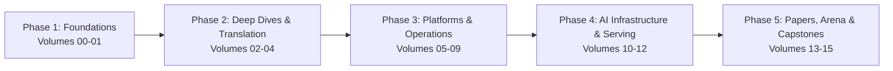
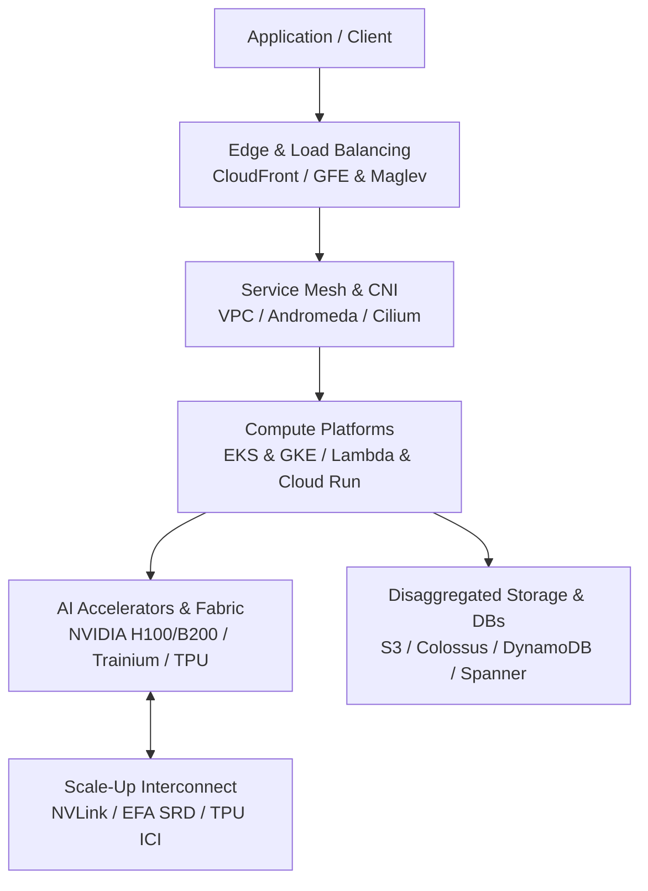

# Cloud AI Engineering: Zero to Godhood (AWS + GCP)

A first-principles, mechanism-first curriculum for cloud and AI infrastructure engineering across Amazon Web Services and Google Cloud.
The goal of this track is total engineering depth: taking a strong software engineer to the top-1% cloud AI infrastructure bar.
By the end of this curriculum, you will understand how cloud platforms operate beneath their public APIs, size and cost distributed systems on a whiteboard, architect multi-region AI systems on AWS and GCP, and defend trade-offs under staff-plus interview scrutiny.

## How this track is organized

Sixteen volumes organized into a rigorous five-phase dependency graph, followed by comprehensive reference appendices.

The first diagram outlines the curriculum progression.
The second diagram illustrates the layered hyperscale infrastructure stack deconstructed across every volume.
Each volume is an isolated directory containing structured chapter files.
Each chapter note is self-contained while building upon the foundational mechanisms established in preceding volumes.

| Volume | Title | Core Focus and Mechanisms |
|---|---|---|
| 00 | Foundations Under the Cloud | Nitro, Firecracker, gVisor, Clos fabrics, Jupiter, BGP, Anycast, storage physical media, failure domains |
| 01 | Cloud Architecture Principles | Static stability, cell-based architectures, shuffle sharding, control vs data plane, landing zones |
| 02 | AWS Deep Dive | IAM engine, Organizations, VPC, Nitro, Graviton, Lambda, ECS, EKS, S3, EBS, DynamoDB, Aurora, DSQL, MSK |
| 03 | GCP Deep Dive | Resource hierarchy, IAM, VPC Service Controls, Andromeda, GFEs, Maglev, GKE, Cloud Run, Spanner, BigQuery |
| 04 | AWS vs GCP Translation | Mechanism-level parity matrices, networking, storage, databases, analytics, multi-cloud reality |
| 05 | Kubernetes and Platform Engineering | Control loops, advanced scheduling, Cilium eBPF, Karpenter, multi-tenancy, IDPs, GitOps, service mesh |
| 06 | Infrastructure as Code and Delivery | Terraform/OpenTofu DAG, CDK/Pulumi, policy as code (OPA/Rego), state safety, progressive rollouts |
| 07 | Reliability and SRE | SLI/SLO math, load shedding, backpressure, retries with jitter, RTO/RPO math, public incident postmortems |
| 08 | Security and Data Perimeter | Zero trust, workload identity (IRSA/GKE WI), envelope encryption, supply chain (SLSA), data perimeters |
| 09 | FinOps and Cloud Economics | Cost allocation, commitment models (Savings Plans vs CUDs), Spot economics, egress tax, GPU/TPU unit costs |
| 10 | AI Infrastructure on Cloud | Accelerators (GPUs/Trainium/TPUs), fabrics (NVLink/EFA/ICI), clusters, distributed parallelism, checkpointing |
| 11 | LLM Serving on Cloud | Inference engines (vLLM/SGLang), PagedAttention, continuous batching, speculative decoding, Bedrock, Vertex |
| 12 | AI Applications and MLOps | Vector search engines, enterprise RAG, agent runtimes, pipeline orchestration, feature stores, AI security |
| 13 | Seminal Papers and Case Studies | Deep dives into 15 foundational papers: Dynamo, DynamoDB, Aurora, Physalia, Firecracker, Spanner, Borg, TPU |
| 14 | Staff+ Interview Arena | Five end-to-end design walkthroughs, cheat sheet numbers, certification roadmap, staff bar analysis |
| 15 | Capstones | Three end-to-end dual-cloud implementations in OpenTofu/Terraform with budget guardrails and teardown |

## Learning path

Phase 1 - Physical Foundations and Architecture (Volumes 00-01).
Understand the bare metal and hypervisor abstractions before designing distributed applications.
Learn how hyperscalers build virtualization, datacenter fabrics, and statically stable multi-zone topologies.

Phase 2 - Hyperscaler Internals and Translation (Volumes 02-04).
Master AWS and Google Cloud mechanisms at the data-plane level.
Translate every primitive between both clouds with rigorous architectural parity analysis.

Phase 3 - Platform Engineering, Delivery, SRE, and Security (Volumes 05-09).
Build resilient, automated platforms using Kubernetes, declarative IaC, and zero-trust security perimeters.
Master quantitative reliability engineering, fault injection, and unit-economics optimization.

Phase 4 - Cloud AI Infrastructure and Serving Systems (Volumes 10-12).
Scale training and inference across thousands of accelerators.
Deconstruct distributed parallelism, high-throughput network fabrics, vLLM internals, and production MLOps.

Phase 5 - Seminal Literature, Interview Arena, and Capstones (Volumes 13-15).
Read the seminal systems papers that defined modern cloud computing.
Drill staff-plus system designs under whiteboard constraints and execute production-ready dual-cloud capstones.

## Ground rules

Mechanism over marketing.
Never repeat high-level console tutorials or marketing summaries; explain the underlying data plane, protocols, and failure modes.
Numbers to know.
Quantify throughput, latency, limits, and cost in every chapter with dated, verified sources.
Runnable and costed.
Provide minimal, fully functional code or IaC configurations with explicit cost breakdowns and teardown commands.
Rigorous trade-off analysis.
State the disadvantages and failure modes of every architectural pattern.

## Conventions

Chapters use Markdown formatted with exactly one sentence per line.
Tables format wikilinks with escaped pipe aliases as `[[Note\|Alias]]`.
See [SUMMARY.md](./SUMMARY.md) for the complete chapter index and [STYLE.md](./STYLE.md) for detailed authoring specifications.

<!-- moc:start (generated by tools/build_mocs.py; edits inside are overwritten) -->
## Also in this folder

**Sections**

- [Appendices](Appendices/README.md)
- [Volume 00 Foundations Under the Cloud](Volume_00_Foundations_Under_the_Cloud/README.md)
- [Volume 01 Cloud Architecture Principles](Volume_01_Cloud_Architecture_Principles/README.md)
- [Volume 02 AWS Deep Dive](Volume_02_AWS_Deep_Dive/README.md)
- [Volume 03 GCP Deep Dive](Volume_03_GCP_Deep_Dive/README.md)
- [Volume 04 AWS vs GCP Translation](Volume_04_AWS_vs_GCP_Translation/README.md)
- [Volume 05 Kubernetes and Platform Engineering](Volume_05_Kubernetes_and_Platform_Engineering/README.md)
- [Volume 06 Infrastructure as Code and Delivery](Volume_06_Infrastructure_as_Code_and_Delivery/README.md)
- [Volume 07 Reliability and SRE](Volume_07_Reliability_and_SRE/README.md)
- [Volume 08 Security Identity and the Data Perimeter](Volume_08_Security_Identity_and_the_Data_Perimeter/README.md)
- [Volume 09 FinOps and Cloud Economics](Volume_09_FinOps_and_Cloud_Economics/README.md)
- [Volume 10 AI Infrastructure on Cloud](Volume_10_AI_Infrastructure_on_Cloud/README.md)
- [Volume 11 LLM Serving and Inference Systems on Cloud](Volume_11_LLM_Serving_and_Inference_Systems_on_Cloud/README.md)
- [Volume 12 AI Applications MLOps and Data Platforms](Volume_12_AI_Applications_MLOps_and_Data_Platforms/README.md)
- [Volume 13 Seminal Papers and Case Studies](Volume_13_Seminal_Papers_and_Case_Studies/README.md)
- [Volume 14 Staff Plus Interview Arena](Volume_14_Staff_Plus_Interview_Arena/README.md)
- [Volume 15 Capstones Production Systems](Volume_15_Capstones_Production_Systems/README.md)

<!-- moc:end -->
