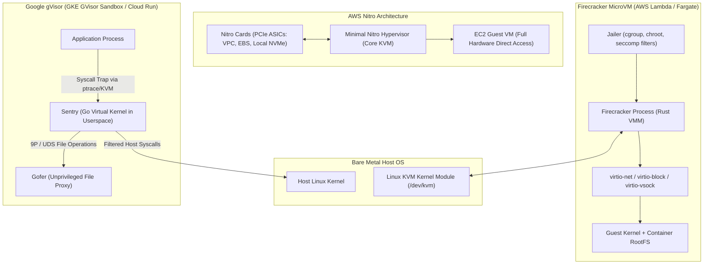

# Hypervisors, MicroVMs, and Sandboxing

## TL;DR

Modern multi-tenant cloud compute isolates untrusted workloads using hardware-assisted virtualization rather than bare OS-level container namespaces.
AWS Nitro offloads network, storage, security, and management subsystems to custom PCIe ASICs, dedicating 100% of host CPU and memory to guest virtual machines.
Firecracker delivers minimalist Linux KVM microVMs with a 5-millisecond startup time and a memory footprint under 5 MiB by stripping legacy PC devices down to `virtio-net`, `virtio-block`, `virtio-vsock`, and minimal serial console.
Google gVisor intercepts Linux system calls in unprivileged user space via a Go-based virtual kernel (`Sentry`), preventing host kernel exploits at the expense of syscall latency.
Container orchestration platforms trace directly from Google Borg's cgroups and chroot primitives to modern OCI runtimes where runc, Kata Containers, and gVisor provide tiered isolation.

## Mental Model

Virtualization isolation mechanisms operate along a strict trade-off spectrum balancing startup latency and memory overhead against kernel attack surface.



Traditional hypervisors emulate complete IBM PC hardware peripherals including IDE controllers, floppy drives, and PCI buses.
MicroVMs eliminate all legacy emulation, implementing only modern paravirtualized virtio interfaces directly over KVM memory mappings.
gVisor eliminates guest kernels entirely by re-implementing Linux system call semantics in user space, acting as an application-level proxy filter.

## Internals

### The Evolution of Cloud Virtualization

Early cloud virtualization relied on software emulation and paravirtualization (Xen dom0 architecture).
In Xen dom0, all storage and network I/O from guest domains (domU) passed through a privileged management virtual machine (dom0).
This architecture created two major bottlenecks: CPU contention between customer workloads and host management tasks, and a massive hypervisor attack surface exposed through complex device emulation in QEMU.

### AWS Nitro Architecture

Announced in 2017, the AWS Nitro System completely re-architected host virtualization by offloading every non-compute hypervisor responsibility to dedicated hardware cards connected via PCIe:

1. Nitro Card for VPC: A dedicated ASIC that executes VPC encapsulation (Geneve / VXLAN), security groups, route table lookups, and elastic network interface (ENI) hardware virtualization.
2. Nitro Card for EBS: A custom PCIe controller that presents NVMe block storage to the host CPU while executing encryption, volume snapshotting, and EBS distributed storage protocol communication.
3. Nitro Card for Storage: Manages local NVMe SSD drives and handles data scrubbing and RAID controller offloading.
4. Nitro Security Chip: Physically soldered onto the motherboard to control host hardware boot sequences, enforce cryptographic firmware measurement, and prevent unauthorized BIOS modifications.
5. Nitro Hypervisor: A stripped-down, core-based hypervisor derived from Linux KVM.
It performs basic CPU thread scheduling and memory address virtualization (Extended Page Tables / EPT), bypassing host OS overhead entirely.

Because all I/O is routed through hardware ASICs via Single Root I/O Virtualization (SR-IOV), modern EC2 instances achieve virtually 100% of bare-metal CPU, memory, and PCIe bandwidth performance.

### Firecracker MicroVM Internals

Built by AWS in Rust and open-sourced in 2018, Firecracker powers AWS Lambda and AWS Fargate multi-tenant execution.
Firecracker communicates directly with the Linux Kernel-based Virtual Machine (`/dev/kvm`) ioctl API.

Key architecture constraints:
- Stripped Device Model: Firecracker supports exactly five devices: `virtio-net`, `virtio-block`, `virtio-vsock`, a serial console, and a minimal 1-button keyboard controller used solely by ACPI for guest resets.
It has no PCI bus, no ACPI power states beyond reset, and no IDE/SATA/USB controllers.
- Memory Overcommit and Density: Because memory is allocated via anonymous mmap in the host process, thousands of microVMs can share physical host RAM with sub-5 MiB overhead per VM.
- The Jailer Sandbox: Before launching the virtual machine monitor (VMM), a privileged binary named `jailer` executes.
The jailer drops root privileges, configures strict Linux cgroups (CPU, memory, blkio), isolates the filesystem in an empty `chroot` jail, enters a dedicated network and PID namespace, and installs a strict `seccomp-bpf` filter that denies all unnecessary host system calls.
- Fast Boot Mechanics: A standard Linux kernel image is booted directly using the x86 64-bit boot protocol (`bzImage`), bypassing real-mode BIOS, GRUB, and option ROM loading.
This achieves guest kernel boot to user space in under 5 milliseconds.

### Google gVisor Architecture

Open-sourced by Google in 2018, gVisor powers Google Cloud Run, GKE Sandbox, and Google App Engine flexible environment.
Unlike hypervisors that create hardware abstraction boundaries, gVisor implements a user-space kernel called `Sentry`.

Key mechanisms:
- Syscall Interception: The application binary runs unchanged in user space.
Whenever it issues an `int 0x80`, `syscall`, or `sysenter` instruction, gVisor intercepts the instruction before it touches the host Linux kernel.
gVisor uses either `ptrace` (universal compatibility) or a custom KVM virtualization platform (higher performance) to trap system calls.
- The Sentry: A complete user-space operating system kernel written in memory-safe Go.
The Sentry implements over 300 Linux syscalls, memory management, signals, and a full TCP/IP network stack (Netstack).
- The Gofer File Proxy: The Sentry runs with zero host filesystem permissions.
Any filesystem operation (such as `open`, `stat`, or `unlink`) is serialized and sent over a Unix Domain Socket to an unprivileged companion process called the `Gofer`, which validates file access rules before executing the operation on the host.
- Attack Surface Reduction: A standard Linux kernel exposes over 400 syscalls and thousands of device drivers to user space.
gVisor reduces the host kernel attack surface down to approximately 20 heavily restricted host syscalls, preventing container breakout exploits (such as Dirty COW or CVE-2024-21626) from compromising the underlying physical node.

### Borg to Kubernetes Container Lineage

The concept of containerization traces directly to Google internal infrastructure:
- 2006: Google engineers Paul Menage and Rohit Seth author "Process Containers", later renamed to Control Groups (`cgroups`) and merged into Linux kernel 2.6.24.
- 2007-2015: Google runs all internal workloads (search, web server, Gmail) inside Borg, an automated cluster manager orchestrating jobs isolated by cgroups, Linux namespaces (PID, mount, network, IPC, UTS), and chroot.
- 2014-2015: Google open-sources Kubernetes, standardizing the Borg controller pattern, declarative reconciliation loops, and pod abstractions.
- 2016-Present: The Open Container Initiative (OCI) standardizes runtime specifications (`runc`) and image formats, enabling pluggable runtimes like Kata Containers (QEMU/Cloud-Hypervisor) and gVisor (`runsc`).

## Numbers to Know

| Metric | AWS Nitro EC2 | Firecracker MicroVM | Google gVisor (`runsc`) | Standard Container (`runc`) | Sourced As-Of |
|---|---|---|---|---|---|
| Startup Time | 10 to 30 seconds | 5 to 15 milliseconds | 50 to 150 milliseconds | 50 to 200 milliseconds | Official benchmarks (as of 2026-10) |
| Memory Overhead per Instance | Dedicated host slice | Less than 5 MiB | 15 to 30 MiB | Less than 1 MiB | NSDI paper / gVisor docs (as of 2026-10) |
| Max Instances per Physical Host | Hundreds (NUMA bounded) | Up to 4,000+ per host | Thousands | Thousands | AWS re:Invent / Google docs (as of 2026-10) |
| Syscall Latency Overhead | 0% (Bare-metal direct) | Less than 1% (VT-x EPT) | 2x to 10x for trapped calls | 0% (Native kernel calls) | NSDI 2020 / USENIX ATC (as of 2026-10) |
| Network Throughput Cap | Up to 100 Gbps (SR-IOV) | Up to 10 Gbps (virtio) | Bounded by user-space Netstack | Line-rate host networking | AWS EC2 specs / GCP docs (as of 2026-10) |
| Host Syscalls Exposed | Zero (Isolated by ASIC) | ~20 (Strict seccomp filter) | ~20 (Host kernel barrier) | 300+ (Direct host kernel) | AWS / Google security whitepapers (as of 2026-10) |

## AWS vs GCP Mechanism Parity

| Mechanism / Dimension | Amazon Web Services | Google Cloud Platform | Architectural Difference |
|---|---|---|---|
| Hardware Virtualization Offload | AWS Nitro System (Nitro Cards for VPC, EBS, NVMe, Security Chip) | Google Titanium (Titanium PCIe offload engines and custom ASICs) | Nitro uses dedicated modular cards per subsystem; Titanium integrates networking, security, and storage acceleration into unified hardware controllers. |
| Serverless Isolation Engine | Firecracker (MicroVMs running over KVM in Rust) | gVisor (`runsc` user-space kernel in Go) | AWS isolates each Lambda/Fargate task in a complete hardware-isolated KVM microVM; GCP isolates Cloud Run in a user-space Go syscall emulator. |
| Kubernetes Sandboxing | EKS with Kata Containers or Nitro Enclaves | GKE Sandbox (native integrated gVisor node pools) | GKE provides native first-class node pool configuration with `sandbox.gke.io/type: gvisor`; AWS requires custom AMI/daemonset setup for Kata. |
| Secure Enclaves | AWS Nitro Enclaves (Isolated CPU/memory slice with no network/storage) | GCP Confidential Computing (AMD SEV / Intel TDX hardware memory encryption) | Nitro Enclaves isolate cryptographic tasks via local vsock to parent EC2; GCP encrypts hypervisor-accessible memory in hardware. |
| Container Runtimes | containerd with runc / Firecracker | containerd with runc / runsc | AWS defaults to standard runc with EC2 isolation; GCP leverages runsc across multi-tenant serverless tiers. |

## Worked Example: Capacity Sizing and MicroVM Cost Modeling

Consider a high-throughput webhook processing service requiring 10,000 concurrent execution sandboxes.
Each sandbox processes untrusted third-party Python code.
We compare running these tasks on AWS Lambda (Firecracker) versus GKE Standard with gVisor (`runsc`) versus dedicated EC2 Nitro instances.

### Capacity Calculations

1. Workload Parameters:
   - Concurrency: 10,000 concurrent sandboxes.
   - Allocated memory per sandbox: 512 MiB.
   - Average execution duration: 200 milliseconds.
   - Invocation rate: 50,000 requests per second.
   - Aggregate active memory: `10,000 * 512 MiB = 5,120,000 MiB = 5,000 GiB (5 TiB)`.

2. Option A: AWS Lambda (Firecracker Serverless):
   - Memory allocation: 512 MiB per execution.
   - Monthly compute seconds: `50,000 req/s * 0.2 s * 86,400 s/day * 30 days = 25,920,000,000 GB-seconds` (with 0.5 GB allocated per request = `12,960,000,000 GB-s`).
   - Lambda pricing (us-east-1, x86, as of 2026-10): $0.0000166667 per GB-second + $0.20 per million requests.
   - Compute cost: `12,960,000,000 * $0.0000166667 = $216,000.43 / month`.
   - Request cost: `(50,000 * 86,400 * 30 / 1,000,000) * $0.20 = 129,600 * $0.20 = $25,920.00 / month`.
   - Total Lambda cost: ~$241,920.43 per month.

3. Option B: Self-Managed GKE Cluster with gVisor (`runsc`):
   - Node instance type: `n2-standard-32` (32 vCPUs, 128 GiB RAM).
   - Usable RAM per node after OS and GKE daemon reservations: ~120 GiB.
   - Sandboxes per node: `120 GiB / 0.512 GiB = ~234 sandboxes per node`.
   - Nodes required for 10,000 concurrent sandboxes: `ceil(10,000 / 234) = 43 nodes`.
   - Add 20% headroom for bin-packing and rolling updates: `ceil(43 * 1.2) = 52 nodes`.
   - GCE `n2-standard-32` on-demand cost (us-central1, as of 2026-10): ~$1.554 per hour.
   - Total GKE compute cost: `52 nodes * $1.554/hr * 730 hrs/month = $58,989.84 / month`.
   - Cluster management fee: $0.10/hr = $73.00 / month.
   - Total GKE cost: ~$59,062.84 per month.
   - Engineering trade-off: GKE with gVisor saves ~$182,000/month over Lambda at sustained 50k req/s, but introduces cluster maintenance, patching, and syscall overhead.

### Runnable OpenTofu / Terraform Configuration: GKE Sandbox Node Pool

```hcl
# main.tf - Production GKE Cluster with gVisor Sandbox Enabled
terraform {
  required_version = ">= 1.6.0"
  required_providers {
    google = {
      source  = "hashicorp/google"
      version = "~> 6.0"
    }
  }
}

provider "google" {
  project = var.project_id
  region  = var.region
}

variable "project_id" {
  type        = string
  description = "Target Google Cloud Project ID"
}

variable "region" {
  type        = string
  default     = "us-central1"
  description = "GCP Region for cluster deployment"
}

resource "google_container_cluster" "sandbox_cluster" {
  name     = "cloud-ai-sandbox-cluster"
  location = "${var.region}-a"

  # We remove the default node pool and allocate dedicated pools below
  remove_default_node_pool = true
  initial_node_count       = 1

  network    = "default"
  subnetwork = "default"

  ip_allocation_policy {}

  workload_identity_config {
    workload_pool = "${var.project_id}.svc.id.goog"
  }

  deletion_protection = false
}

resource "google_container_node_pool" "gvisor_pool" {
  name       = "gvisor-sandbox-pool"
  location   = "${var.region}-a"
  cluster    = google_container_cluster.sandbox_cluster.name
  node_count = 2

  node_config {
    machine_type = "n2-standard-4"
    oauth_scopes = [
      "https://www.googleapis.com/auth/cloud-platform"
    ]

    # Enable gVisor runtime on this node pool
    sandbox_config {
      sandbox_type = "gvisor"
    }

    labels = {
      sandbox = "gvisor"
    }

    metadata = {
      disable-legacy-endpoints = "true"
    }
  }

  management {
    auto_repair  = true
    auto_upgrade = true
  }
}

# Teardown Command:
# tofu destroy -auto-approve -var="project_id=YOUR_PROJECT_ID"
```

## Failure Modes and Pitfalls

### Pitfall 1: gVisor Syscall Bottlenecks on I/O-Intensive Workloads
Applications performing heavy local disk I/O, rapid socket polling, or frequent small file operations (`stat`, `read`, `write`, `epoll_ctl`) degrade severely under gVisor.
Because every syscall traps to the Sentry in user space and file operations route through the Gofer proxy via IPC, I/O-bound microservices can suffer a 3x to 10x throughput degradation compared to native `runc`.
Mitigation: Profile workloads with `strace` prior to sandboxing.
Use Firecracker microVMs or native hardware virtualization if syscall density exceeds 50,000 syscalls per second per thread.

### Pitfall 2: Firecracker Vsock Starvation and Connection Leaks
Firecracker guest-to-host communication relies on AF_VSOCK (virtual socket address family).
If the guest runtime crashes or host monitoring agents fail to drain vsock buffers, the host VMM process exhausts epoll file descriptors.
Subsequent microVM launches fail silently with `EADDRINUSE` or host out-of-memory panics.
Mitigation: Enforce hard execution timeouts at the supervisor layer and terminate runaway microVM processes using `SIGKILL` on the parent Firecracker PID.

### Pitfall 3: Linux cgroup v1 vs v2 Freezing Deadlocks
Early multi-tenant container platforms running on cgroup v1 suffered from severe race conditions during OOM kills.
When a container hit its `memory.limit_in_bytes`, the host kernel attempted to invoke the OOM killer while tasks inside the container were frozen by monitoring agents, causing uninterruptible sleep (D state) processes that could only be cleared by rebooting the physical host.
Mitigation: Mandate cgroup v2 unified hierarchy across all host AMIs.
cgroup v2 supports atomic `cgroup.kill` and clean memory controller reclamation.

## Security and Cost Angles

- IAM and Compute Instance Profiles: Never run Firecracker or container runtimes with direct host IAM credentials.
In multi-tenant systems, guest instances must receive ephemeral credentials via AWS STS AssumeRoleWithWebIdentity or GCP Workload Identity Federation injected via local loopback metadata proxies.
- Metadata Service (IMDSv2) Exploitation: In untrusted container execution environments, a rogue guest can attempt to query the host instance metadata service (`http://169.254.169.254`).
Always mandate IMDSv2 with `HttpTokens: required` and set `HttpPutResponseHopLimit: 1` on EC2 nodes, preventing bridge-networked containers from harvesting host IAM role credentials.
- Unit Economics Lever: Serverless platforms charge for elapsed wall-clock execution time.
Cold starts (loading rootfs and initializing runtimes) represent pure unrecoverable cloud spend.
By adopting Firecracker's snapshot-restore capabilities (similar to AWS Lambda SnapStart), teams reduce microVM startup from 250 milliseconds down to sub-15 milliseconds, driving down cold-start latency percentiles and eliminating idle CPU billing.

## Interview Questions and Model Answers

### Question 1 (L5 - Senior)
Why does AWS Lambda utilize Firecracker microVMs rather than standard Docker containers (`runc`) for multi-tenant isolation?

#### Model Answer
Standard Docker containers share the host Linux kernel.
Isolation is enforced purely via software abstractions: kernel namespaces (PID, mount, network, user) and control groups (cgroups).
Because all containers share the single host kernel, any kernel privilege escalation exploit or zero-day vulnerability (such as a local privilege escalation bug in the eBPF subsystem or dirty COW in copy-on-write page tables) grants the container root access to the entire host and all co-located customer workloads.
Firecracker utilizes the Linux KVM hypervisor module to provide true hardware-assisted virtualization (Intel VT-x / AMD-V).
Each customer function executes within its own dedicated guest Linux kernel and memory address space isolated by hardware Extended Page Tables (EPT).
Firecracker strips legacy PC devices to eliminate QEMU-style device emulation vulnerabilities and wraps the process in a strict seccomp-bpf jailer, ensuring multi-tenant security guarantees that survive guest kernel compromise.

#### Follow-up Interviewer Question
What is the memory and boot-time penalty Lambda pays for hardware-assisted isolation compared to a container fork?

### Question 2 (L6 - Staff)
Compare the architectural mechanisms and performance trade-offs of AWS Nitro hypervisor offload versus Google Titanium.

#### Model Answer
Both AWS Nitro and Google Titanium solve the "hypervisor tax" problem where host CPU cores and memory are stolen from customer instances to manage networking, storage, and security.
AWS Nitro decomposes host responsibilities into specialized, modular PCIe cards: the Nitro Card for VPC executes packet encapsulation and security groups; the Nitro Card for EBS exposes an NVMe controller over PCIe and speaks EBS protocols over the storage network; and the Nitro Security Chip controls secure boot.
This leaves a minimal hypervisor on the host CPU doing only vCPU scheduling and memory virtualization.
Google Titanium consolidates network packet processing, local storage offload, and security attestation into custom System-on-Chip (SoC) accelerators.
Titanium offloads Andromeda virtual network routing directly into hardware flow tables and communicates directly with Google's Colossus distributed storage fabric over specialized network protocols.
The primary operational difference lies in flexibility: Nitro's modular PCIe architecture allows AWS to upgrade storage or network controllers independently across server generations, whereas Google Titanium is deeply coupled with Google's unified Andromeda SDN and Borg cluster fabric.

#### Follow-up Interviewer Question
How does SR-IOV enable near-line-rate packet processing inside an EC2 instance without burning host CPU cycles on context switches?

### Question 3 (L7+ - Principal)
Design a multi-tenant code-execution sandbox platform capable of running 100,000 untrusted user submissions per minute with a strict p99 execution start SLA under 50 milliseconds. Defend your choice of virtualization technology, lifecycle management, and security boundaries.

#### Model Answer
Architectural Blueprint:
1. Isolation Primitive: Firecracker MicroVMs over bare-metal AWS EC2 `i3en.metal` or GCP `c2-standard` bare-metal nodes.
We explicitly reject standard `runc` containers due to shared kernel exploit risk.
We reject gVisor because arbitrary user code (compilers, package managers) issues heavy system call sequences that trigger severe Sentry/Gofer serialization bottlenecks.
2. Pool Pre-Warming and Snapshotting: Booting a microVM from scratch takes ~10 milliseconds, but initializing Python/Node.js runtimes takes 100 to 500 milliseconds.
We maintain a pre-warmed pool of microVMs booted to a snapshot-ready state using Firecracker's snapshot create/resume API.
A local host-daemon agent resumes paused microVM memory snapshots in ~5 milliseconds via memory-mapped cow files (`copy-on-write`), guaranteeing the sub-50ms p99 SLA.
3. Network and Security Perimeters:
   - Guest network interfaces attach to host tap devices isolated in per-submission network namespaces with zero default routing.
   - Host IMDS access is completely blocked at the iptables PREROUTING chain on the host.
   - MicroVMs run inside ephemeral `jailer` cgroups with CPU quotas (e.g., 2 vCPUs) and hard memory boundaries (512 MiB).
   - Writeable scratch filesystems use ephemeral ramdisks (`tmpfs`) to prevent disk I/O bottlenecks and eliminate residual state leaks between customer runs.
4. Fleet Placement and Autoscaling: A distributed orchestrator schedules submissions across bare-metal workers using consistent hashing with bounded loads to prevent thundering herds on individual nodes.
When a worker node reaches 80% RAM capacity, the scheduler spills traffic to warm standby nodes.

#### Follow-up Interviewer Question
If an adversary submits code designed to trigger an architectural CPU side-channel exploit (e.g., Spectre / Meltdown / Downfall), how does your design prevent cross-VM information leakage across tenant sandboxes sharing physical CPU cores?

## Further Reading

- [Firecracker: Lightweight Virtualization for Serverless Applications (NSDI 2020)](https://www.usenix.org/conference/nsdi20/presentation/agache) - The seminal AWS paper detailing Firecracker design, device model reduction, and security boundaries.
- [Borg, Omega, and Kubernetes (ACM Queue 2016)](https://queue.acm.org/detail.cfm?id=2898444) - Google systems engineers describe ten years of container orchestration experience inside Borg and its translation to Kubernetes.
- [AWS Nitro System Architecture Whitepaper](https://docs.aws.amazon.com/whitepapers/latest/aws-nitro-system/aws-nitro-system.html) - Official technical breakdown of Nitro Cards, the Nitro Security Chip, and hypervisor offloading.
- [gVisor Architecture and Sandbox Principles](https://gvisor.dev/docs/architecture_guide/) - Deep dive into Sentry syscall interception, Gofer proxy isolation, and memory-safe kernel emulation.
