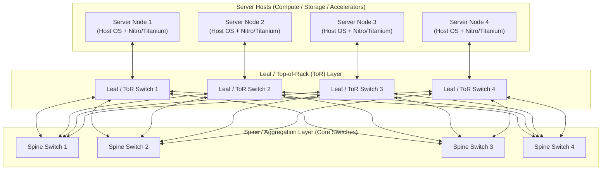

# Datacenter Networking Fabrics

## TL;DR

Hyperscale cloud networks eliminate traditional tree bottlenecks by constructing multi-tier, non-blocking Clos switching fabrics where bisection bandwidth scales linearly with the number of commodity switches.
Google Jupiter evolved from a merchant-silicon electrical Clos to a direct-connect topology among aggregation blocks, interconnected by MEMS-mirror Optical Circuit Switches (OCS) that reconfigure block-to-block capacity without optical-to-electrical conversion.
AWS constructs redundant 100GbE and 400GbE multi-stage spine-and-leaf Clos networks integrated with custom Nitro networking ASICs to offload packet parsing and security filtering at line rate.
Equal-Cost Multi-Path (ECMP) hashes the packet 5-tuple across parallel paths, requiring flowlet switching or modern packet-spraying protocols to eliminate hash collisions and polarization hot-spots.
In high-throughput AI and analytics workloads, traditional TCP incast and packet loss trigger severe tail latency spikes, driving hyperscalers toward multi-path transport protocols like AWS Scalable Reliable Datagram (SRD) and custom congestion control.

## Mental Model

Modern datacenter fabrics fold multi-stage Clos networks into spine-and-leaf architectures where every leaf switch connects to every spine switch, guaranteeing uniform latency and equal-cost multi-pathing between any two server racks.



In a traditional hierarchical enterprise network, traffic between servers on different access switches passes through core routers that oversubscribe bandwidth by 10:1 or 100:1.
In a non-blocking Clos fabric, the aggregate upward bandwidth from the leaf layer matches or exceeds the downward capacity, allowing every server to transmit to any other server at full physical line rate simultaneously.

## Internals

### The Geometry of Clos Fabrics

Proposed by Charles Clos in 1953 for telephone exchange switching, Clos networks enable high-capacity crossbar connectivity using small, inexpensive switching units.
A 3-stage Clos network connects $r$ input stages of $n \times m$ crossbars to $m$ intermediate stages of $r \times r$ crossbars, which connect to $r$ output stages of $m \times n$ crossbars.
When generalized to datacenter topologies:
- Top-of-Rack (ToR / Leaf) Switches: Sit at the top of physical racks, connecting host network interface cards (NICs) via downlinks (e.g., 25GbE/100GbE) and connecting to aggregation switches via uplinks (e.g., 100GbE/400GbE).
- Spine (Aggregation) Switches: Interconnect all ToR switches.
Because every leaf switch connects to every spine switch, traffic between any two servers in the same two-tier fabric traverses at most three switch hops (Host $\rightarrow$ ToR $\rightarrow$ Spine $\rightarrow$ Destination ToR $\rightarrow$ Destination Host).
- Bisection Bandwidth: The minimum bandwidth across the cut when the network is divided into two equal halves.
A network is "full-bisection non-blocking" when the bisection bandwidth equals the sum of bandwidth of half the connected nodes.

### Google Jupiter Network Evolution

Google documented its datacenter network evolution across two landmark SIGCOMM papers (2015 and 2022):

1. Jupiter Rising (2015): Replaced commercial chassis switches with merchant silicon switching chips arranged in a hierarchical Clos topology.
The Jupiter topology is built from ToR switches, aggregation blocks, and spine blocks, and a full Jupiter fabric supports 1.3 Pbps of bisection bandwidth.
Routing used Firepath, Google's own intra-cluster routing protocol, rather than OpenFlow or a standard IGP: redundant Firepath masters on a subset of spine switches collect and redistribute global link state (centralized topology state distribution), while a Firepath client on every switch computes its own ECMP forwarding tables (distributed route computation).
Standard eBGP runs only at the fabric edge, between Cluster Border Routers and external peers, with BGP-learned routes redistributed through Firepath.

2. Jupiter Evolving (2022): Electrical packet switches require optical-to-electrical-to-optical (OEO) conversions at every switch port, dissipating massive power at 400G and 800G line rates.
Google introduced custom Optical Circuit Switches (OCS), named "Palomar".
An OCS uses micro-electro-mechanical system (MEMS) 2D mirror arrays to directly reflect optical light beams from input fibers to output fibers without decoding packets.
The OCS layer replaced the spine blocks entirely: aggregation blocks connect directly to each other through OCS-provisioned links (a direct-connect topology rather than a Clos).
Because optical switching is wavelength-agnostic and protocol-agnostic, Google upgrades line rates from 100G to 800G without replacing the physical core OCS fabric.
Two centralized SDN loops run on different timescales: topology engineering reconfigures OCS cross-connects infrequently to match the slowly changing block-level traffic matrix, while traffic engineering continuously splits traffic (WCMP) in the electrical aggregation-block switches over direct and one-intermediate-block transit paths.
The paper reports about 60% of traffic on the direct path, an average block-level path length of 1.4, 5x higher speed and capacity, 30% lower capex, 41% lower power, and 3x faster fabric reconfiguration than the earlier patch-panel Clos.

### AWS Datacenter Network Architecture

AWS constructs custom network hardware from the ground up:
- Custom Network Hardware: AWS builds its own switches around merchant switching silicon, running internal network operating systems based on Linux, stripping out unused enterprise features (STP, legacy RIP) to maximize packet throughput.
- Redundant Regional Backbones: An AWS region comprises multiple physically distinct Availability Zones linked over fully redundant, dedicated metro fiber, with all traffic between AZs encrypted (AWS docs, as of 2026-10).
AZs are many kilometers apart but within 100 km of each other, which bounds fiber propagation to roughly 0.5 ms one way (about 5 microseconds per km), and AWS states the latency is low enough for synchronous replication (AWS docs, as of 2026-10).
- Scalable Reliable Datagram (SRD): Standard TCP suffers from head-of-line blocking: if one packet is dropped, the entire stream stalls while waiting for retransmission.
AWS designed SRD, a specialized transport protocol implemented directly inside Nitro Card ASICs.
SRD sprays the packets of a single flow across many ECMP network paths simultaneously (packet spraying) and retransmits lost packets from the Nitro card far faster than a kernel TCP retransmission timeout.
SRD provides reliable but not in-order delivery: packets reach the destination out of order and SRD does not reorder them, leaving any ordering to upper layers (the EFA libfabric provider or the application), so a single loss never stalls unrelated messages.
ENA Express, which carries ordinary TCP/UDP over SRD, reorders packets on the receiving side by default so the guest TCP stack sees in-order delivery (AWS EC2 docs, as of 2026-10).
SRD measures per-path round-trip times and steers packets away from congested paths, reducing tail-latency outliers in Amazon EBS and EFA (Elastic Fabric Adapter).

### Routing Protocols, Anycast, and ECMP Hashing

Within a modern cloud fabric, physical routing balances stability against load distribution:
- BGP (Border Gateway Protocol) at Scale: Many operators run eBGP (External BGP) between Clos tiers as the only routing protocol (RFC 7938); Google is the notable exception, using Firepath inside the fabric.
In the RFC 7938 design all spine switches share one Autonomous System Number (ASN) and each leaf/ToR gets its own private ASN, so AS-Path loop prevention naturally stops routing loops.
- Equal-Cost Multi-Path (ECMP): When a switch has multiple parallel links to the next tier with identical routing cost, it distributes packets using a hash of the packet header:
$$\text{Path Index} = \text{Hash}(\text{Src IP}, \text{Dst IP}, \text{Src Port}, \text{Dst Port}, \text{Protocol}) \pmod N$$
- Hash Polarization (The Congestion Trap): If two consecutive switch tiers use the exact same hashing algorithm and seed, traffic that hashes to link $k$ at Tier 1 will hash to the exact same relative link at Tier 2.
This causes severe imbalance where certain links run at 100% capacity while adjacent links sit idle.
Hyperscalers eliminate polarization by using unique polynomial hash seeds (e.g., CRC-32 with varied polynomials or MurmurHash3) at each switch layer.
- Flowlet Switching: Rather than hashing individual packets (which causes TCP out-of-order delivery) or individual flows (which causes elephant flow collisions), flowlet switching identifies bursts of packets separated by idle intervals greater than the network delay difference.
Each burst ("flowlet") is safely routed over a different path without reordering packets inside the receiver's TCP window.

## Numbers to Know

| Parameter / Metric | Enterprise Legacy Fabric | AWS Datacenter Fabric | Google Jupiter Fabric | Sourced As-Of |
|---|---|---|---|---|
| Fabric Architecture | 3-tier oversubscribed tree | Multi-tier non-blocking Clos | Optical Circuit Switched Clos | SIGCOMM / re:Invent (as of 2026-10) |
| Intra-AZ Round-Trip Latency | 500 to 2,000 microseconds | Less than 100 microseconds (Nitro) | Less than 100 microseconds (Titanium) | Cloud latency audits (as of 2026-10) |
| Inter-AZ Speed-of-Light RTT | N/A | No published figure; AZs within 100 km, so fiber propagation RTT is at most about 1 ms | No published SLA figure; measure with the Network Intelligence Center Performance Dashboard | AWS docs / Google Cloud docs (as of 2026-10) |
| Host Link Speeds | 10 GbE to 25 GbE | Up to 200 Gbps ENA on network-optimized types; up to 3,200 Gbps EFA on P5 | Up to 200 Gbps per VM with Tier_1 networking; up to 3,200 Gbps GPU networking on A3 Ultra | EC2 / GCE instance specs (as of 2026-10) |
| Bisection Bandwidth Capacity | 100 Gbps to 10 Tbps | Multi-Petabit per second | 1.3 Pbps per fabric in 2015 (Jupiter Rising); greater than 6 Petabits per second today | Google SIGCOMM 2015 / Google Cloud blog 2022 (as of 2026-10) |
| Packet Loss Rate in Fabric | 0.1% to 1.0% | Less than 0.001% (SRD multipath) | Less than 0.001% (SDN traffic eng) | UNVERIFIED (no primary source found, as of 2026-10) |

## AWS vs GCP Mechanism Parity

| Mechanism | Amazon Web Services | Google Cloud Platform | Architectural Difference |
|---|---|---|---|
| Core Fabric Technology | Massive electrical Clos fabric with custom switches on merchant silicon and Nitro offload | Direct-connect aggregation blocks over Optical Circuit Switching (OCS Palomar) with SDN control | Google uses MEMS optical mirrors to reconfigure block-to-block capacity; AWS relies on massive, static over-provisioned electrical Clos fabrics. |
| Multi-Path Transport | Scalable Reliable Datagram (SRD) in hardware (Nitro EFA) | Falcon / Swift congestion control with hardware packet pacing | AWS bypasses TCP using packet spraying across ECMP paths with out-of-order delivery left to libfabric (EFA) or reordered on receive (ENA Express); GCP optimizes TCP/UDP using Andromeda and custom kernel/Titanium congestion control algorithms. |
| Datacenter SDN Controller | Decentralized eBGP with localized route controllers | Centralized SDN (Orion, NSDI 2021, which controls Jupiter and B4) driving traffic and topology engineering | AWS prioritizes decentralized blast-radius containment using standard eBGP peering; Google prioritizes global programmatic traffic efficiency via centralized SDN. |
| High-Performance Interconnect | Elastic Fabric Adapter (EFA) for EC2 | Fast Socket / Cloud TPU Optical Circuit Switching | AWS EFA exposes an OS-bypass userspace interface (libfabric); GCP exposes high-performance networking via Andromeda Datapath V2 and direct TPU 3D-Torus optical fabrics. |

## Worked Example: Capacity Sizing and Bisection Bandwidth Math

Consider sizing the network fabric for a 1,024-node GPU training cluster.
Each node contains 8 NVIDIA H100 GPUs and 400 Gbps of dedicated network bandwidth.
We calculate total bisection bandwidth, leaf-to-spine link counts, and network infrastructure cost.

### Capacity Calculations

1. Total Host Bandwidth:
   - Node count: 1,024 hosts.
   - Host network capacity: 400 Gbps (full-duplex).
   - Total host injection bandwidth: `1,024 * 400 Gbps = 409,600 Gbps = 409.6 Tbps`.

2. Clos Fabric Sizing (Non-Blocking 1:1 Oversubscription):
   - Switch hardware: 64-port 400GbE (25.6 Tbps) QSFP-DD merchant silicon switches.
   - Scale check: a non-blocking 2-tier leaf-spine of k-port switches supports at most `k^2 / 2` hosts, so 32-port switches cap at 512 hosts and 64-port switches cap at `64^2 / 2 = 2,048` hosts, enough for 1,024.
   - Leaf (ToR) Switch Allocation:
     - Each ToR connects 32 hosts via downlinks: `32 * 400 Gbps = 12.8 Tbps`.
     - Each ToR provides 32 uplinks to the spine layer: `32 * 400 Gbps = 12.8 Tbps`.
     - Downlink to uplink oversubscription ratio: `32 : 32 = 1:1` (Strictly non-blocking).
     - Total Leaf switches required: `1,024 hosts / 32 hosts-per-switch = 32 Leaf switches`.
   - Spine Switch Allocation:
     - Total leaf uplinks needing termination: `32 Leaf switches * 32 uplinks = 1,024 uplinks`.
     - Ports per spine switch: 64 ports (400GbE).
     - Spine switches required: `1,024 uplinks / 64 ports = 16 Spine switches`.
     - Each leaf therefore runs 2 parallel links to each of the 16 spines (`32 uplinks / 16 spines`), and each spine terminates 2 links from each of the 32 leaves (`32 * 2 = 64 ports`).
   - Total Switch Count: `32 Leaf + 16 Spine = 48 switches`.
   - Total Bisection Bandwidth: `Half of nodes * 400 Gbps = 512 * 400 Gbps = 204.8 Tbps`.

3. Interconnect Cable Sizing:
   - Host-to-Leaf cables: 1,024 active optical cables (400G AOC).
   - Leaf-to-Spine cables: 1,024 active optical cables (400G AOC).
   - Total 400G optical links: 2,048 cables.

### Infrastructure Deployment: AWS VPC with Placement Group for Non-Blocking Fabric

To pack instances close together inside one AZ for the lowest latency and highest per-flow throughput (a placement group does not guarantee a non-blocking path), we provision EC2 instances inside a `cluster` placement group using OpenTofu / Terraform:

```hcl
# network_fabric.tf - Non-blocking cluster placement group
terraform {
  required_version = ">= 1.6.0"
  required_providers {
    aws = {
      source  = "hashicorp/aws"
      version = "~> 5.0"
    }
  }
}

provider "aws" {
  region = "us-east-1"
}

# Cluster placement group packs instances together inside a single AZ Clos switch tier
resource "aws_placement_group" "ai_cluster_pg" {
  name     = "cloud-ai-clos-cluster-pg"
  strategy = "cluster"
}

resource "aws_vpc" "ai_vpc" {
  cidr_block           = "10.0.0.0/16"
  enable_dns_hostnames = true
  enable_dns_support   = true

  tags = {
    Name = "cloud-ai-high-perf-vpc"
  }
}

resource "aws_subnet" "ai_subnet" {
  vpc_id            = aws_vpc.ai_vpc.id
  cidr_block        = "10.0.1.0/24"
  availability_zone = "us-east-1a"

  tags = {
    Name = "cloud-ai-fabric-subnet"
  }
}

# Sizing budget alarm: Alert if monthly estimated charges exceed threshold.
# Billing metrics exist only in us-east-1, require billing alerts to be enabled,
# and are published with a Currency dimension that the alarm must match.
resource "aws_cloudwatch_metric_alarm" "network_cost_alarm" {
  alarm_name          = "network-fabric-estimated-charges"
  comparison_operator = "GreaterThanThreshold"
  evaluation_periods  = 1
  metric_name         = "EstimatedCharges"
  namespace           = "AWS/Billing"
  period              = 21600 # 6 hours
  statistic           = "Maximum"
  threshold           = 5000  # $5,000 threshold
  alarm_description   = "Triggers if network infrastructure and egress exceed budget"

  dimensions = {
    Currency = "USD"
  }
}

# Teardown Command:
# tofu destroy -auto-approve
```

## Failure Modes and Pitfalls

### Pitfall 1: ECMP Hash Polarization and Silent Hot-Spots
When symmetric load balancing hashing functions are chained across multi-stage Clos layers, traffic aggregates on identical switch ports.
This causes severe link saturation and microburst packet drops on a single cable while parallel paths in the fabric operate below 10% utilization.
Symptoms: Periodic TCP retransmissions, erratic p99 database latency spikes, and degraded all-reduce collective times in distributed training.
Mitigation: Enforce randomized hash seeds at every switch hop.
Enable flowlet switching or modern packet-spraying transports like AWS SRD.

### Pitfall 2: BGP Route Flapping and Convergence Storms
In Clos fabrics running internal BGP (iBGP/eBGP), a degrading physical optical transceiver with intermittent signal loss causes its BGP session to flap continuously.
Every flap forces the neighboring switch to withdraw routes and broadcast BGP updates across all spine tiers, consuming CPU cycles on route processors and inducing transient blackholes.
Mitigation: Configure BGP route dampening (`dampening 15 750 2000 60`) and aggressive Bidirectional Forwarding Detection (BFD) with sub-second timers (e.g., 300ms detection interval) to isolate degraded links before routing loops form.

### Pitfall 3: TCP Incast Collapse in Distributed Storage and ML
When hundreds of worker nodes simultaneously stream response data or parameter updates to a single aggregator or storage node, the final leaf switch's packet buffers overflow within microseconds.
Traditional TCP drops packets, triggers an exponential backoff, and stalls throughput for hundreds of milliseconds.
Mitigation: Enable Explicit Congestion Notification (ECN) coupled with Data Center TCP (DCTCP) or RoCEv2 with Priority-Based Flow Control (PFC) and Random Early Detection (RED).

## Security and Cost Angles

- Wire-Speed Encryption in the Fabric: Modern cloud providers encrypt all inter-datacenter and inter-AZ network traffic at the physical layer.
AWS Nitro cards and Google Titanium processors perform AES-256 GCM encryption in hardware at full 100G/400G line rate with zero measurable CPU penalty.
- Inter-AZ Network Egress Tax: Transferring data within the same AZ over the local Clos fabric is free on AWS and GCP.
However, traversing the regional backbone across Availability Zones incurs a bidirectional fee of $0.01 per GB on AWS ($0.01/GB out + $0.01/GB in = $0.02/GB total) and $0.01 per GB on GCP.
A high-throughput distributed database or streaming cluster transferring 1 PB across zones per month generates $20,000 in unbudgeted network egress cost.
- Placement Group Unit Economics: Using `cluster` placement groups on AWS or compact placement policies on GCP places instances physically close together within one zone, minimizing latency while eliminating inter-AZ egress fees entirely.

## Interview Questions and Model Answers

### Question 1 (L5 - Senior)
What is the structural difference between a traditional 3-tier enterprise tree network and a 3-stage Clos fabric, and why does the cloud require Clos?

#### Model Answer
A traditional enterprise tree network consists of Core, Distribution, and Access layers.
Traffic between nodes on different access switches funnels upward into larger, centralized core switches.
Because core switch port density is limited, bandwidth is heavily oversubscribed (often 10:1 or 40:1), creating severe congestion bottlenecks for east-west traffic (server-to-server within the datacenter).
A 3-stage Clos fabric (spine-and-leaf) decouples switching from single massive chassis by organizing commodity switches into an interconnected mesh.
Every leaf switch connects directly to every spine switch.
This provides multiple parallel equal-cost paths between every pair of servers.
By provisioning as many uplink ports as downlink ports, a Clos fabric achieves non-blocking 1:1 bisection bandwidth: any server can transmit to any other server at full physical line rate without contention.
Cloud computing is dominated by distributed databases, microservices, and AI training that generate massive east-west traffic, making non-blocking Clos fabrics mandatory.

#### Follow-up Interviewer Question
How does an ECMP switch determine which spine link to forward an incoming packet across, and what happens if two packets from the same TCP flow take different links?

### Question 2 (L6 - Staff)
Explain how AWS Scalable Reliable Datagram (SRD) avoids the fundamental limitations of TCP when running on multi-tier Clos networks.

#### Model Answer
TCP was designed for wide-area networks with unknown, lossy topologies.
It treats out-of-order packets as evidence of packet loss, collapses its congestion window, and stalls delivery to the application until missing packets are retransmitted (head-of-line blocking).
On a modern Clos datacenter fabric with thousands of equal-cost parallel paths, standard TCP is forced to route every packet of a connection over the single path chosen by the initial 5-tuple hash.
If that specific path experiences transient microburst congestion, the entire connection stalls even though 127 adjacent parallel paths are idle.
AWS SRD rethinks transport by implementing the protocol directly inside the Nitro Card ASIC:
1. Packet Spraying: SRD dissolves the single-path constraint.
It transmits individual datagrams across all available ECMP paths simultaneously.
2. Reliable but Unordered Delivery: SRD guarantees delivery but deliberately does not guarantee ordering, so it never holds later packets behind a lost one (no transport-level head-of-line blocking).
With the Elastic Fabric Adapter (EFA), packets reach the receiver out of order and the libfabric EFA provider or the application (for example NCCL via the aws-ofi-nccl plugin) restores any ordering it needs; only ENA Express reorders on receive, so unmodified TCP still sees an in-order stream.
3. Microsecond RTT Measurement: SRD tracks round-trip times per path from its acknowledgments.
If a path shows a microsecond latency elevation, SRD steers subsequent packets to faster paths and retransmits lost packets from the Nitro card instead of waiting for a millisecond-scale TCP retransmission timeout.
This eliminates tail latency outliers, avoids TCP incast collapse, and achieves predictable p99 performance under multi-tenant load.

#### Follow-up Interviewer Question
Why is packet spraying incompatible with standard off-the-shelf Linux TCP/IP network stacks without specialized hardware offload?

### Question 3 (L7+ - Principal)
Google's 2022 Jupiter network replaced core electrical packet switches with Optical Circuit Switches (OCS). Explain the physics and architectural trade-offs of this decision, and analyze how an optical core interacts with datacenter traffic scheduling.

#### Model Answer
Architectural Driver and Physics:
At 400 Gbps and 800 Gbps per port, electrical packet switches face extreme power, thermal, and cost barriers.
Standard electrical switches must convert optical signals from fiber cables into electrical signals (OEO conversion), process headers in high-power silicon ASIC packet buffers, and convert back to light.
Google's OCS (Palomar) uses 2D arrays of tiny MEMS mirrors.
Input fibers shoot collimated light beams through free space onto mirrors that pivot to direct the light directly into output fibers.
Because light passes through without optical-to-electrical conversion:
1. Low Data-Plane Power: The OCS does no packet processing, so its power is a small fraction of an electrical spine; Jupiter Evolving reports 41% lower fabric power and 30% lower capex.
2. Protocol and Speed Agnostic: An OCS installed for 100G fiber carries 400G, 800G, or 1.6T signals without hardware modification.
Trade-Offs and Traffic Scheduling:
The primary limitation is that an OCS is a circuit switch: re-pointing mirrors is far too slow for per-packet or per-flow switching, and a circuit carries no light while it moves, so links must be drained before reconfiguration.
Jupiter Evolving therefore keeps all packet switching in the electrical aggregation blocks and splits control into two centralized SDN loops:
- Topology Engineering: The controller reconfigures OCS cross-connects infrequently and incrementally, sizing direct block-to-block capacity to the slowly varying aggregate traffic matrix rather than to individual flows.
- Traffic Engineering: Every flow, including latency-sensitive RPCs and bulk transfers alike, is packet-switched by the aggregation blocks, which split traffic (WCMP) between the direct block-to-block path and transit paths through one intermediate block; about 60% of traffic takes the direct path.
The trade-off is that a direct-connect topology is not uniformly non-blocking like a Clos: an unexpected traffic shift is absorbed by transit paths that consume extra capacity until topology engineering catches up.
In return, the OCS layer is rate-agnostic, so aggregation blocks of different generations (and line rates) coexist on one fabric and can be refreshed without rebuilding the spine.

#### Follow-up Interviewer Question
If an OCS MEMS mirror fails during operation, how does the SDN controller detect the physical failure without packet headers to inspect, and what is the blast radius mitigation?

### Question 4 (L5 - Senior)
Many operators run eBGP as the only routing protocol inside a leaf-spine fabric (RFC 7938). Explain the ASN design, how ECMP is enabled, and what happens when a single leaf-to-spine link fails.

#### Model Answer
Why eBGP instead of OSPF or IS-IS: a link-state IGP floods every topology change to every router and requires each to hold the full link-state database, whereas eBGP keeps state per session, applies policy at every hop, and is a protocol every switch vendor implements well, which is the rationale RFC 7938 gives for large fabrics.
ASN design:
- All spine switches share one ASN, and each leaf (ToR) gets its own private ASN (from 64512 to 65534, or the 4-byte private range when 2-byte numbers run out).
- Because the spines share an ASN, a route that a spine learned from leaf A is rejected by AS-Path loop prevention if it tries to come back up through another leaf to a different spine, which blocks "valley" paths without any extra policy.
ECMP:
- Each leaf learns every remote leaf's prefixes from all spines with equal AS-Path length, and multipath must be enabled (`maximum-paths`) to install all of them.
- When equal-length paths carry different AS numbers, as happens in multi-tier designs where leaves or pods use distinct ASNs, the "multipath relax" option is also needed, otherwise BGP installs only one path.
Single link failure:
1. Loss of signal tears the BGP session down immediately on a hard failure; for gray failures where light stays up but frames are lost, BFD with sub-second timers detects the fault.
2. The leaf removes that spine as a next hop from its ECMP groups locally, losing 1/N of its uplink capacity, and the spine withdraws the prefixes it had learned from that leaf.
3. Every other leaf removes that one spine from the ECMP group for the affected leaf's prefixes only; all other prefixes keep every path.
4. Flows that hashed onto the dead link rehash onto the survivors; with resilient (consistent) ECMP hashing only those flows move, while naive modulo-N hashing reshuffles many unrelated flows and causes a burst of reordering.
The trade-off is that eBGP convergence is fast and local but generates many updates during large events, so operators pair it with BFD, route summarization at the leaf, and careful timer tuning.

#### Follow-up Interviewer Question
How would you drain a spine switch for maintenance so that traffic moves off it before the BGP sessions are shut down, without dropping packets?

### Question 5 (L6 - Staff)
For a GPU training cluster, compare a lossless RoCEv2 fabric (PFC plus ECN) with a lossy fabric that relies on a multipath transport such as AWS SRD. What failure modes does each design introduce?

#### Model Answer
RoCEv2 carries RDMA over UDP/IP, and NIC transports have traditionally recovered from loss with go-back-N, so even small loss rates collapse throughput.
Operators therefore make the fabric lossless with Priority Flow Control (PFC, IEEE 802.1Qbb), which pauses a single traffic class on a link when the downstream buffer fills, and add ECN-based congestion control (DCQCN, SIGCOMM 2015) so PFC is a backstop rather than the normal control loop.
Failure modes of the lossless design, documented at scale in Microsoft's "RDMA over Commodity Ethernet at Scale" (SIGCOMM 2016):
- Congestion spreading: a pause propagates upstream hop by hop and stalls innocent flows that share a queue with the congested one.
- Pause storms: a malfunctioning NIC that keeps emitting pause frames can freeze a large part of the fabric, which is why switches need a PFC watchdog that stops honoring pauses on a stuck port.
- Deadlock: cyclic buffer dependencies, for example from transient routing loops or paths that go down and back up during failures, can make a set of queues wait on each other forever.
- Headroom: each lossless port and priority needs buffer headroom for the bytes still in flight after a pause is sent, which grows with link speed and cable length and eats shallow switch buffers.
- Path collisions: a reliable-connection queue pair follows one ECMP path, so a few elephant flows can collide on one link while others sit idle.
The lossy multipath design (SRD on AWS EFA) removes PFC entirely: SRD sprays each flow across many paths, accepts out-of-order arrival, and retransmits lost packets from the Nitro card quickly, so a drop costs one retransmission instead of a fabric-wide pause.
Its failure modes are different:
- Ordering moves up the stack: the EFA libfabric provider or the collective library must handle reordering, and EFA exposes libfabric rather than the standard RDMA verbs reliable-connection model, so the software ecosystem needs integration work (for example the aws-ofi-nccl plugin).
- Gray links hurt everyone a little: because every flow touches many paths, one link silently dropping a small fraction of packets degrades every flow slightly instead of a few flows badly, so the transport must measure per-path health and stop using bad paths.
- Sustained incast still requires real congestion control; spraying spreads load but cannot create capacity at an oversubscribed last hop.
The industry trend favors the lossy, sprayed approach for very large AI fabrics, but lossless RoCE remains viable at moderate scale when the operator controls NICs, switch buffers, and PFC configuration end to end.

#### Follow-up Interviewer Question
How would you size PFC headroom for a 400 Gbps link with 100 m of fiber, and why does the requirement grow with link speed?

### Question 6 (L7+ - Principal)
Extend the worked example to a 16,384-GPU training cluster: 2,048 nodes with 8 GPUs each and one 400 Gbps NIC per GPU. Choose the topology and tiering, justify the oversubscription ratio, and describe the failure-domain strategy.

#### Model Answer
Endpoints: 16,384 NICs at 400 Gbps is `16,384 * 400 Gbps = 6,553.6 Tbps` of injection bandwidth.
Tiering:
- A non-blocking 2-tier leaf-spine of k-port switches tops out at `k^2 / 2` endpoints, which is 2,048 for 64-port 400G switches, so two tiers cannot reach 16,384 endpoints.
- A 3-tier fat tree of k-port switches supports `k^3 / 4` endpoints, which is 65,536 for k = 64, so three tiers of 64-port switches suffice with room to grow.
Rail-optimized pods:
- Build pods of 128 nodes (1,024 NICs) and wire NIC i of every node to the leaves of rail i, so each rail has 128 NICs on 4 leaves of 32 downlinks each, and each pod has `8 rails * 4 leaves = 32 leaves`.
- GPUs of the same rank on different nodes then reach each other through a single leaf, while cross-rail traffic inside a node rides NVLink, and NCCL's PXN path can route a message through a NIC on a different rail via NVLink.
- Each pod uses 32 aggregation switches, and the cluster needs `16,384 / 1,024 = 16 pods`.
Switch count at 1:1 everywhere:
- Leaves: `16 pods * 32 = 512`; aggregation: `16 pods * 32 = 512`.
- Core: each pod sends `32 aggregation switches * 32 uplinks = 1,024` links upward, so `16 * 1,024 = 16,384` core-facing links need `16,384 / 64 = 256` core switches.
- Total: `512 + 512 + 256 = 1,280` switches and `3 * 16,384 = 49,152` links, each with a transceiver at both ends.
Oversubscription:
- Data-parallel all-reduce on rail-aligned placement stays mostly inside a pod, so a 2:1 core would halve core switches (to 128) and the matching optics.
- Mixture-of-experts all-to-all traffic, pipeline stages split across pods, and jobs re-placed after failures all cross the core, so a 2:1 core directly slows the collective, and synchronous training runs at the speed of its slowest link.
- I would build 1:1 at the leaf and aggregation tiers and accept oversubscription at the core only if the scheduler enforces topology-aware placement.
Failure domains and operations:
- In a rail-optimized design a leaf failure removes one rail from 32 nodes rather than taking a rack offline, and NCCL can route around it over NVLink and PXN at reduced bandwidth.
- Building two or more independent network planes means a plane failure halves bandwidth instead of stopping the job.
- Collective traffic has very low flow entropy, so static 5-tuple ECMP polarizes; use adaptive routing, flowlet switching, or a spraying transport.
- At about 49,000 links, flapping and gray optics are a daily event, so link health telemetry, automatic drain, and checkpoint cadence are part of the network design rather than afterthoughts.

#### Follow-up Interviewer Question
A single flapping 400G optic in the aggregation tier is slowing the whole 16,384-GPU job. How do you identify the exact link and contain the impact without restarting the job?

## Further Reading

- [Jupiter Rising: A Decade of Clos Topologies and Centralized Control in Google's Datacenter Network (SIGCOMM 2015)](https://research.google/pubs/pub43837/) - Foundational paper on multi-tier merchant silicon Clos fabrics and Firepath centralized routing control.
- [Jupiter Evolving: Transforming Google's Datacenter Network via Optical Circuit Switches and Software-Defined Networking (SIGCOMM 2022)](https://research.google/pubs/jupiter-evolving-transforming-googles-datacenter-network-via-optical-circuit-switches-and-software-defined-networking/) - Google's architecture paper detailing the move from Clos to a direct-connect topology over MEMS OCS, plus topology and traffic engineering.
- [A Scalable, Commodity Data Center Network Architecture (SIGCOMM 2008)](https://dl.acm.org/doi/10.1145/1402958.1402967) - Mohammad Al-Fares' seminal paper establishing modern Fat-Tree Clos topologies for commodity datacenters.
- [A Cloud-Optimized Transport Protocol for Elastic and Scalable HPC (IEEE Micro 2020)](https://doi.org/10.1109/MM.2020.3016891) - The AWS paper describing SRD: packet spraying, out-of-order delivery, and Nitro-based congestion control.
