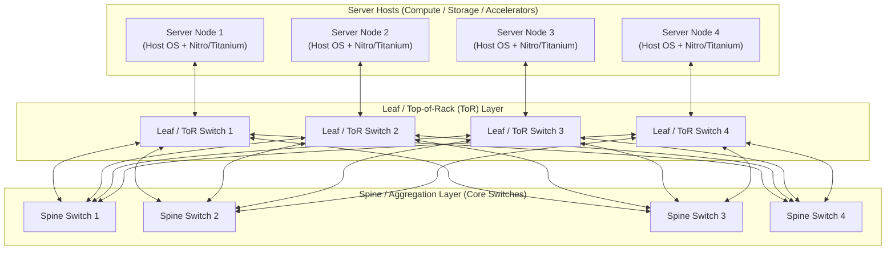

# Datacenter Networking Fabrics

## TL;DR

Hyperscale cloud networks eliminate traditional tree bottlenecks by constructing multi-tier, non-blocking Clos switching fabrics where bisection bandwidth scales linearly with the number of commodity switches.
Google Jupiter evolved from custom electrical packet switches to dynamic Optical Circuit Switching (OCS) fabrics that dynamically reconfigure inter-cluster bandwidth using motorized mirrors without optical-to-electrical conversion.
AWS constructs redundant 100GbE and 400GbE multi-stage spine-and-leaf Clos networks integrated with custom Nitro networking ASICs to offload packet parsing and security filtering at line rate.
Equal-Cost Multi-Path (ECMP) hashes the packet 5-tuple across parallel paths, requiring flowlet switching or modern packet-spraying protocols to eliminate hash collisions and polarization hot-spots.
In high-throughput AI and analytics workloads, traditional TCP incast and packet loss trigger severe tail latency spikes, driving hyperscalers toward multi-path transport protocols like AWS Scalable Reliable Datagram (SRD) and custom congestion control.

## Mental Model

Modern datacenter fabrics fold multi-stage Clos networks into spine-and-leaf architectures where every leaf switch connects to every spine switch, guaranteeing uniform latency and equal-cost multi-pathing between any two server racks.



In a traditional hierarchical enterprise network, traffic between servers on different access switches passes through core routers that oversubscribe bandwidth by 10:1 or 100:1.
In a non-blocking 5-stage Clos fabric, the aggregate upward bandwidth from the leaf layer matches or exceeds the downward capacity, allowing every server to transmit to any other server at full physical line rate simultaneously.

## Internals

### The Geometry of Clos Fabrics

Proposed by Charles Clos in 1953 for telephone exchange switching, Clos networks enable high-capacity crossbar connectivity using small, inexpensive switching units.
A 3-stage Clos network connects $r$ input stages of $n \times m$ crossbars to $m$ intermediate stages of $r \times r$ crossbars, which connect to $r$ output stages of $m \times n$ crossbars.
When generalized to datacenter topologies:
- Top-of-Rack (ToR / Leaf) Switches: Sit at the top of physical racks, connecting host network interface cards (NICs) via downlinks (e.g., 25GbE/100GbE) and connecting to aggregation switches via uplinks (e.g., 100GbE/400GbE).
- Spine (Aggregation) Switches: Interconnect all ToR switches.
Because every leaf switch connects to every spine switch, traffic between any two servers in the same datacenter traverses at most three hops (Host $\rightarrow$ ToR $\rightarrow$ Spine $\rightarrow$ Destination ToR $\rightarrow$ Destination Host).
- Bisection Bandwidth: The minimum bandwidth across the cut when the network is divided into two equal halves.
A network is "full-bisection non-blocking" when the bisection bandwidth equals the sum of bandwidth of half the connected nodes.

### Google Jupiter Network Evolution

Google documented its datacenter network evolution across two landmark SIGCOMM papers (2015 and 2022):

1. Jupiter Rising (2015): Replaced commercial chassis switches with merchant silicon switching chips arranged in a hierarchical Clos topology.
To scale beyond a single switch chassis, Google introduced the "Aggregation Block" (middle tier) and "Superblock" (core tier).
Centralized software-defined networking (SDN) controllers dynamically computed routes and pushed forwarding tables via OpenFlow, running BGP only at border routing points.

2. Jupiter with Optical Circuit Switching (2022): Electrical packet switches require optical-to-electrical-to-optical (OEO) conversions at every switch port, dissipating massive power at 400G and 800G line rates.
Google introduced custom Optical Circuit Switches (OCS), named "Palomar".
An OCS uses micro-electro-mechanical system (MEMS) 2D arrays of motorized piezoelectric mirrors to directly reflect optical light beams from input fibers to output fibers without decoding packets.
Because optical switching is wavelength-agnostic and protocol-agnostic, Google upgrades line rates from 100G to 800G without replacing the physical core OCS fabric.
The SDN controller dynamically steers long-lived bulk flows (such as analytical MapReduce shuffles or AI checkpoint syncs) onto dedicated optical circuits in sub-10 milliseconds.

### AWS Datacenter Network Architecture

AWS constructs custom network hardware from the ground up:
- Custom Network Silicon: AWS designs custom merchant silicon switches running internal network operating systems based on Linux, stripping out unused enterprise features (STP, legacy RIP) to maximize packet throughput.
- Redundant Regional Backbones: An AWS region comprises multiple physically distinct Availability Zones connected through dense wavelength-division multiplexing (DWDM) optical rings.
Regional transit centers interconnect all AZs within sub-2-millisecond speed-of-light optical fiber limits.
- Scalable Reliable Datagram (SRD): Standard TCP suffers from head-of-line blocking: if one packet is dropped, the entire stream stalls while waiting for retransmission.
AWS designed SRD, a specialized transport protocol implemented directly inside Nitro Card ASICs.
SRD takes outgoing packets, splits them across hundreds of independent ECMP network paths simultaneously (packet spraying), and reassembles them out-of-order in hardware at the destination Nitro card.
SRD detects congestion in microseconds and steers packets away from overloaded switch queues, eliminating tail-latency latency outliers in Amazon EBS and EFA (Elastic Fabric Adapter).

### Routing Protocols, Anycast, and ECMP Hashing

Within a modern cloud fabric, physical routing balances stability against load distribution:
- BGP (Border Gateway Protocol) at Scale: Hyperscalers run internal eBGP (External BGP) between Clos tiers.
Each tier is assigned a distinct Autonomous System Number (ASN), turning the fabric into a deterministic eBGP path where AS-Path loop prevention naturally stops routing loops.
- Equal-Cost Multi-Path (ECMP): When a switch has multiple parallel links to the next tier with identical routing cost, it distributes packets using a hash of the packet header:
$$\text{Path Index} = \text{Hash}(\text{Src IP}, \text{Dst IP}, \text{Src Port}, \text{Dst Port}, \text{Protocol}) \pmod N$$
- Hash Polarization (The Congestion Trap): If two consecutive switch tiers use the exact same hashing algorithm and seed, traffic that hashes to link $k$ at Tier 1 will hash to the exact same relative link at Tier 2.
This causes severe imbalance where certain links run at 100% capacity while adjacent links sit idle.
Hyperscalers eliminate polarization by using unique polynomial hash seeds (e.g., CRC-32 with varied polynomials or MurmurHash3) at each switch layer.
- Flowlet Switching: Rather than hashing individual packets (which causes TCP out-of-order delivery) or individual flows (which causes elephant flow collisions), flowlet switching identifies bursts of packets separated by idle intervals greater than the network delay difference.
Each burst ("flowlet") is safely routed over a different path without reordering packets inside the receiver's TCP window.

## Numbers to Know

| Parameter / Metric | Enterprise Legacy Fabric | AWS Datacenter Fabric | Google Jupiter Fabric | Sourced As-Of |
|---|---|---|---|---|
| Fabric Architecture | 3-tier oversubscribed tree | Multi-tier non-blocking Clos | Optical Circuit Switched Clos | SIGCOMM / re:Invent (as of 2026-10) |
| Intra-AZ Round-Trip Latency | 500 to 2,000 microseconds | Less than 100 microseconds (Nitro) | Less than 100 microseconds (Titanium) | Cloud latency audits (as of 2026-10) |
| Inter-AZ Speed-of-Light RTT | N/A | 1.0 to 1.8 milliseconds | 1.0 to 1.8 milliseconds | AWS/GCP SLA benchmarks (as of 2026-10) |
| Host Link Speeds | 10 GbE to 25 GbE | Up to 100 GbE / 400 Gbps (EFA) | Up to 200 GbE / 800 Gbps (Titanium) | EC2 / GCE instance specs (as of 2026-10) |
| Bisection Bandwidth Capacity | 100 Gbps to 10 Tbps | Multi-Petabit per second | Greater than 6 Petabits per second | Google SIGCOMM 2022 (as of 2026-10) |
| Packet Loss Rate in Fabric | 0.1% to 1.0% | Less than 0.001% (SRD multipath) | Less than 0.001% (SDN traffic eng) | USENIX NSDI / SIGCOMM (as of 2026-10) |

## AWS vs GCP Mechanism Parity

| Mechanism | Amazon Web Services | Google Cloud Platform | Architectural Difference |
|---|---|---|---|
| Core Fabric Technology | Massive electrical Clos fabric with custom merchant silicon and Nitro offload | Hybrid Clos with Optical Circuit Switching (OCS Palomar) and SDN control | Google uses motorized MEMS optical mirrors to reconfigure core bisection bandwidth dynamically; AWS relies on massive, static over-provisioned electrical Clos fabrics. |
| Multi-Path Transport | Scalable Reliable Datagram (SRD) in hardware (Nitro EFA) | Falcon / Swift congestion control with hardware packet pacing | AWS bypasses TCP using packet spraying across ECMP paths reassembled on Nitro; GCP optimizes TCP/UDP using Andromeda and custom kernel/Titanium congestion control algorithms. |
| Datacenter SDN Controller | Decentralized eBGP with localized route controllers | Centralized SDN (Orion / Firehose) driving dynamic flow steering | AWS prioritizes decentralized blast-radius containment using standard eBGP peering; Google prioritizes global programmatic traffic efficiency via centralized SDN. |
| High-Performance Interconnect | Elastic Fabric Adapter (EFA) for EC2 | Fast Socket / Cloud TPU Optical Circuit Switching | AWS EFA exposes an OS-bypass userspace interface (libfabric); GCP exposes high-performance networking via Andromeda Datapath V2 and direct TPU 3D-Torus optical fabrics. |

## Worked Example: Capacity Sizing and Bisection Bandwidth Math

Consider sizing the network fabric for a 1,024-node GPU training cluster.
Each node contains 8 NVIDIA H100 GPUs and 400 Gbps of dedicated network bandwidth.
We calculate total bisection bandwidth, leaf-to-spine link counts, and network infrastructure cost.

### Capacity Calculations

1. Total Host Bandwidth:
   - Node count: 1,024 hosts.
   - Host network capacity: 400 Gbps (full-duplex).
   - Total host injection bandwidth: `1,024 * 400 Gbps = 409,600 Gbps = 409.6 Tbps`.

2. Clos Fabric Sizing (Non-Blocking 1:1 Oversubscription):
   - Switch hardware: 32-port 400GbE QSFP-DD merchant silicon switches.
   - Leaf (ToR) Switch Allocation:
     - Each ToR connects 16 hosts via downlinks: `16 * 400 Gbps = 6.4 Tbps`.
     - Each ToR provides 16 uplinks to the spine layer: `16 * 400 Gbps = 6.4 Tbps`.
     - Downlink to uplink oversubscription ratio: `16 : 16 = 1:1` (Strictly non-blocking).
     - Total Leaf switches required: `1,024 hosts / 16 hosts-per-switch = 64 Leaf switches`.
   - Spine Switch Allocation:
     - Total leaf uplinks needing termination: `64 Leaf switches * 16 uplinks = 1,024 uplinks`.
     - Ports per spine switch: 32 ports (400GbE).
     - Spine switches required: `1,024 uplinks / 32 ports = 32 Spine switches`.
   - Total Switch Count: `64 Leaf + 32 Spine = 96 switches`.
   - Total Bisection Bandwidth: `Half of nodes * 400 Gbps = 512 * 400 Gbps = 204.8 Tbps`.

3. Interconnect Cable Sizing:
   - Host-to-Leaf cables: 1,024 active optical cables (400G AOC).
   - Leaf-to-Spine cables: 1,024 active optical cables (400G AOC).
   - Total 400G optical links: 2,048 cables.

### Infrastructure Deployment: AWS VPC with Placement Group for Non-Blocking Fabric

To guarantee that instances land on the same low-latency Clos spine without oversubscription, we provision EC2 instances inside a `cluster` placement group using OpenTofu / Terraform:

```hcl
# network_fabric.tf - Non-blocking cluster placement group
terraform {
  required_version = ">= 1.6.0"
  required_providers {
    aws = {
      source  = "hashicorp/aws"
      version = "~> 5.0"
    }
  }
}

provider "aws" {
  region = "us-east-1"
}

# Cluster placement group packs instances together inside a single AZ Clos switch tier
resource "aws_placement_group" "ai_cluster_pg" {
  name     = "cloud-ai-clos-cluster-pg"
  strategy = "cluster"
}

resource "aws_vpc" "ai_vpc" {
  cidr_block           = "10.0.0.0/16"
  enable_dns_hostnames = true
  enable_dns_support   = true

  tags = {
    Name = "cloud-ai-high-perf-vpc"
  }
}

resource "aws_subnet" "ai_subnet" {
  vpc_id            = aws_vpc.ai_vpc.id
  cidr_block        = "10.0.1.0/24"
  availability_zone = "us-east-1a"

  tags = {
    Name = "cloud-ai-fabric-subnet"
  }
}

# Sizing budget alarm: Alert if monthly network infrastructure costs exceed threshold
resource "aws_cloudwatch_metric_alarm" "network_cost_alarm" {
  alarm_name          = "network-fabric-estimated-charges"
  comparison_operator = "GreaterThanThreshold"
  evaluation_periods  = 1
  metric_name         = "EstimatedCharges"
  namespace           = "AWS/Billing"
  period              = 21600 # 6 hours
  statistic           = "Maximum"
  threshold           = 5000  # $5,000 threshold
  alarm_description   = "Triggers if network infrastructure and egress exceed budget"
}

# Teardown Command:
# tofu destroy -auto-approve
```

## Failure Modes and Pitfalls

### Pitfall 1: ECMP Hash Polarization and Silent Hot-Spots
When symmetric load balancing hashing functions are chained across multi-stage Clos layers, traffic aggregates on identical switch ports.
This causes severe link saturation and microburst packet drops on a single cable while parallel paths in the fabric operate below 10% utilization.
Symptoms: Periodic TCP retransmissions, erratic p99 database latency spikes, and degraded all-reduce collective times in distributed training.
Mitigation: Enforce randomized hash seeds at every switch hop.
Enable flowlet switching or modern packet-spraying transports like AWS SRD.

### Pitfall 2: BGP Route Flapping and Convergence Storms
In Clos fabrics running internal BGP (iBGP/eBGP), a degrading physical optical transceiver with intermittent signal loss causes its BGP session to flap continuously.
Every flap forces the neighboring switch to withdraw routes and broadcast BGP updates across all spine tiers, consuming CPU cycles on route processors and inducing transient blackholes.
Mitigation: Configure BGP route dampening (`dampening 15 750 2000 60`) and aggressive Bidirectional Forwarding Detection (BFD) with sub-second timers (e.g., 300ms detection interval) to isolate degraded links before routing loops form.

### Pitfall 3: TCP Incast Collapse in Distributed Storage and ML
When hundreds of worker nodes simultaneously stream response data or parameter updates to a single aggregator or storage node, the final leaf switch's packet buffers overflow within microseconds.
Traditional TCP drops packets, triggers an exponential backoff, and stalls throughput for hundreds of milliseconds.
Mitigation: Enable Explicit Congestion Notification (ECN) coupled with Data Center TCP (DCTCP) or RoCEv2 with Priority-Based Flow Control (PFC) and Random Early Detection (RED).

## Security and Cost Angles

- Wire-Speed Encryption in the Fabric: Modern cloud providers encrypt all inter-datacenter and inter-AZ network traffic at the physical layer.
AWS Nitro cards and Google Titanium processors perform AES-256 GCM encryption in hardware at full 100G/400G line rate with zero measurable CPU penalty.
- Inter-AZ Network Egress Tax: Transferring data within the same AZ over the local Clos fabric is free on AWS and GCP.
However, traversing the regional backbone across Availability Zones incurs a bidirectional fee of $0.01 per GB on AWS ($0.01/GB out + $0.01/GB in = $0.02/GB total) and $0.01 per GB on GCP.
A high-throughput distributed database or streaming cluster transferring 1 PB across zones per month generates $20,000 in unbudgeted network egress cost.
- Placement Group Unit Economics: Using `cluster` placement groups on AWS or compact placement on GCP places instances on the same physical Clos aggregation block, minimizing latency while eliminating inter-AZ egress fees entirely.

## Interview Questions and Model Answers

### Question 1 (L5 - Senior)
What is the structural difference between a traditional 3-tier enterprise tree network and a 3-stage Clos fabric, and why does the cloud require Clos?

#### Model Answer
A traditional enterprise tree network consists of Core, Distribution, and Access layers.
Traffic between nodes on different access switches funnels upward into larger, centralized core switches.
Because core switch port density is limited, bandwidth is heavily oversubscribed (often 10:1 or 40:1), creating severe congestion bottlenecks for east-west traffic (server-to-server within the datacenter).
A 3-stage Clos fabric (spine-and-leaf) decouples switching from single massive chassis by organizing commodity switches into an interconnected mesh.
Every leaf switch connects directly to every spine switch.
This provides multiple parallel equal-cost paths between every pair of servers.
By provisioning as many uplink ports as downlink ports, a Clos fabric achieves non-blocking 1:1 bisection bandwidth: any server can transmit to any other server at full physical line rate without contention.
Cloud computing is dominated by distributed databases, microservices, and AI training that generate massive east-west traffic, making non-blocking Clos fabrics mandatory.

#### Follow-up Interviewer Question
How does an ECMP switch determine which spine link to forward an incoming packet across, and what happens if two packets from the same TCP flow take different links?

### Question 2 (L6 - Staff)
Explain how AWS Scalable Reliable Datagram (SRD) avoids the fundamental limitations of TCP when running on multi-tier Clos networks.

#### Model Answer
TCP was designed for wide-area networks with unknown, lossy topologies.
It treats out-of-order packets as evidence of packet loss, collapses its congestion window, and stalls delivery to the application until missing packets are retransmitted (head-of-line blocking).
On a modern Clos datacenter fabric with thousands of equal-cost parallel paths, standard TCP is forced to route every packet of a connection over the single path chosen by the initial 5-tuple hash.
If that specific path experiences transient microburst congestion, the entire connection stalls even though 127 adjacent parallel paths are idle.
AWS SRD rethinks transport by implementing the protocol directly inside the Nitro Card ASIC:
1. Packet Spraying: SRD dissolves the single-path constraint.
It transmits individual datagrams across all available ECMP paths simultaneously.
2. Hardware Reassembly: Packets arriving out of order are reassembled into order directly by the receiving Nitro ASIC before presenting the data to the guest operating system via the Elastic Fabric Adapter (EFA).
3. Microsecond RTT Measurement: Nitro measures round-trip time on every single packet.
If a path shows a microsecond latency elevation, SRD instantly steers subsequent packets to faster paths.
This eliminates tail latency outliers, avoids TCP incast collapse, and achieves predictable p99 performance under multi-tenant load.

#### Follow-up Interviewer Question
Why is packet spraying incompatible with standard off-the-shelf Linux TCP/IP network stacks without specialized hardware offload?

### Question 3 (L7+ - Principal)
Google's 2022 Jupiter network replaced core electrical packet switches with Optical Circuit Switches (OCS). Explain the physics and architectural trade-offs of this decision, and analyze how an optical core interacts with datacenter traffic scheduling.

#### Model Answer
Architectural Driver and Physics:
At 400 Gbps and 800 Gbps per port, electrical packet switches face extreme power, thermal, and cost barriers.
Standard electrical switches must convert optical signals from fiber cables into electrical signals (OEO conversion), process headers in high-power silicon ASIC packet buffers, and convert back to light.
Google's OCS (Palomar) uses 2D arrays of tiny motorized piezoelectric MEMS mirrors.
Input fibers shoot collimated light beams through free space onto mirrors that pivot to direct the light directly into output fibers.
Because light passes through without optical-to-electrical conversion:
1. Zero Silicon Packet Power: The OCS consumes virtually zero data-plane power; power is only used to hold mirror positions.
2. Protocol and Speed Agnostic: An OCS installed for 100G fiber carries 400G, 800G, or 1.6T signals without hardware modification.
Trade-Offs and Traffic Scheduling:
The primary limitation is reconfiguration latency: moving physical mirrors takes roughly 1 to 10 milliseconds.
During reconfiguration, the optical path drops all light, meaning an OCS cannot perform per-packet switching.
To make this practical, Google bifurcated network traffic via a centralized SDN controller:
- Dynamic Topology Matching: Long-lived bulk transfers (such as distributed BigQuery shuffles, Colossus replication, and AI training all-reduce steps) are scheduled in advance.
The SDN controller directs OCS switches to establish direct optical paths between specific aggregation blocks for minutes or hours.
- Electrical Hybrid Path: Latency-sensitive RPCs, search queries, and short-lived flows continue to traverse a parallel electrical Clos layer that performs standard per-packet routing.
The optical core delivers massive bisection bandwidth at a fraction of the capital and energy cost, enabling Google to scale compute clusters beyond the thermal limits of pure silicon fabrics.

#### Follow-up Interviewer Question
If an OCS mirror motor fails mechanically during operation, how does the SDN controller detect the physical failure without packet headers to inspect, and what is the blast radius mitigation?

## Further Reading

- [Jupiter Rising: A Decade of Clos Topologies in Google's Datacenter Network (SIGCOMM 2015)](https://research.google/pubs/pub43837/) - Foundational paper on multi-tier merchant silicon Clos fabrics and centralized SDN control.
- [Jupiter Evolving: Optical Circuit Switched Datacenter Network (SIGCOMM 2022)](https://research.google/pubs/pub51587/) - Google's architecture paper detailing MEMS optical switching, Palomar switches, and dynamic topology management.
- [A Scalable, Commodity Data Center Network Architecture (SIGCOMM 2008)](https://dl.acm.org/doi/10.1145/1402958.1402967) - Mohammad Al-Fares' seminal paper establishing modern Fat-Tree Clos topologies for commodity datacenters.
- [AWS re:Invent: A Zero-Loss Network with Scalable Reliable Datagram (SRD)](https://www.youtube.com/watch?v=Fj7rP9E2x80) - Technical exposition of AWS SRD protocol mechanics, packet spraying, and Nitro hardware acceleration.
