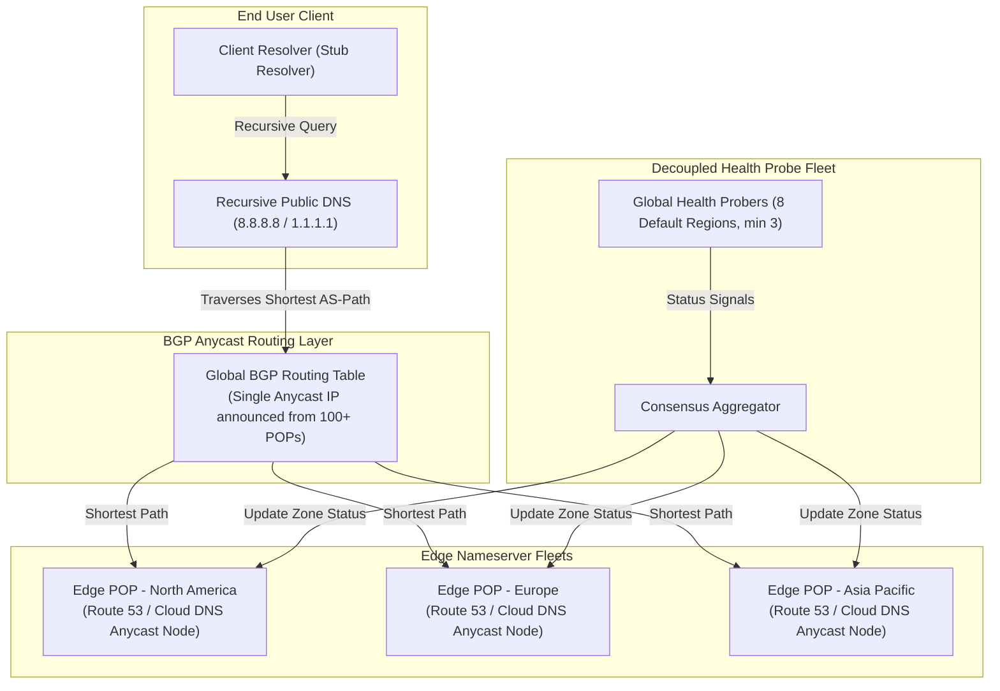

# DNS, Anycast, and Global Traffic Management

## TL;DR

Global traffic steering in hyperscale clouds pairs BGP Anycast routing at the network layer with authoritative DNS routing policies at the application layer.
Amazon Route 53 stripes each hosted zone across four authoritative nameservers belonging to four distinct Top-Level Domains (`.com`, `.net`, `.org`, `.co.uk`) to ensure that a TLD outage never causes total service unavailability.
Route 53 uses shuffle sharding to assign each hosted zone a delegation set of four authoritative virtual nameservers drawn from a large multi-tenant pool, mathematically reducing customer-to-customer fate sharing under DDoS attacks to near zero.
Google Cloud DNS serves managed zones from anycast name servers at multiple locations worldwide, so each query is answered by a nearby Google location rather than a single region.
Health checking systems decouple probe fleets from nameserver databases, aggregating distributed health signals using consensus thresholds (Route 53: healthy only while more than 18% of health checkers agree) to prevent flap storms during brownouts.

## Mental Model

DNS resolves human-readable names to IP addresses, while BGP Anycast routes those queries across the physical Internet to the closest healthy edge nameserver.



Anycast advertises the exact same IP address prefix from hundreds of physical edge points of presence worldwide using Border Gateway Protocol (BGP).
Internet service providers naturally route DNS queries along the shortest BGP Autonomous System (AS) path to the topologically closest datacenter.
If an edge location experiences a catastrophic failure, BGP withdraws the route advertisement, automatically shifting client traffic to the next closest location without updating DNS records.

## Internals

### Amazon Route 53 Fault Isolation Mechanics

Route 53 is architected to survive physical datacenter loss, regional network cuts, and malicious floods:

1. Four-TLD Nameserver Striping:
When a customer creates an Amazon Route 53 public hosted zone, AWS allocates four authoritative nameservers with distinct TLD suffixes:
- `ns-xxxx.awsdns-xx.com`
- `ns-xxxx.awsdns-xx.net`
- `ns-xxxx.awsdns-xx.org`
- `ns-xxxx.awsdns-xx.co.uk`
The four names sit under four different TLDs, so resolving them depends on four different TLD zones and their nameserver fleets; note that `.com` and `.net` share one registry operator (Verisign), while `.org` and `.co.uk` are run by different operators.
Even if an entire TLD (such as `.org`) experiences a complete technical collapse or geopolitical routing seizure, client resolvers fall back to the nameservers under the remaining TLDs.

2. Combinatoric Shuffle Sharding:
In a naive multi-tenant system, thousands of customers share a cluster of nameserver IP addresses.
If Customer A suffers a 500 Gbps volumetric DDoS attack, the shared cluster saturates, causing collateral damage to Customers B, C, and D.
Route 53 isolates tenants using shuffle sharding across thousands of virtual nameservers:
- Consider a pool of 2,000 distinct virtual nameserver addresses.
- Each hosted zone is assigned an isolated subset of 4 nameservers.
- The number of unique 4-nameserver combinations is given by the combinations formula:
$$\binom{2000}{4} = \frac{2000 \times 1999 \times 1998 \times 1997}{4 \times 3 \times 2 \times 1} \approx 6.64 \times 10^{11}$$
Over 664 billion unique subsets exist.
If an attacker targets Customer A's four nameservers, any other customer in the fleet shares at most a fraction of their delegation with Customer A.
Client resolvers retry across all four delegated nameservers, meaning a customer that overlaps with Customer A on one, two, or three nameservers still resolves through its unshared nameservers, at the cost of extra retry latency.

3. Static Stability:
Route 53 nameservers operate with pre-computed, statically stable data planes.
Nameservers cache the entire compiled zone data locally in high-speed memory.
If the Route 53 control plane (the API for creating and modifying records) goes down completely, the global data plane continues serving existing DNS records without degradation.

### Google Cloud DNS Architecture

Google Cloud DNS leverages the same worldwide infrastructure that powers Google Search and YouTube:
- Integrated Anycast Network: Cloud DNS uses anycast to serve managed zones from multiple locations around the world, and each query is routed to the nearest serving location (Google Cloud DNS docs, as of 2026-10).
- 100% Availability SLA: Google Cloud DNS publishes a 100% Monthly Uptime Percentage service level objective for its managed authoritative name servers, with tiered financial credits when it is missed (Google Cloud DNS SLA, as of 2026-10).
- Managed DNSSEC Signing: Cloud DNS signs DNSSEC-enabled zones and manages the DNSKEY records for them.
It performs fully automatic Zone Signing Key (ZSK) rotation, but it does not rotate Key Signing Keys (KSK) automatically, because a KSK rollover requires a manual DS record update at the domain registrar (Google Cloud DNS docs, as of 2026-10).
Signed zones let validating resolvers detect forged answers, which defends against DNS cache poisoning and man-in-the-middle spoofing.

### Advanced Routing Policies

Modern cloud DNS systems are programmable traffic controllers executing specialized algorithms:
- Latency-Based Routing (LBR): Route 53 continuously measures network latency from client networks worldwide to AWS Regions.
When a query arrives, Route 53 looks up the client resolver's IP prefix (or the ECS client subnet, below) in its latency data and returns the record for the Region providing the lowest network round-trip time.
Cloud DNS has no latency-based policy; its routing policies are weighted round robin, geolocation, and failover (Google Cloud DNS docs, as of 2026-10).
- EDNS0 Client Subnet (ECS): Traditional DNS servers only see the IP address of the recursive resolver (such as `8.8.8.8` or an ISP caching server).
If a user in Tokyo uses a public DNS resolver based in California, naive latency routing would return a California IP address, ruining performance.
Under RFC 7871 (Client Subnet in DNS Queries), the recursive resolver appends the client's truncated IP address prefix (e.g., `/24` for IPv4) to the query.
The cloud authoritative nameserver uses this client subnet to return the optimal local endpoint.
- Geoproximity and Routing Control: Routes traffic based on geographic coordinates with a configurable "bias" parameter.
Increasing the bias expands the geographical catchment zone of a region, allowing engineers to gradually shift traffic between regions during planned maintenance or capacity crunches.

### Health Checking and Probe Aggregation

DNS failover requires high reliability in failure detection:
- The Flap Storm Problem: In a distributed system with millions of clients, transient network blips (packet loss, BGP reconvergence) can cause a single health checker to declare an endpoint dead.
If the DNS server immediately updates records, millions of clients invalidate local caches and hammer the secondary region, overloading it and triggering cascading failure.
- Distributed Probe Consensus: Route 53 runs health checkers in multiple AWS Regions; by default a health check uses all eight health-checker Regions (`us-east-1`, `us-west-1`, `us-west-2`, `eu-west-1`, `ap-southeast-1`, `ap-southeast-2`, `ap-northeast-1`, `sa-east-1`), and a customized list must keep at least three (Route 53 API reference, as of 2026-10).
Each health checker probes the target endpoint at a fixed interval (standard 30-second interval or fast 10-second interval) and changes its own view of the endpoint only after a configurable failure threshold of consecutive checks (default 3, range 1 to 10).
Route 53 then aggregates the checkers: the endpoint is healthy while more than 18% of health checkers report it healthy, and unhealthy when 18% or fewer do, so a network partition that isolates the endpoint from a few checker locations does not trigger failover (AWS Route 53 docs, as of 2026-10).
- Inverted and Calculated Health Checks: Engineers combine multiple health checks using logical AND, OR, and NOT operations, allowing automated failover based on composite service metrics, CloudWatch alarms, or synthetic canary checks.

## Numbers to Know

| Parameter | Route 53 Specification | Google Cloud DNS Specification | Sourced As-Of |
|---|---|---|---|
| Service Level Agreement (SLA) | 100% Authoritative Resolution | 100% Authoritative Resolution | Official Service SLAs (as of 2026-10) |
| Authoritative TLD Diversity | 4 distinct TLDs (.com, .net, .org, .co.uk) | 4 nameservers under one domain (`ns-cloud-*.googledomains.com`) | AWS/GCP documentation (as of 2026-10) |
| Health Checker Regions | 8 by default; custom list needs at least 3 | Not published | Route 53 API reference (as of 2026-10) |
| Health Aggregation Rule | Healthy while more than 18% of checkers report healthy | Not published | AWS Route 53 Guide (as of 2026-10) |
| Standard Health Check Interval | 30 seconds (10s fast interval) | Configurable via Cloud Monitoring | AWS Route 53 Guide (as of 2026-10) |
| Failover Latency Floor | TTL + (Interval * Threshold) | TTL + Health Check Window | DNS Protocol Standards (as of 2026-10) |
| Standard Record TTL Default | 300 seconds (5 minutes) | 300 seconds | Best Practice Guide (as of 2026-10) |
| Max DNS Payload over UDP | 512 bytes (Extended to 4,096 via EDNS0) | 512 bytes (Extended via EDNS0) | RFC 6891 Specification |
| Public Hosted Zone Base Price | $0.50 per hosted zone / month | $0.20 per hosted zone / month | AWS/GCP Pricing Pages (as of 2026-10) |
| Standard Query Pricing | $0.40 per million queries (first 1B), $0.20 beyond | $0.40 per million queries (first 1B), $0.20 beyond | AWS/GCP Pricing Pages (as of 2026-10) |
| Routing Policy Query Pricing | Latency: $0.60 per million (first 1B), $0.30 beyond; Geo: $0.70, $0.35 beyond | Routing policy: $0.70 per million (first 1B), $0.35 beyond | AWS/GCP Pricing Pages (as of 2026-10) |

## AWS vs GCP Mechanism Parity

| Feature / Mechanism | Amazon Route 53 | Google Cloud DNS | Operational Trade-off |
|---|---|---|---|
| Fault Isolation Strategy | Shuffle Sharded Anycast with 4-TLD Nameserver Striping | Anycast name servers at multiple global locations, all under `googledomains.com` | Route 53 provides stronger architectural protection against TLD-level outages; Cloud DNS concentrates its delegation under a single TLD. |
| Traffic Steering Policies | Simple, Latency, Geolocation, Geoproximity, IP-based, Weighted, Multivalue Answer, Failover | Weighted Round Robin, Geolocation, Failover (with health checks) | Route 53 offers latency-based routing, geoproximity biases, and Application Recovery Controller (ARC) routing controls; Cloud DNS has no latency-based policy. |
| Automated DNSSEC | Route 53 manages the ZSK; the KSK is backed by a customer managed asymmetric `ECC_NIST_P256` KMS key in `us-east-1` | Managed signing with automatic ZSK rotation; no automatic KSK rotation | On both platforms, enabling DNSSEC and rolling the KSK require publishing or updating the DS record at the registrar. |
| Multi-Region Failover Controller | Route 53 Application Recovery Controller (ARC) | Cloud Load Balancing with Multi-Region Anycast VIPs | AWS relies on DNS-level record swapping; GCP promotes single multi-region Anycast IP frontends that absorb failover at Layer 4/7 without DNS updates. |

## Worked Example: Latency-Based Routing with Failover and Cost Calculation

Consider an AI inference API deployed across two regions: `us-east-1` (Primary, Northern Virginia) and `eu-west-1` (Secondary, Ireland).
We configure Route 53 Latency-Based Routing (LBR) with automated health check failover using OpenTofu / Terraform.

### Capacity and Cost Calculation

1. Query Volume:
   - Request rate: 10,000 queries per second.
   - Monthly queries: `10,000 * 86,400 * 30 = 25,920,000,000 queries = 25,920 million queries`.

2. Route 53 Cost Breakdown (AWS Route 53 pricing, as of 2026-10):
   - Hosted Zone Fee: 1 hosted zone = $0.50 / month.
   - Every query hits latency records, so every query is billed at the latency-based rate instead of the standard rate (not both):
   - Latency Queries, first 1 billion: `1,000 million * $0.60 / million = $600.00`.
   - Latency Queries, beyond 1 billion: `24,920 million * $0.30 / million = $7,476.00`.
   - Health Checks: 2 AWS endpoints (ALBs) with 30-second interval and HTTPS (no string matching in this config):
     `2 * ($0.50 basic + $1.00 HTTPS) = $3.00 / month` at list price; the offer of up to 50 free health checks on AWS endpoints can reduce this.
   - Total Monthly DNS Cost: `$0.50 + $600.00 + $7,476.00 + $3.00 = $8,079.50 / month` (about $8.1k).
   - Critical Cost Lesson: query volume, not zones or health checks, dominates DNS cost at scale.
The same 25,920 million queries on simple (standard) records would cost `$400.00 + $4,984.00 = $5,384.00`, so latency-based routing adds `$8,076.00 - $5,384.00 = $2,692.00 / month` here.
For a resolver that honors TTLs, a 60-second TTL instead of 5 seconds cuts its refreshes for a hot name by up to `1 - 5/60 = ~92%`; measure the real reduction, because resolver fan-out and TTL floors make it smaller.

3. Lab Cost (the configuration below as written, with only test queries; AWS Route 53 and AWS Budgets pricing, as of 2026-10):
   - Hosted zone: $0.50 for the month, not prorated, but a hosted zone deleted within 12 hours of creation is not charged.
   - Health checks: prorated for partial months; the two HTTPS checks cost `2 * ($0.50 + $1.00) = $3.00 / month` if the targets are AWS endpoints, or `2 * ($0.75 + $2.00) = $5.50 / month` if they are not, so a one-day lab costs at most about `$5.50 / 30 = $0.18`.
   - Test queries: a few thousand queries cost well under $0.01.
   - Budget: AWS Budgets without actions is free.
   - Lab total: under $1 if destroyed the same day, and at most about $6 if left running for a full month.

### Runnable OpenTofu / Terraform Configuration: Latency Routing with Health Checks

```hcl
# dns_routing.tf - Route 53 Latency-Based Routing with Health Check Failover
terraform {
  required_version = ">= 1.6.0"
  required_providers {
    aws = {
      source  = "hashicorp/aws"
      version = "~> 5.0"
    }
  }
}

provider "aws" {
  region = "us-east-1"
}

variable "domain_name" {
  type        = string
  default     = "api.example-ai.internal"
  description = "Target domain for latency-based routing"
}

variable "budget_alert_email" {
  type        = string
  description = "Email address that receives the lab budget alerts"
}

# Budget alarm: account-wide monthly cost budget for the lab (budgets without actions are free)
resource "aws_budgets_budget" "lab_budget" {
  name         = "cloud-ai-ch03-dns-lab"
  budget_type  = "COST"
  limit_amount = "10"
  limit_unit   = "USD"
  time_unit    = "MONTHLY"

  notification {
    comparison_operator        = "GREATER_THAN"
    threshold                  = 50
    threshold_type             = "PERCENTAGE"
    notification_type          = "ACTUAL"
    subscriber_email_addresses = [var.budget_alert_email]
  }

  notification {
    comparison_operator        = "GREATER_THAN"
    threshold                  = 100
    threshold_type             = "PERCENTAGE"
    notification_type          = "FORECASTED"
    subscriber_email_addresses = [var.budget_alert_email]
  }
}

# Authoritative Hosted Zone
resource "aws_route53_zone" "primary_zone" {
  name = var.domain_name
}

# Health Check for US Region Endpoint
resource "aws_route53_health_check" "us_health" {
  fqdn              = "us-east-1.alb.example-ai.internal"
  port              = 443
  type              = "HTTPS"
  resource_path     = "/healthz"
  failure_threshold = 3
  request_interval  = 30

  tags = {
    Name = "us-endpoint-health"
  }
}

# Health Check for EU Region Endpoint
resource "aws_route53_health_check" "eu_health" {
  fqdn              = "eu-west-1.alb.example-ai.internal"
  port              = 443
  type              = "HTTPS"
  resource_path     = "/healthz"
  failure_threshold = 3
  request_interval  = 30

  tags = {
    Name = "eu-endpoint-health"
  }
}

# Latency-Based Record for US
resource "aws_route53_record" "us_latency_record" {
  zone_id        = aws_route53_zone.primary_zone.zone_id
  name           = var.domain_name
  type           = "A"
  ttl            = 60
  set_identifier = "us-east-1-latency"

  latency_routing_policy {
    region = "us-east-1"
  }

  health_check_id = aws_route53_health_check.us_health.id
  records         = ["198.51.100.10"] # Representative ALB IP
}

# Latency-Based Record for EU
resource "aws_route53_record" "eu_latency_record" {
  zone_id        = aws_route53_zone.primary_zone.zone_id
  name           = var.domain_name
  type           = "A"
  ttl            = 60
  set_identifier = "eu-west-1-latency"

  latency_routing_policy {
    region = "eu-west-1"
  }

  health_check_id = aws_route53_health_check.eu_health.id
  records         = ["203.0.113.20"] # Representative ALB IP
}

# Deploy Command:
# tofu init && tofu apply -var 'budget_alert_email=you@example.com'
# Teardown Command (removes the zone, records, health checks, and budget):
# tofu destroy -auto-approve -var 'budget_alert_email=you@example.com'
```

## Failure Modes and Pitfalls

### Pitfall 1: Caching Resolvers Violating Low TTLs during Outages
When engineers configure a 10-second TTL to achieve fast automated failover, they assume clients switch regions within 10 seconds.
In reality, many mobile carriers, enterprise corporate forwarders, and legacy ISP resolvers enforce a minimum TTL floor (e.g., 300 to 900 seconds) regardless of the authoritatively returned TTL.
During an outage, 20% to 40% of client traffic continues hitting the failed region for up to 15 minutes.
Mitigation: Do not rely solely on DNS for disaster recovery.
Pair DNS with Layer 7 Anycast ingress proxies (such as AWS Global Accelerator or Google Cloud External Application Load Balancers) that can reroute traffic instantaneously without client DNS cache invalidation.

### Pitfall 2: Health Check Thundering Herd on Degraded Backends
When a regional backend experiences high CPU load, response times increase and health check probes timeout.
Route 53 marks the region unhealthy and shifts 100% of global traffic to the secondary region.
The sudden doubling of traffic instantly overwhelms the secondary region, causing its health checks to fail as well.
Route 53 enters a catastrophic state where both regions are marked unhealthy; because "if no record is healthy, all records are healthy", Route 53 fails open and resumes routing by latency to both overloaded clusters, battering them with traffic before they can recover (AWS Route 53 docs, as of 2026-10).
Mitigation: Configure health check grace thresholds, enable rate limiting/load shedding on application servers, and configure Route 53 Application Recovery Controller (ARC) safety rules to prevent automated failover if the secondary region lacks capacity.

### Pitfall 3: Split-Brain DNS in Hybrid Cloud Peering
Organizations operating hybrid cloud networks with on-premises datacenters frequently create Route 53 Resolver endpoints and Google Cloud DNS forwarding zones.
If an engineer creates overlapping private hosted zones (e.g., `corp.internal`) in both cloud accounts without establishing explicit forwarding rules, internal DNS queries resolve inconsistently depending on which local VPC resolver is queried.
Mitigation: Implement centralized transit networking with dedicated, single-source-of-truth inbound and outbound DNS resolver endpoints managed via automated IaC pipelines.

## Security and Cost Angles

- DNS Amplification and Reflection Defense: Route 53 and Cloud DNS operate massive Anycast absorption capacity designed to absorb multi-terabit volumetric UDP reflection attacks without degrading legitimate lookups.
Authoritative servers drop malformed queries and enforce response rate limiting (RRL).
- DNS Tunneling and Data Exfiltration: Malicious actors exfiltrate sensitive data by encoding byte sequences into subdomains (e.g., `base64data.attacker.com`).
Deploy Amazon Route 53 Resolver DNS Firewall to inspect outbound query patterns, or Cloud DNS response policy rules on Google Cloud, to block known command-and-control domains.
- TTL Sizing Unit Economics: Setting a 1-second TTL generates continuous recursive queries, dramatically increasing cloud billing at scale ($0.40 to $0.60 per million queries).
Setting TTL to 60-300 seconds provides an optimal balance between failover responsiveness and cost management.

## Interview Questions and Model Answers

### Question 1 (L5 - Senior)
What is BGP Anycast, and how does it differ from traditional DNS load balancing?

#### Model Answer
BGP Anycast operates at the network routing layer (Layer 3/4).
Multiple geographically distributed physical servers announce the exact same IP address and prefix to neighboring Internet routers using the Border Gateway Protocol.
When a client sends a packet to an Anycast IP, each network on the way picks its BGP best path (local preference and other policy first, then typically the shortest Autonomous System (AS) path), which usually directs the client to a topologically close edge server.
Traditional DNS load balancing operates at the application layer (Layer 7).
A client queries an authoritative nameserver, which evaluates logic (such as weighted algorithms or geolocation databases) and returns a specific Unicast IP address unique to one datacenter.
Anycast provides instantaneous, automated failover at the network level: if an edge POP crashes, BGP withdraws the route advertisement, and subsequent packets automatically reroute to the next closest POP once BGP reconverges (typically seconds, sometimes longer) without waiting for DNS cache timeouts.

#### Follow-up Interviewer Question
Why is Anycast predominantly used for UDP services like DNS and NTP rather than long-lived stateful TCP connections?

### Question 2 (L6 - Staff)
How does Amazon Route 53 use shuffle sharding to eliminate customer fate-sharing under massive DDoS attacks, and what is the mathematical intuition behind it?

#### Model Answer
In standard multi-tenancy, if 10,000 customers share 8 nameserver IP addresses, an attack that takes down those 8 servers impacts all 10,000 customers (100% fate-sharing).
With shuffle sharding, Route 53 maintains a large pool of virtual nameservers (for example, 2,000 distinct IP addresses across multiple TLDs).
When a new customer creates a hosted zone, Route 53 does not assign them the whole pool; it assigns a tiny, unique combination of nameservers (typically 4).
The total number of unique combinations is $\binom{2000}{4}$, which yields over 664 billion possible combinations.
If an attacker targets Customer A's hosted zone with a multi-terabit volumetric flood that completely saturates all 4 of Customer A's assigned nameservers:
1. Every other customer in the system is unaffected unless they share all 4 nameservers with Customer A.
2. The probability of any specific customer sharing all 4 nameservers is $1 \text{ in } 664 \text{ billion}$.
3. Even customers that share 1, 2, or 3 nameservers with Customer A remain 100% available because DNS client resolvers query all delegated nameservers in parallel or fall back to surviving nameservers.
Shuffle sharding shrinks collateral impact to near zero without requiring dedicated physical hardware per customer.

#### Follow-up Interviewer Question
How does the EDNS0 Client Subnet (ECS) extension work, and how does it prevent latency-based DNS routing from breaking when clients use public recursive resolvers like Google Public DNS?

### Question 3 (L7+ - Principal)
Design a multi-region active-active disaster recovery architecture for a tier-0 transactional payment service that guarantees zero data loss (RPO = 0) and a recovery time objective under 5 seconds (RTO < 5s) during a complete cloud region outage. Defend your traffic steering and state replication mechanisms.

#### Model Answer
Architectural Blueprint:
1. Ingress and Traffic Management:
   - We do not use plain DNS failover for the primary path because DNS caching resolvers violate TTLs, blowing the 5-second RTO.
   - We deploy Layer 4/Layer 7 Anycast frontends (e.g., AWS Global Accelerator or Google Cloud External Application Load Balancer).
   A single static Anycast IP is advertised globally via BGP from edge POPs.
   - Edge POPs maintain active TCP connections and execute health checks against regional application clusters over dedicated private backbones.
   - If Region A fails, the edge Anycast proxy shifts the traffic distribution to Region B at the proxy layer with zero client-side DNS caching delay.
   Managed health checks alone cannot meet a 5-second RTO (Global Accelerator health checks run at a 10- or 30-second interval with a consecutive-failure threshold, and ALB endpoints inherit ELB target health checks), so the design also needs client or edge retries that fail over a request on connection error or timeout, and the failover path must not depend on control-plane edits such as changing traffic dial weights (AWS Fault Isolation Boundaries whitepaper, as of 2026-10).
2. Synchronous State Replication (RPO = 0):
   - To achieve RPO = 0, asynchronous replication is prohibited because un-replicated transactions in the write buffer would be lost.
   - We deploy a multi-region distributed consensus database: Cloud Spanner on GCP or a multi-region quorum datastore on AWS (such as an Aurora DSQL or a multi-region Paxos/Raft consensus layer).
   - Write transactions require synchronous quorum confirmation across at least two regions before acknowledging commit to the client.
3. Split-Brain and Latency Mitigation:
   - We locate the primary regions in geographically adjacent regions (e.g., `us-east-1` Northern Virginia and `us-east-2` Ohio) where speed-of-light inter-region fiber round-trip latency is under 12 milliseconds.
   - A third, lightweight "witness" region (e.g., `us-west-2` Oregon) hosts a tie-breaker consensus node without storing full data replicas.
   - If Region A is severed, Region B and the Witness region form an immediate 2-of-3 quorum, ensuring non-blocking write availability without split-brain risk.

#### Follow-up Interviewer Question
Under your design, what happens to inflight transactions that were midway through the two-phase commit protocol at the moment Region A suffered total power loss?

### Question 4 (L5 - Senior)
A latency-routed Route 53 record set has a 60-second TTL, and each record is tied to an HTTPS health check with the default 30-second interval and failure threshold of 3.
Walk through the worst-case time from a regional outage until clients stop reaching the failed region, and explain which knobs shorten it and what each one costs.

#### Model Answer
Failover time is the sum of a detection stage, an aggregation stage, and a cache-expiry stage.
Detection: each Route 53 health checker probes independently every 30 seconds, and an HTTPS check fails when the TCP connection takes longer than four seconds or the endpoint does not return a 2xx or 3xx status within two seconds after connecting.
A checker flips its own view to unhealthy only after 3 consecutive failures, so detection takes roughly 60 to 90 seconds depending on where in the interval the outage starts, plus the probe timeouts.
Aggregation: Route 53 marks the endpoint unhealthy once 18% or fewer of its health checkers still report it healthy, so the record is withdrawn only after most checkers have independently crossed the threshold.
Cache expiry: from then on, Route 53 answers with the healthy Region, but every recursive resolver that cached the old answer keeps returning it until the 60-second TTL expires.
The worst case for TTL-honoring resolvers is therefore about 90 seconds plus probe timeouts plus 60 seconds, roughly two and a half minutes, and longer for resolvers or client runtimes that impose their own minimum TTL.
Knobs and their costs:
1. Fast interval (10 seconds) cuts detection to roughly 20 to 30 seconds at a threshold of 3, but costs an extra $1.00 per health check per month for AWS endpoints and roughly triples probe traffic to the endpoint (AWS Route 53 pricing, as of 2026-10).
2. A failure threshold of 1 or 2 detects faster, but a single dropped probe per checker can now flip state, so the endpoint flaps during brownouts; the same threshold also governs recovery, so a low value re-admits a half-recovered region quickly.
3. A lower TTL (for example 10 seconds) shrinks the cache stage, but multiplies query volume, which is billed at $0.60 per million latency queries for the first billion (AWS Route 53 pricing, as of 2026-10), and resolvers with TTL floors ignore it anyway.
4. Pointing the health check at a deep `/healthz` that exercises dependencies catches more real failures, but a shared dependency outage can then mark every region unhealthy at once, which triggers Route 53's fail-open behavior and sends traffic back to all regions.
The senior-level conclusion is that DNS failover is a minutes-scale mechanism; anything tighter needs an anycast proxy layer or client-side retries in front of it.

#### Follow-up Interviewer Question
Route 53 treats all records as healthy when none is healthy; how would you design the health checks so that a dependency outage affecting every region does not cause a fail-open that overloads the weakest region?

### Question 5 (L6 - Staff)
Your disaster recovery runbook fails a service over by calling the Route 53 `ChangeResourceRecordSets` API to set the failed region's weight to zero.
Why is this a fragile design, and how would you restructure failover around the Route 53 data plane instead?

#### Model Answer
The runbook depends on the Route 53 control plane, which is the wrong dependency to take during a large-scale event.
Route 53 separates a control plane (the API that creates and edits hosted zones, records, and health checks) from a data plane (the globally distributed nameservers answering queries and the health checkers evaluating endpoints).
The control plane for this global service is hosted in `us-east-1`, so a runbook that needs it inherits the failure modes of a single region, its API throttling, and the surge of other customers editing records during the same event (AWS Fault Isolation Boundaries whitepaper, as of 2026-10).
Even when the API succeeds, a record change first returns `PENDING` and only reaches `INSYNC` after it has propagated to all nameservers, and cached answers then live for another TTL.
The data plane, by contrast, is the part designed for the 100% availability SLA, and it already evaluates health checks continuously, so the robust pattern is to pre-provision everything and only flip state through data-plane mechanisms:
1. Create failover, weighted, or latency records ahead of time, each associated with a health check, so no record ever needs to be edited during an incident.
2. Drive the health checks from a signal you control during an event; Route 53 Application Recovery Controller (ARC) routing controls are on/off switches exposed as `RECOVERY_CONTROL` health checks.
3. Change routing control state through the ARC cluster, which is a set of five redundant Regional endpoints that reach quorum across five Regions; ARC keeps at least three of the five endpoints accessible, and state converges within about 5 seconds on average and 15 seconds at most (AWS ARC docs, as of 2026-10).
4. Add ARC safety rules (assertion and gating rules) so an operator or automation cannot turn every region off at once, which would otherwise trip the fail-open behavior.
Trade-offs: ARC clusters are a standing hourly cost and another system to test; the runbook must try multiple cluster endpoints in turn; and switching remains bounded by DNS caching, so the TTL stage of failover does not disappear.
The deeper principle is static stability: the failover path should require no new resources, no control-plane writes, and no capacity that is not already running, so the secondary region must be pre-scaled to absorb the primary's traffic.

#### Follow-up Interviewer Question
How would you regularly prove that this failover path works without causing a customer-visible incident, and what would you measure during the drill?

### Question 6 (L7+ - Principal)
You run GPU inference in six regions whose capacity differs by a factor of four and changes hourly as accelerators are added, drained, or fail.
Design the global traffic management layer so that users go to a low-latency region with spare capacity, without oscillation, and justify where DNS belongs in that design.

#### Model Answer
The binding constraint is capacity, not latency, so the design separates a slow, coarse placement layer from a fast, fine-grained spillover layer.
Signals: steer on per-region admission headroom (queue depth, accelerator memory occupancy, tokens per second against a target), not CPU or HTTP error rate, because a GPU region saturates by queueing long before it errors.
Layer 1, DNS for coarse placement:
- Route 53 weighted or geoproximity-biased records (or Cloud DNS weighted round robin, which has no latency policy) express the hourly capacity plan, recomputed by a controller from the headroom signals.
- DNS is a delayed, lumpy actuator: a weight change takes the record propagation time plus a TTL to take effect, resolvers that ignore TTLs lag further, and one large public resolver can carry many users behind a single cached answer, so weights move populations of resolvers rather than users.
- A feedback loop on such an actuator oscillates if its gain is too high, which shows up as traffic sloshing between two regions every few TTLs.
- Damping rules: cap each weight step (for example a few percent per cycle), require a dwell time longer than propagation plus TTL before the next adjustment, and add hysteresis so a region must cross separate high and low headroom thresholds to lose or regain weight.
Layer 2, anycast proxy for fast spillover:
- A global anycast front end reacts to endpoint health without any client DNS cache in the way: AWS Global Accelerator fails away from unhealthy endpoint groups, and a Google global external Application Load Balancer uses backend capacity settings to spill excess requests to the next closest region.
- On AWS, Global Accelerator is a Layer 4 service, so per-request spillover still needs an L7 router behind it or client retries; on Google Cloud the L7 balancer does it natively.
- Record weights and Global Accelerator traffic dials are control-plane writes (Route 53 in `us-east-1`, Global Accelerator in `us-west-2`), which is acceptable for routine capacity steering but must never be on the disaster recovery path (AWS Fault Isolation Boundaries whitepaper, as of 2026-10).
Layer 3, admission control at the region:
- Each region sheds load explicitly with `429` or `503` plus `Retry-After` once its queue exceeds the latency SLO, and clients retry with jitter against the global endpoint, which is the only layer that reacts within a single request.
Failure handling:
- Keep health checks semantic ("this region can serve"), and keep capacity out of them; mixing the two makes every capacity crunch look like an outage, and when all regions look unhealthy Route 53 fails open to all of them.
- Bound the controller: if its inputs go stale, freeze the last known good weights rather than computing new ones from missing data.
Trade-offs: the hybrid design costs more (latency-based or weighted DNS queries plus an always-on anycast layer), adds a controller that itself needs testing, and data-residency rules (geolocation constraints) must override capacity steering, which can strand capacity in one jurisdiction.

#### Follow-up Interviewer Question
Your weighted DNS controller shows traffic swinging between two regions with a period of about three minutes; how do you confirm that the loop itself is the cause, and which parameter do you change first?

## Further Reading

- [Amazon Route 53 Developer Guide: How Domain Name System Works](https://docs.aws.amazon.com/Route53/latest/DeveloperGuide/welcome-dns-service.html) - Official AWS architectural guide on authoritative nameservers, TLD striping, and shuffle sharding.
- [AWS Builders' Library: Workload Isolation using Shuffle-Sharding](https://aws.amazon.com/builders-library/workload-isolation-using-shuffle-sharding/) - Principal engineer deep dive on the mathematical combinatorics and blast radius containment of shuffle sharding.
- [Google Cloud DNS Architectural Overview](https://cloud.google.com/dns/docs/overview) - Technical breakdown of Google's Anycast edge POPs, 100% SLA, and managed DNSSEC.
- [AWS Fault Isolation Boundaries: Global Services](https://docs.aws.amazon.com/whitepapers/latest/aws-fault-isolation-boundaries/global-services.html) - Documents where the Route 53, CloudFront, and Global Accelerator control planes live and why failover must rely only on data-plane operations.
- [RFC 7871: Client Subnet in DNS Queries (EDNS0 ECS)](https://datatracker.ietf.org/doc/html/rfc7871) - The Internet Engineering Task Force specification for preserving client locality across caching resolvers.
