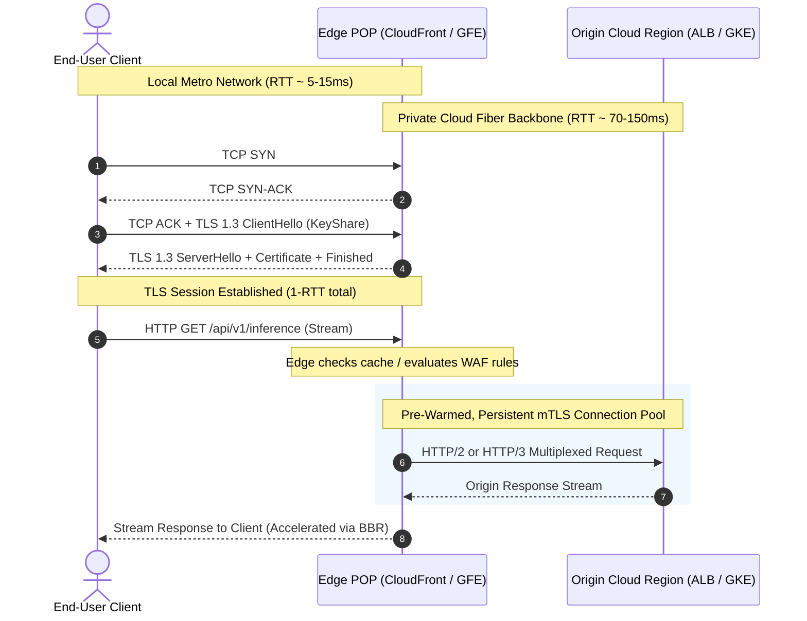

# Edge Infrastructure and TLS Termination

## TL;DR

Edge infrastructure moves compute, caching, and cryptographic termination out of centralized cloud regions and onto hundreds of global Points of Presence (POPs) located directly inside metro carrier exchanges.
Terminating Transport Layer Security (TLS) at the edge reduces handshake latency from multiple cross-ocean round trips down to a single local hop, while routing backhaul traffic to origin datacenters over private, congestion-free fiber backbones.
TLS 1.3 reduces the standard cryptographic handshake to exactly 1 round-trip time (1-RTT) and introduces 0-RTT early data resumption using encrypted pre-shared keys.
Zero-RTT session resumption exposes applications to replay attacks, requiring edge proxies to reject non-idempotent HTTP state-mutating requests (such as POST or PUT) sent in early data frames.
Google BBR congestion control replaces loss-based algorithms like CUBIC at the edge, maximizing bandwidth across high-latency long-haul paths by measuring real bottleneck bandwidth and minimum round-trip propagation time.

## Mental Model

Edge infrastructure establishes split-TCP connections, terminating client latency locally while accelerating origin requests across a persistent, optimized backbone connection pool.



Without edge termination, a client in Sydney connecting to an origin in Northern Virginia must execute a TCP handshake (1 RTT = 160ms) followed by a TLS handshake (1 RTT = 160ms), incurring over 320ms of pure cryptographic overhead before sending a single HTTP byte.
With edge termination, the client completes TCP and TLS handshakes with a local Sydney POP in under 15ms.
The edge proxy forwards the request over a pre-warmed, pre-authenticated persistent TCP connection to Northern Virginia over private fiber, cutting time-to-first-byte (TTFB) in half.

## Internals

### Edge Point of Presence (POP) Hierarchy

Both AWS and Google Cloud organize their global perimeter into a tiered caching and proxy hierarchy:
- Edge Locations: Hundreds of geographically distributed facilities located in major metropolitan areas close to end users.
They house high-density rack clusters containing Google Front Ends (GFEs) or AWS Edge Proxies connected directly to Internet Service Providers (ISPs) via Internet Exchange Points (IXPs) and private network-to-network interfaces (NNIs).
- Regional Edge Caches (REC): Positioned between local edge locations and origin datacenters.
Regional Edge Caches feature larger storage tiers that retain cached objects evicted from local edge locations due to memory pressure, shielding the origin from cache-stampede traffic.
- Private Global Backbones: Once traffic enters an edge POP bound for an origin hosted in the same cloud, it does not traverse the public, unmanaged Internet (origins outside the cloud are still reached over the Internet).
It travels over dedicated, private terrestrial and subsea fiber-optic cables owned and operated by the cloud provider, avoiding public BGP routing congestion, packet drops, and transit hops.

### TLS 1.3 Protocol Mechanics and Handshake Latency

Defined in RFC 8446, TLS 1.3 radically overhauls secure communications:
- Mandatory 1-RTT Handshake: In TLS 1.2, negotiating cipher suites and exchanging Diffie-Hellman parameters required two round trips (2-RTT).
TLS 1.3 eliminates obsolete cipher suites (dropping RSA key transport, static Diffie-Hellman, RC4, and CBC-mode ciphers).
Because every full TLS 1.3 handshake uses ephemeral Diffie-Hellman key exchange ((EC)DHE) from a small set of named groups, the client guesses the server's key exchange algorithm and includes its `KeyShare` parameter directly inside the initial `ClientHello`.
The server responds with `ServerHello`, its certificate, and `Finished` in one flight, completing the cryptographic handshake in exactly 1-RTT.
- Cryptographic Ciphers: TLS 1.3 restricts symmetric encryption to Authenticated Encryption with Associated Data (AEAD) algorithms:
  - `TLS_AES_256_GCM_SHA384`
  - `TLS_CHACHA20_POLY1305_SHA256`
  - `TLS_AES_128_GCM_SHA256`
- Forward Secrecy: Because full handshakes always use ephemeral (EC)DHE, compromising the server's long-term private key in the future cannot decrypt recorded historical network traffic.
The exception is PSK resumption: the `psk_ke` mode skips the fresh (EC)DHE exchange and loses forward secrecy with respect to the PSK, so edges should offer only `psk_dhe_ke`, and 0-RTT early data is never forward secret.

### Zero-RTT (0-RTT) Early Data and Replay Attacks

TLS 1.3 allows a returning client to send application data in its very first flight (`0-RTT`):
1. How 0-RTT Operates: During an earlier connection, the server issues a Pre-Shared Key (PSK) identity encapsulated inside a Session Ticket.
When reconnecting, the client encrypts the initial HTTP request using this PSK and transmits it alongside the `ClientHello`.
2. The Replay Attack Vulnerability: Unlike standard handshakes where random nonces prevent replay, a passive network adversary can intercept a 0-RTT packet and re-transmit it to the server multiple times.
If the 0-RTT payload is an idempotent `GET /index.html`, replaying causes minimal harm.
However, if the 0-RTT payload is a state-mutating request (such as `POST /api/v1/transfer_funds` or `POST /api/v1/generate_token`), the server could execute the transaction repeatedly.
3. Edge Mitigations:
   - Method Restriction: RFC 8446 defines early data but gives it no replay protection across connections (Section 8 and Appendix E.5), and it forbids application protocols from using 0-RTT without a profile that defines its use.
   RFC 8470 is that profile for HTTP: clients MAY send safe methods in early data and MUST NOT send unsafe methods (or methods of unknown safety); an intermediary that forwards a request before the handshake completes MUST add `Early-Data: 1`; and a server unwilling to risk a replay answers `425 (Too Early)`, which the client MUST retry after the handshake.
   An edge proxy therefore accepts early data only for safe methods such as `GET` and `HEAD`, and either delays or rejects with 425 anything else.
   - Single-Use Ticket Trackers: RFC 8446 Section 8 describes single-use tickets, ClientHello recording, and freshness checks; edge proxies implement them with distributed Bloom filters and local in-memory caches of recently seen tickets or ClientHellos, rejecting replays within a sliding time window.

### Session Resumption and Distributed STEK Rotation

Maintaining TLS session state across a globally distributed fleet requires decoupled key management:
- Session IDs (RFC 5246): The server stores session state in local memory and gives the client an arbitrary lookup ID.
This fails in multi-server cloud fleets because subsequent queries hit different edge servers that lack the cached session state.
- Session Tickets (RFC 5077): The server encrypts the session state (cipher suite, master secret, client identity) using a secret Session Ticket Encryption Key (STEK) and sends the ticket to the client.
On reconnection, the client returns the ticket, and any server holding the STEK can decrypt it locally without consulting a centralized database.
- Global STEK Rotation: Hyperscale edge fleets distribute symmetric STEK keys globally via secure gossip or key management pipelines every 1 to 24 hours.
Keys follow a dual-key lifecycle: a `current` key encrypts new tickets, while a `previous` key remains valid for decrypting existing tickets, preventing session drops during key rotation.

### Hardware Cryptographic Offload and BBR Congestion Control

- Hardware Offload: Terminating TLS 1.3 for millions of concurrent requests consumes massive CPU resources for asymmetric elliptic-curve scalar multiplication (X25519) and symmetric AES-GCM encryption.
Edge servers offload these operations to dedicated hardware cryptographic accelerators or CPU vector instruction sets (Intel AVX-512 with VAES, ARMv8 Cryptographic Extensions).
- TCP BBR (Bottleneck Bandwidth and RTT): Traditional TCP congestion control algorithms (Reno, CUBIC) interpret packet loss as an indicator of network congestion.
On long-haul transoceanic fiber links, transient packet loss frequently occurs without buffer overflow, causing CUBIC to cut its congestion window to 70% on every loss event (multiplicative decrease factor 0.7, RFC 9438; Reno halves it) and, on a long-RTT path, to take many seconds to grow back, collapsing throughput.
Google BBR builds an explicit real-time model of the physical path from two estimates, the bottleneck bandwidth (BtlBw) and the round-trip propagation time (RTprop), whose product is the bandwidth-delay product:
$$BDP = \text{BtlBw} \times \text{RTprop}$$
BBR paces packet transmissions at the estimated bottleneck bandwidth and aims to keep about one BDP of data in flight (capping the window at a small multiple of BDP), which limits queue build-up at intermediate routers and sustains high throughput across lossy transoceanic routes.

## Numbers to Know

| Parameter | Specification / Threshold | Context / Notes | Sourced As-Of |
|---|---|---|---|
| TLS 1.2 Full Handshake Latency | 2 RTT (e.g., 300ms intercontinental) | Requires separate cipher and key exchange flights | RFC 5246 Specification |
| TLS 1.3 Full Handshake Latency | 1 RTT (e.g., 15ms local edge POP) | 1-RTT key exchange via pre-populated KeyShare | RFC 8446 Specification |
| TLS 1.3 0-RTT Latency | 0 RTT (Application data in first flight) | HTTP clients may send only safe methods in early data | RFC 8446 (mechanism), RFC 8470 (HTTP rules) |
| CloudFront Edge POP Count | 750+ POPs in 100+ cities across 50+ countries, plus 15 Regional Edge Caches | Embedded POPs inside ISP networks are counted separately | AWS CloudFront details page (as of 2026-10) |
| Google Cloud Edge Locations | 200+ network edge locations | Integrated with Google Front End (GFE) network | Google Cloud VPC docs (as of 2026-10) |
| STEK Lifetime / Rotation Window | Commonly rotated every 1 to 24 hours | Dual-key overlap prevents session drop | UNVERIFIED (operator practice, no provider-published figure) |
| CloudFront Data Out to Internet | $0.085 / GB (First 10 TB, US/Europe) | CloudFront free tier includes 1 TB/month | AWS Pricing (as of 2026-10) |
| CloudFront HTTPS Requests | $0.0100 per 10,000 (US), $0.0120 per 10,000 (Europe) | Free tier includes 10,000,000 requests/month | AWS Pricing (as of 2026-10) |
| Google Cloud CDN Egress Price | $0.080 / GiB cache egress (First 10 TiB, North America/Europe) | Cache fill and cache lookups are billed separately | GCP Pricing (as of 2026-10) |

## AWS vs GCP Mechanism Parity

| Mechanism | Amazon Web Services (CloudFront) | Google Cloud Platform (Cloud CDN) | Architectural Distinction |
|---|---|---|---|
| Edge Proxy Architecture | Amazon CloudFront (Dedicated reverse-proxy software on custom hardware) | Google Front End (GFE - Unified edge proxy for Search, YouTube, Cloud) | GFEs handle all internal and external Google services simultaneously using a unified codebase; CloudFront is an AWS-specific service. |
| Ingress Network Steering | DNS-based steering: CloudFront's DNS answers with IP addresses of a nearby edge location | Anycast VIPs terminated directly at nearest edge POP | GCP provides single static Anycast IP addresses globally; CloudFront steers by DNS resolution to per-location edge addresses (with optional anycast static IPs). |
| Regional Cache Layer | Regional Edge Caches (REC) sitting between POPs and origin | Media CDN and multi-tier edge cache hierarchy | Both platforms shield origin datacenters using intermediate caching tiers with multi-terabyte storage. |
| Edge Programmability | CloudFront Functions (lightweight JavaScript runtime, ES 5.1 compliant plus some ES6-12 features) and Lambda@Edge | Service Extensions (callouts and plugins) on Cloud Load Balancing and Media CDN | CloudFront Functions execute short request and response transforms at edge locations; Lambda@Edge runs full Node.js or Python functions at Regional Edge Caches. |

## Worked Example: CloudFront CDN Distribution with OpenTofu / Terraform

Consider deploying a global caching and TLS termination layer for an AI inference API.
We redirect HTTP to HTTPS (CloudFront negotiates TLS 1.3 with clients that support it), restrict the behavior to safe HTTP methods, and set TTL bounds in a custom cache policy.

### Capacity and Cost Calculation

1. Traffic Profile:
   - Monthly requests: 50,000,000 HTTP/S requests.
   - Monthly egress volume: 20 TB (20,000 GB) delivered to end users.
   - Cache hit ratio: 80% of requests served directly from the edge.

2. Cost Estimation (US/Europe Region, as of 2026-10):
   - Data Transfer Out (First 1 TB free):
     `19,000 GB * $0.085 / GB = $1,615.00`.
   - HTTPS Request Fees ($0.0100 per 10,000 requests in the US; first 10,000,000 requests free):
     `(50,000,000 - 10,000,000) / 10,000 = 4,000 units * $0.0100 = $40.00`.
     Without the free tier the same line is `5,000 units * $0.0100 = $50.00`; note that `5,000 * $0.10` would be $500.00, ten times the real price.
   - Regional Edge Cache tier: no additional charge; Origin Shield is not enabled here and would add $0.0075 per 10,000 requests that reach it (US).
   - Total Monthly Edge Cost: `$1,615.00 + $40.00 = $1,655.00 / month`.
   - Cost Comparison vs Direct Origin Egress:
     Serving the same 20,000 GB straight from EC2 costs about $1,740 in data transfer (first 100 GB free, then $0.09/GB up to 10 TB and $0.085/GB for the next 40 TB), plus the compute to terminate 50M TLS sessions.
     Caching 80% of requests at the edge offloads 40M requests from regional compute; the dollar value of that offload depends on per-request origin cost and is not estimated here.

3. Lab Cost (the configuration below as written, with only test traffic; AWS CloudFront, Amazon S3, and AWS Budgets pricing, as of 2026-10):
   - CloudFront: test traffic stays inside the always-free monthly tier (1 TB data transfer out, 10,000,000 requests), which is shared by every distribution in the account.
   - S3 origin: an empty or near-empty bucket costs well under $0.01 per month, and data transfer from an AWS origin to CloudFront is not charged.
   - Cache policy and origin access control: no charge.
   - Budget: AWS Budgets without actions is free.
   - Lab total: about $0.00 per month unless the account has already used its CloudFront free tier.

### Runnable OpenTofu / Terraform Configuration: CloudFront with HTTPS Enforcement and a Custom Cache Policy

```hcl
# edge_cdn.tf - CloudFront Distribution with HTTPS redirect and explicit cache policy
terraform {
  required_version = ">= 1.6.0"
  required_providers {
    aws = {
      source  = "hashicorp/aws"
      version = "~> 5.0"
    }
    random = {
      source  = "hashicorp/random"
      version = "~> 3.0"
    }
  }
}

provider "aws" {
  region = "us-east-1"
}

variable "budget_alert_email" {
  type        = string
  description = "Email address that receives the lab budget alerts"
}

# Budget alarm: account-wide monthly cost budget for the lab (budgets without actions are free)
resource "aws_budgets_budget" "lab_budget" {
  name         = "cloud-ai-ch04-edge-lab"
  budget_type  = "COST"
  limit_amount = "10"
  limit_unit   = "USD"
  time_unit    = "MONTHLY"

  notification {
    comparison_operator        = "GREATER_THAN"
    threshold                  = 50
    threshold_type             = "PERCENTAGE"
    notification_type          = "ACTUAL"
    subscriber_email_addresses = [var.budget_alert_email]
  }

  notification {
    comparison_operator        = "GREATER_THAN"
    threshold                  = 100
    threshold_type             = "PERCENTAGE"
    notification_type          = "FORECASTED"
    subscriber_email_addresses = [var.budget_alert_email]
  }
}

# Example Origin: S3 Bucket or Application Load Balancer
resource "aws_s3_bucket" "origin_bucket" {
  bucket        = "cloud-ai-origin-assets-${random_id.bucket_suffix.hex}"
  force_destroy = true
}

resource "random_id" "bucket_suffix" {
  byte_length = 4
}

# Origin Access Control (OAC) to secure origin access
resource "aws_cloudfront_origin_access_control" "oac" {
  name                              = "cloud-ai-oac"
  description                       = "OAC for securing S3 origin"
  origin_access_control_origin_type = "s3"
  signing_behavior                  = "always"
  signing_protocol                  = "sigv4"
}

# TTL bounds live in the cache policy. Behavior-level min_ttl/default_ttl/max_ttl and
# forwarded_values are deprecated legacy settings; a behavior uses either a cache
# policy or forwarded_values, and a cache policy's TTLs take precedence.
resource "aws_cloudfront_cache_policy" "edge_cache" {
  name        = "cloud-ai-edge-cache"
  comment     = "Static assets: no cookies, headers, or query strings in the cache key"
  min_ttl     = 0
  default_ttl = 3600
  max_ttl     = 86400

  parameters_in_cache_key_and_forwarded_to_origin {
    cookies_config {
      cookie_behavior = "none"
    }
    headers_config {
      header_behavior = "none"
    }
    query_strings_config {
      query_string_behavior = "none"
    }
    # Normalizes Accept-Encoding into the cache key so compress = true is effective
    enable_accept_encoding_brotli = true
    enable_accept_encoding_gzip   = true
  }
}

resource "aws_cloudfront_distribution" "cdn" {
  enabled             = true
  is_ipv6_enabled     = true
  comment             = "Cloud AI Edge Distribution"
  default_root_object = "index.html"

  origin {
    domain_name              = aws_s3_bucket.origin_bucket.bucket_regional_domain_name
    origin_id                = "s3-origin"
    origin_access_control_id = aws_cloudfront_origin_access_control.oac.id
  }

  default_cache_behavior {
    allowed_methods  = ["GET", "HEAD", "OPTIONS"]
    cached_methods   = ["GET", "HEAD"]
    target_origin_id = "s3-origin"

    # Cache key, forwarded values, and TTLs all come from the cache policy
    cache_policy_id = aws_cloudfront_cache_policy.edge_cache.id

    viewer_protocol_policy = "redirect-to-https"
    compress               = true
  }

  # Restrict geographical distribution to lower costs if desired
  price_class = "PriceClass_100" # US, Canada, Europe

  restrictions {
    geo_restriction {
      restriction_type = "none"
    }
  }

  # The default *.cloudfront.net certificate fixes the security policy at TLSv1, so
  # minimum_protocol_version cannot be raised here. To enforce TLS 1.2+ (for example
  # "TLSv1.2_2021"), attach an ACM certificate from us-east-1 with
  # ssl_support_method = "sni-only" and an alias (custom domain) on the distribution.
  viewer_certificate {
    cloudfront_default_certificate = true
  }
}

# Let only this distribution read the bucket through OAC
data "aws_iam_policy_document" "origin_read" {
  statement {
    sid       = "AllowCloudFrontOACRead"
    actions   = ["s3:GetObject"]
    resources = ["${aws_s3_bucket.origin_bucket.arn}/*"]

    principals {
      type        = "Service"
      identifiers = ["cloudfront.amazonaws.com"]
    }

    condition {
      test     = "StringEquals"
      variable = "AWS:SourceArn"
      values   = [aws_cloudfront_distribution.cdn.arn]
    }
  }
}

resource "aws_s3_bucket_policy" "origin_read" {
  bucket = aws_s3_bucket.origin_bucket.id
  policy = data.aws_iam_policy_document.origin_read.json
}

# Deploy Command:
# tofu init && tofu apply -var 'budget_alert_email=you@example.com'
# Teardown Command (force_destroy empties the bucket; CloudFront must disable the
# distribution before deleting it, so destroy can take several minutes):
# tofu destroy -auto-approve -var 'budget_alert_email=you@example.com'
```

## Failure Modes and Pitfalls

### Pitfall 1: Replay Attack Exploitation via Misconfigured 0-RTT Endpoints
If an edge proxy terminates TLS 1.3 with 0-RTT early data enabled, and forwards incoming requests directly to a non-idempotent API gateway without inspecting the method, malicious actors can record valid 0-RTT packets from the wire and replay them.
Symptoms: Duplicate account registrations, duplicated billing charges, or corrupted database balances caused by replayed client sessions.
Mitigation: Enforce strict WAF rules at the edge.
Answer `425 (Too Early)` to any request carrying the early data header (`Early-Data: 1`) whose method is unsafe (POST, PUT, DELETE, PATCH), so the client retries it after the handshake completes (RFC 8470).

### Pitfall 2: Cache Stampede (Thundering Herd) on Origin Outages
When a highly requested cached asset expires at the edge, hundreds of concurrent incoming requests miss the cache simultaneously.
The edge proxy opens hundreds of simultaneous backend connections to the origin to fetch the exact same object.
This sudden traffic spike overloads the database or origin application, causing cascading failures.
Mitigation: Enable Origin Shield on CloudFront, or request collapsing on self-managed caches (NGINX `proxy_cache_lock`, Varnish request coalescing, Apache Traffic Server collapsed forwarding).
Request collapsing holds concurrent duplicate requests in an edge queue, sending exactly one request to the origin and streaming the response to all waiting clients simultaneously.

### Pitfall 3: Stale STEK Keys Causing Fleet-Wide Reconnection Storms
If the automated key rotation pipeline for Session Ticket Encryption Keys (STEK) fails silently, edge servers eventually discard expired keys without receiving replacements.
Clients attempting to resume sessions are rejected with a cache miss, forcing millions of clients into full 1-RTT cryptographic handshakes simultaneously.
The sudden spike in asymmetric cryptographic operations overwhelms edge CPU limits, elevating latency for all edge traffic.
Mitigation: Implement synthetic monitoring for TLS session resumption success rates and alert immediately if session ticket decryption failures exceed 1%.

## Security and Cost Angles

- Web Application Firewall (WAF) Integration: Terminating TLS at the edge allows cloud WAFs (AWS WAF, Google Cloud Armor) to inspect plaintext HTTP request headers, query parameters, and bodies at the perimeter before malicious traffic reaches private VPC networks.
- Origin Cloaking: Origins should never be exposed directly to the public Internet.
Configure origin security groups to accept traffic exclusively from CloudFront or Cloud CDN IP ranges, or enforce AWS Origin Access Control (OAC) / GCP Private Service Connect.
- Cost Optimization via Edge Caching: Caching static assets, pre-computed model responses, and vector search chunks at the edge eliminates origin egress fees and database compute cycles.
Serving an object from CloudFront costs ~$0.085/GB; serving that same object directly from an EC2 instance to the Internet costs $0.09/GB plus the EC2 instance compute hours required to process the HTTP server thread.

## Interview Questions and Model Answers

### Question 1 (L5 - Senior)
Why does TLS 1.3 require fewer round trips than TLS 1.2, and how does it achieve this reduction?

#### Model Answer
In TLS 1.2, the client and server negotiate cryptographic parameters across two full round trips (2-RTT):
1. In Flight 1, the client sends `ClientHello` listing supported cipher suites; the server responds with `ServerHello`, its chosen cipher suite, and its digital certificate.
2. In Flight 2, the client verifies the certificate, exchanges key parameters (such as Diffie-Hellman parameters or an RSA-encrypted pre-master secret), and sends a `Finished` message; the server verifies and responds with `Finished`.
Only then can application data flow.
TLS 1.3 eliminates static RSA key exchange and mandates Ephemeral Diffie-Hellman (ECDHE).
Because the key exchange mechanism is standardized, the client does not wait for the server's choice.
Instead, the client predicts the server's preferred elliptic curve (e.g., X25519) and transmits its public key share directly inside the initial `ClientHello` (`KeyShare` extension).
The server reads the client's key share, computes the shared secret, generates its own key share, and sends its `ServerHello`, certificate, and `Finished` message in a single flight.
The client computes the shared secret and begins transmitting encrypted application data immediately, completing the handshake in exactly 1-RTT.

#### Follow-up Interviewer Question
What happens in TLS 1.3 if the client guesses the wrong elliptic curve in its initial KeyShare?

### Question 2 (L6 - Staff)
What is a TLS 0-RTT replay attack, why does it occur, and how must an architect defend against it at the edge layer?

#### Model Answer
TLS 1.3 0-RTT (Early Data) allows a client resuming a previous session to encrypt and transmit application data in its very first flight along with the `ClientHello`, using a Pre-Shared Key (PSK) derived from an earlier session ticket.
Because this early data is sent before the server sends its `ServerHello` and establishes fresh cryptographic nonces, the early data payload is completely static on the physical wire.
A network attacker who records the raw network packets can replay the exact same byte sequence to the server minutes or hours later.
The server, holding the valid Session Ticket Encryption Key, decrypts the replayed data and processes it as a valid request.
Defenses at the edge layer:
1. Idempotency Gatekeeping: The edge proxy must enforce a strict policy where only safe, idempotent HTTP methods (such as `GET` and `HEAD`) are accepted via 0-RTT early data.
All non-idempotent methods (`POST`, `PUT`, `DELETE`, `PATCH`) received in early data must be buffered and delayed until the 1-RTT handshake completes, or rejected with HTTP 425 Too Early.
2. Anti-Replay Mechanisms: Edge proxies implement single-use ticket tracking using distributed Bloom filters and client hello timestamp verification, rejecting tickets that fall outside a narrow validity window (e.g., +/- 10 seconds).

#### Follow-up Interviewer Question
How does Google BBR congestion control handle packet loss differently than TCP CUBIC across transoceanic fiber links connecting edge POPs to origin datacenters?

### Question 3 (L7+ - Principal)
Design a global edge acceleration layer for an ultra-low-latency real-time AI inference platform serving voice and streaming token generation to 10 million concurrent users worldwide. Optimize for time-to-first-byte (TTFB) and tail latency.

#### Model Answer
Architectural Blueprint:
1. Perimeter Network and Protocol Sizing:
   - Terminate client connections at global edge POPs using Anycast routing (BGP Anycast over AWS Global Accelerator or Google Cloud External Application Load Balancers).
   - Enforce HTTP/3 over QUIC (RFC 9000) at the edge.
   QUIC combines the transport and TLS 1.3 cryptographic handshake into a single round trip over UDP, and its independent streams remove TCP's cross-stream head-of-line blocking on lossy wireless/mobile client connections.
   - For clients that do not support QUIC, fall back to TLS 1.3 over TCP with BBR congestion control and aggressive TCP window scaling.
2. Backhaul Connection Pooling and Split-TCP:
   - Edge POPs maintain persistent, warm connection pools to the origin cloud regions across dedicated private fiber backbones (AWS Global Backbone or Google Private Network).
   - Transport between edge POPs and origin uses HTTP/2 multiplexing or specialized streaming protocols (such as gRPC over persistent mTLS tunnels) with BBR congestion control.
   - Because the edge-to-origin link has near-zero packet loss and predictable latency, TCP windows remain wide open, eliminating slow-start latency penalties.
3. Edge Token Streaming and Caching:
   - LLM responses are streamed as Server-Sent Events (SSE) or WebSockets.
   Edge proxies buffer only small chunk frames to minimize jitter before pushing tokens to the client.
   - Common prompt prefixes and system instructions are evaluated for prompt-caching headers at the edge, routing requests to specific GPU clusters that hold warm KV-cache blocks for that prompt.
4. Failover and Health State Reconciliation:
   - Edge proxies perform active Layer 7 health probing against regional inference endpoints.
   - If an origin region's p99 queue time exceeds 200 milliseconds, the edge proxy's dynamic load balancer sheds traffic to the next closest region over the private backbone, completely invisible to the client connection.

#### Follow-up Interviewer Question
If an adversary floods your edge POPs with SSL renegotiation attacks or malformed TLS ClientHello packets, how does your edge layer protect its cryptographic offload hardware from exhaustion?

### Question 4 (L5 - Senior)
A fleet of thousands of edge servers behind anycast sees a TLS resumption rate below 10%, so most returning clients pay for a full handshake.
Explain how session resumption works across a fleet, why the rate is low, and what the security cost of fixing it is.

#### Model Answer
Resumption lets a returning client skip the certificate exchange and the server's signature, which are the expensive asymmetric operations at the edge.
TLS 1.2 session IDs keep the session state in the memory of the server that issued it, so resumption works only if the next connection lands on the same server; behind anycast and per-POP load balancers it usually does not, which is the most common cause of a low rate.
Session tickets (RFC 5077 for TLS 1.2, `NewSessionTicket` PSKs in TLS 1.3) move the state to the client: the server encrypts it under a Session Ticket Encryption Key (STEK), and any server holding that STEK can decrypt the ticket and resume.
So the fix is to share STEKs across every server that may receive the client's next connection, with a dual-key window (a current key that issues tickets and a previous key that still decrypts) so rotation does not invalidate live tickets.
The security cost is that the STEK becomes a high-value secret:
1. In TLS 1.2, a ticket carries the master secret, so anyone who steals a STEK can decrypt every recorded session whose ticket it protected until that key is destroyed; forward secrecy degrades to the STEK rotation interval.
2. In TLS 1.3, the `psk_dhe_ke` mode mixes a fresh (EC)DHE exchange into the resumed handshake, so a stolen STEK alone does not decrypt recorded traffic, but 0-RTT early data is protected only by the PSK and remains exposed.
3. RFC 8446 caps ticket lifetime at seven days, which bounds how long a single ticket is usable, but not how long a stolen STEK is useful against recorded traffic.
Operational rules follow: generate STEKs in a key-management pipeline, distribute them only in memory, never write them to disk, rotate them on a fixed schedule, and alert on resumption-rate drops, which are the first symptom of a broken rotation pipeline (Pitfall 3).
The scope of STEK sharing is the core trade-off: sharing globally maximizes resumption but turns one leaked key into a global exposure, whereas per-POP keys contain the blast radius but lose resumption when anycast moves a client to another POP.

#### Follow-up Interviewer Question
How would you measure the resumption rate per POP, and what would you expect it to look like immediately after a STEK rotation if the dual-key window were misconfigured?

### Question 5 (L6 - Staff)
Your CloudFront distribution in front of an inference gateway reports a 12% cache hit ratio, even though product analytics show that most responses are byte-identical.
Diagnose the likely causes and describe how you would raise the hit ratio without serving one user's data to another.

#### Model Answer
A low hit ratio on identical content almost always means the cache key is more specific than the content, so identical objects are stored under many different keys.
In CloudFront, the cache policy defines the cache key (which headers, cookies, and query strings are included, plus the TTL bounds), and every value in the cache key is also forwarded to the origin.
Diagnosis, from most to least common:
1. Cookies or broad headers in the cache key: including all cookies, `User-Agent`, or similar high-cardinality values fragments the cache per user or per browser build.
2. Unnormalized query strings: tracking parameters, random cache-busting values, or the same parameters in different order produce distinct keys for the same object.
3. Accept-Encoding variation: without the policy's gzip and Brotli normalization, compressed variants multiply.
4. TTLs that are too short or `Cache-Control: no-store` from the origin: objects expire before a second request arrives at the same edge location.
5. Geographic spread: each edge location has its own cache, so a long tail of locations each sees the object too rarely to hit.
Fixes:
- Keep only values that actually change the response in the cache policy, and move values the origin needs but that do not change the response (for example a request ID) into an origin request policy, which forwards them without adding them to the cache key.
- Normalize or strip query parameters at the edge with a CloudFront Function before the cache lookup.
- Set TTL bounds in the cache policy and have the origin send explicit `Cache-Control` with `max-age` or `s-maxage`.
- Enable Origin Shield so every edge miss is served from one regional layer, which raises the effective hit ratio seen by the origin at an extra per-request charge ($0.0075 per 10,000 requests in the US, AWS pricing as of 2026-10).
Isolation guardrail: anything that varies by user (authorization, tenant, entitlement) must either be part of the cache key or make the response uncacheable; never drop such a value from the key to improve the hit ratio, because the result is a cross-user data leak, which is far worse than a low hit ratio.
The trade-off is that every value added to the key lowers the hit ratio, so the design work is to make personalized responses small and separate from the large shared ones.

#### Follow-up Interviewer Question
How would you cache responses for an authenticated API where entitlements differ per tenant but most tenants see identical content?

### Question 6 (L7+ - Principal)
A regulated customer asks whether their inference traffic, which contains personal data, may be decrypted at your cloud provider's edge.
Lay out the trust boundary of edge TLS termination, the alternative architectures, and how you would decide.

#### Model Answer
Edge termination means the provider's edge process holds the TLS session keys and sees plaintext requests and responses in memory, and every edge feature (WAF, caching, header rewriting, logging) depends on that plaintext.
The trust boundary therefore includes the provider's edge software, its operators, and any logs the edge writes, not only the customer's own VPC.
Architectures, from most edge capability to least plaintext exposure:
1. Terminate at the edge and re-encrypt to the origin: CloudFront can use HTTPS to the origin and checks that the origin certificate is valid for the origin domain; on Google Cloud, the load balancer does not validate certificates presented by backends inside Google Cloud unless backend authenticated TLS is configured, so encryption to the backend does not by itself authenticate the backend (Google Cloud docs, as of 2026-10).
This keeps WAF and caching, but plaintext still exists at the edge.
2. Edge termination with field-level protection: CloudFront field-level encryption encrypts specified POST form fields at the edge with a public key, so only the origin application holding the private key can read them; it protects selected fields, not whole JSON or streaming payloads.
3. Key custody without plaintext custody: designs such as Cloudflare Keyless SSL keep the certificate private key on the customer's key server, but the edge still derives session keys and sees plaintext, so they address key theft, not data visibility.
4. Layer 4 pass-through: AWS Global Accelerator, or a Google passthrough Network Load Balancer, forwards encrypted bytes and terminates TLS in the customer's VPC; it keeps anycast ingress and the private backbone, but loses edge WAF, caching, and the short client-to-edge TLS handshake, because the TLS handshake now spans the full client-to-origin RTT.
5. Application-layer encryption: the client encrypts the payload end to end (for example with HPKE, RFC 9180), so any TLS terminator sees only ciphertext bodies; this costs client changes and disables body inspection and caching.
Decision process: classify which fields are actually sensitive, check whether the provider's compliance attestations cover edge processing for that data class, and then pick the least exposure that still meets the latency and protection goals; often the answer is split, with public and cacheable paths terminated at the edge and the sensitive inference path on Layer 4 pass-through or application-layer encryption.
Whichever option is chosen, audit edge logging configuration (WAF and access logs can capture headers and query strings) as part of the same review.

#### Follow-up Interviewer Question
If the edge provider suffered a memory-disclosure bug like Cloudflare's 2017 "Cloudbleed" incident, which of these architectures would have limited what leaked, and why?

## Further Reading

- [RFC 8446: The Transport Layer Security (TLS) Protocol Version 1.3](https://datatracker.ietf.org/doc/html/rfc8446) - The definitive IETF specification for TLS 1.3 handshakes, 0-RTT data, and cipher suites.
- [BBR: Congestion-Based Congestion Control (ACM Queue 2016)](https://queue.acm.org/detail.cfm?id=3022184) - Neal Cardwell and the Google networking team detail the physics and math behind BBR.
- [Amazon CloudFront Architecture Guide](https://docs.aws.amazon.com/AmazonCloudFront/latest/DeveloperGuide/Introduction.html) - Technical details on Points of Presence, Regional Edge Caches, and origin shielding.
- [RFC 8470: Using Early Data in HTTP](https://datatracker.ietf.org/doc/html/rfc8470) - The HTTP profile for 0-RTT: safe-method rules, the `Early-Data` header, and the 425 (Too Early) status code.
- [Cloudflare: Introducing Zero Round Trip Time Resumption (0-RTT)](https://blog.cloudflare.com/introducing-0-rtt/) - Production account of deploying 0-RTT at a CDN edge, including replay risk and the request restrictions used to contain it.
