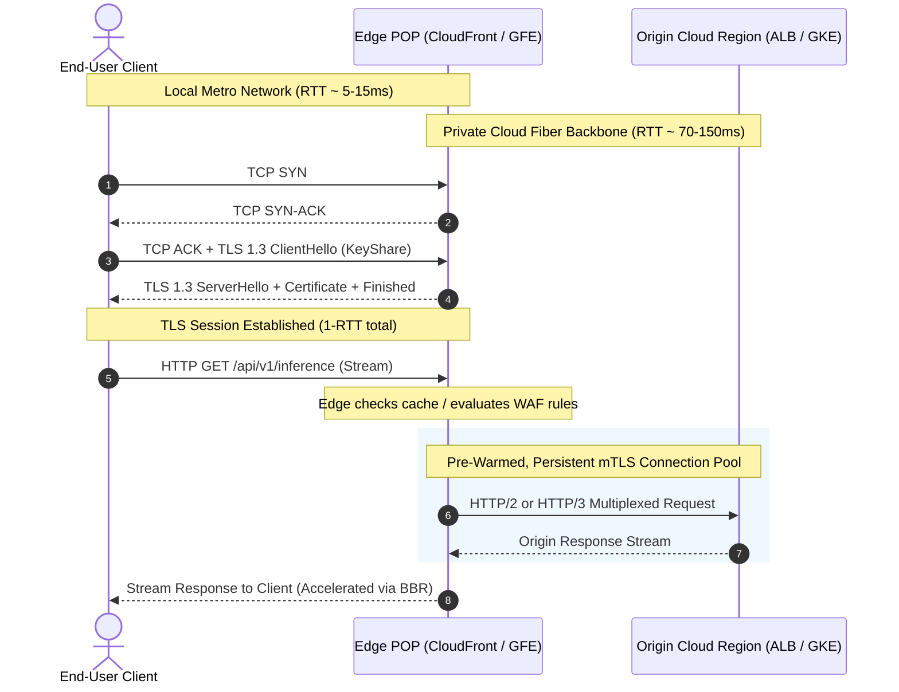

# Edge Infrastructure and TLS Termination

## TL;DR

Edge infrastructure moves compute, caching, and cryptographic termination out of centralized cloud regions and onto hundreds of global Points of Presence (POPs) located directly inside metro carrier exchanges.
Terminating Transport Layer Security (TLS) at the edge reduces handshake latency from multiple cross-ocean round trips down to a single local hop, while routing backhaul traffic to origin datacenters over private, congestion-free fiber backbones.
TLS 1.3 reduces the standard cryptographic handshake to exactly 1 round-trip time (1-RTT) and introduces 0-RTT early data resumption using encrypted pre-shared keys.
Zero-RTT session resumption exposes applications to replay attacks, requiring edge proxies to reject non-idempotent HTTP state-mutating requests (such as POST or PUT) sent in early data frames.
Google BBR congestion control replaces loss-based algorithms like CUBIC at the edge, maximizing bandwidth across high-latency long-haul paths by measuring real bottleneck bandwidth and minimum round-trip propagation time.

## Mental Model

Edge infrastructure establishes split-TCP connections, terminating client latency locally while accelerating origin requests across a persistent, optimized backbone connection pool.



Without edge termination, a client in Sydney connecting to an origin in Northern Virginia must execute a TCP handshake (1 RTT = 160ms) followed by a TLS handshake (1 RTT = 160ms), incurring over 320ms of pure cryptographic overhead before sending a single HTTP byte.
With edge termination, the client completes TCP and TLS handshakes with a local Sydney POP in under 15ms.
The edge proxy forwards the request over a pre-warmed, pre-authenticated persistent TCP connection to Northern Virginia over private fiber, cutting time-to-first-byte (TTFB) in half.

## Internals

### Edge Point of Presence (POP) Hierarchy

Both AWS and Google Cloud organize their global perimeter into a tiered caching and proxy hierarchy:
- Edge Locations: Hundreds of geographically distributed facilities located in major metropolitan areas close to end users.
They house high-density rack clusters containing Google Front Ends (GFEs) or AWS Edge Proxies connected directly to Internet Service Providers (ISPs) via Internet Exchange Points (IXPs) and private network-to-network interfaces (NNIs).
- Regional Edge Caches (REC): Positioned between local edge locations and origin datacenters.
Regional Edge Caches feature larger storage tiers that retain cached objects evicted from local edge locations due to memory pressure, shielding the origin from cache-stampede traffic.
- Private Global Backbones: Once traffic enters an edge POP, it never traverses the public, unmanaged Internet.
It travels over dedicated, private terrestrial and subsea fiber-optic cables owned and operated by the cloud provider, avoiding public BGP routing congestion, packet drops, and transit hops.

### TLS 1.3 Protocol Mechanics and Handshake Latency

Defined in RFC 8446, TLS 1.3 radically overhauls secure communications:
- Mandatory 1-RTT Handshake: In TLS 1.2, negotiating cipher suites and exchanging Diffie-Hellman parameters required two round trips (2-RTT).
TLS 1.3 eliminates obsolete cipher suites (dropping RSA key transport, static Diffie-Hellman, RC4, and CBC-mode ciphers).
Because all permitted ciphers use Ephemeral Diffie-Hellman (ECDHE), the client guesses the server's key exchange algorithm and includes its `KeyShare` parameter directly inside the initial `ClientHello`.
The server responds with `ServerHello`, its certificate, and `Finished` in one flight, completing the cryptographic handshake in exactly 1-RTT.
- Cryptographic Ciphers: TLS 1.3 restricts symmetric encryption to Authenticated Encryption with Associated Data (AEAD) algorithms:
  - `TLS_AES_256_GCM_SHA384`
  - `TLS_CHACHA20_POLY1305_SHA256`
  - `TLS_AES_128_GCM_SHA256`
- Forward Secrecy: By mandating ECDHE for every session, compromising the server's long-term private key in the future cannot decrypt recorded historical network traffic.

### Zero-RTT (0-RTT) Early Data and Replay Attacks

TLS 1.3 allows a returning client to send application data in its very first flight (`0-RTT`):
1. How 0-RTT Operates: During an earlier connection, the server issues a Pre-Shared Key (PSK) identity encapsulated inside a Session Ticket.
When reconnecting, the client encrypts the initial HTTP request using this PSK and transmits it alongside the `ClientHello`.
2. The Replay Attack Vulnerability: Unlike standard handshakes where random nonces prevent replay, a passive network adversary can intercept a 0-RTT packet and re-transmit it to the server multiple times.
If the 0-RTT payload is an idempotent `GET /index.html`, replaying causes minimal harm.
However, if the 0-RTT payload is a state-mutating request (such as `POST /api/v1/transfer_funds` or `POST /api/v1/generate_token`), the server could execute the transaction repeatedly.
3. Edge Mitigations:
   - Method Restriction: RFC 8446 mandates that edge proxies must never forward non-idempotent HTTP methods (POST, PUT, DELETE, PATCH) received via 0-RTT early data.
   - Single-Use Ticket Trackers: Edge proxies maintain distributed Bloom filters and local in-memory caches to record recently seen session tickets, rejecting replayed tickets within a sliding time window.

### Session Resumption and Distributed STEK Rotation

Maintaining TLS session state across a globally distributed fleet requires decoupled key management:
- Session IDs (RFC 5246): The server stores session state in local memory and gives the client an arbitrary lookup ID.
This fails in multi-server cloud fleets because subsequent queries hit different edge servers that lack the cached session state.
- Session Tickets (RFC 5077): The server encrypts the session state (cipher suite, master secret, client identity) using a secret Session Ticket Encryption Key (STEK) and sends the ticket to the client.
On reconnection, the client returns the ticket, and any server holding the STEK can decrypt it locally without consulting a centralized database.
- Global STEK Rotation: Hyperscale edge fleets distribute symmetric STEK keys globally via secure gossip or key management pipelines every 1 to 24 hours.
Keys follow a dual-key lifecycle: a `current` key encrypts new tickets, while a `previous` key remains valid for decrypting existing tickets, preventing session drops during key rotation.

### Hardware Cryptographic Offload and BBR Congestion Control

- Hardware Offload: Terminating TLS 1.3 for millions of concurrent requests consumes massive CPU resources for asymmetric elliptic-curve scalar multiplication (X25519) and symmetric AES-GCM encryption.
Edge servers offload these operations to dedicated hardware cryptographic accelerators or CPU vector instruction sets (Intel AVX-512 with VAES, ARMv8 Cryptographic Extensions).
- TCP BBR (Bottleneck Bandwidth and RTT): Traditional TCP congestion control algorithms (Reno, CUBIC) interpret packet loss as an indicator of network congestion.
On long-haul transoceanic fiber links, transient packet loss frequently occurs without buffer overflow, causing CUBIC to slash its transmission window in half and collapse throughput.
Google BBR builds an explicit real-time mathematical model of the physical path:
$$BBR = \text{Bottleneck Bandwidth} \times \text{Minimum RTT}$$
BBR paces packet transmissions to keep exactly one bandwidth-delay product of data in flight, eliminating bufferbloat at intermediate routers and maintaining line-rate throughput across transoceanic routes.

## Numbers to Know

| Parameter | Specification / Threshold | Context / Notes | Sourced As-Of |
|---|---|---|---|
| TLS 1.2 Full Handshake Latency | 2 RTT (e.g., 300ms intercontinental) | Requires separate cipher and key exchange flights | RFC 5246 Specification |
| TLS 1.3 Full Handshake Latency | 1 RTT (e.g., 15ms local edge POP) | 1-RTT key exchange via pre-populated KeyShare | RFC 8446 Specification |
| TLS 1.3 0-RTT Latency | 0 RTT (Application data in first flight) | Only permitted for safe, idempotent HTTP methods | RFC 8446 Specification |
| CloudFront Edge POP Count | 600+ Points of Presence worldwide | Includes Edge Locations and Regional Edge Caches | AWS Global Infra (as of 2026-10) |
| Google Cloud Edge POP Count | 180+ Edge Network POPs in 200+ countries | Integrated with Google Front End (GFE) network | Google Cloud Infra (as of 2026-10) |
| STEK Lifetime / Rotation Window | Typically rotated every 1 to 24 hours | Dual-key overlap prevents session drop | AWS / Google Sec (as of 2026-10) |
| CloudFront Data Out to Internet | $0.085 / GB (First 10 TB, US/Europe) | CloudFront free tier includes 1 TB/month | AWS Pricing (as of 2026-10) |
| Google Cloud CDN Egress Price | $0.080 / GB (First 10 TB, US/Europe) | Varies by cache hit and network tier | GCP Pricing (as of 2026-10) |

## AWS vs GCP Mechanism Parity

| Mechanism | Amazon Web Services (CloudFront) | Google Cloud Platform (Cloud CDN) | Architectural Distinction |
|---|---|---|---|
| Edge Proxy Architecture | Amazon CloudFront (Dedicated reverse-proxy software on custom hardware) | Google Front End (GFE - Unified edge proxy for Search, YouTube, Cloud) | GFEs handle all internal and external Google services simultaneously using a unified codebase; CloudFront is an AWS-specific service. |
| Ingress Network Steering | DNS Anycast steering to local Edge POPs | Anycast VIPs terminated directly at nearest edge POP | GCP provides single static Anycast IP addresses globally; AWS CloudFront uses DNS Anycast that resolves to regional VIP pools. |
| Regional Cache Layer | Regional Edge Caches (REC) sitting between POPs and origin | Media CDN and multi-tier edge cache hierarchy | Both platforms shield origin datacenters using intermediate caching tiers with multi-terabyte storage. |
| Edge Programmability | CloudFront Functions (V8 micro-engine) and Lambda@Edge | Service Extensions / Cloud Functions for Cloud CDN | CloudFront Functions execute sub-millisecond transforms directly in the edge process; Lambda@Edge runs full Node/Python containers in RECs. |

## Worked Example: CloudFront CDN Distribution with OpenTofu / Terraform

Consider deploying a global caching and TLS termination layer for an AI inference API.
We enforce TLS 1.3, configure safe HTTP methods, and establish budget guardrails.

### Capacity and Cost Calculation

1. Traffic Profile:
   - Monthly requests: 50,000,000 HTTP/S requests.
   - Monthly egress volume: 20 TB (20,000 GB) delivered to end users.
   - Cache hit ratio: 80% of requests served directly from the edge.

2. Cost Estimation (US/Europe Region, as of 2026-10):
   - Data Transfer Out (First 1 TB free):
     `19,000 GB * $0.085 / GB = $1,615.00`.
   - HTTPS Request Fees:
     `50,000,000 * $0.010 per 10,000 requests = 5,000 * $0.10 = $50.00`.
   - Origin Shield / Regional Edge Cache transfers: Included at zero surcharge.
   - Total Monthly Edge Cost: `$1,615.00 + $50.00 = $1,665.00 / month`.
   - Cost Savings vs Direct Origin Egress:
     Direct EC2 egress costs $0.09/GB ($1,800) + compute costs to handle 50M handshakes.
     Caching 80% of requests at the edge offloads 40M invocations from regional compute, saving over $4,000/month in origin backend infrastructure.

### Runnable OpenTofu / Terraform Configuration: CloudFront with Strict TLS 1.3

```hcl
# edge_cdn.tf - CloudFront Distribution with TLS 1.3 Enforcement
terraform {
  required_version = ">= 1.6.0"
  required_providers {
    aws = {
      source  = "hashicorp/aws"
      version = "~> 5.0"
    }
  }
}

provider "aws" {
  region = "us-east-1"
}

# Example Origin: S3 Bucket or Application Load Balancer
resource "aws_s3_bucket" "origin_bucket" {
  bucket        = "cloud-ai-origin-assets-${random_id.bucket_suffix.hex}"
  force_destroy = true
}

resource "random_id" "bucket_suffix" {
  byte_length = 4
}

# Origin Access Control (OAC) to secure origin access
resource "aws_cloudfront_origin_access_control" "oac" {
  name                              = "cloud-ai-oac"
  description                       = "OAC for securing S3 origin"
  origin_access_control_origin_type = "s3"
  signing_behavior                  = "always"
  signing_protocol                  = "sigv4"
}

resource "aws_cloudfront_distribution" "cdn" {
  enabled             = true
  is_ipv6_enabled     = true
  comment             = "Cloud AI Edge Distribution"
  default_root_object = "index.html"

  origin {
    domain_name              = aws_s3_bucket.origin_bucket.bucket_regional_domain_name
    origin_id                = "s3-origin"
    origin_access_control_id = aws_cloudfront_origin_access_control.oac.id
  }

  default_cache_behavior {
    allowed_methods  = ["GET", "HEAD", "OPTIONS"]
    cached_methods   = ["GET", "HEAD"]
    target_origin_id = "s3-origin"

    # Forward headers and cookies via managed cache policy
    cache_policy_id = "658327ea-f89d-4fab-a63d-7e88639e58f6" # Managed-CachingOptimized

    viewer_protocol_policy = "redirect-to-https"
    min_ttl                = 0
    default_ttl            = 3600
    max_ttl                = 86400
    compress               = true
  }

  # Restrict geographical distribution to lower costs if desired
  price_class = "PriceClass_100" # US, Canada, Europe

  restrictions {
    geo_restriction {
      restriction_type = "none"
    }
  }

  viewer_certificate {
    cloudfront_default_certificate = true
    minimum_protocol_version       = "TLSv1.2_2021" # Enforces modern TLS protocols
  }
}

# Teardown Command:
# tofu destroy -auto-approve
```

## Failure Modes and Pitfalls

### Pitfall 1: Replay Attack Exploitation via Misconfigured 0-RTT Endpoints
If an edge proxy terminates TLS 1.3 with 0-RTT early data enabled, and forwards incoming requests directly to a non-idempotent API gateway without inspecting the method, malicious actors can record valid 0-RTT packets from the wire and replay them.
Symptoms: Duplicate account registrations, duplicated billing charges, or corrupted database balances caused by replayed client sessions.
Mitigation: Enforce strict WAF rules at the edge.
Reject any request carrying an early data header (`Early-Data: 1`) if the HTTP method is non-idempotent (POST, PUT, DELETE).

### Pitfall 2: Cache Stampede (Thundering Herd) on Origin Outages
When a highly requested cached asset expires at the edge, hundreds of concurrent incoming requests miss the cache simultaneously.
The edge proxy opens hundreds of simultaneous backend connections to the origin to fetch the exact same object.
This sudden traffic spike overloads the database or origin application, causing cascading failures.
Mitigation: Enable Origin Shield on CloudFront or Collapsed Forwarding on NGINX/Envoy.
Collapsed forwarding holds concurrent duplicate requests in an edge queue, sending exactly one request to the origin and streaming the response to all waiting clients simultaneously.

### Pitfall 3: Stale STEK Keys Causing Fleet-Wide Reconnection Storms
If the automated key rotation pipeline for Session Ticket Encryption Keys (STEK) fails silently, edge servers eventually discard expired keys without receiving replacements.
Clients attempting to resume sessions are rejected with a cache miss, forcing millions of clients into full 1-RTT cryptographic handshakes simultaneously.
The sudden spike in asymmetric cryptographic operations overwhelms edge CPU limits, elevating latency for all edge traffic.
Mitigation: Implement synthetic monitoring for TLS session resumption success rates and alert immediately if session ticket decryption failures exceed 1%.

## Security and Cost Angles

- Web Application Firewall (WAF) Integration: Terminating TLS at the edge allows cloud WAFs (AWS WAF, Google Cloud Armor) to inspect plaintext HTTP request headers, query parameters, and bodies at the perimeter before malicious traffic reaches private VPC networks.
- Origin Cloaking: Origins should never be exposed directly to the public Internet.
Configure origin security groups to accept traffic exclusively from CloudFront or Cloud CDN IP ranges, or enforce AWS Origin Access Control (OAC) / GCP Private Service Connect.
- Cost Optimization via Edge Caching: Caching static assets, pre-computed model responses, and vector search chunks at the edge eliminates origin egress fees and database compute cycles.
Serving an object from CloudFront costs ~$0.085/GB; serving that same object directly from an EC2 instance to the Internet costs $0.09/GB plus the EC2 instance compute hours required to process the HTTP server thread.

## Interview Questions and Model Answers

### Question 1 (L5 - Senior)
Why does TLS 1.3 require fewer round trips than TLS 1.2, and how does it achieve this reduction?

#### Model Answer
In TLS 1.2, the client and server negotiate cryptographic parameters across two full round trips (2-RTT):
1. In Flight 1, the client sends `ClientHello` listing supported cipher suites; the server responds with `ServerHello`, its chosen cipher suite, and its digital certificate.
2. In Flight 2, the client verifies the certificate, exchanges key parameters (such as Diffie-Hellman parameters or an RSA-encrypted pre-master secret), and sends a `Finished` message; the server verifies and responds with `Finished`.
Only then can application data flow.
TLS 1.3 eliminates static RSA key exchange and mandates Ephemeral Diffie-Hellman (ECDHE).
Because the key exchange mechanism is standardized, the client does not wait for the server's choice.
Instead, the client predicts the server's preferred elliptic curve (e.g., X25519) and transmits its public key share directly inside the initial `ClientHello` (`KeyShare` extension).
The server reads the client's key share, computes the shared secret, generates its own key share, and sends its `ServerHello`, certificate, and `Finished` message in a single flight.
The client computes the shared secret and begins transmitting encrypted application data immediately, completing the handshake in exactly 1-RTT.

#### Follow-up Interviewer Question
What happens in TLS 1.3 if the client guesses the wrong elliptic curve in its initial KeyShare?

### Question 2 (L6 - Staff)
What is a TLS 0-RTT replay attack, why does it occur, and how must an architect defend against it at the edge layer?

#### Model Answer
TLS 1.3 0-RTT (Early Data) allows a client resuming a previous session to encrypt and transmit application data in its very first flight along with the `ClientHello`, using a Pre-Shared Key (PSK) derived from an earlier session ticket.
Because this early data is sent before the server sends its `ServerHello` and establishes fresh cryptographic nonces, the early data payload is completely static on the physical wire.
A network attacker who records the raw network packets can replay the exact same byte sequence to the server minutes or hours later.
The server, holding the valid Session Ticket Encryption Key, decrypts the replayed data and processes it as a valid request.
Defenses at the edge layer:
1. Idempotency Gatekeeping: The edge proxy must enforce a strict policy where only safe, idempotent HTTP methods (such as `GET` and `HEAD`) are accepted via 0-RTT early data.
All non-idempotent methods (`POST`, `PUT`, `DELETE`, `PATCH`) received in early data must be buffered and delayed until the 1-RTT handshake completes, or rejected with HTTP 425 Too Early.
2. Anti-Replay Mechanisms: Edge proxies implement single-use ticket tracking using distributed Bloom filters and client hello timestamp verification, rejecting tickets that fall outside a narrow validity window (e.g., +/- 10 seconds).

#### Follow-up Interviewer Question
How does Google BBR congestion control handle packet loss differently than TCP CUBIC across transoceanic fiber links connecting edge POPs to origin datacenters?

### Question 3 (L7+ - Principal)
Design a global edge acceleration layer for an ultra-low-latency real-time AI inference platform serving voice and streaming token generation to 10 million concurrent users worldwide. Optimize for time-to-first-byte (TTFB) and tail latency.

#### Model Answer
Architectural Blueprint:
1. Perimeter Network and Protocol Sizing:
   - Terminate client connections at global edge POPs using Anycast routing (BGP Anycast over AWS Global Accelerator or Google Cloud External Application Load Balancers).
   - Enforce HTTP/3 over QUIC (RFC 9000) at the edge.
   QUIC combines the transport and cryptographic handshake into a single UDP packet exchange, eliminating head-of-line blocking across lossy wireless/mobile client connections.
   - For clients that do not support QUIC, fall back to TLS 1.3 over TCP with BBR congestion control and aggressive TCP window scaling.
2. Backhaul Connection Pooling and Split-TCP:
   - Edge POPs maintain persistent, warm connection pools to the origin cloud regions across dedicated private fiber backbones (AWS Global Backbone or Google Private Network).
   - Transport between edge POPs and origin uses HTTP/2 multiplexing or specialized streaming protocols (such as gRPC over persistent mTLS tunnels) with BBR congestion control.
   - Because the edge-to-origin link has near-zero packet loss and predictable latency, TCP windows remain wide open, eliminating slow-start latency penalties.
3. Edge Token Streaming and Caching:
   - LLM responses are streamed as Server-Sent Events (SSE) or WebSockets.
   Edge proxies buffer only small chunk frames to minimize jitter before pushing tokens to the client.
   - Common prompt prefixes and system instructions are evaluated for prompt-caching headers at the edge, routing requests to specific GPU clusters that hold warm KV-cache blocks for that prompt.
4. Failover and Health State Reconciliation:
   - Edge proxies perform active Layer 7 health probing against regional inference endpoints.
   - If an origin region's p99 queue time exceeds 200 milliseconds, the edge proxy's dynamic load balancer sheds traffic to the next closest region over the private backbone, completely invisible to the client connection.

#### Follow-up Interviewer Question
If an adversary floods your edge POPs with SSL renegotiation attacks or malformed TLS ClientHello packets, how does your edge layer protect its cryptographic offload hardware from exhaustion?

## Further Reading

- [RFC 8446: The Transport Layer Security (TLS) Protocol Version 1.3](https://datatracker.ietf.org/doc/html/rfc8446) - The definitive IETF specification for TLS 1.3 handshakes, 0-RTT data, and cipher suites.
- [BBR: Congestion-Based Congestion Control (ACM Queue 2016)](https://queue.acm.org/detail.cfm?id=3022184) - Neal Cardwell and the Google networking team detail the physics and math behind BBR.
- [Amazon CloudFront Architecture Guide](https://docs.aws.amazon.com/AmazonCloudFront/latest/DeveloperGuide/Introduction.html) - Technical details on Points of Presence, Regional Edge Caches, and origin shielding.
- [Cloudflare: Why TLS 1.3 is a Huge Step for the Web](https://blog.cloudflare.com/why-tls-1-3-is-a-huge-step-for-the-web/) - Engineering analysis of cryptographic performance gains and 0-RTT replay mitigations.
