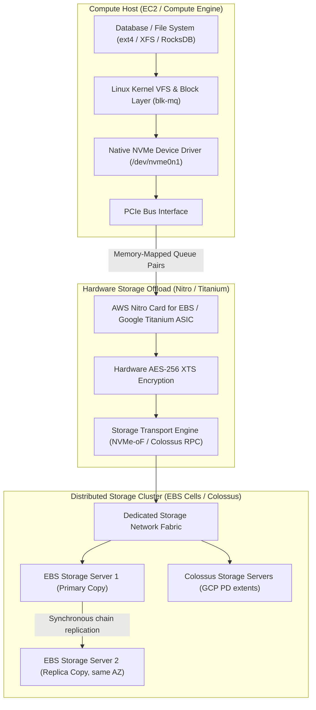

# Storage Media and Block Storage Foundations

## TL;DR

Cloud block storage abstracts physical non-volatile solid-state drives (SSDs) across high-speed network fabrics to deliver persistent, attachable block volumes.
Solid-state media physics dictates that NAND flash memory cannot be overwritten in place; cells must be electrically erased in large blocks (typically 4 MiB to 16 MiB) before individual pages (typically 4 KiB to 16 KiB) can be programmed, creating write amplification and garbage collection stalls.
The Non-Volatile Memory Express (NVMe) interface eliminates legacy SATA/SAS serial bottlenecking by providing up to 64,000 independent queue pairs with up to 64,000 commands per queue, aligning with modern multi-core CPU architectures.
Amazon Elastic Block Store (EBS) attaches network storage to EC2 instances by having the AWS Nitro Card emulate a physical PCIe NVMe controller via SR-IOV, transparently encrypting data and streaming sector I/O across redundant storage server clusters.
Google Cloud Persistent Disk (PD) decouples compute from storage completely, striping virtual disk extents across Colossus storage servers over Google's Andromeda SDN network.

## Mental Model

Block storage operates at the sector level below filesystems, bridging physical flash controllers to virtualized host device drivers over dedicated storage networks.



The guest operating system believes it is reading and writing sectors to a local physical NVMe SSD drive plugged directly into its motherboard PCIe slot.
In reality, the Nitro or Titanium ASIC intercepts memory-mapped queue writes, encrypts the sectors in hardware, translates block addresses into network RPC calls, and replicates data across physically independent storage servers before acknowledging completion to the guest CPU.

## Internals

### Physics of NAND Flash Memory

Understanding cloud disk performance and I/O latency variance requires understanding physical silicon flash media:
- Flash Cells: NAND flash stores bits by trapping electrons inside insulated floating gates or charge-trap transistors.
  - Single-Level Cell (SLC): 1 bit per cell. Highest endurance (50,000 to 100,000 Program/Erase cycles), lowest latency (<25 microseconds), highest cost.
  - Multi-Level Cell (MLC): 2 bits per cell (4 voltage levels). ~3,000 to 10,000 P/E cycles.
  - Triple-Level Cell (TLC): 3 bits per cell (8 voltage levels). Common workhorse of SSD-backed cloud block tiers (gp3, io2, Balanced PD), although providers do not publish the NAND type behind each tier; Standard PD is HDD-backed. ~1,000 to 3,000 P/E cycles.
  - Quad-Level Cell (QLC): 4 bits per cell (16 precise voltage levels). High density, lowest endurance (~100 to 1,000 P/E cycles), slower write performance. Used in low-cost archival storage tiers.
- Asymmetric Read, Write, and Erase Granularity:
  - Read: Executed at Page granularity (typically 4 KiB to 16 KiB). Latency: ~10 to 50 microseconds.
  - Program (Write): Executed at Page granularity. Latency: ~100 to 500 microseconds.
  - Erase: Can only be executed at Block granularity (typically 256 to 1,024 pages = 4 MiB to 16 MiB). Latency: ~1 to 5 milliseconds.
- Out-of-Place Updates and the Flash Translation Layer (FTL): Because an already programmed page cannot be overwritten without erasing its entire containing block, flash drives cannot perform in-place updates.
The drive controller runs embedded firmware called the Flash Translation Layer (FTL).
The FTL maps logical block addresses (LBAs) presented to the host to physical page locations on the silicon dies.
When an existing LBA is modified, the FTL writes the new data to a fresh, erased physical page and marks the old physical page as "invalid".
- Write Amplification Factor (WAF) and Garbage Collection:
Over time, physical blocks become fragmented mixtures of valid and invalid pages.
The drive controller initiates background Garbage Collection (GC): it reads valid pages out of a fragmented block, writes them into an empty block, and issues an erase command to the original block.
The Write Amplification Factor is defined as:
$$\text{WAF} = \frac{\text{Bytes Written to NAND Silicon}}{\text{Bytes Written by Host}}$$
A high WAF degrades drive write endurance and causes severe tail latency spikes when guest writes stall waiting for background block erasures.
- The TRIM / Discard Command: When an operating system deletes a file, standard filesystems merely update metadata, leaving old sectors on disk.
The SATA/NVMe `TRIM` (or `deallocate`) command informs the FTL that specific LBA ranges are no longer needed, allowing the garbage collector to skip copying dead pages and drastically reducing WAF.

### The NVMe Protocol Architecture

Prior to NVMe, SSDs connected via legacy storage interfaces (SATA AHCI and SAS) designed for spinning magnetic disks:
- SATA AHCI Limitations: AHCI provides a single command queue capable of holding only 32 commands.
Every I/O requires a global spinlock in the operating system kernel and triggers costly hardware CPU register reads over the slow legacy bus.
- NVMe Queue Pair Architecture: Designed from first principles for multi-core processors and PCIe bus architectures:
  - Multi-Queue Scalability: NVMe supports up to 64,000 independent Queue Pairs (QPs).
  Each queue pair comprises a Submission Queue (SQ) and a Completion Queue (CQ), each capable of holding up to 64,000 entries.
  - Per-Core Lockless Queues: The Linux kernel block layer (`blk-mq`) maps one dedicated NVMe queue pair to each physical CPU core.
  A thread running on Core 4 writes commands directly into its dedicated Submission Queue in host memory and rings a hardware doorbell register without acquiring global locks or contending with threads running on other cores.
  - MSI-X Interrupt Steering: NVMe pairs with Message Signaled Interrupts-Extended (MSI-X), delivering completion interrupts directly to the specific CPU core that submitted the request, maintaining optimal CPU L1/L2 cache locality.

### Network Block Storage Attachment Mechanics

Cloud providers do not attach physical SATA/SAS cables between storage arrays and virtual machines.
They virtualize the block interface at the physical PCIe layer:

#### AWS Nitro Card for EBS
On an EC2 instance, the Nitro Card for EBS presents itself to the server motherboard as a physical PCIe endpoint implementing the standard NVMe interface.
The guest Linux kernel loads its standard, unmodified open-source `nvme` driver.
When an application executes a write:
1. The guest OS writes a 64-byte NVMe command into the host Submission Queue and updates the Nitro doorbell register.
2. The Nitro Card ASIC fetches the command over PCIe via Direct Memory Access (DMA), completely bypassing the host CPU.
3. The Nitro hardware cryptographic engine encrypts the sector payload using the volume's unique AES-256 XTS data key (each encrypted EBS volume gets its own data key, protected by an AWS KMS key).
4. Nitro encapsulates the I/O into proprietary network packets and routes them across the dedicated EBS storage network to the target storage server cluster.
5. EBS uses chain replication: the primary storage server synchronously forwards the write to a replica storage server in the same AZ before returning an acknowledgment.
Physalia is not on this read/write path; it is the configuration store that holds each volume's replication-chain membership (which servers are primary and replica) in small 7-node Paxos cells, and it is consulted only when that configuration changes, for example on failover or re-mirroring after a storage server fails (Brooker et al., NSDI 2020).
6. The Nitro Card receives the network acknowledgment, writes a 16-byte completion record into the guest Completion Queue, and triggers an MSI-X interrupt.

#### Google Cloud Persistent Disk (PD)
Google Cloud Persistent Disk operates entirely over Google's Andromeda SDN and Colossus distributed filesystem:
1. Compute Engine presents a Persistent Disk to the guest as a virtio-SCSI device or, on newer machine series (C3, C3D, M3, H3, Tau T2A) and Confidential VMs, as an NVMe device, backed by Titanium offload or the hypervisor block virtualization layer (Google Cloud docs, as of 2026-10).
2. Persistent Disk slices the virtual volume into fixed-size block chunks (extents).
3. Writes are transformed into Remote Procedure Calls (RPCs) sent directly over Andromeda to Colossus storage servers (D-Servers).
4. For Regional Persistent Disks, the write is synchronously replicated across two separate Availability Zones before the block write acknowledges.
5. Persistent Disk maintains independent read and write IOPS and throughput limiters implemented as token buckets inside the host block layer.

## Numbers to Know

| Parameter | AWS EBS gp3 | AWS EBS io2 Block Express | GCP Balanced Persistent Disk | GCP Extreme Persistent Disk | Sourced As-Of |
|---|---|---|---|---|---|
| Max IOPS per Volume | 80,000 IOPS (500 IOPS/GiB; raised from 16,000 in Sept 2025) | 256,000 IOPS (1,000 IOPS/GiB) | Up to 80,000 IOPS | Up to 120,000 IOPS | AWS/GCP Docs (as of 2026-10) |
| Max Throughput per Volume | 2,000 MiB/s (0.25 MiB/s per provisioned IOPS) | 4,000 MiB/s | 1,200 MiB/s | 4,000 MiB/s read, 3,000 MiB/s write (N2 with 64+ vCPUs) | AWS/GCP Docs (as of 2026-10) |
| Max Volume Size | 64 TiB | 64 TiB | 64 TiB | 64 TiB | AWS/GCP Docs (as of 2026-10) |
| Baseline Latency | Single-digit milliseconds | Under 500 us average for 16 KiB I/O | 1 to 2 milliseconds | Sub-millisecond | AWS/GCP Specs (as of 2026-10) |
| Baseline IOPS Included | 3,000 IOPS and 125 MiB/s (free) | None (all IOPS provisioned) | 3,000 IOPS and 140 MiB/s baseline, plus 6 IOPS and 0.28 MiB/s per GiB | Provisioned separately | AWS/GCP Docs (as of 2026-10) |
| Base Storage Price | $0.08 / GB-month | $0.125 / GB-month | $0.10 / GB-month | $0.125 / GB-month | us-east-1 / us-central1 (as of 2026-10) |
| Additional IOPS Price | $0.005 / provisioned IOPS | Tiered from $0.065 to $0.032 | Included in disk size | $0.065 / provisioned IOPS (UNVERIFIED against Google's price page) | AWS/GCP Pricing (as of 2026-10) |
| Additional Throughput Price | $0.04 / provisioned MiB/s | Included in IOPS tier | Included in disk size | Included in IOPS tier | AWS/GCP Pricing (as of 2026-10) |

## AWS vs GCP Mechanism Parity

| Dimension | AWS Elastic Block Store (EBS) | Google Cloud Persistent Disk (PD) | Architectural Difference |
|---|---|---|---|
| Hardware Device Interface | Emulated physical PCIe NVMe controller via Nitro Card ASIC | virtio-SCSI on older machine series; NVMe on newer series (C3, C3D, M3, H3, T2A) and Confidential VMs | AWS always exposes an NVMe device on Nitro instances; GCP's guest interface depends on machine series, and behind either interface the I/O travels over Andromeda to Colossus. |
| Multi-AZ Synchronous Replication | Not supported natively on gp3/io2 (Requires application replication) | Native feature: Regional Persistent Disk (Synchronous 2-AZ replication) | GCP provides block-level synchronous replication across two zones, with one writer VM attached at a time (failover by force-attach); AWS EBS is strictly single-AZ (snapshots are regional, stored in S3). |
| Multi-Attach Capabilities | io2 Multi-Attach (Attach up to 16 Nitro instances in single AZ with NVMe PR) | Persistent Disk Multi-Writer mode (Attach to multiple instances for clustered FS) | Both require cluster-aware filesystems (such as GFS2 or OCFS2) or custom distributed locks to avoid filesystem corruption. |
| Performance Decoupling | gp3 completely decouples IOPS, throughput, and capacity allocation | Balanced PD couples IOPS and throughput directly to provisioned gigabytes | On AWS gp3, you can allocate a 100 GiB disk with 16,000 IOPS and 1,000 MiB/s (within the 500 IOPS/GiB and 0.25 MiB/s per IOPS ratios); on GCP Balanced PD, achieving 16,000 IOPS requires `(16,000 - 3,000) / 6 = 2,167 GiB`, before per-VM limits. |

## Worked Example: Capacity Sizing, IOPS Budgeting, and OpenTofu Deployment

Consider a transactional PostgreSQL database requiring 2 TiB of storage, 15,000 sustained read/write IOPS (16 KiB page size), and 350 MiB/s throughput.
We compare AWS EBS gp3 versus GCP Balanced Persistent Disk.

### Capacity Calculations

1. AWS EBS gp3 Configuration:
   - Base capacity: 2,048 GiB.
   - Baseline included performance: 3,000 IOPS and 125 MiB/s.
   - Required extra IOPS: `15,000 - 3,000 = 12,000 provisioned IOPS`.
   - Required extra Throughput: `350 - 125 = 225 MiB/s provisioned throughput`.
   - Monthly Cost Breakdown (us-east-1, as of 2026-10):
     - Storage fee: `2,048 GB * $0.08 / GB-month = $163.84`.
     - Provisioned IOPS fee: `12,000 IOPS * $0.005 = $60.00`.
     - Provisioned Throughput fee: `225 MiB/s * $0.04 = $9.00`.
     - Total AWS EBS Monthly Cost: `$163.84 + $60.00 + $9.00 = $232.84 / month`.

2. GCP Balanced Persistent Disk Configuration:
   - Balanced PD yields a baseline of 3,000 IOPS and 140 MiB/s, plus 6 IOPS per GiB and 0.28 MiB/s per GiB (Google Cloud docs, as of 2026-10).
   - Capacity needed for 15,000 IOPS: `(15,000 - 3,000) / 6 = 2,000 GiB`, so the 2,048 GiB capacity requirement already covers it.
   - Provisioning 2,048 GiB provides:
     - IOPS: `3,000 + 2,048 * 6 = 15,288 IOPS`.
     - Throughput: `140 + 2,048 * 0.28 = 713.44 MiB/s` (exceeds the 350 MiB/s requirement).
   - The VM's machine type and vCPU count must also allow 15,000 IOPS; achievable performance is the lower of the disk limit and the VM limit.
   - Monthly Cost Breakdown (us-central1, as of 2026-10):
     - Storage fee: `2,048 GB * $0.10 / GB-month = $204.80`.
     - Additional IOPS / Throughput fees: $0.00 (Included in disk capacity).
     - Total GCP PD Monthly Cost: `$204.80 / month`.

### Runnable OpenTofu / Terraform Configuration: High-Performance EBS gp3 Volume

```hcl
# block_storage.tf - High-Performance Provisioned EBS gp3 Volume
terraform {
  required_version = ">= 1.6.0"
  required_providers {
    aws = {
      source  = "hashicorp/aws"
      version = "~> 5.0"
    }
  }
}

provider "aws" {
  region = "us-east-1"
}

# kms_key_id must be a KMS key ARN, not an alias; resolve the alias to its key ARN
data "aws_kms_alias" "ebs" {
  name = "alias/aws/ebs"
}

# High-performance gp3 block volume with custom IOPS and throughput
resource "aws_ebs_volume" "database_data_volume" {
  availability_zone = "us-east-1a"
  size              = 2048 # 2 TiB
  type              = "gp3"

  # Explicitly decoupled performance parameters
  iops       = 15000
  throughput = 350

  encrypted  = true # Hardware AES-256 via Nitro Card
  kms_key_id = data.aws_kms_alias.ebs.target_key_arn

  final_snapshot = false

  tags = {
    Name        = "postgresql-data-volume"
    Environment = "production"
  }
}

# Attach to an existing EC2 instance (Representative attachment)
# resource "aws_volume_attachment" "db_attach" {
#   device_name = "/dev/xvdf"
#   volume_id   = aws_ebs_volume.database_data_volume.id
#   instance_id = aws_instance.db_node.id
# }

# Latency guardrail: VolumeAvgReadLatency (milliseconds, Nitro instances only)
# VolumeTotalReadTime is a per-period sum, and its Average statistic is not meaningful on Nitro
resource "aws_cloudwatch_metric_alarm" "ebs_high_latency_alarm" {
  alarm_name          = "ebs-volume-high-latency-alert"
  comparison_operator = "GreaterThanThreshold"
  evaluation_periods  = 3
  metric_name         = "VolumeAvgReadLatency"
  namespace           = "AWS/EBS"
  period              = 60
  statistic           = "Maximum"
  threshold           = 5 # milliseconds
  alarm_description   = "Triggers when EBS read latency exceeds 5ms across consecutive evaluation periods"

  dimensions = {
    VolumeId = aws_ebs_volume.database_data_volume.id
  }
}

# Budget guardrail: email when forecasted monthly account spend exceeds 80% of $300
# (the lab estimate above is ~$233/month for the volume alone)
variable "budget_alert_email" {
  type        = string
  description = "Address that receives AWS Budgets notifications"
}

resource "aws_budgets_budget" "ebs_lab_monthly" {
  name         = "ebs-lab-monthly-budget"
  budget_type  = "COST"
  limit_amount = "300"
  limit_unit   = "USD"
  time_unit    = "MONTHLY"

  notification {
    comparison_operator        = "GREATER_THAN"
    threshold                  = 80
    threshold_type             = "PERCENTAGE"
    notification_type          = "FORECASTED"
    subscriber_email_addresses = [var.budget_alert_email]
  }
}

# Teardown Command (also deletes the alarm and the budget):
# tofu destroy -auto-approve
```

## Failure Modes and Pitfalls

### Pitfall 1: EC2 Instance-Level EBS Bandwidth Throttling
Engineers frequently provision high-performance EBS volumes (e.g., io2 with 64,000 IOPS and 1,000 MiB/s) attached to small or medium EC2 instances (such as `c6i.large`).
A `c6i.large` instance has a baseline EBS limit of only 650 Mbps (81.25 MB/s) and 3,600 IOPS; it can burst to 10 Gbps (1,250 MB/s) and 40,000 IOPS, but only for 30 minutes at least once every 24 hours (AWS instance specs, as of 2026-10).
When the database sustains 350 MiB/s, the burst credits drain and the Nitro Card throttles I/O at the instance boundary, causing thread queues to back up and p99 database latency to spike to seconds, while the volume-level metrics show the volume itself is not saturated.
The instance-level CloudWatch metrics `InstanceEBSThroughputExceededCheck` and `InstanceEBSIOPSExceededCheck` (and `EBSByteBalance%` / `EBSIOBalance%` on burstable sizes) expose the real bottleneck.
Mitigation: Consult AWS EBS-optimized instance tables.
Select an instance size whose baseline (not burst) EBS bandwidth and IOPS exceed the volume's provisioned performance; many `.4xlarge` and smaller sizes only reach their maximum in 30-minute bursts.

### Pitfall 2: Queue Depth Starvation on High-Throughput NVMe Volumes
High-performance block storage requires sufficient concurrent I/O requests in flight to fill the storage controller's pipelines.
If an application uses synchronous single-threaded I/O (`O_SYNC` with queue depth = 1), maximum achievable throughput is physically bounded by round-trip latency:
$$\text{Max IOPS} = \frac{1}{\text{Round-Trip Latency}} = \frac{1}{0.001 \text{ s}} = 1,000 \text{ IOPS}$$
Even on a 256,000 IOPS io2 Block Express volume with an average latency under 500 microseconds, a single-threaded synchronous writer is capped at roughly `1 / 0.0005 s = 2,000 IOPS`, far below what was provisioned.
Mitigation: Tune application database engines to use asynchronous I/O (`io_uring`, `libaio`, or multi-threaded worker pools) with a target queue depth between 16 and 32 per volume.

### Pitfall 3: Filesystem Metadata Corruption in Multi-Attach Volumes
Enabling multi-attach allows multiple compute instances to attach the same block storage volume simultaneously.
Attaching a standard single-node filesystem (such as `ext4` or `XFS`) to multiple instances causes catastrophic data corruption within seconds.
Neither ext4 nor XFS coordinates block allocation across hosts; both operating system kernels cache superblock metadata locally in RAM and overwrite each other's block tables.
Mitigation: Multi-attach volumes must only be formatted with cluster-aware distributed filesystems (e.g., OCFS2, GFS2) or managed by distributed storage engines that coordinate access via NVMe Reservations (PRs).

## Security and Cost Angles

- Transparent Hardware Encryption: Both AWS EBS and GCP Persistent Disk enforce encryption at rest by default.
Encryption is executed directly on the Nitro Card or Titanium processor using dedicated AES-256 hardware engines before packets leave the host, ensuring plaintext data is never exposed on the network or physical storage drives.
- Detached Volume Cost Waste: When compute instances are terminated, attached EBS or Persistent Disk volumes are often left orphaned if `delete_on_termination` is set to `false`.
Unattached storage volumes continue incurring full monthly gigabyte and provisioned IOPS charges indefinitely.
An unattached 2 TiB io2 volume with 15,000 provisioned IOPS incurs over $1,200/month in zombie cloud spend.
Enforce automated AWS Config rules or GCP Policy Analyzer to detect and snapshot unattached disks older than 7 days.
- Unit Economics of gp3 vs gp2: Legacy AWS gp2 volumes tied performance directly to disk size (3 IOPS per GB) and used burst credit balances.
Upgrading from gp2 to gp3 saves up to 20% on baseline storage costs ($0.08 vs $0.10 per GB) while providing 3,000 IOPS and 125 MiB/s baseline performance free of charge.

## Interview Questions and Model Answers

### Question 1 (L5 - Senior)
Why can NAND flash memory not overwrite existing data in place, and how does this physical limitation create the Write Amplification Factor?

#### Model Answer
NAND flash memory is organized into physical pages (typically 4 KiB to 16 KiB) grouped into physical blocks (typically 4 MiB to 16 MiB).
While read and write (programming) operations can be performed on individual pages, the underlying physics of flash cells requires that trapped electrons be cleared by applying a high voltage across an entire block simultaneously.
Therefore, erasing can only occur at the block level.
Once a page is programmed, it cannot be reprogrammed until the entire containing block is erased.
When an application modifies an existing block address, the drive's Flash Translation Layer (FTL) cannot overwrite the existing physical page; instead, it writes the new data to an empty page elsewhere on the silicon die and marks the original page as invalid.
Over time, the drive runs low on empty blocks and must perform Garbage Collection.
The drive controller reads all surviving valid pages from a fragmented block, rewrites them to a new block, and then erases the old block.
Because the drive is forced to copy existing valid data in addition to writing new host data, the total bytes written to the physical NAND dies exceeds the bytes requested by the host application.
The ratio of physical bytes written to host bytes written is the Write Amplification Factor (WAF).
High WAF degrades drive endurance, exhausts write cycles, and induces garbage-collection latency spikes.

#### Follow-up Interviewer Question
What is the function of the OS-level TRIM or Discard command, and how does it reduce the Write Amplification Factor?

### Question 2 (L6 - Staff)
Compare the architectural mechanisms of the AWS Nitro Card for EBS against Google Cloud Persistent Disk when handling sector-level read and write requests.

#### Model Answer
AWS Nitro Card for EBS:
AWS presents block storage as an emulated physical PCIe hardware device.
The Nitro Card implements physical NVMe controller hardware specifications via SR-IOV.
The guest OS interacts with the drive using standard, native NVMe drivers, submitting commands to lockless per-core memory-mapped Queue Pairs.
The Nitro Card DMA-reads the command directly from host memory, performs AES-256 XTS encryption in hardware on the ASIC, and encapsulates the sector data into low-latency network packets.
These packets traverse a dedicated storage network to the volume's primary storage server, which chain-replicates the write to a replica storage server in the same AZ.
The write is synchronously confirmed on both servers before Nitro writes a completion entry into the guest NVMe Completion Queue and signals an interrupt.
Physalia, a store of small 7-node Paxos cells, holds the chain's membership and is consulted only when that configuration changes (failover or re-mirroring), never on the per-I/O path.
Google Cloud Persistent Disk:
GCP exposes a Persistent Disk to the guest as either a virtio-SCSI device or, on newer machine series such as C3, as an NVMe device, but either way the guest-visible device is only a front end.
Behind it, Compute Engine's block virtualization layer (offloaded to Titanium on newer series) is integrated with Google's Andromeda Software-Defined Network.
When a write occurs, the block subsystem splits the volume into discrete chunk extents and issues Remote Procedure Calls (RPCs) directly over Andromeda to Colossus, Google's global distributed filesystem.
Data is striped across distributed D-Servers and encoded using Reed-Solomon erasure coding or multi-zone replication.
In summary: AWS Nitro emulates localized NVMe hardware speaking to a primary-replica storage chain inside one AZ, with Physalia guarding the chain configuration, delivering predictable latency (single-digit milliseconds on gp3, sub-millisecond on io2 Block Express); GCP integrates block storage directly into its Colossus distributed filesystem, enabling features like native multi-zone synchronous replication (Regional PD).

#### Follow-up Interviewer Question
Why does an application executing synchronous single-threaded I/O with a queue depth of 1 experience poor IOPS on a cloud block storage volume regardless of whether 10,000 or 100,000 IOPS are provisioned?

### Question 3 (L7+ - Principal)
You are the principal architect for a mission-critical financial ledger database. The system requires zero data loss (RPO = 0), a recovery time objective under 15 seconds (RTO < 15s), and sustained 25,000 write IOPS with p99 write latency under 2 milliseconds. Design and defend the cloud storage architecture across AWS and GCP, analyzing physical failure domains, replication mechanisms, and cost implications.

#### Model Answer
Architectural Blueprint:
1. Google Cloud Platform Implementation:
   - Primary Storage Primitive: GCP Regional Persistent Disk (Balanced or Extreme PD).
   - Replication Topology: Regional PD executes synchronous replication at the block layer across two discrete Availability Zones (e.g., `us-central1-a` and `us-central1-b`) before acknowledging writes.
   - Fault Recovery (RTO < 15s): If the primary compute instance in Zone A crashes or Zone A suffers complete power loss, an automated control plane script or Kubernetes StatefulSet attaches the existing Regional PD volume to a standby instance in Zone B using force-attach (`--force-attach`).
   Because the file sectors are already synchronously replicated at the block layer in Zone B, the standby database initiates standard crash recovery (WAL replay) with RPO = 0, provided the disk was fully replicated (not running degraded on one zone) at the moment of failure.
   The RTO is the sum of failure detection, force-attach, and WAL replay, so it must be measured in failover drills to prove it fits the 15-second budget.
2. Amazon Web Services Implementation:
   - AWS EBS gp3/io2 is strictly a single-AZ construct; AWS does not offer multi-AZ synchronous block replication.
   Therefore, relying on EBS block storage alone cannot achieve RPO = 0 across an AZ failure without application-level distributed consensus.
   - Architectural Selection: We deploy a multi-node database cluster (e.g., PostgreSQL with synchronous streaming replication or Amazon Aurora Multi-AZ with a 4-of-6 storage quorum).
   - If deploying a custom database engine on EC2: We provision io2 Block Express volumes (for sub-millisecond average write latency) in two separate AZs and configure synchronous quorum commits at the database engine level (e.g., Raft/Paxos or PostgreSQL `synchronous_commit = on` with `synchronous_standby_names = 'ANY 1 (standby_b, standby_c)'`).
3. Trade-off and Latency Analysis:
   - GCP Regional PD incurs a ~1.5ms to 2.5ms latency penalty due to the inter-AZ speed-of-light network round trip on every write, but eliminates the operational complexity of managing application-level database consensus.
   - AWS io2 Block Express delivers low local latency (under 500 microseconds average for 16 KiB I/O, per AWS docs as of 2026-10) within a single AZ, but requires application-level replication across zones to achieve RPO = 0.
   - Cost: GCP Regional PD charges 2x the standard disk price ($0.20/GB vs $0.10/GB) for synchronous replication.
   On AWS, running two EC2 instances with independent io2 Block Express volumes and inter-AZ data replication incurs higher compute and provisioned IOPS costs, but yields superior p99 read/write tail latency.

#### Follow-up Interviewer Question
If a write operation to a GCP Regional Persistent Disk succeeds in Zone A but times out in Zone B due to an inter-zone optical fiber cut, how does the storage controller resolve the split-brain state without compromising consistency?

### Question 4 (L5 - Senior)
A PostgreSQL primary on a `c6i.large` uses an io2 volume provisioned with 20,000 IOPS and 500 MiB/s, yet p99 query latency degrades every afternoon while the volume's own metrics show it is far below its provisioned limits. Walk through your diagnosis and fix.

#### Model Answer
Block storage performance is the minimum of three independent limits: the volume's provisioned IOPS and throughput, the instance's EBS bandwidth and IOPS limit, and the concurrency (queue depth) the application keeps in flight.
The volume metrics only describe the first limit, so a healthy-looking volume does not prove the I/O path is healthy.
A `c6i.large` has a baseline EBS limit of 650 Mbps (81.25 MB/s) and 3,600 IOPS, with bursts to 1,250 MB/s and 40,000 IOPS for only 30 minutes at least once every 24 hours (AWS instance specs, as of 2026-10).
The morning workload runs on burst credits; once they drain in the afternoon, the Nitro Card enforces the baseline and requests queue in the guest block layer, which is exactly where p99 latency grows.
I confirm it with instance-level metrics rather than volume metrics: `InstanceEBSIOPSExceededCheck` and `InstanceEBSThroughputExceededCheck` flip to 1, `EBSIOBalance%` and `EBSByteBalance%` fall toward zero, and `VolumeAvgReadLatency` / `VolumeAvgWriteLatency` rise while `VolumeIOPSExceededCheck` stays at 0.
On the guest, `iostat -x` shows rising `aqu-sz` and `await` with throughput flat at the instance ceiling.
The fix is to size the instance so that its baseline, not its burst, exceeds the volume's provisioned performance; otherwise the io2 IOPS being paid for are unreachable.
The trade-off is cost: a larger instance adds vCPUs and memory the database may not need, so the cheaper alternative is often to right-size the volume down to what the instance can sustain, or to pick a family with higher EBS bandwidth per vCPU.
I would also verify the remaining limit, queue depth, because a single-threaded synchronous writer is capped at `1 / latency` regardless of either ceiling.

#### Follow-up Interviewer Question
How would you build a CloudWatch alarm that distinguishes "instance EBS ceiling reached" from "volume provisioned IOPS exceeded" so that on-call knows which resource to resize?

### Question 5 (L6 - Staff)
A team proposes attaching one io2 volume with Multi-Attach to two EC2 instances so the standby can take over instantly if the primary dies. Evaluate the design and specify what is required to make it safe.

#### Model Answer
Multi-Attach lets up to 16 Nitro-based instances in the same Availability Zone attach one io2 volume, but EBS only shares the blocks; it provides no coordination of who may write.
If both instances mount an `ext4` or `XFS` filesystem, each kernel caches allocation bitmaps, inodes, and the journal in RAM and writes them back independently, so the filesystem is corrupted as soon as both write.
The real problem is fencing: when the standby decides the primary is dead, the primary may only be partitioned or paused (a long GC or hypervisor stall) and can resume writing stale data.
A safe design therefore needs three pieces.
First, a single-writer filesystem must be mounted on only one node at a time, or a cluster-aware filesystem (GFS2, OCFS2) with its own distributed lock manager must be used.
Second, the storage must enforce exclusion: io2 Multi-Attach supports NVMe reservations, so the cluster manager uses reservation-based fencing in which the new primary preempts the old primary's reservation, after which the old primary's writes are rejected by the storage rather than trusted to stop voluntarily.
Third, leadership must come from a quorum outside the two nodes (a third voter or an external lock service), otherwise a network partition leaves each side believing the other failed.
Even when done correctly, the design only protects against instance failure: the volume, its replicas, and both instances sit in one AZ, so an AZ failure takes out everything, and a logical corruption is faithfully shared by both nodes.
For most databases, two instances with independent volumes and database-level synchronous replication across AZs is the better design, trading higher storage cost and replication latency for AZ-level fault tolerance and isolation from shared corruption.

#### Follow-up Interviewer Question
Why is it unsafe for the standby to simply wait for the primary's heartbeat to stop for N seconds before mounting the volume, even with a generous timeout?

### Question 6 (L7+ - Principal)
In April 2011 a network configuration error made 13% of the EBS volumes in one Availability Zone unavailable, and the replication configuration store sat in the shared EBS control plane. Using that incident, explain how you would design the configuration store for a replicated block storage service, and why Physalia looks the way it does.

#### Model Answer
EBS volume data uses chain replication: writes flow from the client instance to the primary storage server and on to a replica, with no control-plane involvement per I/O.
The configuration store is consulted only when the chain must change, for example when a replica is lost and the volume must be re-mirrored, and it must decide atomically which copy is authoritative so that two servers never both act as primary.
That access pattern is pathological for a conventional design: the store is nearly idle in steady state, but a large correlated failure makes thousands of volumes ask for reconfiguration at the same moment, exactly when the network is partitioned and capacity is scarce.
In 2011 the replication configuration shared a database with API traffic, so the re-mirroring storm overloaded the control plane and spread the impact beyond the original failure (Brooker et al., NSDI 2020).
The design principles that follow are the ones Physalia embodies.
First, keep consistency non-negotiable, since a wrong answer about the chain corrupts data, and accept that by CAP not every key can be available to every client during a partition.
Second, exploit the fact that each volume's configuration needs to be available to only three parties: the client instance, the primary, and the replica.
Physalia therefore partitions configuration into millions of tiny databases, each served by a cell that runs Paxos over seven nodes, and places the cell's nodes close to those three parties using knowledge of network and power topology, so a partition that isolates them from the rest of the datacenter does not isolate them from their configuration.
Seven nodes is a deliberate trade-off: larger cells improve durability and tail latency, while keeping each cell small bounds the blast radius of a bug, overload, or bad deployment to a few volumes.
Third, separate the configuration store from the customer-facing API control plane so that API load and reconfiguration storms cannot starve each other.
The costs are real: millions of cells need their own control plane to create, repair, and move cells, reconfiguration is frequent and must be proven safe, and the system is harder to test than a single database.
I would accept that complexity because the alternative couples the availability of every volume in a zone to one shared service at the moment it is most stressed.

#### Follow-up Interviewer Question
Physalia continuously moves cells to be close to their clients through Paxos reconfiguration; what safety invariant must every reconfiguration step preserve, and how would you test it?

## Further Reading

- [NVM Express Base Specification Revision 2.0](https://nvmexpress.org/specifications/) - The authoritative industry specification defining NVMe multi-queue mechanics, doorbell registers, and admin commands.
- [Millions of Tiny Databases (NSDI 2020)](https://www.usenix.org/conference/nsdi20/presentation/brooker) - Marc Brooker, Tao Chen, and Fan Ping describe Physalia, the EBS replication-configuration store built from small 7-node Paxos cells placed for blast-radius containment.
- [Google Cloud Persistent Disk Architecture and Internals](https://cloud.google.com/compute/docs/disks) - Technical documentation detailing Persistent Disk extents, Colossus integration, and Regional PD replication.
- [The Unwritten Contract of Solid State Drives (EuroSys 2017)](https://pages.cs.wisc.edu/~jhe/eurosys17-he.pdf) - Jun He, Sudarsun Kannan, Andrea Arpaci-Dusseau, and Remzi Arpaci-Dusseau formalize the rules (request scale, locality, aligned sequentiality, grouping by death time, uniform data lifetime) that software must follow to avoid FTL garbage-collection and write-amplification penalties.
