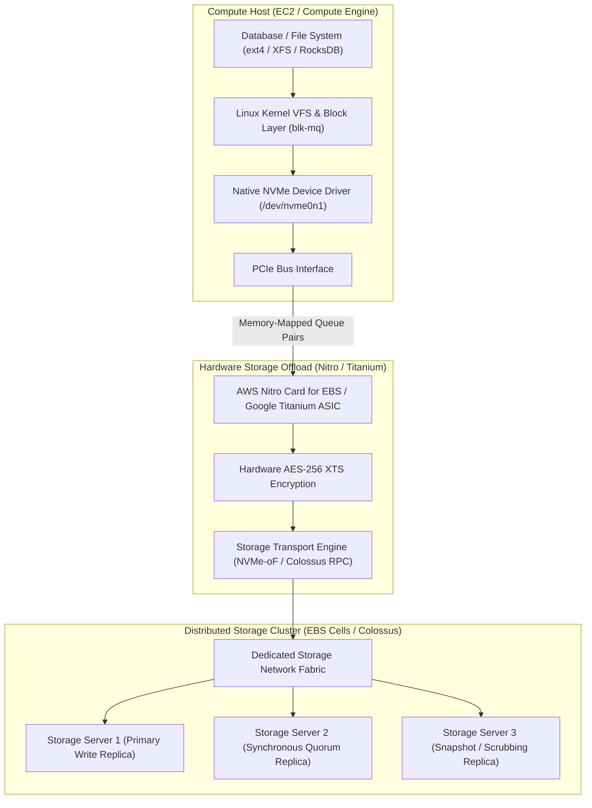

# Storage Media and Block Storage Foundations

## TL;DR

Cloud block storage abstracts physical non-volatile solid-state drives (SSDs) across high-speed network fabrics to deliver persistent, attachable block volumes.
Solid-state media physics dictates that NAND flash memory cannot be overwritten in place; cells must be electrically erased in large blocks (typically 4 MiB to 16 MiB) before individual pages (typically 4 KiB to 16 KiB) can be programmed, creating write amplification and garbage collection stalls.
The Non-Volatile Memory Express (NVMe) interface eliminates legacy SATA/SAS serial bottlenecking by providing up to 64,000 independent queue pairs with up to 64,000 commands per queue, aligning with modern multi-core CPU architectures.
Amazon Elastic Block Store (EBS) attaches network storage to EC2 instances by having the AWS Nitro Card emulate a physical PCIe NVMe controller via SR-IOV, transparently encrypting data and streaming sector I/O across redundant storage server clusters.
Google Cloud Persistent Disk (PD) decouples compute from storage completely, striping virtual disk extents across Colossus storage servers over Google's Andromeda SDN network.

## Mental Model

Block storage operates at the sector level below filesystems, bridging physical flash controllers to virtualized host device drivers over dedicated storage networks.



The guest operating system believes it is reading and writing sectors to a local physical NVMe SSD drive plugged directly into its motherboard PCIe slot.
In reality, the Nitro or Titanium ASIC intercepts memory-mapped queue writes, encrypts the sectors in hardware, translates block addresses into network RPC calls, and replicates data across physically independent storage servers before acknowledging completion to the guest CPU.

## Internals

### Physics of NAND Flash Memory

Understanding cloud disk performance and I/O latency variance requires understanding physical silicon flash media:
- Flash Cells: NAND flash stores bits by trapping electrons inside insulated floating gates or charge-trap transistors.
  - Single-Level Cell (SLC): 1 bit per cell. Highest endurance (50,000 to 100,000 Program/Erase cycles), lowest latency (<25 microseconds), highest cost.
  - Multi-Level Cell (MLC): 2 bits per cell (4 voltage levels). ~3,000 to 10,000 P/E cycles.
  - Triple-Level Cell (TLC): 3 bits per cell (8 voltage levels). Standard workhorse of cloud block storage (gp3, io2, Standard Persistent Disk). ~1,000 to 3,000 P/E cycles.
  - Quad-Level Cell (QLC): 4 bits per cell (16 precise voltage levels). High density, lowest endurance (~100 to 1,000 P/E cycles), slower write performance. Used in low-cost archival storage tiers.
- Asymmetric Read, Write, and Erase Granularity:
  - Read: Executed at Page granularity (typically 4 KiB to 16 KiB). Latency: ~10 to 50 microseconds.
  - Program (Write): Executed at Page granularity. Latency: ~100 to 500 microseconds.
  - Erase: Can only be executed at Block granularity (typically 256 to 1,024 pages = 4 MiB to 16 MiB). Latency: ~1 to 5 milliseconds.
- Out-of-Place Updates and the Flash Translation Layer (FTL): Because an already programmed page cannot be overwritten without erasing its entire containing block, flash drives cannot perform in-place updates.
The drive controller runs embedded firmware called the Flash Translation Layer (FTL).
The FTL maps logical block addresses (LBAs) presented to the host to physical page locations on the silicon dies.
When an existing LBA is modified, the FTL writes the new data to a fresh, erased physical page and marks the old physical page as "invalid".
- Write Amplification Factor (WAF) and Garbage Collection:
Over time, physical blocks become fragmented mixtures of valid and invalid pages.
The drive controller initiates background Garbage Collection (GC): it reads valid pages out of a fragmented block, writes them into an empty block, and issues an erase command to the original block.
The Write Amplification Factor is defined as:
$$\text{WAF} = \frac{\text{Bytes Written to NAND Silicon}}{\text{Bytes Written by Host}}$$
A high WAF degrades drive write endurance and causes severe tail latency spikes when guest writes stall waiting for background block erasures.
- The TRIM / Discard Command: When an operating system deletes a file, standard filesystems merely update metadata, leaving old sectors on disk.
The SATA/NVMe `TRIM` (or `deallocate`) command informs the FTL that specific LBA ranges are no longer needed, allowing the garbage collector to skip copying dead pages and drastically reducing WAF.

### The NVMe Protocol Architecture

Prior to NVMe, SSDs connected via legacy storage interfaces (SATA AHCI and SAS) designed for spinning magnetic disks:
- SATA AHCI Limitations: AHCI provides a single command queue capable of holding only 32 commands.
Every I/O requires a global spinlock in the operating system kernel and triggers costly hardware CPU register reads over the slow legacy bus.
- NVMe Queue Pair Architecture: Designed from first principles for multi-core processors and PCIe bus architectures:
  - Multi-Queue Scalability: NVMe supports up to 64,000 independent Queue Pairs (QPs).
  Each queue pair comprises a Submission Queue (SQ) and a Completion Queue (CQ), each capable of holding up to 64,000 entries.
  - Per-Core Lockless Queues: The Linux kernel block layer (`blk-mq`) maps one dedicated NVMe queue pair to each physical CPU core.
  A thread running on Core 4 writes commands directly into its dedicated Submission Queue in host memory and rings a hardware doorbell register without acquiring global locks or contending with threads running on other cores.
  - MSI-X Interrupt Steering: NVMe pairs with Message Signaled Interrupts-Extended (MSI-X), delivering completion interrupts directly to the specific CPU core that submitted the request, maintaining optimal CPU L1/L2 cache locality.

### Network Block Storage Attachment Mechanics

Cloud providers do not attach physical SATA/SAS cables between storage arrays and virtual machines.
They virtualize the block interface at the physical PCIe layer:

#### AWS Nitro Card for EBS
On an EC2 instance, the Nitro Card for EBS presents itself to the server motherboard as a physical PCIe endpoint supporting the standard NVMe 1.4 specification.
The guest Linux kernel loads its standard, unmodified open-source `nvme` driver.
When an application executes a write:
1. The guest OS writes a 64-byte NVMe command into the host Submission Queue and updates the Nitro doorbell register.
2. The Nitro Card ASIC fetches the command over PCIe via Direct Memory Access (DMA), completely bypassing the host CPU.
3. The Nitro hardware cryptographic engine encrypts the sector payload using an instance-specific AES-256 XTS data key.
4. Nitro encapsulates the I/O into proprietary network packets and routes them across the dedicated EBS storage network to the target storage server cluster.
5. In Amazon EBS, volume extents are managed by a specialized consensus control plane called Physalia, which organizes storage nodes into localized 7-node Paxos clusters.
The primary storage node synchronously replicates the write to a secondary storage node across different power domains before returning an acknowledgment.
6. The Nitro Card receives the network acknowledgment, writes a 16-byte completion record into the guest Completion Queue, and triggers an MSI-X interrupt.

#### Google Cloud Persistent Disk (PD)
Google Cloud Persistent Disk operates entirely over Google's Andromeda SDN and Colossus distributed filesystem:
1. GCE virtual machines run a specialized block driver that communicates with Google's Titanium offload processor or hypervisor block virtualization layers.
2. Persistent Disk slices the virtual volume into fixed-size block chunks (extents).
3. Writes are transformed into Remote Procedure Calls (RPCs) sent directly over Andromeda to Colossus storage servers (D-Servers).
4. For Regional Persistent Disks, the write is synchronously replicated across two separate Availability Zones before the block write acknowledges.
5. Persistent Disk maintains independent read and write IOPS and throughput limiters implemented as token buckets inside the host block layer.

## Numbers to Know

| Parameter | AWS EBS gp3 | AWS EBS io2 Block Express | GCP Balanced Persistent Disk | GCP Extreme Persistent Disk | Sourced As-Of |
|---|---|---|---|---|---|
| Max IOPS per Volume | 16,000 IOPS | 256,000 IOPS | Up to 80,000 IOPS | Up to 120,000 IOPS | AWS/GCP Docs (as of 2026-10) |
| Max Throughput per Volume | 1,000 MiB/s | 4,000 MiB/s | 1,200 MiB/s | 2,400 MiB/s | AWS/GCP Docs (as of 2026-10) |
| Max Volume Size | 16 TiB | 64 TiB | 64 TiB | 64 TiB | AWS/GCP Docs (as of 2026-10) |
| Baseline Latency | 1 to 2 milliseconds | Sub-millisecond (~250-500 us) | 1 to 2 milliseconds | Sub-millisecond | AWS/GCP Specs (as of 2026-10) |
| Baseline IOPS Included | 3,000 IOPS (free) | 100 IOPS per GiB | Based on capacity | Provisioned separately | AWS/GCP Pricing (as of 2026-10) |
| Base Storage Price | $0.08 / GB-month | $0.125 / GB-month | $0.10 / GB-month | $0.125 / GB-month | us-east-1 / us-central1 (as of 2026-10) |
| Additional IOPS Price | $0.005 / provisioned IOPS | Tiered from $0.065 to $0.032 | Included in disk size | $0.05 / provisioned IOPS | AWS/GCP Pricing (as of 2026-10) |
| Additional Throughput Price | $0.04 / provisioned MiB/s | Included in IOPS tier | Included in disk size | Included in IOPS tier | AWS/GCP Pricing (as of 2026-10) |

## AWS vs GCP Mechanism Parity

| Dimension | AWS Elastic Block Store (EBS) | Google Cloud Persistent Disk (PD) | Architectural Difference |
|---|---|---|---|
| Hardware Device Interface | Emulated physical PCIe NVMe controller via Nitro Card ASIC | Paravirtualized block device driver integrated with Titanium / Andromeda | AWS exposes raw NVMe hardware devices directly to the guest; GCP uses Andromeda SDN network endpoints to pipe blocks into Colossus. |
| Multi-AZ Synchronous Replication | Not supported natively on gp3/io2 (Requires application replication) | Native feature: Regional Persistent Disk (Synchronous 2-AZ replication) | GCP provides block-level active-active synchronous replication across two physical zones; AWS EBS is strictly single-AZ (snapshots are multi-AZ on S3). |
| Multi-Attach Capabilities | io2 Multi-Attach (Attach up to 16 Nitro instances in single AZ with NVMe PR) | Persistent Disk Multi-Writer mode (Attach to multiple instances for clustered FS) | Both require cluster-aware filesystems (such as GFS2 or OCFS2) or custom distributed locks to avoid filesystem corruption. |
| Performance Decoupling | gp3 completely decouples IOPS, throughput, and capacity allocation | Balanced PD couples IOPS and throughput directly to provisioned gigabytes | On AWS gp3, you can allocate a 100 GB disk with 16,000 IOPS and 1,000 MiB/s; on GCP Balanced PD, achieving 16,000 IOPS requires provisioning at least 534 GB. |

## Worked Example: Capacity Sizing, IOPS Budgeting, and OpenTofu Deployment

Consider a transactional PostgreSQL database requiring 2 TiB of storage, 15,000 sustained read/write IOPS (16 KiB page size), and 350 MiB/s throughput.
We compare AWS EBS gp3 versus GCP Balanced Persistent Disk.

### Capacity Calculations

1. AWS EBS gp3 Configuration:
   - Base capacity: 2,048 GiB.
   - Baseline included performance: 3,000 IOPS and 125 MiB/s.
   - Required extra IOPS: `15,000 - 3,000 = 12,000 provisioned IOPS`.
   - Required extra Throughput: `350 - 125 = 225 MiB/s provisioned throughput`.
   - Monthly Cost Breakdown (us-east-1, as of 2026-10):
     - Storage fee: `2,048 GB * $0.08 / GB-month = $163.84`.
     - Provisioned IOPS fee: `12,000 IOPS * $0.005 = $60.00`.
     - Provisioned Throughput fee: `225 MiB/s * $0.04 = $9.00`.
     - Total AWS EBS Monthly Cost: `$163.84 + $60.00 + $9.00 = $232.84 / month`.

2. GCP Balanced Persistent Disk Configuration:
   - Balanced PD yields 6 IOPS per GiB and 0.28 MiB/s per GiB.
   - To achieve 15,000 IOPS natively: `15,000 / 6 = 2,500 GiB`.
   - Provisioning 2,500 GiB provides:
     - IOPS: `2,500 * 6 = 15,000 IOPS`.
     - Throughput: `2,500 * 0.28 = 700 MiB/s` (exceeds the 350 MiB/s requirement).
   - Monthly Cost Breakdown (us-central1, as of 2026-10):
     - Storage fee: `2,500 GB * $0.10 / GB-month = $250.00`.
     - Additional IOPS / Throughput fees: $0.00 (Included in disk capacity).
     - Total GCP PD Monthly Cost: `$250.00 / month`.

### Runnable OpenTofu / Terraform Configuration: High-Performance EBS gp3 Volume

```hcl
# block_storage.tf - High-Performance Provisioned EBS gp3 Volume
terraform {
  required_version = ">= 1.6.0"
  required_providers {
    aws = {
      source  = "hashicorp/aws"
      version = "~> 5.0"
    }
  }
}

provider "aws" {
  region = "us-east-1"
}

# High-performance gp3 block volume with custom IOPS and throughput
resource "aws_ebs_volume" "database_data_volume" {
  availability_zone = "us-east-1a"
  size              = 2048 # 2 TiB
  type              = "gp3"

  # Explicitly decoupled performance parameters
  iops       = 15000
  throughput = 350

  encrypted  = true # Hardware AES-256 via Nitro Card
  kms_key_id = "alias/aws/ebs"

  final_snapshot = false

  tags = {
    Name        = "postgresql-data-volume"
    Environment = "production"
  }
}

# Attach to an existing EC2 instance (Representative attachment)
# resource "aws_volume_attachment" "db_attach" {
#   device_name = "/dev/xvdf"
#   volume_id   = aws_ebs_volume.database_data_volume.id
#   instance_id = aws_instance.db_node.id
# }

# Cost guardrail: Alarm on high read/write burst exhaustion or volume latency
resource "aws_cloudwatch_metric_alarm" "ebs_high_latency_alarm" {
  alarm_name          = "ebs-volume-high-latency-alert"
  comparison_operator = "GreaterThanThreshold"
  evaluation_periods  = 3
  metric_name         = "VolumeTotalReadTime"
  namespace           = "AWS/EBS"
  period              = 60
  statistic           = "Average"
  threshold           = 0.005 # 5 milliseconds
  alarm_description   = "Triggers when EBS read latency exceeds 5ms across consecutive evaluation periods"

  dimensions = {
    VolumeId = aws_ebs_volume.database_data_volume.id
  }
}

# Teardown Command:
# tofu destroy -auto-approve
```

## Failure Modes and Pitfalls

### Pitfall 1: EC2 Instance-Level EBS Bandwidth Throttling
Engineers frequently provision high-performance EBS volumes (e.g., io2 with 64,000 IOPS and 1,000 MiB/s) attached to small or medium EC2 instances (such as `c6i.large`).
A `c6i.large` instance has a maximum dedicated EBS throughput cap of only 156 MiB/s and 10,000 IOPS.
When the database demands 350 MiB/s, the Nitro Card throttles I/O at the instance boundary, causing thread queues to back up and p99 database latency to spike to seconds, while the EBS volume metrics report zero saturation.
Mitigation: Consult AWS EBS-optimized instance tables.
Select instance sizes (typically `.4xlarge` or larger) whose dedicated EBS bandwidth exceeds the volume's provisioned performance limits.

### Pitfall 2: Queue Depth Starvation on High-Throughput NVMe Volumes
High-performance block storage requires sufficient concurrent I/O requests in flight to fill the storage controller's pipelines.
If an application uses synchronous single-threaded I/O (`O_SYNC` with queue depth = 1), maximum achievable throughput is physically bounded by round-trip latency:
$$\text{Max IOPS} = \frac{1}{\text{Round-Trip Latency}} = \frac{1}{0.001 \text{ s}} = 1,000 \text{ IOPS}$$
Even on a 256,000 IOPS io2 volume, a single-threaded synchronous writer will never exceed 1,000 IOPS.
Mitigation: Tune application database engines to use asynchronous I/O (`io_uring`, `libaio`, or multi-threaded worker pools) with a target queue depth between 16 and 32 per volume.

### Pitfall 3: Filesystem Metadata Corruption in Multi-Attach Volumes
Enabling multi-attach allows multiple compute instances to attach the same block storage volume simultaneously.
Attaching a standard single-node filesystem (such as `ext4` or `XFS`) to multiple instances causes catastrophic data corruption within seconds.
Neither ext4 nor XFS coordinates block allocation across hosts; both operating system kernels cache superblock metadata locally in RAM and overwrite each other's block tables.
Mitigation: Multi-attach volumes must only be formatted with cluster-aware distributed filesystems (e.g., OCFS2, GFS2) or managed by distributed storage engines that coordinate access via NVMe Reservations (PRs).

## Security and Cost Angles

- Transparent Hardware Encryption: Both AWS EBS and GCP Persistent Disk enforce encryption at rest by default.
Encryption is executed directly on the Nitro Card or Titanium processor using dedicated AES-256 hardware engines before packets leave the host, ensuring plaintext data is never exposed on the network or physical storage drives.
- Detached Volume Cost Waste: When compute instances are terminated, attached EBS or Persistent Disk volumes are often left orphaned if `delete_on_termination` is set to `false`.
Unattached storage volumes continue incurring full monthly gigabyte and provisioned IOPS charges indefinitely.
An unattached 2 TiB io2 volume with 15,000 provisioned IOPS incurs over $1,200/month in zombie cloud spend.
Enforce automated AWS Config rules or GCP Policy Analyzer to detect and snapshot unattached disks older than 7 days.
- Unit Economics of gp3 vs gp2: Legacy AWS gp2 volumes tied performance directly to disk size (3 IOPS per GB) and used burst credit balances.
Upgrading from gp2 to gp3 saves up to 20% on baseline storage costs ($0.08 vs $0.10 per GB) while providing 3,000 IOPS and 125 MiB/s baseline performance free of charge.

## Interview Questions and Model Answers

### Question 1 (L5 - Senior)
Why can NAND flash memory not overwrite existing data in place, and how does this physical limitation create the Write Amplification Factor?

#### Model Answer
NAND flash memory is organized into physical pages (typically 4 KiB to 16 KiB) grouped into physical blocks (typically 4 MiB to 16 MiB).
While read and write (programming) operations can be performed on individual pages, the underlying physics of flash cells requires that trapped electrons be cleared by applying a high voltage across an entire block simultaneously.
Therefore, erasing can only occur at the block level.
Once a page is programmed, it cannot be reprogrammed until the entire containing block is erased.
When an application modifies an existing block address, the drive's Flash Translation Layer (FTL) cannot overwrite the existing physical page; instead, it writes the new data to an empty page elsewhere on the silicon die and marks the original page as invalid.
Over time, the drive runs low on empty blocks and must perform Garbage Collection.
The drive controller reads all surviving valid pages from a fragmented block, rewrites them to a new block, and then erases the old block.
Because the drive is forced to copy existing valid data in addition to writing new host data, the total bytes written to the physical NAND dies exceeds the bytes requested by the host application.
The ratio of physical bytes written to host bytes written is the Write Amplification Factor (WAF).
High WAF degrades drive endurance, exhausts write cycles, and induces garbage-collection latency spikes.

#### Follow-up Interviewer Question
What is the function of the OS-level TRIM or Discard command, and how does it reduce the Write Amplification Factor?

### Question 2 (L6 - Staff)
Compare the architectural mechanisms of the AWS Nitro Card for EBS against Google Cloud Persistent Disk when handling sector-level read and write requests.

#### Model Answer
AWS Nitro Card for EBS:
AWS presents block storage as an emulated physical PCIe hardware device.
The Nitro Card implements physical NVMe controller hardware specifications via SR-IOV.
The guest OS interacts with the drive using standard, native NVMe drivers, submitting commands to lockless per-core memory-mapped Queue Pairs.
The Nitro Card DMA-reads the command directly from host memory, performs AES-256 XTS encryption in hardware on the ASIC, and encapsulates the sector data into low-latency network packets.
These packets traverse a dedicated storage network to a localized 7-node Paxos replication cluster managed by the Physalia control plane.
The write is synchronously confirmed across two physical storage servers before Nitro writes a completion entry into the guest NVMe Completion Queue and signals an interrupt.
Google Cloud Persistent Disk:
GCP does not emulate physical PCIe NVMe devices for persistent disks.
Instead, GCE utilizes a paravirtualized block device layer integrated with Google's Andromeda Software-Defined Network.
When a write occurs, the block subsystem splits the volume into discrete chunk extents and issues Remote Procedure Calls (RPCs) directly over Andromeda to Colossus, Google's global distributed filesystem.
Data is striped across distributed D-Servers and encoded using Reed-Solomon erasure coding or multi-zone replication.
In summary: AWS Nitro emulates localized NVMe hardware speaking to specialized Paxos storage cells, delivering predictable single-digit millisecond latency; GCP integrates block storage directly into its global Colossus distributed filesystem, enabling seamless features like native multi-zone synchronous replication (Regional PD) and online volume resizing without device resets.

#### Follow-up Interviewer Question
Why does an application executing synchronous single-threaded I/O with a queue depth of 1 experience poor IOPS on a cloud block storage volume regardless of whether 10,000 or 100,000 IOPS are provisioned?

### Question 3 (L7+ - Principal)
You are the principal architect for a mission-critical financial ledger database. The system requires zero data loss (RPO = 0), a recovery time objective under 15 seconds (RTO < 15s), and sustained 25,000 write IOPS with p99 write latency under 2 milliseconds. Design and defend the cloud storage architecture across AWS and GCP, analyzing physical failure domains, replication mechanisms, and cost implications.

#### Model Answer
Architectural Blueprint:
1. Google Cloud Platform Implementation:
   - Primary Storage Primitive: GCP Regional Persistent Disk (Balanced or Extreme PD).
   - Replication Topology: Regional PD executes synchronous replication at the block layer across two discrete Availability Zones (e.g., `us-central1-a` and `us-central1-b`) before acknowledging writes.
   - Fault Recovery (RTO < 15s): If the primary compute instance in Zone A crashes or Zone A suffers complete power loss, an automated control plane script or Kubernetes StatefulSet attaches the existing Regional PD volume to a standby instance in Zone B using force-attach (`--force-attach`).
   Because the file sectors are already synchronously replicated at the block layer in Zone B, the standby database initiates standard crash recovery (WAL replay) and resumes processing in under 10 seconds, achieving RPO = 0 and RTO < 15 seconds.
2. Amazon Web Services Implementation:
   - AWS EBS gp3/io2 is strictly a single-AZ construct; AWS does not offer multi-AZ synchronous block replication.
   Therefore, relying on EBS block storage alone cannot achieve RPO = 0 across an AZ failure without application-level distributed consensus.
   - Architectural Selection: We deploy a multi-node database cluster (e.g., PostgreSQL with synchronous streaming replication or Amazon Aurora Multi-AZ with a 4-of-6 storage quorum).
   - If deploying a custom database engine on EC2: We provision io2 Block Express volumes (for sub-millisecond p99 write latency) in two separate AZs and configure synchronous quorum commits at the database engine level (e.g., Raft/Paxos or PostgreSQL `synchronous_commit = on` with `synchronous_standby_names = 'ANY 1'`).
3. Trade-off and Latency Analysis:
   - GCP Regional PD incurs a ~1.5ms to 2.5ms latency penalty due to the inter-AZ speed-of-light network round trip on every write, but eliminates the operational complexity of managing application-level database consensus.
   - AWS io2 Block Express delivers ultra-low local latency (~250 to 500 microseconds) within a single AZ, but requires application-level replication across zones to achieve RPO = 0.
   - Cost: GCP Regional PD charges 2x the standard disk price ($0.20/GB vs $0.10/GB) for synchronous replication.
   On AWS, running two EC2 instances with independent io2 Block Express volumes and inter-AZ data replication incurs higher compute and provisioned IOPS costs, but yields superior p99 read/write tail latency.

#### Follow-up Interviewer Question
If a write operation to a GCP Regional Persistent Disk succeeds in Zone A but times out in Zone B due to an inter-zone optical fiber cut, how does the storage controller resolve the split-brain state without compromising consistency?

## Further Reading

- [NVM Express Base Specification Revision 2.0](https://nvmexpress.org/specifications/) - The authoritative industry specification defining NVMe multi-queue mechanics, doorbell registers, and admin commands.
- [Millions of Distributed Databases: Building the Amazon EBS Control Plane (NSDI 2020)](https://www.usenix.org/conference/nsdi20/presentation/antonov) - AWS architecture paper detailing Physalia, localized Paxos cells, and blast-radius containment in EBS.
- [Google Cloud Persistent Disk Architecture and Internals](https://cloud.google.com/compute/docs/disks) - Technical documentation detailing Persistent Disk extents, Colossus integration, and Regional PD replication.
- [Flash Boys: Auto-Tuning Flash Storage Engines (VLDB 2020)](https://dl.acm.org/doi/10.14778/3407790.3407812) - Systems research paper analyzing Flash Translation Layer garbage collection, wear leveling, and write amplification.
