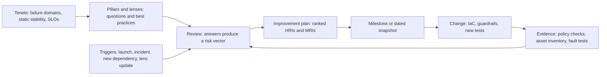

# Well-Architected Frameworks

## TL;DR

- Both frameworks are review instruments, not control planes. AWS ships a stateful scoring tool, and Google ships documentation with agent skills. Neither one enforces anything on its own, so a framework is only as good as the evidence you wire into it.
- AWS has six pillars: operational excellence, security, reliability, performance efficiency, cost optimization, sustainability (AWS docs, as of 2026-10). Google's current framework documents pillars for operational excellence, security/privacy/compliance, reliability, cost optimization, performance optimization and sustainability. It adds a cross-pillar AI and ML perspective (Google Cloud docs, as of 2026-10).
- A review is a sampling process with a miss rate. Mean time-to-detect for a new high-risk issue is roughly T x (1/p - 1/2), where T is the review interval and p is the chance a review catches a given issue. Cadence alone cannot fix a low p, so encode the checkable subset of questions as continuous controls.
- The tenets that matter at staff level are not pillar slogans. They are explicit failure domains, static stability, control/data plane separation, bounded blast radius, SLO-driven change control and tested recovery. A pillar answer of "yes" is worthless unless a fault-injection test or a policy check backs it.
- Pillars conflict by design. Static stability costs N/(N-1) capacity across N zones, and that is a reliability-versus-cost trade you must price explicitly. For AI workloads, accelerator scarcity makes that price very large.

## Mental Model



A framework is a shared vocabulary plus a questionnaire.
The questionnaire converts architectural intent into a small vector of risk counts per pillar.
The vector is only as accurate as the evidence behind each answer, and without evidence it records what participants believe, which drifts away from what is deployed.
The useful system boundary is therefore the loop: tenets define what is non-negotiable, pillars structure the questions, evidence feeds the answers, and triggers (not just a calendar) restart the loop.
Treat the review as a control-plane activity that must never sit in the request path of the workload it judges.

## Internals

### What each framework is structurally

AWS describes its framework as six pillars with design principles, questions and best practices, and it ships a no-cost console tool for evaluating workloads, flagging high-risk issues and recording improvements (AWS Well-Architected page, as of 2026-10).
The framework dates from 2012 as an internal artifact.
It became a public whitepaper in 2015, gained Operational Excellence in 2016, got pillar whitepapers and lenses in 2017, and shipped the Tool in 2018.
The Sustainability pillar arrived in 2021, and by November 2024 AWS said 100 percent of best practices had been refreshed at least once since October 2022 ([AWS Architecture Blog](https://aws.amazon.com/blogs/architecture/announcing-updates-to-the-aws-well-architected-framework-guidance-3), as of 2026-10).
The Tool received a further framework refresh on 2025-04-09 ([AWS What's New](https://aws.amazon.com/about-aws/whats-new/2025/04/new-guidance-well-architected-tool), as of 2026-10).

Google's framework is documentation in the Cloud Architecture Center.
It was previously called the Architecture Framework, and its change log records that the old System Design category was removed ([Google Cloud docs](https://docs.cloud.google.com/architecture/framework/whats-new), as of 2026-10).
Its AI and ML perspective was added on 2024-10-11, and per-pillar AI/ML updates followed on 2025-04-28 (operations), 2025-05-28 (cost), 2025-08-07 (reliability), 2025-11-26 (security) and 2026-02-13 (performance) (Google Cloud docs, as of 2026-10).
Google also publishes per-pillar `google-cloud-waf-*` agent skills so AI agents can evaluate workloads against pillar principles ([Google Cloud docs](https://docs.cloud.google.com/architecture/framework), as of 2026-10).

### The AWS review data model

The Tool's objects are workload, lens review, pillar review, question, answer, milestone and improvement plan.
A workload ID is a 32-character hex string that is unique within an AWS Region ([AWS API reference](https://docs.aws.amazon.com/wellarchitected/latest/APIReference/API_GetMilestone.html), as of 2026-10).
That detail matters operationally: your governance data lives in a regional control plane, and cross-Region rollups are your job.
The general framework lens is applied to every workload and additional lenses stack on top, up to 20 per workload (AWS service quotas, as of 2026-10).

An answer is a set of selected choices.
Each choice corresponds to a best practice, and each question carries rules that map the selected set to a risk level (high, medium, none, not applicable, unanswered).
Three consequences follow that a getting-started guide does not spell out:

1. Risk is a function of the choice set, not of any single choice. The rollup is therefore not additive across questions, and a team can lower its HRI count by changing one answer without changing any architecture.
2. The "none of these" option is the pessimistic baseline. Answering honestly with no evidence yields HRIs, which is the correct prior for an unreviewed workload.
3. Lens versions change the question set. When AWS refreshes the framework (14 reliability best practices were updated for the first time since 2022 in the 2025 release), a workload's risk counts can move with zero architectural change. Record the lens version in every milestone so trend lines remain comparable. (Upgrade carry-over behavior is not re-verified here; see the UNVERIFIED list.)

A milestone records the state of a workload at a point in time, and AWS recommends saving one each time you make improvements ([AWS docs](https://docs.aws.amazon.com/wellarchitected/latest/userguide/milestones.html), as of 2026-10).
Profiles (2023-06) reorder questions toward business goals but do not change risk scoring.
Review templates (2023-10) standardize repeated configuration ([timeline compiled by a third party](https://hidekazu-konishi.com/entry/aws_well_architected_framework_history_and_timeline.html), as of 2026-10).

### Mechanism: review cadence as a detection problem

Let new high-risk issues arrive at rate r per workload per year, introduced uniformly in time.
Let a review at interval T catch any given outstanding issue with probability p, because answers are self-reported and reviewers miss what they do not know to look for.
The first review after introduction is on average T/2 away, and each miss adds a full interval.
The expected time-to-detect is therefore:

```
E[delay] = T/2 + T * (1 - p) / p = T * (1/p - 1/2)
```

With p = 0.6 and T = 90 days, E[delay] is 105 days, longer than the review interval itself.
Halving T helps linearly, but raising p helps hyperbolically.
That is the argument for evidence-backed answers.
A fraction c of questions can be encoded as continuous checks (policy-as-code, asset inventory queries, config rules) with detection delay near one day.
The blended delay is c x 1 + (1 - c) x T x (1/p - 1/2).
Section "Worked Example" quantifies this.

Self-reported assessment is also the structural weakness of the Tool.
Commentary on the 2026 AWS Well-Architected Agent preview makes the same point: classic reviews are declarative and rely on what participants know about their environment ([Devoteam, third-party](https://www.devoteam.com/expert-view/aws-well-architected-agent-preview/), as of 2026-10).

### Mechanism: the non-negotiable tenets

The pillars are a taxonomy.
The tenets below are what a bar raiser actually checks.
These are this curriculum's editorial selection, drawn from the AWS Builders' Library and the Google SRE canon, and each pairs with a test that produces evidence.

| Tenet | Mechanism | Evidence test |
|---|---|---|
| Explicit failure domains | Every component maps to a zone, cell or Region, and the map is in code | Diff of deployed placement against declared placement |
| Static stability | The data plane keeps working with zero control-plane calls during a zonal failure | Game day that revokes control-plane access and kills a zone |
| Control/data plane separation | Data plane has no runtime dependency on mutable control-plane APIs | Dependency trace of the request path |
| Bounded blast radius | Cells and shuffle sharding cap the share of customers one bad input can hit | Poison-pill injection per cell |
| No circular dependencies | Recovery tooling, auth, DNS and observability do not live inside what they recover | Dependency graph cycle check, including the "cold start from nothing" path |
| SLO-driven change control | Error budget gates risky deploys, rollback is one action | Budget burn policy in the pipeline |
| Least privilege plus data perimeter | Identity, resource and network boundaries are redundant layers | Access analyzer and perimeter tests |
| Unit economics | Cost per request, per token or per training step is a first-class metric | Dashboard with an owner and an alert |

See [[17-Cloud-AI-Engineering/Volume_01_Cloud_Architecture_Principles/Chapter_02_Regions_Zones_and_Static_Stability|Regions, Zones, and Static Stability]], [[17-Cloud-AI-Engineering/Volume_01_Cloud_Architecture_Principles/Chapter_03_Cell_Based_Architecture_and_Shuffle_Sharding|Cell-Based Architecture and Shuffle Sharding]] and [[17-Cloud-AI-Engineering/Volume_01_Cloud_Architecture_Principles/Chapter_04_Control_Plane_vs_Data_Plane_Separation|Control Plane vs Data Plane Separation]] for the mechanisms behind the first four rows.
The theory behind the "no circular dependencies" row is metastability: a trigger pushes the system into a state where a sustaining feedback loop (retries, cache misses, backlog) keeps it degraded after the trigger is gone (Bronson et al., HotOS 2021; Huang et al., OSDI 2022).
The theory behind blast radius containment is the cell design in Physalia (Brooker et al., "Millions of Tiny Databases", NSDI 2020).

### Mechanism: serial dependency math

A request path with k hard serial dependencies, each at availability a, has composite availability a^k.
Five dependencies at 99.95 percent give 99.75 percent, about 108 minutes of budget burn per 30 days.
Ten give 99.50 percent.
Pillar questions ask whether you "use redundancy" but rarely force you to enumerate the hard dependencies.
The enumeration is the review.

### The AI-workload extension

AWS's Generative AI Lens (published 2025-04-15) covers a six-phase lifecycle: scoping, model selection, customization, integration, deployment and continuous iteration.
It explicitly excludes model training and advanced customization techniques ([AWS docs](https://docs.aws.amazon.com/wellarchitected/latest/generative-ai-lens/generative-ai-lens.html) and [AWS Architecture Blog](https://aws.amazon.com/blogs/architecture/announcing-the-aws-well-architected-generative-ai-lens), as of 2026-10).
At re:Invent 2025 AWS added a Responsible AI Lens and updated the Machine Learning and Generative AI Lenses ([InfoQ](https://www.infoq.com/news/2025/12/aws-expands-well-architected/), as of 2026-10).
Google's AI and ML perspective maps reliability to five principles: scalable and highly available infrastructure, modular and loosely coupled architecture, an automated end-to-end MLOps platform, data and model governance, and holistic observability ([Google Cloud docs](https://docs.cloud.google.com/architecture/framework/perspectives/ai-ml/reliability), as of 2026-10).
Training is covered on the Google side and excluded from the AWS lens, so cross-cloud AI reviews need a custom lens for training fleets.
See [[17-Cloud-AI-Engineering/Volume_10_AI_Infrastructure_on_Cloud/Chapter_08_Fault_Tolerance_and_Fleet_Resiliency_at_Scale|Fault Tolerance and Fleet Resiliency at Scale]].

## Numbers to Know

| Item | Value | Source and date |
|---|---|---|
| AWS Well-Architected pillars | 6 | AWS docs, as of 2026-10 |
| Google Well-Architected pillar documents | 6 (operational excellence, security/privacy/compliance, reliability, cost, performance, sustainability) plus AI/ML cross-pillar perspective | Google Cloud docs, as of 2026-10 |
| AWS Well-Architected Tool price | No cost in the console | AWS Well-Architected page, as of 2026-10 |
| Milestones per workload | 100 (not adjustable) | AWS service quotas, as of 2026-10 |
| Lenses per workload | 20 | AWS service quotas, as of 2026-10 |
| Custom lenses per account per Region | 15 | AWS service quotas, as of 2026-10 |
| Review templates per account per Region | 500 | AWS service quotas, as of 2026-10 |
| Pillars per custom lens / questions per pillar | 10 / 20 | AWS service quotas, as of 2026-10 |
| Workloads per account per Region | 1,000 (third-party; UNVERIFIED against official quotas) | towardsthecloud.com, as of 2026-10 |
| AWS framework refresh | 2025-04-09, 78 best practices updated or added per AWS | AWS What's New, as of 2026-10 |
| Generative AI Lens publication | 2025-04-15 | AWS docs, as of 2026-10 |
| Google AI/ML perspective added | 2024-10-11 | Google Cloud docs, as of 2026-10 |
| Well-Architected Agent (AWS) | Preview per third-party coverage; one profile analyzes up to 100 accounts (AWS user guide); 5 reviews per day per profile; 4 of 6 pillars in preview | AWS user guide and Devoteam, as of 2026-10 |
| Availability budget at 99.9 / 99.95 / 99.99 percent | 43.2 / 21.6 / 4.32 minutes per 30 days | Arithmetic |
| Static stability capacity overhead | N/(N-1): 2 zones 200 percent, 3 zones 150 percent, 4 zones 133 percent, 6 zones 120 percent of peak | Arithmetic |
| Serial dependency composite, 5 x 99.95 percent | 99.75 percent (about 108 minutes per 30 days) | Arithmetic |

## AWS vs GCP Mechanism Parity

| Dimension | AWS Well-Architected | Google Cloud Well-Architected Framework |
|---|---|---|
| Pillars | Six, long-stable set including sustainability since 2021 | Operational excellence; security, privacy and compliance; reliability; cost optimization; performance optimization; sustainability (docs, as of 2026-10) |
| Unit of review | Workload with lens reviews (questions with selectable best-practice choices) | Prose principles and recommendations per pillar; assessment questions and validation checklists inside agent skills |
| Stateful scoring | Tool stores answers, computes risk counts, keeps up to 100 milestones | No first-party stateful scorer found in this research (UNVERIFIED); keep your own baseline |
| Domain extension | Lenses (Generative AI, Machine Learning, Responsible AI, Serverless, SaaS and others), plus custom lenses | Cross-pillar perspectives, with AI and ML the documented one |
| Automation hooks | Tool API for CI-driven reviews; Well-Architected Agent in preview | Agent skills in a public repository for LLM-driven evaluation |
| Reliability philosophy | Static stability, cells, constant work, fail-static (Builders' Library) | SRE: SLIs, SLOs, error budgets, graceful degradation, postmortems |
| Failure-domain vocabulary | Region, Availability Zone, cell | Region, zone, multi-region services with global control planes |
| Cost vocabulary | Cloud financial management, consumption model | Align spending with value, cost culture, continuous optimization |
| AI guidance | Lens-based, lifecycle phases, training excluded from the Gen AI Lens | Perspective-based, includes MLOps, data governance and training infrastructure |
| Governance evidence sources | Config, Security Hub, Trusted Advisor, CloudTrail | Cloud Asset Inventory, Security Command Center, Recommender, audit logs |

The practical difference is where state lives.
On AWS, the review state is a managed object you can diff over time.
On Google, the framework gives you a rubric and you must build the state, for example by exporting Cloud Asset Inventory snapshots to BigQuery and storing review outcomes in your own repository.
Mechanism parity at the infrastructure level is covered in [[17-Cloud-AI-Engineering/Volume_04_AWS_vs_GCP_Translation/Chapter_03_Identity_Security_and_Governance_Translation|Identity, Security, and Governance Translation]].

## Worked Example

### Worked Example: A review that carries its own evidence and a cadence model

Goal: create a Well-Architected Tool workload, pull risk counts per pillar, stamp each answer with timestamped evidence, save a milestone, and then size cadence.
The Tool itself is no-cost (AWS, as of 2026-10), so this lab provisions no billable resources.
The budget guard below is a safety net in case you extend the lab with real resources.

### Step 1: budget guard

```bash
export ACCT=$(aws sts get-caller-identity --query Account --output text)
aws budgets create-budget --account-id "$ACCT" \
  --budget '{"BudgetName":"waf-lab-guard","BudgetLimit":{"Amount":"5","Unit":"USD"},"TimeUnit":"MONTHLY","BudgetType":"COST"}' \
  --notifications-with-subscribers '[{"Notification":{"NotificationType":"ACTUAL","ComparisonOperator":"GREATER_THAN","Threshold":80,"ThresholdType":"PERCENTAGE"},"Subscribers":[{"SubscriptionType":"EMAIL","Address":"you@example.com"}]}]'
```

### Step 2: the probe

```python
#!/usr/bin/env python3
"""wa_review_probe.py - create a WA Tool workload, answer pessimistically with
evidence stamps, read risk counts, save a milestone."""
import datetime
import json
import sys
import boto3

REGION = "us-east-1"
LENS = "wellarchitected"
wa = boto3.client("wellarchitected", region_name=REGION)


def answers(workload_id, pillar_id):
    token = None
    while True:
        kw = dict(WorkloadId=workload_id, LensAlias=LENS,
                  PillarId=pillar_id, MaxResults=50)
        if token:
            kw["NextToken"] = token
        resp = wa.list_answers(**kw)
        for a in resp["AnswerSummaries"]:
            yield a
        token = resp.get("NextToken")
        if not token:
            return


def stamp(evidence):
    ts = datetime.datetime.now(datetime.timezone.utc).strftime("%Y-%m-%dT%H:%MZ")
    return ("evidence=%s; recorded=%s" % (evidence, ts))[:1500]


def main():
    name = "waf-lab-" + datetime.date.today().isoformat()
    created = wa.create_workload(
        WorkloadName=name,
        Description="Lab workload for review cadence experiments",
        Environment="PREPRODUCTION",
        Lenses=[LENS],
        ReviewOwner="platform-team@example.com",
        AwsRegions=[REGION],
        Tags={"purpose": "waf-lab"},
    )
    wid = created["WorkloadId"]
    print("WorkloadId", wid)

    # Pessimistic baseline: select the "None of these" choice on every
    # reliability question, with a note recording why.
    for a in answers(wid, "reliability"):
        none_choice = next((c["ChoiceId"] for c in a.get("Choices", [])
                            if c["Title"].lower().startswith("none of these")), None)
        if none_choice:
            wa.update_answer(
                WorkloadId=wid, LensAlias=LENS, QuestionId=a["QuestionId"],
                SelectedChoices=[none_choice],
                Notes=stamp("no automated check yet; baseline"))

    review = wa.get_lens_review(WorkloadId=wid, LensAlias=LENS)["LensReview"]
    print("lens version:", review.get("LensVersion"))
    print("overall risk counts:", json.dumps(review.get("RiskCounts", {})))
    for p in review.get("PillarReviewSummaries", []):
        print(p["PillarId"], json.dumps(p.get("RiskCounts", {})))

    wa.create_milestone(WorkloadId=wid,
                        MilestoneName="baseline-" + datetime.date.today().isoformat())
    print("milestone saved; teardown with: aws wellarchitected delete-workload "
          "--workload-id %s --region %s" % (wid, REGION))


if __name__ == "__main__":
    sys.exit(main())
```

The `stamp` function is the point of the exercise.
In production you replace the hard-coded note with the output of a check (for example the compliance state of a config rule, or the timestamp of the last successful game day), and you map `QuestionId` to the checker.
Answers that have no checker remain human attestations and are labeled as such.

### Step 3: Google-side evidence harvest (read-only)

```bash
PROJECT=$(gcloud config get-value project)
# Snapshot resource inventory as the review baseline (writes to your BigQuery dataset)
gcloud asset export --project="$PROJECT" --content-type=resource \
  --bigquery-dataset="projects/$PROJECT/datasets/waf_baseline" \
  --bigquery-table="assets_$(date +%Y%m%d)"
# Cost-pillar evidence: idle VM recommendations
gcloud recommender recommendations list \
  --recommender=google.compute.instance.IdleResourceRecommender \
  --project="$PROJECT" --location=us-central1-a --format=json
```

BigQuery storage for the exported table is billable at your normal rate and is small for a lab project; drop the dataset when finished.

### Step 4: cadence capacity and cost model

Assumptions (illustrative, not measured): 120 workloads split 20 tier-1, 50 tier-2, 50 tier-3; each full review costs 16 person-hours at an assumed 120 USD loaded per hour, so 1,920 USD; new HRIs arrive at 0.15 per workload per month, or 1.8 per year; a review catches a given outstanding HRI with p = 0.6.

| Cadence | Mean detect delay, review only | HRI-days exposed per workload-year |
|---|---|---|
| Annual (T=365) | 426 days | 767 |
| Semiannual (T=180) | 210 days | 378 |
| Quarterly (T=90) | 105 days | 189 |
| Quarterly plus 60 percent of questions automated | 43 days | 77 |
| Annual plus 60 percent automated | 171 days | 308 |

Review volume under a tiered policy (tier-1 quarterly, tier-2 semiannual, tier-3 annual) is 20 x 4 + 50 x 2 + 50 x 1 = 230 reviews per year.
Full reviews cost 230 x 1,920 = 441,600 USD per year.
If automation turns reviews into deltas costing a third as much, the figure is 147,200 USD per year, and detection delay drops as well.
Automation is therefore the only lever that improves both columns.
Event triggers (new hard dependency, tier change, post-incident, lens upgrade, model swap) should force an out-of-cycle delta review regardless of the calendar.

### Step 5: static stability pricing for a GPU serving fleet

Peak load needs 24 accelerator nodes.
To survive losing one zone with no scale-out (the static stability rule), each of N zones must hold enough to carry peak on N-1 zones.
Total nodes = 24 x N/(N-1): 2 zones need 48, 3 zones need 36, 4 zones need 32.
Using an assumed 40 USD per node-hour (placeholder, substitute the current price) over 730 hours:

- 3 zones versus a single-zone 24-node fleet: 12 extra nodes x 40 x 730 = 350,400 USD per month.
- 2 zones versus 3 zones: 12 extra nodes, another 350,400 USD per month, so two zones is strictly worse on cost and reliability.
- 4 zones versus 3 zones saves 4 nodes (116,800 USD per month) but requires four zones with free accelerator capacity.

### Teardown

```bash
WID=${WID:-$(aws wellarchitected list-workloads --region us-east-1 --query "WorkloadSummaries[?WorkloadName=='waf-lab-inference-gateway'].WorkloadId" --output text)}
PROJECT=${PROJECT:-$(gcloud config get-value project)}
aws wellarchitected delete-workload --workload-id "$WID" --region us-east-1
aws budgets delete-budget --account-id "$ACCT" --budget-name waf-lab-guard
bq rm -r -f -d "$PROJECT:waf_baseline"
```

## Failure Modes and Pitfalls

### Review theater

Symptom: all pillars show zero HRIs and the workload suffers an outage within a quarter.
Mechanism: answers were attestations without evidence, and the choice-set rules reward selecting boxes that sound true.
Mitigation: require an evidence link per answer, sample 10 percent of "no risk" answers for independent verification each cycle, and publish the sampled miss rate, which is your empirical (1 - p).

### Hidden shared fate

The AWS S3 event of 2017-02-28 began with an operator command that removed more capacity than intended.
It also exposed that the status dashboard itself depended on the failing service ([AWS summary](https://aws.amazon.com/message/41926/); details not re-fetched this session).
The AWS us-east-1 event of 2021-12-07 involved congestion in the internal network from automated scaling activity, and it impaired the monitoring and operational tooling needed to diagnose it ([AWS summary](https://aws.amazon.com/message/12721/); details not re-fetched this session).
The lesson for review design: pillar questions ask about monitoring, but the discriminating question is whether monitoring and recovery tooling share a failure domain with the monitored system.

### Regional control-plane dependencies and DNS

The AWS us-east-1 event of 2025-10-19 and 2025-10-20 was attributed in AWS's post-event summary to a latent race condition in DynamoDB's DNS management that produced an empty record for the regional endpoint, followed by cascading impact on dependent services ([AWS summary](https://aws.amazon.com/message/101925/); details recalled, not re-fetched this session, UNVERIFIED).
The review lesson is that "multi-AZ" says nothing about a regional endpoint failing, so the dependency inventory must include name resolution and regional service endpoints.

### Global configuration pushes

Google Cloud's incident on 2025-06-12 was attributed to a policy-data change that hit an unguarded code path in a global control service and was replicated globally within seconds (Google Cloud incident report; details recalled, UNVERIFIED).
The review lesson: a pillar item on "safe deployments" must cover configuration and metadata, not only binaries, and must demand staged rollout and feature-flag protection for every globally replicated input.

### Pillar tension left implicit

Reliability pushes extra capacity, cost optimization removes it, and sustainability penalizes idle hardware.
If the review records each pillar separately, no one owns the trade.
Record each trade as a risk acceptance with an owner, a quantified cost, and an expiry date.

### Stale lenses and silent score changes

When a lens version changes, risk counts move without architectural change.
Pin the lens version in every milestone, and diff question sets before comparing quarter-over-quarter trends.

### Quota and tooling limits

A single workload is capped at 100 milestones and 20 lenses (AWS quotas, as of 2026-10).
A fleet run weekly with one milestone per run exhausts a workload's milestone budget in under two years, so snapshot to your own store and keep Tool milestones for decision points.

### Metastable amplification of the review itself

If you automate re-reviews on every deploy and each failing check opens tickets and pages, a bad rollout turns your governance into an alert storm.
Rate-limit and aggregate, and keep review automation off the paging path.

## Security and Cost Angles

### Security

- Scope the reviewer role. Allow `wellarchitected:GetWorkload`, `ListAnswers`, `GetLensReview` and `UpdateAnswer` on tagged workloads, and reserve `DeleteWorkload`, `CreateMilestone` and sharing actions for the governance role.
- Workload notes tend to contain architecture detail such as account IDs, dependency names and known weaknesses. Treat the Tool's contents as sensitive, forbid secrets in notes, and restrict cross-account sharing.
- For evidence harvesting, use read-only roles per account with an organization-level aggregation. On Google, `roles/cloudasset.viewer` and `roles/recommender.viewer` are the narrow roles to start from.
- The agent-based tooling raises a data-residency question. Commentary on the AWS agent preview says storage location and retention were not documented at the time (Devoteam, third-party, as of 2026-10), so classify it as a preview feature and gate it behind data-handling approval.
- Pair review output with a perimeter: see [[17-Cloud-AI-Engineering/Volume_08_Security_Identity_and_the_Data_Perimeter/Chapter_06_Constructing_an_Impenetrable_Data_Perimeter|Constructing an Impenetrable Data Perimeter]].

### Cost

- Tool price is zero, so the cost is people-time. In the model above, a 16-person-hour review is about 1,920 USD, and automation that reduces reviews to deltas saves roughly two thirds.
- Review depth should follow blast radius and spend. Tier-3 workloads get an annual delta review plus automated checks.
- The unit-economics tenet means every review ends with a cost-per-unit number and an owner. See [[17-Cloud-AI-Engineering/Volume_09_FinOps_and_Cloud_Economics/Chapter_05_GPU_and_TPU_Unit_Economics|GPU and TPU Unit Economics]].
- For AI fleets the largest lever is the availability design: moving from 2 zones to 3 zones at constant peak load saves 12 of 48 nodes (25 percent), as in Step 5.

## Interview Questions and Model Answers

### Question 1 (L5 - Senior)

A team says "we passed our Well-Architected review" after a regional outage took them down. What does a passed review actually tell you, and what does it not?

#### Model Answer

A review produces a risk vector from self-reported answers.
Each question's risk is a function of the set of selected best-practice choices, so a clean vector means the participants believed they met the listed practices.
It does not tell you that the practice is implemented, that it works under failure, or that the question set covers your specific hard dependencies.
In the outage case, I would check three things.
First, whether the dependency inventory included regional endpoints and shared-fate tooling, because pillar questions about redundancy are satisfied by multi-AZ even when a regional dependency is the failure.
Second, whether each "no risk" answer carried evidence, such as a game-day record or a policy check.
Third, whether the lens version was current.
The corrective action is to add a dependency-graph step and an evidence requirement, not to add more questions.

#### Follow-up Interviewer Question

Which single artifact would you ask for first to tell whether the review was real or theater?

### Question 2 (L5 - Senior)

Compare the AWS and Google frameworks as engineering artifacts. What would you port, and what would you not?

#### Model Answer

Structurally, AWS has six pillars with a stateful tool that stores answers, risk counts and up to 100 milestones per workload.
Google has pillar documents for operations, security, reliability, cost, performance and sustainability, with a cross-pillar AI and ML perspective and agent skills, but I found no first-party stateful scorer (UNVERIFIED).
Philosophically, Google's reliability pillar descends from SRE: SLOs, error budgets and postmortems.
AWS reliability guidance leans on the Builders' Library tenets: static stability, cells, constant work and fail-static behavior.
I would port the tenet-and-evidence approach, and one control catalog with stable control IDs mapped to both frameworks' questions.
I would not port question wording one-to-one, because the failure-domain primitives differ.
For example, a global VPC in Google Cloud changes what "network isolation per environment" means compared with regional VPCs.
I would also not port AWS's per-workload risk scoring to Google by inventing equivalent numbers, because scores built on different rubrics are not comparable.

#### Follow-up Interviewer Question

How would you keep the control catalog from collapsing to the lowest common denominator?

### Question 3 (L6 - Staff)

You own governance for 120 workloads. Design the review cadence so it does not become a checkbox exercise and does not consume the platform team.

#### Model Answer

I model review as a detection problem.
Expected time-to-detect for a new high-risk issue is T x (1/p - 1/2), where T is the interval and p is the chance a review catches an outstanding issue.
At p = 0.6 and a 90-day cadence, mean delay is 105 days, so cadence tuning alone cannot get below about a month without costs exploding.
The levers in order of value are: raise p by requiring evidence per answer; automate the checkable fraction c of questions to near-daily detection; use event triggers for out-of-cycle delta reviews; and only then shorten T.
Concretely: tier workloads by blast radius and revenue; tier-1 gets quarterly delta reviews plus continuous checks, tier-2 semiannual, tier-3 annual.
Triggers include a new hard dependency, a new Region, an incident, a lens version change, a tier change and, for AI services, a model or provider swap.
Measure p empirically by independently re-verifying a sample of "no risk" answers each cycle, and measure the automated fraction c as a program KPI.
With c = 0.6, a quarterly cadence drops mean delay from 105 to about 43 days in my illustrative model.
Cost is people-time: at 16 hours per full review, 230 reviews per year is about 442,000 USD, falling to about 147,000 USD if reviews become deltas.

#### Follow-up Interviewer Question

How would you detect that your measured p is itself wrong because the sampling reviewer shares blind spots with the original team?

### Question 4 (L6 - Staff)

Reliability says "survive a zone loss with no scaling". Cost optimization says "do not hold idle accelerators". Resolve this for an LLM serving fleet whose peak needs 24 nodes.

#### Model Answer

Static stability means the surviving zones must already hold the capacity, because relying on launching replacements during a zonal event depends on a control plane and on spare accelerator capacity that is scarce exactly when everyone is failing over.
Total provisioned nodes are peak x N/(N-1): 48 for 2 zones, 36 for 3, 32 for 4.
So two zones is the worst option, costing double the peak, and three zones costs 50 percent overhead.
Four zones saves 4 nodes against three zones only if there is accelerator capacity in a fourth zone and the model weights can be placed there; for GPUs that is often not true.
I would not treat this as binary.
I would define a degraded-mode SLO: for example, under a zone loss, serve the premium tier at full quality and shed or downshift the batch tier, so the provisioned overhead covers only the portion of load that must be protected.
If premium traffic is 60 percent of peak, protected capacity is 14.4 nodes, and N=3 needs only about 21.6 nodes of statically stable capacity for that tier plus opportunistic capacity for the rest.
Then I would price the residual risk, such as the monthly cost of the remaining nodes versus the expected revenue at risk from degraded batch service, and record the trade as an owned, expiring risk acceptance.

#### Follow-up Interviewer Question

The capacity team says the fourth zone has no free accelerators for six months. What changes in your design?

### Question 5 (L6 - Staff)

As a bar raiser, you review a design that claims full multi-region resilience. What do you look for that the framework questions would not surface?

#### Model Answer

I look for hidden coupling in five places.
First, the recovery path: does the tooling to fail over (deployment system, secrets, DNS changes, identity) live in the region being recovered or depend on its control plane? The 2017 S3 and 2021 us-east-1 events both showed tooling and visibility sharing fate with the failing system.
Second, name resolution and regional endpoints, because multi-AZ placement says nothing about an endpoint failure.
Third, global config propagation: does any metadata or policy change replicate everywhere in seconds without staging? The 2025-06-12 Google Cloud incident is the reference case, and I would flag it as a pattern, not a vendor flaw.
Fourth, retry and backlog behavior: what happens when the dependency returns? Without jittered backoff, load shedding and bounded queues, recovery can re-trigger the overload, which is the metastable pattern.
Fifth, the serial dependency math: five hard dependencies at 99.95 percent give 99.75 percent, so the claimed SLO is violated by design.
I ask for a cold-start-from-nothing walkthrough and a game-day record where control-plane access is revoked.

#### Follow-up Interviewer Question

The team says they cannot revoke control-plane access in a game day because production would break. What do you conclude?

### Question 6 (L7+ - Principal)

You must make "non-negotiable tenets" enforceable across 40 teams and two clouds without a central review bottleneck. Design the system, including exceptions.

#### Model Answer

I separate tenets (small, stable, owned by principals) from controls (many, versioned, owned by platform) from reviews (event-driven, evidence-first).
Each tenet gets a testable statement and a control ID, for example "no hard runtime dependency on a mutable control plane" mapped to a trace-based test and an IaC lint.
Controls are expressed as policy-as-code at three points: pre-merge (plan scanning), pre-deploy (admission and org-level guardrails), and continuous (inventory queries against deployed state).
The reviews consume control results as evidence, so a team's review is mostly confirming that automated evidence is current, and human time goes to the unautomatable questions such as failure-domain design.
Exceptions are first-class: a waiver is a record with an owner, a quantified risk, a compensating control and an expiry, stored in version control, and expiring waivers page the owner and the sponsoring director.
Two-way-door decisions are delegated; one-way doors (data residency, region choice, identity model, public API contracts) require principal review.
I would track program-level metrics: automated coverage fraction c, sampled miss rate (1 - p), mean waiver age, and time-to-remediate HRIs.
Failure modes I plan for: controls diverging between clouds (solved by one control ID mapping to a per-cloud implementation) and controls becoming a deploy bottleneck (solved by dry-run mode for new controls and an SLO on control evaluation latency).

#### Follow-up Interviewer Question

A product team with a revenue deadline requests a waiver on a tenet that guards against a cascading-failure pattern. What is your decision procedure?

### Question 7 (L7+ - Principal)

Adapt the framework review for a multi-tenant LLM platform where output quality is non-deterministic, accelerator capacity is scarce, and model providers throttle you.

#### Model Answer

I keep the pillars but extend what counts as a hard dependency and as an SLI.
Reliability gets a quality SLI alongside availability and latency: an offline and online eval pass rate with a budget, because a model update can fail without a single error.
That aligns with the AWS Generative AI Lens lifecycle, where model selection, customization and continuous iteration are explicit phases, and with Google's AI/ML reliability principles around MLOps automation and data and model governance.
Capacity is the dominant risk: I enumerate provider quotas and accelerator reservations as dependencies with their own failure modes, and I design degraded modes such as routing to a smaller model, queue-and-defer for batch tiers, and per-tenant admission control with priority classes.
Training is outside the AWS Generative AI Lens, so I add a custom lens for checkpoint cadence, straggler handling and silent-data-corruption detection, referencing [[17-Cloud-AI-Engineering/Volume_10_AI_Infrastructure_on_Cloud/Chapter_08_Fault_Tolerance_and_Fleet_Resiliency_at_Scale|Fault Tolerance and Fleet Resiliency at Scale]].
For security I add prompt-injection and tool-credential boundaries to the data-perimeter review.
For cost I require cost per request or per token with an owner, because average utilization hides tail-driven overprovisioning.
Triggers for out-of-cycle review include a model swap, a context-length change, a new tool with side effects, and a provider quota change.
I also require game days that include provider throttling and loss of one accelerator zone.

#### Follow-up Interviewer Question

Your eval pass rate drops 3 points after a provider silently updates a hosted model. What guardrails would have caught it, and where does the framework fail to help?

## Further Reading

- [AWS Well-Architected Framework definitions](https://docs.aws.amazon.com/wellarchitected/latest/framework/definitions.html) - the canonical pillar definitions that every lens and review inherits.
- [AWS Well-Architected Tool endpoints and quotas](https://docs.aws.amazon.com/general/latest/gr/wellarchitected.html) - the limits that shape how you can operate reviews at fleet scale.
- [AWS Well-Architected Tool milestones](https://docs.aws.amazon.com/wellarchitected/latest/userguide/milestones.html) - how point-in-time review state is recorded, essential for trend analysis.
- [AWS Generative AI Lens](https://docs.aws.amazon.com/wellarchitected/latest/generative-ai-lens/generative-ai-lens.html) - the lifecycle-phase structure and the explicit exclusion of training.
- [Google Cloud Well-Architected Framework](https://docs.cloud.google.com/architecture/framework) - the pillar documents, the AI and ML perspective and the agent skills.
- [Google Cloud framework change log](https://docs.cloud.google.com/architecture/framework/whats-new) - dated record of pillar and AI/ML updates, useful for pinning review baselines.
- [Google Cloud AI and ML reliability perspective](https://docs.cloud.google.com/architecture/framework/perspectives/ai-ml/reliability) - the five reliability principles for ML systems.
- AWS Builders' Library (aws.amazon.com/builders-library): articles on static stability using Availability Zones, workload isolation using shuffle-sharding, reliability and constant work, timeouts, retries and backoff with jitter, and using load shedding to avoid overload - the mechanisms behind the reliability tenets.
- Google, Site Reliability Engineering and The Site Reliability Workbook (sre.google) - SLOs, error budgets and the cascading-failure chapter, the source of Google's reliability pillar.
- Brooker et al., "Millions of Tiny Databases", NSDI 2020 - the cell and blast-radius design behind EBS's control plane; see [[17-Cloud-AI-Engineering/Volume_13_Seminal_Papers_and_Case_Studies/Chapter_03_Physalia_EBS_Control_Plane|Physalia]].
- Verma et al., "Large-scale cluster management at Google with Borg", EuroSys 2015 - the lineage of Google's operational model; see [[17-Cloud-AI-Engineering/Volume_13_Seminal_Papers_and_Case_Studies/Chapter_07_Google_Borg_and_Omega|Borg and Omega]].
- Bronson et al., "Metastable Failures in Distributed Systems", HotOS 2021, and Huang et al., "Metastable Failures in the Wild", OSDI 2022 - the theory for why recovery paths and retries need review.
- AWS post-event summaries for 2017-02-28 (S3), 2021-12-07 (us-east-1) and 2025-10-19 (us-east-1) - primary-source case studies in shared fate and dependency cycles.
- Next chapter: [[17-Cloud-AI-Engineering/Volume_01_Cloud_Architecture_Principles/Chapter_02_Regions_Zones_and_Static_Stability|Regions, Zones, and Static Stability]].
