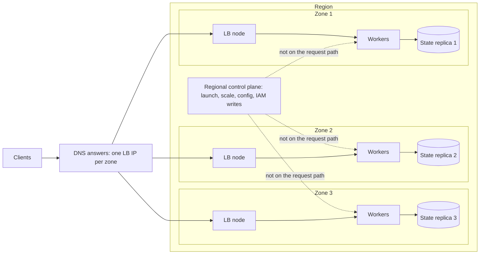

# Regions, Zones, and Static Stability

## TL;DR

A zone is a failure-isolation boundary for power, cooling, and network, but not for the regional control plane, global services, or any dependency you share across zones, so you must design for the case where one zone is gone and the control plane is also degraded.
Static stability means a single-zone loss requires zero API calls, zero scaling actions, and zero configuration pushes to stay within SLO: for N zones and k tolerated zone losses you pre-provision N/(N-k) times peak capacity (50 percent extra for 3 zones, 100 percent for 2).
Survivor utilization rises by N/(N-k) at the instant of loss, so latency is governed by queueing (a fleet at 60 percent in 3 zones jumps to 90 percent and p99 grows about 4x), and autoscalers that target average utilization will silently erode this headroom.
Every cross-zone runtime dependency, boot-time dependency, and recovery-path dependency is a bimodal-behavior risk, and a cycle in the dependency graph (A needs B to start, B needs A to recover) converts a partial outage into a cold-start problem that no amount of redundancy fixes.
Enforce this with tiered dependency graphs checked in CI for strongly connected components, zone-aligned request paths, fail-static caches with staleness alarms, and game days that freeze the control loop and kill a zone.

## Mental Model



Two planes cross a region.
The data plane is the set of already-running things that serve requests, and it is replicated per zone so that losing one zone removes a fixed fraction of capacity and nothing else.
The control plane is the set of APIs that create, change, and delete things, and it is regional or global, more complex, and more likely to be impaired exactly when you need it.
A statically stable system is one where the dotted lines in the diagram carry no traffic that the recovery depends on: capacity already exists in the surviving zones, routing converges from health signals rather than from an operator or an API call, and state is already replicated.
The rest of this chapter is the arithmetic of how much capacity "already exists" must be, the mechanisms that quietly break the property, and the dependency-graph discipline that stops a regional impairment from becoming a cycle you cannot restart out of.
See [[17-Cloud-AI-Engineering/Volume_01_Cloud_Architecture_Principles/Chapter_04_Control_Plane_vs_Data_Plane_Separation|Control Plane vs Data Plane Separation]] for the plane split in general, and [[17-Cloud-AI-Engineering/Volume_00_Foundations_Under_the_Cloud/Chapter_06_Physical_Failure_Domains_and_Blast_Radius|Physical Failure Domains and Blast Radius]] for what a zone is made of physically.

## Internals

### What a zone is, and what it is not

An AWS Availability Zone is one or more discrete data centers with independent power, cooling, and networking, and the AZs in a Region are separated by meaningful distance yet connected by dedicated metro fiber with single-digit millisecond latency (AWS docs, as of 2026-10, UNVERIFIED in this pass - recalled from the AWS Regions and Availability Zones page).
A Google Cloud zone is a deployment area within a region that Google documents as a single failure domain, and a region has at least three zones (Google Cloud docs, as of 2026-10, UNVERIFIED in this pass).
Neither definition promises that the zone is independent of the regional control plane, of global services, or of whatever you built that all zones share.
Treat the zone as a bounded blast radius for physical faults and for zonal software deployments, and nothing more.

AWS maps zone names to physical zones per account, so `us-east-1a` in your account and in a vendor's account may be different data centers, and the stable identifier is the AZ ID such as `use1-az1` (AWS docs, as of 2026-10, UNVERIFIED in this pass).
The operational consequence is that incident communications, capacity reservations shared across accounts via RAM, and zonal shift calls must all be expressed in AZ IDs, and your automation must resolve names to IDs per account before it acts.
If you skip this step, an "AZ-b impaired" message sends half your accounts to drain the healthy zone.

### Control plane, data plane, and bimodal behavior

AWS states that once an EC2 instance is launched it is as available as a physical server and does not depend on control plane APIs to keep running or to restart after reboot, and the same holds for VPCs, S3 objects, and EBS volumes (AWS Fault Isolation Boundaries whitepaper, as of 2026-10).
The Well-Architected Reliability pillar calls the failure of this property bimodal behavior: the workload behaves differently in failure mode than in normal mode, for example by relying on launching new instances when a zone fails (AWS Well-Architected REL 11, as of 2026-10).
The Builders' Library article that defines the pattern is Weiss and Furr, "Static stability using Availability Zones" (Amazon Builders' Library, 2019).
Its core claim is that a statically stable system keeps doing what it was doing when a dependency is impaired, possibly without seeing updates the dependency was supposed to deliver, and it recommends over-provisioning so that a zone loss needs no scale-up (Amazon Builders' Library, as of 2026-10).

The point that is missing from most getting-started guides is that static stability is a property of the recovery path, not of the steady state.
A system with three zones, health checks, and an Auto Scaling group looks highly available in a diagram and is bimodal in practice, because the diagram's recovery edge is "ASG calls RunInstances in the surviving zones".
That edge passes through detection, alarm evaluation, a scaling decision, the EC2 control plane, a capacity pool shared with every other tenant doing the same thing at the same moment, instance boot, application warm-up, and load balancer registration.
Every one of those stages is correlated with the failure you are recovering from, and the whole sequence typically takes minutes (illustrative, based on operating experience, not a published number).

### The capacity invariant

Let `B` be the number of instances needed to serve peak demand at a target utilization `u_target` (the knee of your latency curve).
Place instances evenly across `N` zones and require that any `k` zones can fail.
Each zone must hold `ceil(B / (N - k))` instances, so the fleet is `N * ceil(B / (N - k))`.
For `k = 1` this is the formula AWS gives for ECS: target desired count equals base desired count times (AZ spread count divided by (AZ spread count minus 1)) (AWS Containers Blog, "Best practices for resilience and availability on Amazon ECS", as of 2026-10).
The Fault Isolation Boundaries whitepaper gives the worked case of three instances in each of three zones, nine in total, with six surviving a zone loss at a cost of 50 percent additional instances (AWS Fault Isolation Boundaries whitepaper, as of 2026-10).

The overhead falls as `N` grows, which is the economic argument for more, smaller failure domains.
`N = 2` costs 100 percent extra, `N = 3` costs 50 percent, `N = 4` costs 33 percent, and `N = 6` costs 20 percent (derived).
The counter-argument is that cross-zone traffic cost, quorum placement, and operational surface grow with `N`, and most regions offer three zones, so three is the practical default.

Survivor utilization is the second half of the invariant.
If steady-state utilization is `rho`, then immediately after losing `k` of `N` zones it is `rho * N / (N - k)`.
If you want survivors to stay under a latency-safe ceiling `rho_max`, steady-state utilization must stay under `rho_max * (N - k) / N`.
For `rho_max = 0.70` and `N = 3` that is 46.7 percent, which surprises teams that have been told to run at 60 to 70 percent for efficiency.

Model a single instance as M/M/1 with service time `s`: response time is exponential with mean `s / (1 - rho)`, so the p99 is `ln(100) * s / (1 - rho)`.
For `s = 20 ms`, `rho = 0.60` gives a p99 of 230 ms and `rho = 0.90` gives 921 ms (derived, simplified model; real multi-threaded servers differ in shape but not in the knee).
Utilization above roughly 0.9 also makes timeouts and retries start to dominate, which pushes you toward the metastable regime described in "Metastable Failures in Distributed Systems" (Bronson et al., HotOS 2021).

### Why the autoscaler erodes the headroom

Target-tracking policies and the Kubernetes Horizontal Pod Autoscaler scale in until average utilization equals the target.
If the target is 60 percent, a 3-zone fleet converges to 60 percent steady state, which is the 90 percent post-loss case above, and the headroom you provisioned is removed by the same automation that is supposed to make you efficient.
Cluster-level consolidation does the same at node granularity, for example Karpenter NodePool consolidation of underutilized nodes (Karpenter docs, UNVERIFIED in this pass).
There are three defenses.
Set the tracking target to `rho_max * (N - k) / N` rather than to the efficient-looking number.
Set a minimum capacity equal to `N * ceil(B / (N - k))` and let the autoscaler act only above it.
Alert on a synthetic metric, "capacity remaining after worst-zone loss divided by current demand", which is the direct measure of static stability and the one that should page.
See [[17-Cloud-AI-Engineering/Volume_05_Kubernetes_and_Platform_Engineering/Chapter_04_Autoscaling_at_Scale_HPA_KEDA_and_Karpenter|Autoscaling at Scale: HPA, KEDA, and Karpenter]] for the scaling-loop side.

### Zone-aligned request paths

Capacity is necessary but not sufficient, because a request that crosses zones at every hop makes the whole request depend on all zones.
Consider a 5-hop call chain where each hop picks a zone uniformly at random among 3, and one zone fails completely (every call into it fails).
With no retries, request success is (2/3)^5 = 13.2 percent.
With one retry per hop, per-hop success is 1 - (1/3)^2 = 8/9 and request success is (8/9)^5 = 55.5 percent, at a cost of more load on the survivors (derived).
If each request stays in the zone it entered, a zone failure fails exactly the fraction of requests that entered that zone, and those can be shifted away at the edge, which gives a clean and fast recovery action.
The same alignment cuts the expected cross-zone hops in this chain from 3.3 to near 0, which matters for both latency and for inter-zone transfer charges (see [[17-Cloud-AI-Engineering/Volume_09_FinOps_and_Cloud_Economics/Chapter_04_Network_Egress_Economics_and_Optimization|Network Egress Economics and Optimization]]).

Zone affinity has its own failure mode: it makes per-zone load depend on where clients land, so a skewed client population produces a hot zone while the others idle.
Envoy's zone-aware routing sends traffic locally when the local zone's share of healthy hosts is within bounds and spills the residual to other zones in proportion to their capacity, and it is only effective when capacity per zone is roughly balanced (Envoy docs, UNVERIFIED in this pass).
Envoy also applies an overprovisioning factor, default 1.4, before it spills load to the next priority level, so a locality at 72 percent healthy still receives 100 percent of its traffic, and a panic threshold, default 50 percent, below which it ignores health status and spreads to all hosts (Envoy docs, UNVERIFIED in this pass).
Those two defaults are a tuning decision about whether you prefer to overload a degraded zone or to cascade into healthy ones, and you should choose them deliberately.

On AWS, Application Load Balancers always have cross-zone load balancing enabled at the load balancer level, while Network Load Balancers default to disabled (AWS docs, as of 2026-10, UNVERIFIED in this pass).
With cross-zone disabled, DNS gives each zonal LB node an equal share of client traffic, so unequal instance counts per zone give unequal per-instance load.
That is the mechanism by which an "almost balanced" fleet (for example 7, 7, and 6 instances) turns into a hot instance population under load.

### Push, not pull: how data planes survive control plane loss

There are two ways a data plane host can learn the state it needs, such as routing tables, feature flags, or credentials.
A pull-on-miss design asks a regional service whenever it meets something unknown, so an outage of that service turns into failures for every new flow or key, and the failure rate rises with the arrival rate of new things.
A push-full-state design has the control plane continuously deliver the complete state, so the host always holds a last-known-good copy and its failure behavior is "stale" instead of "down".
The Builders' Library article describes how EC2 itself is built around this idea, including keeping network traffic local to the zone and avoiding regional calls on the data path (Amazon Builders' Library, as of 2026-10; the specific EC2 network-mapping details are UNVERIFIED in this pass).
The cost of push-full-state is state size times fan-out and the need for versioning, which is why it pairs with constant-work techniques: [[17-Cloud-AI-Engineering/Volume_01_Cloud_Architecture_Principles/Chapter_05_Constant_Work_and_Workload_Smoothing|Constant Work and Workload Smoothing]].
Its operational hazard is silent staleness, so every fail-static cache needs an age metric and an alarm on it, and it needs a bounded behavior when the age exceeds the data's safe lifetime.

### The hidden dependencies

The recovery path is only as static as its weakest hidden dependency.
The table lists the ones that bite most often and the static-stable replacement.

| Dependency | Typical hidden form | Statically stable replacement |
|---|---|---|
| Instance launch | ASG or Karpenter scaling out during the event | Headroom pre-provisioned at N/(N-k) |
| Boot path | KMS decrypt, secret fetch, registry pull, package install at instance start | Bake into the image, local NVMe cache, regional registry mirror, cached envelope data keys |
| Authentication | STS or IdP call per request, IdP hosted in the failing region | Cached credentials that outlive the outage, pre-provisioned break-glass users (AWS Fault Isolation Boundaries whitepaper, as of 2026-10) |
| Authorization changes | Editing SCPs or policies to unblock recovery | Pre-staged session-tag-based admin access instead of Organizations writes (AWS Fault Isolation Boundaries whitepaper, as of 2026-10) |
| DNS failover | Editing records through a regional or global control plane | Pre-created records with health-check-driven failover on the data plane |
| Config | Read from a store per request | Local last-known-good with an age alarm |
| Observability | Alarms and dashboards hosted in the failing zone or region | Out-of-band monitors, local logs, a second signal path |
| Deployment | Need the pipeline to ship the fix | Break-glass artifact path that does not use the production dependency chain |

The whitepaper also warns that if your identity provider is itself hosted on AWS it may be impaired in the same event, and recommends pre-provisioning break-glass users in a statically stable way (AWS Fault Isolation Boundaries whitepaper, as of 2026-10).
Several global AWS services have a control plane in a single Region while their data planes are distributed, with Route 53 as the standard example (AWS Fault Isolation Boundaries whitepaper, as of 2026-10, UNVERIFIED on the exact service list).

### Circular dependency prevention

A circular dependency exists when a strongly connected component of size greater than one appears in the graph of "X must be up for Y to start, scale, authenticate, or recover".
The cycles that matter fall into five classes.
Startup cycles: A needs B at boot and B needs A at boot.
Recovery cycles: B's repair requires A's control plane, and A is down because B is down.
Authorization cycles: the system that grants access to fix the system is behind the access it grants.
Observability cycles: the monitoring that tells you the system is down runs on the system.
Capacity cycles: the scheduler or autoscaler that adds capacity runs on the capacity it adds.

You can detect declared cycles mechanically.
Build the graph from infrastructure code, from trace edges, from network flow logs, and from startup scripts, then compute strongly connected components with Tarjan's algorithm in CI and fail the build on any new component that is not on an explicit allow-list with an owner and an expiry date.

```python
import sys
sys.setrecursionlimit(10000)

def sccs(graph):
    index, low, on, stack, out, idx = {}, {}, set(), [], [], [0]
    def visit(v):
        index[v] = low[v] = idx[0]; idx[0] += 1
        stack.append(v); on.add(v)
        for w in graph.get(v, ()):
            if w not in index:
                visit(w); low[v] = min(low[v], low[w])
            elif w in on:
                low[v] = min(low[v], index[w])
        if low[v] == index[v]:
            comp = []
            while True:
                w = stack.pop(); on.discard(w); comp.append(w)
                if w == v: break
            out.append(sorted(comp))
    nodes = set(graph) | {w for ws in graph.values() for w in ws}
    for v in sorted(nodes):
        if v not in index: visit(v)
    return [c for c in out if len(c) > 1 or c[0] in graph.get(c[0], ())]

deps = {
    "app": ["lb", "secrets", "metrics"],
    "secrets": ["kms", "authn"],
    "authn": ["kv-store"],
    "kv-store": ["dns", "fleet-mgr"],
    "fleet-mgr": ["kv-store", "dns"],
    "metrics": ["kv-store"],
    "dns": [],
}
print(sccs(deps))   # 'fleet-mgr', 'kv-store'
```

Static analysis finds only the edges you declared, so pair it with three structural rules.
Assign every service a tier and allow edges only to the same tier or lower, where tier 0 is the set of things that start and repair everything else (naming, identity, key management, configuration distribution, the fleet manager, the deploy path).
Require tier 0 to depend only on hardware and on itself, with its own bootstrap bundle that works with no other service present.
Run a cold-start test: in an isolated account or project, bring the tier-0 set up from zero in dependency order with all other services absent, and fail the test if any tier-0 component blocks on something outside the set.

The dependency that kills you is often a soft edge, such as a lease or a health check, rather than a hard call.
A fleet manager that renews leases against a key-value store, where the key-value store's own endpoint is managed by a DNS system that needs the fleet manager's hosts to run, is a cycle that only shows up when leases expire at scale.
The next failure-modes section covers a public example of this shape.

## Numbers to Know

| Quantity | Value | Source |
|---|---|---|
| Extra instances to survive 1 of 3 zones (3 per zone, 9 total, 6 survive) | 50 percent | AWS Fault Isolation Boundaries whitepaper, as of 2026-10 |
| ECS desired count rule for single-AZ loss | base x (spread / (spread - 1)) | AWS Containers Blog, as of 2026-10 |
| Overhead for k=1 by zone count | N=2: 100 percent, N=3: 50 percent, N=4: 33 percent, N=6: 20 percent | Derived from the N/(N-1) rule |
| Maximum steady-state utilization for a 70 percent post-loss ceiling | N=2: 35 percent, N=3: 46.7 percent, N=4: 52.5 percent, N=6: 58.3 percent | Derived |
| Survivor utilization after 1-of-3 loss from 60 percent | 90 percent | Derived |
| M/M/1 p99 at 20 ms service time | 230 ms at rho 0.60, 921 ms at rho 0.90 | Derived, simplified model |
| 5-hop chain, random zone per hop, one zone dead | 13.2 percent success without retries, 55.5 percent with one retry per hop | Derived |
| AZ separation and latency | Within 100 km of each other, single-digit millisecond latency | AWS docs, as of 2026-10, UNVERIFIED in this pass |
| Cross-AZ data transfer price in AWS Regions | 0.01 USD per GB each direction | AWS EC2 pricing, as of 2026-10, UNVERIFIED in this pass |
| Cross-zone data transfer price within a Google Cloud region | 0.01 USD per GB | Google Cloud network pricing, as of 2026-10, UNVERIFIED in this pass |
| ELB DNS record TTL (bounds how fast clients stop using an removed zonal IP) | 60 seconds | AWS ELB docs, as of 2026-10, UNVERIFIED in this pass |
| ARC zonal shift expiry range | 1 minute to 3 days, extendable | AWS ARC docs, as of 2026-10, UNVERIFIED in this pass |
| Envoy overprovisioning factor and panic threshold defaults | 1.4 and 50 percent | Envoy docs, as of 2026-10, UNVERIFIED in this pass |
| EC2 Region-level SLA and instance-level SLA | 99.99 percent and 99.5 percent | AWS EC2 SLA, as of 2026-10, UNVERIFIED in this pass |
| t4g.nano On-Demand, us-east-1 (used in the lab) | 0.0042 USD per hour | AWS EC2 pricing, as of 2026-10, UNVERIFIED in this pass |
| gp3 storage price, us-east-1 (used in the lab) | 0.08 USD per GiB-month | AWS EBS pricing, as of 2026-10, UNVERIFIED in this pass |
| Fleet-wide recovery time via reactive scale-out | Minutes, driven by detection, API, capacity contention, boot, warm-up | Illustrative, operating experience, not a published figure |

Note that the SLA figure is a Region-level commitment, so a single-zone failure does not by itself breach it, and the SLA gives you no design guidance.
Treat every UNVERIFIED price as a template parameter and re-read the pricing page before you commit budget.

## AWS vs GCP Mechanism Parity

| Dimension | AWS | Google Cloud |
|---|---|---|
| Failure-domain unit | Availability Zone, one or more data centers, AZ ID is the stable identifier and names are mapped per account (AWS docs, UNVERIFIED in this pass) | Zone, documented as a single failure domain, at least three per region (Google Cloud docs, UNVERIFIED in this pass) |
| Design doctrine | Builders' Library static stability article, Fault Isolation Boundaries whitepaper | Google SRE book on cascading failures, Cloud Architecture Center infrastructure reliability guide |
| Zonal block storage | EBS volume lives in one AZ, so a replacement instance in another AZ needs a snapshot restore or application-level replication | Persistent Disk and Hyperdisk are zonal, with a regional variant that replicates synchronously across two zones (Google Cloud docs, UNVERIFIED in this pass) |
| Instance group spread | Auto Scaling group with subnets in several AZs, optional AZRebalance process that moves capacity to rebalance | Regional managed instance group with a target distribution shape such as EVEN (Google Cloud docs, UNVERIFIED in this pass) |
| Load balancing model | Per-zone LB nodes with their own IPs in DNS, cross-zone toggle, ALB on by default and NLB off by default | Software-defined global and regional proxies and Maglev-based passthrough, with no per-zone LB IP for you to remove from DNS, traffic spills by backend capacity and health (see [[17-Cloud-AI-Engineering/Volume_03_GCP_Deep_Dive/Chapter_05_Cloud_Load_Balancing_GFEs_and_Maglev\|Cloud Load Balancing: GFEs and Maglev]]) |
| Zonal evacuation primitive | Route 53 Application Recovery Controller zonal shift and zonal autoshift for supported resources (AWS docs, UNVERIFIED in this pass on resource list) | No managed equivalent verified in this pass, the manual lever is draining a zonal backend by setting its capacity scaler to 0 on the backend service (UNVERIFIED) |
| Kubernetes control plane | EKS runs the control plane across multiple AZs (AWS docs, UNVERIFIED in this pass) | GKE regional clusters replicate the control plane across three zones, zonal clusters have a single control plane replica, and `--num-nodes` is per zone in regional clusters (GKE docs, UNVERIFIED in this pass) |
| Reserved capacity in a zone | On-Demand Capacity Reservations are scoped to an AZ | Compute Engine reservations are scoped to a zone |
| Global control plane risk | Several global services have a single-Region control plane, so recovery must avoid their write APIs (AWS Fault Isolation Boundaries whitepaper) | Global resources and a globally replicated policy path, as the June 2025 Service Control incident showed (Google Cloud incident report, UNVERIFIED details) |
| Cross-zone pricing | Per-GB in each direction (UNVERIFIED) | Per-GB (UNVERIFIED) |

The mechanism-level difference that matters most is the load balancer.
On AWS you reason about zonal LB nodes, DNS TTLs, and cross-zone settings, and zone shift is a DNS-level operation with an unavoidable drain delay.
On Google Cloud the proxy layer is a fleet that is not zone-addressable from your side, so evacuation is expressed in backend capacity and health, and the convergence time is governed by config propagation and health check cadence rather than by DNS caches.
Neither model removes the need to pre-provision headroom, because both route the displaced traffic onto capacity that must already exist.

## Worked Example: A Statically Stable Fleet and an AZ-Loss Drill

The lab provisions six `t4g.nano` instances in three AZs (the N/(N-1) result for a base of four), freezes the Auto Scaling control loop, terminates every instance in one AZ, and asserts that the survivors still meet the base without any launch call.
It then compares the result with the sizing model.

### Step 1 - capacity sizing

Run the sizing model for a realistic fleet (base 40 instances, 60 percent peak utilization, 20 ms service time).

```python
"""sizing.py - static stability sizing for N AZs, k AZ losses, per-instance M/M/1 latency model."""
import math

def per_az_instances(base, n_az, k=1):
    return math.ceil(base / (n_az - k))

def table(base=40, n_values=(2, 3, 4, 6), k=1, svc_ms=20.0, rho_peak_target=0.60):
    print("n_az | per_az | total | overprov | rho_normal | rho_after_loss | p99_normal_ms | p99_after_ms")
    for n in n_values:
        pa = per_az_instances(base, n, k)
        total = pa * n
        rho_n = rho_peak_target * base / total
        rho_f = rho_peak_target * base / (pa * (n - k))
        def p99(rho):
            return float("inf") if rho >= 1.0 else math.log(100.0) * svc_ms / (1.0 - rho)
        print(f"{n:4d} | {pa:6d} | {total:5d} | {100.0*(total-base)/base:7.0f}% | {rho_n:10.2f} | {rho_f:14.2f} | {p99(rho_n):13.0f} | {p99(rho_f):12.0f}")

def naive(n_az, rho=0.60, svc_ms=20.0):
    rho_f = rho * n_az / (n_az - 1)
    return rho_f, (math.log(100.0) * svc_ms / (1.0 - rho_f) if rho_f < 1 else float("inf"))

def max_normal_rho(n_az, k=1, rho_ceiling_after_loss=0.70):
    return rho_ceiling_after_loss * (n_az - k) / n_az

if __name__ == "__main__":
    table()
    print("naive 3-AZ fleet at 60 pct:", naive(3))
    for n in (2, 3, 4, 6):
        print(n, "max normal rho for 0.70 post-loss ceiling:", round(max_normal_rho(n), 3))
```

Expected output of `table()` (computed with the script above):

```text
n_az | per_az | total | overprov | rho_normal | rho_after_loss | p99_normal_ms | p99_after_ms
   2 |     40 |    80 |    100% |       0.30 |           0.60 |           132 |          230
   3 |     20 |    60 |     50% |       0.40 |           0.60 |           154 |          230
   4 |     14 |    56 |     40% |       0.43 |           0.57 |           161 |          215
   6 |      8 |    48 |     20% |       0.50 |           0.60 |           184 |          230
```

Read it as follows.
The post-loss utilization column is flat near 0.60 by construction, which is the point of the sizing rule: the failure case looks like the design case.
The `N = 4` row costs 40 percent rather than 33 percent because 40 divided by 3 rounds up to 14, so rounding is a real cost at small `B`.
A fleet that was sized with no failure headroom, 60 percent at peak across 3 AZs, would reach 90 percent and a 921 ms p99 on a zone loss.

### Step 2 - provision with OpenTofu or Terraform

The configuration uses the default VPC subnets, one per AZ, no public IPv4 addresses, IMDSv2 only, and an account budget with a forecast and an actual alert.

```hcl
terraform {
  required_version = ">= 1.6.0"
  required_providers {
    aws = {
      source  = "hashicorp/aws"
      version = "~> 5.0"
    }
  }
}

variable "region" {
  type    = string
  default = "us-east-1"
}

variable "base_instances" {
  type        = number
  default     = 4
  description = "Instances needed to serve peak load at the target utilization"
}

variable "az_count" {
  type    = number
  default = 3
}

variable "alert_email" {
  type = string
}

provider "aws" {
  region = var.region
}

data "aws_availability_zones" "available" {
  state = "available"
  filter {
    name   = "opt-in-status"
    values = ["opt-in-not-required"]
  }
}

locals {
  azs     = slice(sort(data.aws_availability_zones.available.names), 0, var.az_count)
  per_az  = ceil(var.base_instances / (var.az_count - 1))
  total   = local.per_az * var.az_count
}

data "aws_vpc" "default" {
  default = true
}

data "aws_subnet" "az" {
  for_each          = toset(local.azs)
  vpc_id            = data.aws_vpc.default.id
  availability_zone = each.key
  default_for_az    = true
}

data "aws_security_group" "default" {
  vpc_id = data.aws_vpc.default.id
  name   = "default"
}

data "aws_ssm_parameter" "al2023_arm" {
  name = "/aws/service/ami-amazon-linux-latest/al2023-ami-kernel-default-arm64"
}

resource "aws_launch_template" "lab" {
  name_prefix   = "static-stability-lab-"
  image_id      = data.aws_ssm_parameter.al2023_arm.value
  instance_type = "t4g.nano"

  metadata_options {
    http_endpoint = "enabled"
    http_tokens   = "required"
  }

  network_interfaces {
    associate_public_ip_address = false
    security_groups             = [data.aws_security_group.default.id]
  }

  user_data = base64encode(<<-EOT
    #!/bin/bash
    TOKEN=$(curl -s -X PUT http://169.254.169.254/latest/api/token -H "X-aws-ec2-metadata-token-ttl-seconds: 60")
    AZ=$(curl -s -H "X-aws-ec2-metadata-token: $TOKEN" http://169.254.169.254/latest/meta-data/placement/availability-zone-id)
    mkdir -p /srv/www
    echo "az_id=$AZ" > /srv/www/index.html
    cd /srv/www && nohup python3 -m http.server 8080 >/dev/null 2>&1 &
  EOT
  )
}

resource "aws_autoscaling_group" "lab" {
  name                = "static-stability-lab"
  min_size            = local.total
  max_size            = local.total
  desired_capacity    = local.total
  vpc_zone_identifier = [for s in data.aws_subnet.az : s.id]
  health_check_type   = "EC2"

  launch_template {
    id      = aws_launch_template.lab.id
    version = "$Latest"
  }

  tag {
    key                 = "Lab"
    value               = "static-stability"
    propagate_at_launch = true
  }
}

resource "aws_budgets_budget" "lab" {
  name         = "static-stability-lab"
  budget_type  = "COST"
  limit_amount = "5"
  limit_unit   = "USD"
  time_unit    = "MONTHLY"

  notification {
    comparison_operator        = "GREATER_THAN"
    threshold                  = 80
    threshold_type             = "PERCENTAGE"
    notification_type          = "ACTUAL"
    subscriber_email_addresses = [var.alert_email]
  }

  notification {
    comparison_operator        = "GREATER_THAN"
    threshold                  = 100
    threshold_type             = "PERCENTAGE"
    notification_type          = "FORECASTED"
    subscriber_email_addresses = [var.alert_email]
  }
}

output "asg_name" {
  value = aws_autoscaling_group.lab.name
}

output "total_instances" {
  value = local.total
}
```

Apply with `tofu init && tofu apply -var alert_email=you@example.com` (or `terraform` in place of `tofu`).
The default VPC must have a default subnet in each chosen AZ, and the data source fails loudly if it does not.
AWS Budgets data lags actual spend by hours, so the budget is a backstop, and the teardown command below is the real control.

### Step 3 - freeze the control loop and kill a zone

```python
"""az_loss_drill.py - kill one AZ's instances with the ASG control loop frozen."""
import argparse
import time
import boto3

FREEZE = ["Launch", "ReplaceUnhealthy", "AZRebalance", "HealthCheck"]

def main():
    p = argparse.ArgumentParser()
    p.add_argument("--asg", required=True)
    p.add_argument("--base", type=int, required=True)
    p.add_argument("--region", default="us-east-1")
    a = p.parse_args()
    asg_c = boto3.client("autoscaling", region_name=a.region)
    ec2 = boto3.client("ec2", region_name=a.region)

    g = asg_c.describe_auto_scaling_groups(AutoScalingGroupNames=[a.asg])["AutoScalingGroups"][0]
    by_az = {}
    for i in g["Instances"]:
        by_az.setdefault(i["AvailabilityZone"], []).append(i["InstanceId"])
    victim = sorted(by_az)[0]
    print("per-AZ instances:", {k: len(v) for k, v in by_az.items()}, "victim:", victim)

    asg_c.suspend_processes(AutoScalingGroupName=a.asg, ScalingProcesses=FREEZE)
    try:
        ec2.terminate_instances(InstanceIds=by_az[victim])
        time.sleep(60)
        live = [
            r["InstanceId"]
            for res in ec2.describe_instances(
                InstanceIds=[i for v in by_az.values() for i in v])["Reservations"]
            for r in res["Instances"]
            if r["State"]["Name"] == "running"
        ]
        print("running after AZ loss with control loop frozen:", len(live), "required:", a.base)
        ok = len(live) >= a.base
        print("RESULT:", "PASS (statically stable)" if ok else "FAIL (bimodal: needs control plane)")
    finally:
        asg_c.resume_processes(AutoScalingGroupName=a.asg, ScalingProcesses=FREEZE)

if __name__ == "__main__":
    main()
```

Run `python3 az_loss_drill.py --asg static-stability-lab --base 4 --region us-east-1`.
The expected output is six instances before, two terminated, four running, and `PASS`.
Rerun it after `tofu apply -var base_instances=4 -var az_count=2` and you get 8 total, 4 killed, and 4 surviving, which shows that 2 zones need the 100 percent overhead.
The `finally` clause resumes the processes, at which point the ASG launches replacements and rebalances, which is the reactive recovery you deliberately did not depend on.

### Step 4 - the same shape on Google Cloud

```bash
gcloud compute instance-templates create ss-lab-tmpl \
  --machine-type=e2-micro --image-family=debian-12 --image-project=debian-cloud \
  --no-address

gcloud compute instance-groups managed create ss-lab-mig \
  --template=ss-lab-tmpl --size=6 --region=us-central1 \
  --zones=us-central1-a,us-central1-b,us-central1-c \
  --target-distribution-shape=EVEN

gcloud billing budgets create --billing-account=BILLING_ACCOUNT_ID \
  --display-name=ss-lab --budget-amount=5USD \
  --threshold-rule=percent=0.8 --threshold-rule=percent=1.0
```

The flags `--target-distribution-shape` and `--zones` for regional managed instance groups, and the `gcloud billing budgets create` threshold rules, are from memory and UNVERIFIED in this pass, so check `gcloud ... --help` before running.
Teardown: `gcloud compute instance-groups managed delete ss-lab-mig --region=us-central1 --quiet && gcloud compute instance-templates delete ss-lab-tmpl --quiet`.

### Step 5 - cost estimate and teardown

Using the prices in the Numbers table (UNVERIFIED, re-check before use), the AWS lab costs:

- Compute: 6 instances x 0.0042 USD per hour = 0.0252 USD per hour.
- Root volumes: 6 x 8 GiB = 48 GiB x 0.08 USD per GiB-month = 3.84 USD per month, or about 0.0053 USD per hour.
- Public IPv4: zero, because the launch template disables public addresses.
- Total: about 0.031 USD per hour, 0.73 USD per day, and about 22 USD per 30 days if you forget it.
- A two-hour session costs about 0.06 USD, and the 5 USD budget fires its forecast alert within the first day of a leak.

Exact teardown, run from the same directory and variables as the apply:

```bash
tofu destroy -auto-approve -var alert_email=you@example.com
aws autoscaling describe-auto-scaling-groups --auto-scaling-group-names static-stability-lab --region us-east-1 --query 'AutoScalingGroups[].AutoScalingGroupName'
```

The second command must print an empty list.
The ASG destroy terminates all instances, so no manual instance cleanup is needed.

## Failure Modes and Pitfalls

### Public incidents that map to these mechanisms

None of the incident details below were re-fetched in this pass, so each is UNVERIFIED and should be checked against the primary post-event summary before you cite it in a review.

- S3, us-east-1, 2017-02-28: an operator command removed more servers than intended, forcing restarts of index and placement subsystems, and the status dashboard's own dependency on the impaired service delayed communication. The lesson is an observability cycle (UNVERIFIED).
- Kinesis, us-east-1, 2020-11-25: adding front-end capacity pushed servers over an operating-system thread limit, and dependent services including CloudWatch and Cognito were impaired. The lesson is that a capacity addition, a control-plane-style action, can itself be the trigger, and that a dependent service inherits the failure (UNVERIFIED).
- us-east-1, 2021-12-07: an automated scaling activity of an internal service caused congestion on the link between the internal network and the main network, and impairment of monitoring and operational tooling slowed the response. The lesson is that the tools to recover share fate with the thing being recovered (UNVERIFIED).
- DynamoDB, us-east-1, 2025-10-19 to 2025-10-20: a latent race condition in the DNS management automation left an empty DNS record for the regional endpoint, and subsequent impairment of EC2 instance-launch workflows, which depended on the same database for lease management, and of network load balancer health checks extended recovery to many hours. The lesson is the soft-cycle pattern: the system that launches capacity needed the service that had lost its name (UNVERIFIED).
- Google Cloud, 2025-06-12: a policy change with blank fields, replicated globally within seconds, hit an unguarded code path in Service Control and crashed the binaries, and recovery in one region was slowed by a herd effect on a backing database. The lesson is that a globally replicated control input defeats zonal and regional isolation, and that recovery needs randomized backoff (UNVERIFIED).
- Google Cloud europe-west9, 2023-04: a water leak and fire in a Paris data center removed a zone, and some regional services were also affected. The lesson is that "regional" services can still have zonal dependencies you do not see (UNVERIFIED).

### Mechanism-level failure patterns

**Reactive recovery masquerading as redundancy.**
The diagram says three zones and the recovery is "scale up elsewhere", which fails when the control plane is slow, throttled, or capacity-starved during the event.
All tenants in the failed zone try to launch into the same surviving pools, and on-demand capacity is not guaranteed unless reserved, so you can receive insufficient-capacity errors at the worst moment (AWS docs on capacity reservations, UNVERIFIED in this pass).
Control plane APIs are also throttled per account with token buckets, and launch calls sit in a stricter class than reads, so a large scale-out can hit the limit before it hits capacity (AWS docs, UNVERIFIED on bucket sizes, none quoted).

**Headroom erosion.**
Target tracking, HPA, and node consolidation return the fleet to the efficient point and delete the N/(N-1) margin, as described in Internals.
FinOps right-sizing campaigns do the same by lowering minimums.
The symptom is a zone event where latency collapses even though the architecture review said "survives AZ loss".

**Quota arithmetic.**
Quotas such as vCPU limits are per Region, not per zone, and they apply to your standing fleet, so the N/(N-k) sizing must fit inside the quota at all times.
Quota increases are themselves a control plane action, so they must be done before the event.

**Zone-bound state.**
An EBS volume lives in one AZ, so a replacement instance in another AZ cannot attach it, and a Kubernetes pod with a zonal persistent volume cannot reschedule across zones.
For stateful systems the recovery is "replicas already exist in the survivors", and re-replication after a loss is a long, risky period (see the Kafka question below).
See [[17-Cloud-AI-Engineering/Volume_13_Seminal_Papers_and_Case_Studies/Chapter_03_Physalia_EBS_Control_Plane|Physalia: Millions of Distributed Databases]] for how EBS contains the blast radius of its own control plane.

**Imbalance.**
Cross-zone load balancing disabled with unequal per-zone counts, or zone-aware routing with skewed clients, produces hot instances while average utilization looks fine.
Kubernetes topology spread with `whenUnsatisfiable: ScheduleAnyway` allows a quiet drift to a single zone, and `DoNotSchedule` can leave pods pending during a zone event (see [[17-Cloud-AI-Engineering/Volume_05_Kubernetes_and_Platform_Engineering/Chapter_02_Advanced_Scheduling_and_Topology_Aware_Placement|Advanced Scheduling and Topology-Aware Placement]]).

**Grey failure.**
A zone that is slow or partially failing passes shallow health checks, so health-based failover never fires and the clients in that zone see errors.
The defense is deep health checks that exercise a dependency path, per-zone error and latency SLIs, and an operator-triggered evacuation lever that has been drilled.

**Failure amplification on the way in and out.**
When a zone fails, retries multiply load on survivors, and when it recovers, cold caches and connection storms hit the returning capacity.
Use budgeted retries with jittered backoff and a slow ramp on recovery (see [[17-Cloud-AI-Engineering/Volume_07_Reliability_and_SRE/Chapter_03_Resilient_Communication_Retries_Jitter_and_Circuit_Breakers|Resilient Communication: Retries, Jitter, and Circuit Breakers]]).
Disable AZ rebalancing during an event, because rebalancing terminates healthy instances in the surviving zones to move capacity back, which is churn at the worst time.

**Fallback paths that are never exercised.**
A fallback that only runs in failure is code that is not tested by normal traffic and creates bimodal behavior, which is the subject of the Builders' Library article "Avoiding fallback in distributed systems" (Amazon Builders' Library, UNVERIFIED in this pass).
Prefer one path that is always exercised over a primary and a fallback.

**Long-lived connections defeat evacuation.**
DNS-based zone shift stops new connections from reaching a zone, but HTTP/2 and gRPC connections that were opened earlier persist until closed, so a drain needs a maximum connection age and a client that reconnects.

## Security and Cost Angles

### Security

Scope the drill identity tightly, because a role that can freeze scaling and terminate instances is a production weapon.

```json
{
  "Version": "2012-10-17",
  "Statement": [
    {
      "Effect": "Allow",
      "Action": ["ec2:TerminateInstances"],
      "Resource": "arn:aws:ec2:*:*:instance/*",
      "Condition": {"StringEquals": {"aws:ResourceTag/Lab": "static-stability"}}
    },
    {
      "Effect": "Allow",
      "Action": ["autoscaling:SuspendProcesses", "autoscaling:ResumeProcesses", "autoscaling:DescribeAutoScalingGroups"],
      "Resource": "*"
    },
    {
      "Effect": "Allow",
      "Action": ["ec2:DescribeInstances"],
      "Resource": "*"
    }
  ]
}
```

Attach it only to a lab or staging role, and add an organization-level deny on these actions in production accounts except for a named game-day role with session tags and an expiry.
Pre-provision break-glass identities and admin paths that do not require writing policy during the event, for example session-tag-based access rather than editing SCPs through the Organizations control plane (AWS Fault Isolation Boundaries whitepaper, as of 2026-10).
Prefer regional STS endpoints over the global endpoint in recovery paths, so authentication does not depend on a single Region (UNVERIFIED in this pass).

Key management is a boot-time dependency.
Envelope encryption lets a running host keep a cached data key and keep serving through a key-service impairment, but any new instance with encrypted volumes or any process that fetches a secret at start needs the key service to be reachable, so a statically stable design caches data keys with a lifetime longer than your worst expected outage and keeps the boot path off remote calls where possible (see [[17-Cloud-AI-Engineering/Volume_08_Security_Identity_and_the_Data_Perimeter/Chapter_04_Encryption_Key_Hierarchies_and_Envelope_Encryption|Encryption Key Hierarchies and Envelope Encryption]]).

Private connectivity must also be zone-complete.
An AWS interface VPC endpoint places an ENI in each subnet you choose, so you need an endpoint ENI in every AZ you use, otherwise a zone's workloads call a remote zone's endpoint, which adds cross-AZ latency, cost, and a cross-zone runtime dependency (AWS docs, UNVERIFIED in this pass).
On Google Cloud, Private Service Connect endpoints are regional addresses, and VPC Service Controls perimeters are a separate policy layer that you must also keep out of the recovery path (see [[17-Cloud-AI-Engineering/Volume_03_GCP_Deep_Dive/Chapter_03_VPC_Service_Controls_Security_Perimeters|VPC Service Controls: Security Perimeters]]).

### Cost

The overhead is the product of the fleet and 1/(N-1), so the levers are more zones, a smaller `B`, and cheaper headroom.
More failure domains lower the overhead, and cells (see [[17-Cloud-AI-Engineering/Volume_01_Cloud_Architecture_Principles/Chapter_03_Cell_Based_Architecture_and_Shuffle_Sharding|Cell-Based Architecture and Shuffle Sharding]]) are the generalization.
Reducing `B` through efficiency work shrinks the headroom in proportion, so a 20 percent efficiency gain is a 20 percent headroom saving too.
Headroom runs continuously, so it belongs inside your commitment coverage (Savings Plans or CUDs), not on top of it.
Do not source headroom from Spot, because Spot capacity is reclaimed per capacity pool and reclamation correlates with zone-level capacity events, so the headroom may vanish with the zone you are protecting.
For scarce capacity such as accelerators, reservations are zonal and billed whether used or not, so consider degrading gracefully instead of paying for 50 percent idle accelerators (see the final interview question).
Cross-zone traffic is billed per GB in both clouds (UNVERIFIED), so zone-aligned routing is both a reliability and a cost control, and its payoff is largest for chatty, deep call graphs.

## Interview Questions and Model Answers

### Question 1 (L5 - Senior)

A service runs 30 instances, 10 in each of three AZs, at 65 percent CPU at peak, with an ASG and a CPU target-tracking policy.
A zone becomes unavailable at peak.
What happens, and how would you change the design?

#### Model Answer

The 10 failed instances' load moves to the 20 survivors immediately, because the load balancer stops sending to the dead targets as soon as health checks fail, so survivors go from 65 percent to 65 x 30/20 = 97.5 percent utilization.
At that utilization queueing delay is effectively unbounded: with a simple M/M/1 model and 20 ms service time, p99 goes from about 4.6 x 20 / 0.35 = 263 ms to about 3.7 seconds, and timeouts plus client retries add load on top.
The target-tracking policy wants to scale out, but that is a control plane path with detection delay, an alarm window, RunInstances, capacity contention with every other customer in the zone, boot, warm-up, and registration, so for several minutes the service is in a brownout or down.
The design fix is static stability: size so that survivors stay under a ceiling, for example 70 percent.
Required instance count is 65 percent x 30 / 0.70 = about 28 instances needed after the loss, so with 2 surviving zones I need 14 per zone and 42 in total, which is 12 extra instances, a 40 percent increase, and steady-state utilization drops to about 46 percent.
I would also change the scaling target to 46 percent or set the minimum capacity to 42, otherwise the autoscaler will scale in and delete the headroom.
If 40 percent extra is too expensive, I would add load shedding by priority so that the lowest-priority traffic is dropped first and the core path keeps its SLO, and I would say explicitly that this is a decision to accept degradation, not static stability.

#### Follow-up Interviewer Question

You deploy this and finance reports the fleet runs at 46 percent average CPU and asks you to cut it to 65 percent.
What is your argument, and what telemetry would you give them to make the cost of the cut visible?

### Question 2 (L5 - Senior)

What is bimodal behavior, and why is "the ASG will replace the instances in the other zones" not a statically stable design?

#### Model Answer

Bimodal behavior is when the system does different things in the normal mode and the failure mode, so the failure-mode code path is exercised rarely and depends on components that are likelier to be degraded during the event.
Replacing instances through an ASG requires the EC2 control plane, which is regional, more complex than the data plane, and throttled per account, and it also needs spare capacity in the surviving zones, which is a shared pool that all other tenants in the failed zone are also drawing from.
Even if everything works, the recovery latency is the sum of health-check detection, alarm periods, the scaling decision, instance boot, application warm-up, and load balancer registration, which is minutes of degraded service while the SLO is measured in seconds.
A statically stable design makes the same decision at design time instead of event time: it pre-provisions the capacity so that the surviving zones already carry the load, routing converges using data plane health signals, and no mutating API call is required in the recovery path.
The cost is that the headroom is paid for continuously, which is a trade I make explicitly using the N/(N-1) formula.
The ASG still has a role: it restores the lost zone's capacity after the event and handles ordinary demand growth, but correctness does not depend on it.

#### Follow-up Interviewer Question

How would you prove in a game day that your service does not depend on the control plane in the recovery path, and what exact fault would you inject?

### Question 3 (L6 - Staff)

You run a three-node-per-AZ Kafka cluster (9 brokers, RF=3, `min.insync.replicas=2`, producers `acks=all`, `broker.rack` set to the AZ) with 2 TB per broker.
One AZ is lost.
Walk through the behavior, the decisions you make in the first hour, and the risk you carry.

#### Model Answer

Because replicas are rack-aware, every partition has exactly one replica in each AZ, so a zone loss removes one replica per partition and leaves two, which satisfies `min.insync.replicas=2`, and leaders for partitions that were in the dead zone are re-elected from the survivors.
Producers with `acks=all` keep writing, with a brief stall for leader election and metadata refresh, and consumers rebalance.
The cluster is now running with no redundancy margin: any further broker loss that touches a partition drops its ISR to one and writes to that partition fail (availability loss, not data loss, with `acks=all`).
The tempting action is to rebuild 3 brokers in the surviving zones, but that is a control plane operation, there is no valid rack-aware placement for RF=3 across two zones, and re-replication traffic is large: a broker's 2 TB at a 200 MB/s throttle is 10,000 seconds, about 2.8 hours, and that traffic competes with production for disk and network, which risks pushing the survivors out of their own SLO.
My first-hour decision is therefore not to rebuild eagerly: confirm the survivors have capacity headroom (this is why the cluster is sized so two zones carry the traffic), watch ISR shrink and under-min-ISR partition counts, throttle any replication, and set a timer after which, if the zone has not returned, I begin controlled re-replication into a temporary two-rack layout while accepting that placement is not zone-diverse.
EBS volumes are zonal, so the dead zone's volumes cannot be attached elsewhere, and if the failed zone returns, brokers come back with intact data and catch up from the log, which is usually much cheaper than a rebuild.
Tiered storage reduces the local data per broker and therefore the rebuild cost, and I would record that as a design lever for next time.
The metadata quorum matters as well: three KRaft controllers, one per zone, tolerate the loss, while two controllers in one zone and one in another do not.

#### Follow-up Interviewer Question

If you had to run this cluster on only two zones for cost reasons, where would you put the three controllers and what exactly do you lose on a zone failure?

### Question 4 (L6 - Staff)

Zone C shows an 8 percent 5xx rate and doubled p99 latency, while the load balancer reports all targets healthy.
Other zones are clean.
What do you do in the first ten minutes, and what goes wrong with the obvious action?

#### Model Answer

First I classify the failure: it is zone-correlated and invisible to the shallow health check, so it is a grey failure, and I want a per-zone breakdown of errors and latency by dependency to see whether the fault is in the zone's compute, in a zonal dependency, or in a regional dependency that only some zones hit.
The obvious action is to evacuate zone C: on AWS use a zonal shift away from the AZ ID, which removes that zone's load balancer IPs from DNS, and on Google Cloud set the capacity scaler for the zone's backend to zero.
Before pulling the lever I check the invariant: do zones A and B have enough headroom to absorb zone C's share, that is, would their utilization stay under the ceiling after receiving 50 percent more load?
If not, evacuating converts a partial failure into a total one, and the better move is a partial drain or shedding low-priority traffic.
The things that go wrong are time and residue.
DNS-based evacuation is bounded by the 60-second record TTL plus client and resolver caching, and HTTP/2 or gRPC connections already open to zone C keep working or failing until they are recycled, so error rate declines over minutes, not seconds.
The shift is itself an API call to a regional service, so I do it as an optimization, not as the thing correctness depends on, and I record the expiry because zonal shifts are time-limited.
I also freeze autoscaling, rebalance, and deploys for the duration, since each of them reacts to the skewed signal.

#### Follow-up Interviewer Question

The shift has completed, traffic in zone C is near zero, but a 6 percent error rate persists across all zones.
What does that tell you, and what is your next hypothesis?

### Question 5 (L6 - Staff)

Design the autoscaling policy for a Kubernetes service on 3 zones so that it is statically stable and still cost-aware.
Explain the failure you are protecting against and how you would measure compliance.

#### Model Answer

The failure is the autoscaler and the node consolidator converging to the efficient point, which erases the headroom, so a zone loss pushes survivors to rho x 1.5.
I set a hard floor of replicas and nodes equal to `3 x ceil(B / 2)`, where `B` is the peak requirement at the target utilization, and let HPA scale above the floor only.
I set the HPA utilization target to `rho_max x 2/3`, for example 0.70 x 0.667 = 46.7 percent, so that scaling above the floor also preserves the invariant.
I use topology spread constraints on the zone key with `maxSkew: 1` and `whenUnsatisfiable: DoNotSchedule` for the serving deployment, with `minDomains: 3`, so that a drift to two zones surfaces as pending pods and an alert, not as quiet concentration, and I accept that during a real zone loss pending pods mean the floor in the dead zone cannot be rescheduled elsewhere, which is exactly what the headroom is for.
I mark the node pools for the serving tier as not consolidatable below the floor, since consolidation of underutilized nodes would otherwise remove the headroom nodes.
Pod disruption budgets limit voluntary disruption but do not protect against consolidation of node capacity, so they are not a substitute.
For compliance I publish a metric, "capacity after worst-zone loss divided by current demand", computed from per-zone allocatable and current request rate, and I page when it falls under 1.0 with a ticket at 1.2.
I test with a game day that cordons every node in one zone and verifies the SLO holds with the control loop paused.

#### Follow-up Interviewer Question

FinOps shows that 60 percent of the headroom is idle for 22 hours a day.
Without giving up the property, what can you legitimately do with that capacity?

### Question 6 (L7+ - Principal)

A postmortem finds that your deploy system, your configuration store, and your secrets service formed a cycle that extended an incident to nine hours.
Design the organizational and technical program that prevents this class of failure, and say what you will not be able to prevent.

#### Model Answer

I treat this as a graph property with an owner, not as a one-off fix.
First, define tier 0 as the services needed to start, repair, and authorize everything else: naming, identity, key management, config distribution, the fleet manager, the deploy path, and the minimum observability.
Tier 0 may depend only on hardware, on itself, and on a bootstrap bundle that is built and versioned out of band, and every other service may depend only on the same or a lower-numbered tier.
Second, make the graph observable and enforced: declared edges from infrastructure code, observed edges from traces and flow logs, and a Tarjan strongly-connected-component check in CI that fails any new non-trivial component not on an allow-list with an owner and an expiry.
Third, test the cold start: in an isolated account, bring tier 0 up from nothing in dependency order with nothing else present, and run this on a schedule, because the graph drifts with every change.
Fourth, convert the soft edges into explicit contracts: for each lease, token, or cache, document the expiry, the behavior on expiry (fail-static, fail-closed, or fail-open) and test the behavior at scale, since the worst cycles appear when thousands of leases expire together.
Fifth, give recovery a separate path: break-glass credentials and a local artifact path that do not traverse the production dependency chain, with restore drills.
What I cannot prevent is the cycle in the provider's own dependency graph, such as a managed service whose control plane depends on a service I also depend on, so I must assume a regional or global dependency can be impaired, hold the recovery plan to be statically stable against it, and keep a hard-coded list of the provider services my tier 0 touches, each with a documented behavior if it is gone.
The public incidents in this chapter show that the dangerous edges are often not in the architecture diagram but in leases, health checks, and name resolution.

#### Follow-up Interviewer Question

The team that owns the tier-0 config distribution argues that using the tier-1 managed key-value store would save them six engineer-months and that "it has five nines".
How do you respond, and what would change your mind?

### Question 7 (L7+ - Principal)

You own a multi-tenant LLM inference platform on 64 accelerators per model replica group and a training platform of several thousand accelerators.
Accelerators are scarce and billed hourly.
Should these be statically stable against a zone loss in the N/(N-1) sense?
Defend a position with numbers.

#### Model Answer

For inference the answer is "partially, and by degradation rather than by full duplication".
The N/(N-1) rule applied to scarce accelerators means 50 percent idle accelerators in a 3-zone design, which is a cost that scales with the most expensive line in the budget, so I first quantify the loss: expected zone events per year times the revenue and SLO penalty per minute of full outage, compared with 50 percent of the fleet cost.
Then I look for cheaper ways to meet the actual SLO.
I define priority classes, such as interactive paid, interactive free, and batch, and give each a shedding order, so that with one-third of capacity gone I keep interactive paid at full SLO by dropping batch and free-tier traffic, which is the load-shedding approach in [[17-Cloud-AI-Engineering/Volume_07_Reliability_and_SRE/Chapter_02_Load_Shedding_Backpressure_and_Admission_Control|Load Shedding, Backpressure, and Admission Control]].
I then add a quality fallback that is always exercised in normal operation, such as routing a fraction of traffic to a smaller or quantized model so that its capacity is warm and real, and lowering maximum output length under pressure.
Headroom only for the top priority class is typically a 15 to 20 percent addition rather than 50 percent, and I would show that calculation with the real traffic mix.
The reactive path is especially weak for accelerators: a new replica must be placed, must load weights, for example 140 GB for a 70-billion-parameter model in 16-bit format, at a single-client object-storage throughput of a few GB per second, which is on the order of a minute or more even in the best case and far longer from a cold registry, and accelerators in a failing zone's surviving siblings are the scarcest capacity in the region at that moment, so I would not count on reactive scale-up and I would pre-position weights on local NVMe and warm replicas.
For routing I keep requests zone-affine because KV-cache locality and prefix caches are per replica, which also makes zone evacuation a clean operation.
For training the logic is different: tightly coupled jobs run in a single zone with a cluster placement group or a TPU slice, because the fabric is zonal, so a zone loss kills the job regardless of headroom elsewhere.
Static stability for training is therefore a checkpoint cadence and a restart path that does not depend on fresh capacity (hot spares in the same zone, checkpoints in regional object storage, and a pre-validated restart script), and the cost trade-off is the checkpoint interval against lost work (see [[17-Cloud-AI-Engineering/Volume_10_AI_Infrastructure_on_Cloud/Chapter_08_Fault_Tolerance_and_Fleet_Resiliency_at_Scale|Fault Tolerance and Fleet Resiliency at Scale]]).
My position: statically stable for the top-priority inference tier, graceful degradation for the rest, and checkpoint-and-restart for training, with capacity reservations used for the guaranteed floor.

#### Follow-up Interviewer Question

Your guaranteed floor is held in capacity reservations that are tied to a single zone.
What happens if that is the zone that fails, and how would you restructure the reservation portfolio?

## Further Reading

- [Static stability using Availability Zones](https://aws.amazon.com/builders-library/static-stability-using-availability-zones) (Weiss and Furr, Amazon Builders' Library): the original definition of the pattern and the EC2 internals that motivate it.
- [AWS Fault Isolation Boundaries whitepaper](https://docs.aws.amazon.com/whitepapers/latest/aws-fault-isolation-boundaries/static-stability.html): the authoritative treatment of zonal, regional, and global service types and which control planes sit where.
- [Zonal services, AWS Fault Isolation Boundaries](https://docs.aws.amazon.com/whitepapers/latest/aws-fault-isolation-boundaries/zonal-services.html): the nine-instances, six-survive worked example and its cost.
- [Best practices for resilience and availability on Amazon ECS](https://aws.amazon.com/blogs/containers/best-practices-for-resilience-and-availability-on-amazon-ecs/): the desired-count formula applied to a container scheduler.
- [Understand resiliency patterns and trade-offs](https://aws.amazon.com/blogs/architecture/understand-resiliency-patterns-and-trade-offs-to-architect-efficiently-in-the-cloud/): a pattern ladder from single AZ to multi-Region with the cost of each step.
- [Availability and Beyond: Understanding and Improving the Resilience of Distributed Systems on AWS](https://docs.aws.amazon.com/whitepapers/latest/availability-and-beyond-improving-resilience/fault-tolerance-and-fault-isolation.html): how fault tolerance and fault isolation compose with static stability.
- [AWS Well-Architected Reliability REL 11](https://wa.aws.amazon.com/wellarchitected/2020-07-02T19-33-23/wat.question.REL_11.en.html): the bimodal-behavior definition and the best-practice checklist.
- Avoiding fallback in distributed systems (Amazon Builders' Library, https://aws.amazon.com/builders-library/avoiding-fallback-in-distributed-systems/): why unexercised fallback paths create bimodal behavior (URL recalled, not re-fetched in this pass).
- Bronson et al., "Metastable Failures in Distributed Systems" (HotOS 2021) and Huang et al., "Metastable Failures in the Wild" (OSDI 2022): the formal framing of retry and cache-cold collapse that follows a zone event.
- Google SRE Book, chapter "Addressing Cascading Failures": the Google-side doctrine on load shedding, retries, and overload that complements zone-level headroom (URL not included because it was not re-fetched in this pass).
- Primary post-event summaries for the incidents listed in Failure Modes (AWS Post-Event Summaries page and the Google Cloud Service Health incident history): read the originals before citing any detail from this chapter.
- Related chapters: [[17-Cloud-AI-Engineering/Volume_01_Cloud_Architecture_Principles/Chapter_01_Well_Architected_Frameworks|Well-Architected Frameworks]], [[17-Cloud-AI-Engineering/Volume_01_Cloud_Architecture_Principles/Chapter_04_Control_Plane_vs_Data_Plane_Separation|Control Plane vs Data Plane Separation]], [[17-Cloud-AI-Engineering/Volume_07_Reliability_and_SRE/Chapter_07_Anatomy_of_Major_Cloud_Outages|Anatomy of Major Cloud Outages]], and next [[17-Cloud-AI-Engineering/Volume_01_Cloud_Architecture_Principles/Chapter_03_Cell_Based_Architecture_and_Shuffle_Sharding|Cell-Based Architecture and Shuffle Sharding]].
