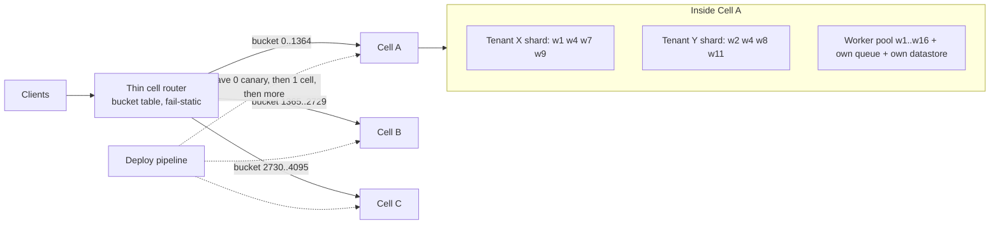

# Cell-Based Architecture and Shuffle Sharding

## TL;DR

1. A cell is a complete, independent copy of the service with a fixed maximum size. A cell shares no state, no database and no synchronous API dependency with other cells, so a failure is bounded to the 1/C of customers mapped to it.
2. Shuffle sharding gives each tenant a pseudo-random m-of-n subset of workers. A poison tenant takes down only its own m workers, and a victim is fully down only if it holds exactly the same subset.
3. The isolation comes from the client, not the server: if the client does not retry across every member of its shard, shuffle sharding buys nothing. Shuffle sharding trades "fully down for 1/G of tenants" for "partially degraded for a larger fraction of tenants".
4. Cells contain changes and correlated faults, and shuffle shards contain tenant-triggered faults. Both fail against any artifact that bypasses the cell boundary, such as globally replicated config, policy or feature data. Code can roll out in waves while data goes everywhere in seconds.
5. Route through a thin, fail-static router. Use a fixed number of virtual buckets mapped to cells, and fence each bucket with an epoch so stale routers cannot write to the wrong cell.

## Mental Model



Two orthogonal partitions are in play.
The first is the cell: a vertical slice (router target, compute, queue, datastore, keys, quotas) that holds a stable subset of tenants and is the unit of deployment, scaling, testing and evacuation.
The second is the shuffle shard: a horizontal, per-tenant subset of the stateless workers inside a cell.
The router is the only component that sees all cells, so it is kept small enough to be statically stable: it holds a tiny immutable table and makes no per-request calls to a mapping database.
Deployments walk cells one wave at a time, so a bad change is observed in one slice before it reaches the others.
Cells answer "what if the change is bad" and "what if the infrastructure under a slice fails".
Shuffle shards answer "what if one tenant's traffic is toxic".
See [[17-Cloud-AI-Engineering/Volume_01_Cloud_Architecture_Principles/Chapter_02_Regions_Zones_and_Static_Stability|Regions, Zones, and Static Stability]] for the zone-level layer this builds on.

## Internals

### Cells: what the boundary must contain

The AWS Well-Architected whitepaper on cell-based architecture states the ideal plainly.
<br>A cell should be independent, unaware of other cells, and should not share state, with no cross-cell API calls and no shared databases or S3 buckets (AWS Well-Architected, as of 2026-10).
The same page encourages separate AWS accounts per cell (AWS Well-Architected, as of 2026-10).
The account is a useful boundary because AWS resources carry limits and quotas per Region and account (AWS Well-Architected, as of 2026-10).
A cell in its own account therefore also gets its own quota blast radius, which is the failure mode people forget: one tenant exhausting an API throttle in a shared account degrades every cell in that account.

A cell must be a bulkhead for four independent resources:

- **Compute and queues**: no shared worker pool, no shared queue.
- **State**: no shared database, cache or object prefix.
- **Control surface**: its own deployment target, config and feature flags, so that no artifact is read by more than one cell without a wave mechanism.
- **Quotas and credentials**: its own account or project, its own KMS keys, its own service-linked roles.

The whitepaper's best practices are operationally specific.
Start with multiple cells from day one, because the single cell you have today is "cell zero", and having more than one is the only way to discover cross-cell coupling (AWS Well-Architected, as of 2026-10).
Build the cell migration mechanism from day one, because moving a tenant is the operation you will need when a cell fills or a whale appears (AWS Well-Architected, as of 2026-10).

### Cell sizing is a trade, not a constant

The whitepaper lays out the sizing trade directly.
With 10 cells each holds 10 percent of customers, and with 100 cells each holds 1 percent (AWS Well-Architected, as of 2026-10).
Smaller cells reduce scope of impact and are less likely to hit scaling limits that only appear at size, but they multiply the number of replicas you operate (AWS Well-Architected, as of 2026-10).
The mechanism behind "unknown limits appear at size" is that every large system hides a non-linear resource: a connection table, a thread count per peer, a metadata shard.
Capping cell size at a load you have stress-tested turns these from production discoveries into test-environment discoveries.
This is the same reason Physalia, the EBS control plane, partitions into many small consensus groups rather than one large one (Brooker et al., "Millions of Tiny Databases", NSDI 2020).
Borg likewise manages clusters as bounded "cells" (Verma et al., "Large-scale cluster management at Google with Borg", EuroSys 2015).
See [[17-Cloud-AI-Engineering/Volume_13_Seminal_Papers_and_Case_Studies/Chapter_03_Physalia_EBS_Control_Plane|Physalia]] and [[17-Cloud-AI-Engineering/Volume_13_Seminal_Papers_and_Case_Studies/Chapter_07_Google_Borg_and_Omega|Borg and Omega]].

### Partition keys and the virtual-bucket indirection

The partition key decides which tenants fail together, so choose it by blast-radius semantics, not by hash convenience.
Good keys are tenant, account or customer id, because customer-visible impact aligns with a cell.
Bad keys are request id or user id inside a tenant, because every tenant then touches every cell and one tenant's poison data lands everywhere.

The mechanism that getting-started guides skip is the indirection layer between key and cell:

1. `bucket = hash(key) mod B`, where B is fixed for the life of the system (4096 in the lab below).
2. `cell = table[bucket]`, a small mutable array of B entries.
3. A per-bucket epoch (fencing token) increments whenever a bucket changes owner.

Plain `hash(key) mod C` is a trap, because adding one cell to C cells moves C/(C+1) of all keys (8/9 when going from 8 to 9 cells in the lab).
With a bucket table you move exactly the buckets you choose, and a rebalance to add one cell moves about 1/(C+1) of keys, matching the lab output.
This is the same idea as virtual nodes in Dynamo (DeCandia et al., SOSP 2007), fixed at a size you never change; compare the [[08-Distinguished-Engineering/02-Distributed-Systems-Internals/Consistent-Hash-Ring|Consistent Hash Ring]] note.
Choose B at least 100x the largest cell count you will ever run.
The table is then 4096 entries, a few kilobytes, which means the router can be pushed the whole table on a timer rather than diffs, which is the constant-work pattern (see [[17-Cloud-AI-Engineering/Volume_01_Cloud_Architecture_Principles/Chapter_05_Constant_Work_and_Workload_Smoothing|Constant Work and Workload Smoothing]]).
A tenant larger than one bucket's share of a cell needs an explicit override entry or a dedicated cell, because hashing cannot split a single key.

Fencing matters because routers are distributed and stale.
DNS-based or client-cached routing cannot be recalled, so during a bucket move some clients will keep sending to the old cell for a TTL or longer.
Each cell therefore checks, on every request, that it owns the bucket at the epoch the router claimed, and rejects otherwise.
This is the same principle as a fencing token on a lease, and it is defense in depth against a buggy router, which is itself a shared component.

### Router: the one thing everybody shares

The router is the cell architecture's weakest point, so shrink it:

- Stateless, no per-request lookup to a database, table baked in as an immutable versioned artifact.
- Fail-static: if the control plane that updates the table is unreachable, keep routing with the last-known-good table.
- Deployed itself in waves, in multiple zones, with its own canary.
- Does no authentication, transformation or business logic that could crash on tenant data.

The mapping table and its migration workflow are control plane; per-request routing is data plane.
That separation is the subject of the next chapter, [[17-Cloud-AI-Engineering/Volume_01_Cloud_Architecture_Principles/Chapter_04_Control_Plane_vs_Data_Plane_Separation|Control Plane vs Data Plane Separation]].

### Shuffle sharding: mechanism and combinatorics

Take n workers and give each tenant a subset of m of them.
Two independently placed tenants share exactly j workers with probability given by the hypergeometric distribution:

`P(j) = C(m,j) * C(n-m, m-j) / C(n,m)`

The probability that two tenants have identical shards is 1/C(n,m).
For the AWS Builders' Library example, Route 53 arranges capacity into 2048 virtual name servers and assigns each domain a shuffle shard of four, giving about 730 billion possible shards, enough to give every domain a unique one (AWS Builders' Library, as of 2026-10).
The same text says no domain will share more than two virtual name servers with any other (AWS Builders' Library, as of 2026-10).
A DDoS against one domain spikes traffic on that domain's four virtual name servers only, and the targeted customer can then be moved to dedicated attack capacity (AWS Builders' Library, as of 2026-10).

Mechanisms worth knowing cold:

**1. Isolation is delegated to the client.**
Shuffle sharding only works if the client tries every endpoint in its shard until one succeeds.
DNS resolvers do this natively, which is why Route 53 is the canonical example.
For an HTTP or RPC service you must supply that retry logic and a way to address "this tenant's m endpoints", either through per-tenant DNS names or a content-aware router (as noted in public explainers of the Builders' Library article, as of 2026-10).
Assignments are fixed: a tenant whose workers fail is not reshuffled onto healthy ones, because dynamic reassignment would carry the poison to new workers.

**2. Topology constraints shrink the combinatorial space.**
Route 53 gives each hosted zone four name server names, one from each of four stripes (AWS Architecture Blog, as of 2026-10).
The stripes are hosted across four top-level domains: .com, .net, .co.uk and .org (AWS Architecture Blog, as of 2026-10).
AWS considered advertising all four stripes from every edge location and rejected it, because it gives a poor availability model (AWS Architecture Blog, as of 2026-10).
If the 2048-name pool is split into four equal stripes of 512 (UNVERIFIED assumption), the number of distinct shards is 512^4 = 68.7 billion, about 10.6x fewer than the unconstrained C(2048,4) = 730.9 billion (derived, lab output).
The lesson: when you add a topology constraint such as one worker per zone, recompute the shard space.
It is almost always still large enough.

**3. A maximum-overlap rule caps the tenant count.**
A rule of "no two shards share more than k workers" means every (k+1)-subset of workers can appear in at most one shard.
Each shard of size m contains C(m,k+1) such subsets, so the number of shards is at most C(n,k+1) / C(m,k+1).
This is the Johnson bound for constant-weight codes (derived).
For n=2048, m=4, k=2 the bound is C(2048,3)/4 = 357,389,824 shards (derived, lab output).
A stateful assigner can enforce the rule cheaply: store all (k+1)-subsets of existing shards in a hash set, then reject a candidate if any of its own (k+1)-subsets is already present.
That check costs C(m,k+1) lookups per candidate.
The lab implements this, and 200,000 striped assignments needed only 597 rejections (lab output, as of 2026-10).
Note that this assigner is my own illustration, not the internals of Route 53 Infima.
Infima is described in public explainers as offering stateless hash-based and stateful sharders (as of 2026-10).

**4. Shuffle sharding trades "down" for "degraded".**
In the lab with n=64 workers and m=4, one poison tenant degrades 23 percent of victims, because a victim is degraded if any of its four workers is in the attacker's shard: 1 - C(60,4)/C(64,4) = 23.3 percent (derived).
Simple sharding into 16 disjoint groups degrades 6.2 percent, but fully takes down all of that 6.2 percent.
Shuffle sharding takes down 0 percent, and the 23 percent see retried-then-succeeded requests with added latency.
At n=2048, m=4, the degraded fraction for one attacker falls to 0.78 percent (derived).
Shuffle sharding therefore gets better as the fleet grows, while simple sharding's per-group blast radius is fixed at 1/(n/m).
The AWS Builders' Library makes the same point: most scaling challenges get harder with size, but shuffle sharding gets more effective (AWS Builders' Library, as of 2026-10).

**5. Recursion.**
Shuffle sharding can be applied at multiple layers, isolating "a customer's customer" (AWS Builders' Library, as of 2026-10).
A practical stack is: cell by tenant, shuffle shard of workers inside the cell, and shuffle shard of queues or partitions inside the worker.
AWS Lambda asynchronous invocation reportedly places a message on the shortest queue among a tenant's shard, with the example of 3 of 100 queues giving 161,700 combinations (a third-party summary of the AWS Compute Blog, as of 2026-10).

### Poison pills: how they actually propagate

A poison pill is any input that deterministically crashes, hangs or corrupts a worker.
Four propagation vehicles exist, and each needs a different containment:

| Vehicle | Mechanism | Containment |
|---|---|---|
| Client retry | Retry walks every worker in the shard, each attempt kills one | Retry budget, shard-bounded retries, crash isolation |
| Durable queue redelivery | Message returns after visibility timeout and kills the next consumer | Max receive count then DLQ, per-message crash counter |
| Data replication | Row or config is replicated to every cell in seconds | Staged propagation per cell, validation, last-known-good |
| Shared dependency | One cell's tenant overwhelms a shared service | No shared dependencies, per-cell quotas |

The first two are contained by shuffle sharding and queue hygiene.
The last two are only contained by the cell boundary, and only if that boundary applies to data as well as code (see Failure Modes).

Collateral damage is a separate force from retry propagation.
In a multi-threaded or batched server (a vLLM engine with continuous batching is the extreme case), a crashing request kills every in-flight request on that process.
The blast radius on a shared worker is therefore the number of concurrent requests, not one.
Under shuffle sharding the collateral victims have other workers, so they succeed on retry, which is exactly why the degraded fraction is much larger than the down fraction.

### Identifying the pill: crash-journal intersection

A technique you will not find in a getting-started guide is to identify the culprit statistically from crash dumps.
On crash, each worker durably records the set of tenant ids in flight.
A central counter intersects these sets across crashes on distinct workers.
For N active tenants on a worker with c in flight at the instant of a crash, an innocent tenant appears in any single crash set with probability about c/N.
After k independent crashes on different workers, the expected number of innocent tenants in the intersection is (N-1) * (c/N)^k.
With N=500 and c=50 that is about 5.0 after two crashes, 0.5 after three and 0.05 after four (derived).
Four crashes on a shard of four workers is exactly what a retry-walking poison tenant produces, so by the time the shard is dead you have a one-tenant suspect.
Then move that tenant to a quarantine shard, matching the "dedicated attack capacity" idea in the Route 53 description (AWS Builders' Library, as of 2026-10).
The independence assumption is approximate: tenants with correlated traffic patterns will co-appear, so treat the output as a ranked list rather than a verdict.

### Capacity: isolation is not free capacity

Shuffle sharding is described as usually costing no additional resources, because it is a smart arrangement of existing ones (AWS Builders' Library, as of 2026-10).
It does not create headroom, though, and two rules fall out of the arithmetic:

- When one of a shard's m workers dies, survivors each carry m/(m-1) of their prior load, so per-worker utilization u must satisfy u * m/(m-1) <= 1. For m=4 that is u <= 75 percent, and for m=2 it is u <= 50 percent (derived).
- When k poison tenants with disjoint shards each kill m workers, fleet utilization must satisfy u <= 1 - k*m/n. For n=64, m=4, k=3 that is 81 percent (derived).

## Numbers to Know

| Quantity | Value | Source |
|---|---|---|
| Route 53 virtual name server pool | 2048 | AWS Builders' Library, as of 2026-10 |
| Route 53 shard size per hosted zone | 4 | AWS Builders' Library, as of 2026-10 |
| Possible Route 53 shuffle shards | about 730 billion | AWS Builders' Library, as of 2026-10 |
| Exact C(2048,4) | 730,862,190,080 | derived, lab output, as of 2026-10 |
| Max overlap between any two Route 53 hosted zones | 2 name servers | AWS Builders' Library and AWS Architecture Blog, as of 2026-10 |
| Route 53 stripes (TLDs) | 4: .com, .net, .co.uk, .org | AWS Architecture Blog, as of 2026-10 |
| Johnson bound on zones with max overlap 2 | 357,389,824 | derived, lab output, as of 2026-10 |
| 8 nodes, 2 per shard: shards, P(identical) | 28 shards, 3.6 percent | AWS re:Invent 2021 ARC308 slides, as of 2026-10 |
| 8 nodes, simple sharding by pairs | 25 percent of customers affected | AWS re:Invent 2021 ARC308 slides, as of 2026-10 |
| 100 nodes, 5 per shard: P(identical shard) | 1 in 75,287,520 | derived, lab output, as of 2026-10 |
| Lambda async queue example: 3 of 100 queues | 161,700 combinations | third-party summary of AWS Compute Blog, as of 2026-10 |
| Blast radius with 10 / 100 cells | 10 percent / 1 percent of customers | AWS Well-Architected cell-based whitepaper, as of 2026-10 |
| Route 53 availability objective | 100 percent SLA | AWS re:Invent 2021 ARC308 slide text, as of 2026-10 |
| Google Cloud Service Control incident: latent code to trigger | 2025-05-29 deploy, 2025-06-12 trigger, 14 days | Google incident report as quoted in secondary summaries, as of 2026-10 |
| Same incident: global metadata propagation | within seconds | Google incident report as quoted in secondary summaries, as of 2026-10 |
| Cloudflare 2025-11-18: feature file size change | doubled, exceeded a proxy limit | Cloudflare blog, as of 2026-10 |
| Cloudflare feature file propagation cadence | every five minutes | ilert postmortem summary, as of 2026-10 |
| Virtual buckets in this chapter's router | 4096 (design choice) | lab, as of 2026-10 |

No list prices are stated in this chapter, because shuffle sharding and cell routing do not have a direct price; cell overhead is a function of whatever fixed-cost resources your cell needs.

## AWS vs GCP Mechanism Parity

Rows marked (U) were not re-verified against Google Cloud primary documentation this month and are listed in the batch report.

| Mechanism | AWS | Google Cloud |
|---|---|---|
| Documented cell guidance | Dedicated Well-Architected whitepaper on cell-based architecture (AWS Well-Architected, as of 2026-10) | No dedicated cell-based whitepaper verified; Architecture Center documents zonal, regional, multi-regional and global deployment archetypes (Google Cloud docs, as of 2026-10) (U) |
| Natural cell boundary | Separate AWS accounts encouraged per cell (AWS Well-Architected, as of 2026-10) | Project per cell is the analogous boundary (U) |
| Quota scope that bounds noisy neighbors | Limits per Region and account (AWS Well-Architected, as of 2026-10) | Per-project quotas, design inference (U) |
| Public shuffle sharding in managed services | Route 53: four name servers per zone, one per stripe, overlap capped at two (AWS Architecture Blog, as of 2026-10) | No equivalent public statement verified (U) |
| Regional isolation evidence | Regions are the unit cells aim to resemble in containment (AWS Well-Architected, as of 2026-10) | Cloud Build is described as regionally isolated instances (Google Cloud docs, as of 2026-10) |
| Global metadata coupling, failure example | Not an AWS incident in this chapter | Service Control is a regional service whose datastore metadata replicates almost instantly worldwide (Google incident report, as quoted in secondary sources, as of 2026-10) |
| Router implementation options | Route 53 weighted or geo records, ALB or CloudFront with a lookup layer (U) | Cloud DNS routing policies, global external Application Load Balancer URL maps (U) |
| Deployment waves across cells | Per-cell pipeline stages, ARC zonal shift for AZ-level evacuation (U) | Rollouts by region and zone, Cloud Deploy stages (U) |
| Strongest consistency trade | Cell state kept local, cross-cell calls discouraged | Spanner and global quota data give global consistency at the price of global blast radius |

The substantive difference is not product naming but where global state lives.
The Service Control incident is a clean demonstration that a "regional service" with a globally replicated datastore has a global failure domain, whatever the code deployment topology says.
When you evaluate any managed service on either cloud, ask: is any datastore, config store or policy store shared across its regions or cells, and how fast does it propagate?

## Worked Example: Cell Router, Overlap-Bounded Shuffle Shards and a Poison-Pill Simulation

This lab provisions no cloud resources, so there is no cost, no budget alarm and nothing to tear down in a cloud account.
It runs on the standard library only.

### Run it

```python
#!/usr/bin/env python3
"""Cell routing + shuffle sharding lab. Standard library only. No cloud resources, no cost."""
import hashlib
import itertools
import random
from math import comb

# ---------- Part A: shuffle shard math and a max-overlap assigner ----------

def overlap_pmf(n, m):
    """P(two independent random m-subsets of n workers share exactly j members)."""
    total = comb(n, m)
    return {j: comb(m, j) * comb(n - m, m - j) / total for j in range(m + 1)}

def johnson_bound(n, m, k):
    """Upper bound on shards if any two may share at most k workers.
    Every (k+1)-subset may appear in at most one shard; each shard contains C(m,k+1) of them."""
    return comb(n, k + 1) // comb(m, k + 1)

class OverlapBoundedAssigner:
    """Stateful sharder: reject a candidate if it shares more than max_overlap workers
    with any existing shard. Detected in O(C(m,k+1)) via a set of (k+1)-subsets."""
    def __init__(self, n, m, max_overlap, stripes=None, seed=1):
        self.n, self.m, self.k = n, m, max_overlap
        self.stripes = stripes          # list of lists of worker ids, one pick per stripe
        self.rng = random.Random(seed)
        self.seen = set()
        self.rejects = 0

    def _candidate(self):
        if self.stripes:
            return tuple(sorted(self.rng.choice(s) for s in self.stripes))
        return tuple(sorted(self.rng.sample(range(self.n), self.m)))

    def assign(self):
        while True:
            cand = self._candidate()
            subs = list(itertools.combinations(cand, self.k + 1))
            if any(s in self.seen for s in subs):
                self.rejects += 1
                continue
            self.seen.update(subs)
            return cand

# ---------- Part B: poison pill propagation through client retries ----------

def run_poison(n, m, tenants, attackers, scheme, seed=7):
    """Each attacker sends a request that crashes any worker that executes it.
    The client retries every worker in its shard in turn. Returns fraction of
    NON-attacker tenants with zero live workers, and mean fraction of workers lost."""
    rng = random.Random(seed)
    if scheme == "none":
        shards = [tuple(range(n)) for _ in range(tenants)]
    elif scheme == "sharded":      # n/m disjoint groups
        g = n // m
        shards = [tuple(range((t % g) * m, (t % g) * m + m)) for t in range(tenants)]
        rng.shuffle(shards)
    else:                          # shuffle, overlap bounded to m-2
        a = OverlapBoundedAssigner(n, m, max_overlap=m - 2, seed=seed)
        shards = [a.assign() for _ in range(tenants)]
    bad = rng.sample(range(tenants), attackers)
    dead = set()
    for t in bad:
        dead.update(shards[t])     # retry loop walks the whole shard
    victims = [t for t in range(tenants) if t not in bad]
    down = sum(1 for t in victims if all(w in dead for w in shards[t]))
    degraded = sum(1 for t in victims if any(w in dead for w in shards[t]))
    return down / len(victims), degraded / len(victims), len(dead) / n

# ---------- Part C: cell router with virtual buckets and epoch fencing ----------

BUCKETS = 4096  # fixed forever; never change this number

def bucket_of(key):
    return int.from_bytes(hashlib.sha256(key.encode()).digest()[:8], "big") % BUCKETS

class Router:
    def __init__(self, cells):
        self.bucket_epoch = [1] * BUCKETS                              # per-bucket fencing token
        self.table = [cells[b % len(cells)] for b in range(BUCKETS)]  # bucket -> cell
        self.overrides = {}                                           # whale key -> cell

    def route(self, key):
        c = self.overrides.get(key) or self.table[bucket_of(key)]
        return c, self.bucket_epoch[bucket_of(key)]

    def add_cell(self, new_cell):
        cells = sorted(set(self.table))
        target = BUCKETS // (len(cells) + 1)
        counts = {c: self.table.count(c) for c in cells}
        moved = 0
        for b in range(BUCKETS):
            if moved >= target:
                break
            c = self.table[b]
            if counts[c] > target:       # only take from cells above the new fair share
                self.table[b] = new_cell
                self.bucket_epoch[b] += 1
                counts[c] -= 1
                moved += 1
        return moved / BUCKETS

class Cell:
    """Defense in depth: the cell refuses keys for buckets it does not own at this epoch."""
    def __init__(self, name, router):
        self.name, self.router = name, router

    def handle(self, key, epoch):
        owner, cur = self.router.route(key)
        if owner != self.name or epoch != cur:
            return "REJECT_STALE_ROUTE"
        return "OK"

if __name__ == "__main__":
    print("== A1: overlap distribution, n=100 m=5 and n=2048 m=4")
    for n, m in [(100, 5), (2048, 4)]:
        pmf = overlap_pmf(n, m)
        print(n, m, "C(n,m)=%d" % comb(n, m), {j: "%.3e" % p for j, p in pmf.items()})
    print("== A2: stripe-constrained count vs unconstrained")
    print("unconstrained", comb(2048, 4), "4 stripes of 512:", 512 ** 4)
    print("== A3: Johnson bound for max overlap 2, n=2048 m=4:", johnson_bound(2048, 4, 2))
    stripes = [list(range(i * 512, (i + 1) * 512)) for i in range(4)]
    a = OverlapBoundedAssigner(2048, 4, 2, stripes=stripes)
    for _ in range(200000):
        a.assign()
    print("assigned 200000 zones, rejects:", a.rejects)
    print("== B: poison pill, n=64 workers, m=4, 5000 tenants")
    for attackers in (1, 3, 10):
        for scheme in ("none", "sharded", "shuffle"):
            d, g, w = run_poison(64, 4, 5000, attackers, scheme)
            print("attackers=%2d %-8s victims_down=%.4f victims_degraded=%.4f workers_lost=%.3f" % (attackers, scheme, d, g, w))
    print("== C: router")
    r = Router(["cell-%02d" % i for i in range(8)])
    keys = ["tenant-%d" % i for i in range(20000)]
    before = {k: r.route(k)[0] for k in keys}
    frac = r.add_cell("cell-08")
    after = {k: r.route(k)[0] for k in keys}
    print("bucket table moved %.4f of buckets; keys moved %.4f (ideal 1/9=%.4f)" % (frac, sum(before[k] != after[k] for k in keys) / len(keys), 1 / 9))
    print("mod-N rehash would move %.4f of keys" % (8 / 9))
    moved_key = next(k for k in keys if before[k] != after[k])
    still_key = next(k for k in keys if before[k] == after[k])
    print("stale client, moved key, old cell:", Cell(before[moved_key], r).handle(moved_key, 1))
    print("stale client, unmoved key, same cell:", Cell(before[still_key], r).handle(still_key, 1))
    print("fresh client, moved key, new cell:", Cell("cell-08", r).handle(moved_key, r.route(moved_key)[1]))
```

### Observed output (Python 3.11, runtime about 1 second)

```text
== A1: overlap distribution, n=100 m=5 and n=2048 m=4
100 5 C(n,m)=75287520 {0: '7.696e-01', 1: '2.114e-01', 2: '1.838e-02', 3: '5.931e-04', 4: '6.309e-06', 5: '1.328e-08'}
2048 4 C(n,m)=730862190080 {0: '9.922e-01', 1: '7.778e-03', 2: '1.714e-05', 3: '1.119e-08', 4: '1.368e-12'}
== A2: stripe-constrained count vs unconstrained
unconstrained 730862190080 4 stripes of 512: 68719476736
== A3: Johnson bound for max overlap 2, n=2048 m=4: 357389824
assigned 200000 zones, rejects: 597
== B: poison pill, n=64 workers, m=4, 5000 tenants
attackers= 1 none     victims_down=1.0000 victims_degraded=1.0000 workers_lost=1.000
attackers= 1 sharded  victims_down=0.0622 victims_degraded=0.0622 workers_lost=0.062
attackers= 1 shuffle  victims_down=0.0000 victims_degraded=0.2304 workers_lost=0.062
attackers= 3 none     victims_down=1.0000 victims_degraded=1.0000 workers_lost=1.000
attackers= 3 sharded  victims_down=0.1869 victims_degraded=0.1869 workers_lost=0.188
attackers= 3 shuffle  victims_down=0.0000 victims_degraded=0.5341 workers_lost=0.172
attackers=10 none     victims_down=1.0000 victims_degraded=1.0000 workers_lost=1.000
attackers=10 sharded  victims_down=0.4365 victims_degraded=0.4365 workers_lost=0.438
attackers=10 shuffle  victims_down=0.0357 victims_degraded=0.9184 workers_lost=0.453
== C: router
bucket table moved 0.1111 of buckets; keys moved 0.1131 (ideal 1/9=0.1111)
mod-N rehash would move 0.8889 of keys
stale client, moved key, old cell: REJECT_STALE_ROUTE
stale client, unmoved key, same cell: OK
fresh client, moved key, new cell: OK
```

Read the output carefully, because it contains three results that surprise people.

1. **Shuffle sharding is not strictly better at small n.** With n=64 and 10 simultaneous poison tenants, 3.6 percent of victims are fully down and 91.8 percent are degraded. The fleet is too small relative to k*m = 40 workers lost. Shuffle sharding needs n large relative to m times the number of concurrent attackers.
2. **The win is the tail, not the mean.** Simple sharding with one attacker takes 6.2 percent of tenants fully down, while shuffle sharding takes 0 percent down and 23 percent degraded. If your clients retry across the shard, 23 percent degraded means higher p99 latency, not errors.
3. **Rebalancing with buckets moves 11.3 percent of keys versus 88.9 percent for mod-N.** The 0.2 point gap versus the ideal 11.1 percent is hash noise over 20,000 keys.

### Step-by-step sizing (illustrative assumptions, not measured data)

Assumptions: peak 600,000 requests per second; a cell is stress-tested to 40,000 requests per second and operated at 50 percent of that, so 20,000 requests per second per cell; fixed overhead per cell is $1,500 per month (load balancer, minimum instances, observability, NAT); variable compute is $200,000 per month in total; 4 cell-scoped incidents per year of 2 hours each; $50,000 of revenue per hour at full service.

1. Cells needed at peak: 600,000 / 20,000 = 30 cells.
2. Blast radius per cell: 1/30 = 3.3 percent of tenants.
3. Fixed overhead: 30 x $1,500 = $45,000 per month, which is 22.5 percent on top of $200,000 variable.

| Cells | Fixed overhead per month | Overhead over variable | Blast radius | Expected annual loss from cell incidents |
|---|---|---|---|---|
| 10 | $15,000 | 7.5 percent | 10 percent | 4 x 2 x $50,000 / 10 = $40,000 |
| 30 | $45,000 | 22.5 percent | 3.3 percent | $13,333 |
| 100 | $150,000 | 75 percent | 1 percent | $4,000 |

The expected-value column does not justify more cells: going from 10 to 30 cells saves about $26,700 per year of expected loss and costs $360,000 per year of fixed overhead.
Expected loss is the wrong lens for cells, which exist to cap tail risk, contractual exposure and reputational damage.
The right framing is a blast-radius budget: for example "no single change may affect more than 5 percent of tenants", which sets C >= 20, and then minimise overhead subject to that budget.
Drive the per-cell fixed cost down (shared nothing but cheap, such as cell-level serverless) before you accept a larger blast radius.

### Optional guardrails if you extend this lab to real cells

Skip this if you stay local.
If you deploy real cells, set a budget before the first resource and tear down with a single command per cell.

```bash
# AWS: monthly budget with an 80 percent actual-spend email alert (flags not re-verified this session)
aws budgets create-budget --account-id 111122223333 \
  --budget '{"BudgetName":"cells-lab","BudgetLimit":{"Amount":"20","Unit":"USD"},"TimeUnit":"MONTHLY","BudgetType":"COST"}' \
  --notifications-with-subscribers '[{"Notification":{"NotificationType":"ACTUAL","ComparisonOperator":"GREATER_THAN","Threshold":80,"ThresholdType":"PERCENTAGE"},"Subscribers":[{"SubscriptionType":"EMAIL","Address":"you@example.com"}]}]'

# GCP: equivalent budget (flags not re-verified this session)
gcloud billing budgets create --billing-account=BILLING_ID \
  --display-name=cells-lab --budget-amount=20USD --threshold-rule=percent=0.8

# Teardown of the local lab
rm -rf /tmp/lab
```

For real cells, one Terraform or OpenTofu state per cell makes `tofu destroy` per cell a bounded operation, and keeps a bad apply from touching other cells.

## Failure Modes and Pitfalls

**1. Data bypasses the cell boundary: Google Cloud Service Control, 2025-06-12.**
Per Google's incident report as quoted in secondary summaries (the primary status page was not retrievable this session), a Service Control change adding quota policy checks shipped on 2025-05-29 without adequate error handling and without feature-flag protection (as of 2026-10).
The rollout was region by region, but the failing code path required a specific policy row and so was never exercised during the rollout (as of 2026-10).
On 2025-06-12, a policy change with unintended blank fields was inserted into regional Spanner tables and replicated globally within seconds (as of 2026-10).
Every region hit the null pointer and crashed, then restarted into the same row.
The cell-architecture reading is simple: code went in waves, data did not, so the wave discipline was bypassed by the data plane.
The prescription: make data artifacts (policy, config, feature files, schemas) roll out per cell, with validation and a bake time, exactly like binaries.
A bake time only exercises code paths that traffic exercises, and here the latent path sat dormant for 14 days, so seed canary cells with synthetic poison inputs.

**2. Oversized config propagates to the whole fleet: Cloudflare, 2025-11-18.**
Per Cloudflare's own post-mortem, a database permission change caused a query to emit duplicate entries, doubling a Bot Management feature file, which was then propagated to all machines in the network (Cloudflare blog, as of 2026-10).
A summary reports the file exceeded a hard limit in the core proxy and was regenerated and pushed every five minutes, so parts of the fleet flipped between good and bad states (ilert, as of 2026-10).
The cell-based lessons: a hard-coded limit consumed in a global path is a poison-pill trigger, and a file that is "generated by a pipeline" deserves the same staged rollout as code.
Fail-static helps too: a proxy that rejects an invalid feature file and keeps the last-known-good one turns an outage into stale features.

**3. Shuffle sharding without client retry.**
The isolation comes from the client trying every member of its shard, and public explainers of the Builders' Library article stress that clients must be fault tolerant and able to retry (as of 2026-10).
Teams that implement shard assignment on the server side and keep a single-endpoint client get the cost of the machinery and none of the isolation.
The corollary: retries must have a budget (see [[17-Cloud-AI-Engineering/Volume_07_Reliability_and_SRE/Chapter_03_Resilient_Communication_Retries_Jitter_and_Circuit_Breakers|Resilient Communication]]), because a retry loop that crosses m workers also delivers a poison request to m workers.

**4. Queue redelivery as a poison-pill carrier.**
A message that crashes its consumer reappears after the visibility timeout and crashes the next one, so the crash loop walks the entire consumer fleet.
Use a bounded receive count with a dead-letter queue, a per-message crash counter in the worker's crash journal, and per-cell queues so one cell's pill cannot cross over.

**5. Router becomes the new global dependency.**
A router that consults a mapping database per request converts a cell architecture into a single-point-of-failure architecture with extra steps.
Keep the table local, immutable and pushed in full on a timer.
If the pushing control plane breaks, routers keep serving.
The router itself must be rolled out in waves and monitored by a canary that exercises every cell.

**6. Cell migration is where isolation is deliberately violated.**
Moving a tenant means a window where two cells may both believe they own the data.
The worked example's per-bucket epoch check is the minimum: the destination cell accepts the bucket only after the source has stopped accepting writes at the old epoch.
Rehearse migration continuously, because the whitepaper's advice to build it on day one is really advice to avoid discovering its bugs during an incident (AWS Well-Architected, as of 2026-10).

**7. Hot tenants and skew.**
A tenant larger than one bucket's share of a cell makes that cell hot, while cell-count averages look healthy.
Give whales an override entry or a dedicated cell, and track per-cell utilisation as a distribution, not a mean.

**8. Headroom not paid for.**
Shuffle shards assume surviving workers can absorb the dead ones' load (u <= 75 percent for m=4).
Fleets running at 85 percent utilisation convert a single worker loss into a cascade, which is a retry-amplified overload rather than isolation.

**9. Cell drift and operational multiplication.**
N cells means N times the dashboards, alarms, pipeline stages and on-call surface.
Without automated conformance checking, cells diverge in version, config and quotas, and the "identical replica" assumption behind your canary logic quietly fails.
Treat a cell definition as a single module instantiated N times (see [[17-Cloud-AI-Engineering/Volume_06_Infrastructure_as_Code_and_Delivery/Chapter_06_Progressive_Delivery_and_Deployment_Pipelines|Progressive Delivery and Deployment Pipelines]]).

**10. Shared quota accounts.**
Cells in a single account share account-level API throttles and quotas, so one cell's scale-out can throttle the others.
This is the argument for account-per-cell in the whitepaper (AWS Well-Architected, as of 2026-10), and for project-per-cell on Google Cloud (design inference, UNVERIFIED).
For longer outage anatomy see [[17-Cloud-AI-Engineering/Volume_07_Reliability_and_SRE/Chapter_07_Anatomy_of_Major_Cloud_Outages|Anatomy of Major Cloud Outages]].

## Security and Cost Angles

**IAM and identity.**
Give each cell its own account or project and its own workload identities, so a credential compromised in one cell has no standing permission in another.
The only cross-cell principals should be the deploy pipeline role (which can assume a deploy role per cell) and the router's read-only table fetch.
Enforce this with organization-level guardrails (see [[17-Cloud-AI-Engineering/Volume_01_Cloud_Architecture_Principles/Chapter_06_Multi_Account_and_Multi_Project_Landing_Zones|Multi-Account and Multi-Project Landing Zones]]).
A pipeline that can deploy to all cells is itself a global blast radius, so require wave gating and approvals inside the pipeline, not only in the cells.

**Keys and encryption.**
Use a separate KMS key hierarchy per cell, so that a mistaken key policy edit or key deletion degrades one cell, and per-tenant data keys can be wrapped by the cell's key.
Cross-cell access to ciphertext is then useless without cell key grants, which makes tenant migration a deliberate re-wrap operation.
See [[17-Cloud-AI-Engineering/Volume_08_Security_Identity_and_the_Data_Perimeter/Chapter_04_Encryption_Key_Hierarchies_and_Envelope_Encryption|Encryption Key Hierarchies and Envelope Encryption]].

**Network boundaries.**
Private endpoints and egress controls (VPC endpoints on AWS, VPC Service Controls perimeters on Google Cloud) should be per cell, so that exfiltration or lateral movement from a compromised cell cannot use a shared network path.
Shuffle sharding by itself offers no security isolation, since two tenants sharing a worker share a process and kernel, so apply it to availability and combine it with per-request sandboxing for confidentiality.

**Cost levers.**
- Shuffle sharding is described as typically free in resource terms, because it rearranges capacity you already have (AWS Builders' Library, as of 2026-10). Its real cost is headroom, per the utilisation rules above.
- Fixed per-cell overhead dominates at small cell sizes, so shrink the fixed floor first: shared-nothing does not mean one load balancer per 100 requests per second.
- Evacuating a failed cell into the others costs capacity you must hold in reserve, and it also breaks isolation, so prefer fast re-creation of the cell, or per-cell reserve.
- Cross-zone traffic inside a cell is billed, so decide whether a cell spans zones (higher availability, cross-zone data charges) or sits in one zone (cheaper, zone loss equals cell loss). See [[17-Cloud-AI-Engineering/Volume_01_Cloud_Architecture_Principles/Chapter_02_Regions_Zones_and_Static_Stability|Regions, Zones, and Static Stability]].
- For GPU fleets, replica counts are the cost driver: a shard of m=2 of 8 replicas needs 50 percent per-replica utilisation to absorb one failure, which is a large idle-GPU bill. See [[17-Cloud-AI-Engineering/Volume_09_FinOps_and_Cloud_Economics/Chapter_05_GPU_and_TPU_Unit_Economics|GPU and TPU Unit Economics]].

## Interview Questions and Model Answers

### Question 1 (L5 - Senior)
A teammate says "we already have autoscaling groups across three AZs, so we do not need cells". How do you respond?

#### Model Answer
Autoscaling across AZs addresses capacity and zone loss, which are infrastructure faults.
Cells address a different class: changes and software faults that are correlated across the fleet.
A bad deploy, a poison request or a bad config row hits every instance in the group regardless of AZ spread, because the failure domain is "all instances running this code with this data".
A cell caps that domain at 1/C of tenants: with 10 cells each holds 10 percent of customers and with 100 cells each holds 1 percent (AWS Well-Architected, as of 2026-10).
Cells also change how you deploy: you can ship to one cell, watch it, and stop.
They also cap size at a stress-tested maximum, which converts hidden scaling limits into pre-production findings.
The honest cost is operating C copies, a routing layer and a migration mechanism.
I would add that cells and AZs compose: a cell usually spans AZs for infrastructure resilience, and the cell is the unit that deployments and failures are scoped to.

#### Follow-up Interviewer Question
Your cell spans three AZs and one AZ fails. Does the cell fail over to another cell, and why or why not?

### Question 2 (L5 - Senior)
Compute the blast radius for a shuffle-sharded fleet of 8 workers with 2 workers per tenant, and explain what must be true of clients for that number to be real.

#### Model Answer
There are C(8,2) = 28 distinct shards.
A random victim has an identical shard to a given attacker with probability 1/28, or 3.6 percent, versus 25 percent for simple sharding into four pairs (AWS re:Invent 2021 ARC308 slides, as of 2026-10).
A victim shares exactly one worker with probability 12/28 = 42.9 percent, and zero workers with 15/28 = 53.6 percent (derived).
The 3.6 percent only holds if the client retries across both of its workers.
Without retry, a victim sharing one dead worker fails half its requests, so 42.9 percent of tenants see 50 percent errors, which is worse than the simple-sharding story for the median tenant.
So the requirements are: client-side retry across all shard members, idempotent or safe-to-retry requests, a way to address exactly the shard's workers (per-tenant DNS or a content-aware router), and fixed assignment so a poison tenant is not reshuffled onto new workers.
I would also say that m=2 of 8 is a bad real deployment: the combinatorial space is tiny, and survivors absorb a 2x load when one dies, which causes overload.

#### Follow-up Interviewer Question
A request is not idempotent, such as a payment charge. How do you keep shuffle sharding's retry assumption without double-charging?

### Question 3 (L6 - Staff)
Design the cell router and the tenant migration protocol. What happens when the mapping store is down?

#### Model Answer
Route through `bucket = hash(tenant) mod B` with B fixed at 4096, then `cell = table[bucket]`.
I use buckets rather than `mod C` because adding a cell to 8 moves 8/9 of keys under mod-N but only about 1/9 with an explicit table, as in the lab output.
The table is a few kilobytes, so the control plane pushes the whole table to every router on a timer and routers hold it in memory as an immutable versioned artifact.
That is the constant-work pattern: no diffing, no per-request lookups, no failure mode that is proportional to mapping-store load.
If the mapping store or the push pipeline is down, routers keep using the last-known-good table, which is fail-static, and migrations simply pause.
Migration of a bucket runs as: mark the bucket read-only in the source cell, copy and verify state, bump the per-bucket epoch in the destination and source, publish a new table, then unfreeze in the destination.
Fencing is mandatory because routers are stale for at least one push interval and clients may cache DNS: each cell checks `(owner == me and epoch == claimed)` on every request and rejects stale routes.
I accept a brief write unavailability for the migrating bucket, rather than dual-write, because dual-write couples two cells.
Whales get override entries or dedicated cells because a hash cannot split a single key.
The router is deployed in waves, runs no tenant-data-dependent code, and is probed by a synthetic canary for every cell.

#### Follow-up Interviewer Question
A router push contains a table with a typo that points bucket 17 at a nonexistent cell. How do you ensure that is not a global outage?

### Question 4 (L6 - Staff)
In your simulation, shuffle sharding degraded 23 percent of victims from one poison tenant, while simple sharding degraded 6 percent. A VP asks why you chose the "worse" one. Defend or reverse the choice.

#### Model Answer
The two metrics measure different harm.
Simple sharding degrades 6.2 percent but the 6.2 percent are completely down, with no healthy worker anywhere in their group.
Shuffle sharding degrades 23 percent but takes down none of the victims, since each victim has other workers and the client retry reaches them.
For a given tenant the experience is a latency bump and a fraction of retried requests, versus a hard outage.
If the SLO is on availability, shuffle sharding wins in the tail, and its advantage grows with fleet size: at n=2048, m=4 one attacker degrades only about 0.78 percent (derived).
I would reverse the choice in three cases.
First, if the workload cannot retry safely.
Second, if n is small relative to m times the number of concurrent attackers: at n=64 with 10 attackers the lab shows 3.6 percent fully down and 91.8 percent degraded, so the fleet is under-sized for the technique.
Third, if the latency budget has no room for retry penalties.
In addition I would pair it with detection: crash-journal intersection across the first few crashes gives a one-tenant suspect, and the tenant moves to a quarantine shard, which bounds how long the 23 percent degradation lasts.
The headroom rule must also be explicit: u <= (m-1)/m per shard, so 75 percent for m=4.

#### Follow-up Interviewer Question
The attacker rotates tenant identities, creating a new tenant id per request. What breaks in your containment story, and what do you change?

### Question 5 (L6 - Staff)
Choose a cell count for a service with 600k requests per second at peak, where management wants "as small as possible blast radius" and finance wants the lowest cost. Show your reasoning.

#### Model Answer
I would reject both framings and set a blast-radius budget, then optimise cost under it.
The first constraint is capacity: if a cell is stress-tested to 40k requests per second and operated at 50 percent, I need 600k / 20k = 30 cells at minimum, so 30 is a floor, not a choice.
The second is the policy budget, for example "no single change or fault may touch more than 5 percent of tenants", which requires at least 20 cells and is already satisfied by 30.
With an assumed $1,500 per month fixed floor per cell, 30 cells add $45,000 per month, 22.5 percent over a $200,000 variable bill; 100 cells would add 75 percent.
An expected-value calculation will not justify more cells: with 4 two-hour incidents a year and $50,000 per revenue hour, moving from 10 to 30 cells saves about $26.7k of expected loss and costs $360k in overhead.
Cells buy tail protection, so I justify them with contractual penalties, trust and the ability to stage deploys, not expected loss.
I would then attack the fixed floor (cheaper per-cell ingress, shared-nothing but serverless data plane, automated cell lifecycle) rather than shrink cell count.
I would also keep a cell-size ceiling so that growth beyond the stress-tested ceiling adds cells rather than scaling up.

#### Follow-up Interviewer Question
Your biggest customer is 8 percent of total traffic. How does that change the cell design?

### Question 6 (L7+ - Principal)
You own a quota and policy system that must be globally consistent within seconds, and it is on the critical path of every API. A blank-field row crashing every region in seconds is your nightmare. Redesign it without giving up the consistency requirement entirely.

#### Model Answer
The 2025 Google Service Control incident shows the shape of the problem: code was rolled out region by region, but the metadata that triggers a latent path replicated worldwide in seconds, so the wave discipline applied to the binary and not to the data (Google incident report as quoted in secondary summaries, as of 2026-10).
I would split the data into two classes.
Class A is data that truly needs global consistency in seconds, such as a kill switch or a revocation.
Class B is everything else, including most policy and quota configuration edits, and it can tolerate staged propagation.
For Class B, the data plane consumes a versioned snapshot per cell, and the control plane publishes versions through the same wave pipeline as code: validate against a schema and semantic checks in a pre-publication sandbox, apply to a canary cell, bake, then proceed.
Each consumer keeps the last-known-good snapshot and fails static: on a parse failure or invariant violation it rejects the new version, increments a metric and keeps serving.
The binary must treat all policy fields as untrusted input: missing fields default to a safe value and never crash.
New code paths ship behind a default-off flag, and I seed canaries with synthetic malformed rows so a latent path is exercised during bake, not 14 days later.
For Class A, I accept global propagation, but constrain the payload to a tiny, strongly typed, heavily fuzzed schema (a boolean and an id), so the poison surface is minimal, and the consumer has a circuit breaker that ignores class A input that fails a sanity check.
The cost is a defined staleness window for Class B (minutes, rather than seconds) and the operational cost of a snapshot pipeline.
That trade is explicit, and I would get product sign-off for the staleness bound.
I would also add a per-cell "red button" that is independent of the control plane, since in the incident a crash-looping fleet is the case where control-plane-mediated mitigation is slowest.

#### Follow-up Interviewer Question
A customer changes a quota at 10:00 and expects it enforced by 10:00:05. How do you meet that for them without shipping their change globally unvalidated?

### Question 7 (L7+ - Principal)
Design the isolation model for a multi-tenant LLM inference gateway on GPUs, where a single adversarial prompt can OOM an engine and kill every in-flight sequence on that replica.

#### Model Answer
The collateral radius is the batch: with continuous batching, one replica crash kills all in-flight sequences, so a worker's blast radius is its concurrency, not one request.
Cells go first: a cell is a model deployment with its own GPU pool, its own gateway, its own quota and its own KV-cache sizing, deployed in waves, so a bad engine or model-weights release hits one cell.
Inside a cell I would shuffle-shard tenants over replicas with m large enough that losing one replica is survivable: for 32 replicas and m=4, C(32,4) = 35,960 shards, and the gateway retries across the shard on engine failure with a retry budget.
The headroom arithmetic is brutal on GPUs: m=4 requires per-replica utilisation <= 75 percent to absorb one loss, and each loss also discards in-flight work and KV cache, so the survivors also take a cold-cache penalty.
I would reduce the poison surface up front: admission control on prompt and max-output tokens, per-tenant KV-block budgets, and request validation before the engine, so that the engine fails less often.
Detection uses the crash-journal intersection: replicas log in-flight tenant ids on crash, and two or three crashes produce a one-tenant suspect that the gateway moves to a quarantine shard with small batch limits.
An important design choice is not to retry the same request on every shard replica blindly: after the first engine crash, tag the request as suspect, and retry it once on an isolated low-concurrency "canary" replica, so that a pill kills one low-concurrency worker rather than m production ones.
Quota is an orthogonal control: account-level throughput caps do not isolate crash faults, so I do not rely on them for this.
The cost story: idle headroom plus the quarantine pool is the price, perhaps 25 to 35 percent of fleet, which I would compare to the cost of one fleet-wide crash loop in terms of lost revenue and SLA credits.
See [[17-Cloud-AI-Engineering/Volume_11_LLM_Serving_and_Inference_Systems_on_Cloud/Chapter_04_Continuous_Batching_and_Scheduling_Algorithms|Continuous Batching and Scheduling Algorithms]] and [[17-Cloud-AI-Engineering/Volume_11_LLM_Serving_and_Inference_Systems_on_Cloud/Chapter_03_KV_Cache_Management_and_PagedAttention|KV-Cache Management and PagedAttention]].

#### Follow-up Interviewer Question
Prefix caching means tenants sharing a system prompt benefit from shared KV blocks across requests. How does that interact with shuffle sharding and with tenant-level isolation?

### Question 8 (L6 - Staff)
How many tenants can Route 53-style shuffle sharding support if you require that no two tenants share more than 2 of 4 workers, with 2048 workers? What changes if workers are split into 4 stripes?

#### Model Answer
Each pair of tenants may share at most 2 workers, so no triple of workers can appear in two different shards.
Each shard contains C(4,3) = 4 triples, and there are C(2048,3) triples in total, so at most C(2048,3)/4 = 357,389,824 shards exist: the Johnson bound (derived).
That is a ceiling for a perfect packing; a randomised assigner with a subset-hash rejection check, like the lab's, reached 200,000 shards with only 597 rejections, so it is far from saturation at realistic tenant counts.
Striping constrains each shard to one worker per stripe, so the unconstrained count of 730.9 billion becomes 512^4 = 68.7 billion if the stripes are equal (UNVERIFIED assumption), a factor of about 10.6 less.
The overlap-bounded ceiling shrinks too, though striping only restricts which shards are legal, and the bound is still far above any plausible tenant count.
The point for design is that the combinatorial space is rarely the binding constraint.
What binds is per-shard capacity, the need for fixed assignment, and the overlap-guarantee check cost.
The real design question is therefore whether tenants of very different sizes should get the same m: a large tenant on m=4 workers can saturate all four, so large tenants need larger m or dedicated capacity, which lowers their isolation value but raises their capacity.

#### Follow-up Interviewer Question
A tenant doubles its traffic and its four workers saturate. Do you reshuffle it, and what does that do to the isolation guarantee for the tenants that overlapped with its old shard?

## Further Reading

- [Workload isolation using shuffle-sharding (AWS Builders' Library)](https://aws.amazon.com/builders-library/workload-isolation-using-shuffle-sharding/) - the primary source for the Route 53 numbers, the client-retry precondition and recursive shuffle sharding.
- [A Case Study in Global Fault Isolation (AWS Architecture Blog)](https://aws.amazon.com/blogs/architecture/a-case-study-in-global-fault-isolation/) - explains Route 53 stripes, the overlap rule and the latency versus availability decision for anycast advertisement.
- [Reducing the Scope of Impact with Cell-Based Architecture (AWS Well-Architected)](https://docs.aws.amazon.com/wellarchitected/latest/reducing-scope-of-impact-with-cell-based-architecture/best-practices.html) - the authoritative treatment of cell design, sizing and the day-one best practices.
- [Improve workload resiliency using shuffle sharding, re:Invent 2021 ARC308 slides](https://d1.awsstatic.com/events/reinvent/2021/Improve_workload_resiliency_using_shuffle_sharding_ARC308.pdf) - the overlap tables and scope-of-impact formulas used in this chapter.
- [Cloudflare outage on November 18, 2025](https://blog.cloudflare.com/18-november-2025-outage/) - a primary post-mortem of a globally propagated oversized artifact.
- [Configuring white-label name servers (Amazon Route 53)](https://docs.aws.amazon.com/Route53/latest/DeveloperGuide/white-label-name-servers.html) - shows the four-name-server delegation set that is the visible face of Route 53 shuffle sharding.
- Brooker et al., "Millions of Tiny Databases", NSDI 2020 - Physalia, a production example of compartmentalising a control plane into many small consensus groups.
- DeCandia et al., "Dynamo: Amazon's Highly Available Key-value Store", SOSP 2007 - the virtual node lineage behind the fixed-bucket indirection.
- Verma et al., "Large-scale cluster management at Google with Borg", EuroSys 2015 - the Borg cell as an operational boundary.
- Google Cloud's incident report for 2025-06-12 (Service Control) - read the primary status page, since this chapter relied on secondary quotations of it.
- [[17-Cloud-AI-Engineering/Volume_01_Cloud_Architecture_Principles/Chapter_02_Regions_Zones_and_Static_Stability|Regions, Zones, and Static Stability]] and [[17-Cloud-AI-Engineering/Volume_07_Reliability_and_SRE/Chapter_02_Load_Shedding_Backpressure_and_Admission_Control|Load Shedding, Backpressure, and Admission Control]] - the layers above and below the cell boundary in this curriculum.
