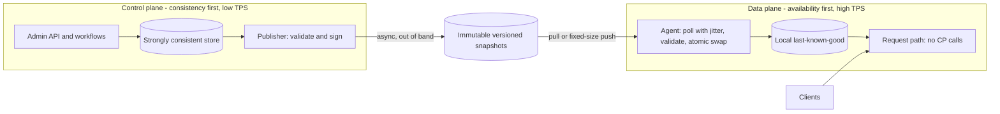

# Control Plane vs Data Plane Separation

## TL;DR

- The data plane serves the primary function of the resource. The control plane creates, changes, and deletes resources and propagates those changes to the data plane. Separate them so that data plane availability never depends on a control plane call at request time.
- Static stability is the invariant: the data plane keeps doing exactly what it was doing when the control plane is gone. It must also be able to restart in that state, which requires a last-known-good (LKG) copy of its configuration on local disk.
- State flows from control plane to data plane asynchronously and out of band. Prefer constant-work pull or fixed-size push of immutable, versioned, checksummed snapshots over per-request lookups. Never let a single publish reach the whole fleet at once.
- Degrade by explicit staleness budgets: FRESH, then STALE (serve everything on LKG), then EXPIRED (read-only, mutations rejected fast). Choose the budget from the slowest hidden clock in the data plane (certificates, leases, tokens, DNS TTLs), not from a round number.
- Recovery paths must use data plane operations only. The expensive outages (AWS us-east-1 in October 2025, Google Cloud in June 2025) were control-plane-originated state or automation reaching a data plane with no brake, followed by a recovery herd.

## Mental Model



Think of the control plane as a factory that manufactures configuration and the data plane as a fleet of machines that run from a local copy of the latest blueprint.
The only coupling is a one-way, asynchronous, versioned hand-off through a boring durable store.
If the factory burns down, the machines keep running from the last blueprint they validated, and they can reboot from it because it is on their own disk.
The interesting engineering is in the hand-off: what the agent accepts, what it refuses, how long it will trust old data, and what it stops doing when trust runs out.
This chapter builds on [[17-Cloud-AI-Engineering/Volume_01_Cloud_Architecture_Principles/Chapter_02_Regions_Zones_and_Static_Stability|Regions, Zones, and Static Stability]] and on the cell boundaries from [[17-Cloud-AI-Engineering/Volume_01_Cloud_Architecture_Principles/Chapter_03_Cell_Based_Architecture_and_Shuffle_Sharding|Cell-Based Architecture and Shuffle Sharding]].

## Internals

### Definitions and why the split pays for itself

AWS defines a control plane as the machinery for making changes to a system and getting those changes propagated to where they take effect, and a data plane as the daily business of the resources ([AWS Builders' Library, Static stability using Availability Zones](https://aws.amazon.com/builders-library/static-stability-using-availability-zones), as of 2026-10).
In EC2 the control plane is everything that happens during a launch: placement, network interface allocation, EBS volume preparation, IAM role credential generation, security group rule installation, and propagation to the host and the network edge.
The data plane routes packets by VPC route tables and reads and writes EBS volumes.
The same article states that the EC2 data plane is far simpler than its control plane, so its design targets higher availability.
The AWS Fault Isolation Boundaries whitepaper states that data planes are intentionally less complicated, with fewer moving parts, which makes failures statistically less likely there than in control planes ([AWS whitepaper](https://docs.aws.amazon.com/pdfs/whitepapers/latest/aws-fault-isolation-boundaries/aws-fault-isolation-boundaries.pdf), as of 2026-10).

There are three independent reasons to split, and a reviewer should be able to name all three:

1. Availability asymmetry. Customers need existing resources to work more than they need to change them, so the two planes need different availability targets and different blast radii.
2. Volume asymmetry. The data plane typically runs orders of magnitude more requests than the control plane, so the two scale on different dimensions ([Lumigo summary of the Builders' Library article](https://lumigo.io/blog/amazon-builders-library-in-focus-5-static-stability-using-availability-zones/), as of 2026-10).
3. Consistency asymmetry. Control planes want strong consistency and serializable workflows (create exactly one volume, allocate one IP). Data planes want the opposite trade: serve from local state and accept bounded staleness.

### The hand-off channel: push, pull, and constant work

The coupling between planes is the part getting-started guides skip.
The Builders' Library article on constant work describes two systems that use this pattern: the Route 53 health check pipeline and the Network Load Balancer configuration system ([AWS Builders' Library, Reliability, constant work, and a good cup of coffee](https://aws.amazon.com/builders-library/reliability-and-constant-work), as of 2026-10).
In the Route 53 case, health check aggregators send a fixed-size table of statuses to the DNS servers every few seconds, and the servers store it in memory essentially as-is.
The table is the same size whether one health check or ten thousand are configured, so the work done per tick does not vary with the number of changes or with failures.
The article explains the push direction by fan-out: there are more DNS servers than aggregators.
For configuration it describes object storage as the configuration loop, where components periodically fetch the whole current state rather than react to deltas.

Mechanically, a constant-work pull has four properties that make it a good fit for a control-to-data-plane hand-off:

- There is no "mode switch" under stress, so there is no rarely exercised fallback to rot (see [Avoiding fallback in distributed systems](https://aws.amazon.com/builders-library/avoiding-fallback-in-distributed-systems/), as of 2026-10).
- Full-state snapshots are idempotent. A lost or duplicated fetch cannot leave a host in a state that depends on message order.
- Load on the control plane is a function of fleet size and poll interval, never of change rate, so a burst of customer changes cannot hurt serving.
- The store in the middle (an object store) has a data plane SLA of its own, which is far better than that of the workflow engine that produced the snapshot.

The next chapter, [[17-Cloud-AI-Engineering/Volume_01_Cloud_Architecture_Principles/Chapter_05_Constant_Work_and_Workload_Smoothing|Constant Work and Workload Smoothing]], covers the load-shape side of this in depth.

### The fail-static state machine (the mechanism the quickstarts omit)

"The data plane keeps working" is not a design. These are the pieces you actually have to build.

**1. Versioned, immutable, self-verifying snapshots.**
Each publish is a new object named by a monotonically increasing generation, carrying a content hash (and in production a signature).
A small pointer object (`LATEST`) is flipped atomically after the snapshot is durable.
The agent never reads a half-written configuration, and it can prove which generation it is running.

**2. Validate before activate, and keep the old one.**
The agent stages the new snapshot, checks the hash, checks that the generation is strictly greater than the current one, runs semantic invariants, and only then swaps it in atomically and persists it as the new LKG.
Invariants must be cheap and paranoid: a policy set is not empty, the number of rules did not shrink by more than a configured fraction, no required field is blank.
A rejected snapshot is quarantined and reported, and the agent continues on the old generation.
This is the "poison pill" defense that [[17-Cloud-AI-Engineering/Volume_01_Cloud_Architecture_Principles/Chapter_03_Cell_Based_Architecture_and_Shuffle_Sharding|cell-based designs]] assume exists at the cell boundary.

**3. The LKG on local disk closes the bootstrap loop.**
Static stability that holds only while processes stay up is not static stability; hosts reboot, and containers get rescheduled.
If a restarted data plane process must call the control plane to learn its configuration, the control plane is on the data plane's restart path, which is a circular dependency.
The whitepaper lists preventing circular dependencies as one of the two ways AWS achieves static stability ([AWS whitepaper, Static stability](https://docs.aws.amazon.com/whitepapers/latest/aws-fault-isolation-boundaries/static-stability.html), as of 2026-10).

**4. The staleness budget and the hidden clocks.**
The data plane has clocks the control plane's designers may not remember: TLS certificate expiry, token and credential lifetimes, host leases, cache TTLs, DNS TTLs.
The hard staleness budget H must satisfy: H is at least the p99 time to detect, mitigate, and roll out a control plane repair, and H is strictly less than the shortest hidden clock that cannot be refreshed without the control plane.
If your certificates are renewed by a control plane workflow at two thirds of a 24 hour lifetime, your real fail-static horizon is about 8 hours, not "indefinite".
Write the horizon down, graph it per fleet, and alarm when `now - last_ok` crosses half of it.

**5. Graduated degradation, not a cliff.**
A useful ladder, which the lab below implements:

| Mode | Age of LKG | Reads | Writes and mutations | Rationale |
|---|---|---|---|---|
| FRESH | up to soft budget | allowed | allowed | normal |
| STALE | up to hard budget | allowed | allowed on LKG | stale routing is usually still correct |
| EXPIRED | beyond hard budget | allowed | rejected fast with 503 and Retry-After | mutations depend on current placement, authz, or fencing state |

Reads degrade last because a stale read is usually a bounded-staleness read, while a stale write can be a split-brain write.
Rejecting mutations fast is itself load shedding; see [[17-Cloud-AI-Engineering/Volume_07_Reliability_and_SRE/Chapter_02_Load_Shedding_Backpressure_and_Admission_Control|Load Shedding, Backpressure, and Admission Control]].

**6. Fencing at the point of write.**
Control plane automation is a distributed system with concurrent actors, and "check freshness, then act" is a time-of-check to time-of-use race.
The fix is a fencing token (the generation) compared and swapped at the object being mutated, not a check done earlier in the workflow.
The October 2025 DynamoDB event below is the canonical example.

### Controllers that act on stale signals: the Kubernetes case

Kubernetes is a clean example of the same split.
Pods and kubelets are the data plane, and the API server, scheduler, and controller manager are the control plane (see [[17-Cloud-AI-Engineering/Volume_05_Kubernetes_and_Platform_Engineering/Chapter_01_Kubernetes_Control_Loop_Internals|Kubernetes Control Loop Internals]] and [[04-System-Design/07-Infrastructure-and-Orchestration/Kubernetes-Architecture|Kubernetes Architecture]]).
If the API server is down, running containers keep running because the kubelet owns their lifecycle locally.
The dangerous case is different: a partition between nodes and a healthy control plane.
The node lifecycle controller then sees missing heartbeats, marks nodes unreachable, taints them, and evicts pods after the toleration window.
The control plane takes destructive action on a stale and possibly wrong signal about the data plane.
Kubernetes limits the blast radius with a rate limiter: the controller manager has a normal eviction rate, a much lower secondary eviction rate when a zone is mostly unhealthy, and a cluster size threshold below which it stops evicting in unhealthy zones (flags `--node-eviction-rate`, `--secondary-node-eviction-rate`, `--unhealthy-zone-threshold`, `--large-cluster-size-threshold`; defaults of 0.1/s, 0.01/s, 55%, and 50 nodes are UNVERIFIED in this session, verify against kube-controller-manager docs).
The general principle: any control plane component that can destroy data plane capacity needs a circuit breaker keyed on the fraction of the fleet it believes is unhealthy.
A tolerance for "unreachable" on pods that you would rather keep running is a per-workload knob (`tolerationSeconds` on the `node.kubernetes.io/unreachable` taint; the 300 second default is UNVERIFIED in this session).

### Control planes have internal planes too

The Physalia paper (Brooker et al., NSDI 2020) records that on 21 April 2011 an incorrectly executed network configuration change made 13% of EBS volumes in one Availability Zone unavailable, and that at that time replication configuration lived in the EBS control plane, sharing a database with API traffic ([USENIX NSDI 2020](https://www.usenix.org/system/files/nsdi20-paper-brooker.pdf), as of 2026-10).
Physalia, the replacement, is designed to separate itself from the EBS data plane and to separate its own data and control planes.
Per the trade press, each partition key is served by a small Paxos cell of seven logical nodes with one master, and cells are placed near the clients that use their keys ([The Next Platform](https://www.nextplatform.com/2020/02/18/the-jellyfish-inspired-database-under-aws-block-storage/), as of 2026-10).
The lesson is recursive: the replication topology (what EBS volume replicas must agree on) is data-plane-critical metadata and must not share fate with the customer-facing admin API.
See [[17-Cloud-AI-Engineering/Volume_02_AWS_Deep_Dive/Chapter_09_Elastic_Block_Store_and_Network_Storage|Elastic Block Store and Network Storage]] and [[17-Cloud-AI-Engineering/Volume_13_Seminal_Papers_and_Case_Studies/Chapter_03_Physalia_EBS_Control_Plane|Physalia]] for the full design, and [[08-Distinguished-Engineering/02-Distributed-Systems-Internals/Raft-Consensus|Raft Consensus]] for the consensus mechanics.

### Global services: one control plane, many data planes

AWS partitions global-service control planes into a single Region: the repost.aws guidance notes that us-east-1 hosts the control planes of numerous global services, while their data planes are regional or edge-local ([AWS re:Post](https://repost.aws/articles/ARe7BZRCUhRlap9b7yFSagLw/reducing-control-plane-dependencies-in-us-east-1-a-practical-guide-for-aws-customers), as of 2026-10).
The whitepaper's rule for global services is that a data plane failure in one Region (IAM) or one point of presence (Route 53) does not affect others, so what you must plan for is an event in the Region hosting the control plane or in the control plane itself ([AWS whitepaper, Global services](https://docs.aws.amazon.com/whitepapers/latest/aws-fault-isolation-boundaries/global-services.html), as of 2026-10).
Application Recovery Controller (ARC) applies the pattern to failover itself: routing control states live in a cluster whose data plane spans five Regional endpoints, and state can be updated as long as three of the five Regions are available ([AWS Architecture Blog](https://aws.amazon.com/blogs/architecture/minimizing-dependencies-in-a-disaster-recovery-plan), as of 2026-10).
Creating and deleting routing controls is control plane, hosted in us-west-2 per one AWS networking post ([AWS Networking blog](https://aws.amazon.com/blogs/networking-and-content-delivery/orchestrate-disaster-recovery-automation-using-amazon-route-53-arc-and-aws-step-functions), as of 2026-10), while flipping them is a data plane call.
That is the right shape: the "switch" you throw during an incident is on a quorum data plane that is independent of the Region you are escaping.

### The correlation problem

Control plane availability is quoted as an unconditional number, but you need it conditional on the data plane being in trouble.
Incidents generate control plane load (retries, mass re-launches, operators clicking), and control planes are sized for the daily average, so conditional availability during a regional event is much lower than the SLA.
Treat "I will call the control plane to recover" as a dependency with availability near the worst case, not the SLA.
Metastable failure work (Bronson et al., HotOS 2021; Huang et al., OSDI 2022; venues cited from memory, see the batch report) formalizes the recovery side: a trigger plus a sustaining feedback loop such as retries keeps a system degraded after the trigger is gone.

## Numbers to Know

| Quantity | Value | Source |
|---|---|---|
| ARC routing control data plane | 5 Regional endpoints, updates succeed if 3 of 5 Regions are available | (AWS Architecture Blog and aws-samples/arc-iad, as of 2026-10) |
| ARC control plane location | us-west-2 (create and delete routing controls) | (AWS Networking blog, as of 2026-10) |
| Route 53 DNS data plane design target | 100% availability SLA | (AWS Networking blog, as of 2026-10) |
| Recommended DNS TTL on failover records | 60 to 120 seconds | (AWS Database blog on DynamoDB global tables failover, as of 2026-10) |
| Route 53 health check results push cadence | fixed-size table every few seconds | (AWS Builders' Library, constant work, as of 2026-10) |
| Static stability sizing example | need 6 instances over 3 AZs, so run 9 (3 per AZ) | (AWS re:Post, from the fault isolation whitepaper, as of 2026-10) |
| Over-provision factor for n AZs, survive loss of one | n/(n-1): 2 AZs 2.00x, 3 AZs 1.50x, 4 AZs 1.33x, 6 AZs 1.20x | derived |
| 2011 EBS event blast radius | 13% of volumes in one AZ | (Physalia, NSDI 2020, as of 2026-10) |
| Physalia cell size | 7 logical nodes, one master per Paxos cell | (The Next Platform, as of 2026-10) |
| AWS us-east-1 event, Oct 2025 | 11:48 PM PDT Oct 19 to 2:20 PM PDT Oct 20 (14 h 32 min) | (AWS post-event summary, as of 2026-10) |
| DynamoDB error window in that event | 11:48 PM to 2:40 AM PDT (2 h 52 min) | (AWS post-event summary, as of 2026-10) |
| NLB connection error window in that event | 5:30 AM to 2:09 PM PDT | (AWS post-event summary, as of 2026-10) |
| Google Cloud, 12 Jun 2025 | bad policy row replicated globally within seconds, most regions recovered in about 2 hours, us-central1 later | (Google incident report as quoted by Simon Willison and outagecost.com, as of 2026-10) |
| Lab: 20,000 hosts, 10 s poll, direct to object store | 2,000 req/s, 5.18e9 req/month | derived |
| Lab: same fleet via 100 relays | 10 req/s, 2.59e7 req/month | derived |
| S3 Standard GET list price used in lab | 0.0004 USD per 1,000 requests | UNVERIFIED, check the S3 pricing page |

## AWS vs GCP Mechanism Parity

| Dimension | AWS | Google Cloud |
|---|---|---|
| Stated doctrine | Control plane and data plane are distinct components with separate availability targets; static stability is a design principle (AWS whitepaper, as of 2026-10) | SRE practice and global-service design; no single named "static stability" doc located in this session (UNVERIFIED) |
| Global service control plane placement | Partition-global control planes concentrated in us-east-1; ARC control plane in us-west-2 (AWS re:Post, AWS Networking blog, as of 2026-10) | Global control metadata replicated by Spanner; Service Control sits on every API request path (Google incident report, as of 2026-10) |
| Operator failover switch on a quorum data plane | ARC routing controls, 5 Regional endpoints, 3 of 5 quorum, data plane CLI/SDK only (AWS docs, as of 2026-10) | No exact equivalent verified; closest design is health-checked global load balancer backend failover evaluated in the data plane with no operator action (see [[17-Cloud-AI-Engineering/Volume_03_GCP_Deep_Dive/Chapter_05_Cloud_Load_Balancing_GFEs_and_Maglev\|Cloud Load Balancing]]) |
| Config propagation style for global policy | Mostly regional data planes with their own state; async propagation from control plane | Near-instant global replication for quota and policy metadata, which is what turned a bad row into a global crash loop in June 2025 |
| Kubernetes managed control plane | EKS managed control plane; nodes and pods run if API server unreachable | GKE zonal vs regional control plane replicas; zonal control plane unavailable during upgrades while workloads keep running (UNVERIFIED this session, see [[17-Cloud-AI-Engineering/Volume_03_GCP_Deep_Dive/Chapter_07_GKE_Deep_Dive_Standard_vs_Autopilot\|GKE Deep Dive]]) |
| Per-cell control metadata | Physalia cells for EBS (Paxos, seven nodes per cell) | Spanner split groups and Paxos replication for control metadata (Spanner paper, OSDI 2012) |
| Cluster scheduler heritage | Customer-visible EC2 and ECS control planes | Borg: running tasks reported to continue if the master or agents fail (Borg paper, EuroSys 2015, UNVERIFIED this session) |
| What to avoid in a recovery path | Console, Describe/Create APIs, record edits, new instance launches | Same class: project-level admin APIs, IAM policy edits, new VM creation |

The mechanism-level difference worth carrying into design reviews: AWS leans toward regional data planes with a single-Region control plane for global services, so the failure to plan for is "control plane unreachable".
Google leans toward globally replicated control metadata that feeds a global request path, so the failure to plan for is "control metadata is wrong everywhere within seconds".
Mitigations differ accordingly: pre-provisioned capacity and data-plane-only failover on AWS, versus staged propagation, validate-before-activate, and fail-static on parse failure on GCP.

## Worked Example: A Fail-Static Agent with Read-Only Degradation

This lab is a local simulation in Python 3 standard library only.
It provisions no cloud resources, so the cost is 0 USD, there is no budget alarm to configure, and teardown is automatic because the script creates and deletes its own temporary directory (manual teardown: `rm -rf /tmp/failstatic-*`).
The file store stands in for S3 or GCS, and `LATEST` stands in for the pointer object.

### Code

```python
#!/usr/bin/env python3
"""Fail-static data plane agent: local, stdlib only, no cloud resources."""
import hashlib, json, os, random, shutil, tempfile

FRESH, STALE, EXPIRED = "FRESH", "STALE", "EXPIRED"


class Clock:
    def __init__(self):
        self.t = 0.0
    def now(self):
        return self.t
    def advance(self, s):
        self.t += s


class ControlPlane:
    """Publishes immutable, checksummed, generation-numbered snapshots."""
    def __init__(self, store):
        self.store, self.gen = store, 0
        os.makedirs(store, exist_ok=True)
    def publish(self, rules, clock):
        self.gen += 1
        body = json.dumps({"gen": self.gen, "rules": rules}, sort_keys=True)
        doc = {"body": body, "sha256": hashlib.sha256(body.encode()).hexdigest(), "ts": clock.now()}
        path = os.path.join(self.store, "snap-%08d.json" % self.gen)
        with open(path, "w") as f:
            json.dump(doc, f)
        tmp = os.path.join(self.store, "LATEST.tmp")
        with open(tmp, "w") as f:
            f.write(os.path.basename(path))
        os.replace(tmp, os.path.join(self.store, "LATEST"))  # atomic pointer flip


class Agent:
    def __init__(self, store, state_dir, clock, interval=10.0, soft_budget=300.0,
                 hard_budget=14400.0, max_shrink=0.5, rng=None):
        self.store, self.state_dir, self.clock = store, state_dir, clock
        self.interval, self.soft, self.hard = interval, soft_budget, hard_budget
        self.max_shrink, self.rng = max_shrink, rng or random.Random(7)
        self.gen, self.rules, self.last_ok = 0, {}, None
        self.rejected = []
        self.fetch_enabled = True
        os.makedirs(state_dir, exist_ok=True)
        self._load_last_known_good()

    def _load_last_known_good(self):
        p = os.path.join(self.state_dir, "lkg.json")
        if os.path.exists(p):  # boot with zero control plane dependency
            with open(p) as f:
                d = json.load(f)
            self.gen, self.rules, self.last_ok = d["gen"], d["rules"], d["ts"]

    def _validate(self, doc):
        if hashlib.sha256(doc["body"].encode()).hexdigest() != doc["sha256"]:
            return "bad_checksum"
        body = json.loads(doc["body"])
        if body["gen"] <= self.gen:
            return "generation_regress"
        if not body["rules"]:
            return "empty_rules"
        if self.rules and len(body["rules"]) < self.max_shrink * len(self.rules):
            return "shrink_guard"
        return None

    def poll_once(self):
        """Constant work: always fetch, always validate, never branch on load."""
        if not self.fetch_enabled:
            return "fetch_failed"
        try:
            with open(os.path.join(self.store, "LATEST")) as f:
                name = f.read().strip()
            with open(os.path.join(self.store, name)) as f:
                doc = json.load(f)
        except OSError:
            return "fetch_failed"
        why = self._validate(doc)
        if why:
            self.rejected.append((name, why))  # quarantine, keep serving LKG
            return "rejected:" + why
        body = json.loads(doc["body"])
        self.gen, self.rules, self.last_ok = body["gen"], body["rules"], self.clock.now()
        tmp = os.path.join(self.state_dir, "lkg.tmp")
        with open(tmp, "w") as f:
            json.dump({"gen": self.gen, "rules": self.rules, "ts": self.last_ok}, f)
        os.replace(tmp, os.path.join(self.state_dir, "lkg.json"))
        return "applied"

    def jittered_sleep(self):
        return self.interval * (0.5 + self.rng.random())

    def mode(self):
        if self.last_ok is None:
            return EXPIRED
        age = self.clock.now() - self.last_ok
        return FRESH if age <= self.soft else (STALE if age <= self.hard else EXPIRED)

    def handle(self, kind):
        m = self.mode()
        if kind == "read":
            return 200 if self.rules else 503
        if m == EXPIRED:  # read-only degradation: writes need current placement/authz
            return 503
        return 200


def main():
    root = tempfile.mkdtemp(prefix="failstatic-")
    try:
        clock = Clock()
        cp = ControlPlane(os.path.join(root, "store"))
        cp.publish({"r%d" % i: i for i in range(10)}, clock)
        ag = Agent(os.path.join(root, "store"), os.path.join(root, "state"), clock)
        assert ag.poll_once() == "applied" and ag.mode() == FRESH

        ag.fetch_enabled = False  # control plane outage begins
        clock.advance(60); assert ag.poll_once() == "fetch_failed"
        assert ag.mode() == FRESH and ag.handle("write") == 200
        clock.advance(600); assert ag.mode() == STALE and ag.handle("write") == 200

        ag2 = Agent(os.path.join(root, "store"), os.path.join(root, "state"), clock)
        assert ag2.gen == 1 and ag2.handle("read") == 200  # restart during outage

        clock.advance(14400); assert ag.mode() == EXPIRED
        assert ag.handle("read") == 200 and ag.handle("write") == 503  # read-only

        ag.fetch_enabled = True  # recovery
        cp.publish({}, clock)  # poison: empty
        assert ag.poll_once() == "rejected:empty_rules" and ag.handle("read") == 200
        cp.publish({"r0": 0, "r1": 1}, clock)  # 80 percent shrink
        assert ag.poll_once() == "rejected:shrink_guard"
        cp.publish({"r%d" % i: i for i in range(10)}, clock)
        assert ag.poll_once() == "applied" and ag.mode() == FRESH and ag.handle("write") == 200
        print("all assertions passed; rejected =", ag.rejected)
    finally:
        shutil.rmtree(root)  # teardown


def sizing(n_hosts=20000, interval_s=10.0, hosts_per_relay=200, price_per_1k=0.0004):
    direct_rps = n_hosts / interval_s
    relays = -(-n_hosts // hosts_per_relay)
    relay_rps = relays / interval_s
    month = 30 * 86400
    for label, rps in (("direct", direct_rps), ("relayed", relay_rps)):
        print("%-8s %8.1f req/s  %14.0f req/month  USD %9.2f/month" %
              (label, rps, rps * month, rps * month / 1000.0 * price_per_1k))
    for n in (2, 3, 4, 6):
        print("AZs=%d  overprovision=%.2fx  (need N, run N*%d/%d)" % (n, n / (n - 1.0), n, n - 1))


if __name__ == "__main__":
    main()
    sizing()
```

Run it with `python3 failstatic.py`.
Observed output in the authoring sandbox:

```text
all assertions passed; rejected = [('snap-00000002.json', 'empty_rules'), ('snap-00000003.json', 'shrink_guard')]
direct     2000.0 req/s      5184000000 req/month  USD   2073.60/month
relayed      10.0 req/s        25920000 req/month  USD     10.37/month
AZs=2  overprovision=2.00x  (need N, run N*2/1)
AZs=3  overprovision=1.50x  (need N, run N*3/2)
AZs=4  overprovision=1.33x  (need N, run N*4/3)
AZs=6  overprovision=1.20x  (need N, run N*6/5)
```

### Capacity and cost back-of-the-envelope

1. Fan-in: 20,000 hosts polling every 10 s is 20,000 / 10 = 2,000 requests per second against the snapshot store. Uniform jitter in [0.5, 1.5] times the interval removes synchronized spikes, so the mean holds at 2,000 and the peak stays near it.
2. Monthly requests: 2,000 x 86,400 x 30 = 5.184e9. At 0.0004 USD per 1,000 requests (UNVERIFIED price), that is 5.184e6 x 0.0004 = 2,073.60 USD per month. Conditional GETs are still billed requests, so an ETag check does not remove this line.
3. Relay tier: one relay per 200 hosts is 100 relays polling at 10 s, which is 10 req/s and 10.37 USD per month at the same price. The relays cost compute (100 small instances), but they also give you a place for per-cell staging, and the object store sees a load that is independent of fleet growth.
4. Per-prefix request ceilings on the object store (a documented figure of several thousand GET/s per prefix, UNVERIFIED this session) make the direct design fragile above a few thousand hosts, so shard snapshots across prefixes or use relays.
5. Staleness budget: if control plane p99 repair is 90 minutes, rollout of a fix to the fleet takes 30 minutes, and the shortest non-refreshable clock (certificates) is 8 hours, choose H = 4 hours. That is at least 2 hours of mitigation plus 2x safety margin, and half of the hidden clock. Alarm at 2 hours.
6. Static stability sizing: if peak needs 6 instances across 3 AZs, run 9, a 50% premium. Going to 4 AZs for the same capacity needs 8 (4 x 2), a 33% premium. This is the price of not calling a control plane to replace capacity.

### Production mapping (not provisioned here)

- Replace the directory with an object store prefix per cell, write snapshots with a content hash in the key, and publish `LATEST` last.
- Replace the SHA-256 check with an asymmetric signature (KMS or Cloud KMS asymmetric sign) verified offline with a pinned public key.
- Add per-cell staged rollout with bake time between cells, owned by the pipeline described in [[17-Cloud-AI-Engineering/Volume_06_Infrastructure_as_Code_and_Delivery/Chapter_06_Progressive_Delivery_and_Deployment_Pipelines|Progressive Delivery and Deployment Pipelines]].
- For an ARC-style operator switch, the recovery runbook calls the cluster data plane API directly against one of five bookmarked endpoints chosen at random, for example `aws route53-recovery-cluster update-routing-control-state --routing-control-arn <arn> --routing-control-state Off --endpoint-url <endpoint> --region <region>`; the exact flags were not re-verified in this session (UNVERIFIED), and an ARC cluster is a billable resource not created by this lab.

## Failure Modes and Pitfalls

### Control-plane-originated state reaching the whole data plane at once (Google Cloud, 12 June 2025)

A feature for additional quota policy checks reached Service Control through the normal region-by-region rollout on 29 May 2025, but the failing code path was never exercised because it needed a policy change to trigger it.
It had no appropriate error handling and was not feature-flag protected.
At about 10:45 am PDT on 12 June, a policy change with unintended blank fields was inserted into the regional Spanner tables that Service Control uses, and because quota management is global it was replicated worldwide within seconds ([Simon Willison quoting the incident report](https://simonwillison.net/2025/Jun/14/google-cloud-outage-incident-report/), as of 2026-10).
Binaries hit a null pointer and crash-looped in every region.
Per a summary of the report, engineers deployed a red-button bypass, most regions recovered in about two hours, and us-central1 lagged because Service Control lacked randomized exponential backoff, so restarting tasks overloaded the underlying infrastructure in a herd effect ([outagecost.com](https://outagecost.com/case-studies/gcp-june-2025), as of 2026-10).
Lessons: data replicated by a control plane is code input and needs staged rollout like code; parse failures must fall back to LKG, not to a crash; and restart loops need jittered backoff.

### Automation race and recovery herd (AWS us-east-1, 19-20 October 2025)

AWS's summary describes three impact periods and attributes the root cause to a latent race condition in the DynamoDB DNS management system that produced an incorrect empty DNS record for the regional endpoint, which the automation failed to repair ([AWS post-event summary](https://aws.amazon.com/message/101925), [InfoQ](https://www.infoq.com/news/2025/11/aws-dynamodb-outage-postmortem), as of 2026-10).
Secondary analyses say a DNS Enactor checked plan freshness once at the start, then ran slowly enough that the check was stale, applied an old plan over a newer one, and cleanup automation then deleted the plan that had just been applied ([techupkeep.dev](https://www.techupkeep.dev/blog/aws-outage-october-2025-analysis), as of 2026-10).
Mechanism takeaway: the freshness check must be a compare-and-swap on the object being written, and cleanup must be unable to delete the generation that is currently serving.
After DynamoDB recovered, a secondary analysis reports that EC2's host workflow leases, which depended on DynamoDB, had lapsed, and that the re-establishment backlog caused congestion; AWS throttled launches and network state changes to drain it ([outagecost.com](https://outagecost.com/case-studies/aws-october-2025), as of 2026-10).
This is the hidden-clock failure from Internals: a lease TTL is the real fail-static horizon, and the herd on lease renewal after recovery is a metastable-style trap, which is why renewals need jitter and server-side admission control.
Cross-reference [[17-Cloud-AI-Engineering/Volume_07_Reliability_and_SRE/Chapter_07_Anatomy_of_Major_Cloud_Outages|Anatomy of Major Cloud Outages]] for the full timeline treatment.

### Shared fate inside the control plane (EBS, April 2011)

The replication configuration shared a database with API traffic, so a network event and the resulting re-mirroring storm saturated the very store that volumes needed to make progress (Physalia, NSDI 2020, as of 2026-10).
Pitfall: "the control plane" is not one thing, and its subsets that data plane correctness depends on must be isolated from its customer-facing and workflow subsets.

### Bimodal recovery and untested fallbacks

If your recovery plan is "launch new capacity in the surviving zone", you are behaving differently in failure than in steady state, which the Well-Architected Framework calls bimodal behavior ([AWS Well-Architected REL11-BP05](https://docs.aws.amazon.com/wellarchitected/2022-03-31/framework/rel_withstand_component_failures_static_stability.html), as of 2026-10).
The Builders' Library fallback article describes a case where a cache fallback turned a partial website outage into a full-site outage and took down the fulfillment network ([Avoiding fallback in distributed systems](https://d1.awsstatic.com/builderslibrary/pdfs/avoiding-fallback-in-distributed-systems.pdf), as of 2026-10).
Prefer paths that are exercised continuously over fallbacks that run rarely.

### Recovery runbooks that depend on the control plane

A failover step that says "log into the console" or "edit the DNS record" is a dependency on control plane paths that may be unavailable during the event.
The ARC guidance is explicit: bookmark or hard-code the five Regional endpoints, use the CLI or SDK against the cluster data plane rather than the console, choose an endpoint at random with retries across all five, and keep purpose-built long-lived credentials accessible ([ARC best practices](https://docs.aws.amazon.com/r53recovery/latest/dg/route53-arc-best-practices.regional.html), as of 2026-10).
Test this under a drill that actually blocks the control plane path.

### Health checks that fail open and controllers that destroy capacity

Health-check automation on a shared dependency can mark the whole fleet unhealthy; the Builders' Library guidance (as summarized by [Lumigo](https://lumigo.io/blog/amazon-builders-library-in-focus-6-implementing-health-checks/), as of 2026-10) notes that NLB fails open when no servers report healthy and recommends thresholds that stop automation from taking drastic actions fleet-wide.
The Kubernetes mass-eviction case in Internals is the same pattern: bound the fraction of the fleet any automation may remove per unit time.

### Unbounded staleness that nobody alarms on

The most common silent failure is not an outage but a data plane that has been on LKG for nine days because a publisher quietly broke.
Export `now - last_ok` per host, alarm on the 50th percentile crossing half the hard budget, and keep a fleet-wide generation histogram.

## Security and Cost Angles

### IAM scoping

- The data plane agent role gets read-only access to one snapshot prefix (`s3:GetObject` on `config/<cell>/*` or the GCS equivalent `roles/storage.objectViewer` on one bucket with a condition), and nothing else. It never holds control plane mutate permissions.
- The publisher role is the only writer, is not assumable from data plane hosts, and writes `LATEST` only after the snapshot object is durable.
- Separate break-glass roles for recovery use data plane APIs only, with long-lived credentials stored offline, as the ARC best practices recommend (AWS docs, as of 2026-10).
- Apply SCP or Organization Policy guardrails so that data plane hosts cannot call IAM or admin APIs even by mistake.

### Key hierarchy and verification

- Sign snapshots with an asymmetric key in KMS or Cloud KMS, pin the public key in the agent image, and verify offline. This keeps KMS off the request and poll path, so a KMS impairment does not become a data plane impairment.
- Encrypt snapshots at rest with a CMK, but remember decrypt calls are a dependency: if the agent must call KMS to read a snapshot, you have put KMS in the fail-static path. Cache the plaintext LKG on encrypted local disk.
- Cross-reference [[17-Cloud-AI-Engineering/Volume_08_Security_Identity_and_the_Data_Perimeter/Chapter_04_Encryption_Key_Hierarchies_and_Envelope_Encryption|Encryption Key Hierarchies and Envelope Encryption]].

### Network boundaries

- Reach the snapshot store through a VPC gateway endpoint (AWS) or Private Google Access with a VPC Service Controls perimeter (GCP), so the config path does not traverse a NAT gateway that is itself a control-plane-managed dependency. See [[17-Cloud-AI-Engineering/Volume_08_Security_Identity_and_the_Data_Perimeter/Chapter_06_Constructing_an_Impenetrable_Data_Perimeter|Constructing an Impenetrable Data Perimeter]].
- A tampered snapshot is a fleet-wide remote configuration push. Treat the store's write path as tier-0.

### Unit economics

- Static stability costs n/(n-1) capacity: 1.50x on three AZs, 1.33x on four. Spend it only on tier-0 request paths and let tier-2 workloads accept control-plane-dependent recovery.
- Poll cost scales with fleet size over interval, not with change rate. In the lab, direct polling is about 2,074 USD per month versus about 10 USD with relays (price UNVERIFIED).
- Capacity reservations help guarantee availability but launching into a reservation is still a control plane call, so they do not replace pre-provisioned running capacity for tier-0.
- Constant-work designs do extra work on purpose; budget for it rather than optimizing it away.

## Interview Questions and Model Answers

### Question 1 (L5 - Senior)

Classify these operations as control plane or data plane, and say which should still work if the control plane is impaired: `RunInstances`, reading an object from S3, an EC2 instance rebooting, a Route 53 record edit, answering a DNS query, `AssumeRole`, attaching an EBS volume.

#### Model Answer

Control plane operations create, modify, or delete resources and propagate the change: `RunInstances`, Route 53 record edits, and attaching an EBS volume.
Data plane operations are the primary function of an existing resource: S3 object reads, a running EC2 instance (including rebooting), and Route 53 answering DNS queries and performing health checks (AWS whitepaper, as of 2026-10).
A reboot belongs in the data plane because an instance, once launched, does not depend on control plane APIs to stay running or to start running again.
`AssumeRole` is the interesting one: the issuing of credentials is a data plane function of the IAM/STS stack in each Region, but creating or editing roles is control plane, so a runbook can call `AssumeRole` during an event but should not depend on creating a new role (the IAM data plane being regional is stated in the AWS whitepaper, as of 2026-10).
So during a control plane impairment, I expect S3 reads, running instances, DNS answers, and use of existing roles to work, and I expect launches, record edits, and attachments to be unreliable.
The practical rule is to keep the second group out of any recovery path.

#### Follow-up Interviewer Question

Your disaster recovery runbook currently says "create a new Auto Scaling group in the secondary Region and update the Route 53 record". Which two steps are control plane dependencies, and what do you replace them with?

### Question 2 (L5 - Senior)

Explain static stability and compute the cost of making a three-AZ web tier statically stable against the loss of one AZ when steady-state peak needs 12 instances.

#### Model Answer

Static stability means the system keeps operating as normal without making changes during the unavailability of a dependency, including without calling control planes to replace lost capacity (AWS whitepaper, as of 2026-10).
For AZ loss, the only statically stable answer is to pre-provision enough capacity that the surviving AZs carry peak load without launching anything.
With n AZs and loss of one, each AZ must carry peak / (n - 1), so the fleet is peak x n/(n - 1).
For 12 instances and three AZs, each AZ runs 6, for 18 total, a 50% premium.
With four AZs each runs 4, for 16 total, a 33% premium.
The trade-off is explicit: you pay for idle capacity continuously to buy independence from the EC2 control plane at the worst possible moment, when every other tenant in the AZ is also trying to launch.
The load balancer must also stop sending to the dead AZ via health checks (a data plane mechanism), not via an operator action.
I would not apply this to every tier; I apply it to the request path and accept slower recovery for batch and internal tools.

#### Follow-up Interviewer Question

Cross-zone load balancing and a mix of instance types complicate the "each AZ carries peak / (n - 1)" arithmetic. Where does the formula break, and how do you detect that in production?

### Question 3 (L6 - Staff)

Design the configuration distribution path from a control plane to a 50,000-host data plane fleet so that a control plane outage is a non-event for serving, and a bad configuration cannot take the fleet down.

#### Model Answer

I split the problem into transport, agent, and rollout.
Transport: the control plane publishes immutable, content-addressed snapshots with a monotonic generation and a signature to an object store, then flips a tiny `LATEST` pointer last.
Agents pull on a fixed interval with 0.5x to 1.5x jitter, always fetching the full state, which is the constant-work pattern the Route 53 and NLB systems use.
Load on the store is hosts divided by interval, independent of change rate; at 50,000 hosts and 10 s that is 5,000 req/s, so I would put a relay tier per cell in front rather than hit one prefix directly.
Agent: stage, verify signature and hash, enforce generation monotonicity, run semantic invariants (non-empty, shrink guard, required fields), then atomically swap and persist as LKG on local disk.
A rejected snapshot is quarantined and alarmed, and the host keeps serving LKG.
A restarting host loads LKG from disk, so the control plane is never on the restart path.
Degradation: FRESH, STALE, EXPIRED with the hard budget derived from the shortest non-refreshable hidden clock (certificates, leases), and EXPIRED goes read-only with fast 503s on mutations.
Rollout: the publisher does not write one global `LATEST`; it writes per-cell pointers and advances them cell by cell with bake time and automated rollback on error-rate or crash signals, because replication of data to all regions within seconds is how Google's June 2025 incident went global.
Operational controls: a red-button to pin generation, a fleet generation histogram, and a staleness alarm.
Trade-offs: staleness during emergencies (you cannot push a security fix faster than your rollout allows, so keep an emergency fast lane with a smaller invariant set and human approval), and the cost of polling.

#### Follow-up Interviewer Question

A snapshot is syntactically valid and passes your invariants but is semantically wrong, for example a routing rule that sends 100% of traffic to one cell. What catches it before the fleet does?

### Question 4 (L6 - Staff)

Walk through the June 2025 Google Cloud Service Control incident as a control/data plane failure. What principles were violated and what would you change if quota and authorization checks sit on every API request path?

#### Model Answer

The data plane here is the request path that checks authorization and quota on every API call, and its input is policy metadata produced by a control plane.
A new code path was released through regional rollout but not exercised, with no error handling and no feature flag.
Then a policy row with blank fields was written and replicated globally within seconds, so every region executed the dormant path and crash-looped (Google incident report, as quoted by Simon Willison, as of 2026-10).
Violated principles: first, control-plane data was treated as data, not as a deployment, so it bypassed staged rollout; second, a parse or validation failure caused a crash instead of keep-serving-LKG; third, the failure mode of the request path on bad policy was not decided in advance (fail open for quota, fail closed for authorization); fourth, restarts lacked randomized exponential backoff, which a summary of the report says delayed us-central1 recovery.
What I would change: version policy snapshots and roll them out per cell with bake time, even if the quota system wants global values; wrap the new code in a flag; make the loader total, so any exception on a snapshot quarantines it and retains the previous generation; define per-check fail-open or fail-closed behavior explicitly; add jittered backoff on restart and admission control on the datastore; and keep a red button that bypasses a specific check class.
The remaining tension is the requirement that quota be globally consistent within seconds, which is exactly what conflicts with staged rollout.

#### Follow-up Interviewer Question

How do you reconcile global quota correctness with staged rollout and fail-static behavior?

(Expected direction: local token buckets with leased slices of the global budget, bounded overshoot proportional to lease size and duration, and policy rollout separated from usage accounting.)

### Question 5 (L6 - Staff)

On Kubernetes, distinguish "API server is down" from "nodes are partitioned from a healthy control plane". What happens to workloads in each case and how do you protect them?

#### Model Answer

If the API server and controllers are down, kubelets keep running the containers they already own, so serving continues; what stops is scheduling, scaling, rollouts, and new pod creation.
If there is only a partition between nodes and a healthy control plane, the node lifecycle controller stops seeing heartbeats, marks nodes unready or unreachable, applies taints, and evicts pods once their toleration for the unreachable taint expires.
That turns a control plane impairment into data plane damage, because a control plane component acts on a stale view of the data plane.
Kubernetes mitigates with eviction rate limiting: a normal rate, a much lower secondary rate when a zone is mostly unhealthy, and a threshold under which small clusters stop evicting (flags and defaults UNVERIFIED in this session).
My protections: set `tolerationSeconds` on the unreachable taint for workloads where an unreachable node is more likely a network problem than a dead node, and where the workload tolerates duplicate or zombie pods only if it fences itself (leases, fencing tokens); spread across zones so a single partition does not hit a majority; alarm on the fraction of nodes NotReady and page before the eviction timer fires; and put cluster autoscaler or Karpenter behavior in the same circuit-breaker category, since a control plane that reacts by launching nodes during a partition adds control plane load at the wrong time.
For stateful workloads, longer tolerations risk running two writers, so the fencing token must be enforced at the storage layer.

#### Follow-up Interviewer Question

You raise `tolerationSeconds` to ten minutes for a StatefulSet that holds a Raft member. What exactly prevents a split-brain if the node is alive but partitioned, and what do you lose?

### Question 6 (L7+ - Principal)

Using the October 2025 us-east-1 DynamoDB event as a case study, state the design invariants you would require of control-plane automation that edits the endpoint records of a tier-0 data plane, and the recovery-side invariants.

#### Model Answer

Reported facts: an automation race left the regional endpoint with an empty DNS record that the automation could not repair, and recovery afterward was prolonged by dependent systems whose state had lapsed while DynamoDB was unreachable (AWS post-event summary and secondary analyses, as of 2026-10).
Write-side invariants.
One: all mutations are fenced by generation and applied with compare-and-swap at the record, so a slow actor holding an old plan cannot overwrite a newer one; a freshness check at the start of a workflow is a TOCTOU bug.
Two: the live generation is protected from deletion; cleanup may only remove generations older than the live generation minus a retention window.
Three: no plan that results in an empty or drastically smaller record set may be applied by automation without a human gate, and the tier-0 record must have an independent "last good" restore path that does not depend on the service being restored.
Four: apply per cell with bake time so a bad plan hits one cell.
Five: the system's own dependencies (DNS for DynamoDB) must not depend on DynamoDB, to avoid a recovery cycle.
Verification: the race took a rare interleaving, so I would model the planner/enactor protocol in TLA+ or P, run deterministic simulation with injected delays on a single actor, and add fault injection that stalls an enactor in production-like environments.
Recovery-side invariants: every lease or session that depends on the restored service has jittered renewal and server-side admission control; a runbook-level throttle exists for launches and state propagation (AWS did throttle EC2 launches and network state changes per a secondary analysis); and the fail-static horizon of each dependent (lease TTL) is longer than the p99 repair time of the thing it depends on, or the dependent must degrade to read-only rather than drop capacity.
The business trade-off is slower automation (cell by cell, human gates on shrink) against a blast radius of one cell.

#### Follow-up Interviewer Question

How would you prove, before the next incident, that a given dependent system's lease TTL exceeds the repair time of its dependency, and who owns that number?

### Question 7 (L7+ - Principal)

You are asked to set a company policy on "control plane dependencies in recovery paths" across AWS and GCP. What is the policy, how do you justify the cost, and how do you enforce it?

#### Model Answer

Policy: for tier-0 services, no recovery or failover path may call a control plane API of a partition-global service or of the Region being escaped; the allowed set is data plane calls (ARC routing control updates, health-check-driven DNS failover, load balancer health checks, pre-provisioned capacity).
Justification is a conditional availability argument.
The control plane SLA is measured unconditionally, but during a regional event it receives herd traffic from everyone's recovery automation, and control planes are statistically more likely to fail than data planes (AWS whitepaper, as of 2026-10), so P(control plane works | I need it) is much lower than its SLA.
For a tier-0 service with an annual downtime budget of 26 minutes (99.995%), a single event where recovery waits two hours for a control plane wipes out four years of budget, so the 33% to 50% over-provisioning premium (n/(n-1) for four or three zones) is cheap compared with outage cost; I would still present it per tier so tier-2 services do not pay for it.
Enforcement: an inventory of recovery runbooks with each step tagged control plane or data plane; CI policy-as-code that fails modules whose failover resources include control plane-only triggers; game days that block the control plane path (deny IAM edits and `RunInstances` via SCP or Organization Policy in a test environment) and require recovery to succeed; and a quarterly review of fail-static horizons per service against hidden clocks.
On GCP the equivalent audit focuses on global control metadata that feeds request paths, requiring staged rollout and validate-before-activate for any policy replicated globally, since the June 2025 incident was not a "region down" failure.
Where multi-cloud is suggested as the remedy, I would note that it moves rather than removes the control plane dependency unless the switch itself lives on a third quorum data plane.

#### Follow-up Interviewer Question

An executive says on-demand capacity reservations already guarantee capacity, so pre-provisioned running instances are waste. Where is that right and where is it wrong?

(Expected direction: reservations guarantee that a launch can succeed, but the launch is still a control plane call that may be throttled or impaired and takes minutes; for tier-0 request paths the running instance is the data plane, for tier-1 reservations plus tested automation may be sufficient.)

## Further Reading

- [AWS Builders' Library: Static stability using Availability Zones](https://aws.amazon.com/builders-library/static-stability-using-availability-zones) - the canonical definitions of control plane, data plane, and static stability, with the EC2 worked example.
- [AWS Fault Isolation Boundaries whitepaper](https://docs.aws.amazon.com/whitepapers/latest/aws-fault-isolation-boundaries/static-stability.html) - how AWS applies the pattern to zonal, Regional, and global services, plus the per-service control plane impairment guidance in Appendix A.
- [AWS Builders' Library: Reliability, constant work, and a good cup of coffee](https://aws.amazon.com/builders-library/reliability-and-constant-work) - the Route 53 health check and S3-as-configuration-loop designs for the hand-off channel.
- [AWS Builders' Library: Avoiding fallback in distributed systems](https://aws.amazon.com/builders-library/avoiding-fallback-in-distributed-systems/) - why rarely exercised recovery modes fail and what to build instead.
- [Millions of Tiny Databases (Physalia), NSDI 2020](https://www.usenix.org/system/files/nsdi20-paper-brooker.pdf) - a control plane database designed for blast radius containment, with the 2011 EBS event that motivated it.
- [Route 53 ARC routing control best practices](https://docs.aws.amazon.com/r53recovery/latest/dg/route53-arc-best-practices.regional.html) - the operational discipline for a data-plane-only failover switch.
- [AWS: Summary of the Amazon DynamoDB Service Disruption in us-east-1, October 2025](https://aws.amazon.com/message/101925) - primary source for the automation race and cascade discussed above.
- [Google Cloud Service Control incident, June 2025 (summary by Simon Willison)](https://simonwillison.net/2025/Jun/14/google-cloud-outage-incident-report/) - quotes the official report on globally replicated policy data and an unguarded code path.
- Metastable Failures in Distributed Systems (HotOS 2021) and Metastable Failures in the Wild (OSDI 2022) - the formal account of why recovery herds sustain outages after the trigger is gone.
- Large-scale cluster management at Google with Borg (EuroSys 2015), see [[17-Cloud-AI-Engineering/Volume_13_Seminal_Papers_and_Case_Studies/Chapter_07_Google_Borg_and_Omega|Borg and Omega]] - a control plane designed so that running tasks outlive the master.
- Related chapters: [[17-Cloud-AI-Engineering/Volume_07_Reliability_and_SRE/Chapter_03_Resilient_Communication_Retries_Jitter_and_Circuit_Breakers|Resilient Communication: Retries, Jitter, and Circuit Breakers]] for the backoff mechanics referenced in the recovery herd analysis.
