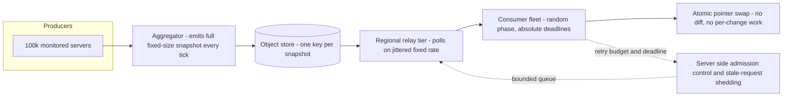

# Constant Work and Workload Smoothing

## TL;DR

1. A system that does more work when things go wrong has a hidden positive feedback loop. Failure triggers more work (retries, resyncs, re-replication, cache misses, state-change fan-out), which causes more failure. Constant work removes the loop by making the work done per cycle independent of the state of the world.
2. "Constant" has to hold at every stage: bytes on the wire after compression, CPU to parse, CPU to apply, and fan-in at the receiver. Delta-encoding, "skip if unchanged" fast paths, and transport compression each quietly reintroduce load-proportional work.
3. Synchronization is the dual problem. Clients that share a clock, a restart event, a deploy, or a slow dependency phase-lock, and a uniform load of 10k rps becomes a 100k rps spike. The fix is randomized phase (jitter), absolute-deadline scheduling, retry budgets, and deadline-aware shedding. Jitter alone is not enough once the server wastes capacity on abandoned requests.
4. Cache stampedes and cold-start herds are solved by bounding concurrent recomputation (single flight, leases) and by refreshing probabilistically before expiry (XFetch). Early refresh fires roughly `delta * beta * ln(rate * delta)` seconds before expiry, so it trades hit-rate freshness for tail latency.
5. Pre-allocated pools (buffers, connections, KV-cache blocks, warm capacity) convert unbounded memory and latency behavior into a hard concurrency limit that you can shed against. The cost is that you pay for peak all the time, and you must size the pool from Little's law and not from average load.

## Mental Model



The intuition is that the data plane has a fixed clock and a fixed payload shape, and nothing a producer, a failure, or a client does can change the amount of work that clock triggers.
Producers do not push events at consumers.
They overwrite the latest state, and consumers pull the whole state at a rate they choose, so a lost message, a restarted consumer, or a partitioned relay is repaired by the next tick with no recovery protocol.
Spread across that fixed clock are two smoothing devices: random phase, so N consumers do not hit the origin on the same millisecond, and a bounded pool at each hop, so overload turns into rejected requests at a known concurrency limit instead of queues, swap, and OOM kills.
This is the same stance as [[17-Cloud-AI-Engineering/Volume_01_Cloud_Architecture_Principles/Chapter_04_Control_Plane_vs_Data_Plane_Separation|Control Plane vs Data Plane Separation]] applied to time: the data plane must not do work whose volume is chosen by the failure being handled.

## Internals

### The work function and why tails kill

Define the work function `W(s)` as the amount of CPU, network, and I/O a component performs per unit time as a function of system state `s` (fraction of unhealthy nodes, cache miss ratio, number of changed records).
Most designs are sized for `E[W]` over a normal day.
Failures are exactly the states where `W` is largest, because the system has to notice, notify, repair, and retry.
The AWS Well-Architected Reliability Pillar states the canonical example: a health-check system watching 100,000 servers has nominal load while failures are rare, but if half the servers become unhealthy it is overwhelmed trying to update notification systems and communicate state to its clients ([REL04-BP03 Do constant work](https://docs.aws.amazon.com/wellarchitected/latest/framework/rel_prevent_interaction_failure_constant_work.html)).
The recommended remedy there is to send the same size payload, a full snapshot of current state, every time.
The Builders' Library article [Reliability, constant work, and a good cup of coffee](https://aws.amazon.com/builders-library/reliability-and-constant-work/) develops the idea with Route 53 health-check propagation and with configuration distribution through a polled object, and is the primary source for this chapter.

The design goal is therefore `max_s W(s) / E_s[W(s)]` close to 1.
Constant work is the extreme: `W(s)` is a constant.
Almost every real system lands between the extremes, and the staff-level skill is identifying which loops in the system have a ratio far above 1 and pinning them.

### Metastable failure: the feedback loop constant work removes

The metastable failure literature (Bronson et al., "Metastable Failures in Distributed Systems", HotOS 2021, and Huang et al., "Metastable Failures in the Wild", OSDI 2022) separates a **trigger** (a deploy, a cache flush, a load spike, a brief dependency brownout) from a **sustaining effect** (a feedback loop that keeps the system in a degraded state after the trigger is gone).
The OSDI 2022 incident study found that retry policy was the most common sustaining mechanism, with load-dependent work such as cache-miss amplification and rebalancing also frequent (exact fractions UNVERIFIED this session).
The defining property is that removing the trigger does not restore service, because goodput has collapsed below offered load and the amount of wasted work is itself proportional to the backlog.

Three structural properties create the sustaining loop:

- Work per request rises when the system is unhealthy (a cache miss turns a 1 ms lookup into a 50 ms database query).
- Clients add requests when the system is unhealthy (retries, resync, failover reconnects).
- The server spends capacity on requests whose callers have already given up (no deadline propagation, no stale-request shedding).

Constant work attacks the first property.
Jittered retries with budgets attack the second.
Deadline-aware admission control attacks the third.
The lab in the Worked Example section shows all three interacting: with a server that burns capacity on abandoned requests, even full-jitter exponential backoff leaves 781 of 20,000 clients unserved after 300 simulated seconds, and the same clients finish in under 25 seconds once the server sheds stale requests.

### Constant-work patterns

**Full-state propagation.**
A producer periodically emits the entire current state, and a consumer replaces its view wholesale.
Compared to event streams it removes ordering requirements, acknowledgements, per-consumer cursors, replay logs, and the "resync" path that nobody exercises until an outage.
A dropped message costs one period of staleness.
A new consumer needs no bootstrap protocol because its first poll is indistinguishable from its thousandth.
The price is that average-case bandwidth and CPU are higher than a delta stream, and it only scales while the snapshot is bounded.
In the lab, the snapshot costs 12.5 MB per tick for 1,000 subscribers regardless of failures, which is more than the 3.2 MB an event stream would emit when 0.05 percent of servers change, and 256x less than the 3,200 MB burst when half of them change.
The crossover is near 0.2 percent of servers changing per tick, and the point of the design is that you operate on the right-hand side of that line during an incident.

**Level-triggered reconciliation.**
Kubernetes controllers are the in-house example: a reconcile function receives a key, reads the whole desired and observed state for that object, and converges, so a missed watch event is repaired by the next list or resync.
Informer relists and the periodic resync are constant work with respect to correctness, even though the common event path is edge-triggered for efficiency.
Controller-runtime's default cache resync period is on the order of ten hours with jitter (UNVERIFIED this session), which is a deliberate choice of a very low constant rate.
See [[17-Cloud-AI-Engineering/Volume_05_Kubernetes_and_Platform_Engineering/Chapter_01_Kubernetes_Control_Loop_Internals|Kubernetes Control Loop Internals]] and [[04-System-Design/07-Infrastructure-and-Orchestration/Kubernetes-Architecture|Kubernetes Architecture]].

**Fixed-rate sweepers.**
Lifecycle scanners, garbage collectors, and anti-entropy repair processes that run at a fixed per-node budget (bytes scanned per second) instead of "as fast as possible when there is a backlog" give predictable background load.
Cassandra and Dynamo-style anti-entropy are the common examples, see [[04-System-Design/05-Data-Stores/Apache-Cassandra|Apache Cassandra]].

**Token-bucket-bounded admission.**
The DynamoDB paper (Elhemali et al., USENIX ATC 2022) describes admission control built from token buckets at the partition level and a global admission control layer at the request routers.
Work admitted into a storage node is bounded by tokens regardless of how many clients send requests, and unspent capacity is retained as burst tokens for a limited window.
Admission control is constant work enforced at the boundary: the storage node's work function is capped even if the offered load is not.
See [[17-Cloud-AI-Engineering/Volume_02_AWS_Deep_Dive/Chapter_10_Amazon_DynamoDB_Architecture_and_Partitioning|Amazon DynamoDB: Architecture and Partitioning]].

### What "constant" has to mean

This is the section that getting-started guides skip.
Constant-work designs fail in practice because "constant" is only true at one layer.

1. **Constant after compression.**
   A health bitmap with all servers healthy compresses to a few bytes.
   A bitmap with a random half unhealthy is incompressible.
   If gzip, brotli, or zstd sits in the path, the bytes on the wire are a function of entropy, and entropy is maximized in the middle of a partial failure, the worst moment.
   Either use a fixed-width encoding and disable transport compression on this path, or size every hop for the incompressible worst case.
   The lab publisher writes `os.urandom` bitmaps for exactly this reason: it exercises the maximum-entropy case.
2. **Constant apply cost.**
   If the consumer diffs the new snapshot against the old one and applies only changes, apply cost is proportional to the number of changes, and a mass failure turns into a CPU spike on every consumer simultaneously.
   Apply by swapping a single reference to an immutable parsed structure.
   The cost is up to 2x memory for the overlap window, and a bounded parse cost per tick that you can load-test once.
3. **Constant parse cost and no data-dependent branches on the hot path.**
   A "fast path if nothing changed" optimization is the same bug in a different place, because the slow path is the one that runs during the incident and is the one nobody sized for.
4. **Constant fan-in.**
   `N` consumers polling every `T` seconds produces `N / T` requests per second at the origin.
   Constant work at the sender multiplied by an unbounded consumer count is not constant.
   Put a relay or cache tier between them so the origin sees `R / T` where `R` is the number of relays, which is fixed by topology and not by fleet size.
5. **Bounded snapshot growth.**
   If snapshot size is `O(n)` in the number of entities and every one of `n` consumers fetches it, fleet-wide bandwidth is `O(n^2)`.
   The 2020 Kinesis front-end event had the same shape: per-server state and thread count grew with fleet size, so adding capacity pushed every server past an OS thread limit ([AWS post-event summary, Kinesis, November 2020](https://aws.amazon.com/message/11201/); details UNVERIFIED this session).
6. **Constant work still has a cost.**
   You pay the peak cost every second of every day.
   It is worth it only when the cost of the tail (an outage, an overprovisioned burst reserve, a recovery protocol) exceeds the steady premium.
   At low scale, or where failures are independent and rare, delta streams are the right answer.

### Synchronization: why phases lock

Floyd and Jacobson ("The Synchronization of Periodic Routing Messages", IEEE/ACM Transactions on Networking, 1994) showed that periodic processes which are weakly coupled, for example by resetting a timer after processing a message from a peer, converge to synchronized phase even when started at random.
The practical lesson is that randomizing the initial offset is necessary but not sufficient, because the coupling pulls phases back together.
The coupling in cloud systems is easy to create:

- **Fixed-delay scheduling.**
  `sleep(T)` after each response couples a client's phase to server latency.
  If a server stalls for 5 seconds, every client that was in flight loses the same 5 seconds and emerges together.
  Schedule against absolute deadlines (`start + k * T`) and add per-tick jitter, so latency does not move the phase.
- **Shared events.**
  A deploy, an autoscaler scale-out, a node reboot wave, a certificate rotation, or a regional recovery lines up thousands of clients on one instant.
  In the lab, 100,000 pollers restarted together produce a per-second peak equal to the entire fleet (10x the mean at a 10 second period), and uniform random phase brings the peak to 1.02x the mean.
- **Human-chosen times.**
  Cron jobs at `:00`, midnight UTC, and "every 5 minutes" produce spikes at round clock times across every tenant.
  The Google SRE book chapter on distributed cron ([Distributed Periodic Scheduling with Cron](https://sre.google/sre-book/distributed-periodic-scheduling/)) describes this load pattern and the practice of hashing unspecified fields so jobs spread out (details UNVERIFIED this session).
- **Identical PRNG seeds.**
  A fleet of identical images with a hard-coded or time-seconds-resolution seed generates identical "random" delays.
  Seed from OS entropy or hash the instance ID.

### Retry amplification and budgets

If each layer in a call chain of depth `d` makes up to `a` attempts, a failing leaf can see up to `a^d` calls per user request: three layers with three attempts each is 27x, five layers is 243x.
The Builders' Library article [Timeouts, retries, and backoff with jitter](https://aws.amazon.com/builders-library/timeouts-retries-and-backoff-with-jitter/) and Marc Brooker's [Exponential Backoff And Jitter](https://aws.amazon.com/blogs/architecture/exponential-backoff-and-jitter/) set out the mechanics: full jitter (`sleep = uniform(0, min(cap, base * 2^attempt))`) outperforms equal and decorrelated jitter on total work in his contention simulation, and retries should be limited to one layer where possible.
Backoff reduces the retry rate of one client.
A budget caps the retry rate of the process: a token bucket that is debited per retry and credited per success, so that during a broad failure the retry ratio falls to a few percent of traffic.
Brooker's [Fixing retries with token buckets and circuit breakers](https://brooker.co.za/blog/2022/02/28/retries.html) covers the trade-off: a local budget stops amplification but means that during a partial brownout some requests that a retry would have saved are failed.
Chapter coverage of the full mechanism is in [[17-Cloud-AI-Engineering/Volume_07_Reliability_and_SRE/Chapter_03_Resilient_Communication_Retries_Jitter_and_Circuit_Breakers|Resilient Communication: Retries, Jitter, and Circuit Breakers]]; the server half is in [[17-Cloud-AI-Engineering/Volume_07_Reliability_and_SRE/Chapter_02_Load_Shedding_Backpressure_and_Admission_Control|Load Shedding, Backpressure, and Admission Control]].

The interaction with the server matters more than the client policy.
The lab's central result is that a server which dequeues and processes requests whose callers have already timed out spends its capacity on wasted work, and then no client policy can recover goodput.
Propagating the caller's deadline and discarding expired work at dequeue time (the "stale request" check) is what makes goodput equal capacity under overload.
See also the Google SRE book chapters on [Handling Overload](https://sre.google/sre-book/handling-overload/) and [Addressing Cascading Failures](https://sre.google/sre-book/addressing-cascading-failures/), and the Builders' Library [Using load shedding to avoid overload](https://aws.amazon.com/builders-library/using-load-shedding-to-avoid-overload/) and [Avoiding insurmountable queue backlogs](https://aws.amazon.com/builders-library/avoiding-insurmountable-queue-backlogs/).

### Cache stampedes: single flight, leases, and XFetch

When a hot key expires, every request in the recompute window `delta` sees a miss.
At rate `lambda` that is `lambda * delta` redundant recomputations, each of which hits the backing store.
Three mechanisms bound it:

1. **Single flight (request coalescing).**
   Concurrent misses for the same key share one in-flight recompute.
   Within a process this is a map of futures.
   CDNs implement it as request collapsing at the edge or shield layer.
   It bounds backend load to 1, but every request during the window still blocks, so tail latency is `delta`.
2. **Leases.**
   Nishtala et al. ("Scaling Memcache at Facebook", NSDI 2013) describe a lease token returned on a miss, which grants one client permission to refill and is rate-limited per key (on the order of one token per 10 seconds per key, UNVERIFIED this session), while other clients wait briefly or use stale data.
   Leases also prevent stale sets from overwriting newer values.
   See [[04-System-Design/05-Data-Stores/Memcached-Architecture|Memcached Architecture]].
3. **Probabilistic early expiration (XFetch).**
   Vattani, Chierichetti, and Lowenstein ("Optimal Probabilistic Cache Stampede Prevention", PVLDB 2015) propose that each reader, on a hit, recompute early if `now - delta * beta * ln(U) >= expiry`, where `U` is uniform in (0,1], `delta` is the recompute cost, and `beta` is a tuning constant (1 is their default).
   `-ln(U)` is exponentially distributed, so the early-refresh gap is an exponential random variable with mean `delta * beta`.

The non-obvious consequence is how early the refresh actually happens at high request rate.
At `r` seconds before expiry, one reader triggers with probability `exp(-r / (delta * beta))`.
At `lambda` requests per second the expected number of triggers accumulated from the start of the zone to time `r` before expiry is `lambda * delta * beta * exp(-r / (delta * beta))`.
Setting that to 1 gives the typical first-trigger time:

```
r_first = delta * beta * ln(lambda * delta * beta)
```

For `lambda = 1000`, `delta = 2 s`, `beta = 1`, this is `2 * ln(2000) = 15.2 s`, and the lab measured 15.3 s of average early refresh.
So XFetch with a 60 second TTL on a 1,000 rps key effectively runs a 45 second TTL.
For hot keys, early refresh grows only logarithmically with rate, which is why it scales; for cold keys it rarely triggers, which is correct because they do not stampede.
Combine XFetch with single flight, so that only one of the triggered readers actually recomputes, and serve the stale value (as in HTTP `stale-while-revalidate` and `stale-if-error`) while it does.
In the lab, XFetch cut the number of requests that experienced a miss from about 20,000 to 2,001 (the one cold start), and single flight alone had bounded backend load to 10 recomputes but left all 20,007 requests blocked.

### Pre-allocated pools: mechanism and sizing

A pool replaces per-request allocation with checkout from a fixed set of objects created at startup.
Why this is a constant-work technique and not just a micro-optimization:

- General-purpose allocators fragment under mixed sizes, and `malloc` and `mmap` take locks (including the process-wide `mmap_lock` in Linux) that serialize across threads when traffic surges.
- First touch of fresh memory takes a page fault that the kernel must satisfy, which under memory pressure triggers reclaim or compaction, so allocation latency becomes load-dependent.
  Pre-touching memory at startup moves that cost out of the request path (for example `-XX:+AlwaysPreTouch` on the JVM, or `MAP_POPULATE` and `mlock` for native services, with huge pages reserved up front so that THP compaction cannot stall the data path; kernel and JVM docs, UNVERIFIED this session).
- High-throughput I/O paths register buffers once so the kernel or NIC does not pin and unpin pages per operation (io_uring registered buffers, DPDK `rte_mempool`; UNVERIFIED this session).
- Garbage-collected runtimes pay pause time that grows with live heap and allocation rate, both of which spike under load; reusing objects flattens the allocation rate.

The sizing rule uses Little's law: `pool_size = lambda_max * W_max * safety`, where `lambda_max` is the admitted peak arrival rate and `W_max` is the worst-case time a buffer is held (not the mean).
When the pool is empty the correct response is to reject immediately, not to queue behind it: pool exhaustion is your admission-control signal, and it makes the limit explicit (HTTP 429 or 503 with `Retry-After`) at a known concurrency instead of an OOM kill.

Where this shows up in AI infrastructure:

- **KV-cache block pool.**
  vLLM profiles peak activation memory at startup and then allocates the rest of the GPU memory budget (governed by `gpu_memory_utilization`) as a fixed pool of KV blocks, so per-request memory is a block-table lookup and exhaustion becomes a scheduling decision (queue, preempt) and not a CUDA OOM.
  See [[17-Cloud-AI-Engineering/Volume_11_LLM_Serving_and_Inference_Systems_on_Cloud/Chapter_03_KV_Cache_Management_and_PagedAttention|KV-Cache Management and PagedAttention]].
- **Static-shape execution.**
  XLA-compiled programs on TPU (and CUDA graphs on GPU) are compiled per input shape, so serving stacks pad requests into a small set of bucketed shapes.
  That is constant work per step by construction, at the price of wasted FLOPs on padding, and it avoids recompilation storms when shapes vary (general XLA behavior; UNVERIFIED this session).
- **Connection pools.**
  PostgreSQL forks a process per connection (see [[04-System-Design/05-Data-Stores/PostgreSQL-Architecture|PostgreSQL Architecture]]), so a reconnect storm after failover is memory-bound on the server.
  A fixed pool size in the client or a proxy (RDS Proxy, PgBouncer) bounds server-side connections and turns the storm into queueing at the pool.

### Where smoothing lives

Smoothing is applied at three boundaries, and a robust design uses all of them:

1. **At the client:** jittered phase, absolute-deadline scheduling, retry budget, deadline propagation, circuit breaker.
2. **In a relay or cache tier:** collapses `N` consumer requests into `R` origin requests, absorbs herds, serves stale on origin error.
3. **At the origin:** token-bucket admission, bounded queues, stale-request shedding, pre-allocated pools.

Cell boundaries from [[17-Cloud-AI-Engineering/Volume_01_Cloud_Architecture_Principles/Chapter_03_Cell_Based_Architecture_and_Shuffle_Sharding|Cell-Based Architecture and Shuffle Sharding]] bound the herd: a recovering cell can only be hit by its own clients.
[[17-Cloud-AI-Engineering/Volume_01_Cloud_Architecture_Principles/Chapter_02_Regions_Zones_and_Static_Stability|Static stability]] is the pre-allocation principle at fleet scale: capacity for the failover case is already running, so the failure path does not depend on a scale-out API that is itself under load.

## Numbers to Know

Web search quota was exhausted during authoring, so every cloud-doc number below is recalled and flagged `UNVERIFIED`.
Re-verify against the cited doc page before using in a design review or an interview.
Rows marked "lab" were produced by the script in the Worked Example.

| Item | Value | Source |
|---|---|---|
| Lambda scale-up rate per function | 1,000 additional concurrent execution environments every 10 seconds | (AWS Lambda docs, as of 2026-10) UNVERIFIED |
| Lambda default account concurrency | 1,000 across a Region, soft limit; new accounts may start lower | (AWS Lambda docs, as of 2026-10) UNVERIFIED |
| S3 request rate per partitioned prefix | 3,500 PUT/COPY/POST/DELETE and 5,500 GET/HEAD per second | (Amazon S3 docs, as of 2026-10) UNVERIFIED |
| DynamoDB per-partition throughput ceiling | 3,000 RCU and 1,000 WCU | (DynamoDB docs and ATC 2022 paper, as of 2026-10) UNVERIFIED |
| DynamoDB burst capacity | Unused capacity retained up to about 300 seconds | (DynamoDB docs, as of 2026-10) UNVERIFIED |
| DynamoDB on-demand scaling | Instantly accommodates up to 2x the previous peak; new tables start at 4,000 WCU and 12,000 RCU | (DynamoDB docs, as of 2026-10) UNVERIFIED |
| EventBridge Scheduler flexible time window | 1 to 1,440 minutes, or OFF | (EventBridge Scheduler docs, as of 2026-10) UNVERIFIED |
| AWS SDK standard retry mode (typical) | 3 total attempts, max backoff about 20 s, retry token bucket of 500, retry cost 5 (10 on timeout), 1 token back per success; varies by SDK and version | (AWS SDK reference guide, as of 2026-10) UNVERIFIED |
| Envoy retry budget defaults | 20 percent of active requests, minimum 3 concurrent retries | (Envoy docs, as of 2026-10) UNVERIFIED |
| gRPC retry throttling | Per-server token bucket, `maxTokens` and `tokenRatio` (for example 0.1) | (gRPC retry design, as of 2026-10) UNVERIFIED |
| Cloud Storage bucket request-rate ramp | About 1,000 object writes/s and 5,000 reads/s initially, scaling by doubling over roughly 20 minute intervals | (Google Cloud Storage docs, as of 2026-10) UNVERIFIED |
| Memcache lease issuance | About one token per key per 10 seconds | (Nishtala et al., NSDI 2013) UNVERIFIED |
| XFetch first-trigger time | `delta * beta * ln(lambda * delta * beta)`; 15.2 s predicted, 15.3 s measured at 1,000 rps, delta 2 s | (derived, lab, as of 2026-10) |
| Synchronized poller peak | 10.0x mean unjittered vs 1.02x mean with uniform random phase, 100k clients, 10 s period | (lab, as of 2026-10) |
| Retry amplification | `attempts^depth`: 3 attempts, 3 layers = 27x; 5 layers = 243x | (arithmetic) |
| Lambda list price, us-east-1 x86 | $0.20 per 1M requests, $0.0000166667 per GB-second | (AWS Lambda pricing, as of 2026-10) UNVERIFIED |
| S3 Standard list price, us-east-1 | $0.023 per GB-month, $0.005 per 1,000 PUT, $0.0004 per 1,000 GET | (Amazon S3 pricing, as of 2026-10) UNVERIFIED |

## AWS vs GCP Mechanism Parity

| Concern | AWS mechanism | Google Cloud mechanism | Critical difference |
|---|---|---|---|
| Scheduled job jitter | EventBridge Scheduler flexible time window spreads invocations across a window of up to 24 hours (UNVERIFIED) | Cloud Scheduler cron jobs and Cloud Tasks `scheduleTime`; no native window parameter that I could verify (UNVERIFIED) | On GCP derive a per-tenant minute offset from a hash of the tenant ID and bake it into the cron expression, or add in-handler sleep jitter |
| Client retry defaults | SDK retry modes with a retry-token bucket in standard mode (UNVERIFIED) | Client libraries use truncated exponential backoff with jitter, with per-API idempotency rules (UNVERIFIED) | AWS SDKs have a process-level budget; on GCP rely on gRPC retry throttling or the mesh proxy for budgets |
| Burst absorption at storage | DynamoDB partition token buckets, burst capacity, adaptive capacity, on-demand 2x-previous-peak rule | Spanner and Bigtable scale by splits and node count, with autoscaler lag; Cloud Storage ramps request rate by doubling | Both hide a scale-up delay that a synchronized herd outruns; pre-warm or pre-split before a known event |
| Object-store polling limits | Per-prefix request rates, 503 Slow Down, autopartition lag | Per-bucket request-rate ramp, 429 and 503 with backoff guidance | Constant-work polling at fleet scale needs a relay tier or CDN on both clouds |
| Request collapsing at the edge | CloudFront request collapsing and Origin Shield (UNVERIFIED) | Cloud CDN request coalescing and mid-tier caching (UNVERIFIED) | Both reduce herd on origin for identical cache keys; neither helps for uncacheable per-user keys |
| Config distribution | AWS AppConfig with an agent that polls and caches locally, plus gradual deployment strategies (UNVERIFIED) | GCS object polled with generation-conditional reads, plus Pub/Sub notifications on object change | AppConfig is a managed constant-poll design; on GCP you assemble it yourself |
| Warm capacity | Lambda provisioned concurrency, SnapStart; EC2 Auto Scaling warm pools; Karpenter with low-priority placeholder pods | Cloud Run minimum instances; GKE with low-priority placeholder (balloon) pods | Same principle everywhere: pay for idle capacity to remove a scale-out dependency from the failure path |
| Queue consumer concurrency caps | SQS event source mapping `ScalingConfig.MaximumConcurrency` (UNVERIFIED) | Pub/Sub subscriber flow control, push endpoint concurrency | Caps convert a backlog drain into a bounded rate, which protects the downstream |
| Admission control at managed APIs | Throttling with `ThrottlingException` and `Retry-After`-style hints per service, plus Service Quotas | Quota enforcement via Service Control and per-API quotas, 429 responses | June 2025 Google outage shows the quota layer is itself a dependency with its own herd behavior (see Failure Modes) |

## Worked Example: Constant-Work Snapshot Distribution with Jitter

The goal is to show, with numbers you can regenerate, that (1) a snapshot costs a fixed amount regardless of failure fraction, (2) random phase flattens a synchronized fleet, (3) retries need a deadline-aware server, and (4) XFetch plus single flight eliminates a hot-key stampede.
Part A is an offline simulator with no cloud cost.
Part B deploys a small AWS publisher on a flexible-window schedule.
Part C is the GCP equivalent.

### Part A: offline simulator (no cost)

Save as `constant_work_lab.py` and run `python3 constant_work_lab.py`.

```python
#!/usr/bin/env python3
"""Offline lab: constant work vs load-proportional work, jitter vs herd, XFetch vs stampede.
Stdlib only. No cloud resources. Deterministic with fixed seeds."""
import heapq
import math
import random


def health_fanout(n_servers=100_000, subscribers=1_000, bytes_per_bit=1 / 8):
    print("== 1. Event-driven delta vs constant-work snapshot (health state fan-out)")
    snapshot_bytes = n_servers * bytes_per_bit
    print("fail_frac  event_burst_msgs  event_burst_MB  const_msgs/tick  const_MB/tick  burst_msgs/const_msgs")
    for frac in (0.0005, 0.01, 0.10, 0.50):
        changes = int(n_servers * frac)
        ev_msgs = changes * subscribers
        ev_mb = ev_msgs * 64 / 1e6          # assume 64 B per notification
        c_msgs = subscribers
        c_mb = subscribers * snapshot_bytes / 1e6
        print("%8.4f  %16d  %14.1f  %15d  %13.1f  %21.1f"
              % (frac, ev_msgs, ev_mb, c_msgs, c_mb, ev_msgs / c_msgs))


def poll_peak(n=100_000, period=10.0, jitter=True, seed=1):
    rnd = random.Random(seed)
    bins = [0] * int(period)
    for _ in range(n):
        phase = rnd.uniform(0, period) if jitter else 0.0
        bins[int(phase) % int(period)] += 1
    return max(bins), n / period


def polling():
    print("== 2. Periodic pollers after a synchronized restart (100k clients, 10 s period)")
    for j in (False, True):
        peak, mean = poll_peak(jitter=j)
        print("jitter=%-5s peak_rps=%7d mean_rps=%7.0f peak/mean=%.2f" % (j, peak, mean, peak / mean))


def herd(policy, shed_stale, n=20_000, cap=2_000, timeout=1.0, max_attempts=12, dt=0.1, seed=7):
    """Server: FIFO, serves cap req/s. If shed_stale, requests older than the client timeout
    are discarded at dequeue for free (deadline-aware admission); otherwise the server burns
    capacity on requests nobody is waiting for. Client: abandons after `timeout`, retries."""
    rnd = random.Random(seed)
    ev = [(0.0, i, 1) for i in range(n)]
    heapq.heapify(ev)
    queue = []
    qi = 0
    done = set()
    sent = wasted = 0
    t = 0.0
    per_tick = int(cap * dt)
    last_done = 0.0
    while t < 300 and len(done) < n:
        while ev and ev[0][0] <= t:
            st, c, a = heapq.heappop(ev)
            if c in done:
                continue
            queue.append((st, c))
            sent += 1
            if a < max_attempts:
                gap = 0.5 * 2 ** min(a, 6)
                if policy == "immediate":
                    nxt = st + timeout
                elif policy == "exp_nojitter":
                    nxt = st + timeout + gap
                else:
                    nxt = st + timeout + rnd.uniform(0, gap)
                heapq.heappush(ev, (nxt, c, a + 1))
        served = 0
        while served < per_tick and qi < len(queue):
            st, c = queue[qi]
            qi += 1
            if shed_stale and t - st > timeout:
                continue
            served += 1
            if t - st <= timeout and c not in done:
                done.add(c)
                last_done = t
            else:
                wasted += 1
        t += dt
    return len(done), sent, wasted, round(last_done, 1)


def herds():
    print("== 3. Recovery of 20k clients against a 2k rps server (1 s client timeout, ideal drain = 10 s)")
    print("policy        server        completed    sent   wasted  last_success_s")
    for shed in (False, True):
        for p in ("immediate", "exp_nojitter", "full_jitter"):
            d, s, w, te = herd(p, shed)
            print("%-13s %-12s %9d %7d %8d %10.1f"
                  % (p, "shed_stale" if shed else "serve_stale", d, s, w, te))


def cache_run(mode, rps=1000, ttl=60.0, delta=2.0, beta=1.0, horizon=600.0, seed=3):
    """mode: none | single_flight | xfetch. Returns (recompute_starts, blocked_requests, early_s)."""
    rnd = random.Random(seed)
    expiry = 0.0
    installs = []
    inflight = False
    starts = blocked = 0
    early = []
    t = 0.0
    step = 1.0 / rps
    while t < horizon:
        while installs and installs[0] <= t:
            inst = heapq.heappop(installs)
            expiry = max(expiry, inst + ttl)
            if not installs:
                inflight = False
        if t >= expiry:
            blocked += 1
            if mode == "none" or not inflight:
                starts += 1
                inflight = True
                heapq.heappush(installs, t + delta)
        elif mode == "xfetch" and not inflight:
            if t - delta * beta * math.log(1.0 - rnd.random()) >= expiry:
                starts += 1
                inflight = True
                early.append(expiry - t)
                heapq.heappush(installs, t + delta)
        t += step
    avg_early = sum(early) / len(early) if early else 0.0
    return starts, blocked, avg_early


def stampede():
    print("== 4. Hot key cache stampede (1000 rps, TTL 60 s, recompute 2 s, 600 s horizon)")
    print("mode            recompute_starts  requests_that_missed  avg_early_refresh_s")
    for mode in ("none", "single_flight", "xfetch"):
        s, b, e = cache_run(mode)
        print("%-14s %16d %21d %20.1f" % (mode, s, b, e))


if __name__ == "__main__":
    health_fanout()
    polling()
    herds()
    stampede()
```

Output from a run of this exact script on 2026-10-21:

```
== 1. Event-driven delta vs constant-work snapshot (health state fan-out)
fail_frac  event_burst_msgs  event_burst_MB  const_msgs/tick  const_MB/tick  burst_msgs/const_msgs
  0.0005             50000             3.2             1000           12.5                   50.0
  0.0100           1000000            64.0             1000           12.5                 1000.0
  0.1000          10000000           640.0             1000           12.5                10000.0
  0.5000          50000000          3200.0             1000           12.5                50000.0
== 2. Periodic pollers after a synchronized restart (100k clients, 10 s period)
jitter=False peak_rps= 100000 mean_rps=  10000 peak/mean=10.00
jitter=True  peak_rps=  10186 mean_rps=  10000 peak/mean=1.02
== 3. Recovery of 20k clients against a 2k rps server (1 s client timeout, ideal drain = 10 s)
policy        server        completed    sent   wasted  last_success_s
immediate     serve_stale       2200  215800   213600        1.0
exp_nojitter  serve_stale      14200  185800   171600      235.0
full_jitter   serve_stale      19219  185026   165807      115.8
immediate     shed_stale       20000  108800        0        9.9
exp_nojitter  shed_stale       20000  108200        0      168.9
full_jitter   shed_stale       20000   61028        0       23.4
== 4. Hot key cache stampede (1000 rps, TTL 60 s, recompute 2 s, 600 s horizon)
mode            recompute_starts  requests_that_missed  avg_early_refresh_s
none                      20007                 20007                  0.0
single_flight                10                 20007                  0.0
xfetch                       13                  2001                 15.3
```

How to read it:

- Section 1: the snapshot is more expensive in bytes when almost nothing is failing (12.5 MB per tick against 3.2 MB) and 256x cheaper when half the fleet changes (12.5 MB against 3,200 MB).
  The message count is the real killer: the delta stream's burst is 50,000x the constant message count at 50 percent failure.
- Section 2: jitter takes the per-second peak from 100,000 to 10,186.
- Section 3: without server-side shedding, no client policy completes the job within 300 simulated seconds (the `last_success_s` values for the three stale-serving rows are only the last time a client succeeded; `completed` shows 2,200, 14,200 and 19,219 of 20,000).
  The `immediate` row collapses to 2,200 successes because after the first second every request the server dequeues is already stale.
  With shedding, immediate retry looks fine on completion time (9.9 s) but sends 5.4 requests per client, which is pure amplification on the network and the ingress tier, and which in a real system is not free because rejecting a request still costs a parse, a TLS record, and a log line.
  Exponential backoff without jitter finishes in 168.9 s because retries come in synchronized waves at 1.5 s, 2.5 s, 4.5 s, and so on, so most waves find an empty server and a few find a swamped one.
  Full jitter finishes in 23.4 s with 61,028 requests, roughly 2.4x the ideal 20,000.
- Section 4: single flight alone bounds backend recomputes (10 in 600 s) but blocks every request in each 2 second window.
  XFetch removes those misses except for the first cold fill and refreshes about 15 seconds early.

Caveats of the model: it is a single FIFO server, the client timeout is fixed at 1 second, the client retries up to 12 times, and shedding is free.
It illustrates mechanisms and orders of magnitude, not a prediction for a real system.

### Part B: AWS publisher on a flexible-window schedule

A Lambda function writes a fixed-size, maximum-entropy snapshot to S3 every 15 minutes, spread across a 5 minute flexible window.
`main.tf`:

```hcl
terraform {
  required_version = ">= 1.6"
  required_providers {
    aws     = { source = "hashicorp/aws", version = "~> 5.0" }
    archive = { source = "hashicorp/archive", version = "~> 2.4" }
  }
}

variable "region" { default = "us-east-1" }
variable "alert_email" { type = string }
variable "n_servers" { default = 100000 }

provider "aws" { region = var.region }

data "aws_caller_identity" "me" {}

resource "aws_s3_bucket" "snap" {
  bucket        = "cw-snapshot-${data.aws_caller_identity.me.account_id}-${var.region}"
  force_destroy = true
}

resource "aws_s3_bucket_public_access_block" "snap" {
  bucket                  = aws_s3_bucket.snap.id
  block_public_acls       = true
  block_public_policy     = true
  ignore_public_acls      = true
  restrict_public_buckets = true
}

data "archive_file" "fn" {
  type        = "zip"
  output_path = "${path.module}/fn.zip"
  source {
    filename = "handler.py"
    content  = <<-PY
      import os, struct, time, boto3
      s3 = boto3.client("s3")
      N = int(os.environ["N_SERVERS"])
      def handler(event, context):
          # Always the same size: 16 byte header + N/8 byte bitmap, never "only the changes".
          # os.urandom emulates the maximum-entropy (incompressible) state.
          body = struct.pack(">QQ", int(time.time()), N) + os.urandom(N // 8)
          s3.put_object(Bucket=os.environ["BUCKET"], Key="snapshot/v1.bin",
                        Body=body, ContentType="application/octet-stream")
          return {"bytes": len(body)}
    PY
  }
}

resource "aws_iam_role" "fn" {
  name = "cw-publisher"
  assume_role_policy = jsonencode({
    Version = "2012-10-17"
    Statement = [{ Effect = "Allow", Action = "sts:AssumeRole",
                   Principal = { Service = "lambda.amazonaws.com" } }]
  })
}

resource "aws_iam_role_policy_attachment" "logs" {
  role       = aws_iam_role.fn.name
  policy_arn = "arn:aws:iam::aws:policy/service-role/AWSLambdaBasicExecutionRole"
}

resource "aws_iam_role_policy" "put" {
  role = aws_iam_role.fn.id
  policy = jsonencode({
    Version = "2012-10-17"
    Statement = [{ Effect = "Allow", Action = ["s3:PutObject"],
                   Resource = "${aws_s3_bucket.snap.arn}/snapshot/*" }]
  })
}

resource "aws_lambda_function" "pub" {
  function_name    = "cw-publisher"
  role             = aws_iam_role.fn.arn
  runtime          = "python3.12"
  handler          = "handler.handler"
  filename         = data.archive_file.fn.output_path
  source_code_hash = data.archive_file.fn.output_base64sha256
  timeout          = 30
  memory_size      = 128
  environment {
    variables = { BUCKET = aws_s3_bucket.snap.id, N_SERVERS = tostring(var.n_servers) }
  }
}

resource "aws_iam_role" "sched" {
  name = "cw-scheduler"
  assume_role_policy = jsonencode({
    Version = "2012-10-17"
    Statement = [{ Effect = "Allow", Action = "sts:AssumeRole",
                   Principal = { Service = "scheduler.amazonaws.com" } }]
  })
}

resource "aws_iam_role_policy" "invoke" {
  role = aws_iam_role.sched.id
  policy = jsonencode({
    Version = "2012-10-17"
    Statement = [{ Effect = "Allow", Action = "lambda:InvokeFunction",
                   Resource = aws_lambda_function.pub.arn }]
  })
}

resource "aws_scheduler_schedule" "pub" {
  name                = "cw-publisher-every-15m"
  schedule_expression = "rate(15 minutes)"
  flexible_time_window {
    mode                      = "FLEXIBLE"
    maximum_window_in_minutes = 5
  }
  target {
    arn      = aws_lambda_function.pub.arn
    role_arn = aws_iam_role.sched.arn
  }
}

resource "aws_budgets_budget" "lab" {
  name         = "constant-work-lab"
  budget_type  = "COST"
  limit_amount = "5.0"
  limit_unit   = "USD"
  time_unit    = "MONTHLY"
  notification {
    comparison_operator        = "GREATER_THAN"
    threshold                  = 80
    threshold_type             = "PERCENTAGE"
    notification_type          = "ACTUAL"
    subscriber_email_addresses = [var.alert_email]
  }
}
```

Run:

```bash
terraform init
terraform apply -var alert_email=you@example.com
aws lambda invoke --function-name cw-publisher /tmp/out.json && cat /tmp/out.json
```

The expected response is `{"bytes": 12516}`, which is 16 bytes of header plus 12,500 bytes of bitmap, independent of failure state.
Edit `BUCKET` in `poller.py` (shown below) and run several copies to watch the jittered, absolute-deadline poll loop.

```python
import random
import struct
import time

import boto3

BUCKET = "REPLACE_ME"
KEY = "snapshot/v1.bin"
PERIOD = 10.0
s3 = boto3.client("s3")
current = {"gen": 0, "bitmap": b""}


def fetch_once():
    body = s3.get_object(Bucket=BUCKET, Key=KEY)["Body"].read()
    gen, n = struct.unpack(">QQ", body[:16])
    new = {"gen": gen, "bitmap": body[16:]}
    return new   # caller swaps the whole reference; no diffing, no per-change work


def run():
    global current
    start = time.monotonic() + random.uniform(0, PERIOD)    # random phase per process
    k = 0
    while True:
        deadline = start + k * PERIOD + random.uniform(-0.1, 0.1) * PERIOD
        time.sleep(max(0.0, deadline - time.monotonic()))   # absolute deadlines, not sleep-after-response
        try:
            current = fetch_once()                          # one reference assignment = atomic swap
        except Exception:
            pass                                            # keep last known good; next tick repairs
        k += 1


if __name__ == "__main__":
    run()
```

Cost estimate for Part B, at us-east-1 list prices (UNVERIFIED this session, see Numbers to Know):

- Invocations: 4 per hour x 24 x 30 = 2,880 per month.
- Lambda compute: 2,880 x 0.128 GB x 0.3 s (generous) = about 111 GB-s, which is about $0.002, plus about $0.0006 for requests.
- S3 PUTs: 2,880 x $0.005 / 1,000 = about $0.014.
- S3 storage: 12.5 KB, effectively $0.
- Total: about $0.02 per month.
  The $5 budget alarm above is a guardrail against a mistake such as setting `rate(1 minute)` and a large `n_servers`, not an expected spend.

Teardown (exact):

```bash
terraform destroy -auto-approve -var alert_email=you@example.com
```

### Part C: GCP equivalent

Cloud Scheduler has no flexible window that I could verify, so derive a stable offset per publisher shard from a hash.
Costs are cents per month for a bucket and a few scheduler jobs, but verify the free-tier job allowance in current Cloud Scheduler pricing (UNVERIFIED).

```bash
PROJECT=my-lab-project
BUCKET=cw-snapshot-$PROJECT
gcloud storage buckets create gs://$BUCKET --project=$PROJECT --location=us-central1 \
  --uniform-bucket-level-access
for shard in 1 2 3; do
  # stable per-shard minute offset in 0..14 derived from a hash
  off=$(( $(printf '%s' "publisher-$shard" | cksum | cut -d' ' -f1) % 15 ))
  gcloud scheduler jobs create http publisher-$shard --project=$PROJECT --location=us-central1 \
    --schedule="$off,$((off+15)),$((off+30)),$((off+45)) * * * *" \
    --uri="https://REPLACE_ME.run.app/publish?shard=$shard" --http-method=POST \
    --oidc-service-account-email=publisher@$PROJECT.iam.gserviceaccount.com
done
gcloud billing budgets create --billing-account=REPLACE_ME --display-name=constant-work-lab \
  --budget-amount=5USD --threshold-rule=percent=0.8
```

Teardown:

```bash
for shard in 1 2 3; do gcloud scheduler jobs delete publisher-$shard --location=us-central1 --project=$PROJECT --quiet; done
gcloud storage rm -r gs://$BUCKET
```

### Capacity and cost sizing: when the polling fleet is large

The AWS and GCP labs have a publisher and a few readers.
Production is different: size it with the following arithmetic.

1. Fleet: 100,000 consumers, each polling every 10 s gives 10,000 GET/s at the origin.
2. Prefix limit: 10,000 exceeds 5,500 GET/s per prefix (UNVERIFIED), so a single key throttles with 503 Slow Down, which triggers retries, which is the loop we are trying to avoid.
3. Direct S3 request cost: 10,000/s x 2,592,000 s/month = 25.9 billion GETs x $0.0004 / 1,000 = about $10,368 per month, for a 12.5 KB object.
   Conditional GETs (`If-None-Match`) reduce bytes but are still billed and still count against the request rate, and they make the work depend on the change rate, which defeats the point unless the 304 path is as cheap as the 200 path.
4. Relay tier: 100 relays each poll S3 every 10 s, so the origin sees 10 GET/s and about 25.9 million GETs per month, or about $10.37.
5. Relay-to-consumer fan-out: each relay serves 1,000 consumers every 10 s, which is 100 rps per relay, trivially served from memory.
6. Peak behavior: with uniform random phase the per-second arrival count at a relay is approximately Poisson with mean 100 and standard deviation 10, so the peak is about 1.1x the mean per second, which a relay sized at 2x handles without queueing.
7. Staleness bound: relay poll interval + consumer poll interval = 20 s worst case, which is the number to put in the SLO for state freshness.
8. Pool sizing at a relay: with peak 150 rps and a worst-case hold time of 50 ms per connection buffer, Little's law gives 150 x 0.05 = 7.5, so a pool of 64 buffers has 8x headroom and rejects fast beyond that.

## Failure Modes and Pitfalls

Incident references below are from memory and are listed in the UNVERIFIED section for re-checking against the primary post-event summaries before reuse.

### Documented incidents

- **Amazon DynamoDB, US-East, September 2015** ([AWS post-event summary](https://aws.amazon.com/message/5467D2/)).
  Storage servers periodically ask a metadata service for their partition assignments.
  A new feature (global secondary indexes) increased the size of that membership data, so retrieval times rose, requests exceeded timeouts, and the servers' retries multiplied the load on the metadata service.
  Constant-work lesson: the per-request cost of a control-plane call was proportional to a growing quantity, and the failure response (retry and re-request) was proportional to the number of failed callers.
- **Amazon Kinesis, US-East-1, November 2020** ([AWS post-event summary](https://aws.amazon.com/message/11201/)).
  A capacity addition to the front-end fleet pushed per-server thread counts, which scale with fleet size, past an OS limit.
  Constant-work lesson: work and resource consumption per server must not be a function of fleet size.
- **Google Cloud, 12 June 2025, Service Control.**
  A policy change containing blank fields replicated globally within seconds and exercised a code path with a null-pointer bug, putting Service Control tasks into crash loops across regions.
  Per the incident report, the us-central1 recovery was prolonged because restarting tasks overloaded the regional Spanner database they depend on, and the service lacked randomized exponential backoff on that path.
  Lessons: a globally replicated config push is an unstaged synchronized event, and the recovery path (task restart, reload from the database) was load-proportional with no jitter and no admission control.
  Link the pattern to staged rollout in [[17-Cloud-AI-Engineering/Volume_06_Infrastructure_as_Code_and_Delivery/Chapter_06_Progressive_Delivery_and_Deployment_Pipelines|Progressive Delivery and Deployment Pipelines]].
- **AWS us-east-1, 19-20 October 2025** ([AWS post-event summary](https://aws.amazon.com/message/101925/)).
  A DNS automation race left the DynamoDB regional endpoint with an empty record.
  After DNS was repaired, a lease-management subsystem for EC2 hosts had to re-establish work for a very large number of hosts at once and entered a congestive-collapse state that AWS recovered from by throttling incoming work and restarting hosts of the subsystem; EC2 launches were then deliberately rate-limited while the backlog drained.
  Lesson: recovery work was proportional to the number of hosts that had lost state, which is the largest it can ever be, and the fix was manual throttling that a constant-work design would have built in.

### Production anti-patterns

- **Constant work that is not constant.**
  Compressed snapshots, "unchanged" fast paths, diff-based apply, and snapshots that grow with fleet size each reintroduce load-proportional work.
  Detect with a chaos test: flip 50 percent of the state and compare CPU, bytes, and p99 against the baseline; the ratio should be about 1.
- **Jitter in the wrong place.**
  Jittering the first attempt but retrying on a fixed schedule, or jittering with a range much smaller than the service time, achieves nothing.
  Floyd and Jacobson's guidance is a randomization range comparable to the period itself (plus or minus half the period), not a few percent.
  Small jitter on the steady-state poll (as in `poller.py`, plus or minus 10 percent) is acceptable only because the initial phase is uniform over the whole period.
- **Sleep-after-response scheduling.**
  Reintroduces coupling to latency.
  Use absolute deadlines.
- **Identical seeds.**
  Containers built from one image and seeded by wall-clock seconds produce correlated "random" delays.
- **Retries at every layer.**
  SDK retries inside a service-mesh retry inside an application retry inside a gateway retry is `3 x 3 x 3 x 3 = 81` attempts against the origin.
  Retry at one layer, and make the others fail fast.
- **Backoff with a server that serves stale requests.**
  The lab's `serve_stale` rows are the failure: goodput collapses even though every client backs off politely.
- **Shedding that costs as much as serving.**
  If rejecting a request requires TLS termination, auth, and JSON parsing, a flood of rejected requests still saturates the CPU.
  Put cheap rejection (connection-level limits, token check on a header) in front of expensive work.
- **Pool exhaustion with an unbounded wait queue.**
  A connection pool that blocks callers indefinitely turns exhaustion into a thread pile-up and then a timeout storm.
  Bound the wait time to a small fraction of the caller's deadline.
- **Warm pool sized from average load.**
  Placeholder pods, minimum instances, and provisioned concurrency sized for the average leave you exposed to the 10-second-per-1,000-environment Lambda scale-up rate (UNVERIFIED) or autoscaler lag when the herd arrives.
- **AI-specific herds.**
  Thousands of ranks start writing a checkpoint at the same step boundary, so the object store sees one synchronized burst per interval; hundreds of inference replicas pull the same multi-hundred-gigabyte weights at the same autoscaling event; every dataloader worker opens shard files at epoch start.
  See [[17-Cloud-AI-Engineering/Volume_10_AI_Infrastructure_on_Cloud/Chapter_06_High_Throughput_Checkpointing_to_Object_Storage|High-Throughput Checkpointing to Object Storage]], [[17-Cloud-AI-Engineering/Volume_10_AI_Infrastructure_on_Cloud/Chapter_07_High_Throughput_Data_Loaders_and_Storage_IO|High-Throughput Data Loaders and Storage I/O]], and [[17-Cloud-AI-Engineering/Volume_11_LLM_Serving_and_Inference_Systems_on_Cloud/Chapter_08_Cloud_GPU_Autoscaling_and_Cold_Start_Mitigation|Cloud GPU Autoscaling and Cold-Start Mitigation]].
- **Poisoned snapshots.**
  The same property that repairs state quickly also applies a bad snapshot to the entire fleet within one period.
  A snapshot that truncates to empty is applied everywhere by design.
  Defend with last-known-good retention, size and shape validation (refuse a snapshot that drops more than a threshold of entries), and staged rollout across cells.

## Security and Cost Angles

### Security

- **Scope writers and readers separately.**
  The publisher role has `s3:PutObject` on one prefix only (as in the Terraform above) and no read.
  Consumers have `s3:GetObject` on that prefix only.
  Add `aws:PrincipalOrgID` and `aws:SourceVpce` conditions to the bucket policy so the snapshot is only readable from your VPC endpoint.
  See [[17-Cloud-AI-Engineering/Volume_08_Security_Identity_and_the_Data_Perimeter/Chapter_06_Constructing_an_Impenetrable_Data_Perimeter|Constructing an Impenetrable Data Perimeter]].
- **Sign what the fleet will apply.**
  Because a snapshot is applied everywhere, integrity matters more than confidentiality.
  Sign with an asymmetric KMS key (`kms:Sign` for the publisher, public key distributed to consumers), and verify before swap.
  Verification is itself constant work: a fixed-size signature check on a fixed-size body.
- **Encryption and request amplification.**
  SSE-KMS makes each uncached GET incur a KMS decrypt call, so a polling fleet can hit KMS request quotas.
  S3 Bucket Keys reduce KMS requests substantially (the documented figure is up to 99 percent; UNVERIFIED), and a relay tier cuts the count by the fan-out ratio.
  See [[17-Cloud-AI-Engineering/Volume_08_Security_Identity_and_the_Data_Perimeter/Chapter_04_Encryption_Key_Hierarchies_and_Envelope_Encryption|Encryption Key Hierarchies and Envelope Encryption]].
- **Rate limits as a security control.**
  Admission control and retry budgets also bound the damage from a compromised or buggy client, which is a form of denial-of-wallet protection for pay-per-request services.
- **Gateway endpoints.**
  An S3 gateway VPC endpoint has no hourly or per-GB charge, so route polling through it, not through NAT (UNVERIFIED pricing detail, verify before relying).

### Cost

- **The premium is explicit.**
  Constant work costs more on a normal day: in the lab, 12.5 MB per tick versus 3.2 MB.
  Price it per request and per GB, compare it with the cost of the tail (incident minutes, reserved burst headroom), and write the number in the design doc.
- **Fan-in dominates.**
  The 100,000-consumer example costs about $10,368 per month at the origin and about $10.37 with a 100-relay tier (see sizing above).
  The relay tier has its own cost (100 small instances or containers), so compare totals, but fan-in reduction is the highest-leverage lever.
- **Period is a cost knob with a staleness price.**
  Doubling the period halves request cost and doubles worst-case staleness.
  Set it from the freshness SLO ([[17-Cloud-AI-Engineering/Volume_07_Reliability_and_SRE/Chapter_01_SLIs_SLOs_and_Error_Budget_Engineering|SLIs, SLOs, and Error Budget Engineering]]), not from habit.
- **Warm capacity is a standing cost.**
  Provisioned concurrency, placeholder pods, and warm pools are billed while idle.
  Size them to the shed-free portion of peak (the rest is absorbed by queueing and shedding), and consider commitment discounts for the baseline ([[17-Cloud-AI-Engineering/Volume_09_FinOps_and_Cloud_Economics/Chapter_02_Commitment_Discounts_Savings_Plans_vs_CUDs|Commitment Discounts: Savings Plans vs CUDs]]).
- **Retries are billable.**
  The lab's 61,028 requests for 20,000 successes means each success cost 3.05 requests; at pay-per-request pricing the multiplier lands on your bill as well as on the origin.
- **Stagger expensive AI work.**
  Staggered checkpoint uploads let you provision lower aggregate object-store throughput and fewer prefixes, and avoid paying for burst headroom that is used for a few seconds per interval.

## Interview Questions and Model Answers

### Question 1 (L5 - Senior)

What is "constant work", why do AWS and Google engineers prefer it for control-plane to data-plane propagation, and when would you not use it?

#### Model Answer

Constant work means the amount of work a component does per cycle does not depend on the state it is reporting or the number of things that changed.
The standard example is propagating health state: instead of sending an event for each state change, send the full state every tick.
The reason to prefer it is that event-driven propagation has a work function that peaks exactly when the system is least healthy, because mass failures produce mass events, and every downstream consumer and notification queue has to absorb that peak.
Full-state propagation also removes whole classes of protocol: no ordering, no acks, no per-consumer cursors, no resync path.
A lost message is healed by the next tick, and a new consumer bootstraps by doing its normal poll.

I would not use it when the state is large and fan-in is unbounded, because snapshot size times consumer count grows quadratically with fleet size.
I would also avoid it when changes are rare and independent and the steady-state premium is not justified by any tail risk, for example a configuration that changes weekly and is consumed by 20 hosts.
Finally, it needs "constant" to hold at every stage: if transport compression makes size depend on entropy, or the consumer applies diffs, the load-proportional work has just moved.

#### Follow-up Interviewer Question

You said a compressed snapshot is not constant.
Your snapshot is a 12.5 KB bitmap, so how would you test that the end-to-end work, including CPU on consumers, is actually flat when you flip 0, 1, 50, and 100 percent of the bits?

### Question 2 (L5 - Senior)

Your clients call a service with exponential backoff and three retries, and the service still went down and stayed down for 40 minutes after a 2 minute dependency blip.
What happened and what do you change?

#### Model Answer

This is a metastable failure.
The blip is the trigger, and the sustaining effect is a loop of retries and wasted work.
During the blip, requests time out and clients retry, so offered load rises well above the normal rate.
The service's queue fills with requests whose callers have already timed out, and if the service dequeues and processes them in FIFO order, goodput falls to near zero while throughput stays at capacity.
When the dependency recovers, the queue is full of stale work, so new requests wait behind it and also time out, and clients keep retrying.
Exponential backoff alone does not fix this, because without jitter the retries arrive in synchronized waves, and without a budget a large client population still multiplies load by the retry count.

Changes, in priority order:

1. Propagate the caller deadline and drop expired requests at dequeue time with no work (in my lab this alone takes completion from "not finished in 300 s" to under 25 s with full jitter).
2. Bound the queue and reject early with a clear signal (429 or 503 with `Retry-After`).
3. Use full jitter on backoff, and a per-process retry budget (for example, retries limited to 10 percent of requests) so a broad failure cannot multiply traffic.
4. Retry in exactly one layer of the call chain.
5. Alarm on goodput and retry ratio, not only on error rate, because during the collapse the error rate may look stable while goodput is zero.

#### Follow-up Interviewer Question

The retry budget means that in a partial brownout some requests that a retry would have rescued are now failed.
How would you choose the budget, and how would you tell whether it is set too low?

### Question 3 (L6 - Staff)

Design configuration propagation to 200,000 hosts in 3 AZs with a freshness target of 30 seconds.
Compare event-driven and snapshot polling and size the system.

#### Model Answer

I would choose snapshot polling through a relay tier.
Event-driven push needs per-host connections or queues, ordering, ack tracking, and a resync path for hosts that were down.
It is also load-proportional in exactly the wrong way, since a config change touching every host produces 200,000 deliveries at once, and a mass restart makes every host request a full sync at once.

Sizing.
Let the consumer period be 10 s with uniform random phase, relay period 10 s, so worst-case staleness is about 20 s plus apply time, inside the 30 s target.
Direct polling is 20,000 GET/s at the origin, which is more than a single S3 prefix supports (5,500 GET/s, UNVERIFIED), and at $0.0004 per 1,000 GETs costs about $20,700 per month.
With a relay tier of 60 relays (20 per AZ), the origin sees 6 GET/s and each relay serves 3,333 hosts every 10 s, which is about 333 rps with a Poisson peak of about 1.1x.
Relays are stateless and hold the last good snapshot in memory, so a relay restart repopulates in one poll.
Static stability: each AZ's relays serve only that AZ's hosts and continue serving the last good snapshot if the origin is unreachable.

Safety.
Because every host applies the snapshot within one period, a bad snapshot is a fleet-wide event.
I would sign snapshots, have relays reject any snapshot with a lower generation or a size change beyond a threshold, keep last known good on consumers, and roll the publisher out by cell, so that a bad config reaches one cell's relays first and a canary check on that cell gates promotion.
Constant work applies to the apply path too: consumers swap one immutable reference, so apply cost is flat.

Cost of the design: the relay fleet and a doubled staleness bound.
I would accept that because the origin load is independent of fleet size, so growth to 1 million hosts changes the relay count and nothing at the origin.

#### Follow-up Interviewer Question

A relay in one AZ gets partitioned from the origin for 10 minutes and its hosts keep applying a stale snapshot.
How do you bound the harm of stale config, and what does a host do when its snapshot age exceeds a limit?

### Question 4 (L6 - Staff)

A hot key in a shared cache (for example embeddings for a popular document in a RAG service) expires every 5 minutes and your vector database spikes 40x.
Walk through the options and derive how early XFetch will refresh.

#### Model Answer

The 40x spike is the stampede: during the recompute window `delta`, every request at rate `lambda` misses, so there are about `lambda * delta` redundant recomputations.
Options:

1. **Single flight** at the process level (a map from key to future) and at the cache tier.
   It cuts backend load to one recompute per process or per key, but every request still blocks for `delta`, so tail latency equals the recompute time.
2. **Leases** in the cache: the miss returns a token to one client, others retry briefly or take stale data.
   This works across processes, and is the Facebook memcache approach.
3. **Probabilistic early expiration (XFetch)**: on a hit, refresh early if `now - delta * beta * ln(U) >= expiry`.
   Combined with serve-stale while one refresh is in flight, the request path never sees a miss for a hot key.

Derivation: the early gap `G = -delta * beta * ln(U)` is exponential with mean `delta * beta`, so a single reader triggers `r` seconds before expiry with probability `exp(-r / (delta * beta))`.
At rate `lambda`, expected triggers accumulated by time `r` before expiry is `lambda * delta * beta * exp(-r / (delta * beta))`.
Setting this to 1 gives `r = delta * beta * ln(lambda * delta * beta)`.
For 1,000 rps, `delta = 2 s`, `beta = 1`, that is about 15.2 s, and my simulation measured 15.3 s.
Two consequences: early-refresh lead grows only logarithmically with traffic, so hot keys do not refresh absurdly early; and a cold key, with `lambda * delta * beta` below 1, rarely refreshes early, which is right.

Trade-offs: effective TTL is shortened by `r`, so data is fresher but you spend more backend work on keys that are hot (a little), and XFetch does not help the very first fill or a full cache flush, where every key is cold at once.
For a flush I would pre-warm the top keys from a recorded list and apply a rate-limited warmer, since the herd across many keys is a different problem than the herd on one key.

#### Follow-up Interviewer Question

Your recompute cost `delta` varies from 200 ms to 8 s depending on backend load.
What do you feed into the formula, and what happens if you underestimate `delta` during an incident?

### Question 5 (L6 - Staff)

You are on call.
Error rate has been 100 percent for 20 minutes after a deploy that you have already rolled back, and CPU on the service is at 95 percent.
How do you diagnose and recover, and why is adding capacity risky?

#### Model Answer

Rollback removed the trigger and the service is still down, so I suspect a sustaining loop.
Diagnosis in minutes: compare throughput and goodput (successful responses), look at queue depth and queue age, compare incoming request rate to the pre-incident baseline (if it is 3-5x, retries are in play), check the fraction of server work on requests whose deadline already passed (log the deadline remaining at dequeue), and check cache hit ratio and connection counts on the dependency.

Recovery sequence:

1. Reduce offered load below capacity at the outermost boundary you control: tighten rate limits, shed by priority, return 503 with `Retry-After` and a jittered value, disable client-side retries if you have a kill switch.
2. Purge the stale backlog: drop queued requests older than the client timeout, which for a FIFO queue can be done by restart or by an admin command, accepting that the dropped requests are already dead.
3. Let the service reach steady goodput at low load, then ramp admission in steps (for example 10, 25, 50, 100 percent), watching goodput and dependency health at each step.
4. Warm caches and connection pools before taking full load.

Adding capacity is risky because new instances start cold: empty caches, empty connection pools, no JIT warmup.
They receive an equal share of the full herd immediately, which makes the dependency's miss rate and connection count worse, and if the autoscaler has a launch rate limit, you are racing a control plane that is itself under load.
In the October 2025 AWS event, recovery explicitly required throttling work so the backlog could drain, and in the June 2025 Google event the regional Spanner dependency was overloaded by restarting tasks, so both show that capacity is not the first lever.

Afterwards: add deadline propagation and stale-request shedding, a retry budget, jitter on every reconnect path, and a game-day that reproduces "trigger, remove trigger, system stays down".

#### Follow-up Interviewer Question

Your shedding policy drops 60 percent of traffic for 15 minutes.
How do you decide which 60 percent, and how do you prevent the dropped clients from creating the next herd when you stop shedding?

### Question 6 (L7+ - Principal)

You run 4,096 accelerators training a model.
Every 20 minutes each rank writes its shard of a 2 TB checkpoint to object storage, and 120 inference replicas autoscale and each pull a 140 GB weight set at start.
Both patterns have caused storage throttling.
Design the fix and state the trade-offs.

#### Model Answer

Diagnose it as synchronization, not capacity.
Object stores scale per prefix and per bucket by partitioning, and that scale-up takes time, so a burst of 4,096 ranks hitting a few prefixes at the same step boundary exceeds the instantaneous per-prefix limit (S3: 3,500 writes/s per prefix, UNVERIFIED), even though the aggregate bytes would be easy to absorb if spread over a minute.

Checkpoints:

1. Decouple the step from the upload.
   Write synchronously to node-local NVMe (fast, bounded), then upload asynchronously.
   The training step is blocked only for the local write.
2. Spread the upload.
   Each rank (or each node) delays its upload by a deterministic offset: `hash(rank) mod W` where `W` is a window such as 3 minutes.
   2 TB over 3 minutes is about 11 GB/s aggregate, which is a smooth, schedulable rate, versus a burst limited only by NIC speed.
3. Shard keys across prefixes with a hash prefix so that partitioning has room to split, and use large multipart parts so request counts are small (a 2 TB checkpoint at 64 MB parts is about 31,000 PUTs, not millions).
4. Make the checkpoint commit atomic with a small manifest written last, so a partially uploaded checkpoint is never selected for restore, and keep the previous complete checkpoint until the new manifest lands.
5. The trade-off is RPO: the checkpoint is durable `W` seconds later than it would be, so a failure in the window loses one extra interval.
   Local NVMe plus a peer-replicated copy covers the common single-node failure inside that window.

Weights cold start:

1. 120 replicas times 140 GB is 16.8 TB, and without coordination they all hit the same keys at once.
2. Fetch once per node (a node-local cache populated by a single loader, shared by all pods on the node), stagger starts with jitter, and serve repeat pulls from a regional cache or peer-to-peer from nodes already holding the weights.
3. Keep a pre-baked image or snapshot for the warm path, and keep a minimum replica count so the herd is bounded by the scale-out step and not the full fleet.
4. The limit becomes the NIC (a 100 Gbps NIC is about 12.5 GB/s, so about 11 s per 140 GB at best) and not the object store's request limits.

Organizationally, I would set a rule that any job that triggers more than a threshold of synchronized object-store requests must register a stagger window with the platform scheduler, and enforce it by the checkpoint library default, so that the safe behavior is the zero-configuration behavior.

#### Follow-up Interviewer Question

A node fails 30 seconds into the stagger window and its shard was only on local NVMe.
What does restore look like, and how would you decide whether to shrink `W` or pay for a peer replica?

### Question 7 (L7+ - Principal)

You have been asked to eliminate retry storms and synchronized herds across 300 services owned by 60 teams in a multi-cloud estate.
You cannot rewrite the services.
What is your strategy?

#### Model Answer

The goal is to make the safe behavior the default, measurable, and enforced at chokepoints, because a policy document will not change 300 retry loops.

1. **Measure first.**
   Define a per-service amplification metric (calls to a dependency divided by calls from users, over rolling windows) and a "work-function ratio" (peak work per unit time during a fault-injection run divided by baseline).
   Rank services by both.
   Most of the risk will be in a small number of edges, typically the shared dependencies with high fan-in: auth, config, metadata, quota and billing.
   The Google June 2025 outage is the argument for why quota and policy services are in that set.
2. **Paved road.**
   Ship one client library or mesh policy with: single-layer retries, full jitter, a retry budget, deadline propagation, and per-dependency concurrency limits.
   Where services cannot be rebuilt, enforce it in the sidecar or gateway, setting retry policy centrally (for example, an Envoy retry budget).
3. **Server-side protections that do not require client cooperation.**
   Stale-request shedding based on a propagated deadline header, bounded queues, priority-based shedding with a protected class for health checks and control traffic, and token-bucket admission per caller.
   Clients that do not cooperate then get throttled by tenant and cannot take down the shared dependency.
4. **De-synchronization defaults.**
   Platform schedulers (cron, batch, autoscaling hooks) add per-job hash-derived offsets, and publish a rule that no job may be scheduled at a round time without a jitter window.
   Deploy tooling staggers restarts by cell.
5. **Verify with failure.**
   Add a quarterly game day for each tier-0 dependency: kill 50 percent of its capacity for 5 minutes, remove the fault, and measure time to restore goodput.
   Pass criterion: recovery without human intervention within a fixed multiple of the fault duration.
   This exercises the metastable condition directly, which load tests do not.
6. **Governance and costs.**
   A design-review checklist question ("what is the work function under a 50 percent failure?"), and an explicit exception process, because constant work and warm capacity cost money and teams will trade it against their roadmap.
   Show the price in unit terms (cost per million requests of the constant-work premium) next to the outage cost.

Trade-offs: a central library becomes a correlated-change risk itself, so roll it out by cell with a canary, keep a kill switch, and keep retry parameters in dynamic config that is itself a constant-work poll.
Multi-cloud makes it harder because retry defaults, quotas, and throttling signals differ (see the parity table), so I would standardize on the signal (HTTP 429 and 503 with `Retry-After`, gRPC `RESOURCE_EXHAUSTED` with retry pushback) and not on the provider.

#### Follow-up Interviewer Question

Six months in, the shared library's retry budget is blamed for a customer-visible failure where a retry would have succeeded.
How do you respond, and what data would you want before changing the default?

### Question 8 (L6 - Staff)

A team proposes making their autoscaling more aggressive to "absorb herds".
Where does that help, where does it hurt, and what do you recommend?

#### Model Answer

Autoscaling reacts to load after it is observed, so it has a delay of metric aggregation, a decision, and instance launch plus warmup.
A herd arrives in seconds.
Faster scaling shrinks the gap but cannot close it, and it adds two hazards: new instances start cold and increase load on shared dependencies (caches, databases, auth) exactly when those are stressed, and in a failure event many services scale simultaneously and compete for the same launch API and capacity, which turns into correlated throttling.
Lambda's documented per-function scale-up of 1,000 environments per 10 seconds (UNVERIFIED) is a concrete example of a bound on how fast reactive capacity can arrive.

What helps: smoothing the arrival (jitter, queues with bounded depth, relay or cache tier), pre-allocated headroom for the known peak (provisioned concurrency, placeholder pods, minimum instances), and admission control for the remainder.
What to scale on: concurrency or queue age (leading indicators), not CPU, and scale down slowly to avoid oscillation.
Recommendation: keep autoscaling for diurnal and slow trends, solve herds with smoothing and headroom, and verify with a synchronized-start load test.

#### Follow-up Interviewer Question

The headroom is costing 30 percent of the service's compute bill.
How do you justify it, and what is the cheapest way to reduce it without reintroducing the herd risk?

## Further Reading

- [Reliability, constant work, and a good cup of coffee](https://aws.amazon.com/builders-library/reliability-and-constant-work/) - the primary statement of the constant-work pattern with the Route 53 and configuration examples.
- [REL04-BP03 Do constant work](https://docs.aws.amazon.com/wellarchitected/latest/framework/rel_prevent_interaction_failure_constant_work.html) - the Well-Architected one-page version, useful for design-review checklists.
- [Timeouts, retries, and backoff with jitter](https://aws.amazon.com/builders-library/timeouts-retries-and-backoff-with-jitter/) - retry amplification across layers and the case for jitter.
- [Exponential Backoff And Jitter](https://aws.amazon.com/blogs/architecture/exponential-backoff-and-jitter/) - the simulation comparing full, equal, and decorrelated jitter.
- [Fixing retries with token buckets and circuit breakers](https://brooker.co.za/blog/2022/02/28/retries.html) - the argument for budgets over per-request backoff, with the trade-off stated honestly.
- [Using load shedding to avoid overload](https://aws.amazon.com/builders-library/using-load-shedding-to-avoid-overload/) - the server half of the problem.
- [Avoiding insurmountable queue backlogs](https://aws.amazon.com/builders-library/avoiding-insurmountable-queue-backlogs/) - why FIFO backlogs outlive their triggers and how to design around it.
- [Google SRE book: Addressing Cascading Failures](https://sre.google/sre-book/addressing-cascading-failures/) - the Google formulation of retry, load-shedding, and capacity interactions.
- [Google SRE book: Handling Overload](https://sre.google/sre-book/handling-overload/) - per-client quotas, criticality, and adaptive throttling.
- [Google SRE book: Distributed Periodic Scheduling with Cron](https://sre.google/sre-book/distributed-periodic-scheduling/) - periodic load spikes in a real scheduler.
- Bronson, Aghayev, Charapko, Zhu, "Metastable Failures in Distributed Systems", HotOS 2021 - the vocabulary of trigger and sustaining effect.
- Huang et al., "Metastable Failures in the Wild", OSDI 2022 - an empirical study of real incidents, with retry policy as a leading sustaining effect.
- Floyd and Jacobson, "The Synchronization of Periodic Routing Messages", IEEE/ACM Transactions on Networking, 1994 - why independent periodic timers lock together and how much randomness breaks it.
- Vattani, Chierichetti, Lowenstein, "Optimal Probabilistic Cache Stampede Prevention", PVLDB 2015 - the XFetch result and its optimality argument.
- Nishtala et al., "Scaling Memcache at Facebook", NSDI 2013 - leases and gutter pools for stampedes and stale sets.
- Elhemali et al., "Amazon DynamoDB: A Scalable, Predictably Performant, and Fully Managed NoSQL Database Service", USENIX ATC 2022 - token-bucket admission control and adaptive capacity in a production data plane.
- AWS post-event summaries: [DynamoDB, September 2015](https://aws.amazon.com/message/5467D2/), [Kinesis, November 2020](https://aws.amazon.com/message/11201/), [US-EAST-1, October 2025](https://aws.amazon.com/message/101925/) - three recovery paths that were load-proportional.
- Google Cloud incident report for 12 June 2025 (Service Control), on the Google Cloud status page - a global config push plus a jitter-free recovery path.
- Related chapters: [[17-Cloud-AI-Engineering/Volume_01_Cloud_Architecture_Principles/Chapter_04_Control_Plane_vs_Data_Plane_Separation|Control Plane vs Data Plane Separation]], [[17-Cloud-AI-Engineering/Volume_01_Cloud_Architecture_Principles/Chapter_06_Multi_Account_and_Multi_Project_Landing_Zones|Multi-Account and Multi-Project Landing Zones]], [[17-Cloud-AI-Engineering/Volume_07_Reliability_and_SRE/Chapter_07_Anatomy_of_Major_Cloud_Outages|Anatomy of Major Cloud Outages]], and [[04-System-Design/05-Data-Stores/Redis-Architecture|Redis Architecture]] for cache-side primitives.
