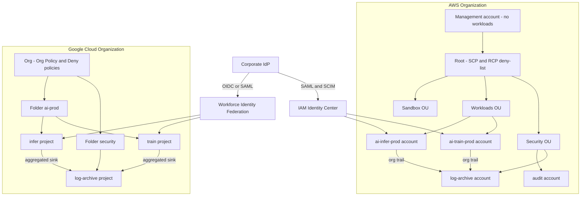

# Multi-Account and Multi-Project Landing Zones

## TL;DR

1. The account (AWS) or project (GCP) is the unit that bundles four boundaries: IAM trust, service quota and API throttle, billing, and failure containment. Tags, VPCs and namespaces give you none of the four.
2. Guardrails are intersections you cannot widen from below. AWS SCPs and RCPs only subtract permissions along the root-to-account path, and they never apply to the management account. GCP IAM allow policies inherit additively down the tree, so a folder-level grant quietly dissolves project isolation unless deny policies or principal access boundaries restrain it.
3. Audit logs are only worth having if they land in an account or project that workload administrators cannot touch. The failure to design against is silent non-delivery (a KMS policy edit, a bucket policy drift, a revoked sink writer), not a log you can see being deleted.
4. Quotas and throttles are partitioned per account or project, so accounts are also your capacity and noisy-neighbor cells. This helps contain blast radius and hurts GPU capacity pooling, because every cell needs its own quota, reservation and platform baseline.
5. Organization-level control planes (Organizations, Identity Center, Org Policy, Service Control) are shared global dependencies. Keep them off the runtime request path, stage every guardrail change through a canary OU or folder, and keep a break-glass path that does not depend on the identity source.

## Mental Model



A landing zone is a policy tree plus a set of small, disposable blast-radius cells.
The tree carries guardrails downward.
Logs flow upward and sideways into a cell that nobody in the workload tree can write to except the logging service itself.
Identity enters from one external source and is translated into per-cell short-lived credentials.
Each leaf account or project has its own IAM namespace, its own quota and throttle buckets, and its own bill.
A mistake, a compromise or a runaway GPU job is therefore bounded by the cell, as long as no grant, shared role or shared key crosses the cell wall.
The cost of the design is a platform tax paid once per cell and an operational dependency on the organization-level control planes.

## Internals

### What an account or project actually isolates

An AWS account is a hard IAM namespace.
Cross-account access requires an allow on both sides: an identity policy in the caller's account and a trust or resource policy in the target.
Nothing is inherited from the organization into the account's IAM, so the only way to lose isolation is to create a trust relationship.
The account is also the scope of most service quotas and of the API throttling token buckets.
The EC2 API documentation describes per-account, per-Region token-bucket throttling (bucket size and refill rate per action category).
The practical consequence is that a runaway control-plane loop in one account drains that account's bucket and not its neighbors'.

A GCP project is also a quota, billing-link and API-enablement boundary.
Its IAM boundary is softer, because IAM allow policies attach at the organization, folder or project and the effective policy is the union of the policies along the ancestry.
A role granted to a group on a folder applies to every project beneath it, including projects created tomorrow.
The AWS account boundary protects you by default.
The GCP project boundary protects you only if folder and organization grants are kept narrow and audited.
This asymmetry is the first thing to reason about when comparing blast radius.

### Policy evaluation along the hierarchy

AWS SCP semantics are an intersection over the path.
The documented rule is that an action is allowed only if an explicit allow exists at every level from the root through each OU to the account, and no level denies it.
Writing A(n) for the set of actions allowed by node n, the SCP effective set for an account is the intersection of A(n) over all nodes n on the path.
Within one node, allows from multiple attached SCPs union together, and any explicit Deny at any node wins.
Three consequences follow.

1. Detaching the default `FullAWSAccess` policy from a node without attaching a replacement allow produces an implicit deny for that whole subtree.
2. An allow-list strategy multiplies document size at every level, which is why almost every production landing zone uses a deny-list at the root and a few narrow allow-lists on sandbox OUs.
3. SCPs affect only member accounts. They have no effect on principals in the management account, and they do not restrict service-linked roles (the second claim is from secondary sources, see the report).

A mechanism worth knowing is the `aws:PrincipalOrgPaths` condition key.
It lets you attach one deny SCP at the root and exempt the platform OU by path inside the policy.
You then spend one attachment slot at the root instead of one per OU, which matters because attachment slots per node are finite.
The root-plus-five-OU-levels-plus-account path has seven nodes.
At 10 SCPs per node and 10,240 characters each (AWS What's New, as of 2026-05), the theoretical ceiling on one account's path is 70 attached documents and 716,800 characters, versus 35 documents and 179,200 characters under the pre-May-2026 limits.
Many wikis and some AWS-hosted knowledge-center pages still quote the old values, so verify in your own organization before you design to a number.

Resource control policies (RCPs, launched late 2024) apply the same inheritance model to resources in member accounts.
They cap what principals, including principals outside your organization, can do against your resources.
SCPs bound what your principals can do. RCPs bound what can be done to your resources. Together they implement a data perimeter with `aws:PrincipalOrgID` and `aws:ResourceOrgID`.
RCPs cover a finite list of services, so check the current list before depending on one.

GCP evaluation is layered differently.
Allow policies union along the ancestry.
Deny policies are evaluated before allow policies and can be attached at the organization, folder or project.
Principal access boundary policies, where available, bound the set of resources a principal may use at all (GA status is UNVERIFIED, see the report).
Organization Policy is separate from IAM.
It constrains resource configuration, not principals.
Boolean constraints are set per node and the effective value for a resource is determined by the nearest node that sets it.
List constraints can merge with the parent via `inheritFromParent`, with denied values taking precedence over allowed values.
Org Policy has a dry-run mode that records would-be violations in audit logs without blocking requests.
I found no native SCP dry-run equivalent in the sources reviewed, so the safe rollout path on AWS is a staged OU plus a historical CloudTrail query, not a simulator.

Neither system is retroactive.
An SCP or an Org Policy constraint blocks future API calls or resource configurations.
Existing noncompliant resources keep running until something touches them.
This is how a "compliant" estate accumulates old public buckets and external IPs underneath a perfect-looking policy tree.
AWS publishes automated-reasoning work on policy analysis (Zelkova, FMCAD 2018), and the same SMT-based reasoning powers tools like IAM Access Analyzer.
Use those analyzers for the already-deployed estate, since the guardrails only cover new calls.

### Control plane to data plane distribution

Organization policies are authored in a control plane and replicated to the authorization data plane of every region.
Treat them as eventually consistent.
IAM itself is documented as eventually consistent, and GCP IAM documents propagation delays that are typically minutes (exact figures UNVERIFIED).
Practical implications:

- A detach-SCP rollback is not an instantaneous undo, so a bad deny has a tail.
- Pipelines should retry with backoff on `AccessDenied` immediately after a grant.
- Never put an Organizations or Org Policy API call on a workload's request path.

The Builders' Library argument for static stability applies directly: data-plane operations should keep working when the control plane is impaired, so landing-zone tooling must not be a runtime dependency (see [[17-Cloud-AI-Engineering/Volume_01_Cloud_Architecture_Principles/Chapter_02_Regions_Zones_and_Static_Stability|Regions, Zones, and Static Stability]] and [[17-Cloud-AI-Engineering/Volume_01_Cloud_Architecture_Principles/Chapter_04_Control_Plane_vs_Data_Plane_Separation|Control Plane vs Data Plane Separation]]).
The AWS Fault Isolation Boundaries whitepaper classifies Organizations and IAM-style services as global-control-plane services with a home region and regional data planes.

### Quota and throttle partitioning as a capacity cell

Because quotas and API throttle buckets are per account or project, an account is a capacity cell in the sense of [[17-Cloud-AI-Engineering/Volume_01_Cloud_Architecture_Principles/Chapter_03_Cell_Based_Architecture_and_Shuffle_Sharding|Cell-Based Architecture and Shuffle Sharding]].
Blast radius for quota exhaustion, throttling storms and credential compromise is 1/N of the fleet if load is spread over N equal cells.
The price is fragmentation.
GPU vCPU quotas, capacity reservations, Bedrock tokens-per-minute and Vertex AI quotas are all assigned per cell.
A cell with spare reserved GPUs cannot lend them to a starved cell without an explicit sharing mechanism (AWS RAM sharing of capacity reservations, GCP shared reservations).
Sizing is therefore a bin-packing problem: choose the smallest N such that each cell's quota request is grantable and stranded capacity stays under your tolerance.
See [[17-Cloud-AI-Engineering/Volume_10_AI_Infrastructure_on_Cloud/Chapter_03_High_Performance_AI_Cluster_Architectures|High-Performance AI Cluster Architectures]] and [[17-Cloud-AI-Engineering/Volume_09_FinOps_and_Cloud_Economics/Chapter_05_GPU_and_TPU_Unit_Economics|GPU and TPU Unit Economics]].

### Account vending as a state machine

Account creation in Organizations is asynchronous.
`CreateAccount` returns a request id, and you poll `DescribeCreateAccountStatus` until it reaches a terminal state.
Creation requests are subject to concurrency limits (a secondary source states five concurrent requests, which I could not verify against AWS docs).
A vending pipeline must therefore be an idempotent, resumable workflow with a durable record per account (requested, created, moved to OU, baselined, handed over), not a loop in a script.
AWS Control Tower orchestrates this: it enrolls accounts by deploying baseline stacks, configures AWS Config recording and CloudTrail, and implements controls as SCPs (preventive), AWS Config rules (detective) and CloudFormation Hooks (proactive).
It also detects drift when someone changes governed resources outside it.
Custom SCPs that block the Control Tower execution role are a classic cause of failed enrollment and repair loops.
Account Factory for Terraform wraps the same vending flow in a Git-driven pipeline (details UNVERIFIED).

Account OU moves are policy changes.
Moving an account between OUs instantly changes its SCP path.
Gate `organizations:MoveAccount` with the same review you give an SCP edit.
GCP is similar: moving a project between folders changes inherited IAM and Org Policy, so protect `resourcemanager.projects.move`.

Destruction semantics differ.
An AWS account closure is not instantly reversible and has rate limits and a post-closure suspended period (UNVERIFIED specifics).
A GCP project deletion has a recovery window, and the project ID is never reusable (UNVERIFIED specifics).
Build deletion protections and a quarantine OU or folder, rather than delete on decommission.

### Central log routing

AWS: an organization trail created in the management account (or a delegated administrator) records management events, and optionally data events, for every member account and delivers to one S3 bucket.
Member accounts see the trail but cannot modify or delete it.
The bucket lives in the log-archive account.
The bucket policy grants the CloudTrail service principal write access scoped by `aws:SourceArn` and the `AWSLogs/<org-id>/` prefix.
If the trail uses SSE-KMS, the key policy must allow `cloudtrail.amazonaws.com` to use the key with the matching encryption context.
Log file validation produces hourly digest files that are SHA-256 hashed and signed, so deletion or modification of delivered files is detectable.
S3 Object Lock in compliance mode makes deletion impossible even for the account root.
The failure mode here is delivery stopping because someone edited the bucket or key policy.
The trail keeps "running", and the status object carries a delivery error that nobody is alarming on.

GCP: the Log Router evaluates each log entry against the sinks on the entry's resource and its ancestors, as long as the aggregated sink was created with `include_children`.
A folder-level aggregated sink therefore captures every current and future project under the folder with no per-project work.
Each sink has a writer identity (a service account) that must be granted a role on the destination (for example `roles/logging.bucketWriter` on a log bucket).
Destinations include log buckets, BigQuery datasets, Cloud Storage buckets and Pub/Sub topics.
Admin Activity audit logs are always on and cannot be disabled, while Data Access audit logs are off by default for most services and must be enabled explicitly.
If the writer identity loses permission, the router cannot deliver and entries are eventually dropped after retries (retry window UNVERIFIED).
Both systems therefore need an out-of-band completeness check, described in the lab sizing and in Question 4.

### Identity federation

Workforce identity: AWS IAM Identity Center takes SAML sign-in and SCIM provisioning from your IdP.
A permission set is rendered into a role in each assigned account (names of the form `AWSReservedSSO_<set>_<suffix>`).
Humans never hold long-lived IAM user keys.
GCP Workforce Identity Federation (or Cloud Identity with SAML) maps IdP identities to `principal://` and `principalSet://` identifiers that you bind in IAM.

Workload identity: CI systems and external workloads exchange an OIDC token for short-lived cloud credentials.
On AWS this is `AssumeRoleWithWebIdentity` against an IAM OIDC provider, with trust conditions on `aud` and `sub`.
On GCP it is Workload Identity Federation through the STS endpoint, with an attribute condition on the provider.
The classic failure is a trust policy that pins the issuer but not the subject, which lets any repository or pipeline in the issuer's tenant assume the role.
The full treatment is in [[17-Cloud-AI-Engineering/Volume_08_Security_Identity_and_the_Data_Perimeter/Chapter_02_Workload_Identity_Federation|Workload Identity Federation]].

Deprovisioning removes a user's ability to mint new sessions.
It does not revoke credentials already minted, which remain valid until the session duration expires.
Your incident-response runbook needs a session-revocation step for each cloud.

### Foundational references

- Brooker et al., "Millions of Tiny Databases" (Physalia), NSDI 2020: cell-structured control planes and blast-radius reasoning, the same logic applied to accounts as cells.
- Backes et al., "Semantic-based Automated Reasoning for AWS Access Policies using SMT", FMCAD 2018: how policy analysis scales without enumerating requests.
- Verma et al., "Large-scale cluster management at Google with Borg", EuroSys 2015, and Burns et al., "Borg, Omega, and Kubernetes", ACM Queue 2016: hierarchical quota and admission as the lineage of per-project quota.
- AWS Builders' Library, "Static stability using Availability Zones", and the AWS Fault Isolation Boundaries whitepaper: global control plane versus regional data plane.

## Numbers to Know

All rows marked UNVERIFIED are recalled from vendor documentation or taken from a secondary source and must be re-checked before you design to them.

| Item | Value | Source |
| --- | --- | --- |
| SCPs attachable per root, OU or account | 10 (was 5) | (AWS What's New, as of 2026-05; re-read 2026-10) |
| Maximum SCP document size | 10,240 characters (was 5,120) | (AWS What's New, as of 2026-05; re-read 2026-10) |
| OU nesting depth under root | 5 levels | (AWS Security Blog, as of 2026-10) |
| SCPs definable per organization | 10,000 | (AWS Security Blog, as of 2026-10) |
| Derived: SCP nodes on one account path | 7 nodes, 70 attachments, 716,800 characters max | Arithmetic from the rows above |
| Organizations handshake expiration | 30 days | (AWS General Reference, as of 2026-10) |
| Enable-all-features request expiration | 90 days | (AWS General Reference, as of 2026-10) |
| Account quota visibility in Service Quotas | Available, announced 2026-08 | (AWS What's New, as of 2026-08) |
| RCPs per node and RCP size | 5 and 5,120 characters | UNVERIFIED - secondary source (towardsthecloud.com, 2026) |
| OUs per organization | 2,000 | UNVERIFIED - secondary source (towardsthecloud.com, 2026) |
| Default maximum accounts, adjustable ceiling | 10 default; 50,000 stated ceiling | UNVERIFIED - secondary source (towardsthecloud.com, 2026) |
| Concurrent account creation | 5 | UNVERIFIED - secondary source (towardsthecloud.com, 2026) |
| GCP folder nesting depth | 10 | UNVERIFIED - recalled from Google Cloud docs |
| GCP project deletion recovery window | 30 days | UNVERIFIED - recalled from Google Cloud docs |
| Cloud Logging `_Required` / `_Default` retention | 400 days / 30 days | UNVERIFIED - recalled from Google Cloud docs |
| Cloud Logging ingestion list price | 0.50 USD per GiB after free allotment | UNVERIFIED - recalled, check pricing page |
| S3 Standard list price, us-east-1 first tier | 0.023 USD per GB-month | UNVERIFIED - recalled, check pricing page |
| IAM Identity Center max permission-set session | 12 hours | UNVERIFIED - recalled from AWS docs |

The pricing rows are only used to scale the lab estimate below.
Do not quote them in a design review without re-reading the pricing pages.

## AWS vs GCP Mechanism Parity

| Dimension | AWS | GCP |
| --- | --- | --- |
| Hierarchy | Organization root, OUs (5 levels), accounts | Organization, folders, projects |
| Isolation unit | Account: hard IAM namespace, quota, throttle, billing | Project: quota, billing link, API enablement; IAM is inherited |
| Permission guardrail | SCP (intersection, deny-list or allow-list), RCP for resources | IAM Deny policies, principal access boundaries (GA status UNVERIFIED), Org Policy for resource config |
| Inheritance direction | Can only subtract from account IAM | Allow policies add downward; deny and Org Policy subtract |
| Management-level exemption | SCPs do not apply to the management account | Org admins are governed by IAM like anyone else, so protect those roles with deny policies |
| Dry-run of guardrails | None found in reviewed sources; use staged OU and CloudTrail analysis | Org Policy dry-run mode records violations in audit logs |
| Retroactivity | Not retroactive | Not retroactive |
| Landing-zone product | Control Tower with Account Factory (AFT for Terraform) | Architecture Center landing-zone guidance and open-source Terraform blueprints; no Control Tower equivalent verified |
| Central audit logs | Organization trail to log-archive S3, digest validation, Object Lock | Aggregated folder or org sink to log bucket, BigQuery, GCS or Pub/Sub |
| Sink identity | CloudTrail service principal with `aws:SourceArn` scoping | Sink writer identity needs a role on the destination |
| Workforce federation | IAM Identity Center, permission sets, SCIM | Workforce Identity Federation or Cloud Identity |
| Workload federation | IAM OIDC provider, `AssumeRoleWithWebIdentity` | Workload Identity Federation via STS |
| Network sharing | RAM subnet sharing, Transit Gateway | Shared VPC host and service projects |
| Deletion semantics | Account closure with post-closure suspension (details UNVERIFIED) | Project deletion with recovery window (details UNVERIFIED) |
| Org-scale control plane risk | Organizations and IAM have global control planes with a home region | Service Control, IAM and Org Policy metadata are global |

Related chapters: [[17-Cloud-AI-Engineering/Volume_02_AWS_Deep_Dive/Chapter_01_IAM_Policy_Evaluation_Engine|IAM Policy Evaluation Engine]], [[17-Cloud-AI-Engineering/Volume_02_AWS_Deep_Dive/Chapter_02_AWS_Organizations_and_Account_Governance|AWS Organizations and Account Governance]], [[17-Cloud-AI-Engineering/Volume_03_GCP_Deep_Dive/Chapter_01_Resource_Hierarchy_and_Organization_Policies|Resource Hierarchy and Organization Policies]], [[17-Cloud-AI-Engineering/Volume_03_GCP_Deep_Dive/Chapter_02_Cloud_IAM_Roles_Policies_and_Conditions|Cloud IAM]] and [[17-Cloud-AI-Engineering/Volume_04_AWS_vs_GCP_Translation/Chapter_03_Identity_Security_and_Governance_Translation|Identity, Security, and Governance Translation]].

## Worked Example: Guardrails, Central Audit Sink, and Sizing

The lab has three parts.
Part A is an OpenTofu module for a sandbox OU, a deny-list SCP and one AI sandbox account in a sandbox AWS organization.
Part B is an OpenTofu module for a GCP folder, two projects, Org Policy, a folder-level aggregated audit sink into a locked-down log project, and a budget.
Part C is a Python sizing model and an SCP headroom auditor.

Run Part A only in a throwaway organization.
Do not run it against a production management account.

### Cost estimate and budget

- AWS Organizations, OUs and SCPs have no charge. The account itself costs nothing until you create resources in it. The lab creates none in the account, so the expected AWS spend is 0 USD. The budget below is a tripwire in case you add resources.
- GCP: folder, projects and Org Policy have no charge. The sink routes only audit logs from two near-idle projects. At a few MiB per month the log volume is far below any free allotment, so the expected spend is under 1 USD per month (pricing UNVERIFIED, see Numbers to Know).
- Budgets are set at 50 USD per month per cloud with notifications at 80 percent of actual spend and 100 percent of forecast spend on GCP.

### Part A: AWS (OpenTofu)

```hcl
# aws_landing.tf - run in the management account of a SANDBOX organization
terraform {
  required_version = ">= 1.6"
  required_providers {
    aws = { source = "hashicorp/aws", version = ">= 5.60" }
  }
}

variable "region"          { default = "us-east-1" }
variable "allowed_regions" { default = ["us-east-1", "us-west-2"] }
variable "account_email"   { type = string } # must be globally unique, e.g. you+ai-sbx@example.com
variable "budget_email"    { type = string }

provider "aws" { region = var.region }

data "aws_organizations_organization" "this" {}

resource "aws_organizations_organizational_unit" "sandbox" {
  name      = "ai-sandbox"
  parent_id = data.aws_organizations_organization.this.roots[0].id
}

# NotAction skips global services. If you use Bedrock cross-Region inference,
# the allowed list must also include every destination Region of the profile.
data "aws_iam_policy_document" "guardrails" {
  statement {
    sid     = "DenyOutsideApprovedRegions"
    effect  = "Deny"
    not_actions = [
      "iam:*", "organizations:*", "sts:*", "support:*", "budgets:*",
      "account:*", "ce:*", "sso:*", "route53:*", "cloudfront:*"
    ]
    resources = ["*"]
    condition {
      test     = "StringNotEquals"
      variable = "aws:RequestedRegion"
      values   = var.allowed_regions
    }
  }
  statement {
    sid       = "DenyLeaveOrg"
    effect    = "Deny"
    actions   = ["organizations:LeaveOrganization"]
    resources = ["*"]
  }
  statement {
    sid    = "DenyTamperWithAuditPlane"
    effect = "Deny"
    actions = [
      "cloudtrail:StopLogging", "cloudtrail:DeleteTrail",
      "config:StopConfigurationRecorder", "config:DeleteConfigurationRecorder",
      "guardduty:DeleteDetector"
    ]
    resources = ["*"]
  }
}

resource "aws_organizations_policy" "guardrails" {
  name    = "ai-sandbox-guardrails"
  type    = "SERVICE_CONTROL_POLICY"
  content = data.aws_iam_policy_document.guardrails.json
}

resource "aws_organizations_policy_attachment" "sandbox" {
  policy_id = aws_organizations_policy.guardrails.id
  target_id = aws_organizations_organizational_unit.sandbox.id
}

resource "aws_organizations_account" "ai_sandbox" {
  name                       = "ai-sandbox-01"
  email                      = var.account_email
  parent_id                  = aws_organizations_organizational_unit.sandbox.id
  role_name                  = "OrganizationAccountAccessRole"
  close_on_deletion          = true
  iam_user_access_to_billing = "DENY"
}

resource "aws_budgets_budget" "sandbox" {
  name         = "ai-sandbox-monthly"
  budget_type  = "COST"
  limit_amount = "50"
  limit_unit   = "USD"
  time_unit    = "MONTHLY"
  cost_filter {
    name   = "LinkedAccount"
    values = [aws_organizations_account.ai_sandbox.id]
  }
  notification {
    comparison_operator        = "GREATER_THAN"
    threshold                  = 80
    threshold_type             = "PERCENTAGE"
    notification_type          = "ACTUAL"
    subscriber_email_addresses = [var.budget_email]
  }
}

output "sandbox_account_id" { value = aws_organizations_account.ai_sandbox.id }
```

### Part B: GCP (OpenTofu)

```hcl
# gcp_landing.tf
terraform {
  required_version = ">= 1.6"
  required_providers {
    google = { source = "hashicorp/google", version = ">= 6.0" }
    random = { source = "hashicorp/random", version = ">= 3.5" }
  }
}

variable "org_id"          { type = string }
variable "billing_account" { type = string }
variable "region"          { default = "us-central1" }

provider "google" { region = var.region }

resource "random_id" "sfx" { byte_length = 3 }

resource "google_folder" "ai" {
  display_name = "ai-platform-lab"
  parent       = "organizations/${var.org_id}"
}

resource "google_project" "log" {
  name            = "ai-log-archive"
  project_id      = "ai-logs-${random_id.sfx.hex}"
  folder_id       = google_folder.ai.folder_id
  billing_account = var.billing_account
  deletion_policy = "DELETE"
}

resource "google_project" "sandbox" {
  name            = "ai-sandbox"
  project_id      = "ai-sbx-${random_id.sfx.hex}"
  folder_id       = google_folder.ai.folder_id
  billing_account = var.billing_account
  deletion_policy = "DELETE"
}

resource "google_project_service" "logging" {
  project = google_project.log.project_id
  service = "logging.googleapis.com"
}

resource "google_logging_project_bucket_config" "audit" {
  project        = google_project.log.project_id
  location       = var.region
  bucket_id      = "org-audit"
  retention_days = 30
  depends_on     = [google_project_service.logging]
}

resource "google_logging_folder_sink" "audit" {
  name             = "ai-folder-audit"
  folder           = google_folder.ai.name
  include_children = true
  filter           = "logName:\"cloudaudit.googleapis.com\""
  destination      = "logging.googleapis.com/projects/${google_project.log.project_id}/locations/${var.region}/buckets/${google_logging_project_bucket_config.audit.bucket_id}"
}

resource "google_project_iam_member" "sink_writer" {
  project = google_project.log.project_id
  role    = "roles/logging.bucketWriter"
  member  = google_logging_folder_sink.audit.writer_identity
}

resource "google_org_policy_policy" "no_sa_keys" {
  name   = "${google_folder.ai.name}/policies/iam.disableServiceAccountKeyCreation"
  parent = google_folder.ai.name
  spec { rules { enforce = "TRUE" } }
}

# Dry-run first: violations are recorded but not blocked.
resource "google_org_policy_policy" "locations" {
  name   = "${google_folder.ai.name}/policies/gcp.resourceLocations"
  parent = google_folder.ai.name
  dry_run_spec {
    rules { values { allowed_values = ["in:us-locations"] } }
  }
}

resource "google_billing_budget" "ai" {
  billing_account = var.billing_account
  display_name    = "ai-platform-lab-monthly"
  budget_filter {
    projects = [
      "projects/${google_project.sandbox.number}",
      "projects/${google_project.log.number}",
    ]
  }
  amount {
    specified_amount {
      currency_code = "USD"
      units         = "50"
    }
  }
  threshold_rules { threshold_percent = 0.8 }
  threshold_rules {
    threshold_percent = 1.0
    spend_basis       = "FORECASTED_SPEND"
  }
}
```

Default budget notifications go to billing administrators.
Add a Pub/Sub or monitoring-channel `all_updates_rule` if you want routing to a team channel.

### Part C: Sizing model and SCP headroom auditor

```python
# size.py - landing zone sizing model. All inputs are assumptions: replace with measured values.
import math
GIB = 1024 ** 3

def scp_headroom(depth_ou=5, per_node=10, size_chars=10_240):
    nodes = 1 + depth_ou + 1  # root + OU levels + account
    return nodes, nodes * per_node, nodes * per_node * size_chars

def log_model(accounts, events_per_acct_day, bytes_per_event, retention_days,
              hot_price_gib_month, ingest_price_gib, compression=1.0):
    daily = accounts * events_per_acct_day * bytes_per_event / compression
    monthly_gib = daily * 30 / GIB
    stored_gib = daily * retention_days / GIB
    return {
        "daily_gib": daily / GIB,
        "monthly_ingest_gib": monthly_gib,
        "stored_gib": stored_gib,
        "storage_usd_month": stored_gib * hot_price_gib_month,
        "ingest_usd_month": monthly_gib * ingest_price_gib,
    }

if __name__ == "__main__":
    n, c, b = scp_headroom()
    print(f"SCP path: nodes={n} max_attached={c} max_chars={b:,}")
    aws = log_model(300, 100_000, 1024, 400, 0.023, 0.0, compression=8.0)
    print("AWS CloudTrail S3:", {k: round(v, 2) for k, v in aws.items()})
    gcp = log_model(200, 50_000, 1536, 400, 0.01, 0.50)
    print("GCP Cloud Logging:", {k: round(v, 2) for k, v in gcp.items()})
    nodes = 4096 // 8
    vcpu = nodes * 192
    print("GPU vCPU needed:", vcpu, "cells at 12,288 vCPU quota:", math.ceil(vcpu / 12_288))
    for k in (1, 4, 16, 64):
        print(f"cells={k:3d} worst-case fleet loss={100.0 / k:5.1f}%")
```

```python
# scp_audit.py - read-only. Reports SCP attachment count and size per node on every account path.
import boto3

org = boto3.client("organizations")
MAX_ATTACH, MAX_CHARS = 10, 10_240   # re-check against current quotas

def scps(target):
    out, tok = [], None
    while True:
        kw = {"TargetId": target, "Filter": "SERVICE_CONTROL_POLICY"}
        if tok:
            kw["NextToken"] = tok
        r = org.list_policies_for_target(**kw)
        out += r["Policies"]
        tok = r.get("NextToken")
        if not tok:
            return out

cache = {}
def node_stats(node):
    if node not in cache:
        pols = scps(node)
        chars = [len(org.describe_policy(PolicyId=p["Id"])["Policy"]["Content"]) for p in pols]
        cache[node] = (len(pols), max(chars, default=0))
    return cache[node]

paginator = org.get_paginator("list_accounts")
for page in paginator.paginate():
    for acct in page["Accounts"]:
        node, path = acct["Id"], []
        while True:
            path.append(node)
            parents = org.list_parents(ChildId=node)["Parents"]
            if parents[0]["Type"] == "ROOT":
                path.append(parents[0]["Id"])
                break
            node = parents[0]["Id"]
        for n in path:
            cnt, biggest = node_stats(n)
            if cnt >= MAX_ATTACH - 2 or biggest >= int(MAX_CHARS * 0.8):
                print(f"WARN account={acct['Id']} node={n} attached={cnt} largest_chars={biggest}")
```

Organizations read APIs are rate limited, so the auditor caches per node.
Run it on a schedule and alarm on its output, not ad hoc.

### Back-of-the-envelope

1. SCP budget: seven nodes on the deepest path, 10 attachments each, gives 70 documents and 716,800 characters. Using a deny-list at the root and `aws:PrincipalOrgPaths` exemptions means a typical path uses 2 to 4 attachments, which leaves headroom.
2. Audit volume (assumptions): 300 AWS accounts, 100,000 events per account per day, 1 KiB of raw JSON per event, 8x compression. That is about 3.6 GiB per day, about 107 GiB per month and about 1.4 TiB at 400 days of retention. At the S3 Standard list price above that is about 33 USD per month for storage.
3. GCP audit volume (assumptions): 200 projects, 50,000 entries per day, 1.5 KiB per entry. That is about 14 GiB per day and 5.6 TiB stored at 400 days. If every byte were charged at the ingestion list price above it would be about 215 USD per month for ingestion alone, an upper bound because some audit categories are free to ingest (UNVERIFIED). The lever is to route the archive copy to Cloud Storage and keep only a short hot window in a log bucket.
4. GPU cells: 4,096 GPUs at 8 per node is 512 nodes. At 192 vCPUs per node (an assumption, instance-type dependent) that is 98,304 vCPUs. If you can obtain 12,288 vCPUs of quota per account (an assumption), you need at least 8 cells. Going from 1 cell to 8 cuts worst-case loss on one compromised or throttled account from 100 percent to 12.5 percent.

### Teardown

```bash
# GCP: removes folder, projects, sink, org policies, budget
tofu -chdir=gcp destroy -var org_id=ORG_ID -var billing_account=BILLING_ID

# AWS: closes the sandbox account (close_on_deletion), removes SCP attachment, SCP and OU
tofu -chdir=aws destroy -var account_email=you+ai-sbx@example.com -var budget_email=you@example.com
```

Closing an AWS member account is not an instant delete.
Verify its state with `aws organizations describe-account --account-id ACCOUNT_ID` and expect a suspended state.
The closed account keeps counting toward organization limits for a period (UNVERIFIED), so do not run this lab in a loop.

## Failure Modes and Pitfalls

1. **Root-level deny locks out the fixer.** An SCP at the root that denies the role your pipeline uses cannot be corrected by that pipeline. Only the management account is exempt from SCPs, so that account is your recovery path. Keep a break-glass role there, protected by hardware MFA and a documented procedure, and carve your recovery roles out of deny SCPs with `aws:PrincipalArn` or `aws:PrincipalOrgPaths` conditions.
2. **Stale limit folklore.** The SCP quotas doubled in 2026-05 (AWS What's New), but older blog posts and a knowledge-center page still quote 5 and 5,120. Teams either contort policies to fit limits that no longer exist or, worse, trust a pre-2026 audit that says they are at the limit. Control Tower-generated SCPs consume the same per-node attachment budget, so count them.
3. **Silent log-delivery failure.** An edited KMS key policy, a bucket policy rewritten by an IaC tool, or a revoked GCP sink writer role stops delivery without any workload impact. The first sign is an incident where the logs are missing. Alarm on the absence of data: per-account expected-volume floors, a canary event emitted from each account on a schedule, and the trail's latest-delivery-error status.
4. **Regional deny breaks AI services.** A region-allow-list SCP that omits the destination Regions of a Bedrock cross-Region inference profile, or global endpoints you forgot to exempt in `NotAction`, produces confusing `AccessDenied` failures at inference time (exact behavior UNVERIFIED, test in a canary OU).
5. **GCP folder grants dissolve project isolation.** A "temporary" `roles/editor` for a group at folder level applies to every present and future project. Audit with Cloud Asset Inventory IAM queries, prefer project-scoped grants, and back them with deny policies for the few permissions that must never be exercised broadly.
6. **Guardrails are not retroactive.** Org Policy and SCPs do not remediate resources that predate them. Pair them with detective scanning for existing public buckets, external IPs and long-lived keys.
7. **Quota stranding.** With 64 cells, 64 quota requests and 64 reservations need to be granted and kept busy. A cell with idle reserved GPUs cannot serve a neighbor's spike unless you share the reservation across accounts or projects. Track utilization per cell and re-balance quarterly.
8. **Vending thundering herd.** A team launching 40 environments at once hits Organizations concurrency limits and baseline-stack throughput. Make vending queue-based and idempotent, and apply admission control (see [[17-Cloud-AI-Engineering/Volume_07_Reliability_and_SRE/Chapter_02_Load_Shedding_Backpressure_and_Admission_Control|Load Shedding, Backpressure, and Admission Control]]).
9. **Identity-source outage and lingering sessions.** If the IdP is down, humans cannot sign in. If you deprovision a user, existing role sessions persist until expiry. Keep per-account break-glass roles and a session-revocation runbook.
10. **Workload-identity trust too broad.** An OIDC trust that pins the issuer but not the `sub` claim allows any workflow in the issuer to assume the role. Always pin `aud` and `sub`, or the GCP attribute condition, to a specific repository and branch or environment.
11. **Operator-command blast radius.** The AWS S3 us-east-1 incident of 2017-02-28 (AWS post-event summary, https://aws.amazon.com/message/41926/) was started by a routine debugging command whose input removed more capacity than intended. AWS responded by limiting how fast and how much capacity tooling can remove. The landing-zone analogue is a Terraform change that attaches an SCP at the root, closes an account, or deletes a folder. Cap the number of targets any single pipeline run may change, and require approval above the cap.
12. **Global control data as a shared fate.** Google Cloud's incident of 2025-06-12 was attributed to a malformed policy-metadata record that was replicated globally and crashed the Service Control binaries worldwide (from memory of the public incident report, details UNVERIFIED). The lesson for landing zones is that Org Policy, quota and IAM metadata are globally replicated control data. Change them gradually, and do not assume that regional workload isolation protects you from a bad global configuration push.
13. **Regional control-plane cascade.** The AWS us-east-1 event of 2025-10-19 and 2025-10-20 began with a DNS automation fault affecting DynamoDB and cascaded into other services (details UNVERIFIED). Landing-zone operators felt it as degraded consoles, failing sign-ins and stalled pipelines. Your recovery tooling must work with us-east-1 impaired.
14. **Tenant-level deletion.** In May 2024 UniSuper's Google Cloud VMware Engine private cloud was deleted by a provisioning error on the provider side and was restored from backups held outside that environment (details UNVERIFIED). The blast radius of a single cloud tenant is a real failure domain. Keep an independent, immutable backup copy outside the org, ideally in another provider or at least another organization.

## Security and Cost Angles

### IAM and administration scoping

- Keep the management account and the GCP organization admin set free of workloads. Use delegated administrator accounts or projects for GuardDuty, Security Hub, IAM Access Analyzer, CloudTrail and Security Command Center so day-to-day security work never needs management-account credentials.
- Remove standing root credentials from member accounts and use centralized root access management where available (UNVERIFIED, see report).
- Grant humans permission sets scoped to job functions, assigned to groups, not to individuals. Grant CI roles only on the accounts or projects they deploy to.
- Pin all IaC pipeline roles to a named OU or folder subtree, and deny organization-level mutations (`organizations:*` write actions, `resourcemanager.*` moves) to every principal except the platform pipeline.

### Encryption key hierarchy

- The CloudTrail bucket is encrypted with a customer-managed KMS key in the log-archive account. Its key policy names the CloudTrail service principal with the encryption-context condition, and the key administrators are a separate role from key users.
- On GCP, put CMEK keys for log buckets in a dedicated key project with separate admin and use roles. Org Policy can require CMEK for supported services (the constraint set is UNVERIFIED).
- Both clouds use envelope encryption (a data key per object or per block, wrapped by the KMS key), so revoking the KMS key makes the archive unreadable. That is why key deletion needs the same protection as log deletion: a long deletion window, an SCP or deny policy on key scheduling, and alerts. See [[17-Cloud-AI-Engineering/Volume_08_Security_Identity_and_the_Data_Perimeter/Chapter_04_Encryption_Key_Hierarchies_and_Envelope_Encryption|Encryption Key Hierarchies and Envelope Encryption]].

### Private boundaries

- AWS data perimeter: SCP conditions on `aws:PrincipalOrgID` for what your principals can reach, RCPs on `aws:ResourceOrgID` and `aws:PrincipalOrgID` for who can reach your resources, and VPC endpoint policies as the network-level enforcement.
- GCP: VPC Service Controls perimeters contain projects and restrict API access paths, and are the closest analogue. See [[17-Cloud-AI-Engineering/Volume_03_GCP_Deep_Dive/Chapter_03_VPC_Service_Controls_Security_Perimeters|VPC Service Controls]] and [[17-Cloud-AI-Engineering/Volume_08_Security_Identity_and_the_Data_Perimeter/Chapter_06_Constructing_an_Impenetrable_Data_Perimeter|Constructing an Impenetrable Data Perimeter]].
- Audit retention and non-repudiation evidence are covered in [[17-Cloud-AI-Engineering/Volume_08_Security_Identity_and_the_Data_Perimeter/Chapter_07_Compliance_Auditing_and_Non_Repudiation|Compliance, Auditing, and Non-Repudiation]].

### Unit economics

- **Platform tax per cell.** Each cell carries a recurring baseline: configuration recording, threat detection, NAT or Cloud NAT, interface endpoints or Private Service Connect endpoints, and log ingestion. Many of these are hourly charges that scale with cell count. Model it as `tax = N * (baseline per cell)` and compare against the value of blast-radius reduction. Do not make an account per developer unless the baseline is automated and cheap.
- **Budget actions.** Per-account AWS Budgets can attach an SCP or IAM policy automatically on threshold breach (UNVERIFIED, check current budget action types), which converts a cost overrun into a hard stop for sandbox OUs. On GCP, budgets can publish to Pub/Sub so a function can detach billing from a sandbox project.
- **Log volume.** Move the archive copy to the cheapest durable tier, keep a short hot window for investigation, and exclude high-volume, low-value data-plane events from the hot path. Reconsider data events on object stores for training datasets, which can dominate volume.
- **GPU idle cost.** Per-cell reservations are the largest line item. Track reserved-but-idle GPU hours per cell and share reservations across cells in the same OU or folder.
- **Cross-cell data transfer.** Cells that exchange data across accounts or Regions pay transfer charges (see [[17-Cloud-AI-Engineering/Volume_09_FinOps_and_Cloud_Economics/Chapter_04_Network_Egress_Economics_and_Optimization|Network Egress Economics and Optimization]]). Allocation by account or project is the cheapest cost-attribution model there is (see [[17-Cloud-AI-Engineering/Volume_09_FinOps_and_Cloud_Economics/Chapter_01_Cloud_Billing_Models_and_Unit_Cost_Allocation|Cloud Billing Models and Unit Cost Allocation]]).

## Interview Questions and Model Answers

### Question 1 (L5 - Senior)

A teammate proposes one AWS account per environment with tag-based IAM conditions to separate teams. You propose account-per-workload. Defend the position and state the cost.

#### Model Answer

Tags are metadata under the control of whoever can call `TagResource`.
Unless you also lock tagging down with SCPs and tag policies, a tag-based ABAC boundary is only as strong as the weakest principal with tagging permission.
An account is the one boundary that is not inherited and not forgeable: cross-account access needs an explicit allow on both sides.
The account also partitions service quotas and API throttle buckets, so one team's runaway control-plane loop or GPU request cannot consume another team's capacity.
It partitions billing, so cost attribution is exact without tagging discipline.
And it partitions failure and compromise: a stolen credential reaches one account's resources, not the environment.
The costs are a per-account baseline (recording, threat detection, NAT, endpoints, logging), a vending pipeline, cross-account networking and sharing complexity, and fragmented capacity such as GPU reservations.
I would start with account-per-workload-per-environment, automate vending so the marginal cell costs near zero in human time, and keep ABAC for within-account separation where the boundary does not need to be a hard one.

#### Follow-up Interviewer Question

What is the smallest number of accounts you would accept for a three-team, two-environment product, and what would push you to split further?

### Question 2 (L5 - Senior)

An engineer with AdministratorAccess in a member account gets AccessDenied on `ec2:RunInstances` in eu-west-1. Walk through why, and where the management account differs.

#### Model Answer

The effective permission is the intersection of what IAM grants and what every SCP level along the path allows.
AdministratorAccess grants everything in the identity policy, but the SCP stack can still deny.
I would check explicit denies first, such as a region-restriction SCP using `aws:RequestedRegion` that excludes eu-west-1, and then check for a missing allow at some level, for example a detached `FullAWSAccess` with no replacement on an OU.
Permission boundaries and session policies are further intersections, so check those as well, along with any resource control policy on the resources involved.
CloudTrail records the denied call, and the error message names whether the denial was due to an SCP.
The management account is different because SCPs do not apply to its principals.
That makes it the break-glass recovery point and the reason it must contain no workloads and few humans.

#### Follow-up Interviewer Question

You find the denying SCP is attached at the root and is written correctly for its intent. How do you grant one team an exception without attaching a new SCP per OU?

### Question 3 (L6 - Staff)

You must roll out a new deny SCP at the root of a 400-account organization. There is no dry-run mode. Describe the rollout.

#### Model Answer

The failure we are guarding against is a fleet-wide outage caused by a policy that denies something legitimate workloads depend on, including paths we do not know about such as service principals acting on our behalf.
First, quantify impact from evidence.
I would query CloudTrail (through Athena or a lake) over at least a full business and release cycle for the exact actions and condition values the SCP would deny, grouped by account, principal and `userAgent`, and include rare periodic jobs such as quarterly batch or disaster-recovery drills.
Second, write the policy with an exemption path via `aws:PrincipalOrgPaths` for the platform OU and the recovery roles, so I can attach once at the root and still exclude the places where the fixer lives.
Third, stage: attach to a sandbox OU for a week, then a low-risk workload OU, then a canary subset of production, using the same policy document and the same attachment mechanism throughout.
Rolling out through Organizations means each stage is an attach, and rollback is a detach.
Because policy distribution is eventually consistent, I assume the rollback has a tail and I keep the previous version available.
Fourth, make the change bounded: the pipeline refuses to change more than a fixed number of targets per run and requires a second approver for the root.
Fifth, watch for denied calls from the new `Sid` across the fleet in near-real time, with an automatic page and a pre-approved rollback.
Finally, I record the change as a policy event and re-run the headroom auditor, because every new root SCP spends attachment and character budget on every path in the tree.

#### Follow-up Interviewer Question

The SCP denies `kms:ScheduleKeyDeletion`. Three weeks later a Control Tower enrollment fails with an access error. How do you find out whether the SCP caused it, and how do you fix it without weakening the guardrail?

### Question 4 (L6 - Staff)

Design tamper-resistant, complete audit logging for 300 AWS accounts and 200 GCP projects. How do you prove completeness?

#### Model Answer

Separate the data plane from the people.
On AWS, an organization trail delivers to an S3 bucket in a log-archive account that has no workloads and no human write access.
The bucket uses a KMS key owned by that account, Object Lock in compliance mode, versioning, and a policy that allows only the CloudTrail service principal with `aws:SourceArn` scoped to the organization trail and the `AWSLogs/<org-id>/` prefix.
SCPs deny `cloudtrail:StopLogging` and `DeleteTrail` and block the log-archive account from being the target of `LeaveOrganization` or account moves.
On GCP, a folder or organization aggregated sink with `include_children` routes audit logs into a log bucket in a dedicated project, with a short hot retention and a second sink to Cloud Storage with a retention policy and bucket lock for the archive.
Data Access audit logs are off by default, so enable them intentionally per service, and budget the volume.
Completeness is the hard part, because both failure modes are silent.
I use three independent checks.
First, a synthetic canary: every account and project emits a known, rate-limited event on a schedule, and a detector in the audit account alerts when any cell's canary is missing for more than a threshold.
Second, volume baselines: per-cell expected event counts with seasonal bands, so a cell that drops to zero or falls by an order of magnitude pages us.
Third, cryptographic and configuration checks: CloudTrail digest validation on a schedule, and drift detection on the sink, the writer-identity grants, the bucket policy and the key policy.
For a cell created yesterday, the canary proves the sink covers it without anyone configuring it, which is the property aggregated sinks and organization trails are supposed to give.
The residual risks are the logging service itself being down, which I accept and document, and events that happen before the first canary, which I cover by having the vending pipeline emit a baseline event.

#### Follow-up Interviewer Question

A regulator asks you to demonstrate that no log in the last 90 days was modified or deleted by an administrator. What evidence do you produce, and where is it weakest?

### Question 5 (L6 - Staff)

A group is granted `roles/editor` at a GCP folder, and a service account in a project beneath it is compromised. Compare the blast radius with the equivalent AWS scenario and describe how you would contain it.

#### Model Answer

In GCP the allow policy attached at the folder is inherited by every project under it, so the compromised identity (or the group member who is compromised) can reach every project in the folder, including ones created later, until something subtracts that access.
An AWS equivalent would be a role in one account, and reaching other accounts would require a trust policy someone deliberately wrote, so the default blast radius is one account.
The GCP default is wider because inheritance is additive, not because projects are less isolated in principle.
Containment is in layers.
Immediate: remove the grant at the folder, disable the service account and revoke its keys, and rotate anything it could read.
Structural: stop granting primitive roles at folders, scope grants to projects or to custom roles, and use deny policies on the dangerous permissions (for example IAM policy mutation and service account key creation) at the organization or folder so even a broad allow cannot exercise them.
Boundary: principal access boundary policies, if available in your edition, limit which resources a principal can ever touch regardless of grants.
Preventive: the `iam.disableServiceAccountKeyCreation` Org Policy removes the most common credential-theft path, and Workload Identity Federation replaces long-lived keys.
Detective: Cloud Asset Inventory IAM search to find every inherited grant, and an alert for IAM changes at folder and organization scope.
The takeaway for the architecture review is that on GCP the folder is a trust boundary, so treat grants there with the same rigor as an AWS trust policy.

#### Follow-up Interviewer Question

Your security team wants to adopt principal access boundaries across the org. What data do you gather first so the policy does not break production, and how do you phase it?

### Question 6 (L7+ - Principal)

Design the landing zone for a multi-tenant AI platform: training clusters, inference fleets, shared feature and data lakes, and 1,500 enterprise tenants who may bring their own models. Decide the cell boundary and defend it.

#### Model Answer

I start from the failure and constraint list, not the tooling.
The risks are cross-tenant data exposure, a noisy tenant exhausting throughput or GPU quota, a compromised training job reaching production inference or data, and a bad guardrail change taking out everything.
The constraints are GPU capacity and quota granted per account or project, Bedrock and Vertex AI quotas assigned per account or project and Region, organization limits on account count and vending throughput, and a platform tax per cell.
I would use three tiers of cell.
Tier 1 is the platform: separate accounts and projects for log archive, audit, network hub, key management, shared data lake, model registry and CI.
These are small in number, locked down, and not tenant-facing.
Tier 2 is the workload cells by function and environment, such as training-prod, inference-prod, eval, and sandbox, each in its own OU or folder with its own guardrail set.
Training and inference are separate cells because their trust levels, quota families and failure behavior differ, and a training job should not have network or IAM paths into serving.
Tier 3 is tenant isolation, and here I do not default to account-per-tenant for 1,500 tenants.
Instead, I use account-per-tenant only for the tenants who contract for it, such as regulated or high-value customers, and for the rest I shuffle-shard tenants onto a pool of shared inference cells so that a noisy or malicious tenant touches a small, bounded subset of cells and any two tenants rarely share the same set.
The combinatorics are in [[17-Cloud-AI-Engineering/Volume_01_Cloud_Architecture_Principles/Chapter_03_Cell_Based_Architecture_and_Shuffle_Sharding|Cell-Based Architecture and Shuffle Sharding]].
Capacity: GPU reservations are made per cell and shared within an OU or folder using AWS RAM or GCP shared reservations, so idle capacity in one cell can serve its siblings without crossing the trust boundary between training and serving.
For managed model APIs, I would treat the per-account token quota as the cell's budget, route through an inference gateway that owns admission control and per-tenant rate limits, and use cross-Region inference only where the regional allow-list SCP and the data-residency policy have been aligned.
Guardrails are layered in the OU tree: a root deny-list for audit tampering, leaving the organization, and unapproved Regions; an OU-level perimeter via RCP and VPC Service Controls; and a sandbox OU with budget actions.
Vending is a durable workflow with rate limits that is idempotent per account, with quotas pre-requested by the pipeline for known cell types.
Operationally, the platform control plane must not be on the serving path, break-glass must not depend on the IdP, and all guardrail changes go through the canary OU first.
The numbers I would show the review board are cell count, per-cell quota headroom, stranded GPU-hours, platform tax per cell, and blast radius expressed as the percentage of tenants and capacity lost per cell failure.

#### Follow-up Interviewer Question

Your vending pipeline must create 200 tenant accounts during a customer onboarding wave and Organizations concurrency limits and baseline stack times make that take days. What do you change, and what do you refuse to change?

### Question 7 (L7+ - Principal)

The AWS organization and its identity source are in one home Region, and that Region has a multi-hour control-plane impairment. Who can still operate production, who cannot, and what do you change in the design?

#### Model Answer

I separate what keeps running from what can be changed.
Workloads already running in accounts across other Regions or zones are data-plane operations and should keep serving, if they were built to be statically stable and do not make Organizations, IAM mutation or Identity Center calls at request time.
What degrades is anything that needs the organization's global or home-Region control plane: sign-in through Identity Center, vending, SCP changes, role-session minting that depends on those services, pipelines that call the Organizations API, and possibly the console.
In a regional cascade like the AWS us-east-1 event of October 2025, operators hit exactly these paths, though the exact services affected should be checked against the post-event summary.
The design changes are as follows.
First, pre-staged break-glass: per-account IAM roles or users with hardware MFA, credentials held offline in at least two custodians' control, exempted from SCPs by `aws:PrincipalArn` condition, usable without Identity Center, and tested quarterly in a game day.
Second, the break-glass path to the management account for SCP recovery, since that is the only account exempt from SCPs.
Third, no runtime dependencies on organization APIs: configuration needed at request time is baked into the data plane and read from regional or local stores, with the control plane only updating it asynchronously.
Fourth, deployment pipelines that can deploy from a known-good artifact in the target Region with credentials that are already present, instead of needing a fresh organization call.
Fifth, an identity strategy that tolerates IdP loss: short, scoped, cached break-glass sessions with strict audit, and a cross-cloud read-only observer identity so that the other cloud's console still lets us see what is happening.
Sixth, an explicit rule that DR failover does not require changing organization policy.
The anti-patterns are break-glass credentials in the same account as the thing being broken-glass-ed, a break-glass role whose use is blocked by an SCP, and a game day that tested it only when the control plane was healthy.

#### Follow-up Interviewer Question

How do you keep break-glass credentials from becoming the weakest link in the security model, given they bypass your normal controls by design?

### Question 8 (L7+ - Principal)

A three-year-old startup runs everything in one AWS account (and one GCP project for analytics). Design the migration to a multi-account landing zone without a freeze, and identify the irreversible steps.

#### Model Answer

The central constraint is that most resources cannot be moved between AWS accounts, so migration is re-creation plus data movement, and every step must be reversible until a final cutover.
Phase 0 is observation: stand up the organization, with the existing account as a member, the log-archive and audit accounts, an organization trail and the identity source integrated, before moving anything. This changes no workloads and gives a baseline of who calls what.
Phase 1 is guardrails in monitor mode: use the deny-list SCPs in a sandbox OU only, and run IAM Access Analyzer and scanning on the legacy account to find public resources and long-lived keys. Do not attach a restrictive SCP to the legacy account until traffic analysis shows it would not break anything.
Phase 2 is a strangler migration by service, starting with stateless services and CI, into new cells created by the vending pipeline. Each service gets its own account and the same baseline. Use shared networking (RAM subnet sharing or Transit Gateway) so the new cells and the legacy account can talk during transition without public paths.
Phase 3 is data: databases and object stores move with replication (logical replication or object replication) with cutover by endpoint change, and the old store stays as the rollback target for a defined period.
Phase 4 is tightening: only when the legacy account is carrying a shrinking set of workloads do I move it to a restricted OU and attach the full guardrail set.
The irreversible steps are the ones I keep rare and gated: closing the legacy account (which has a recovery window but should be treated as one-way), deleting the old data stores and keys (KMS key deletion with the longest waiting period), and any change to the organization's identity source or home Region.
On GCP, projects can be moved between folders, which is a policy change in effect: moving the analytics project into a folder with Org Policy constraints changes its allowed configuration immediately for future operations, so I run those constraints in dry-run first.
Success criteria are measured, not declared: percentage of production traffic served from governed cells, number of resources outside the baseline, and mean time to vend an account.

#### Follow-up Interviewer Question

The legacy account contains a KMS key that encrypts three years of backups, and five other services' IAM policies reference its ARN directly. How do you retire the account without losing the ability to restore?

## Further Reading

- [AWS Organizations quotas (AWS General Reference)](https://docs.aws.amazon.com/general/latest/gr/ao.html) - the authoritative source for limits that change; re-check before every design review.
- [AWS Organizations now supports higher SCP quotas (AWS What's New, 2026-05)](https://aws.amazon.com/about-aws/whats-new/2026/05/aws-organizations-increased-scp-quotas/) - the announcement that changed the headroom math in this chapter.
- [Get more out of service control policies in a multi-account environment (AWS Security Blog)](https://aws.amazon.com/blogs/security/get-more-out-of-service-control-policies-in-a-multi-account-environment/) - the inheritance model and worked examples of SCP structure across OUs.
- [AWS Organizations Service Quotas visibility announcement (2026-08)](https://aws.amazon.com/about-aws/whats-new/2026/08/aws-organizations/) - shows how to monitor your account ceiling alongside other quotas.
- [AWS Fault Isolation Boundaries whitepaper](https://docs.aws.amazon.com/whitepapers/latest/aws-fault-isolation-boundaries/abstract-and-introduction.html) - the global versus regional control-plane classification you need to place Organizations and IAM in a failure analysis.
- [Organizing Your AWS Environment Using Multiple Accounts (AWS whitepaper)](https://docs.aws.amazon.com/whitepapers/latest/organizing-your-aws-environment/organizing-your-aws-environment.html) - the reference OU design that Control Tower and most landing zones follow.
- [Static stability using Availability Zones (AWS Builders' Library)](https://aws.amazon.com/builders-library/static-stability-using-availability-zones/) - the principle behind keeping organization control planes off the request path.
- [Millions of Tiny Databases (Physalia, NSDI 2020)](https://www.usenix.org/conference/nsdi20/presentation/brooker) - cell structure and blast-radius reasoning that generalizes to account-as-cell design.
- [Semantic-based Automated Reasoning for AWS Access Policies using SMT (FMCAD 2018)](https://ieeexplore.ieee.org/document/8603000) - how policy analysis is made tractable, and why analyzers complement non-retroactive guardrails.
- [Resource hierarchy (Google Cloud docs)](https://cloud.google.com/resource-manager/docs/cloud-platform-resource-hierarchy) - the organization, folder and project model and its inheritance rules.
- [Organization Policy overview (Google Cloud docs)](https://cloud.google.com/resource-manager/docs/organization-policy/overview) - constraint types, inheritance, merge semantics and dry-run mode.
- [Landing zone design in Google Cloud (Architecture Center)](https://cloud.google.com/architecture/landing-zones) - Google's reference decisions for hierarchy, identity, networking and logging.
- [AWS post-event summary for the S3 us-east-1 event of 2017-02-28](https://aws.amazon.com/message/41926/) - the canonical example of operator-command blast radius and input-bounded tooling.
- [[17-Cloud-AI-Engineering/Volume_08_Security_Identity_and_the_Data_Perimeter/Chapter_06_Constructing_an_Impenetrable_Data_Perimeter|Constructing an Impenetrable Data Perimeter]] and [[17-Cloud-AI-Engineering/Volume_07_Reliability_and_SRE/Chapter_07_Anatomy_of_Major_Cloud_Outages|Anatomy of Major Cloud Outages]] - the next steps in this curriculum for perimeters and incident analysis.
