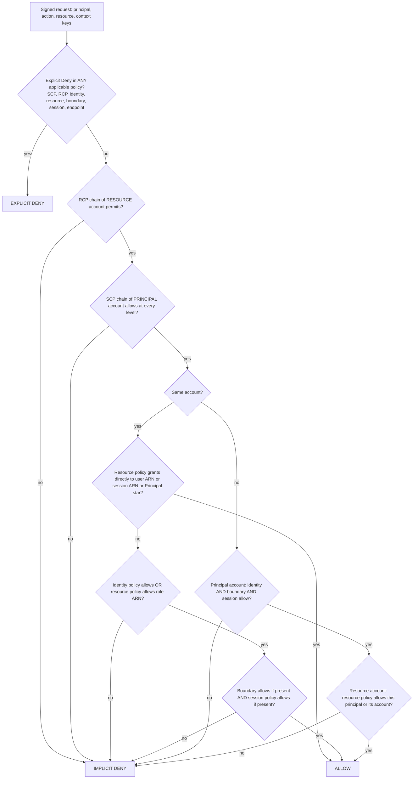

# IAM Policy Evaluation Engine

## TL;DR

Every AWS request is a pure function evaluation: a SigV4-authenticated principal plus a request context goes through a deny sweep over every applicable policy, then the organizational ceilings (RCPs on the resource side, SCPs on the principal side), then grants (identity union resource), then the principal-side ceilings (permissions boundary, session policy).
Explicit deny always wins, default is implicit deny, and only identity-based and resource-based policies can grant; SCPs, RCPs, boundaries, and session policies only filter.
Same-account access is a union of identity and resource grants, while cross-account access is an intersection of two independent account-local evaluations, so a bucket policy alone never lets a foreign principal in.
The principal ARN form written in a resource policy changes the semantics: a same-account grant to a user ARN or role-session ARN bypasses implicit denies in boundaries and session policies, while a grant to the role ARN does not.
IAM is eventually consistent, its control plane is concentrated while its data plane is regional, and policy semantics are decidable enough that AWS proves properties with SMT (Zelkova), which is the only scalable way to change guardrails across thousands of accounts safely.

## Mental Model



Think of the engine as two separable half-evaluations glued by account topology.
The principal half asks "is this identity, inside its organization's guardrails, permitted to attempt this action?" and is computed from SCPs, identity policies, permissions boundaries, and session policies.
The resource half asks "does the owner of this resource, inside its organization's guardrails, accept this caller?" and is computed from RCPs and the resource-based policy.
Inside one account, either half can produce the grant, so the halves are OR-ed and then capped by the ceilings.
Across accounts, the halves are AND-ed because neither account trusts the other to have made the decision for it.
The one asymmetry that breaks the clean picture is that a same-account resource policy naming a specific user or session is treated as a grant made to that exact session, so ceilings that exist to cap what the identity could grant itself do not apply to it.

## Internals

### Where evaluation physically happens

Authorization is not a central RPC to an "IAM server" for every API call.
Each AWS service front end authenticates the SigV4 signature, resolves the principal, assembles the request context (action, resource ARN, principal ARN, tags, `aws:SourceIp`, `aws:SourceVpce`, `aws:PrincipalOrgID`, `aws:RequestedRegion`, `aws:CalledVia`, and service-specific keys), and runs AWS enforcement code against the policy set that applies (AWS IAM docs, as of 2026-10).
The policies come from IAM and Organizations through a replicated, regionally served data plane.
The control plane for IAM, the APIs that create roles and change policies, is a global service whose writes are concentrated in one Region (us-east-1 for the aws partition), while authentication and authorization are served from each Region (AWS Fault Isolation Boundaries whitepaper; UNVERIFIED this session).
This split has two consequences that a getting-started guide never mentions.
First, a policy write is eventually consistent: a role you just created or a deny you just attached may not be visible to every service endpoint in every Region yet, and AWS explicitly recommends not putting IAM mutations into critical, high-availability code paths (AWS IAM docs).
Second, the static-stability lesson from [[17-Cloud-AI-Engineering/Volume_01_Cloud_Architecture_Principles/Chapter_04_Control_Plane_vs_Data_Plane_Separation|Control Plane vs Data Plane Separation]] applies directly: a workload that only assumes pre-existing roles and calls regional STS endpoints keeps working during an IAM control-plane impairment, and one that creates roles or rewrites policies at runtime does not.

### The policy types and what each can do

There are seven policy types, and only two can grant.

| Policy type | Attached to | Can grant | Can deny | Applies to whom |
|---|---|---|---|---|
| Identity-based (managed, inline) | User, group, role | Yes | Yes | The principal it is attached to |
| Resource-based | Bucket, key, queue, secret, role trust, and others | Yes | Yes | Principals named in `Principal` |
| Permissions boundary | User or role | No (ceiling) | Yes | That principal's identity-based grants |
| Session policy | STS session (passed at AssumeRole or GetFederationToken) | No (ceiling) | Yes | That one session |
| SCP | Org root, OU, account | No (ceiling) | Yes | Principals in member accounts |
| RCP | Org root, OU, account | No (ceiling, Deny-only for customer policies) | Yes | Resources in member accounts, for supported services |
| VPC endpoint policy | Interface or gateway endpoint | No (ceiling) | Yes | Requests that traverse that endpoint |

SCPs filter what principals in member accounts can do, never affect the management account, and do not restrict service-linked roles (AWS Organizations docs, as of 2026-10).
SCPs gained full IAM policy language support on 2025-09-19, including conditions and resource ARNs in Allow statements, NotAction with Allow, NotResource, and wildcards anywhere in action strings ([AWS What's New, 2025-09](https://aws.amazon.com/about-aws/whats-new/2025/09/aws-organizations-iam-language-service-control-policies)).
RCPs set the maximum permissions available on resources in member accounts, require an organization with all features enabled, and do not affect resources in the management account ([AWS Organizations RCP docs, as of 2026-10](https://docs.aws.amazon.com/organizations/latest/userguide/orgs_manage_policies_rcps.html)).
Customer-authored RCPs can only use `"Effect": "Deny"`, the AWS-managed `RCPFullAWSAccess` is auto-attached, and RCPs do not restrict calls by service-linked roles or apply to AWS managed KMS keys (third-party summary of AWS docs, native.security, as of 2026-08).
The use rule is simple: use an SCP to cap your own principals, and use an RCP to cap external principals reaching into your resources (AWS Organizations RCP docs, as of 2026-10).

### The decision function, precisely

Write the request as `r` and each policy set as a predicate that returns Allow, Deny, or no match.
The engine computes the following, and the order is significant only for short-circuiting, because explicit deny dominates everything.

1. Deny sweep: if any statement with `Effect: Deny` in any applicable SCP, RCP, identity policy, resource policy, boundary, session policy, or endpoint policy matches `r`, return EXPLICIT_DENY (AWS IAM docs, as of 2026-10).
2. RCP ceiling: evaluated against the resource account's chain; because customer RCPs are Deny-only and `RCPFullAWSAccess` supplies the Allow, in practice this collapses into step 1.
3. SCP ceiling: evaluated against the principal account's chain; each level from root through each OU to the account must contain a matching Allow, otherwise IMPLICIT_DENY.
4. Same account: if a resource policy grants `r` to the exact user ARN or session ARN, return ALLOW; otherwise require (identity Allow OR resource-policy Allow to the role ARN) AND boundary Allow (if one is set) AND session-policy Allow (if one was passed).
5. Cross account: require the principal-account half (identity Allow AND boundary AND session) AND the resource-account half (resource policy names the principal or its account).
6. Otherwise IMPLICIT_DENY.

Step 3 is where allow-list SCP strategies fail: an Allow has to be present at every node on the path, so replacing `FullAWSAccess` on one intermediate OU without an equivalent Allow quietly shuts down every account beneath it (Sonrai and AWS Security Blog, as of 2026-05).

### The mechanism you will not find in a getting-started guide: principal-ARN-type semantics

Inside an account, the string you put in a resource policy's `Principal` element selects which branch of the decision function runs.
If a same-account resource policy grants permission directly to an IAM user ARN, implicit denies in that user's identity policy or permissions boundary do not limit the grant (AWS IAM permissions boundaries docs, as of 2026-10).
If it grants permission to an IAM role ARN, the grant is limited by implicit denies in the role's permissions boundary and in any session policy (AWS IAM docs, as of 2026-10).
If it grants permission to an assumed-role session ARN (`arn:aws:sts::111111111111:assumed-role/app/i-0abc`), the grant goes directly to that session and is not limited by implicit denies in the boundary or session policy (AWS IAM docs, as of 2026-10).
The trap inside the trap is that boundaries and session policies do not limit permissions granted with `Principal: "*"` scoped by an `aws:PrincipalArn` condition, unless an identity-based policy contains an explicit deny ([AWS IAM enforcement-logic docs, as of 2026-10](https://docs.aws.amazon.com/IAM/latest/UserGuide/reference_policies_evaluation-logic_policy-eval-denyallow.html)).
Why does this exist?
The boundary and session-policy design goal is to cap what the principal's own identity side can grant itself, which is the delegated-administration threat model.
A resource owner who names an exact session is making an independent, more specific grant, so the engine treats it as resource-side authority rather than identity-side authority.
A wildcard principal with a condition is, in the engine's eyes, still a resource-side grant to "whoever matches," not a grant routed through the role.
The operational consequence is serious: the "Principal star plus aws:PrincipalArn" pattern, recommended for readability and for avoiding trust-policy unique-ID rewrites, silently removes your permissions boundary as an enforcement layer for that resource.
If boundaries are a security control in your platform, and not only a convenience, then an explicit Deny in the boundary is the only construct that survives every branch, because step 1 runs before branch selection.

### Role trust policies are resource policies, with a hidden rewrite

A role trust policy is the resource-based policy of the `sts:AssumeRole` action on that role, so the same-account union rule applies: when the trust policy names a specific principal ARN, the caller does not also need an identity-policy Allow for `sts:AssumeRole`, but when it names only the account (`arn:aws:iam::111111111111:root`), the account's IAM policies must grant it (AWS IAM docs; UNVERIFIED this session).
When you save a trust or resource policy that names a specific IAM user or role ARN, IAM binds it to that principal's internal unique ID, so deleting and recreating a same-named role leaves the old policy matching nobody, shown as an `AROA...` identifier (AWS IAM docs; UNVERIFIED this session).
This is deliberate anti-impersonation behavior, and it is the reason "recreate the role" changes break cross-account trust in ways that look like eventual consistency but never heal.

### KMS inverts the default

For AWS KMS, the key policy is primary: IAM identity policies grant access to a customer managed key only if the key policy delegates to the account by naming the account principal (AWS KMS docs; UNVERIFIED this session).
That makes KMS the strongest resource-side control in AWS, and it is why envelope-encrypted data is protected by two independent policy evaluations, the storage service's and the key's, as covered in [[17-Cloud-AI-Engineering/Volume_02_AWS_Deep_Dive/Chapter_15_Security_and_Cryptography_KMS_and_Nitro_Enclaves|Security and Cryptography: KMS and Nitro Enclaves]].

### Condition evaluation edge semantics

A condition key absent from the request context makes ordinary operators evaluate to false, which means a Deny guarded by a missing key never fires, while `...IfExists` operators evaluate to true when the key is absent.
`ForAllValues` over an empty or missing multivalued key is vacuously true, so `ForAllValues:StringEquals` on `aws:TagKeys` in an Allow statement can grant to requests that carry no tags at all.
`aws:PrincipalArn` for an assumed-role session evaluates to the role ARN, not the session ARN, which is what makes role-scoped conditions stable across sessions.
`aws:ViaAWSService` and `aws:CalledVia` are how perimeter Denies exempt forward-access-session calls, for example CloudFormation or Athena acting on your behalf, without exempting the caller's direct calls.
Confused-deputy protection for service principals relies on `aws:SourceArn`, `aws:SourceAccount`, or `aws:SourceOrgID` in the resource policy, because the service principal itself is shared across all customers.

### Formal semantics: Zelkova

AWS formalized the policy language and built Zelkova, which encodes policy semantics into SMT, compares behaviors, and answers questions such as "does this policy allow any principal outside my organization"; the FMCAD 2018 paper reports that the analysis solves a PSPACE-complete problem and is invoked many millions of times daily ([Backes et al., FMCAD 2018](https://www.cs.utexas.edu/~hunt/FMCAD/FMCAD18/papers/paper3.pdf)).
Regular-expression-like wildcard matching on ARNs is why plain Z3 was not enough, and the team built an automata-based string extension, Z3Automata, used alongside Z3 and CVC4 (ProVerB tool summary).
The follow-up work "A Billion SMT Queries a Day" (CAV 2022) describes how this scaled in production.
Zelkova research fed customer features including IAM Access Analyzer and S3 Block Public Access (UCL REF2021 impact case study).
The engineering lesson is that the IAM policy language is deliberately constrained enough to stay decidable: no loops, no recursion, no external lookups at evaluation time, which is also why Cedar, AWS's later authorization language for application-level policies, was designed around analyzability.
When you design guardrails, prefer constructs that keep analysis tractable: explicit ARNs and well-known condition keys beat deep NotAction and NotResource trees, even though the September 2025 SCP language expansion allows the latter.

## Numbers to Know

| Item | Value | Source and date |
|---|---|---|
| Customer managed policy size | 6,144 characters, white space not counted | (AWS IAM quotas docs, as of 2026-10) |
| Inline policy aggregate per user / group / role | 2,048 / 5,120 / 10,240 characters | (AWS IAM quotas docs, as of 2026-10) |
| Managed policies per role | 20 default, 25 maximum | (AWS IAM quotas docs and re:Post, as of 2026-10) |
| Managed policies per user | 10 default, 20 maximum | (AWS IAM quotas docs, as of 2026-10) |
| Managed policies per group | 10, not raisable | (AWS IAM quotas docs, as of 2026-10) |
| Role trust policy length | 2,048 characters default, 8,192 maximum | (AWS IAM quotas docs, as of 2026-10) |
| Roles per account | 1,000 default, 10,000 maximum | (AWS IAM quotas docs, as of 2026-10) |
| Customer managed policies per account | 1,500 default, 10,000 maximum | (AWS IAM quotas docs, as of 2026-10) |
| Managed policy versions retained | 5 | (AWS IAM quotas docs via sph.sh summary, as of 2026-07) |
| Session policy limits | Up to 10 managed policy ARNs; inline JSON plus ARN characters capped at 2,048 | (AWS IAM quotas docs via summary, as of 2026-08) |
| RCPs attachable per root, OU, or account | 5 | (Tenable and native.security summaries of AWS docs, as of 2026-08) |
| RCP-supported services at launch (2024-11) | S3, STS, KMS, SQS, Secrets Manager | (AWS launch-partner coverage, as of 2024-12) |
| RCP additions | ECR and OpenSearch Serverless (2025-06); Cognito and CloudWatch Logs (2026-01) | ([AWS What's New 2025-06](https://aws.amazon.com/about-aws/whats-new/2025/06/aws-resource-control-policies-additional-services), [2026-01](https://aws.amazon.com/about-aws/whats-new/2026/01/aws-expands-resource-control-policies)) |
| SCP full IAM language | GA in all commercial and GovCloud (US) Regions since 2025-09-19 | (AWS What's New, 2025-09) |
| SCPs per target and SCP document size | 5 per target and 5,120 characters historically; AWS updated SCP quotas on 2026-05-20 | UNVERIFIED current values (AWS Security Blog notes the 2026-05 change) |
| STS role session duration | 1 hour default, up to 12 hours by role setting; role chaining capped at 1 hour | (AWS STS docs; UNVERIFIED this session) |
| Zelkova invocation volume | "many millions of times daily" in 2018; about a billion SMT queries per day reported in 2022 | (FMCAD 2018 paper; CAV 2022 title) |
| IAM, STS, and Organizations policy price | No charge | (AWS pricing; UNVERIFIED this session) |

## AWS vs GCP Mechanism Parity

| Dimension | AWS | Google Cloud | Critical difference |
|---|---|---|---|
| Grant primitive | Identity-based policy on principal, resource-based policy on resource | IAM allow policy bound on a resource node (org, folder, project, resource) | GCP has no identity-attached grants; every grant lives on a resource and inherits down the hierarchy |
| Combination rule | Explicit deny wins, then union of grants, intersected with ceilings | Deny policies evaluated before allow policies; allow policies inherited and unioned | Both are deny-overrides; GCP inheritance is additive and cannot be revoked by a child allow policy |
| Org-level principal ceiling | SCP (filter, every level must Allow) | IAM deny policies at org or folder, plus Principal Access Boundary policies | PAB restricts which resources a principal set may access, closer to an org-scoped boundary (PAB GA status UNVERIFIED) |
| Org-level resource ceiling | RCP (Deny-only, supported services only) | VPC Service Controls perimeters plus Domain Restricted Sharing org policy | VPC SC is context and perimeter based, not a policy-language ceiling; see [[17-Cloud-AI-Engineering/Volume_03_GCP_Deep_Dive/Chapter_03_VPC_Service_Controls_Security_Perimeters\|VPC Service Controls]] |
| Per-principal ceiling | Permissions boundary | No direct equivalent; approximated with deny policies, PAB, and custom roles | Delegated IAM admin is harder to cap on GCP without PAB |
| Per-session ceiling | Session policy on AssumeRole or GetFederationToken | Credential Access Boundaries on downscoped tokens (Cloud Storage focused) | AWS session policies apply across services; GCP downscoping is narrower |
| Cross-tenant semantics | Two-sided: caller account and resource account must both Allow | One-sided: a resource owner can bind any Google identity, unless Domain Restricted Sharing or PAB prevents it | The single largest translation pitfall; GCP external access is blocked by org policy, not by the caller's IAM |
| Condition language | Fixed condition operators over typed context keys | CEL expressions in IAM Conditions | CEL is more expressive; AWS keys are more uniform across services |
| Static reasoning | Zelkova-backed IAM Access Analyzer (external access, unused access, custom policy checks) | Policy Analyzer, Policy Troubleshooter, Policy Simulator | AWS exposes "no new access" proofs as CI-callable APIs |
| Propagation | Eventually consistent; control plane concentrated, data plane regional | Eventually consistent global policy distribution | Both demand pre-provisioned identities for static stability |
| Org policy for configuration | SCP conditions or declarative policies | Organization Policy constraints (configuration, not access) | GCP separates "who can call" from "what config is legal" more cleanly |

For deeper GCP internals see [[17-Cloud-AI-Engineering/Volume_03_GCP_Deep_Dive/Chapter_02_Cloud_IAM_Roles_Policies_and_Conditions|Cloud IAM: Roles, Policies, and Conditions]] and the translation matrix in [[17-Cloud-AI-Engineering/Volume_04_AWS_vs_GCP_Translation/Chapter_03_Identity_Security_and_Governance_Translation|Identity, Security, and Governance Translation]].

## Worked Example: A Reference Evaluator Cross-Checked Against the IAM Simulator

### What you will build

A runnable Python reference model of the decision function that reproduces six behaviors: the role-ARN versus session-ARN asymmetry, the wildcard-principal boundary bypass, the two-sided cross-account rule, SCP region denial overriding AdministratorAccess, and an RCP blocking an external principal despite a permissive bucket policy.
An optional `--aws` mode calls `iam:SimulateCustomPolicy` with a permissions boundary and a same-account resource policy naming a user ARN, so you can compare AWS's simulator against the documented semantics.

### Cost estimate and budget guardrail

IAM users, policies, and the policy simulator API carry no direct charge (AWS pricing; UNVERIFIED this session), so the expected lab cost is 0.00 USD.
Install a 1 USD monthly cost budget anyway, because a lab account with no budget is how stray resources become invoices.

```bash
ACCOUNT_ID=$(aws sts get-caller-identity --query Account --output text)
aws budgets create-budget --account-id "$ACCOUNT_ID" \
  --budget '{"BudgetName":"iam-eval-lab","BudgetLimit":{"Amount":"1","Unit":"USD"},"TimeUnit":"MONTHLY","BudgetType":"COST"}' \
  --notifications-with-subscribers '[{"Notification":{"NotificationType":"ACTUAL","ComparisonOperator":"GREATER_THAN","Threshold":50,"ThresholdType":"PERCENTAGE"},"Subscribers":[{"SubscriptionType":"EMAIL","Address":"you@example.com"}]}]'
```

### Provision the simulated caller

`SimulateCustomPolicy` uses `CallerArn` to fill the `Principal` element of a resource policy, and this lab uses a real, permissionless IAM user for that.

```bash
aws iam create-user --user-name iam-eval-lab-user
USER_ARN=$(aws iam get-user --user-name iam-eval-lab-user --query User.Arn --output text)
```

### The code

```python
#!/usr/bin/env python3
"""Reference model of AWS IAM authorization for teaching purposes.

Models: explicit-deny sweep, RCP and SCP ceilings, same-account union of
identity and resource grants, boundary and session-policy ceilings, the
principal-ARN-type asymmetry, and two-sided cross-account evaluation.
Out of scope: KMS key-policy primacy, role trust special cases, ACLs,
VPC endpoint policies, NotPrincipal, and most condition operators.

Usage:
  python3 iam_eval_lab.py            # offline reference model only
  python3 iam_eval_lab.py --aws ARN  # also call iam:SimulateCustomPolicy
"""
import fnmatch
import json
import sys

ALLOW, IMPLICIT, EXPLICIT = "ALLOW", "IMPLICIT_DENY", "EXPLICIT_DENY"


def as_list(v):
    return v if isinstance(v, list) else [v]


def glob(pattern, value):
    # IAM wildcards: '*' any run of chars, '?' one char; actions are case-insensitive.
    return fnmatch.fnmatchcase(value.lower(), pattern.lower())


def cond_ok(cond, ctx):
    for op, kv in (cond or {}).items():
        for key, want in kv.items():
            have = ctx.get(key)
            if have is None:
                return False  # missing key: non-IfExists operators evaluate false
            if op in ("StringEquals", "ArnEquals"):
                ok = any(have == w for w in as_list(want))
            elif op in ("StringLike", "ArnLike"):
                ok = any(glob(w, have) for w in as_list(want))
            elif op == "StringNotEquals":
                ok = all(have != w for w in as_list(want))
            else:
                raise ValueError("operator not modelled: " + op)
            if not ok:
                return False
    return True


def stmt_matches(st, req, check_principal):
    if "Action" in st and not any(glob(a, req["action"]) for a in as_list(st["Action"])):
        return None
    if "NotAction" in st and any(glob(a, req["action"]) for a in as_list(st["NotAction"])):
        return None
    if "Resource" in st and not any(glob(r, req["resource"]) for r in as_list(st["Resource"])):
        return None
    if "NotResource" in st and any(glob(r, req["resource"]) for r in as_list(st["NotResource"])):
        return None
    if not cond_ok(st.get("Condition"), req["ctx"]):
        return None
    if not check_principal:
        return "n/a"
    p = st.get("Principal")
    if p == "*" or p == {"AWS": "*"}:
        return "wildcard"
    for arn in as_list(p.get("AWS", [])):
        if arn == req["principal_arn"]:
            return "direct"          # IAM user ARN or role SESSION ARN
        if arn == req.get("role_arn"):
            return "role"            # role ARN: still capped by boundary/session
        if arn in (req["principal_account"], "arn:aws:iam::%s:root" % req["principal_account"]):
            return "account"         # delegates to the principal account's IAM
    return None


def effect_hits(policy, effect, req, check_principal=False):
    hits = []
    for st in as_list((policy or {}).get("Statement", [])):
        if st["Effect"] == effect:
            m = stmt_matches(st, req, check_principal)
            if m:
                hits.append(m)
    return hits


def evaluate(req, p):
    same = req["principal_account"] == req["resource_account"]
    flat_scp = [pol for lvl in p.get("scp", []) for pol in lvl]
    flat_rcp = [pol for lvl in p.get("rcp", []) for pol in lvl]
    principal_side = flat_scp + [p.get("identity"), p.get("boundary"), p.get("session")]
    # 1. Explicit deny sweep across every applicable policy type.
    for pol in principal_side + flat_rcp:
        if effect_hits(pol, "Deny", req):
            return EXPLICIT
    if effect_hits(p.get("resource"), "Deny", req, check_principal=True):
        return EXPLICIT
    # 2. RCP ceiling (resource account) and SCP ceiling (principal account).
    #    Customer RCPs are Deny-only and RCPFullAWSAccess is always attached,
    #    so the RCP ceiling reduces to the deny sweep above.
    #    SCPs: every level (root, each OU, account) needs a matching Allow.
    if p.get("scp") and not all(any(effect_hits(pol, "Allow", req) for pol in lvl) for lvl in p["scp"]):
        return IMPLICIT
    rbp = set(effect_hits(p.get("resource"), "Allow", req, check_principal=True))
    ident = bool(effect_hits(p.get("identity"), "Allow", req))
    caps = all(bool(effect_hits(p[k], "Allow", req)) for k in ("boundary", "session") if p.get(k))
    if same:
        # 3a. Grant made directly to the user / session (or Principal "*"):
        #     implicit denies in identity, boundary, session do not apply.
        if rbp & {"direct", "wildcard"}:
            return ALLOW
        # 3b. Otherwise union of identity grant and role-ARN grant, then ceilings.
        return ALLOW if (ident or "role" in rbp) and caps else IMPLICIT
    # 4. Cross-account: both accounts must independently allow.
    principal_ok = ident and caps
    resource_ok = bool(rbp)
    return ALLOW if principal_ok and resource_ok else IMPLICIT


def pol(*stmts):
    return {"Version": "2012-10-17", "Statement": list(stmts)}


A, B, EXT = "111111111111", "222222222222", "999999999999"
ROLE = "arn:aws:iam::%s:role/app" % A
SESSION = "arn:aws:sts::%s:assumed-role/app/i-0abc" % A
OBJ = "arn:aws:s3:::data-%s/k" % A
FULL = pol({"Effect": "Allow", "Action": "*", "Resource": "*"})
IDENT = pol({"Effect": "Allow", "Action": "s3:*", "Resource": "*"})
BOUND = pol({"Effect": "Allow", "Action": "s3:List*", "Resource": "*"})


def base_req(**kw):
    r = {"action": "s3:GetObject", "resource": OBJ, "principal_arn": SESSION, "role_arn": ROLE,
         "principal_account": A, "resource_account": A,
         "ctx": {"aws:PrincipalArn": ROLE, "aws:PrincipalOrgID": "o-abc", "aws:RequestedRegion": "us-east-1"}}
    r.update(kw)
    return r


def bucket(principal, cond=None):
    st = {"Effect": "Allow", "Principal": principal, "Action": "s3:GetObject", "Resource": OBJ}
    if cond:
        st["Condition"] = cond
    return pol(st)


CASES = [
    ("T1 same-acct, bucket names ROLE ARN, boundary lacks GetObject", base_req(),
     {"identity": IDENT, "boundary": BOUND, "resource": bucket({"AWS": ROLE})}, IMPLICIT),
    ("T2 same-acct, bucket names SESSION ARN, same boundary", base_req(),
     {"identity": IDENT, "boundary": BOUND, "resource": bucket({"AWS": SESSION})}, ALLOW),
    ("T3 same-acct, Principal '*' + aws:PrincipalArn condition", base_req(),
     {"identity": IDENT, "boundary": BOUND,
      "resource": bucket("*", {"ArnEquals": {"aws:PrincipalArn": ROLE}})}, ALLOW),
    ("T4 cross-acct, bucket allows, caller identity silent",
     base_req(resource_account=B, resource="arn:aws:s3:::data-b/k"),
     {"identity": pol({"Effect": "Allow", "Action": "sqs:*", "Resource": "*"}),
      "resource": pol({"Effect": "Allow", "Principal": {"AWS": ROLE}, "Action": "s3:GetObject",
                       "Resource": "arn:aws:s3:::data-b/k"})}, IMPLICIT),
    ("T5 SCP region deny beats AdministratorAccess",
     base_req(ctx={"aws:PrincipalArn": ROLE, "aws:RequestedRegion": "ap-south-1"}),
     {"identity": FULL, "scp": [[FULL], [pol({"Effect": "Deny", "Action": "*", "Resource": "*",
       "Condition": {"StringNotEquals": {"aws:RequestedRegion": "us-east-1"}}})]]}, EXPLICIT),
    ("T6 RCP blocks external principal despite public-ish bucket policy",
     base_req(principal_arn="arn:aws:iam::%s:user/x" % EXT, role_arn=None, principal_account=EXT,
              ctx={"aws:PrincipalArn": "arn:aws:iam::%s:user/x" % EXT, "aws:PrincipalOrgID": "o-other"}),
     {"identity": FULL, "resource": bucket("*"),
      "rcp": [[pol({"Effect": "Deny", "Principal": "*", "Action": "s3:*", "Resource": "*",
                    "Condition": {"StringNotEquals": {"aws:PrincipalOrgID": "o-abc"}}})]]}, EXPLICIT),
]


def run_offline():
    bad = 0
    for name, req, pols, want in CASES:
        got = evaluate(req, pols)
        bad += got != want
        print("%-66s %-14s %s" % (name, got, "ok" if got == want else "MISMATCH want " + want))
    return bad


def run_aws(user_arn):
    import boto3  # requires iam:SimulateCustomPolicy; the API itself is not billed
    iam = boto3.client("iam")
    acct = user_arn.split(":")[4]
    obj = "arn:aws:s3:::lab-bucket-%s/k" % acct
    rp = json.dumps(pol({"Effect": "Allow", "Principal": {"AWS": user_arn},
                         "Action": "s3:GetObject", "Resource": obj}))
    out = iam.simulate_custom_policy(
        PolicyInputList=[json.dumps(pol({"Effect": "Allow", "Action": "sqs:*", "Resource": "*"}))],
        PermissionsBoundaryPolicyInputList=[json.dumps(BOUND)],
        ActionNames=["s3:GetObject"], ResourceArns=[obj], ResourcePolicy=rp,
        ResourceOwner="arn:aws:iam::%s:root" % acct, CallerArn=user_arn)
    for r in out["EvaluationResults"]:
        print("simulator:", r["EvalActionName"], r["EvalDecision"])
    print("reference model for same input (user ARN named directly): expected allowed")


if __name__ == "__main__":
    failures = run_offline()
    if "--aws" in sys.argv:
        run_aws(sys.argv[sys.argv.index("--aws") + 1])
    sys.exit(1 if failures else 0)
```

Run it offline first, then against AWS.

```bash
python3 iam_eval_lab.py
python3 iam_eval_lab.py --aws "$USER_ARN"
```

Expected offline output is six `ok` lines: T1 IMPLICIT_DENY, T2 ALLOW, T3 ALLOW, T4 IMPLICIT_DENY, T5 EXPLICIT_DENY, T6 EXPLICIT_DENY.
T1 and T2 differ only in the string inside `Principal`, which is the whole point of the chapter's deep mechanism.
If the simulator's answer ever disagrees with the documented semantics, treat a real request plus its CloudTrail `errorCode` and `errorMessage` as ground truth; the simulator only accepts an IAM user as `CallerArn`, so it cannot model the role-session branch at all (AWS IAM API reference; UNVERIFIED this session).

### Capacity sizing: policy character budgets

Per-role identity budget at default quotas is 20 managed policies times 6,144 characters plus 10,240 inline characters, which is 122,880 plus 10,240, or 133,120 non-whitespace characters.
At the 25-policy maximum it is 153,600 plus 10,240, or 163,840 characters.
At roughly 250 characters per scoped statement, that is about 530 statements by default, which is ample, so if you are hitting it, the problem is role design, not quota.
The binding constraint in practice is the trust policy.
A GitHub Actions OIDC trust policy costs about 300 characters of skeleton plus about 58 characters per `token.actions.githubusercontent.com:sub` subject string such as `repo:acme/payments:ref:refs/heads/main`.
At the 2,048-character default, (2,048 - 300) / 58 is about 30 subjects; at the 8,192 maximum, (8,192 - 300) / 58 is about 136 subjects.
Beyond that you must move from enumerating repos to wildcards plus a Deny on unexpected `job_workflow_ref`, or fan out into per-team roles.
The session policy is the tightest budget: 2,048 characters across inline JSON and up to 10 ARNs, and STS reports usage as a packed-size percentage that also includes session tags (UNVERIFIED this session), so tag-heavy ABAC sessions run out first.
For SCPs, assuming the historical 5-per-target quota still holds (UNVERIFIED after the 2026-05 quota update), a path from root through five nested OUs to an account has 7 attachment points and therefore at most 35 SCPs, and every one of those 7 points must carry an Allow for any action to survive.

### Capacity sizing: CI policy proofs

Model Access Analyzer custom policy checks as a per-call cost: calls per month = PRs per month x changed policies per PR x check types.
For 2,000 PRs, 3 changed policies each, and 2 checks (`CheckNoNewAccess` and `CheckNoPublicAccess`), that is 12,000 calls per month, multiplied by the current per-call list price (UNVERIFIED; check the IAM Access Analyzer pricing page).

### Teardown

```bash
aws iam delete-user --user-name iam-eval-lab-user
aws budgets delete-budget --account-id "$ACCOUNT_ID" --budget-name iam-eval-lab
```

## Failure Modes and Pitfalls

### Guardrail lockout through the SCP Allow chain

Detaching `FullAWSAccess` from one OU without an equivalent Allow denies every action for every account below it at once, because the Allow is required at every level (AWS Security Blog and tocconsulting summary, as of 2026).
The blast radius is the subtree, and because the management account is exempt from SCPs, recovery is possible only from there, which is one more reason never to run workloads in the management account.
Roll SCP and RCP changes as you would roll code: test accounts first, then low OUs, then upward, while watching CloudTrail for new AccessDenied errors, which is AWS's own recommendation for RCPs (AWS Organizations RCP docs, as of 2026-10).

### Global policy propagation as a blast-radius vector

On 2025-06-12 a Google Cloud outage began when a policy change with unintended blank fields replicated globally within seconds and hit a code path in Service Control, the component that performs API authorization and quota checks, which was not protected by a feature flag; the null-pointer crash loop took down API serving across regions, and us-central1 recovered last because restarting tasks overloaded the backing store (Google Cloud incident report; UNVERIFIED this session).
The transferable lesson for AWS guardrails is that a fast, globally replicated policy plane is a global single point of failure unless policy rollouts are staged, validated, and data-driven gated, as discussed in [[17-Cloud-AI-Engineering/Volume_07_Reliability_and_SRE/Chapter_07_Anatomy_of_Major_Cloud_Outages|Anatomy of Major Cloud Outages]].

### Runtime dependency on the IAM control plane

Systems that create roles, attach policies, or rotate access keys in the request path fail when the IAM control plane is impaired or simply lagging under eventual consistency, and they fail as AccessDenied, which callers usually do not retry.
Use pre-provisioned roles, regional STS endpoints, and cached credentials refreshed well before expiry; AWS public post-event summaries for us-east-1 events have listed STS and IAM-dependent console sign-in among impacted functions (AWS Post-Event Summaries; UNVERIFIED this session).

### Boundary bypass by resource-policy shape

A platform team enforces a permissions boundary on all tenant roles, and an application team writes a same-account bucket policy using `Principal: "*"` with an `aws:PrincipalArn` condition.
The boundary no longer constrains that bucket, by documented design (AWS IAM docs, as of 2026-10).
The fix is explicit Deny statements in the boundary for anything that must never happen, plus Access Analyzer checks on resource policies in CI.

### Cross-account "it works in staging"

Staging is often single-account, where a bucket policy alone grants access, and production is cross-account, where the caller's identity policy must also allow.
The same artifact flips from ALLOW to IMPLICIT_DENY at the account boundary, and this is reproduced in lab case T4.

### Trust-policy unique-ID rot

Delete and recreate a role named in another account's trust or bucket policy, and the reference silently becomes an unmatched unique ID that never heals (AWS IAM docs; UNVERIFIED this session).
Engineers misdiagnose it as eventual consistency and wait.

### Condition-key absence

A perimeter Deny such as `StringNotEquals aws:SourceVpce` does not fire when the key is missing, for example on calls not routed through an endpoint, and it also blocks AWS services acting on your behalf unless you exempt `aws:ViaAWSService`.
Data perimeters therefore need paired statements, one for principals and one for networks, with explicit service exemptions.

### Credential theft beats perfect policy logic

The 2019 Capital One breach combined an SSRF against a misconfigured web application firewall with instance-metadata credential retrieval and an over-broad role that could list and read S3 buckets (US DOJ complaint; UNVERIFIED this session).
Policy evaluation was correct; the identity policy was the bug.
Mitigations are IMDSv2 enforcement, network-perimeter conditions on sensitive data (`aws:SourceVpc`, `aws:SourceVpce`), and RCPs that pin access to your organization.

### Quota exhaustion mid-deploy

Inline user policy aggregates of 2,048 characters and the 10-policy group cap are fixed or near-fixed, so pipelines that append statements fail at deploy time with LimitExceeded errors (AWS IAM quotas docs, as of 2026-10).
Prefer roles, managed policies, and ABAC over enumerated ARNs.

## Security and Cost Angles

### Scoping IAM administration itself

The privilege-escalation primitives are `iam:PassRole`, `iam:CreatePolicyVersion` with `--set-as-default`, `iam:SetDefaultPolicyVersion`, `iam:AttachRolePolicy`, `iam:PutRolePermissionsBoundary` and `iam:DeleteRolePermissionsBoundary`, `iam:UpdateAssumeRolePolicy`, and `sts:AssumeRole` against over-trusting roles.
Delegated administration is safe only when a developer can create roles if and only if `iam:PermissionsBoundary` equals the platform boundary ARN, cannot modify or delete that boundary policy or its versions, cannot remove boundaries from roles, and can pass only roles under a constrained path.
Because of the resource-policy bypass above, the boundary must contain explicit Deny statements for the non-negotiables, such as disabling CloudTrail, leaving the organization, or changing the boundary itself.

### Key hierarchy as a second, independent authorization

S3 SSE-KMS and EBS encryption make every read require both the storage service's Allow and a KMS Decrypt Allow against a key policy you control, which turns envelope encryption into an independent authorization layer, not only a confidentiality control; see [[17-Cloud-AI-Engineering/Volume_08_Security_Identity_and_the_Data_Perimeter/Chapter_04_Encryption_Key_Hierarchies_and_Envelope_Encryption|Encryption Key Hierarchies and Envelope Encryption]].
Use `kms:ViaService` and `kms:EncryptionContext` conditions so a stolen credential cannot call KMS directly outside the intended service path.

### Private network boundaries

VPC endpoint policies are a seventh evaluation input and act as a ceiling on requests traversing the endpoint, which lets you prevent exfiltration to buckets outside your organization using `aws:ResourceOrgID`.
Combine them with SCPs (identity perimeter for your principals) and RCPs (resource perimeter against foreign principals) as described in [[17-Cloud-AI-Engineering/Volume_08_Security_Identity_and_the_Data_Perimeter/Chapter_06_Constructing_an_Impenetrable_Data_Perimeter|Constructing an Impenetrable Data Perimeter]].

### Identity federation, not keys

Long-lived access keys are the root cause class of most AWS credential incidents; workloads should obtain sessions through IRSA, EKS Pod Identity, instance profiles, or OIDC federation, covered in [[17-Cloud-AI-Engineering/Volume_08_Security_Identity_and_the_Data_Perimeter/Chapter_02_Workload_Identity_Federation|Workload Identity Federation]].
Session policies let a broker issue narrowly scoped, short-lived credentials per tenant or per job, which is the pattern for multi-tenant AI pipelines that read tenant-scoped prefixes from a shared bucket.

### Unit economics

IAM evaluation is not billed, so cost levers are indirect: CloudTrail data-event logging for audit of sensitive buckets, Access Analyzer unused-access and custom-check charges (UNVERIFIED current prices), and engineering hours lost to AccessDenied debugging.
The highest-leverage investment is CI-time proof (`CheckNoNewAccess` against the last approved version, `CheckNoPublicAccess` on resource policies), because a rejected PR costs cents of analysis while an over-grant in production costs an incident; see [[17-Cloud-AI-Engineering/Volume_06_Infrastructure_as_Code_and_Delivery/Chapter_04_Policy_as_Code_OPA_Sentinel_and_Guardrails|Policy as Code]].

## Interview Questions and Model Answers

### Question 1 (L5 - Senior)

A role has the AWS managed AdministratorAccess policy, yet `s3:GetObject` on a bucket in the same account returns AccessDenied.
Walk through how you find the cause.

#### Model Answer

AdministratorAccess only makes the identity-based half allow, so I enumerate every other input of the decision function and ask which one denies or fails to allow.
First, I read the AccessDenied message and the CloudTrail record, because modern error messages name the policy type responsible and say whether the deny was explicit or implicit (AWS IAM docs; UNVERIFIED this session).
An explicit deny points me to a Deny statement; candidates are an SCP in the account's chain, an RCP if the bucket is in a member account, the bucket policy, a VPC endpoint policy if the call traversed a gateway or interface endpoint, a permissions boundary on the role, or a session policy passed at AssumeRole.
An implicit deny with AdministratorAccess usually means a ceiling failed to allow: a boundary without `s3:GetObject`, a session policy from an SSO permission set or a credential broker, or an SCP chain missing an Allow at some OU.
Then I check the two non-IAM layers that look like IAM: SSE-KMS, where the error is really a KMS key-policy denial on `kms:Decrypt`, and S3 Object Ownership or legacy ACLs if the object was written by another account.
I reproduce with the IAM policy simulator only for identity, boundary, and resource policies, and confirm the final hypothesis with a real call, because the simulator does not model every input.

#### Follow-up Interviewer Question

The error says "explicit deny in a resource-based policy," but the bucket policy has no Deny statements; where else can a resource-side deny live?

### Question 2 (L5 - Senior)

Account A has a role that must read objects from a bucket in account B, encrypted with a customer managed KMS key in B.
List every policy change required and explain why each is needed.

#### Model Answer

Cross-account evaluation is two independent account-local decisions, AND-ed, and here it happens twice, once for S3 and once for KMS.
In A, the role's identity policy must allow `s3:GetObject` on B's bucket ARN and `kms:Decrypt` on B's key ARN; any boundary or session policy on the session must also allow both, and A's SCP chain must allow both.
In B, the bucket policy must allow A's role ARN, or A's account if B wants to delegate the choice to A, for `s3:GetObject`; B's RCPs must not deny it.
B's key policy must allow A's principal for `kms:Decrypt`, ideally with `kms:ViaService` set to `s3.<region>.amazonaws.com` so the key cannot be used directly; identity policies in B are irrelevant to this call because KMS key policy is primary.
If any one of these four documents is silent, the result is an implicit deny, and the most common miss is the key policy, which surfaces as an S3 AccessDenied.
I would name the role ARN rather than the account in B's policies for least privilege, accept that deletion and recreation of the role in A will break the binding through the unique-ID rewrite, and document that as a deployment invariant.

#### Follow-up Interviewer Question

B wants to guarantee that no principal outside the organization can ever read the bucket, even if someone edits the bucket policy; what do you add, and what does it not cover?

### Question 3 (L6 - Staff)

Design delegated IAM administration so that 200 application teams can create their own roles in shared accounts without being able to escalate to administrator.

#### Model Answer

The mechanism is a permissions boundary that acts as an identity-side ceiling, plus conditions that make the boundary mandatory and immutable.
The developer role gets `iam:CreateRole`, `iam:PutRolePolicy`, `iam:AttachRolePolicy`, and `iam:PutRolePermissionsBoundary` only with `iam:PermissionsBoundary` equal to the platform boundary ARN, which forces every created role to carry it.
It is denied `iam:DeleteRolePermissionsBoundary`, any write to the boundary policy and its versions (`CreatePolicyVersion`, `SetDefaultPolicyVersion`, `DeletePolicy`), and any change to platform-owned roles, which I fence by path such as `/platform/`.
`iam:PassRole` is limited to roles under the team's path, and with `iam:PassedToService` scoped to the services the team uses, because PassRole to a compute service is the classic escalation path.
The boundary itself allows the team's service set and includes explicit Deny statements for non-negotiables, because implicit-deny ceilings are bypassed by same-account resource policies that name a session ARN or use a wildcard principal with an `aws:PrincipalArn` condition.
SCPs carry the org-wide invariants, such as no CloudTrail changes and no leaving the organization, so a mistake in the boundary is not a single point of failure.
I validate with Access Analyzer `CheckAccessNotGranted` in CI for escalation actions and run property tests that attempt each escalation path in a sandbox account on every boundary change.
The trade-off is friction: teams hit the boundary for new services, so the boundary must be versioned like an API with a fast review path, or teams will route around it with resource policies.

#### Follow-up Interviewer Question

A team writes a bucket policy granting `s3:*` to `Principal: "*"` conditioned on their role's `aws:PrincipalArn`; what does your boundary do about it, and how do you detect it org-wide?

### Question 4 (L6 - Staff)

Explain why a same-account resource policy naming a role session ARN is not limited by a session policy, while one naming the role ARN is.
What is the design rationale, and where does it bite?

#### Model Answer

Boundaries and session policies are identity-side ceilings that cap what a principal's own identity policies can grant, which is the delegated-admin and credential-broker threat model.
When a resource owner names the exact session ARN, AWS treats it as a grant made directly to that session by the resource side, so identity-side implicit denies do not apply, and the same holds for an IAM user ARN (AWS IAM docs, as of 2026-10).
When the owner names the role ARN, the grant flows to every session of the role, and the engine keeps the boundary and session policy as caps, because otherwise a session policy could never narrow a broadly trusted role.
The wildcard-principal-plus-`aws:PrincipalArn` form is treated as a direct grant and also escapes boundaries and session policies unless an explicit deny exists (AWS IAM docs, as of 2026-10).
It bites credential brokers: a broker issues a session with a session policy scoped to tenant prefix `t1/`, but a bucket policy written with the wildcard pattern for that role lets the session read `t2/`.
Mitigations are explicit Deny statements in the session policy, which survive every branch, writing tenant scoping into the resource policy using `aws:PrincipalTag` from session tags, and banning the wildcard pattern for multi-tenant buckets in CI.
I would also note the testing gap: the IAM simulator accepts only an IAM user as caller, so this branch must be tested with real sessions.

#### Follow-up Interviewer Question

How do session tags and `aws:PrincipalTag` change this analysis, and what stops a caller from setting the tags they want?

### Question 5 (L6 - Staff)

Build a data perimeter for an AI training platform where datasets live in S3 and are encrypted with KMS, using SCPs, RCPs, and endpoint policies.
Explain what each layer catches that the others miss.

#### Model Answer

The perimeter has three assertions: only trusted identities, only trusted resources, and only expected networks.
SCPs implement "my principals can only reach my resources": a Deny on S3 and KMS data actions when `aws:ResourceOrgID` is not our org ID, with `aws:ViaAWSService` exemptions; this stops a compromised training role from exfiltrating to an attacker's bucket, which RCPs cannot see because the attacker's bucket is not ours.
RCPs implement "my resources only accept my principals": a Deny on `s3:*`, `kms:*`, and `sts:AssumeRole` when `aws:PrincipalOrgID` is not ours and the caller is not an AWS service principal, with `aws:SourceOrgID` for confused-deputy cases; this stops a bucket-policy mistake from granting a foreign account, which SCPs cannot see because foreign principals are not ours.
Endpoint policies and network conditions implement "only from expected networks": the gateway endpoint policy restricts to our org's buckets, and a Deny on sensitive buckets when `aws:SourceVpce` is not our endpoint stops stolen credentials from being used from the internet.
KMS key policies are a fourth independent check: even if S3 authorization is misconfigured, a dataset is unreadable without `kms:Decrypt` through `kms:ViaService`.
Gaps I call out are that RCPs cover only supported services and do not apply to the management account or service-linked roles, SCPs do not apply to the management account, and network conditions need careful exemptions for SageMaker or Glue jobs acting through service networks.
Rollout is staged by OU with CloudTrail AccessDenied monitoring, and Access Analyzer external-access findings are the steady-state detector.

#### Follow-up Interviewer Question

A third-party labeling vendor needs to read a subset of objects from its own AWS account; how do you admit it without dismantling the RCP?

### Question 6 (L7+ - Principal)

IAM's control plane is concentrated in one Region while authorization is regional.
How do you design a multi-Region inference platform so that an IAM control-plane impairment does not become a platform outage?

#### Model Answer

The principle is static stability: the data plane must keep serving using state created before the failure, so I separate everything that mutates IAM from everything that consumes it.
All roles, policies, OIDC providers, and trust relationships are provisioned ahead of time by infrastructure pipelines, never by request-path code; autoscaled nodes reuse instance profiles and pod identities that already exist.
Workloads use regional STS endpoints, refresh credentials at roughly half their lifetime so a short STS impairment overlaps valid credentials, and treat refresh failures as retriable with jitter rather than fatal.
Tenant onboarding that would create per-tenant roles is redesigned to ABAC with session tags against pre-existing roles, so adding a tenant is a data write, not an IAM write.
Break-glass access is pre-provisioned in every Region and tested in game days, because human sign-in paths depend on more global components than workload paths do.
I would quantify exposure by inventorying IAM write APIs in CloudTrail by caller and showing which are on critical paths, then setting an SLO that critical paths have zero IAM control-plane calls.
The trade-off is less dynamic least privilege, since you cannot mint narrowly scoped roles on demand, which I recover with session policies and ABAC, both evaluated entirely in the regional data plane.
I would cite the 2025 Google Service Control incident as the counter-lesson: the policy plane that the data plane depends on must have staged, validated rollouts, which also applies to our SCP and RCP changes.

#### Follow-up Interviewer Question

Eventual consistency means a new deny may not be enforced everywhere for some period; how do you design incident-response containment of a compromised role given that?

### Question 7 (L7+ - Principal)

You own guardrails for 5,000 accounts.
How do you make SCP and RCP changes provably safe, and how do you bound the blast radius of a bad change?

#### Model Answer

Two separate problems exist: semantic correctness, meaning the change grants or denies what we intend, and operational safety, meaning a correct-looking change does not break production.
For semantics I use automated reasoning rather than review alone: each guardrail has machine-checked properties, such as "no principal outside o-xxx can read S3 in Prod OU" and "this change grants no new access relative to the last approved version," checked with Access Analyzer custom checks backed by Zelkova-style SMT encoding.
I constrain the policy language we allow in guardrails, preferring explicit ARNs and well-known keys over nested NotAction and NotResource, even though the 2025 SCP language expansion permits them, because readability and analyzer precision both degrade with negation.
For operational safety, I treat guardrails as code with progressive delivery: attach to a canary OU of synthetic accounts that replay representative API calls, then low-risk OUs, then production, with automated rollback on AccessDenied rate deltas from CloudTrail.
Blast radius is bounded structurally by OU design, because policies inherit downward, so I keep shallow, purpose-aligned OUs and never attach experimental guardrails at root.
I also keep a tested recovery path from the management account, which SCPs do not affect, with minimal humans and hardware MFA.
Finally, I measure guardrail health as an SLO: time-to-detect a bad attachment and percentage of accounts covered by verified properties.

#### Follow-up Interviewer Question

The analyzer proves the RCP correct, but it blocks an AWS service integration that calls your bucket using a service principal; which property did you fail to specify, and how do you encode it?

### Question 8 (L7+ - Principal)

You are migrating a platform's authorization model from AWS to Google Cloud.
Which AWS mental models break, and how do you redesign?

#### Model Answer

The most dangerous break is cross-tenant semantics: AWS cross-account access is two-sided, so a foreign principal needs its own account's Allow, while on Google Cloud a resource owner can bind an external identity unilaterally, so the external-access defense moves from IAM evaluation to organization policy (Domain Restricted Sharing) and, where available, Principal Access Boundary policies.
The second break is attachment: AWS lets you attach grants to identities, while Google Cloud grants live in allow policies on resource nodes and inherit additively down the org-folder-project tree, so you cannot revoke an inherited grant with a child allow policy; you need deny policies.
Third, AWS permissions boundaries and session policies have only partial equivalents: deny policies with exception principals, PAB for principal-centric scoping, and Credential Access Boundaries for downscoped Cloud Storage tokens.
Fourth, resource-side org ceilings map not to a policy-language twin of RCPs but to VPC Service Controls perimeters, which are context-based and also govern API ingress and egress between projects, so perimeter design becomes a network-and-project topology exercise.
Fifth, conditions move from fixed operators over context keys to CEL, which is more expressive but harder to reason about, so I would restrict the CEL subset we allow.
I would redesign by writing the target invariants first, mapping each to the GCP control that enforces it, and testing each with Policy Troubleshooter and real calls, following [[17-Cloud-AI-Engineering/Volume_04_AWS_vs_GCP_Translation/Chapter_03_Identity_Security_and_Governance_Translation|Identity, Security, and Governance Translation]].

#### Follow-up Interviewer Question

Which AWS invariant has no clean Google Cloud equivalent, and what compensating detective control do you run?

## Further Reading

- [AWS IAM: Policy evaluation logic](https://docs.aws.amazon.com/IAM/latest/UserGuide/reference_policies_evaluation-logic.html) - the canonical decision flow, including same-account, cross-account, and organization policy interactions.
- [AWS IAM: How AWS enforcement code logic evaluates requests](https://docs.aws.amazon.com/IAM/latest/UserGuide/reference_policies_evaluation-logic_policy-eval-denyallow.html) - the only official source for the principal-ARN-type asymmetry and wildcard-principal boundary bypass.
- [AWS IAM: Permissions boundaries for IAM entities](https://docs.aws.amazon.com/IAM/latest/UserGuide/access_policies_boundaries.html) - exact semantics of boundaries against resource-based policies for users, roles, and sessions.
- [AWS Organizations: Resource control policies](https://docs.aws.amazon.com/organizations/latest/userguide/orgs_manage_policies_rcps.html) - the supported-service list, exemptions, and rollout guidance for the newest policy type.
- [AWS What's New: Full IAM policy language for SCPs (2025-09)](https://aws.amazon.com/about-aws/whats-new/2025/09/aws-organizations-iam-language-service-control-policies) - defines what changed in SCP expressiveness and why old allow-list limitations no longer apply.
- [AWS Security Blog: Get more out of service control policies](https://aws.amazon.com/blogs/security/get-more-out-of-service-control-policies-in-a-multi-account-environment/) - inheritance, Allow-chain behavior, and current SCP quota updates from the service team.
- [AWS IAM and STS quotas](https://docs.aws.amazon.com/IAM/latest/UserGuide/reference_iam-quotas.html) - the authoritative source for every character and attachment limit in this chapter.
- [Backes et al., Semantic-based Automated Reasoning for AWS Access Policies using SMT (FMCAD 2018)](https://www.cs.utexas.edu/~hunt/FMCAD/FMCAD18/papers/paper3.pdf) - the formal semantics of the policy language and the Zelkova encoding behind Access Analyzer.
- Rungta, A Billion SMT Queries a Day (CAV 2022) - how policy reasoning was scaled and operationalized as a production service.
- Cutler et al., Cedar: A New Language for Expressive, Fast, Safe, and Analyzable Authorization (OOPSLA 2024) - design choices for analyzable authorization languages, useful for contrasting with IAM JSON.
- [AWS Fault Isolation Boundaries whitepaper](https://docs.aws.amazon.com/whitepapers/latest/aws-fault-isolation-boundaries/abstract-and-introduction.html) - control-plane versus data-plane placement of global services, including IAM, and static-stability guidance.
- Next chapter: [[17-Cloud-AI-Engineering/Volume_02_AWS_Deep_Dive/Chapter_02_AWS_Organizations_and_Account_Governance|AWS Organizations and Account Governance]] - how the SCP and RCP attachment tree is designed and operated.
