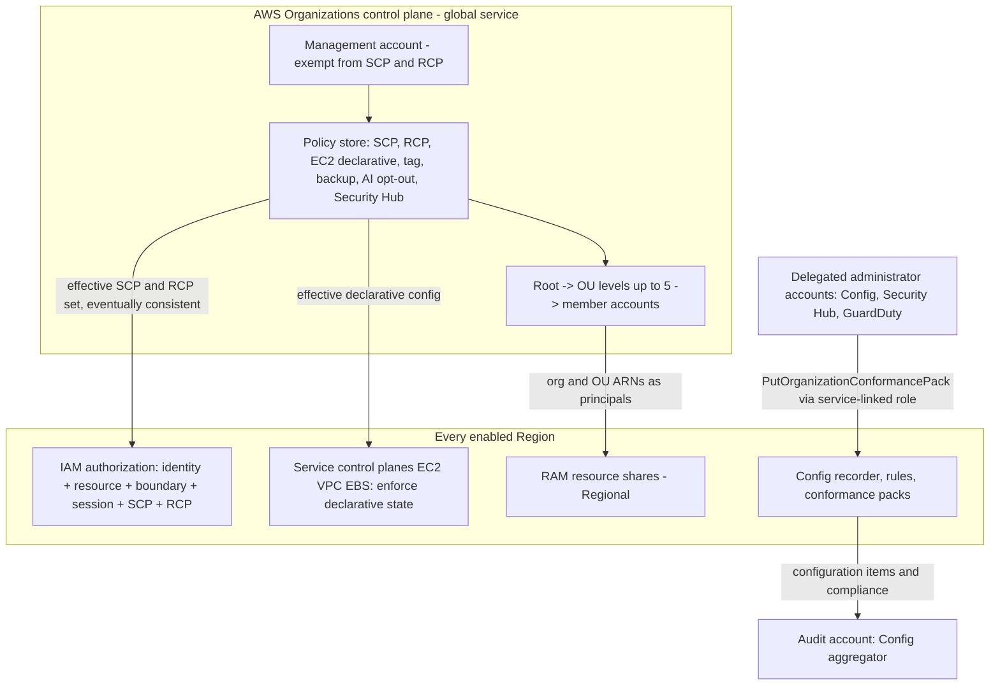

# AWS Organizations and Account Governance

## TL;DR

An SCP never grants anything; it only sets the most a principal can be allowed, and an Allow has to appear at every node from the root down to the account, while a Deny at any node wins.
SCPs and RCPs are checked in the IAM authorization path, but they do not apply to the management account or to service-linked roles, so both of those form an ungoverned channel that you must close by other means.
Declarative (EC2) policies are enforced in each service's control plane, not in the authorization path, so they keep holding when AWS adds a new API that changes the same setting; action-enumerating SCP denies do not.
RAM shares are Regional objects tied to organization membership, so when an account moves, leaves, or is re-parented, the shares behave like a distributed state change that has to be planned.
In AWS Config, rule count and cost both scale with accounts x Regions x rules x resource churn; the binding limit is 1,000 rules per Region per account, not 50 packs.

## Mental Model



Organizations is a policy compiler and distribution system.
It does not take part in the request path of your workloads.
You write intent once at a node of the tree.
The service projects that intent into three separate enforcement points:
- the IAM authorization engine (SCPs and RCPs), which decides each API call;
- the owning service's control plane (declarative policies), which pins configuration state;
- AWS Config, which detects drift after the fact.

RAM is a fourth consumer of the tree.
It uses org and OU membership as a principal set, which turns the tree into a sharing boundary as well as a permission boundary.
The core model: **preventive controls run inline on every request, configuration controls run inline on every mutation, and detective controls run asynchronously on recorded state.**
Each has its own blast radius, latency, and cost curve.

## Internals

### The tree as a failure-domain hierarchy

An organization has exactly one root, up to 2,000 OUs, and accounts as leaves ([AWS Organizations quotas](https://docs.aws.amazon.com/en_us/organizations/latest/userguide/orgs_reference_limits.html), as of 2026-10).
OUs nest at most five levels under the root ([AWS Cloud Operations blog on SCP design](https://aws.amazon.com/blogs/mt/achieving-operational-excellence-with-design-considerations-for-aws-organizations-scps), as of 2026-10).
The account is the hard isolation primitive.
IAM namespaces, service quotas, resource policies, and most API rate limits are scoped per account.
An OU has no runtime presence.
It is purely a policy attachment and inheritance point.
This is why the multi-account pattern is really a blast-radius pattern, the same logic as [[17-Cloud-AI-Engineering/Volume_01_Cloud_Architecture_Principles/Chapter_03_Cell_Based_Architecture_and_Shuffle_Sharding|cells]]:
- a runaway Lambda concurrency quota, a compromised admin role, or a quota-exhausting training job is contained by the account boundary;
- an OU only changes which guardrails apply.

The landing-zone view of this tree is covered in [[17-Cloud-AI-Engineering/Volume_01_Cloud_Architecture_Principles/Chapter_06_Multi_Account_and_Multi_Project_Landing_Zones|Multi-Account and Multi-Project Landing Zones]].
This chapter covers the enforcement machinery.

### Control plane vs data plane

The Organizations API is a global control plane.
Operations such as creating accounts, moving accounts, attaching policies, and enabling trusted access are low-rate administrative mutations.
SCP and RCP evaluation happens in the IAM authorization data plane, in every Region, on every request.
AWS does not publish how the effective policy set is replicated from Organizations into regional authorization.
Treat it the same way as IAM changes in general: eventually consistent, and not something to rely on as a sub-second lever during an incident (mechanism detail UNVERIFIED).
Following [[17-Cloud-AI-Engineering/Volume_01_Cloud_Architecture_Principles/Chapter_04_Control_Plane_vs_Data_Plane_Separation|control plane vs data plane separation]], the design consequence is static stability:
- workloads must not need Organizations API calls at runtime, for example to resolve OU membership;
- incident runbooks must not rely on attaching an SCP as the primary containment step.
Break-glass access should be pre-provisioned and exempt from the guardrails it may need to bypass.
The [AWS Fault Isolation Boundaries whitepaper](https://docs.aws.amazon.com/whitepapers/latest/aws-fault-isolation-boundaries/abstract-and-introduction.html) groups Organizations with other global services whose control plane is concentrated in us-east-1 (UNVERIFIED this session).

### SCP evaluation algebra (the mechanism the getting-started guide skips)

SCP attachment caps rose from 5 to 10 per node, and maximum SCP size from 5,120 to 10,240 characters ([AWS What's New, 2026-05](https://aws.amazon.com/about-aws/whats-new/2026/05/aws-organizations-increased-scp-quotas/), as of 2026-10).
The evaluation is a two-axis boolean algebra.
Most outage-causing SCP changes come from mixing up the two axes.

- **Within one node** (root, an OU, or the account itself), the SCPs attached directly to that node are **unioned** for Allow.
  The node passes a request if any attached SCP allows it and none denies it.
- **Across nodes** on the path from root to account, the per-node verdicts are **intersected**.
  AWS's own explanation is that SCPs filter permissions at each node by intersecting directly attached and inherited SCPs ([AWS re:Post knowledge center](https://repost.aws/knowledge-center/organization-scp-size), as of 2026-10).
- **Deny anywhere** on the path is final, as in identity-policy evaluation ([[17-Cloud-AI-Engineering/Volume_02_AWS_Deep_Dive/Chapter_01_IAM_Policy_Evaluation_Engine|IAM Policy Evaluation Engine]]).

Formally, for path P = (root, OU1, ..., OUk, account):

```
SCP_allows(req) = AND over n in P of [ OR over s attached to n of Allow_s(req) ]
                  AND NOT [ OR over n in P, s attached to n of Deny_s(req) ]
Effective(req)  = SCP_allows(req) AND RCP_allows(req) AND IAM_allows(req)
```

Three consequences follow, and they are rarely spelled out.

1. The account node is itself a filter.
   An Allow attached at the account cannot widen what a parent OU allows.
   It can only narrow.
   An allow-list at OU level caps every descendant, whatever you attach lower down.
2. `FullAWSAccess` is not decoration.
   Detaching it from any single node turns that node into an allow-list.
   That node then implicitly denies every service its remaining SCPs do not name, including services AWS launches next year.
3. On a path of root + 5 OUs + account, at most 7 x 10 = 70 SCPs and up to 716,800 characters of policy can bear on a single request (derived from the quotas above, as of 2026-10).
   No human reviews that by hand.
   Organizations offers no effective-policy view for SCPs or RCPs ([AWS docs, managing policies](https://docs.aws.amazon.com/organizations/latest/userguide/orgs_manage_policies.html), as of 2026-10), so you must build the path evaluation yourself (see the Worked Example).

Since 2025-09, SCPs support the full IAM policy language:
- conditions in Allow statements;
- individual resource ARNs;
- `NotAction` with Allow;
- `NotResource`;
- leading and mid-string wildcards in actions.

([AWS What's New, 2025-09](https://aws.amazon.com/about-aws/whats-new/2025/09/aws-organizations-iam-language-service-control-policies), as of 2026-10.)
That makes conditional allow-lists possible, and it also makes possible SCPs that are correct but unreadable.
Treat the extra expressiveness as a risk to manage, not only as a feature.

Character counting differs by write path.
The console strips whitespace between JSON elements before counting; SDK and CLI saves count what you send ([AWS Organizations quotas](https://docs.aws.amazon.com/en_us/organizations/latest/userguide/orgs_reference_limits.html), as of 2026-10).
For RCPs, all characters count ([AWS RCP docs](https://docs.aws.amazon.com/organizations/latest/userguide/orgs_manage_policies_rcps.html), as of 2026-10).
A policy that saves in the console can therefore fail in a pipeline.
Always minify in CI; Terraform's `jsonencode` does this for you.

### Who SCPs and RCPs do not touch

SCPs and RCPs do not affect the management account ([AWS docs, managing policies](https://docs.aws.amazon.com/organizations/latest/userguide/orgs_manage_policies.html), as of 2026-10).
Delegated administrator accounts are ordinary member accounts and are fully subject to RCPs ([AWS RCP docs](https://docs.aws.amazon.com/organizations/latest/userguide/orgs_manage_policies_rcps.html), as of 2026-10).
SCPs do restrict member-account root users.
Service-linked roles (SLRs) are outside SCP and RCP scope.
That is a deliberate design choice: AWS services must be able to act on your behalf even when customer guardrails are broken.

This creates a second, ungoverned control channel, and AWS Config conformance packs are its clearest example.
`PutConformancePack` runs through the `AWSServiceRoleForConfigConforms` SLR.
It can create Config rules and remediation configurations even when the caller's IAM policies explicitly deny `config:PutConfigRule` ([AWS Config API reference](https://docs.aws.amazon.com/config/latest/APIReference/API_PutConformancePack.html), as of 2026-10).
The practical rule is that the *trigger* action must be governed, even though the downstream SLR actions cannot be:
- deny `config:PutConformancePack` and `config:PutOrganizationConformancePack` to everyone except the platform role;
- otherwise any principal with that one permission can install remediation automation that runs with whatever automation role it names.

### RCPs: the resource-side ceiling

RCPs launched in November 2024.
They cap the maximum permissions *on resources* in member accounts, whoever the caller is, including principals outside the organization ([AWS RCP docs](https://docs.aws.amazon.com/organizations/latest/userguide/orgs_manage_policies_rcps.html), as of 2026-10).

Supported services, verified from AWS announcements (as of 2026-10):
- **launch:** S3, STS, KMS, SQS, Secrets Manager;
- **[2025-06](https://aws.amazon.com/about-aws/whats-new/2025/06/aws-resource-control-policies-additional-services):** ECR and OpenSearch Serverless;
- **[2026-01](https://aws.amazon.com/about-aws/whats-new/2026/01/aws-expands-resource-control-policies):** Cognito and CloudWatch Logs.

Other services may have been added since; check the RCP documentation before you rely on coverage.

RCP limits are still 5 per node and 5,120 characters; the 2026-05 quota increase did not apply to RCPs ([AWS docs, managing policies](https://docs.aws.amazon.com/organizations/latest/userguide/orgs_manage_policies.html), as of 2026-10).
Customer RCPs are deny-only, and the AWS-managed `RCPFullAWSAccess` is the only Allow ([native.security summary of AWS docs](https://www.native.security/cloud-docs/aws-rcp), as of 2026-08).

The design pairing is:
- **SCPs** answer "what may *my* principals do anywhere";
- **RCPs** answer "who may touch *my* resources".

A data perimeter needs both, plus network-path controls ([[17-Cloud-AI-Engineering/Volume_08_Security_Identity_and_the_Data_Perimeter/Chapter_06_Constructing_an_Impenetrable_Data_Perimeter|Constructing an Impenetrable Data Perimeter]]).

### Declarative policies: enforcement at the control plane

Declarative policies, now documented as EC2 policies with policy type `DECLARATIVE_POLICY_EC2`, are enforced in the service's control plane, not in IAM authorization ([AWS declarative policy docs](https://docs.aws.amazon.com/organizations/latest/userguide/orgs_manage_policies_declarative.html), as of 2026-10).
AWS states that once one is attached, the configuration is kept even when the service adds new features or APIs ([AWS EC2 policies docs](https://docs.aws.amazon.com/organizations/latest/userguide/orgs_manage_policies_ec2.html), as of 2026-10).

Supported attributes (as of 2026-10):
- VPC Block Public Access;
- Serial Console Access;
- Image Block Public Access;
- Allowed Images Settings;
- Instance Metadata Defaults;
- EBS Snapshot Block Public Access.

Why this matters:
- An SCP that tries to prevent "public AMIs" has to enumerate every API that can make an AMI public, such as `ModifyImageAttribute`.
  If EC2 ships a new API path, the SCP silently stops being complete.
- A declarative policy pins the *state* ("block new sharing"), so the service refuses any mutation that would violate it, whichever API carries it.
  This is the same idea as GCP Organization Policy constraints, and it is why GCP's governance model has historically resisted new-API drift better.

Declarative policies also offer an account status report to assess readiness, and custom error messages that can point users to an internal wiki ([AWS declarative policy docs](https://docs.aws.amazon.com/organizations/latest/userguide/orgs_manage_policies_declarative.html), as of 2026-10).

### Other organization policy types

Organizations also manages these policy types (as of 2026-10):
- backup policies;
- tag policies;
- chat applications policies;
- AI services opt-out policies;
- Security Hub policies.

Each has its own per-organization count quota and size limit ([AWS Organizations quotas](https://docs.aws.amazon.com/en_us/organizations/latest/userguide/orgs_reference_limits.html), as of 2026-10).
These "management policies" are merged with `@@assign`-style inheritance operators rather than intersected, and some of them support effective-policy views.
Their merge semantics are not the SCP algebra.
Do not reason about them as if they were.

### RAM: sharing as a capability grant

RAM is a Regional service.
Principals can reach a share only in the Region where the resource was created ([AWS RAM docs](https://docs.aws.amazon.com/ram/latest/userguide/getting-started-sharing.html), as of 2026-10).
A share bundles three things:
- resources;
- a managed permission per resource type (AWS managed, or customer managed where supported);
- principals, which can be accounts, OUs, the whole organization, or IAM roles and users for some types.

Once sharing with Organizations is enabled:
- RAM creates the `AWSServiceRoleForResourceAccessManager` SLR;
- in-org shares skip the invitation handshake;
- by default, in-org sharing restricts consumers to the same organization ([AWS RAM docs](https://docs.aws.amazon.com/ram/latest/userguide/getting-started-sharing.html), as of 2026-10).

Sharing a resource does not change the owner-side permissions or quotas that apply to it ([AWS RAM docs](https://docs.aws.amazon.com/ram/latest/userguide/getting-started-sharing.html), as of 2026-10).
For a shared subnet, this means IP space, route tables, and quota pressure stay with the owning network account.
Participants consume the space but cannot manage it.
That is a centralization trade-off:
- **gain:** one IPAM plan, one egress stack, one inspection path;
- **cost:** a single owner account whose quotas and mistakes affect every participant.

Shared-subnet placement has a subtle cross-account trap: AZ names.
Historically, AZ names such as `us-east-1a` were mapped to physical zones independently per account.
Only AZ IDs such as `use1-az1` are stable across accounts.
Capacity reservations, zonal failover drills, and "same-AZ" latency assumptions must therefore be expressed in AZ IDs (whether newer Regions randomize the mapping is UNVERIFIED).

### AWS Config and conformance packs

AWS Config has three main parts:
- a per-account, per-Region **recorder** that emits configuration items (CIs) when resources change;
- **rules**, which evaluate CIs either on change or on a schedule;
- **aggregators**, which pull compliance and CIs across accounts.

A conformance pack is a template containing only `AWS::Config::ConfigRule` and `AWS::Config::RemediationConfiguration` resources plus parameters ([hidekazu-konishi.com guide](https://hidekazu-konishi.com/entry/aws_config_rules_conformance_packs_and_remediation_guide.html), as of 2026-09).
Organization conformance packs are deployed from the management account or a delegated administrator.
They are created in each member account by the conformance-pack SLR ([AWS Config API reference](https://docs.aws.amazon.com/config/latest/APIReference/API_PutOrganizationConformancePack.html), as of 2026-10).

The quota that actually binds is that rules inside packs count toward the 1,000 rules per Region per account limit, which is not adjustable.
Organization-level deployments count against each child account ([AWS Config service limits](https://docs.aws.amazon.com/config/latest/developerguide/configlimits.html), as of 2026-10).
At 130 rules per pack, 50 packs per account is unreachable.
The real ceiling is about seven full packs, before Control Tower detective controls and service-managed rules take their share.

### Foundational research behind policy analysis

Two primary sources sit behind every SCP and RCP linting tool you should use.

- **Zelkova:** Backes et al., *Semantic-based Automated Reasoning for AWS Access Policies using SMT* (FMCAD 2018).
  It encodes IAM policies as SMT formulas and answers questions like "does any request satisfy policy A but not policy B".
  This is the right tool for proving that an SCP refactor preserves semantics.
- **IAM Access Analyzer:** Backes et al., *Stratified Abstraction of Access Control Policies* (CAV 2020).
  It shows how a policy can be summarized into finite findings, which is the basis of external-access analysis.

## Numbers to Know

| Item | Value | Source |
| --- | --- | --- |
| Roots per organization | 1 | (AWS Organizations quotas, as of 2026-10) |
| OUs per organization | 2,000 | (AWS Organizations quotas, as of 2026-10) |
| OU nesting depth under root | 5 levels | (AWS Cloud Operations blog, as of 2026-10) |
| SCPs attached per root, OU, or account | 10 (was 5 before 2026-05) | (AWS What's New 2026-05, as of 2026-10) |
| Max SCP size | 10,240 characters (was 5,120) | (AWS What's New 2026-05, as of 2026-10) |
| RCPs attached per node / max RCP size | 5 / 5,120 characters | (AWS Organizations docs, as of 2026-10) |
| SCPs definable per org / RCPs per org | 10,000 / 1,000 | (AWS Organizations quotas, as of 2026-10) |
| Declarative, tag, backup policy max size | 10,000 characters | (AWS Organizations quotas, as of 2026-10) |
| AI services opt-out policy max size | 2,500 characters | (AWS Organizations quotas, as of 2026-10) |
| Worst-case SCP text on one request path | 7 nodes x 10 x 10,240 = 716,800 chars | (derived from above, as of 2026-10) |
| Minimum age of a created account before removal | 7 days | (AWS Organizations quotas, as of 2026-10) |
| Config rules per Region per account | 1,000, not adjustable, packs included | (AWS Config limits, as of 2026-10) |
| Conformance packs per account / per org | 50 / 50, not adjustable | (AWS Config limits, as of 2026-10) |
| Rules per conformance pack | 130, not adjustable | (AWS Config limits, as of 2026-10) |
| Input parameters per conformance pack | 60 | (risk-sentinel repo citing AWS API reference, as of 2026-09) |
| Config aggregators / accounts per aggregator | 50 adjustable / 10,000 | (AWS Config limits, as of 2026-10) |
| Accounts added or removed per week across aggregators | 1,000, adjustable | (AWS Config limits, as of 2026-10) |
| Config CI price, continuous / periodic | $0.003 / $0.012 per CI | (AWS Config pricing, as of 2026-10) |
| Config rule evaluation, first 100,000 per Region per month | $0.001 | (AWS Config pricing, as of 2026-10) |
| Conformance pack evaluation tiers | $0.001 first 100k, $0.0008 next 400k, $0.0005 beyond | (CloudZero summary of AWS pricing, as of 2026-07) |
| Periodic vs continuous break-even | 4 changes per resource per day ($0.012 / $0.003) | (derived from AWS Config pricing, as of 2026-10) |
| Direct org-to-org account transfer | GA in commercial and GovCloud (US) since 2025-11 | (AWS What's New 2025-11, as of 2026-10) |
| SCP full IAM language | GA since 2025-09 | (AWS What's New 2025-09, as of 2026-10) |

## AWS vs GCP Mechanism Parity

| Concern | AWS mechanism | Google Cloud mechanism | Critical difference |
| --- | --- | --- | --- |
| Hierarchy | Root, OUs (5 levels), accounts | Organization, folders, projects | GCP folder depth limit not verified this session (UNVERIFIED); in both clouds, the account or project is the isolation unit |
| Billing coupling | Consolidated billing tied to the organization | Cloud Billing accounts are separate from the resource hierarchy | On AWS, moving an account changes the payer; in GCP, billing linkage is re-pointed independently |
| Principal guardrail | SCP: max-permission ceiling, union within node, intersection across nodes | IAM deny policies attached at org, folder, or project | SCP exempts the management account and SLRs; GCP deny policies target named principals and permissions with no exempt "management project" (exemption semantics UNVERIFIED) |
| Resource guardrail | RCP on a limited service list | VPC Service Controls perimeters plus org policy `iam.allowedPolicyMemberDomains` | VPC SC gates API access by perimeter and context; RCP is a policy ceiling with no network context unless conditions add it; see [[17-Cloud-AI-Engineering/Volume_03_GCP_Deep_Dive/Chapter_03_VPC_Service_Controls_Security_Perimeters\|VPC Service Controls]] |
| Configuration guardrail | Declarative (EC2) policies in the EC2, VPC, and EBS control planes | Organization Policy constraints: boolean, list, and custom CEL | GCP covers far more services; AWS declarative coverage is EC2-family only (as of 2026-10) |
| New-API drift | SCP denies enumerate actions and go stale; declarative policies do not | Constraints pin state at resource create or update | Prefer state-pinning controls in both clouds when they exist |
| Cross-account sharing | RAM: Regional shares, managed permissions, org/OU principals | IAM bindings across projects; Shared VPC host and service projects | GCP has no general RAM analog because IAM is natively hierarchical and cross-project |
| Detective compliance | Config recorder, rules, conformance packs, aggregators | Cloud Asset Inventory, Security Command Center posture | Config bills per CI and per evaluation; the cost model differs fundamentally |
| Central admin delegation | Delegated administrator per service principal | IAM roles granted at org or folder level | AWS delegation is per service and enumerable; GCP delegation is ordinary IAM |
| Hierarchy-aware condition keys | `aws:PrincipalOrgID`, `aws:PrincipalOrgPaths`, `aws:ResourceOrgID`, `aws:SourceOrgID` | Resource ancestry via IAM conditions and Resource Manager tags | Both couple policies to the tree; moving nodes changes authorization |

See [[17-Cloud-AI-Engineering/Volume_03_GCP_Deep_Dive/Chapter_01_Resource_Hierarchy_and_Organization_Policies|Resource Hierarchy and Organization Policies]] and [[17-Cloud-AI-Engineering/Volume_04_AWS_vs_GCP_Translation/Chapter_03_Identity_Security_and_Governance_Translation|Identity, Security, and Governance Translation]] for the GCP side.

## Worked Example: Canary-Gated SCPs, an OU-Scoped Subnet Share, and an Org Conformance Pack

### Step 0: Offline SCP path evaluator (no cost)

Organizations does not show effective SCPs, so model the path algebra locally before you attach anything.
This script runs on any Python 3.8+ and makes no AWS calls.

```python
#!/usr/bin/env python3
"""Offline SCP path evaluator: union within a node, intersection across nodes."""
import fnmatch, json

def _match_any(patterns, value):
    pats = [patterns] if isinstance(patterns, str) else patterns
    return any(fnmatch.fnmatchcase(value.lower(), p.lower()) for p in pats)

def _cond_ok(cond, ctx):
    for op, kv in (cond or {}).items():
        for key, want in kv.items():
            want = [want] if isinstance(want, str) else want
            have = ctx.get(key)
            if op == "StringNotEquals" and have in want:
                return False
            if op == "StringEquals" and have not in want:
                return False
            if op == "ArnNotLike" and any(fnmatch.fnmatchcase(have or "", w) for w in want):
                return False
    return True

def _stmt_applies(st, action, ctx):
    if "Action" in st and not _match_any(st["Action"], action):
        return False
    if "NotAction" in st and _match_any(st["NotAction"], action):
        return False
    return _cond_ok(st.get("Condition"), ctx)

def node_verdict(policies, action, ctx):
    allowed = False
    for pol in policies:
        for st in pol["Statement"]:
            if _stmt_applies(st, action, ctx):
                if st["Effect"] == "Deny":
                    return "DENY"
                allowed = True
    return "ALLOW" if allowed else "IMPLICIT_DENY"

def evaluate(path, action, ctx):
    for name, policies in path:
        v = node_verdict(policies, action, ctx)
        if v != "ALLOW":
            return f"{v} at {name}"
    return "ALLOWED by SCPs (IAM identity/resource policies still required)"

FULL = {"Statement": [{"Effect": "Allow", "Action": "*", "Resource": "*"}]}
REGION_DENY = {"Statement": [{
    "Effect": "Deny",
    "NotAction": ["iam:*", "organizations:*", "sts:*", "support:*",
                  "cloudfront:*", "route53:*", "budgets:*"],
    "Resource": "*",
    "Condition": {"StringNotEquals": {"aws:RequestedRegion": ["us-east-1", "eu-west-1"]},
                  "ArnNotLike": {"aws:PrincipalARN": ["arn:aws:iam::*:role/platform-breakglass"]}}}]}
ALLOW_LIST = {"Statement": [{"Effect": "Allow",
    "Action": ["ec2:*", "s3:*", "sagemaker:*", "iam:*", "sts:*"], "Resource": "*"}]}

if __name__ == "__main__":
    path = [("Root", [FULL, REGION_DENY]),
            ("OU:Workloads", [ALLOW_LIST]),
            ("OU:Prod", [FULL]),
            ("Account:111122223333", [FULL, {"Statement": [{"Effect": "Allow",
                "Action": "bedrock:*", "Resource": "*"}]}])]
    dev = {"aws:PrincipalARN": "arn:aws:iam::111122223333:role/dev"}
    cases = [("s3:PutObject", dict(dev, **{"aws:RequestedRegion": "eu-west-1"})),
             ("s3:PutObject", dict(dev, **{"aws:RequestedRegion": "ap-south-1"})),
             ("bedrock:InvokeModel", dict(dev, **{"aws:RequestedRegion": "us-east-1"})),
             ("iam:CreateRole", dict(dev, **{"aws:RequestedRegion": "us-east-1"})),
             ("s3:PutObject", {"aws:PrincipalARN": "arn:aws:iam::111122223333:role/platform-breakglass",
                               "aws:RequestedRegion": "ap-south-1"})]
    for action, ctx in cases:
        print(f"{action:22s} {ctx['aws:RequestedRegion']:11s} -> {evaluate(path, action, ctx)}")
    pretty, mini = json.dumps(REGION_DENY, indent=4), json.dumps(REGION_DENY, separators=(",", ":"))
    print(f"REGION_DENY: pretty={len(pretty)} chars, minified={len(mini)} chars")
```

Observed output:

```
s3:PutObject           eu-west-1   -> ALLOWED by SCPs (IAM identity/resource policies still required)
s3:PutObject           ap-south-1  -> DENY at Root
bedrock:InvokeModel    us-east-1   -> IMPLICIT_DENY at OU:Workloads
iam:CreateRole         us-east-1   -> ALLOWED by SCPs (IAM identity/resource policies still required)
s3:PutObject           ap-south-1  -> ALLOWED by SCPs (IAM identity/resource policies still required)
REGION_DENY: pretty=769 chars, minified=307 chars
```

The third line is the lesson: the account-level `bedrock:*` Allow is useless because the Workloads OU's allow-list is a filter above it.
The last line shows that indentation alone took this policy to 2.5x its minified size.
That is the console-versus-pipeline size divergence in miniature.
This toy handles only three condition operators, so for production equivalence checks use IAM Access Analyzer policy validation and the IAM policy simulator.

### Step 1: Prerequisites (run once, from the management account, in a lab organization)

```bash
ROOT_ID=$(aws organizations list-roots --query 'Roots[0].Id' --output text)
aws organizations enable-policy-type --root-id "$ROOT_ID" --policy-type SERVICE_CONTROL_POLICY
aws organizations enable-aws-service-access --service-principal config.amazonaws.com
aws organizations enable-aws-service-access --service-principal config-multiaccountsetup.amazonaws.com
aws ram enable-sharing-with-aws-organization
# Organization conformance packs require the Config recorder to be running in each target member account.
```

In production, register a delegated administrator for `config-multiaccountsetup.amazonaws.com` in an audit or security account.
Run RAM shares from a network account, not the management account.

### Step 2: OpenTofu / Terraform

```hcl
terraform {
  required_version = ">= 1.6"
  required_providers {
    aws = { source = "hashicorp/aws", version = ">= 5.60" }
  }
}

provider "aws" {
  region = "us-east-1"
}

variable "alert_email" { type = string }
variable "allowed_regions" {
  type    = list(string)
  default = ["us-east-1", "eu-west-1"]
}

data "aws_organizations_organization" "this" {}

locals {
  root_id = data.aws_organizations_organization.this.roots[0].id
  platform_roles = [
    "arn:aws:iam::*:role/platform-breakglass",
    "arn:aws:iam::*:role/platform-pipeline",
  ]
}

resource "aws_organizations_organizational_unit" "workloads" {
  name      = "Workloads"
  parent_id = local.root_id
}

resource "aws_organizations_organizational_unit" "canary" {
  name      = "Workloads-Canary"
  parent_id = aws_organizations_organizational_unit.workloads.id
}

# jsonencode emits minified JSON, so size checks match what Organizations counts.
resource "aws_organizations_policy" "baseline_guard" {
  name = "baseline-guard-v1"
  type = "SERVICE_CONTROL_POLICY"
  content = jsonencode({
    Version = "2012-10-17"
    Statement = [
      {
        Sid    = "DenyUnapprovedRegions"
        Effect = "Deny"
        NotAction = [
          "iam:*", "organizations:*", "sts:*", "support:*", "cloudfront:*",
          "route53:*", "budgets:*", "ce:*", "cur:*", "health:*",
          "globalaccelerator:*", "shield:*", "waf:*", "wafv2:*",
          "s3:ListAllMyBuckets"
        ]
        Resource = "*"
        Condition = {
          StringNotEquals = { "aws:RequestedRegion" = var.allowed_regions }
          ArnNotLike      = { "aws:PrincipalARN" = local.platform_roles }
        }
      },
      {
        Sid      = "DenyLeavingOrg"
        Effect   = "Deny"
        Action   = ["organizations:LeaveOrganization"]
        Resource = "*"
      },
      {
        Sid    = "ProtectDetectiveControls"
        Effect = "Deny"
        Action = [
          "config:StopConfigurationRecorder", "config:DeleteConfigurationRecorder",
          "config:DeleteDeliveryChannel", "config:PutConformancePack",
          "config:DeleteConformancePack", "cloudtrail:StopLogging", "cloudtrail:DeleteTrail"
        ]
        Resource = "*"
        Condition = {
          ArnNotLike = { "aws:PrincipalARN" = local.platform_roles }
        }
      }
    ]
  })
}

# Canary first: attach only to the canary OU; promote to Workloads after the soak.
resource "aws_organizations_policy_attachment" "canary" {
  policy_id = aws_organizations_policy.baseline_guard.id
  target_id = aws_organizations_organizational_unit.canary.id
}

# RAM: share one subnet with every current and future account in the Workloads OU.
resource "aws_vpc" "shared" {
  cidr_block = "10.42.0.0/16"
  tags       = { Name = "shared-vpc-lab" }
}

resource "aws_subnet" "shared_a" {
  vpc_id               = aws_vpc.shared.id
  cidr_block           = "10.42.0.0/20"
  availability_zone_id = "use1-az1" # AZ ID, not AZ name: stable across accounts
}

resource "aws_ram_resource_share" "subnets" {
  name                      = "workloads-subnets"
  allow_external_principals = false
}

resource "aws_ram_resource_association" "subnet_a" {
  resource_arn       = aws_subnet.shared_a.arn
  resource_share_arn = aws_ram_resource_share.subnets.arn
}

resource "aws_ram_principal_association" "workloads_ou" {
  principal          = aws_organizations_organizational_unit.workloads.arn
  resource_share_arn = aws_ram_resource_share.subnets.arn
}

# Organization conformance pack: three rules, deployed by the conformance-pack SLR.
resource "aws_config_organization_conformance_pack" "baseline" {
  name          = "org-baseline-lite"
  template_body = <<-EOT
    Resources:
      S3PublicReadProhibited:
        Type: AWS::Config::ConfigRule
        Properties:
          ConfigRuleName: s3-bucket-public-read-prohibited
          Scope:
            ComplianceResourceTypes:
              - AWS::S3::Bucket
          Source:
            Owner: AWS
            SourceIdentifier: S3_BUCKET_PUBLIC_READ_PROHIBITED
      EbsEncryptionByDefault:
        Type: AWS::Config::ConfigRule
        Properties:
          ConfigRuleName: ec2-ebs-encryption-by-default
          Source:
            Owner: AWS
            SourceIdentifier: EC2_EBS_ENCRYPTION_BY_DEFAULT
      IamRootAccessKeyCheck:
        Type: AWS::Config::ConfigRule
        Properties:
          ConfigRuleName: iam-root-access-key-check
          Source:
            Owner: AWS
            SourceIdentifier: IAM_ROOT_ACCESS_KEY_CHECK
  EOT
}

resource "aws_budgets_budget" "lab" {
  name         = "org-governance-lab"
  budget_type  = "COST"
  limit_amount = "10"
  limit_unit   = "USD"
  time_unit    = "MONTHLY"

  notification {
    comparison_operator        = "GREATER_THAN"
    threshold                  = 80
    threshold_type             = "PERCENTAGE"
    notification_type          = "ACTUAL"
    subscriber_email_addresses = [var.alert_email]
  }
}
```

### Step 3: Validate and observe

```bash
tofu output -raw 2>/dev/null; tofu state show aws_organizations_policy.baseline_guard | grep -c Sid
aws organizations describe-policy --policy-id <p-id> --query 'Policy.Content' --output text > /tmp/scp.json
aws accessanalyzer validate-policy --policy-type SERVICE_CONTROL_POLICY --policy-document file:///tmp/scp.json
# Move ONE disposable test account into the canary OU, then exercise it.
aws organizations move-account --account-id <test-acct> --source-parent-id "$ROOT_ID" \
  --destination-parent-id <canary-ou-id>
aws configservice describe-organization-conformance-pack-statuses
aws configservice get-organization-conformance-pack-detailed-status \
  --organization-conformance-pack-name org-baseline-lite
```

In the canary account, a call to a non-approved Region should fail with an AccessDenied that names an explicit deny in a service control policy.
CloudTrail in that account records the denial.

### Step 4: Lab cost estimate

- Organizations, OUs, SCPs, RAM shares, and an empty VPC and subnet: no direct charge (Organizations and RAM pricing UNVERIFIED this session; no NAT gateway or endpoints are created).
- Config, assuming two member accounts in one Region with recorders on, about 300 CIs and about 600 conformance-pack evaluations in the month:
  - 300 x $0.003 = $0.90;
  - 600 x $0.001 = $0.60;
  - total about $1.50 per month (AWS Config pricing, as of 2026-10).
- Tear down the same day and the cost is cents.
- The $10 budget alarm fires at $8 actual spend.

### Step 5: Exact teardown

```bash
aws organizations move-account --account-id <test-acct> --source-parent-id <canary-ou-id> \
  --destination-parent-id "$ROOT_ID"
tofu destroy -auto-approve
# Optional, only in a dedicated lab org:
aws organizations disable-aws-service-access --service-principal config-multiaccountsetup.amazonaws.com
```

OU deletion fails while any account remains in the OU, which is why the move-back must come first.

### Capacity and cost sizing for a real fleet

Assume 400 accounts x 4 active Regions = 1,600 account-Regions.

1. **CI volume.**
   Assume 320 ordinary accounts at about 1,500 CIs per Region per month, and 80 ML accounts with spot nodes and ephemeral ENIs at about 20,000.
   - Ordinary: 320 x 4 x 1,500 = 1.92M CIs.
   - ML: 80 x 4 x 20,000 = 6.4M CIs.
   - Total 8.32M x $0.003 = **$24,960 per month**, of which 77% comes from 20% of accounts (AWS Config pricing, as of 2026-10).
2. **Periodic recording does not automatically save money.**
   A resource that changes k times a day costs 0.003k continuous versus 0.012 periodic, so periodic only wins when k > 4.
   Ephemeral ENIs are new resources with k of about 1, so the better lever is excluding those resource types from recording in ML accounts.
   Keep their governance through SCPs and declarative policies instead.
3. **Conformance-pack evaluations.**
   An org pack of 40 rules averaging 250 evaluations per rule per account-Region per month gives 10,000 evaluations per account-Region.
   That stays in the $0.001 tier (assuming tiers apply per account per Region; UNVERIFIED).
   1,600 x $10 = **$16,000 per month**.
   Doubling rules or Regions doubles this linearly.
4. **Rule quota headroom.**
   Suppose Control Tower and baseline detective controls use about 150 rules per account-Region (UNVERIFIED estimate), plus the 40-rule org pack.
   That leaves 810 of 1,000 for teams (AWS Config limits, as of 2026-10).
   Adding one 130-rule framework pack leaves 680.
5. **SCP character budget.**
   The region guard is 307 characters minified with 7 exemptions.
   AWS's fuller global-service exemption list (about 40 entries) stays well under 10,240.
   The real constraint is human review of the up to 70 SCPs on a path, not bytes.

## Failure Modes and Pitfalls

1. **Region-deny without global-service exemptions.**
   Global services such as IAM, Organizations, Route 53, CloudFront, and Support resolve `aws:RequestedRegion` to us-east-1.
   A naive region deny that excludes us-east-1 breaks IAM role creation, console sign-in flows, and billing tools in every account under that node.
   This failure is fleet-wide and instant, and it also breaks the pipeline you would use to revert it, unless the platform role is exempt.
2. **Detaching `FullAWSAccess` at an intermediate OU.**
   Every service not named in that OU's remaining Allows is implicitly denied below it, including newly launched services teams are waiting to adopt.
   The symptom looks like "the new AI service is broken in prod only", and the ticket goes to the wrong team.
3. **Testing at the account, deploying at the OU.**
   Because of the union-within-node, intersection-across-nodes algebra, the same SCP can behave differently at the account than at an OU that already has other attached Allows.
   Canary by moving test accounts into a canary child OU that mirrors the target path, as in the Worked Example.
4. **Pipeline-only size failures.**
   Pretty-printed JSON passes in the console, which strips whitespace, and fails through SDK or CLI, which counts it (AWS Organizations quotas, as of 2026-10).
   RCPs count every character.
5. **Workloads in the management account.**
   SCPs and RCPs do not apply there.
   Any workload or long-lived credential in that account sits outside every preventive control you have built.
   Keep it empty, delegate administration, and protect it with identity-level controls.
6. **The SLR side channel.**
   SCPs cannot stop service-linked roles.
   `PutConformancePack` creates rules and remediations through an SLR even when the caller's IAM explicitly denies those actions (AWS Config API reference, as of 2026-10).
   Gate the trigger APIs.
7. **Org-ID coupled policies during account moves.**
   Resource policies conditioned on `aws:PrincipalOrgID` or `aws:PrincipalOrgPaths` start denying the moment an account changes organization or OU.
   In-org RAM shares restrict access to consumers in the same organization by default (AWS RAM docs, as of 2026-10).
   Direct transfers (2025-11) remove the standalone phase, but the new organization's SCPs and RCPs apply on arrival ([AWS re:Post](https://repost.aws/knowledge-center/organizations-move-accounts), as of 2026-10).
   AWS's recommended pattern uses RAM resource share retention with temporary bridge shares ([AWS Cloud Operations blog](https://aws.amazon.com/blogs/mt/transfer-aws-accounts-between-aws-organizations-while-preserving-aws-lake-formation-permissions/), as of 2026-10).
8. **Config quota exhaustion during a compliance push.**
   A second 130-rule framework pack can fail in a subset of accounts that already carry team rules, because packs count against the 1,000-rule limit (AWS Config limits, as of 2026-10).
   Organization pack status is per account, so "deployed" in the delegated admin console can hide partial failure.
   Alert on detailed status, not on the API call returning success.
9. **Config cost explosion in ML accounts.**
   Spot-heavy GPU fleets, EKS node churn, and per-pod ENIs generate CIs in proportion to scheduling activity, not to the value of the governance.
   The bill scales with training-job churn.
10. **Control-plane concentration.**
    Organizations is a global service with a us-east-1-anchored control plane (UNVERIFIED this session).
    During regional events affecting us-east-1, account vending and policy changes may be unavailable even while workloads elsewhere run.
    See AWS's [Post-Event Summaries](https://aws.amazon.com/premiumsupport/technology/pes/), including the December 2021 and October 2025 us-east-1 summaries.
    Their specific impact on Organizations APIs is UNVERIFIED here; read them for the static-stability lesson in [[17-Cloud-AI-Engineering/Volume_07_Reliability_and_SRE/Chapter_07_Anatomy_of_Major_Cloud_Outages|Anatomy of Major Cloud Outages]].
11. **AZ-name assumptions in shared VPCs.**
    Participant teams that pin "us-east-1a" in their IaC may land in a different physical AZ than the network team assumed.
    Use AZ IDs end to end.

## Security and Cost Angles

### IAM scoping

- Restrict `organizations:*` mutations to a pipeline role in the management account, behind MFA-gated human approval.
- Delegate Config, Security Hub, GuardDuty, and IAM Access Analyzer administration to a security account so humans rarely touch the management account.
- Every guardrail SCP should exempt a small, named set of platform roles by `aws:PrincipalARN`, never by tag, because tags can be edited by principals with tagging permissions.
- Deny `organizations:LeaveOrganization`, and deny tampering with CloudTrail, Config, and guardrail roles, at the root.
- Centralized root access management for member accounts (sts:AssumeRoot) removes long-lived root credentials from member accounts (feature details UNVERIFIED this session).

### Data perimeter

- RCP on S3, KMS, STS, SQS, and Secrets Manager: deny unless `aws:PrincipalOrgID` equals your org, with exceptions for `aws:PrincipalIsAWSService` and known third parties.
- SCP: deny calls to resources outside your org via `aws:ResourceOrgID` where supported.
- VPC endpoint policies close the network path.
- Third-party SaaS integrations are the most common RCP casualty, so inventory their principals first ([Tenable on RCPs](https://www.tenable.com/blog/new-aws-control-policy-on-the-block), as of 2024-12).
- See [[17-Cloud-AI-Engineering/Volume_08_Security_Identity_and_the_Data_Perimeter/Chapter_06_Constructing_an_Impenetrable_Data_Perimeter|Constructing an Impenetrable Data Perimeter]].

### Key hierarchy for governance data

- Config delivery and organization CloudTrail go to a log-archive account bucket encrypted with a customer managed KMS key.
- The key policy grants the Config and CloudTrail service principals encrypt access, conditioned on `aws:SourceOrgID`, which prevents confused-deputy writes from foreign organizations.
- Readers in the audit account get decrypt through a grant, not through key-policy wildcards.
- See [[17-Cloud-AI-Engineering/Volume_08_Security_Identity_and_the_Data_Perimeter/Chapter_04_Encryption_Key_Hierarchies_and_Envelope_Encryption|Encryption Key Hierarchies and Envelope Encryption]].

### Prefer state-pinning controls

- Where a declarative policy exists, use it instead of an SCP deny, for example for AMI and snapshot public sharing, IMDS defaults, and VPC Block Public Access.
- It cannot go stale when EC2 adds APIs (AWS EC2 policies docs, as of 2026-10).

### Unit economics levers

- Record global resource types such as IAM in exactly one Region so you do not pay for duplicate CIs.
- Exclude high-churn, low-signal types in ML and batch accounts.
- Use periodic recording only for types that change more than four times a day.
- Push "must never happen" checks left into SCPs and declarative policies, which have no per-request charge.
- Keep Config for "must be detected and evidenced".
- Track cost per account-Region as a governance KPI ([[17-Cloud-AI-Engineering/Volume_09_FinOps_and_Cloud_Economics/Chapter_01_Cloud_Billing_Models_and_Unit_Cost_Allocation|Cloud Billing Models and Unit Cost Allocation]]).

## Interview Questions and Model Answers

### Question 1 (L5 - Senior)

A developer in account 1111 under OU path Root > Workloads > Prod has AdministratorAccess.
The platform team attached an SCP allowing `bedrock:*` directly to account 1111, yet `bedrock:InvokeModel` still returns AccessDenied.
Explain why and fix it without weakening other guardrails.

#### Model Answer

SCPs combine on two axes: SCPs attached to the same node are unioned, and the per-node results along the path are intersected.
The request must be allowed at Root, at Workloads, at Prod, and at the account.
An Allow at the account cannot add anything a parent filtered out.
The likely cause is that some OU on the path has had `FullAWSAccess` detached and replaced with an allow-list that does not name Bedrock.
That produces an implicit deny at that node.
I would confirm through the AccessDenied text and CloudTrail, which identify an SCP as the denying policy type.
I would also run a path evaluation, because Organizations does not show effective SCPs.
Fixes, in order of preference:
- add `bedrock:*` to the allow-list at the OU that filters it, scoped with conditions if needed (supported since full IAM language in 2025-09);
- or move that OU from an allow-list to `FullAWSAccess` plus targeted denies.

I would then remove the useless account-level Allow, because dead policy text misleads the next reader.
Finally I would add a CI test that evaluates representative actions against the full path for each OU.

#### Follow-up Interviewer Question

The fix works, but leadership wants Bedrock limited to two Regions and three model families.
Where do you put that constraint, and what breaks if you put it in the account-level SCP instead of the OU?

### Question 2 (L5 - Senior)

Your network team shares subnets from a central VPC to the Workloads OU through RAM.
What do participant accounts own, what can they not do, and what are the operational failure modes?

#### Model Answer

The owner account owns the VPC, subnets, route tables, NACLs, and gateways.
Participants own the resources they launch into shared subnets, plus their own security groups.
Because RAM sharing does not change owner-side permissions or quotas, IP exhaustion and VPC-scoped quotas land on the network account, not on the team causing them.
Sharing to the OU ARN means future accounts in the OU get access with no invitation, because in-org shares skip the handshake.
The failure modes I watch:
- **IP exhaustion:** one team's EKS cluster with per-pod IPs drains a shared /20 and blocks unrelated teams.
- **AZ names:** teams pin AZ names instead of AZ IDs and silently land in different physical zones.
- **Regionality:** shares are Regional, so a DR Region needs its own shares.
- **Org changes:** moving an account out of the OU or org revokes access mid-flight.

Mitigations:
- per-team subnets inside the shared VPC;
- IPAM-driven allocation with alarms on free-IP percentage;
- AZ IDs in all modules;
- a pre-move checklist that enumerates the account's RAM consumption.

#### Follow-up Interviewer Question

A participant team asks for permission to modify route tables for a new egress appliance.
How do you meet the need without breaking the shared-VPC ownership model?

### Question 3 (L6 - Staff)

Design a data perimeter that ensures only your organization's identities can access your S3, KMS, and Secrets Manager data, and only from expected networks.
Explain why SCPs alone are insufficient.

#### Model Answer

The perimeter has three questions and each needs its own control plane.

1. **Identity perimeter:** only trusted identities may access my resources.
   This is an RCP denying requests unless `aws:PrincipalOrgID` matches.
   RCPs are needed because SCPs only constrain my principals; they cannot stop an external principal that a careless bucket policy has granted.
2. **Resource perimeter:** my identities may only reach trusted resources.
   This is an SCP denying when `aws:ResourceOrgID` is not mine, for services that populate it.
   It stops exfiltration to an attacker-owned bucket using valid internal credentials.
3. **Network perimeter:** expected networks only.
   - VPC endpoint policies restrict which principals and resources can be used through the endpoint.
   - RCP or resource-policy conditions on `aws:SourceVpce` or `aws:SourceIp` stop credentials from being used outside the corporate network.

Exceptions are where perimeters fail, so design them explicitly:
- `aws:PrincipalIsAWSService` for services writing to your buckets (CloudTrail, Config);
- service-linked roles, which SCPs and RCPs do not govern anyway;
- an enumerated list of third-party account IDs.

Rollout follows the canary pattern.
Attach to test accounts and a canary OU first, mine CloudTrail for AccessDenied events attributed to RCPs, then widen.
AWS explicitly warns against attaching RCPs to the root without that progression.
I would also note the quota asymmetry: RCPs are still 5 per node and 5,120 characters, so exception lists must be compact.
Ideally the exceptions key on org IDs or org paths rather than account lists.

#### Follow-up Interviewer Question

Your security vendor's scanner breaks the day the RCP lands, and the vendor uses a dynamically assumed role in their own account.
How do you write the exception so it does not become a permanent hole?

### Question 4 (L6 - Staff)

You must roll out a new SCP to 2,000 accounts across 60 OUs, and a mistake could block deployments organization-wide.
Describe your rollout system.

#### Model Answer

I treat SCPs as code with a deployment pipeline that has the same safety properties as a fleet binary rollout.

1. **Static analysis.**
   - Minify and size-check against the API-path limit, because the console counts differently.
   - Run Access Analyzer policy validation with policy type SERVICE_CONTROL_POLICY.
   - Run a Zelkova-style semantic diff: does any request become denied that was previously allowed, outside the intended action set?
2. **Path simulation.**
   For each distinct OU path, evaluate a corpus of real API calls sampled from organization CloudTrail against the full chain of attached SCPs.
   The union-within-node, intersection-across-nodes algebra means an OU that already has an allow-list may react differently.
3. **Waves.**
   - First a canary child OU holding synthetic accounts that run continuous smoke tests (deploy, assume role, write logs).
   - Then low-criticality OUs, then production OUs.
   - Each wave soaks long enough to cover IAM eventual consistency and at least one deployment cycle per wave.
4. **Automated halt.**
   Count AccessDenied events attributed to SCPs per wave and roll back on deviation from baseline.
5. **Rollback must be statically stable.**
   - The pipeline role and break-glass role are exempt by `aws:PrincipalARN` in every guardrail.
   - The rollback path does not depend on anything the SCP can block.
   - I accept that Organizations control-plane availability is itself a dependency, so rollback cannot be the only mitigation; blast radius per wave is the real control.

With 10 SCPs per node now available, I give each guardrail its own SCP with an owner and changelog.
That makes rollback a detach of one policy, not a re-edit of a merged monolith.

#### Follow-up Interviewer Question

Midway through wave three, the Organizations API returns elevated errors during a us-east-1 event.
What state is the fleet in, and what do you do?

### Question 5 (L6 - Staff)

The AWS Config bill tripled after the ML platform team adopted spot GPU nodes on EKS.
Diagnose and fix it without losing compliance evidence.

#### Model Answer

Config cost is CIs x $0.003 plus evaluations x about $0.001 per account-Region (AWS Config pricing, as of 2026-10).
Spot churn and per-pod networking create a stream of new EC2 instances, ENIs, and volumes.
Each one emits CIs, and each CI triggers change-based evaluations for every in-scope rule in every pack.
So the cost grows with scheduling churn multiplied by the number of rules.
Diagnosis:
- group CIs by resource type and account from the Config data in the audit account, and expect ENIs and instances in a handful of ML accounts to dominate;
- check whether global resources are recorded in every Region.

Fixes, in order:

1. **Exclude ephemeral types in ML accounts.**
   Periodic recording only pays off above four changes per resource per day, and ephemeral ENIs are new resources, so periodic does not help.
2. **Record global types once.**
   Record IAM and other global types in a single Region.
3. **Shift prevention left.**
   - Enforce IMDS defaults, EBS snapshot and AMI public-access blocks, and allowed images through declarative policies in the control plane.
   - Enforce region and instance-family limits through SCPs.
   - Neither has a per-evaluation charge.
4. **Keep evidence where auditors need it.**
   - Keep Config recording and rules on the durable resources: buckets, keys, roles, VPC configuration.
   - Document the compensating preventive controls for the excluded types.

I would put a cost-per-account-Region SLO on governance so this regression is caught by alerting next time, not by finance.

#### Follow-up Interviewer Question

An auditor says excluding EC2 instances from recording breaks your asset inventory control.
How do you show completeness without recording every spot instance in Config?

### Question 6 (L7+ - Principal)

Your company acquires a company with 300 AWS accounts in its own organization, and plans to divest a business unit of 150 accounts within a year.
Design the organization strategy and the migration mechanics.

#### Model Answer

First decide whether the target is one organization or several.
One organization gives a single policy plane, a single RAM sharing boundary, consolidated billing, and one set of org-ID conditions.
Multiple organizations give a hard administrative blast-radius boundary and make divestiture a clean cut.
For the divesting unit, I would keep or create a separate organization now so the later exit is an org-level handoff, not 150 surgical moves.

For the acquisition, direct account transfers (GA since 2025-11) remove the standalone phase and keep consolidated billing and governance continuous.
Authorization still changes at the moment of transfer:
- the new organization's SCPs and RCPs apply on arrival;
- any policy keyed on `aws:PrincipalOrgID`, `aws:PrincipalOrgPaths`, `aws:ResourceOrgID`, or `aws:SourceOrgID` flips;
- in-org RAM shares behave like org-scoped grants that are revoked when membership changes.

So the plan is:

1. **Inventory every org-coupled dependency.**
   Scan resource policies, KMS key policies, trust policies, and RAM shares across both organizations for org IDs and paths.
2. **Dual-trust phase.**
   Widen conditions to accept both org IDs, and create bridge RAM shares with retention enabled, as AWS describes for Lake Formation migrations.
3. **Pre-stage landing OUs.**
   - Landing OUs in the acquirer get SCPs that mirror the acquired org's guardrails, so policy meaning does not change on day one.
   - Prove that equivalence with path simulation.
4. **Move in waves by dependency cluster, not by account count.**
5. **Tighten.**
   Converge guardrails, remove the second org ID, and delete bridge shares.

Governance data follows:
- Config aggregators have a 1,000 accounts-per-week add or remove limit (adjustable), which shapes wave size for evidence continuity;
- conformance packs re-deploy under the new delegated admin.

I would also refuse to depend on the Organizations control plane during any wave's critical window; every wave must be safe to pause indefinitely.

#### Follow-up Interviewer Question

Legal requires that the divested unit's data never be reachable by the parent after closing day, even through backups and shared KMS keys.
What specifically do you revoke, and how do you prove it?

### Question 7 (L7+ - Principal)

Your SCP library blocks public AMI sharing by denying a list of EC2 actions.
A security review asks how you know it is still complete after AWS ships new APIs.
Redesign the governance system to be robust to API evolution.

#### Model Answer

An action-enumerating deny is a blacklist over a growing set, so its completeness decays with every AWS release.
Nothing alerts you when it becomes incomplete.
The fix is to move each invariant to the layer that enforces *state* rather than *calls*.
For EC2 image and snapshot public access, IMDS defaults, serial console, and VPC Block Public Access, I would use declarative (EC2) policies.
They are enforced in the service control plane and AWS states they hold as new features and APIs are added.
This mirrors GCP Organization Policy constraints, which is why GCP governance has always been more drift-resistant.

Where no declarative attribute exists, the layering is:
- **Preferred:** an SCP keyed on *conditions* that describe the state transition, where condition keys exist, rather than on action names.
- **Fallback:** action-name denies, only as a backstop.
- **Detective:** a Config rule that evaluates the resulting state, so new APIs cannot evade detection even when they evade prevention.

Then I close the loop operationally:
- a weekly job diffs the IAM service authorization reference for newly added actions in governed services;
- it auto-files reviews against every SCP that enumerates actions in those services;
- property tests based on semantic policy analysis check that the guardrail still denies the abstract capability "make image public".

The principle I would defend to leadership: preventive controls should pin invariants on state; enumeration is a temporary bridge, and every enumerating control must have a detective twin and an owner.

#### Follow-up Interviewer Question

Declarative policies now cover a few services and you have 40 invariants across 15 services.
How do you prioritize, and what is your argument to AWS for the next declarative attributes?

## Further Reading

- [AWS Organizations quotas](https://docs.aws.amazon.com/en_us/organizations/latest/userguide/orgs_reference_limits.html) - authoritative counts and sizes per policy type, plus the console-versus-SDK whitespace rule.
- [Managing organization policies](https://docs.aws.amazon.com/organizations/latest/userguide/orgs_manage_policies.html) - which policy types affect the management account and which support effective-policy views.
- [SCP quota increase, 2026-05](https://aws.amazon.com/about-aws/whats-new/2026/05/aws-organizations-increased-scp-quotas/) - the current 10-per-node and 10,240-character limits.
- [SCP full IAM language deep dive](https://aws.amazon.com/blogs/security/unlock-new-possibilities-aws-organizations-service-control-policy-now-supports-full-iam-language) - patterns that conditional Allows and NotResource now make possible.
- [Resource control policies](https://docs.aws.amazon.com/organizations/latest/userguide/orgs_manage_policies_rcps.html) - the resource-side ceiling, supported services, and AWS's rollout warning.
- [Declarative policies](https://docs.aws.amazon.com/organizations/latest/userguide/orgs_manage_policies_declarative.html) - control-plane enforcement and the account status report, the key to drift-resistant guardrails.
- [SCP design considerations for operational excellence](https://aws.amazon.com/blogs/mt/achieving-operational-excellence-with-design-considerations-for-aws-organizations-scps) - inheritance arithmetic and OU structuring against quotas.
- [Direct account transfers, 2025-11](https://aws.amazon.com/about-aws/whats-new/2025/11/aws-organizations-direct-account-transfers/) - how org-to-org moves work without a standalone phase.
- [Account transfers preserving Lake Formation permissions](https://aws.amazon.com/blogs/mt/transfer-aws-accounts-between-aws-organizations-while-preserving-aws-lake-formation-permissions/) - the bridge-share and RAM-retention migration pattern.
- [AWS RAM: sharing your resources](https://docs.aws.amazon.com/ram/latest/userguide/getting-started-sharing.html) - Regionality, org sharing SLR, and default same-org restriction.
- [AWS Config service limits](https://docs.aws.amazon.com/config/latest/developerguide/configlimits.html) - the non-adjustable rule and pack quotas that bind large rollouts.
- [PutConformancePack API reference](https://docs.aws.amazon.com/config/latest/APIReference/API_PutConformancePack.html) - documents the SLR that creates rules despite explicit IAM denies.
- [AWS Config pricing](https://aws.amazon.com/config/pricing/) - CI and evaluation pricing behind every governance cost model.
- [AWS Fault Isolation Boundaries whitepaper](https://docs.aws.amazon.com/whitepapers/latest/aws-fault-isolation-boundaries/abstract-and-introduction.html) - how global-service control planes interact with regional static stability.
- [AWS Post-Event Summaries](https://aws.amazon.com/premiumsupport/technology/pes/) - primary PIRs for reasoning about us-east-1 control-plane concentration.
- Backes et al., *Semantic-based Automated Reasoning for AWS Access Policies using SMT*, FMCAD 2018 - the Zelkova foundation for proving policy refactors equivalent.
- Backes et al., *Stratified Abstraction of Access Control Policies*, CAV 2020 - the theory behind IAM Access Analyzer findings.
- Next chapter: [[17-Cloud-AI-Engineering/Volume_02_AWS_Deep_Dive/Chapter_03_VPC_Networking_Internals|VPC Networking Internals]] - the shared-VPC data plane that RAM subnet sharing exposes.
