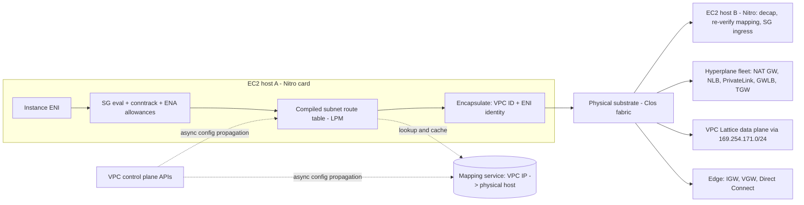

# VPC Networking Internals

## TL;DR

- An Amazon VPC has no router appliance in it. The Nitro card on each host enforces security groups, tracks connections, looks up the compiled route table and wraps each packet with VPC metadata. A mapping service turns virtual addresses into physical hosts, and the receiving host checks that mapping again before it delivers the packet.
- Route tables pick the longest matching prefix and are attached per subnet. Since 2021 you can steer traffic inside a VPC to a middlebox by adding a route more specific than the local route. Gateway route tables add ingress routing at the internet gateway and virtual private gateway.
- NAT Gateway, Network Load Balancer, PrivateLink, Gateway Load Balancer and Transit Gateway all run on Hyperplane. Hyperplane is AWS's multi-tenant fleet that keeps per-flow state. Its limits per destination, per flow and per AZ, plus its idle timeouts, are the real capacity limits behind these products.
- A Transit Gateway "route domain" comes from two separate actions. Association decides which TGW route table an attachment's traffic is looked up in. Propagation decides which route tables learn the attachment's prefixes. When appliance mode is off, AZ affinity silently breaks stateful inspection that crosses AZs.
- PrivateLink is a unidirectional, source-NATed, per-AZ channel to one service. VPC Lattice is a managed layer-7 proxy fabric reached through link-local addresses, with IAM auth policies. TGW gives full layer-3 reachability. Choose by trust model, CIDR overlap and unit cost, not by habit.

## Mental Model



Think of a VPC as a distributed policy database, compiled out to every Nitro card.
The "router", "firewall" and "switch" in VPC diagrams are fictions.
Each one is a function the sending and receiving hosts' offload hardware evaluates on every packet, using state pushed out by the control plane.
Anything that needs shared state across many hosts runs as a Hyperplane service you reach through an ENI in your subnet. That includes address translation, load balancing, cross-VPC transit and private service exposure.
The data plane and the control plane fail differently.
Packets already flowing keep flowing when the API is impaired, because each host holds compiled state.
New ENIs, new routes and new instances depend on the control plane propagating state, and that propagation can lag.

## Internals

### The substrate: encapsulation, the mapping service, and anti-spoofing

Every VPC packet leaves the instance through the Elastic Network Adapter (ENA) or the Elastic Fabric Adapter (EFA), into the Nitro card. There it is wrapped in AWS's proprietary VPC encapsulation, which carries the VPC identity and the source interface identity across the physical network.
Eric Brandwine's re:Invent 2013 talk "A Day in the Life of a Billion Packets" describes the mapping service. It is the authoritative map from VPC addresses to the physical hosts that hold them. Hosts look entries up and cache them, and edge devices called Blackfoot translate between the encapsulated substrate and the outside world.
The non-obvious mechanism is on the receive side.
The destination host checks against the mapping that the claimed source ENI really lives on the sending host. Spoofing is therefore blocked at both ends, not only by the sender's source/destination check.
This is why you must disable source/destination checking on an ENI before it can forward traffic it did not originate (NAT instances, firewalls). It is also why a "promiscuous" VPC sniffer does not exist: Traffic Mirroring is a separate copy path that uses VXLAN on UDP 4789 (AWS docs, 2025 reading, UNVERIFIED).
For the physical fabric underneath, see [[17-Cloud-AI-Engineering/Volume_00_Foundations_Under_the_Cloud/Chapter_02_Datacenter_Networking_Fabrics|Datacenter Networking Fabrics]]. For the offload card, see [[17-Cloud-AI-Engineering/Volume_02_AWS_Deep_Dive/Chapter_04_EC2_Nitro_Architecture_and_Graviton|EC2, Nitro Architecture, and Graviton]].

### Route tables as compiled policy

A VPC route table is a set of prefixes mapped to targets. Each subnet is associated with exactly one route table (explicitly, or implicitly through the main table).
Evaluation order:
1. Longest prefix match.
2. On equal prefixes, static routes beat propagated routes.
3. Among propagated routes, Direct Connect BGP routes beat static VPN routes, which beat BGP VPN routes (AWS docs, 2025 reading, UNVERIFIED).

The local route covering the VPC CIDRs used to be immutable and always won.
Since August 2021 you can add a route that is more specific than the local CIDR, for example a peer subnet's /24. Its target can be a firewall ENI, a Gateway Load Balancer endpoint or an AWS Network Firewall endpoint, which forces east-west traffic inside the VPC through inspection.
Gateway route tables (December 2019) attach to an internet gateway or virtual private gateway. They steer inbound traffic to an appliance before it reaches the destination subnet. This "ingress routing" is how you insert north-south inspection without NAT.
Managed prefix lists can be route destinations. Each one counts against the route quota by its declared maximum entries, not by how many entries it currently holds. This is a common hidden source of quota exhaustion.
Amazon VPC Route Server, which injects BGP-learned routes into VPC route tables for floating-IP appliance failover, is described as launched in 2025 (UNVERIFIED).

The VPC router at the subnet's .1 address and the Amazon DNS resolver at the VPC base plus two are emulations.
Packets to link-local services count against a fixed per-ENI packet budget. Those services include the Route 53 Resolver, the Instance Metadata Service (IMDS) and Amazon Time Sync. The budget is 1024 packets per second per ENI (AWS docs, 2025 reading, UNVERIFIED).

### Elastic Network Interfaces

An ENI is a subnet-scoped (and therefore AZ-scoped) logical NIC. It carries a MAC address, a primary private IPv4 address, secondary addresses, optional /28 IPv4 and /80 IPv6 delegated prefixes, up to the security-group limit, and a source/destination check flag.
Each instance type has a maximum ENI count and a maximum IP count per ENI. This is the root cause of pod IP exhaustion with the Amazon VPC CNI on EKS, which prefix delegation mitigates. See [[17-Cloud-AI-Engineering/Volume_02_AWS_Deep_Dive/Chapter_07_Amazon_EKS_Control_Plane_and_Networking|Amazon EKS: Control Plane and Networking]].
There are several ENI variants:
- Trunk and branch ENIs give each ECS task (awsvpc mode) or EKS pod its own security groups without burning a full ENI slot per pod.
- Requester-managed ENIs are created by AWS services in your subnet (interface endpoints, NLB nodes, TGW attachments, RDS). You can see them but not modify them.
- Hyperplane ENIs, used by Lambda since 2019, are shared per (subnet, security group set) combination, so many function instances reach your VPC through one ENI.

Large accelerator instances expose multiple network cards. Each card has its own ENI and EFA slots, which is how p5.48xlarge reaches 3200 Gbps of EFA bandwidth across 32 network cards (AWS docs, 2025 reading, UNVERIFIED). See [[17-Cloud-AI-Engineering/Volume_10_AI_Infrastructure_on_Cloud/Chapter_02_Interconnect_Technologies_NVLink_EFA_and_TPU_ICI|Interconnect Technologies: NVLink, EFA, and TPU ICI]].

The ENA driver exposes counters that show which per-ENI allowance was hit. Get them with `ethtool -S` and publish them through the CloudWatch agent:
- `bw_in_allowance_exceeded`
- `bw_out_allowance_exceeded`
- `pps_allowance_exceeded`
- `conntrack_allowance_exceeded`
- `conntrack_allowance_available`
- `linklocal_allowance_exceeded`

These counters are the only way to tell "the network is slow" apart from "my instance hit its shaping budget" (AWS docs, 2025 reading, UNVERIFIED).

### Connection tracking: the mechanism nobody reads about

Security groups are stateful because the Nitro card keeps a connection-tracking table per ENI. Its size is bounded by an allowance that scales with instance size and is not published.
A flow is untracked when both of these hold:
- The rule allowing it permits all addresses (0.0.0.0/0 or ::/0) for TCP or UDP.
- The opposite direction has a matching allow-all rule for all ports.

ICMP is always tracked. Flows arriving through Hyperplane-backed services (NLB, NAT Gateway, TGW, PrivateLink, GWLB, Global Accelerator, Lambda) are "automatically tracked" whatever the rules say (AWS EC2 docs, 2025 reading, UNVERIFIED).
Two consequences matter in production.
First, removing a security group rule does not cut existing tracked connections. Removing a rule for untracked traffic stops it immediately. During incident response, a stateless network ACL deny is the reliable kill switch.
Second, a busy proxy or NAT instance can run out of conntrack entries long before it runs out of bandwidth, and the symptom is silent packet drops.
The idle timeouts can be set per ENI through the connection tracking specification:

| Flow type | Default | Configurable range |
|---|---|---|
| TCP established | 432,000 s (5 days) | 60-432,000 s |
| UDP stream | 180 s | 60-180 s |
| Other UDP | 30 s | 30-60 s |

(AWS EC2 docs, 2025 reading, UNVERIFIED)
Lowering the TCP established timeout on a fleet of proxies that see short-lived connections from millions of clients is the main lever against conntrack exhaustion. The cost is that long-lived idle connections get killed unless they send keepalives.

### Hyperplane: the shared-state fabric

Colm MacCarthaigh's re:Invent 2017 talk "Another Day, Another Billion Flows" introduced Hyperplane. It is an internal, horizontally scaled, multi-tenant fleet of EC2-based nodes that does stateful flow processing for NAT Gateway, NLB, PrivateLink and EFS. AWS later said Transit Gateway and Gateway Load Balancer are built on it too.
Customers are isolated on it with shuffle sharding. Each customer resource maps to a small random subset of nodes, so one poison workload overlaps only a small fraction of any other tenant's shard. See [[17-Cloud-AI-Engineering/Volume_01_Cloud_Architecture_Principles/Chapter_03_Cell_Based_Architecture_and_Shuffle_Sharding|Cell-Based Architecture and Shuffle Sharding]].
The ENI you see in your subnet for a NAT Gateway or an interface endpoint is the front door to that shard. It is not the box that processes your packets.
The internal details of how flow state is replicated across Hyperplane nodes are not documented publicly in detail, and this chapter does not describe them (UNVERIFIED).
The architectural lesson to carry forward is the per-flow consistent assignment. Every Hyperplane-backed product inherits these properties:
- a 5-tuple flow is pinned to one path
- per-destination port budgets
- 350-second TCP idle timeouts on NAT Gateway and the PrivateLink/NLB path

(AWS docs, 2025 reading, UNVERIFIED)
For the Google analogue, compare [[17-Cloud-AI-Engineering/Volume_13_Seminal_Papers_and_Case_Studies/Chapter_11_Maglev_Network_Load_Balancer|Maglev]] and the consistent hashing in [[08-Distinguished-Engineering/02-Distributed-Systems-Internals/Consistent-Hash-Ring|Consistent Hash Ring]].

### Transit Gateway: route domains, AZ affinity, appliance mode

A TGW VPC attachment puts a requester-managed ENI in one subnet you pick per AZ. Best practice is a dedicated /28 per AZ with its own route table, so the attachment subnet's routing is separate from workload routing.
Resources in an AZ where the attachment has no subnet cannot use the attachment (AWS TGW docs, 2025 reading, UNVERIFIED).
Routing is decided by two independent relationships:
- **Association.** Each attachment is associated with exactly one TGW route table, which decides where packets arriving from that attachment are looked up.
- **Propagation.** An attachment can propagate its prefixes into any number of TGW route tables.

A "route domain", or segment, is just a pattern of associations and propagations. The classic isolation design associates prod and dev spokes with a "spokes" table that only learns the shared-services prefixes, and associates shared services with a table that learns every spoke.
TGW does not write routes into VPC route tables. You add static routes (or prefix-list routes) that point at the `tgw-` target yourself. A missing return route in the VPC table is the most common one-way-reachability bug.
Blackhole routes in a TGW table drop matching traffic explicitly. Static routes beat propagated routes for the same prefix.
Inter-region TGW peering carries only static routes. AWS Cloud WAN adds a policy-document-driven global core network with segments and dynamic route exchange between its edge locations.

AZ affinity is the mechanism that bites.
TGW keeps a flow in the AZ where it entered whenever the destination attachment has an ENI in that AZ.
With a centralized inspection VPC, the forward path of a flow from a spoke in AZ-a goes through the AZ-a firewall. If the return traffic comes from a resource in AZ-b, it is sent to the AZ-b firewall, which has no state for the flow and drops it.
Appliance mode on the inspection VPC attachment changes this. TGW hashes the flow on its addresses and ports, picks one AZ's ENI and keeps both directions of the flow on it for the flow's lifetime.
Appliance mode adds cross-AZ data transfer and couples the flow's survival to that one AZ's appliance. Gateway Load Balancer gives similar flow stickiness across appliance targets using GENEVE on UDP 6081.

### PrivateLink: unidirectional, source-NATed service exposure

An interface endpoint creates one requester-managed ENI per selected AZ in the consumer subnet, with consumer-controlled security groups and optional private DNS.
Traffic to that ENI enters Hyperplane and comes out at the provider's NLB, or at a GWLB for GWLB endpoints. On the way it is source-NATed, so provider targets see NLB addresses, not consumer addresses.
To recover the consumer's identity, the provider enables Proxy Protocol v2 on the NLB target group and parses the AWS TLV type 0xEA, subtype 0x01, which carries the VPC endpoint ID.
This design has three consequences:
- Overlapping consumer CIDRs are irrelevant.
- Only the consumer can open connections.
- The provider's per-consumer controls are endpoint acceptance, allowed principals and PPv2-based authorization, not source IP.

NLBs have supported security groups since 2023. A specific setting decides whether inbound rules are enforced on PrivateLink traffic, and leaving it enforced while allowing only VPC CIDRs breaks every consumer (AWS ELB docs, 2025 reading, UNVERIFIED).
Gateway endpoints for S3 and DynamoDB are a different mechanism. They are route table entries whose destination is an AWS-managed prefix list, they are free, and they only apply to traffic that starts in that VPC and is routed by that route table.
Endpoint policies are IAM resource policies evaluated by the target service. Combined with `aws:SourceVpce` conditions on bucket policies, they are the building blocks of the data perimeter in [[17-Cloud-AI-Engineering/Volume_08_Security_Identity_and_the_Data_Perimeter/Chapter_06_Constructing_an_Impenetrable_Data_Perimeter|Constructing an Impenetrable Data Perimeter]].
Native cross-region PrivateLink connectivity for endpoint services was announced in late 2024 (UNVERIFIED).

### VPC Lattice: a managed layer-7 fabric reached through link-local addresses

VPC Lattice (GA March 2023) has these building blocks:
- **Service networks:** logical groupings shared across accounts through AWS RAM.
- **Services:** each with listeners, rules and target groups. Targets can be instances, IPs, Lambda functions, ALBs or ECS tasks.
- **VPC associations:** connect a client VPC to a service network. A VPC can be associated with only one service network (AWS Lattice docs, 2025 reading, UNVERIFIED).

The mechanism behind it is the interesting part.
A Lattice service's DNS name resolves, inside an associated VPC, to an address in the link-local range 169.254.171.0/24 (IPv6 fd00:ec2:80::/64). The VPC fabric diverts those packets to the Lattice data plane instead of routing them through your route tables (AWS Lattice docs, 2025 reading, UNVERIFIED).
That is why Lattice works across overlapping CIDRs and ignores TGW and peering entirely.
On the target side, packets arrive from addresses in the managed prefix list `com.amazonaws.<region>.vpc-lattice`. Target security groups must allow that prefix list, and forgetting this is the most common Lattice onboarding failure.
Authorization uses IAM auth policies, enforced at both the service network and the service level. Clients sign requests with SigV4, so the proxy authorizes on principal, organization ID and request attributes rather than on IP.
Since re:Invent 2024, resource gateways and resource configurations extend Lattice to TCP resources such as RDS endpoints, domain names and IPs. Service network endpoints let you reach a service network through PrivateLink from peered or on-premises networks (UNVERIFIED).

### Formal reasoning about reachability

Reachability Analyzer and Network Access Analyzer do not send packets.
They encode route tables, security groups, NACLs, endpoints and gateways as logical constraints and solve them. The approach is described in Backes et al., "Reachability Analysis for AWS-based Networks" (CAV 2019, the Tiros system).
This is the same automated-reasoning lineage as the Zelkova IAM policy analyzer covered in [[17-Cloud-AI-Engineering/Volume_02_AWS_Deep_Dive/Chapter_01_IAM_Policy_Evaluation_Engine|IAM Policy Evaluation Engine]]. It is also why the worked example below can prove segmentation without launching a single instance.

## Numbers to Know

Live re-verification against documentation was not possible for this revision.
Each figure below comes from the named AWS or Google Cloud page as last read in 2025, and is marked UNVERIFIED until it is re-checked against the 2026-10 docs.
Prices are for us-east-1 or the base US region, on-demand.

| Item | Value | Source |
|---|---|---|
| VPC IPv4 CIDR size | /16 to /28 | AWS VPC docs, 2025 reading, UNVERIFIED |
| Reserved IPs per subnet | 5 (network, +1 router, +2 DNS, +3 reserved, broadcast) | AWS VPC docs, 2025 reading, UNVERIFIED |
| IPv4 CIDR blocks per VPC | 5 default, adjustable to 50 | AWS VPC quotas, 2025 reading, UNVERIFIED |
| Route tables per VPC | 200 default | AWS VPC quotas, 2025 reading, UNVERIFIED |
| Routes per route table | 50 default, adjustable to 1,000 | AWS VPC quotas, 2025 reading, UNVERIFIED |
| Security groups per ENI | 5 default, max 16 | AWS VPC quotas, 2025 reading, UNVERIFIED |
| Rules per SG | 60 inbound + 60 outbound; rules x SGs per ENI capped at 1,000 | AWS VPC quotas, 2025 reading, UNVERIFIED |
| NACL rules | 20 per direction default, adjustable to 40 | AWS VPC quotas, 2025 reading, UNVERIFIED |
| Active VPC peerings per VPC | 50 default, max 125 | AWS VPC quotas, 2025 reading, UNVERIFIED |
| Link-local packet budget | 1,024 pps per ENI (DNS, IMDS, Time Sync) | AWS EC2 docs, 2025 reading, UNVERIFIED |
| MTU | 9001 in VPC; 8500 via TGW; 1500 via IGW; 1446 via AWS Site-to-Site VPN | AWS EC2/TGW docs, 2025 reading, UNVERIFIED |
| Single-flow bandwidth | 5 Gbps outside a cluster placement group; 10 Gbps inside; 25 Gbps with ENA Express | AWS EC2 docs, 2025 reading, UNVERIFIED |
| Internet/DX egress cap | 50% of instance bandwidth for 32+ vCPUs; 5 Gbps below 32 vCPUs | AWS EC2 docs, 2025 reading, UNVERIFIED |
| Conntrack TCP established timeout | 432,000 s default; 60-432,000 s range | AWS EC2 docs, 2025 reading, UNVERIFIED |
| TGW attachments per TGW | 5,000 | AWS TGW quotas, 2025 reading, UNVERIFIED |
| TGW route tables per TGW | 20 | AWS TGW quotas, 2025 reading, UNVERIFIED |
| TGW total routes | 10,000 across all route tables | AWS TGW quotas, 2025 reading, UNVERIFIED |
| TGW bandwidth per VPC attachment per AZ | up to 50 Gbps burst (may since have been raised) | AWS TGW quotas, 2025 reading, UNVERIFIED |
| TGW VPN tunnel | 1.25 Gbps per tunnel | AWS TGW quotas, 2025 reading, UNVERIFIED |
| Interface endpoint bandwidth | 10 Gbps per AZ, scaling automatically to 100 Gbps | AWS PrivateLink docs, 2025 reading, UNVERIFIED |
| Interface endpoints per VPC | 50 default | AWS PrivateLink quotas, 2025 reading, UNVERIFIED |
| NAT Gateway throughput | 5 Gbps, auto-scaling to 100 Gbps | AWS VPC docs, 2025 reading, UNVERIFIED |
| NAT Gateway connections | 55,000 simultaneous per unique destination (IP, port, protocol) per NAT IP | AWS VPC docs, 2025 reading, UNVERIFIED |
| NAT Gateway / PrivateLink TCP idle timeout | 350 s | AWS VPC docs, 2025 reading, UNVERIFIED |
| Flow Logs aggregation interval | 10 min default, 1 min option | AWS VPC docs, 2025 reading, UNVERIFIED |
| Price: TGW | $0.05 per attachment-hour + $0.02/GB processed | AWS TGW pricing, 2025 reading, UNVERIFIED |
| Price: interface endpoint | $0.01 per endpoint per AZ per hour + $0.01/GB for the first PB | AWS PrivateLink pricing, 2025 reading, UNVERIFIED |
| Price: NAT Gateway | $0.045/hour + $0.045/GB processed | AWS VPC pricing, 2025 reading, UNVERIFIED |
| Price: VPC Lattice | $0.025 per service-hour + $0.025/GB + $0.10 per million requests | AWS Lattice pricing, 2025 reading, UNVERIFIED |
| Price: cross-AZ transfer | $0.01/GB in each direction | AWS EC2 pricing, 2025 reading, UNVERIFIED |
| Price: public IPv4 address | $0.005/hour per address | AWS VPC pricing, 2025 reading, UNVERIFIED |
| Price: Reachability Analyzer | $0.10 per analysis | AWS VPC pricing, 2025 reading, UNVERIFIED |
| GCP VPC MTU | 1460 default, configurable 1300-8896 | Google Cloud docs, 2025 reading, UNVERIFIED |
| GCP vNICs per VM | up to 8, each in a different VPC network | Google Cloud docs, 2025 reading, UNVERIFIED |
| GCP Cloud NAT TCP established idle timeout | 1,200 s default | Google Cloud docs, 2025 reading, UNVERIFIED |

## AWS vs GCP Mechanism Parity

| Concern | AWS | Google Cloud | Critical difference |
|---|---|---|---|
| Network scope | VPC is regional; subnets are AZ-scoped | VPC network is global; subnets are regional and span zones | GCP needs no transit layer for multi-region inside one network; AWS needs TGW, Cloud WAN or peering |
| Virtualization data plane | Nitro card encapsulation plus mapping service lookup and cache (re:Invent 2013 talk) | Andromeda on-host fast path plus Hoverboard gateways for long-tail flows, with heavy flows offloaded to direct host paths (NSDI 2018) | Andromeda openly documents a default-gateway-then-offload model; AWS documents host-side lookup and cache |
| Route table binding | One route table per subnet association; gateway route tables for ingress | Routes belong to the whole network, scoped by network tags or service accounts, with a numeric priority after longest prefix | AWS routing differs per subnet; GCP routing differs per instance tag |
| Steering to middleboxes | More-specific-than-local routes, GWLB endpoints, Network Firewall endpoints | Static routes or policy-based routes with an internal passthrough NLB as next hop | Both rely on a load-balanced next hop for appliance high availability |
| Stateful filtering | Security groups on ENIs, conntrack in Nitro, untracked-flow rule | VPC firewall rules and hierarchical/network firewall policies enforced on host by Andromeda | GCP has org/folder-level firewall policy inheritance; AWS centralizes through Firewall Manager or Network Firewall |
| Multi-NIC | Multiple ENIs can share one VPC, in different subnets of the same AZ | Each vNIC must be in a different VPC network | Multi-homed appliance designs do not port directly between the two |
| Secondary IPs | Secondary IPs and /28 prefix delegation | Alias IP ranges (the basis of VPC-native GKE) | Same idea; GCP alias ranges are first-class subnet secondary ranges |
| Hub-and-spoke transit | Transit Gateway route tables (association plus propagation), Cloud WAN segments | Network Connectivity Center hub with VPC and hybrid spokes, mesh or star topologies | Both supply segmentation; GCP often avoids the hub by using one Shared VPC |
| Shared network ownership | AWS RAM VPC subnet sharing | Shared VPC host and service projects | Conceptually equivalent; GCP's model is older and more widely used |
| Private service exposure | PrivateLink: endpoint ENI -> Hyperplane SNAT -> NLB; PPv2 TLV 0xEA | Private Service Connect: endpoint forwarding rule -> service attachment -> producer ILB via a PSC NAT subnet; PROXY protocol optional | Same unidirectional, CIDR-overlap-tolerant contract |
| Private access to provider APIs | Gateway endpoints (S3, DynamoDB) and interface endpoints | Private Google Access, private.googleapis.com and restricted.googleapis.com VIPs, PSC for Google APIs | GCP's API perimeter (VPC Service Controls) is an identity-and-context layer above routing |
| Service-to-service layer 7 | VPC Lattice: link-local entry, IAM SigV4 auth policies | No direct managed equivalent; Cloud Service Mesh (Envoy or proxyless gRPC) plus PSC | Lattice moves mesh functions into the provider fabric; GCP keeps them in the mesh |
| NAT | NAT Gateway is a zonal Hyperplane middlebox with per-destination port budgets | Cloud NAT is software-defined in Andromeda and allocates port ranges per VM | AWS exhausts ports per destination per NAT IP; GCP exhausts ports per VM |
| Reachability verification | Reachability Analyzer and Network Access Analyzer (Tiros, SMT-based) | Network Intelligence Center Connectivity Tests (configuration analysis plus live data-plane checks) | Both reason over configuration; neither replaces data-plane canaries |

## Worked Example: Proving Transit Gateway Segmentation Without Launching Instances

### What it builds

The lab builds three VPCs (`shared`, `prod`, `dev`) in one AZ, attached to one Transit Gateway that has its default association and propagation disabled.
It creates two TGW route tables:
- `spokes` is associated with prod and dev, and learns only the shared VPC's prefix.
- `shared` is associated with the shared VPC, and learns both spokes' prefixes.

One ENI per VPC (ENIs are free) acts as the probe endpoint.
Two Reachability Analyzer analyses then show formally that prod can reach shared on TCP 443 and that prod cannot reach dev.

### Cost estimate

- 3 TGW attachments x $0.05/hour = $0.15/hour (AWS TGW pricing, 2025 reading, UNVERIFIED).
- 2 Reachability Analyzer analyses x $0.10 = $0.20 one time (AWS VPC pricing, 2025 reading, UNVERIFIED).
- VPCs, subnets, route tables, security groups and unattached ENIs are not charged. No data moves, so there is no per-GB charge.
- A two-hour session costs about $0.50. A forgotten teardown costs about $110 a month, which is why the budget alarm below is mandatory.

### OpenTofu / Terraform

```hcl
# main.tf - requires OpenTofu >= 1.6 or Terraform >= 1.6, AWS provider >= 5.0
terraform {
  required_version = ">= 1.6"
  required_providers {
    aws = { source = "hashicorp/aws", version = ">= 5.0" }
  }
}

variable "region"       { default = "us-east-1" }
variable "budget_email" { type = string }

provider "aws" { region = var.region }

locals {
  vpcs = {
    shared = "10.10.0.0/16"
    prod   = "10.20.0.0/16"
    dev    = "10.30.0.0/16"
  }
  # attachment -> TGW route table it is ASSOCIATED with
  association = { shared = "shared", prod = "spokes", dev = "spokes" }
  # which attachment PROPAGATES into which TGW route table
  propagation = {
    shared-into-spokes = { att = "shared", rt = "spokes" }
    prod-into-shared   = { att = "prod",   rt = "shared" }
    dev-into-shared    = { att = "dev",    rt = "shared" }
  }
}

data "aws_availability_zones" "az" { state = "available" }

resource "aws_vpc" "v" {
  for_each             = local.vpcs
  cidr_block           = each.value
  enable_dns_support   = true
  enable_dns_hostnames = true
  tags                 = { Name = "lab-${each.key}" }
}

# Workload subnet x.x.1.0/24 and a dedicated TGW attachment subnet x.x.255.0/28
resource "aws_subnet" "work" {
  for_each          = local.vpcs
  vpc_id            = aws_vpc.v[each.key].id
  cidr_block        = cidrsubnet(each.value, 8, 1)
  availability_zone = data.aws_availability_zones.az.names[0]
  tags              = { Name = "lab-${each.key}-work" }
}

resource "aws_subnet" "tgw" {
  for_each          = local.vpcs
  vpc_id            = aws_vpc.v[each.key].id
  cidr_block        = cidrsubnet(each.value, 12, 4080)
  availability_zone = data.aws_availability_zones.az.names[0]
  tags              = { Name = "lab-${each.key}-tgw" }
}

resource "aws_ec2_transit_gateway" "tgw" {
  description                     = "lab segmented tgw"
  default_route_table_association = "disable"
  default_route_table_propagation = "disable"
  auto_accept_shared_attachments  = "disable"
  tags                            = { Name = "lab-tgw" }
}

resource "aws_ec2_transit_gateway_vpc_attachment" "att" {
  for_each                                        = local.vpcs
  transit_gateway_id                              = aws_ec2_transit_gateway.tgw.id
  vpc_id                                          = aws_vpc.v[each.key].id
  subnet_ids                                      = [aws_subnet.tgw[each.key].id]
  transit_gateway_default_route_table_association = false
  transit_gateway_default_route_table_propagation = false
  tags                                            = { Name = "lab-att-${each.key}" }
}

resource "aws_ec2_transit_gateway_route_table" "rt" {
  for_each           = toset(["shared", "spokes"])
  transit_gateway_id = aws_ec2_transit_gateway.tgw.id
  tags               = { Name = "lab-tgwrt-${each.key}" }
}

resource "aws_ec2_transit_gateway_route_table_association" "assoc" {
  for_each                       = local.association
  transit_gateway_attachment_id  = aws_ec2_transit_gateway_vpc_attachment.att[each.key].id
  transit_gateway_route_table_id = aws_ec2_transit_gateway_route_table.rt[each.value].id
}

resource "aws_ec2_transit_gateway_route_table_propagation" "prop" {
  for_each                       = local.propagation
  transit_gateway_attachment_id  = aws_ec2_transit_gateway_vpc_attachment.att[each.value.att].id
  transit_gateway_route_table_id = aws_ec2_transit_gateway_route_table.rt[each.value.rt].id
}

# VPC side: TGW never writes VPC route tables, so add a summary route ourselves
resource "aws_route_table" "work" {
  for_each = local.vpcs
  vpc_id   = aws_vpc.v[each.key].id
  tags     = { Name = "lab-${each.key}-work-rt" }
}

resource "aws_route" "to_tgw" {
  for_each               = local.vpcs
  route_table_id         = aws_route_table.work[each.key].id
  destination_cidr_block = "10.0.0.0/8"
  transit_gateway_id     = aws_ec2_transit_gateway.tgw.id
  depends_on             = [aws_ec2_transit_gateway_vpc_attachment.att]
}

resource "aws_route_table_association" "work" {
  for_each       = local.vpcs
  subnet_id      = aws_subnet.work[each.key].id
  route_table_id = aws_route_table.work[each.key].id
}

resource "aws_security_group" "probe" {
  for_each = local.vpcs
  name     = "lab-probe-${each.key}"
  vpc_id   = aws_vpc.v[each.key].id
  ingress {
    from_port   = 443
    to_port     = 443
    protocol    = "tcp"
    cidr_blocks = ["10.0.0.0/8"]
  }
  egress {
    from_port   = 0
    to_port     = 0
    protocol    = "-1"
    cidr_blocks = ["0.0.0.0/0"]
  }
}

# Unattached ENIs are free and are valid Reachability Analyzer endpoints
resource "aws_network_interface" "probe" {
  for_each        = local.vpcs
  subnet_id       = aws_subnet.work[each.key].id
  security_groups = [aws_security_group.probe[each.key].id]
  description     = "lab reachability probe ${each.key}"
}

resource "aws_ec2_network_insights_path" "p" {
  for_each         = { prod_to_shared = ["prod", "shared"], prod_to_dev = ["prod", "dev"] }
  source           = aws_network_interface.probe[each.value[0]].id
  destination      = aws_network_interface.probe[each.value[1]].id
  protocol         = "tcp"
  destination_port = 443
  depends_on = [
    aws_route.to_tgw,
    aws_route_table_association.work,
    aws_ec2_transit_gateway_route_table_association.assoc,
    aws_ec2_transit_gateway_route_table_propagation.prop,
  ]
}

# Each create or replace of this resource is a billed analysis ($0.10)
resource "aws_ec2_network_insights_analysis" "a" {
  for_each                 = aws_ec2_network_insights_path.p
  network_insights_path_id = each.value.id
  wait_for_completion      = true
}

resource "aws_budgets_budget" "lab" {
  name         = "vpc-internals-lab"
  budget_type  = "COST"
  limit_amount = "5"
  limit_unit   = "USD"
  time_unit    = "MONTHLY"
  notification {
    comparison_operator        = "GREATER_THAN"
    threshold                  = 80
    threshold_type             = "PERCENTAGE"
    notification_type          = "ACTUAL"
    subscriber_email_addresses = [var.budget_email]
  }
}

output "path_found" {
  value = { for k, v in aws_ec2_network_insights_analysis.a : k => v.path_found }
}

output "spokes_rt_id" { value = aws_ec2_transit_gateway_route_table.rt["spokes"].id }
```

### Run, inspect, tear down

```bash
tofu init
tofu apply -auto-approve -var "budget_email=you@example.com"
# Expected: path_found = { prod_to_dev = false, prod_to_shared = true }

# Show what the spokes route domain actually learned (only 10.10.0.0/16 expected)
aws ec2 search-transit-gateway-routes \
  --transit-gateway-route-table-id "$(tofu output -raw spokes_rt_id)" \
  --filters Name=type,Values=propagated \
  --query 'Routes[].{cidr:DestinationCidrBlock,state:State}' --output table

# Read the machine-generated explanation of why prod cannot reach dev
aws ec2 describe-network-insights-analyses \
  --query 'NetworkInsightsAnalyses[?PathFound==`false`].Explanations[].ExplanationCode'

# Teardown - exact command; removes TGW, attachments, ENIs, analyses, and the budget
tofu destroy -auto-approve -var "budget_email=you@example.com"
```

Notice that the dev-to-prod question never needed a firewall. Isolation comes from what each route table has learned, not from a deny rule, and that is both the strength and the weakness of TGW segmentation. A single wrong propagation merges the two domains.

### Back-of-the-envelope: choosing a connectivity primitive for 40 VPCs

Assume 40 workload VPCs spread over 3 AZs, 200 TB/month of east-west traffic, and 5 internal HTTP services each consumed by all 40 VPCs at 2 billion requests/month in total. All prices are from the pricing rows above (2025 reading, UNVERIFIED).

**Average bandwidth**

1. 200e12 bytes x 8 bits / 2,592,000 s is about 617 Mbps on average.
2. At a 5x peak that is about 3.1 Gbps, comfortably inside any single TGW attachment's per-AZ burst.
3. Any single 5-tuple flow is still capped at 5 Gbps by EC2 (10 Gbps inside a placement group), whatever transit you choose.

**Option A: Transit Gateway**

1. Attachments: 40 x $0.05 x 730 h = $1,460/month.
2. Data processing: 200,000 GB x $0.02 = $4,000/month.
3. Total is about $5,460/month, with full layer-3 reachability and a central place to insert inspection.
4. Whether cross-AZ data transfer is billed on top of TGW processing for traffic that crosses AZs inside TGW is UNVERIFIED. Model it before committing.

**Option B: full-mesh VPC peering**

1. 40 x 39 / 2 = 780 peering connections, 39 per VPC. That is inside the 125-per-VPC maximum, but each workload route table needs 39 routes against a default of 50.
2. There are no hourly or processing fees. With uniformly random AZ placement, about 2/3 of the traffic crosses AZs: 200,000 x 2/3 x $0.02 (both directions) is about $2,667/month.
3. It is cheaper, but it has no transitive routing, no central inspection, and it creates an operational problem that grows as N squared.

**Option C: VPC Lattice for the 5 HTTP services**

1. Services: 5 x $0.025 x 730 = about $91/month.
2. Requests: 2,000 M x $0.10 = $200/month, before any free-tier request allowance.
3. Data: if those services carry 20 TB, 20,000 x $0.025 = $500/month.
4. Total is about $791/month, with IAM-authenticated, CIDR-overlap-tolerant access and no route tables to manage.

**Option D: PrivateLink for the same 5 services**

1. Endpoints: 5 services x 40 consumer VPCs x 3 AZs x $0.01 x 730 = $4,380/month.
2. Data: 20,000 GB x $0.01 = $200/month.
3. The endpoint-hour term dominates. PrivateLink is cheap for a few consumers of a high-volume service and expensive for many consumers of many services.

**NAT Gateway port budget**

1. A fleet of 2,000 pods each holding 40 connections to one SaaS endpoint (one IP, port 443) needs 80,000 concurrent mappings to the same destination.
2. 80,000 / 55,000 per NAT IP means at least 2 IPs on that NAT Gateway, plus headroom. Watch `ErrorPortAllocation` in CloudWatch.

## Failure Modes and Pitfalls

### Control-plane propagation lag during large recoveries

The data plane can be healthy while new capacity is unroutable.
AWS's summary of the October 2025 us-east-1 event describes how a DynamoDB DNS automation race cascaded into EC2 instance launches. It reports that delays in propagating network state for newly launched instances made Network Load Balancer health checks fail, which removed capacity (AWS PIR, [aws.amazon.com/message/101925](https://aws.amazon.com/message/101925/), details UNVERIFIED).
The lesson matches [[17-Cloud-AI-Engineering/Volume_01_Cloud_Architecture_Principles/Chapter_02_Regions_Zones_and_Static_Stability|Regions, Zones, and Static Stability]]:
- Pre-provision capacity, ENIs and routes.
- Do not depend on launching and wiring new instances during recovery.
- Make health checks tolerate fresh nodes that are not yet reachable instead of failing them fast.

### Internal network congestion and retry storms

The December 2021 us-east-1 PIR describes an automated scaling activity that triggered a surge of connection activity. The surge congested the devices between AWS's internal network and the main network, and impaired monitoring and control-plane APIs while existing EC2 data-plane traffic largely continued ([AWS PIR](https://aws.amazon.com/message/12721/)).
The April 2011 EBS event began with a network configuration change that shifted traffic onto a lower-capacity network, which set off a storm of re-mirroring ([AWS PIR](https://aws.amazon.com/message/65648/)).
Google's June 2019 networking incident started when a configuration change meant for a small set of servers was applied across several regions. Network control-plane jobs were descheduled and routes were eventually withdrawn ([Google Cloud incident 19009](https://status.cloud.google.com/incident/cloud-networking/19009)).
All three are covered in [[17-Cloud-AI-Engineering/Volume_07_Reliability_and_SRE/Chapter_07_Anatomy_of_Major_Cloud_Outages|Anatomy of Major Cloud Outages]].

### Per-instance and per-path limits that surface as mysterious drops

- **DNS throttling.** Every ENI is limited to 1,024 link-local pps, so a pod-dense node making uncached DNS lookups hits `linklocal_allowance_exceeded` and gets intermittent resolution failures. The fix is node-local caching, such as NodeLocal DNSCache on EKS (AWS docs, 2025 reading, UNVERIFIED).
- **Conntrack exhaustion.** Proxies and NAT instances with many short-lived or idle connections fill the tracking table. Watch `conntrack_allowance_available` and tune the TCP established idle timeout, or make flows untracked where the security posture allows.
- **NAT Gateway port allocation.** The 55,000 limit is per destination tuple per NAT IP. One hot SaaS endpoint exhausts it while total connections look small. Add secondary NAT IPs, spread destinations, or use PrivateLink to that SaaS if it is offered.
- **Idle timeouts at 350 s.** Database pools or gRPC channels idle through NAT Gateway, NLB or PrivateLink are silently dropped, and the next write gets an RST. Set TCP keepalive below 350 s.
- **MTU black holes.** 9001-byte frames inside the VPC drop to 8500 through TGW, 1500 through the internet, and 1446 through AWS Site-to-Site VPN. If ICMP "fragmentation needed" is blocked by a NACL or an appliance, large TLS records hang. Allow ICMP type 3 code 4 and clamp MSS on appliances.

### Routing and segmentation errors

- **TGW asymmetric drops.** Centralized inspection without appliance mode produces flows that work in one direction and time out in the other, or only for some AZ pairs. Enable appliance mode on the inspection attachment and confirm with TGW Flow Logs.
- **Missing VPC return routes.** TGW propagation fills TGW route tables, never VPC route tables. If one side lacks a route to the TGW, traffic is one-way.
- **AZ coverage gaps.** Instances in an AZ with no attachment subnet cannot use the TGW. The same applies to interface endpoints: a consumer in an AZ without an endpoint ENI crosses AZs and pays for it, or fails if zonal DNS names are pinned.
- **Prefix list quota math.** A managed prefix list with max-entries 100 consumes 100 route slots in every route table that references it, even when it holds 3 entries.
- **Gateway endpoint scope.** S3 gateway endpoints do nothing for traffic from on-premises, peered VPCs or TGW spokes. Use S3 interface endpoints for those paths.

### Service-exposure misconfigurations

- **PrivateLink identity.** Providers that authorize on source IP see only NLB addresses. Use PPv2 TLV 0xEA or mutual TLS.
- **NLB security groups.** Enforcing inbound rules on PrivateLink traffic while allowing only local CIDRs blocks every consumer.
- **Lattice targets.** Target security groups that do not allow the `com.amazonaws.<region>.vpc-lattice` prefix list cause health check and request failures that look like application bugs.
- **Lattice association limit.** A VPC can belong to only one service network. Teams that design one service network per team find they cannot consume two of them from one VPC, and need service network endpoints or a redesign.

### Noisy neighbors and shared fabrics

Hyperplane's shuffle sharding limits how many other tenants your traffic overlaps with, but within your own account, one NAT Gateway per AZ is a shared choke point for every workload behind it.
Separating noisy batch egress (model weight downloads, dataset pulls) onto its own NAT Gateway, or better onto S3 gateway endpoints, protects latency-sensitive egress. It also removes the $0.045/GB processing fee on S3 traffic.

### Observability gaps

- VPC Flow Logs are aggregated over 1 to 10 minutes and do not capture traffic to Amazon DNS, IMDS, Time Sync or DHCP. They are not a packet capture (AWS docs, 2025 reading, UNVERIFIED).
- Use ENA counters for host limits, TGW Flow Logs for transit, Traffic Mirroring for payloads, and Reachability Analyzer for intent.

## Security and Cost Angles

### IAM scoping of network mutations

Network-changing actions belong to a small set of roles, guarded by SCPs from [[17-Cloud-AI-Engineering/Volume_02_AWS_Deep_Dive/Chapter_02_AWS_Organizations_and_Account_Governance|AWS Organizations and Account Governance]]:
- `ec2:CreateRoute`, `ec2:ReplaceRoute`
- `ec2:ModifyVpcEndpoint`
- `ec2:AuthorizeSecurityGroupIngress`
- `ec2:CreateTransitGatewayRouteTablePropagation`
- `ec2:AttachInternetGateway`

A common pattern is an SCP that denies `ec2:CreateInternetGateway` and `ec2:AttachInternetGateway` everywhere except a central egress account. VPC Block Public Access, launched in late 2024, adds an account- or organization-level control over IGW traffic (UNVERIFIED).
TGW and Lattice service networks are shared through AWS RAM. Restricting RAM sharing to your organization (`ram:RequestedAllowsExternalPrincipals` false) stops a compromised account from sharing your transit fabric outward.

### Endpoints as policy enforcement points

Interface and gateway endpoint policies limit which principals and resources can be reached through that endpoint.
Combined with `aws:SourceVpce` and `aws:ResourceOrgID` conditions, they stop exfiltration through stolen credentials used from your own network to an attacker's bucket.
VPC Lattice auth policies move service-to-service authorization from IP allowlists to SigV4-signed principal identity. That is the AWS-native form of the zero-trust model in [[17-Cloud-AI-Engineering/Volume_08_Security_Identity_and_the_Data_Perimeter/Chapter_01_Zero_Trust_Architecture_in_Hyperscale_Clouds|Zero Trust Architecture in Hyperscale Clouds]].
GCP's equivalent perimeter is identity-and-context based and sits above routing. See [[17-Cloud-AI-Engineering/Volume_03_GCP_Deep_Dive/Chapter_03_VPC_Service_Controls_Security_Perimeters|VPC Service Controls: Security Perimeters]].

### Encryption on the wire

On Nitro instance families that support it, traffic between supported instances inside a VPC or across peered VPCs is encrypted transparently by the Nitro card (AWS EC2 docs, 2025 reading, UNVERIFIED).
This does not cover traffic through every middlebox or to the internet. Keep TLS end to end for regulated data, with keys from the hierarchy in [[17-Cloud-AI-Engineering/Volume_08_Security_Identity_and_the_Data_Perimeter/Chapter_04_Encryption_Key_Hierarchies_and_Envelope_Encryption|Encryption Key Hierarchies and Envelope Encryption]].
TGW VPN tunnels use IPsec. Direct Connect needs MACsec on supported dedicated ports, or IPsec over DX, to be encrypted.

### Unit-economics levers

- **S3 and DynamoDB traffic.** Send it through gateway endpoints, never NAT Gateway. At $0.045/GB, a 10 TB model-artifact pull through NAT costs about $450 in processing that a gateway endpoint makes free.
- **Zonal alignment.** Keep chatty tiers in the same AZ, or use AZ-aware routing, because cross-AZ transfer at $0.01/GB each way usually dominates east-west cost before TGW does.
- **Consolidation.** Centralize interface endpoints in a shared-services VPC reached over TGW, with Route 53 private hosted zones shared through Resolver rules. You pay endpoint-hours once instead of per VPC, at the price of TGW processing on every byte. Compute the breakeven from the per-hour and per-GB terms above.
- **Public IPv4.** Since February 2024 every public IPv4 address costs $0.005/hour. Prefer IPv6 with an egress-only internet gateway where clients support it.

The full egress model is in [[17-Cloud-AI-Engineering/Volume_09_FinOps_and_Cloud_Economics/Chapter_04_Network_Egress_Economics_and_Optimization|Network Egress Economics and Optimization]].

## Interview Questions and Model Answers

### Question 1 (L5 - Senior)

During an incident you remove the security group rule that allows an attacker's IP on port 22, but their SSH session stays open. Why, and what do you do?

#### Model Answer

Security groups are stateful. The Nitro card holds a connection-tracking entry for the established SSH flow, and removing a rule does not tear down tracked connections. New connections are blocked, but existing ones survive until they close or idle out, and the TCP established idle timeout defaults to 5 days.
If the rule had produced untracked traffic (allow-all in both directions), removing it would have cut the flow immediately, which is a distinction most candidates miss.
The reliable kill is a stateless network ACL deny for the attacker's prefix on the subnet. NACLs are evaluated per packet with no connection memory, so the session dies on the next packet.
In parallel, I would move the instance's ENI to a quarantine security group with no rules. I would snapshot volumes for forensics before stopping anything, and pull VPC Flow Logs plus GuardDuty findings to scope lateral movement.
Afterwards I would remove port 22 exposure entirely in favor of Session Manager, and add an SCP or Config rule that flags 0.0.0.0/0 on administrative ports.

#### Follow-up Interviewer Question

The NACL is shared by forty other instances in that subnet, and adding a deny risks hitting a legitimate client behind the same NAT. How do you contain the threat without collateral damage?

### Question 2 (L5 - Senior)

A team says their S3 gateway endpoint "doesn't work" for on-premises servers reaching S3 over Direct Connect and TGW. Explain the mechanism and the fix.

#### Model Answer

A gateway endpoint is not a reachable address. It is a route table entry whose destination is the S3 managed prefix list and whose target is the endpoint. It only affects packets that start in that VPC and are looked up in that route table.
Traffic from on-premises or from TGW spokes enters the VPC through the TGW attachment ENIs. Even if it were routed toward S3's public prefixes, it is not originating from the VPC, so the gateway endpoint does not carry transitive traffic.
The fix is an S3 interface endpoint, which puts real ENIs with private IPs in the VPC. On-premises resolvers forward the S3 names to a Route 53 Resolver inbound endpoint, or use the endpoint-specific DNS names.
I would keep the gateway endpoint for in-VPC workloads because it is free. The interface endpoint costs per AZ-hour and per GB, so I would size it from the on-premises transfer volume.
I would scope both endpoint policies to the organization's buckets with `aws:ResourceOrgID`.

#### Follow-up Interviewer Question

Both endpoints now exist in the same VPC. Which one does an EC2 instance in that VPC use for `s3.us-east-1.amazonaws.com`, and how do private DNS settings change the answer?

### Question 3 (L6 - Staff)

Design network segmentation for 300 VPCs across prod, non-prod and shared services in two regions, with mandatory stateful inspection between environments and to the internet. Walk through the failure modes.

#### Model Answer

In each region I would use one TGW with these route tables:
- `prod-spokes`, associated with prod VPCs, learning only shared services and a default route to inspection.
- `nonprod-spokes`, set up the same way.
- `shared`, learning everything.
- `inspection`, associated with the inspection VPC attachment, learning every spoke.

Spoke tables point 0.0.0.0/0 and any cross-environment prefix at the inspection attachment through static routes. Static routes beat propagated routes, so a stray propagation cannot bypass inspection for summarized prefixes. I would also blackhole the other environment's summary as a second safety.
The inspection VPC runs Gateway Load Balancer endpoints in front of a firewall fleet in every AZ. Appliance mode is enabled on its TGW attachment, so each flow's two directions go to the same AZ's appliance. Without it, AZ affinity sends return traffic to an appliance with no state, and you get partial, AZ-pair-dependent timeouts.
Across regions I would either peer the TGWs with static routes, accepting manual route management, or move the core to Cloud WAN. There, segments and segment-sharing are declared in a policy document and route exchange between edge locations is dynamic. I would do that once route churn or region count makes static routes a risk.

The failure modes and their controls:
1. An engineer adds a propagation that merges domains. I would gate every TGW change through IaC with a Reachability Analyzer or Network Access Analyzer assertion in CI, for example "no path from any prod ENI to any non-prod ENI", which is an SMT-solved proof rather than a test.
2. Inspection capacity is a shared bottleneck and an AZ-scoped blast radius. GWLB health checks drain bad appliances, but appliance-mode flows pinned to a failed AZ reset. I would size for N-1 AZs and treat the inspection VPC as a tier-0 cell.
3. Quotas: 20 route tables and 10,000 routes per TGW. I would summarize CIDRs through IPAM pools per environment so the tables hold a handful of summaries, not 300 prefixes.
4. TGW data processing on every inspected byte. I would exempt high-volume, low-risk flows such as S3 through gateway endpoints, which keeps those bytes off TGW entirely.

#### Follow-up Interviewer Question

The security team now wants east-west inspection between two subnets inside the same prod VPC. Which VPC routing feature enables that, and what does it do to your appliance capacity model?

### Question 4 (L6 - Staff)

Fifty product teams across fifty accounts need to call each other's HTTP and gRPC services, many VPCs have overlapping 10.0.0.0/16 CIDRs, and security wants identity-based authorization. Compare TGW, PrivateLink and VPC Lattice, and pick one.

#### Model Answer

TGW gives layer-3 reachability, but overlapping CIDRs make it unusable without NAT layers. Authorization would still depend on IP-based security groups, which does not meet the identity requirement.
PrivateLink handles overlap through source NAT and is unidirectional and least-privilege by construction. But each consumer-service pair costs an endpoint per AZ: 50 consumers x 3 AZs x $0.01/hour is about $1,100/month per service before data (2025 pricing, UNVERIFIED). Providers see only NLB IPs unless they parse PPv2 TLV 0xEA, and there is no request-level authorization.
VPC Lattice fits this problem.
Clients reach services through link-local addresses that the fabric diverts, so CIDR overlap is irrelevant. Auth policies evaluate the SigV4-signed caller principal and organization at both the service network and service level. Cost scales per service-hour, per GB and per request, not per consumer-AZ.
The trade-offs I would state:
- Lattice is a regional layer-7 proxy hop, so I would measure added latency for chatty gRPC.
- Clients must sign requests to use IAM auth, which means SDK or sidecar changes.
- Target security groups must allow the Lattice prefix list.
- A VPC joins only one service network, so I would design one org-wide service network per environment, not one per team.

I would keep PrivateLink for the few very-high-volume, few-consumer data services, where its per-GB rate is lower than Lattice's. I would keep TGW for non-HTTP layer-3 needs and inspection.

#### Follow-up Interviewer Question

A latency-sensitive gRPC service sees p99 rise by several milliseconds after moving to Lattice. How do you determine whether the proxy hop, connection reuse or target placement is responsible?

### Question 5 (L6 - Staff)

At daily peak, a fleet of 3,000 EKS pods calling a third-party API sees intermittent connect timeouts, while CPU, memory and the API's status page are all fine. Diagnose it.

#### Model Answer

I would split the path into hops and check each one's specific saturation signal instead of guessing:
1. **Pod DNS.** `linklocal_allowance_exceeded` on node ENIs. 1,024 pps per ENI is easy to exceed when CoreDNS lookups go uncached across many pods.
2. **Node conntrack.** `conntrack_allowance_available` trending toward zero.
3. **NAT Gateway.** `ErrorPortAllocation` and `PacketsDropCount`.
4. **Idle resets.** RSTs from reused idle connections past the 350 s NAT idle timeout.

The classic culprit here is the NAT Gateway. Every pod talks to the same destination IP and port, and each NAT IP supports about 55,000 simultaneous connections per unique destination tuple. 3,000 pods with 20 pooled connections each is 60,000, which is over the budget for a single IP, so new connections fail at peak while total throughput looks trivial.
The fixes, in order of leverage:
- Add secondary private or public IPs to the NAT Gateway.
- Shrink connection pools and reuse HTTP/2 connections.
- Ask the vendor for multiple endpoint IPs or a PrivateLink endpoint service.
- Spread egress across NAT Gateways per AZ, which you should already do so that one AZ's NAT is not a cross-AZ dependency.

I would set keepalive below 350 s so idle pooled connections are not reset, and alarm on `ErrorPortAllocation` above zero.

#### Follow-up Interviewer Question

The vendor allowlists your egress IPs and accepts at most two, so adding more NAT IPs breaks the allowlist. What architecture now satisfies both constraints?

### Question 6 (L7+ - Principal)

Trace a packet from instance A to instance B in different subnets of the same VPC, then explain what keeps working, and what does not, when the VPC control plane is impaired for an hour.

#### Model Answer

The send side:
1. The guest writes the frame to an ENA queue.
2. The Nitro card applies the ENI's outbound security group and checks the conntrack entry.
3. It checks the per-ENI bandwidth, pps and conntrack allowances.
4. It performs a longest-prefix lookup in the compiled route table for A's subnet. The local route, or a more-specific middlebox route if one exists, picks the next hop.
5. It resolves B's VPC address to a physical host through mapping-service state cached on the host.
6. It encapsulates the frame with VPC and source identity and sends it across the Clos substrate.

The receive side:
1. B's Nitro card decapsulates the frame.
2. It confirms the source ENI really is on the sending host according to the mapping, which is the receive-side anti-spoofing check.
3. It evaluates B's inbound security group and conntrack state and delivers the frame to B's ENA queue.

No central router is on the path. Subnet "routers" and the DNS resolver are emulations, so the blast radius of a fault is mostly the two hosts plus the mapping system.
During an hour of control-plane impairment, established and new flows between existing ENIs keep working, because every input to that pipeline is already on the hosts. This is static stability by design.
What breaks is everything that needs new state propagated:
- new instances or ENIs, whose mappings and security groups have not reached peer hosts
- route and security group changes, which may apply late or unevenly
- autoscaling, and load balancer target registration of new nodes

The October 2025 us-east-1 summary describes this pattern: network-state propagation delays for new instances made health checks fail and removed capacity (details UNVERIFIED).
My design implications:
- Keep warm capacity instead of scaling during recovery.
- Avoid health checks that eject fresh nodes during propagation delays.
- Never put an emergency fix behind a route or security group change that needs the impaired control plane. Pre-stage break-glass paths, such as standby NACL entries or pre-attached secondary ENIs, that can be flipped through a different mechanism.
- Run Reachability Analyzer in CI so routine changes never become an incident while propagation is slow.

#### Follow-up Interviewer Question

Mapping state is cached on hosts. What happens to a cached entry when instance B is stopped and its private IP is reused by a new instance on a different host, and how would you design that invalidation if you owned the system?

### Question 7 (L7+ - Principal)

Your company runs on GCP with a single global Shared VPC and is moving half its estate to AWS. The network lead proposes recreating "one global network" with a single TGW mesh. Critique the proposal and give the target architecture.

#### Model Answer

The proposal ports a topology without porting the mechanism.
GCP's global VPC works because Andromeda makes routes and firewall policy network-wide on every host, and Google's backbone carries inter-region traffic inside one routing domain.
In AWS, a VPC and a TGW are regional. Inter-region TGW peering carries only static routes. Subnets are AZ-scoped, and route tables are per subnet rather than per instance tag.
A naive mesh therefore turns into hand-maintained static routes across N regions, which is exactly the global coupling that turns a configuration mistake into a multi-region outage, as in Google's own June 2019 networking incident.
The target architecture I would propose:
- **Regional cells.** One TGW per region per environment, or Cloud WAN with segments declared in one policy document and dynamic route exchange between core network edges. Cloud WAN's deployment process must stage policy changes per region and have rollback.
- **Translated firewall model.** GCP firewall rules scoped by network tags become security groups referencing security groups within a VPC, with central guardrails through Firewall Manager and Network Firewall. GCP hierarchical firewall policies have no exact AWS analogue, so I would enforce them as SCP-protected, IaC-owned baselines.
- **Translated service exposure.** Private Service Connect maps to PrivateLink almost one-to-one, since both are source-NATed and unidirectional. Mesh traffic can move to Lattice for identity-authorized layer 7, replacing reliance on GCP service-account-scoped firewalling.
- **Multi-NIC.** GCP's one-vNIC-per-network rule does not apply in AWS, so appliance designs can be simplified.
- **Cross-cloud link.** Dedicated Interconnect or Direct Connect via partners, with no stretched layer-2, no cross-cloud synchronous dependencies, and a deliberate egress budget, as covered in [[17-Cloud-AI-Engineering/Volume_04_AWS_vs_GCP_Translation/Chapter_07_Multi_Cloud_and_Hybrid_Architecture_Reality|Multi-Cloud and Hybrid Architecture Reality]].

The principle is to accept regional blast radius in AWS as a feature rather than fight it to imitate GCP's global abstraction.

#### Follow-up Interviewer Question

The CFO asks why AWS inter-VPC traffic now has a per-GB processing line item that GCP never had inside one VPC. How do you quantify it and which architectural levers reduce it without weakening segmentation?

## Further Reading

- [Andromeda: Performance, Isolation, and Velocity at Scale in Cloud Network Virtualization (NSDI 2018)](https://www.usenix.org/conference/nsdi18/presentation/dalton) - The only peer-reviewed description of a hyperscaler's VPC data plane in depth, and the reference point for comparing it with Nitro. See also [[17-Cloud-AI-Engineering/Volume_13_Seminal_Papers_and_Case_Studies/Chapter_12_Andromeda_Network_Virtualization|Andromeda chapter]].
- [Reachability Analysis for AWS-based Networks (CAV 2019)](https://www.amazon.science/publications/reachability-analysis-for-aws-based-networks) - Explains how Tiros encodes VPC semantics as logic, which is the basis of Reachability Analyzer and of proof-based network CI.
- [Maglev: A Fast and Reliable Software Network Load Balancer (NSDI 2016)](https://www.usenix.org/conference/nsdi16/technical-sessions/presentation/eisenbud) - Consistent-hash flow assignment and connection tracking at scale, the conceptual sibling of Hyperplane.
- [A Cloud-Optimized Transport Protocol for Elastic and Scalable HPC (IEEE Micro 2020)](https://www.amazon.science/publications/a-cloud-optimized-transport-protocol-for-elastic-and-scalable-hpc) - The SRD protocol behind EFA and ENA Express, explaining why single-flow limits differ by path.
- [AWS Builders' Library: Workload isolation using shuffle-sharding](https://aws.amazon.com/builders-library/workload-isolation-using-shuffle-sharding/) - The isolation math Hyperplane-backed services rely on.
- [AWS Builders' Library: Reliability, constant work, and a good cup of coffee](https://aws.amazon.com/builders-library/reliability-and-constant-work/) - How AWS distributes network configuration with constant-work patterns so propagation does not collapse under load.
- AWS re:Invent 2013, "A Day in the Life of a Billion Packets" (Eric Brandwine) - Primary public source for the mapping service, encapsulation and Blackfoot edge model; search by title.
- AWS re:Invent 2017, "Another Day, Another Billion Flows" (Colm MacCarthaigh) - Primary public source for Hyperplane's design goals and the services it underpins; search by title.
- [Amazon EC2 security group connection tracking](https://docs.aws.amazon.com/AWSEC2/latest/UserGuide/security-group-connection-tracking.html) - The authoritative rules for tracked, untracked and automatically tracked flows and their timeouts.
- [Monitor network performance for ENA settings](https://docs.aws.amazon.com/AWSEC2/latest/UserGuide/monitoring-network-performance-ena.html) - Defines the allowance-exceeded counters you need to diagnose drops.
- [Transit Gateway design best practices](https://docs.aws.amazon.com/vpc/latest/tgw/tgw-best-design-practices.html) - Attachment subnets, AZ affinity and appliance mode in AWS's own words.
- [Building a Scalable and Secure Multi-VPC AWS Network Infrastructure (whitepaper)](https://docs.aws.amazon.com/whitepapers/latest/building-scalable-secure-multi-vpc-network-infrastructure/welcome.html) - Reference topologies for TGW, PrivateLink, centralized egress and inspection.
- [Amazon VPC Lattice User Guide](https://docs.aws.amazon.com/vpc-lattice/latest/ug/what-is-vpc-lattice.html) - Service networks, auth policies, link-local addressing and the target prefix list.
- [Google Cloud Private Service Connect overview](https://cloud.google.com/vpc/docs/private-service-connect) - The GCP counterpart to PrivateLink, needed for parity reasoning.
- [Network Connectivity Center overview](https://cloud.google.com/network-connectivity/docs/network-connectivity-center/concepts/overview) - The GCP hub-and-spoke model to contrast with TGW route domains.
- Related chapters: [[17-Cloud-AI-Engineering/Volume_03_GCP_Deep_Dive/Chapter_04_Global_VPC_Andromeda_SDN_and_Network_Tiers|Global VPC, Andromeda SDN, and Network Tiers]], [[17-Cloud-AI-Engineering/Volume_04_AWS_vs_GCP_Translation/Chapter_02_Networking_and_Load_Balancing_Translation|Networking and Load Balancing Translation]], [[17-Cloud-AI-Engineering/Volume_01_Cloud_Architecture_Principles/Chapter_04_Control_Plane_vs_Data_Plane_Separation|Control Plane vs Data Plane Separation]], and next, [[17-Cloud-AI-Engineering/Volume_02_AWS_Deep_Dive/Chapter_04_EC2_Nitro_Architecture_and_Graviton|EC2, Nitro Architecture, and Graviton]].
