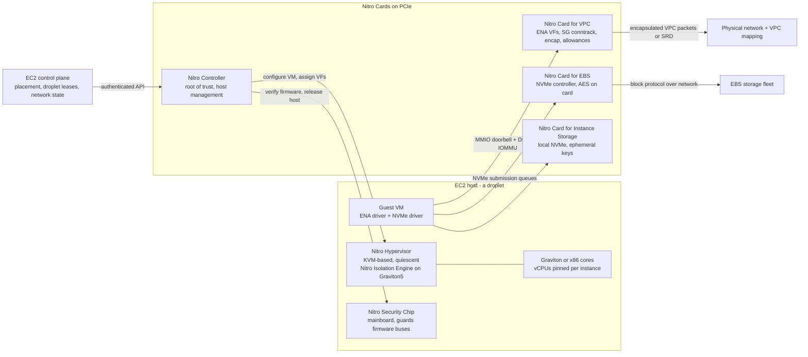

# EC2, Nitro Architecture, and Graviton

## TL;DR

Nitro moves every I/O function (VPC networking, EBS, instance storage, management, and root of trust) off the host CPU and onto dedicated PCIe cards, so the hypervisor is reduced to partitioning CPU and memory and handing out SR-IOV virtual functions.
The guest data plane runs through rings, doorbells, and DMA on the Nitro Card for VPC and the Nitro Card for EBS, so running instances keep working even when the EC2 control plane (placement, leases, network-state propagation) is degraded.
Network performance is set by per-instance token-bucket allowances on the Nitro card (bandwidth, PPS, conntrack, link-local), and sub-second micro-bursts can exhaust them even when 1-minute CloudWatch averages look healthy, so `ethtool -S` allowance counters are the ground truth.
On Graviton one vCPU is one physical core with no SMT, so CPU-percent, rightsizing, and autoscaling thresholds tuned on x86 hyperthreads do not carry over linearly, and you should size by throughput at your latency SLO.
Graviton performance depends on the toolchain: LSE atomics instead of LL/SC loops, correct acquire/release ordering under Arm's weak memory model, vector-length-agnostic SVE code, and page-size-aware allocators decide whether a migration saves 20-30% or regresses p99.

## Mental Model



Think of a Nitro host as two computers sharing one chassis: a customer computer (the cores and DRAM, sliced by a tiny hypervisor) and an AWS computer (the Nitro cards), which owns every path to the network, to storage, and to the firmware.
The guest never talks to AWS software on the host CPU.
It writes descriptors into its own memory and rings a doorbell, and a Nitro card does everything else: it enforces security groups, encapsulates packets, encrypts blocks, and meters bandwidth.
The control plane configures the cards through the Nitro Controller and then gets out of the way, which is why "existing instances kept running, new launches failed" is the usual signature of an EC2 control plane incident.
This chapter builds on [[17-Cloud-AI-Engineering/Volume_02_AWS_Deep_Dive/Chapter_03_VPC_Networking_Internals|VPC Networking Internals]], and the same KVM-plus-minimal-device approach shows up again in [[17-Cloud-AI-Engineering/Volume_02_AWS_Deep_Dive/Chapter_05_Serverless_Compute_and_Lambda_Internals|Serverless Compute and Lambda Internals]].

## Internals

### Lineage: from Xen dom0 to offload cards

Early EC2 ran on Xen, the paravirtualized design from Barham et al., "Xen and the Art of Virtualization" (SOSP 2003).
In that design a privileged domain (dom0) on the host CPU emulated or proxied network and block I/O for every guest.
That had three costs: dom0 used host cores that could otherwise be sold, guest I/O latency picked up jitter from dom0 scheduling, and the trusted computing base included a full Linux userspace on the same CPU as customer code.
AWS took the I/O path apart in stages.
First came enhanced networking with SR-IOV, then EBS offload to a card, then the Annapurna Labs acquisition (2015), and finally the C5 launch (2017) with the KVM-based Nitro Hypervisor, which had no dom0 at all.
The re:Invent 2017 talk "C5 Instances and the Evolution of Amazon EC2 Virtualization" (CMP332, Anthony Liguori) is the primary account of this transition.
For background on KVM, read Kivity et al., "kvm: the Linux Virtual Machine Monitor" (OLS 2007), and [[17-Cloud-AI-Engineering/Volume_00_Foundations_Under_the_Cloud/Chapter_01_Hypervisors_MicroVMs_and_Sandboxing|Hypervisors, MicroVMs, and Sandboxing]].

### Component decomposition

The Nitro System has three parts: Nitro Cards, the Nitro Security Chip, and the Nitro Hypervisor ([AWS whitepaper: The Security Design of the AWS Nitro System](https://docs.aws.amazon.com/whitepapers/latest/security-design-of-aws-nitro-system/security-design-of-aws-nitro-system.html)).
The Nitro Controller card is the host's root of trust and its only management interface, and it exposes an authenticated API to the EC2 control plane.
The Nitro Card for VPC presents Elastic Network Adapter (ENA) virtual functions to guests and carries out the VPC data plane in hardware and card firmware.
The Nitro Card for EBS presents remote EBS volumes as NVMe namespaces and translates NVMe commands into the EBS network block protocol.
The Nitro Card for Instance Storage presents local NVMe SSDs and encrypts them with keys that never leave the card and are destroyed when the instance stops.
The Nitro Security Chip sits on the host mainboard, between the host CPU and nonvolatile storage such as SPI flash, so host software cannot rewrite firmware.
At power-on the Nitro Controller verifies the host firmware chain before the host CPU is allowed to run, so a tampered BIOS is caught before any tenant code executes.

### The hypervisor: a partitioner, not an emulator

Because I/O lives on cards, the Nitro Hypervisor does not need a network stack, a general-purpose filesystem, or an interactive shell.
Its job is to allocate cores and memory, program the IOMMU and stage-2 page tables (EPT on x86, Arm stage-2 translation at EL2 on Graviton), and assign SR-IOV virtual functions straight to guests.
It is quiescent in steady state.
It runs only when a guest traps for a reason that needs host action, and it has no background host threads competing with guest vCPUs.
This removes the jitter you would otherwise get from a host scheduler.
It also explains how bare-metal instances (`*.metal`) are possible.
The security boundary for network and storage sits on the cards and the security chip, not in the hypervisor, so the hypervisor can be left out and the guest still gets VPC and EBS.

### Nitro Isolation Engine: a separation kernel inside the hypervisor

On the sixth-generation Nitro System, first shipped with Graviton5-based M9g and M9gd instances in June 2026, AWS added the Nitro Isolation Engine ([AWS What's New, as of 2026-10](https://aws.amazon.com/about-aws/whats-new/2026/06/ec2-m9g-m9gd-instances-graviton5-processors-available/)).
The engine mediates all access to VM memory, CPU register state, and I/O devices, and it exposes only a minimal API to the rest of the Nitro Hypervisor ([AWS Compute Blog, as of 2026-10](https://aws.amazon.com/blogs/compute/aws-nitro-isolation-engine-formally-verifying-the-hypervisor-in-the-aws-nitro-system/)).
The design idea is Rushby's separation kernel from "Design and Verification of Secure Systems" (SOSP 1981), which splits policy from enforcement.
The rest of the hypervisor still decides which VMs exist, how memory is allocated, and what gets scheduled.
The Isolation Engine only enforces that whatever is decided cannot break isolation ([Amazon Science, as of 2026-10](https://www.amazon.science/blog/ec2s-formally-verified-isolation-engine-provides-mathematical-assurance-of-virtual-machine-isolation)).
It is written in Rust and verified in the Isabelle/HOL theorem prover.
The verified properties are functional correctness (including VM creation, memory mapping, and abort handling), confidentiality as noninterference, and integrity, plus memory safety, termination, and absence of runtime errors ([HCSS 2026 abstract, as of 2026-10](https://sos-vo.org/group/hcss_conference/2026/chong-dockins)).
The proof effort is roughly 260,000 lines according to the HCSS abstract and roughly 330,000 lines according to the later Amazon Science post, and the gap reflects the proof growing over time (as of 2026-10).
The useful comparison is seL4 (Klein et al., "seL4: Formal Verification of an OS Kernel", SOSP 2009).
The trick is the same: shrink the part that must be trusted until it is small enough to prove, and leave the large, fast-changing logic outside the proof boundary.
What the proof covers depends on its model of the hardware.
Treat microarchitectural timing channels and firmware below the engine as outside the proven claim unless the AWS publications say otherwise (UNVERIFIED).

### Packet path through the Nitro Card for VPC

Here is a mechanism you will not find in a getting-started guide: what happens between `send()` and the wire.
1. The guest ENA driver writes a TX descriptor that points at a packet buffer in guest memory, then writes the queue tail to a doorbell register in the VF's PCIe BAR.
2. The card fetches the descriptor and the payload by DMA through the IOMMU, so it can only reach memory the hypervisor mapped for that VF.
3. The card looks up the flow in its connection-tracking table and evaluates security group rules on the first packet of a tracked flow, then creates a conntrack entry.
4. The card resolves the destination VPC IP to a physical host through its cached view of the VPC mapping, wraps the packet in the AWS overlay encapsulation, and stamps it with the source ENI identity so the receiving card can reject spoofed packets.
5. Before transmit, the packet must draw tokens from several per-instance buckets: aggregate bandwidth, packets per second, new tracked connections, and link-local traffic to services such as the Route 53 Resolver, IMDS, and Amazon Time Sync.
6. On receive, the destination card decapsulates, checks that the source mapping is valid, applies stateful SG evaluation, DMAs into a guest RX ring, and raises an MSI-X interrupt, unless the guest uses a poll-mode driver such as DPDK.

When a bucket is empty, the card drops or queues the packet and increments an ENA counter that is visible only from inside the guest: `bw_in_allowance_exceeded`, `bw_out_allowance_exceeded`, `pps_allowance_exceeded`, `conntrack_allowance_exceeded`, and `linklocal_allowance_exceeded` ([AWS EC2 docs, UNVERIFIED 2026-10](https://docs.aws.amazon.com/AWSEC2/latest/UserGuide/monitoring-network-performance-ena.html)).
The buckets refill on sub-second intervals, so a 50 ms burst at line rate can overflow them even if the 1-minute average is 20% of the advertised bandwidth.
That is why the counters, and not CloudWatch `NetworkOut`, are the diagnostic of record.
AWS publishes aggregate bandwidth per instance type but does not publish PPS or conntrack allowances, so you have to measure them, and you can watch the conntrack headroom through `conntrack_allowance_available` (UNVERIFIED 2026-10).

### ENA Express and SRD

ENA Express runs TCP and UDP flows between two Nitro cards over Scalable Reliable Datagram (SRD), AWS's transport that sprays packets across many network paths and recovers from loss in card hardware.
SRD is described in Shalev et al., "A Cloud-Optimized Transport Protocol for Elastic and Scalable HPC" (IEEE Micro 2020).
A single TCP flow is normally hashed to one ECMP path and so inherits that path's congestion and tail latency.
SRD instead spreads one flow across paths and lets the receiving card restore order before delivery, so the guest TCP stack still sees an in-order stream.
The trade-off is that both endpoints must be supported instance types in the same Availability Zone with ENA Express enabled, so it is a data-plane optimization within an AZ and not a WAN feature.
The same transport underlies the Elastic Fabric Adapter (EFA), covered in [[17-Cloud-AI-Engineering/Volume_10_AI_Infrastructure_on_Cloud/Chapter_02_Interconnect_Technologies_NVLink_EFA_and_TPU_ICI|Interconnect Technologies: NVLink, EFA, and TPU ICI]].

### Storage path through the Nitro Card for EBS

The guest sees a standard NVMe controller with submission and completion queues and uses the stock Linux `nvme` driver.
The card turns each NVMe command into network requests to the EBS storage servers that hold the volume's replicas.
The EBS control plane that tracks replica membership is Physalia (Brooker et al., "Millions of Tiny Databases", NSDI 2020), which is covered in [[17-Cloud-AI-Engineering/Volume_13_Seminal_Papers_and_Case_Studies/Chapter_03_Physalia_EBS_Control_Plane|Physalia]].
For encrypted volumes, encryption and decryption happen on the card with a data key unwrapped through KMS at attach time, so plaintext keys never enter guest memory.
The failure-mode consequence is that EBS latency during replica failover appears to the guest as slow NVMe completions.
If the Linux NVMe I/O timeout is shorter than the failover window, the kernel resets the controller and the filesystem may remount read-only.
This is why AWS guidance and Amazon Linux AMIs raise `nvme_core.io_timeout` far above the upstream default (UNVERIFIED 2026-10).
See [[17-Cloud-AI-Engineering/Volume_02_AWS_Deep_Dive/Chapter_09_Elastic_Block_Store_and_Network_Storage|Elastic Block Store and Network Storage]] for the storage-side mechanics.

### Control plane versus data plane and static stability

The control plane handles placement, capacity accounting, per-host leases, and network-state propagation: RunInstances, StopInstances, attach and detach, and security group changes.
The data plane is the cards forwarding packets and blocks with state they already have.
The October 2025 us-east-1 event is the clearest public example of this split ([AWS PIR](https://aws.amazon.com/message/101925/)).
A race in DynamoDB's DNS automation left the regional DynamoDB endpoint record empty.
EC2's DropletWorkflow Manager, which keeps leases on physical hosts ("droplets") and depends on DynamoDB, could not renew those leases.
New launches failed because hosts without valid leases were not eligible for placement.
After DynamoDB recovered, re-establishing leases across the whole fleet drove DropletWorkflow Manager into congestive collapse until operators throttled it.
Then a backlog in network-state propagation meant newly launched instances came up without working networking, and that fed into load balancer health-check flapping.
Instances already running before the event kept working, which is static stability doing exactly what [[17-Cloud-AI-Engineering/Volume_01_Cloud_Architecture_Principles/Chapter_02_Regions_Zones_and_Static_Stability|Regions, Zones, and Static Stability]] prescribes.
The design lesson is that your recovery plan must not depend on launching new capacity during the same regional control plane event that caused the failure.

### Graviton microarchitecture as it matters to software

| Generation | Core | ISA | Cores | Clock | Memory | Notes |
|---|---|---|---|---|---|---|
| Graviton2 | Neoverse N1 | Armv8.2-A | 64 | 2.5 GHz | 8-channel DDR4 | First with LSE atomics; no SVE |
| Graviton3 | Neoverse V1 | Armv8.4-A | 64 | 2.6 GHz | 8-channel DDR5 | SVE with 256-bit vectors, bfloat16 |
| Graviton4 | Neoverse V2 | Armv9.0-A | 96 | 2.8 GHz | 12-channel DDR5 | SVE2 with 128-bit vectors, 2 MB L2 per core, two-socket coherent on largest sizes |
| Graviton5 | Neoverse V3 | Armv9.2-A | 192 | 3.3 GHz | DDR5 | 3 nm, 5x L3 versus Graviton4, PCIe Gen6 |

Graviton5 row: [AWS News Blog](https://aws.amazon.com/blogs/aws/now-available-amazon-ec2-m9g-and-m9gd-instances-powered-by-new-aws-graviton5-processors/) and [Phoronix](https://www.phoronix.com/review/aws-graviton5), as of 2026-10.
Graviton2 to Graviton4 core and clock figures come from the AWS launch posts as tabulated by [Wikipedia](https://en.wikipedia.org/wiki/AWS_Graviton) and Phoronix, as of 2026-10.
The Graviton4 vector width, L2 size, and two-socket topology were not re-verified against primary sources in this pass (UNVERIFIED 2026-10).

#### No SMT: a vCPU is a core

On Intel-based EC2 families with SMT enabled, two vCPUs are two hyperthreads of one physical core and share its execution ports, L1, and L2.
On Graviton, each vCPU is a whole physical core.
The non-obvious consequence is that CPU utilization is not a linear proxy for throughput on SMT hosts.
When an SMT host reports 50%, every physical core may already be running one busy thread, and the second sibling adds only the leftover issue slots.
The same service on Graviton tends to scale closer to linearly up to high utilization.
So an autoscaling target of 50% CPU that was tuned on x86 is usually too conservative on Graviton and wastes the price-performance gain.
Re-derive the target from load tests that measure throughput at the p99 SLO.

#### Atomics: LL/SC versus LSE, and why it gets worse with core count

Armv8.0 has only load-exclusive and store-exclusive (LDXR/STXR) for atomic read-modify-write.
The core marks the cache line in a local exclusive monitor, and STXR fails if any other agent touched the line in between, so the compiler wraps it in a retry loop.
Under contention, each successful increment needs the line to migrate into the winning core's L1 in unique state, and every loser's monitor is cleared and must retry, so retries and coherence traffic grow with the number of contenders.
Armv8.1 Large System Extensions (LSE) add single-instruction atomics such as `LDADD`, `CAS`, and `SWP`.
The coherent mesh interconnect can execute these at the line's home node as "far" atomics instead of pulling the line into the requester's cache.
That turns a cache-line ping-pong into a stream of requests to one place, and the effect is largest on 96-core and 192-core parts with a long mesh diameter (mechanism per Arm CMN documentation, UNVERIFIED 2026-10).
GCC 10 and later default to `-moutline-atomics` on aarch64 Linux, which calls a helper that checks `HWCAP_ATOMICS` at runtime and picks LSE when present.
Older toolchains, statically linked binaries built with `-march=armv8-a`, and some JIT runtimes still emit LL/SC loops.
You can check with `objdump -d binary | grep -cE 'ldxr|ldaxr'` against `grep -c ldadd`.
The worked example below measures this difference directly.

#### Memory ordering

x86 uses Total Store Order, which allows only store-to-load reordering.
Armv8 is weakly ordered but other-multicopy-atomic (Pulte et al., "Simplifying ARM Concurrency", POPL 2018), so loads can pass loads and stores can pass stores unless you add barriers or acquire and release instructions (`LDAR`, `STLR`, and `LDAPR` from Armv8.3 RCpc).
Code that uses `volatile` flags or hand-rolled double-checked locking without C11 atomics often works by accident on x86 and fails intermittently on Graviton.
These bugs scale with core count and load, so they surface in production more than in CI.
Java, Go, and Rust programs that use their language memory models correctly are safe.
Hand-written C and C++ lock-free code, inline assembly, and vendored concurrency libraries are the usual offenders.

#### Vectors: SVE is vector-length agnostic for a reason

SVE (Stephens et al., "The ARM Scalable Vector Extension", IEEE Micro 2017) lets the same binary run on any hardware vector length between 128 and 2048 bits.
Graviton3 implements 256-bit SVE and Graviton4 implements 128-bit SVE2 with more vector pipelines (UNVERIFIED 2026-10).
Kernels hand-tuned on Graviton3 with an assumed 256-bit width can see little or no gain on Graviton4, while vector-length-agnostic loops that use `svcntw()` and predication keep working correctly and pick up the extra pipelines.
For a portable build that runs on Graviton3 and later, the Graviton getting-started guide recommends `-mcpu=neoverse-512tvb`, which tunes for 512 bits of total vector bandwidth per cycle instead of a fixed vector width ([aws-graviton-getting-started](https://github.com/aws/aws-graviton-getting-started), UNVERIFIED 2026-10).

#### Pages, NUMA, and hardening

Arm64 Linux kernels can use 4 KB or 64 KB pages.
A 64 KB kernel cuts TLB misses for large heaps, but it breaks allocators built with a fixed 4 KB page assumption, such as jemalloc configured with `--with-lg-page=12`, and it wastes memory on small mappings.
On the largest Graviton4 sizes that span two sockets, NUMA appears where single-socket Graviton had none, so thread and memory pinning matters again (UNVERIFIED 2026-10).
Graviton3 and later support Armv8.3 pointer authentication and Armv8.5 BTI, which you enable with `-mbranch-protection=standard` to make ROP and JOP attacks harder at a cost of a few percent.

## Numbers to Know

| Quantity | Value | Source and date |
|---|---|---|
| Graviton5 cores per chip | 192 Neoverse V3 | AWS News Blog, as of 2026-10 |
| Graviton5 clock | 3.3 GHz (Graviton4: 2.8 GHz) | Phoronix review, as of 2026-10 |
| Graviton5 L3 cache | 5x Graviton4; reported as 180 MB | AWS News Blog; Tom's Hardware, as of 2026-10 |
| Graviton5 claimed compute uplift | Up to 25% over Graviton4 | AWS announcement via Techzine, as of 2026-10 |
| Graviton5 inter-core latency | Up to 33% lower than Graviton4 | AWS News Blog, as of 2026-10 |
| Graviton5 memory | DDR5-8800 reported | daily.dev summary of Phoronix, UNVERIFIED 2026-10 |
| M9g and M9gd GA | June 2026; C9g and R9g announced for 2026 | AWS What's New; Tom's Hardware, as of 2026-10 |
| M9gd local NVMe | Up to 11.4 TB per instance | About Amazon, as of 2026-10 |
| Nitro generation on M9g | Sixth generation, first with Nitro Isolation Engine | AWS What's New, as of 2026-10 |
| Isolation Engine proof size | ~260K lines (HCSS 2026) to ~330K lines (Amazon Science) | as of 2026-10 |
| Single-flow bandwidth | 5 Gbps outside a cluster placement group, 10 Gbps inside | AWS EC2 docs, UNVERIFIED 2026-10 |
| ENA Express single-flow bandwidth | Up to 25 Gbps within an AZ | AWS EC2 docs, UNVERIFIED 2026-10 |
| Bandwidth to internet or other Regions | 50% of instance bandwidth at 32 or more vCPUs, else 5 Gbps | AWS EC2 docs, UNVERIFIED 2026-10 |
| Link-local allowance | 1024 PPS per ENI to DNS, IMDS, Time Sync | AWS EC2 docs, UNVERIFIED 2026-10 |
| Conntrack TCP established idle timeout | Default 432,000 s (5 days), configurable down to 60 s per ENI | AWS EC2 docs, UNVERIFIED 2026-10 |
| PPS and conntrack allowances per type | Not published; measure with ENA counters | AWS EC2 docs, UNVERIFIED 2026-10 |
| IMDSv2 token TTL | 1 s to 21,600 s | AWS EC2 docs, UNVERIFIED 2026-10 |
| Spot interruption notice | 2 minutes | AWS EC2 docs, UNVERIFIED 2026-10 |
| Public IPv4 address charge | USD 0.005 per hour per address | AWS VPC pricing, UNVERIFIED 2026-10 |
| m7i.2xlarge on-demand, us-east-1 | USD 0.4032 per hour | AWS pricing, UNVERIFIED 2026-10 |
| m8g.2xlarge on-demand, us-east-1 | USD 0.35904 per hour | AWS pricing, UNVERIFIED 2026-10 |

Run the pricing script in the worked example to replace every UNVERIFIED price with a live value before you use it for a decision.
For the cross-cloud cheat sheet, see [[17-Cloud-AI-Engineering/Volume_14_Staff_Plus_Interview_Arena/Chapter_06_Cloud_AI_Numbers_Every_Staff_Engineer_Must_Know|Cloud AI Numbers Every Staff Engineer Must Know]].

## AWS vs GCP Mechanism Parity

Rows without an explicit date tag were not re-verified against official documentation in the 2026-10 research pass and should be treated as UNVERIFIED for currency.

| Dimension | AWS (Nitro, Graviton) | Google Cloud (Titanium, Axion) | Critical difference |
|---|---|---|---|
| I/O offload | Dedicated Nitro Cards for VPC, EBS, instance storage, and management | Titanium offload silicon plus tiered offload to scale-out storage and networking services | Both remove I/O from host cores; AWS splits functions across cards, Google combines on-host offload with fabric services |
| Root of trust | Nitro Controller plus Nitro Security Chip on the mainboard | Titan security chip lineage | Both verify firmware before the host runs tenant code |
| Hypervisor | KVM-based Nitro Hypervisor, no dom0, quiescent; Isolation Engine formally verified on Graviton5 (as of 2026-10) | KVM-based with a Google-built VMM | AWS has a published machine-checked isolation proof for one platform; Google publishes no equivalent proof (UNVERIFIED) |
| Host maintenance | Live updates of Nitro components; hardware retirement through scheduled events and stop/start | Live migration by default for most VM types; accelerator VMs typically terminate on maintenance | On GCE, plan for migration blackouts; on EC2, plan for scheduled-event reboots |
| Virtual NIC | ENA through SR-IOV VF | gVNIC (virtio-net on older types) | Different drivers, so AMIs and images must include the right one |
| Per-VM network limits | Published bandwidth; unpublished PPS and conntrack allowances visible through ENA counters | Per-vCPU egress caps with Tier_1 options on selected types | AWS failures show up as allowance-exceeded counters; GCE failures show up as egress caps |
| Multipath transport | SRD for ENA Express and EFA | Andromeda virtual network (Dalton et al., NSDI 2018); RDMA fabrics on accelerator types | SRD sprays one flow across paths, while standard ECMP pins a flow to one path |
| Arm CPU | Graviton2 to Graviton5; Graviton5 M9g GA (as of 2026-10) | Axion (Neoverse V2) in C4A; Tau T2A (Ampere Altra) | Both are SMT-free; Graviton is one generation newer on core IP as of 2026-10 |
| Confidential computing | Nitro isolation by default, Nitro Enclaves, NitroTPM, AMD SEV-SNP on selected types | Confidential VMs (AMD SEV, SEV-SNP, Intel TDX), Shielded VM vTPM | AWS treats isolation from the operator as a platform property; Google exposes memory encryption as a per-VM option |
| Operator access | Contractual and design commitment that no operator can access the host, independently reviewed | Access Transparency and Access Approval logs and gates | AWS removes the access mechanism, while Google audits and gates it |
| Instance metadata | IMDSv2 session token (PUT) with hop limit | Metadata server requiring the `Metadata-Flavor: Google` header | The IMDSv2 hop limit blocks container and SSRF relay paths at the network layer |
| Block storage attach | EBS as NVMe through the Nitro Card for EBS | Persistent Disk and Hyperdisk through Titanium | Both report remote-storage tail latency as NVMe completion latency |

For the full GCE side, see [[17-Cloud-AI-Engineering/Volume_03_GCP_Deep_Dive/Chapter_06_Compute_Engine_and_Titanium_Architecture|Compute Engine and Titanium Architecture]] and [[17-Cloud-AI-Engineering/Volume_04_AWS_vs_GCP_Translation/Chapter_01_Compute_Translation|Compute Translation]].

## Worked Example: Measuring LSE Atomics and Nitro Allowances, Then Sizing a Graviton Migration

### What this lab provisions and what it costs

The lab launches one Graviton4 `m8g.xlarge` and one Intel `m7i.xlarge` in the default VPC with no inbound ports.
Access goes through SSM Session Manager, IMDSv2 is required with hop limit 1, and root volumes are encrypted gp3.
Cost estimate: about USD 0.18 per hour for `m8g.xlarge` plus about USD 0.20 per hour for `m7i.xlarge`, plus two 8 GiB gp3 volumes and two public IPv4 addresses.
That comes to about USD 0.40 per hour, or under USD 1 for a one-hour session (prices UNVERIFIED 2026-10; confirm with the pricing script below).
For a clearer contention gap between LL/SC and LSE, set `arm_type = "m8g.4xlarge"` (16 cores), which roughly quadruples the Graviton line item.

### Budget alarm (create before apply)

```bash
ACCT=$(aws sts get-caller-identity --query Account --output text)
aws budgets create-budget --account-id "$ACCT" \
  --budget '{"BudgetName":"nitro-graviton-lab","BudgetLimit":{"Amount":"5","Unit":"USD"},"TimeUnit":"MONTHLY","BudgetType":"COST"}' \
  --notifications-with-subscribers '[{"Notification":{"NotificationType":"ACTUAL","ComparisonOperator":"GREATER_THAN","Threshold":80,"ThresholdType":"PERCENTAGE"},"Subscribers":[{"SubscriptionType":"EMAIL","Address":"you@example.com"}]}]'
```

### Terraform / OpenTofu

```hcl
terraform {
  required_providers {
    aws = {
      source  = "hashicorp/aws"
      version = ">= 5.40"
    }
  }
}

provider "aws" {
  region = var.region
}

variable "region" {
  type    = string
  default = "us-east-1"
}

variable "arm_type" {
  type    = string
  default = "m8g.xlarge"
}

variable "x86_type" {
  type    = string
  default = "m7i.xlarge"
}

data "aws_ssm_parameter" "al2023_arm64" {
  name = "/aws/service/ami-amazon-linux-latest/al2023-ami-kernel-default-arm64"
}

data "aws_ssm_parameter" "al2023_x86" {
  name = "/aws/service/ami-amazon-linux-latest/al2023-ami-kernel-default-x86_64"
}

data "aws_vpc" "default" {
  default = true
}

data "aws_subnets" "default" {
  filter {
    name   = "vpc-id"
    values = [data.aws_vpc.default.id]
  }
}

data "aws_iam_policy_document" "assume" {
  statement {
    actions = ["sts:AssumeRole"]
    principals {
      type        = "Service"
      identifiers = ["ec2.amazonaws.com"]
    }
  }
}

resource "aws_iam_role" "lab" {
  name               = "nitro-graviton-lab"
  assume_role_policy = data.aws_iam_policy_document.assume.json
}

resource "aws_iam_role_policy_attachment" "ssm" {
  role       = aws_iam_role.lab.name
  policy_arn = "arn:aws:iam::aws:policy/AmazonSSMManagedInstanceCore"
}

resource "aws_iam_instance_profile" "lab" {
  name = "nitro-graviton-lab"
  role = aws_iam_role.lab.name
}

resource "aws_security_group" "lab" {
  name        = "nitro-graviton-lab"
  description = "No inbound; outbound for SSM and package install"
  vpc_id      = data.aws_vpc.default.id

  egress {
    from_port   = 0
    to_port     = 0
    protocol    = "-1"
    cidr_blocks = ["0.0.0.0/0"]
  }
}

locals {
  user_data = <<-EOF
    #!/bin/bash
    set -euo pipefail
    dnf install -y gcc binutils ethtool
    mkdir -p /opt/lab && cd /opt/lab
    cat > atomics.c <<'SRC'
    #include <stdatomic.h>
    #include <pthread.h>
    #include <stdio.h>
    #include <stdlib.h>
    #include <time.h>
    static _Atomic unsigned long counter;
    static long iters;
    static void *worker(void *arg) {
      (void)arg;
      for (long i = 0; i < iters; i++)
        atomic_fetch_add_explicit(&counter, 1, memory_order_relaxed);
      return NULL;
    }
    int main(int argc, char **argv) {
      int n = atoi(argv[1]);
      iters = atol(argv[2]);
      pthread_t t[512];
      struct timespec a, b;
      clock_gettime(CLOCK_MONOTONIC, &a);
      for (int i = 0; i < n; i++) pthread_create(&t[i], NULL, worker, NULL);
      for (int i = 0; i < n; i++) pthread_join(t[i], NULL);
      clock_gettime(CLOCK_MONOTONIC, &b);
      double s = (b.tv_sec - a.tv_sec) + (b.tv_nsec - a.tv_nsec) / 1e9;
      printf("threads=%d ops=%lu sec=%.3f Mops_per_s=%.1f\n",
             n, (unsigned long)counter, s, counter / s / 1e6);
      return 0;
    }
    SRC
    NPROC=$(nproc)
    OUT=/opt/lab/results.txt
    echo "arch=$(uname -m) nproc=$NPROC" > "$OUT"
    if [ "$(uname -m)" = "aarch64" ]; then
      gcc -O2 -pthread -march=armv8-a -mno-outline-atomics atomics.c -o llsc
      gcc -O2 -pthread -march=armv8.2-a atomics.c -o lse
      echo "llsc_ldxr_count=$(objdump -d llsc | grep -cE 'ldxr|ldaxr')" >> "$OUT"
      echo "lse_ldadd_count=$(objdump -d lse | grep -c ldadd)" >> "$OUT"
      echo "LLSC: $(./llsc "$NPROC" 20000000)" >> "$OUT"
      echo "LSE:  $(./lse "$NPROC" 20000000)" >> "$OUT"
    else
      gcc -O2 -pthread atomics.c -o x86
      echo "X86 lock-xadd: $(./x86 "$NPROC" 20000000)" >> "$OUT"
    fi
    IF=$(ip route show default | awk '{print $5}' | head -n1)
    ethtool -S "$IF" | grep -E 'allowance' >> "$OUT" || true
  EOF
}

resource "aws_instance" "arm" {
  ami                    = data.aws_ssm_parameter.al2023_arm64.value
  instance_type          = var.arm_type
  subnet_id              = data.aws_subnets.default.ids[0]
  vpc_security_group_ids = [aws_security_group.lab.id]
  iam_instance_profile   = aws_iam_instance_profile.lab.name
  user_data              = local.user_data

  metadata_options {
    http_endpoint               = "enabled"
    http_tokens                 = "required"
    http_put_response_hop_limit = 1
  }

  root_block_device {
    volume_type = "gp3"
    volume_size = 8
    encrypted   = true
  }

  tags = { Name = "lab-graviton", Project = "nitro-graviton-lab" }
}

resource "aws_instance" "x86" {
  ami                    = data.aws_ssm_parameter.al2023_x86.value
  instance_type          = var.x86_type
  subnet_id              = data.aws_subnets.default.ids[0]
  vpc_security_group_ids = [aws_security_group.lab.id]
  iam_instance_profile   = aws_iam_instance_profile.lab.name
  user_data              = local.user_data

  metadata_options {
    http_endpoint               = "enabled"
    http_tokens                 = "required"
    http_put_response_hop_limit = 1
  }

  root_block_device {
    volume_type = "gp3"
    volume_size = 8
    encrypted   = true
  }

  tags = { Name = "lab-x86", Project = "nitro-graviton-lab" }
}

output "arm_id" { value = aws_instance.arm.id }
output "x86_id" { value = aws_instance.x86.id }
```

If `apply` fails with `InsufficientInstanceCapacity` or `Unsupported` in the first default subnet, change the subnet index, because not every instance type is offered in every AZ.

### Collect results without SSH

```bash
for ID in $(terraform output -raw arm_id) $(terraform output -raw x86_id); do
  CMD=$(aws ssm send-command --instance-ids "$ID" --document-name AWS-RunShellScript \
        --parameters 'commands=["cat /opt/lab/results.txt"]' --query Command.CommandId --output text)
  sleep 5
  aws ssm get-command-invocation --command-id "$CMD" --instance-id "$ID" \
      --query StandardOutputContent --output text
done
```

On the Graviton host, `llsc_ldxr_count` should be nonzero and `lse_ldadd_count` should be nonzero, which confirms the two binaries really differ in instruction selection.
Expect the LSE binary to sustain higher contended throughput than the LL/SC binary, with a gap that widens as you raise core count.
This lab has not been run for this chapter, so record your own numbers rather than trusting any published ratio.
The allowance counters should all read zero on an idle host, and a nonzero value during a load test is your signal to look at shaping before blaming the application.

### Live price lookup (boto3)

```python
import json
import boto3

pricing = boto3.client("pricing", region_name="us-east-1")

def on_demand_usd_per_hour(instance_type, location="US East (N. Virginia)"):
    resp = pricing.get_products(
        ServiceCode="AmazonEC2",
        Filters=[
            {"Type": "TERM_MATCH", "Field": "instanceType", "Value": instance_type},
            {"Type": "TERM_MATCH", "Field": "location", "Value": location},
            {"Type": "TERM_MATCH", "Field": "operatingSystem", "Value": "Linux"},
            {"Type": "TERM_MATCH", "Field": "tenancy", "Value": "Shared"},
            {"Type": "TERM_MATCH", "Field": "preInstalledSw", "Value": "NA"},
            {"Type": "TERM_MATCH", "Field": "capacitystatus", "Value": "Used"},
        ],
        MaxResults=10,
    )
    for item in resp["PriceList"]:
        product = json.loads(item)
        for term in product["terms"]["OnDemand"].values():
            for dim in term["priceDimensions"].values():
                return float(dim["pricePerUnit"]["USD"])
    raise ValueError(f"no price for {instance_type}")

for t in ["m7i.2xlarge", "m8g.2xlarge", "m9g.2xlarge"]:
    try:
        print(t, on_demand_usd_per_hour(t))
    except ValueError as e:
        print(e)
```

### Teardown

```bash
terraform destroy -auto-approve
aws budgets delete-budget --account-id "$ACCT" --budget-name nitro-graviton-lab
```

### Back-of-the-envelope capacity and cost sizing

Scenario: a stateless JSON API with a peak of 120,000 requests per second across three AZs, which must survive the loss of one AZ.
Step 1: measure throughput at the p99 SLO, not at a CPU percentage.
In this illustrative example, load tests give 1,800 rps per `m7i.2xlarge` (8 vCPU = 4 cores with SMT) and 2,300 rps per `m8g.2xlarge` (8 cores), both at p99 under 50 ms.
These throughput numbers are assumptions for the arithmetic, not benchmarks.
Step 2: base count = ceil(120,000 / 1,800) = 67 for x86, and ceil(120,000 / 2,300) = 53 for Graviton.
Step 3: for static stability against losing one of three AZs, the surviving two-thirds must carry peak, so multiply by 1.5 and round up to a multiple of three: 100.5 becomes 102 instances, and 79.5 becomes 81 instances.
Step 4: monthly on-demand cost at 730 hours is 102 x 0.4032 x 730 = USD 30,022 for x86 and 81 x 0.35904 x 730 = USD 21,230 for Graviton (prices UNVERIFIED 2026-10).
Step 5: the difference is USD 8,792 per month, or 29.3%, before commitments, which apply to both architectures under Compute Savings Plans (see [[17-Cloud-AI-Engineering/Volume_09_FinOps_and_Cloud_Economics/Chapter_02_Commitment_Discounts_Savings_Plans_vs_CUDs|Commitment Discounts]]).
Step 6: network check per Graviton instance: 2,300 rps x 8 KB responses = 18.4 MB/s, about 147 Mbps, which is far below published bandwidth.
At about 10 packets per request including ACKs, that is roughly 23,000 PPS, which should be within allowance but must be confirmed with `pps_allowance_exceeded` under a synthetic burst.
Step 7: conntrack check with Little's law: tracked entries = arrival rate x time each entry stays tracked.
If 50 clients per second silently abandon connections, for example behind a NAT that drops idle mappings without a FIN, then at the default 432,000 s established timeout the steady state is 50 x 432,000 = 21.6 million entries per instance.
No instance allowance is that large, so `conntrack_allowance_exceeded` will eventually climb.
The fix is to lower `TcpEstablishedTimeout` on the ENI (for example to 350 s, just above a typical 5-minute client keepalive) or to make the rules untracked.
Step 8: re-tune autoscaling with the new throughput-per-utilization curve, because a 50% CPU target that was right for SMT x86 leaves Graviton cores under-used.

## Failure Modes and Pitfalls

### Micro-burst shaping disguised as application latency

Symptom: p99 latency spikes and TCP retransmits while CloudWatch `NetworkOut` shows 30% of instance bandwidth.
Mechanism: the Nitro card's bandwidth or PPS bucket drains during sub-second bursts, such as cache-fill fan-out or synchronized batch flushes, and drops packets, and TCP then backs off.
Detection: `bw_out_allowance_exceeded` or `pps_allowance_exceeded` incrementing in `ethtool -S`, exported through the CloudWatch agent.
Fix: smooth the burst with pacing (`fq` qdisc), add jitter to synchronized work as described in [[17-Cloud-AI-Engineering/Volume_01_Cloud_Architecture_Principles/Chapter_05_Constant_Work_and_Workload_Smoothing|Constant Work and Workload Smoothing]], or move up to a larger size for more allowance.

### Link-local exhaustion from DNS amplification in Kubernetes

Kubernetes' default `ndots:5` turns one external lookup into up to five or more resolver queries, and on a dense node all of them go to the VPC resolver through one ENI.
Once that exceeds the link-local allowance (1024 PPS per ENI, UNVERIFIED 2026-10), DNS queries drop silently and show up as sporadic 5-second resolution timeouts.
Fix: a node-local DNS cache, lower `ndots`, and fully qualified names with a trailing dot.
The same allowance covers IMDS, so SDKs that fetch credentials on every call instead of caching them can starve DNS on the same ENI.

### Conntrack table exhaustion

Security groups are stateful, and a rule that is not fully open in both directions forces tracking.
Long default idle timeouts combined with abandoned connections fill the table, as the Little's-law calculation above shows, and new connections are dropped while existing ones survive, so the outage looks partial and confusing.
Fix: per-ENI conntrack timeouts, untracked rule design for high-fan-in tiers, and alarms on `conntrack_allowance_available`.

### Single-flow ceilings

A replication or backup stream using one TCP connection tops out at the single-flow limit regardless of instance size (5 Gbps outside a cluster placement group, UNVERIFIED 2026-10).
Fix: parallel streams, ENA Express inside an AZ, or tools that shard transfers across connections.

### NVMe timeout too short for EBS failover

When `nvme_core.io_timeout` is too short, a transient EBS latency event escalates into controller resets and an `ext4` remount read-only, and that converts a seconds-long storage blip into a host outage.
Custom AMIs built from upstream distributions often miss the AWS-recommended value, so check it in image CI.

### Arm porting bugs that pass CI

Weak-memory races show up only under production concurrency, so a clean CI run does not show the absence of `volatile`-as-synchronization bugs.
Binaries built with `-march=armv8-a -mno-outline-atomics`, or statically linked against an old libc, fall back to LL/SC and can collapse under contention on 96-core and 192-core parts.
Allocators or JIT runtimes built for 4 KB pages crash or waste memory on 64 KB-page kernels.
Prebuilt Python wheels or JNI libraries without aarch64 builds silently compile from source with generic flags, or fail at import time.
Mitigation: multi-arch container builds with per-arch test stages, `objdump` checks for LSE in CI, and ThreadSanitizer runs on aarch64.

### CPU-percent autoscaling after migration

Teams that copy the x86 target-tracking value (for example 50%) to Graviton scale out too early and give back much of the price-performance gain.
Teams that copy x86 instance counts one-to-one by vCPU end up with twice the physical cores they need.
Size by measured throughput at SLO, then derive the new target.

### Capacity-constrained launches

New-generation types such as Graviton5 M9g are offered in fewer AZs at first, and `InsufficientInstanceCapacity` during a scale-out is a real failure mode.
Use instance-type diversification across Graviton generations (M9g, M8g, M7g) in Auto Scaling mixed-instances policies, and use On-Demand Capacity Reservations for critical tiers.
Spot strategies are covered in [[17-Cloud-AI-Engineering/Volume_09_FinOps_and_Cloud_Economics/Chapter_03_Spot_Economics_and_Interruption_Handling|Spot Economics and Interruption Handling]].

### Control plane dependency during regional events

In the [October 2025 us-east-1 PIR](https://aws.amazon.com/message/101925/), launches failed and then came up without network connectivity while existing instances stayed healthy.
Recovery plans that depend on "launch replacements" break during exactly those events.
Pre-provision enough capacity to absorb a zone or region problem, and see [[17-Cloud-AI-Engineering/Volume_07_Reliability_and_SRE/Chapter_07_Anatomy_of_Major_Cloud_Outages|Anatomy of Major Cloud Outages]].
Older but still instructive PIRs: the [April 2011 EBS re-mirroring storm](https://aws.amazon.com/message/65648/), where a network change triggered mass replica re-mirroring that exhausted capacity, and the [December 2021 us-east-1 internal network congestion](https://aws.amazon.com/message/12721/), where automated scaling in the internal network caused a surge that degraded control plane APIs while most running workloads kept serving.

### IMDS hop limit and containers

Hop limit 1 stops containers in bridged network namespaces from reaching IMDS, which is a deliberate security property.
It also breaks pods that legitimately rely on node credentials.
Fix: give pods their own identity (EKS Pod Identity or IRSA) rather than raising the hop limit, as described in [[17-Cloud-AI-Engineering/Volume_08_Security_Identity_and_the_Data_Perimeter/Chapter_02_Workload_Identity_Federation|Workload Identity Federation]].

## Security and Cost Angles

### IAM scoping and guardrails

Enforce IMDSv2 at the organization level with an SCP that denies `ec2:RunInstances` on `arn:aws:ec2:*:*:instance/*` when `ec2:MetadataHttpTokens` is not `required`.
Also deny `ec2:ModifyInstanceMetadataOptions` to everyone except a break-glass role.
Use the `ec2:RoleDelivery` condition key, set to `2.0` or higher, in policies that should accept only credentials delivered through IMDSv2.
Require encrypted volumes with the `ec2:Encrypted` condition on volume creation, and set account-level EBS encryption by default in every Region.
Scope `iam:PassRole` so that only approved instance profiles can be attached, because the right to pass a role is effectively the right to use it.
Policy evaluation details are in [[17-Cloud-AI-Engineering/Volume_02_AWS_Deep_Dive/Chapter_01_IAM_Policy_Evaluation_Engine|IAM Policy Evaluation Engine]].

### Key hierarchy for EBS and instance store

EBS uses envelope encryption.
At volume creation, EC2 asks KMS for a data key encrypted under your KMS key and stores the ciphertext with the volume metadata.
At attach time, EC2 has KMS decrypt it under a grant, and the plaintext data key is held in the Nitro System for card-side AES, never in guest memory.
The operational consequence is that disabling or scheduling deletion of the KMS key does not immediately cut off an attached volume, because the card already holds the key.
The cutoff takes effect at the next attach, start, or snapshot restore.
So key revocation is a gate on future access, not a kill switch for running instances, and incident runbooks must also stop or detach.
Instance store keys are generated on the Nitro card and destroyed when the instance stops, which crypto-shreds the data.
Envelope encryption depth is in [[17-Cloud-AI-Engineering/Volume_08_Security_Identity_and_the_Data_Perimeter/Chapter_04_Encryption_Key_Hierarchies_and_Envelope_Encryption|Encryption Key Hierarchies and Envelope Encryption]].

### Nitro Enclaves and attestation

An enclave takes vCPUs and memory away from the parent instance and has no network or persistent storage.
Its only channel to the parent is vsock.
The Nitro Hypervisor signs an attestation document containing measurements (PCRs) of the enclave image.
KMS key policies can require `kms:RecipientAttestation:ImageSha384` or specific PCR values.
KMS then returns the plaintext only re-encrypted to the enclave's ephemeral public key, so even root on the parent cannot read it.
See [[17-Cloud-AI-Engineering/Volume_02_AWS_Deep_Dive/Chapter_15_Security_and_Cryptography_KMS_and_Nitro_Enclaves|Security and Cryptography: KMS and Nitro Enclaves]].

### Private network boundaries

Instances without internet egress need interface VPC endpoints for `ssm`, `ssmmessages`, and `ec2messages` for Session Manager, plus endpoints for KMS and an S3 gateway endpoint for package mirrors.
Endpoint policies and resource policies with `aws:SourceVpce` complete the perimeter described in [[17-Cloud-AI-Engineering/Volume_08_Security_Identity_and_the_Data_Perimeter/Chapter_06_Constructing_an_Impenetrable_Data_Perimeter|Constructing an Impenetrable Data Perimeter]].

### Hardening Graviton binaries

Build with `-mbranch-protection=standard` to use pointer authentication and BTI on Graviton3 and later.
Prefer Graviton for multi-tenant isolation-sensitive workloads, since the lack of SMT removes the sibling-hyperthread side-channel class entirely.
On Graviton5 you also get the formally verified Isolation Engine (as of 2026-10).

### Unit-economics levers

Graviton price-performance is the biggest single lever for CPU-bound tiers, but only if you resize by throughput and re-tune autoscaling.
Compute Savings Plans follow you across architectures and generations, while EC2 Instance Savings Plans lock you into a family and can strand commitment during a migration.
Public IPv4 addresses are billed hourly (UNVERIFIED 2026-10), so lab and fleet designs should prefer private subnets with endpoints or IPv6.
Cross-AZ traffic is billed in both directions, so chatty microservices spread across AZs pay a hidden tax that Nitro bandwidth headroom does not show you; see [[17-Cloud-AI-Engineering/Volume_09_FinOps_and_Cloud_Economics/Chapter_04_Network_Egress_Economics_and_Optimization|Network Egress Economics and Optimization]].

## Interview Questions and Model Answers

### Question 1 (L5 - Senior)

A service on a 12.5 Gbps instance shows TCP retransmits and p99 spikes, but CloudWatch says average `NetworkOut` is 3 Gbps. How do you diagnose it?

#### Model Answer

First, CloudWatch network metrics are per-minute averages, and the Nitro card enforces allowances with sub-second token buckets, so the average cannot rule out shaping.
I would read the ENA counters from inside the guest with `ethtool -S` and look at `bw_out_allowance_exceeded`, `pps_allowance_exceeded`, `conntrack_allowance_exceeded`, and `linklocal_allowance_exceeded`, ideally exported every 10 seconds through the CloudWatch agent so I can line them up with the latency spikes.
If the bandwidth counter moves, the cause is micro-bursts: synchronized fan-out, cache refills, or batch flushes that hit line rate for tens of milliseconds.
The fix is pacing with the `fq` qdisc, jittering synchronized work, or a larger instance.
If PPS moves while bandwidth does not, the workload is small-packet heavy, so I would batch at the application layer, enable GRO and GSO, or consider DPDK.
If conntrack moves, I would check for abandoned connections and the 5-day default established timeout, and either set a per-ENI timeout or redesign SG rules to be untracked.
If no counter moves, I would check single-flow limits for long-lived streams and then the guest itself: IRQ affinity, RX ring size, and softirq saturation on one core.
Throughout, I would keep the key point in mind: AWS does not publish PPS or conntrack allowances, so the counters are the only source of truth.

#### Follow-up Interviewer Question

The counters are all zero, but one TCP stream between two instances in the same AZ never exceeds 5 Gbps. What are your options, and what does each cost?

### Question 2 (L5 - Senior)

You migrated a Java service from `m7i.2xlarge` to `m8g.2xlarge`, kept the same instance count and the same 50% CPU target-tracking policy, and the bill went up. Explain why.

#### Model Answer

The `m7i` vCPUs are hyperthreads, so 8 vCPUs are 4 physical cores, while the `m8g` vCPUs are 8 full physical cores, so the new fleet has roughly double the physical cores.
On SMT hosts, CPU utilization is non-linear with respect to throughput.
At about 50% reported utilization the physical cores are already mostly busy, so a 50% target on x86 was really a fairly high-load target.
On Graviton, utilization tracks throughput more linearly, so 50% means about half the cores are idle, and the policy holds far more capacity than needed.
If the old policy also had a floor equal to the old count, the fleet never shrank, and any per-instance license or agent cost multiplied too.
I would rerun a load test to find throughput at the p99 SLO on the new type, compute the instance count from that, and set the new target-tracking value where p99 starts to bend.
For Java specifically, I would also check that the JDK version emits LSE atomics, size the heap and GC threads for the new core count, and confirm that JNI dependencies have native aarch64 builds.

#### Follow-up Interviewer Question

How would you build a regression gate so the next migration does not repeat this mistake?

### Question 3 (L6 - Staff)

A C++ order-matching service ported to Graviton4 shows p99 latency three times worse than x86 at peak load on the largest instance size, but similar latency at low load. Walk me through your hypothesis tree and how you would confirm each branch.

#### Model Answer

Latency that degrades only under load and only at high core counts points to contention, and I would check three branches in order of likelihood.
Branch one is atomics.
If the binary or a static dependency was built with `-march=armv8-a` and no outline atomics, every contended `fetch_add`, lock, or reference count is an LDXR/STXR retry loop.
Under contention, every failed store-exclusive means another cache-line migration across a 96-core mesh, so cost grows with the number of contenders.
I would confirm with `objdump` counts of `ldxr` versus `ldadd` and `cas`, and with `perf` hardware events for exclusive-store failures and remote cache accesses on the hot symbols.
The fix is a rebuild with `-mcpu=neoverse-v2` or a known-good portable target with LSE.
Then I would re-measure, because LSE far atomics move the bottleneck to the home node and true sharing is still a design smell, so per-core counters and sharded queues are the real fix.
Branch two is topology.
The largest Graviton4 sizes span two sockets, so if they do, an allocator that interleaves memory and threads that migrate across sockets would add remote-memory latency that single-socket benchmarks never showed.
I would check with `lscpu` and `numactl --hardware`, then pin the matching engine's threads and memory to one node.
Branch three is correctness-motivated over-synchronization.
During the port, someone may have "fixed" sporadic weak-memory bugs by adding full `dmb ish` barriers or `seq_cst` everywhere, which serializes the pipeline.
I would review for acquire and release semantics on the hot path and run ThreadSanitizer on aarch64 to show that the minimal ordering is still correct.
I would also rule out page-size effects (TLB misses on a 4 KB kernel with a large hash table, where huge pages help) and interrupt placement on the ENA queues.
The staff-level point is that I want each hypothesis killed by a specific counter, not by intuition, and I want the build system changed so the bad flags cannot come back.

#### Follow-up Interviewer Question

After the LSE rebuild, throughput improves but p99 is still 40% worse than x86. The hottest symbol is a single global sequence-number counter. What design change do you propose, and how do you keep its semantics?

### Question 4 (L6 - Staff)

Trace a RunInstances call through to the first packet the guest sends. During a regional control plane incident, which steps fail, and what does that imply for DR design?

#### Model Answer

The API front end authenticates and authorizes the call against IAM and SCPs, then the EC2 control plane picks a host that has a valid management lease and matching capacity in the requested AZ.
The control plane sends the Nitro Controller on that host an authenticated request to create the VM.
The Nitro Hypervisor partitions cores and memory, programs stage-2 translation and the IOMMU, and assigns an ENA VF and NVMe VFs.
The EBS path attaches the root volume, which for encrypted volumes includes a KMS decrypt under a grant so the Nitro card can hold the data key.
The VPC control plane must push the ENI's addressing, security groups, and route state to the Nitro Card for VPC, and propagate mapping entries so other cards can reach the new IP.
Only then does the guest boot, DHCP through link-local services, fetch user data and credentials from IMDS, and send packets through the card.
In the October 2025 us-east-1 event, the lease system's dependency on DynamoDB broke host eligibility, so placement failed.
Lease re-establishment then collapsed under its own backlog, and network-state propagation lagged, so new instances launched without connectivity.
Running instances were fine because their card state was already in place.
The DR implication is to treat launch as a control plane operation with regional fate-sharing.
Tier-0 services should run with enough pre-provisioned capacity to lose an AZ without launching anything, keep failover paths free of new-instance creation, and avoid health-check designs that remove capacity when new instances look unhealthy for control plane reasons.
That is static stability: keep running on the state you already have.

#### Follow-up Interviewer Question

Your autoscaling group in the affected region keeps launching instances that fail health checks and then terminating them, which adds load to the impaired control plane. What automatic circuit breaker do you build into the scaling path?

### Question 5 (L6 - Staff)

Design a signing service on EC2 where a compromised root user on the instance still cannot get the private key. What are the residual risks?

#### Model Answer

I would run the signing logic in a Nitro Enclave carved from the parent instance, with no network, no persistent storage, and vsock as its only interface.
The private key is stored encrypted under a KMS key whose policy allows `kms:Decrypt` only when the request carries an attestation document whose `ImageSha384`, or specific PCRs such as PCR0 for the image and PCR8 for the signing certificate, match the approved build.
When the enclave asks KMS through a vsock proxy on the parent, it presents the hypervisor-signed attestation with an ephemeral public key.
KMS returns the plaintext only encrypted to that key, so the parent sees ciphertext only.
Root on the parent can stop the enclave, starve it of requests, or replay and reorder requests, but it cannot read enclave memory or the key.
Residual risks remain.
The parent controls all I/O, so the enclave must authenticate signing requests itself, for example through mutually authenticated sessions terminated inside the enclave and policy checks on what may be signed.
Otherwise a compromised parent can use the key as an oracle without ever stealing it.
The PCR policy pins a build, so the release pipeline and its signing certificate become the new crown jewels.
Supply-chain controls are covered in [[17-Cloud-AI-Engineering/Volume_08_Security_Identity_and_the_Data_Perimeter/Chapter_05_Software_Supply_Chain_Security_SLSA_and_Sigstore|Software Supply Chain Security]].
Enclaves give memory isolation, and I would not claim protection from all side channels without the vendor saying so.
For the highest assurance I would compare with CloudHSM or KMS asymmetric keys, where the key never leaves an HSM and the trade-off is latency and throughput per operation.

#### Follow-up Interviewer Question

How do you rotate the enclave image without downtime when the KMS policy pins PCR0, and how do you stop an attacker from rolling back to an older vulnerable image?

### Question 6 (L7+ - Principal)

A regulator asks you to justify running sensitive workloads on EC2 rather than on dedicated hardware. Using Nitro specifically, explain what is proven, what is asserted, and what is still your responsibility, and contrast it with Google Cloud's model.

#### Model Answer

I would split the argument into three claims with different evidence.
The first is proven: on Graviton5 instances on sixth-generation Nitro, the Nitro Isolation Engine is a Rust separation kernel with Isabelle/HOL proofs of functional correctness, noninterference-style confidentiality, integrity, and memory safety for VM isolation (as of 2026-10).
That proof holds only within its model.
It covers the component that enforces isolation and not the policy code that decides allocations, and its hardware assumptions mean microarchitectural channels and firmware are outside it unless stated.
The second is asserted and independently reviewed: there is no operator access mechanism to Nitro hosts.
That rests on an architecture with no shell, no SSH, and authenticated APIs that cannot read customer memory, plus an external review and contractual service terms.
I would present it as strong design assurance, not a proof.
The third is the customer's responsibility: identity, network perimeter, key policy, patching the guest, and the integrity of what we deploy.
Dedicated hardware does not remove any of these, and it adds physical-security and firmware-patching burdens we currently inherit from AWS.
Google Cloud's posture is different in kind.
It makes operator access auditable and gateable through Access Transparency and Access Approval, and it offers hardware memory encryption through Confidential VMs (SEV-SNP, TDX), where the CPU vendor's attestation is the trust anchor.
So the AWS story is "the mechanism does not exist and isolation is verified", and the Google story is "access is logged and gated, and memory is encrypted against the host".
A principal answer would map each regulatory control to a specific mechanism and its evidence type (proof, audit, attestation, or contract).
It would point out that the remaining gaps are side channels, supply chain, and our own IAM, and propose compensating controls: dedicated hosts or no co-tenancy for the most sensitive tier, attestation-gated keys, and continuous evidence collection.

#### Follow-up Interviewer Question

The regulator asks whether the formal proof survives a firmware update to the Isolation Engine. What process evidence would you need from the provider, and what would you monitor yourself?

### Question 7 (L7+ - Principal)

You own a 30,000-core x86 fleet across 400 services. Propose a multi-year Graviton program, including how you sequence services, structure commitments, and avoid capacity and correctness risk.

#### Model Answer

I would run it as a platform program, not 400 separate migrations.
The first deliverable is multi-arch by default: every base image, CI runner pool, and artifact repository builds and tests `linux/amd64` and `linux/arm64`, with gates for LSE instruction checks, aarch64 ThreadSanitizer, and native-dependency availability.
I would rank services by expected savings multiplied by ease.
Interpreted and JIT runtimes such as Java, Go, Python, and Node.js with no native dependencies go first.
Hand-tuned C++ with x86 intrinsics or vendor binaries goes last or stays on x86.
Rollout per service would be a canary on mixed-architecture Auto Scaling groups, comparing throughput at SLO, error rates, and allowance counters, with automatic rollback.
Each service's capacity model and autoscaling targets are recomputed from measured throughput, since one-for-one vCPU mapping wastes the gain.
For commitments, I would move new purchases to Compute Savings Plans during the program, because EC2 Instance Savings Plans and Standard RIs on x86 families would be stranded as services move.
I would ladder terms so commitments expire in step with migration waves.
For capacity, newer generations such as M9g start in fewer AZs, so each service's instance policy lists several Graviton generations plus an x86 fallback.
Critical tiers hold On-Demand Capacity Reservations in each AZ they depend on, so the static-stability math still holds during a launch-impaired event.
For governance, I would publish a per-service dashboard of cost per request before and after, set an exception process for services that must stay on x86, and give an executive update in unit-economics terms rather than core counts.
The risk I would name explicitly is weak-memory bugs that surface months later under peak load.
To contain them, I would keep a fast architecture rollback path for at least one peak season per service.

#### Follow-up Interviewer Question

Halfway through, finance wants to sign a three-year commitment covering 80% of current spend to capture the discount. How do you size the commitment given the migration curve, and what is your downside if adoption stalls?

## Further Reading

- [The Security Design of the AWS Nitro System (AWS whitepaper)](https://docs.aws.amazon.com/whitepapers/latest/security-design-of-aws-nitro-system/security-design-of-aws-nitro-system.html) - the authoritative description of Nitro Cards, the Security Chip, the hypervisor, and the no-operator-access design.
- [AWS Nitro Isolation Engine: Formally verifying the hypervisor (AWS Compute Blog)](https://aws.amazon.com/blogs/compute/aws-nitro-isolation-engine-formally-verifying-the-hypervisor-in-the-aws-nitro-system/) - explains what the Isolation Engine mediates and how it sits inside the Nitro Hypervisor.
- [EC2's formally verified isolation engine (Amazon Science)](https://www.amazon.science/blog/ec2s-formally-verified-isolation-engine-provides-mathematical-assurance-of-virtual-machine-isolation) - the proof strategy and why splitting off a separation kernel made verification tractable.
- [Nitro Isolation Engine talk abstract (HCSS 2026)](https://sos-vo.org/group/hcss_conference/2026/chong-dockins) - the precise list of properties proven, useful for scoping assurance claims.
- [Now available: Amazon EC2 M9g and M9gd (AWS News Blog)](https://aws.amazon.com/blogs/aws/now-available-amazon-ec2-m9g-and-m9gd-instances-powered-by-new-aws-graviton5-processors/) - primary source for Graviton5 and sixth-generation Nitro capabilities.
- [Phoronix Graviton5 benchmarks](https://www.phoronix.com/review/aws-graviton5) - independent cross-generation measurements that ground AWS's performance claims.
- [aws-graviton-getting-started (GitHub)](https://github.com/aws/aws-graviton-getting-started) - AWS-maintained compiler flags, runtime versions, and porting checklists by language.
- [EC2 network bandwidth documentation](https://docs.aws.amazon.com/AWSEC2/latest/UserGuide/ec2-instance-network-bandwidth.html) - the definitions of single-flow, aggregate, and internet-bound bandwidth limits.
- [Security group connection tracking](https://docs.aws.amazon.com/AWSEC2/latest/UserGuide/security-group-connection-tracking.html) - which flows are tracked, the timeout defaults, and how to configure them per ENI.
- Shalev et al., "A Cloud-Optimized Transport Protocol for Elastic and Scalable HPC", IEEE Micro 2020 - the SRD design behind ENA Express and EFA.
- [Agache et al., "Firecracker: Lightweight Virtualization for Serverless Applications", NSDI 2020](https://www.usenix.org/conference/nsdi20/presentation/agache) - the KVM-plus-minimal-device approach AWS applies to serverless, and a bridge to the next chapter.
- [Brooker et al., "Millions of Tiny Databases", NSDI 2020](https://www.usenix.org/conference/nsdi20/presentation/brooker) - the Physalia control plane that sits behind the Nitro Card for EBS.
- [Dalton et al., "Andromeda", NSDI 2018](https://www.usenix.org/conference/nsdi18/presentation/dalton) - Google's host network virtualization, for parity reasoning against the Nitro Card for VPC.
- [Firestone et al., "Azure Accelerated Networking: SmartNICs in the Public Cloud", NSDI 2018](https://www.usenix.org/conference/nsdi18/presentation/firestone) - a third hyperscaler's take on offloading the virtual network, useful for seeing the design space.
- Barham et al., "Xen and the Art of Virtualization", SOSP 2003 - the dom0 architecture that Nitro was built to remove.
- Klein et al., "seL4: Formal Verification of an OS Kernel", SOSP 2009 - the precedent and methodology for verified isolation kernels.
- Pulte et al., "Simplifying ARM Concurrency", POPL 2018 - the formal Armv8 memory model you need to reason about porting races.
- Stephens et al., "The ARM Scalable Vector Extension", IEEE Micro 2017 - why vector-length-agnostic code is the portable choice across Graviton generations.
- [AWS PIR: October 2025 us-east-1 DynamoDB and EC2 disruption](https://aws.amazon.com/message/101925/) - the canonical recent case of a launch-path failure where running instances stayed healthy.
- AWS re:Invent 2017 CMP332, "C5 Instances and the Evolution of Amazon EC2 Virtualization" - the first-person history of the move from Xen to Nitro.
- Related chapters: [[17-Cloud-AI-Engineering/Volume_02_AWS_Deep_Dive/Chapter_03_VPC_Networking_Internals|VPC Networking Internals]], [[17-Cloud-AI-Engineering/Volume_02_AWS_Deep_Dive/Chapter_05_Serverless_Compute_and_Lambda_Internals|Serverless Compute and Lambda Internals]], [[17-Cloud-AI-Engineering/Volume_13_Seminal_Papers_and_Case_Studies/Chapter_04_Firecracker_MicroVM|Firecracker]], and [[17-Cloud-AI-Engineering/Volume_09_FinOps_and_Cloud_Economics/Chapter_05_GPU_and_TPU_Unit_Economics|GPU and TPU Unit Economics]].
