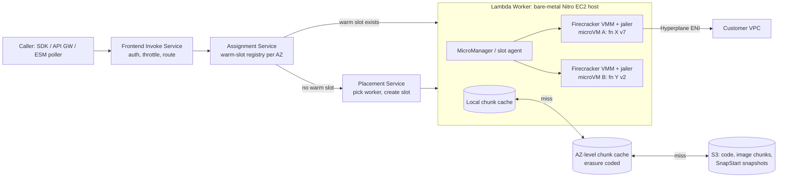

# Serverless Compute and Lambda Internals

## TL;DR

Every default-compute Lambda execution environment is a Firecracker microVM on a bare-metal Nitro worker, and each one serves exactly one function version and one request at a time (AWS whitepaper, as of 2026-11).
AWS renamed these functions Lambda Event Functions in 2026-10, and Lambda Managed Instances are the exception to this model, because they use containers on EC2 Nitro instances in your account (AWS docs, as of 2026-11).
A cold start has four costs that add up: placing a new slot, loading the code or image block by block from tiered caches, booting the guest and runtime, and running your INIT code.
Most of the time goes to INIT, and since 2025-08-01 you pay for it in every configuration ([AWS Compute Blog](https://aws.amazon.com/blogs/compute/aws-lambda-standardizes-billing-for-init-phase/), as of 2026-11).
SnapStart moves INIT to the time you publish a version: Lambda snapshots guest memory and later restores it lazily on page faults, which trades INIT latency for restore latency and adds a uniqueness hazard for random seeds, tokens and connections.
Scaling limits are concrete: each function can add 1,000 execution environments every 10 seconds, the default account concurrency quota is 1,000, and by Little's law concurrency equals RPS times duration (AWS docs, as of 2026-11).
On price, provisioned concurrency is cheaper than on-demand once sustained utilization of the provisioned capacity passes 60 percent (derived from AWS list prices, as of 2026-11).

## Mental Model



The request path and the slot-creation path are separate systems.
A warm invoke only touches the Frontend, the Assignment Service, and a microVM that is already running, so its cost is a few RPC hops plus your handler.
A cold invoke also calls the Placement Service, which picks a worker and creates a slot there.
That worker then streams code, image blocks or snapshot pages from a local, AZ-level and regional cache hierarchy, and the guest boots before INIT runs.
Treat Lambda as a sharded lease manager over a fleet of pre-booted microVM slots, not as "a container that starts per request."
Most cold-start pathologies come from the slot-creation path being slower and more failure-prone than the warm path.

## Internals

### Lineage and the isolation decision

The previous chapter, [[17-Cloud-AI-Engineering/Volume_02_AWS_Deep_Dive/Chapter_04_EC2_Nitro_Architecture_and_Graviton|EC2, Nitro Architecture, and Graviton]], explains how Nitro moves I/O and management onto dedicated cards.
Lambda workers are bare-metal Nitro EC2 instances, so KVM runs directly on the host with no nested virtualization.
At launch in 2014, Lambda isolated tenants with one EC2 instance per customer and containers inside it.
That wasted capacity, because each function's working set is tiny compared with a VM.
The NSDI 2020 Firecracker paper by Agache, Brooker, Florescu, Iordache, Liguori, Neugebauer, Piwonka and Popa lays out the trade-off ([USENIX NSDI 2020, pp. 419-434](https://www.usenix.org/conference/nsdi20/presentation/agache)).
Containers share one host kernel, so a single kernel bug breaks every tenant on the host.
QEMU-class VMMs isolate tenants but bring a large device model and a high per-VM memory and boot cost.
Firecracker sits in between: a Rust VMM on KVM with a deliberately minimal device set.
The core set is virtio-net, virtio-block, virtio-vsock, a serial console, and a partial i8042 controller that exists only so the guest can signal a reset, and newer releases also offer entropy and pmem devices and memory hotplug ([Firecracker README](https://github.com/firecracker-microvm/firecracker/blob/main/README.md), as of 2026-11).
Published targets are user-space boot in about 125 ms, under 5 MiB of VMM memory overhead, and up to 150 microVM creations per second per host ([Firecracker project site](https://firecracker-microvm.github.io/), as of 2026-11).
For the hypervisor-level comparison with gVisor see [[17-Cloud-AI-Engineering/Volume_00_Foundations_Under_the_Cloud/Chapter_01_Hypervisors_MicroVMs_and_Sandboxing|Hypervisors, MicroVMs, and Sandboxing]], and for the paper itself see [[17-Cloud-AI-Engineering/Volume_13_Seminal_Papers_and_Case_Studies/Chapter_04_Firecracker_MicroVM|Firecracker (2020 NSDI)]].

### Defense in depth around one microVM

Each microVM is one Firecracker process started by the `jailer`.
The jailer gives that process its own chroot, PID and network namespaces, a cgroup, and a dropped-privilege UID before the VMM touches guest input.
Firecracker itself then applies seccomp-BPF filters that allow only the few dozen syscalls the VMM threads need, with per-thread filters for the API, VMM and vCPU threads.
A guest escape therefore has to break KVM first, and then still faces a jailed, seccomp-filtered, unprivileged host process.
Each virtio device carries its own token-bucket rate limiter for bandwidth and for operations.
That is how the host stops one microVM's disk or network burst from starving its neighbours without a full QoS scheduler.
An execution environment is never shared across functions or function versions, and it is reused only sequentially by invocations of the same version.

### Control plane vs data plane

| Component | Plane | Role | Failure behavior |
|---|---|---|---|
| Frontend Invoke | Data | Authenticates, authorizes, applies concurrency throttles, routes to an assignment partition | Stateless and horizontally scaled; scaling this fleet past a threshold no cell had reached exposed the latent defect behind the 2023-06-13 us-east-1 event |
| Assignment Service (replaced Worker Manager, re:Invent 2022 SVS404) | Data | Tracks which warm slots exist per function version and AZ, leases a slot to each request | Partitioned, with replicated state per partition; losing a partition leader triggers failover, not cold-start storms (UNVERIFIED: only secondary write-ups of SVS404 found, no AWS primary text) |
| Placement Service | Control-ish, on hot path for cold starts | Picks a worker for a new slot, packing for low correlation | Degradation shows up as elevated cold-start latency and throttles, while warm traffic continues |
| Worker + MicroManager | Data | Runs Firecracker processes, freezes and thaws slots, fetches code chunks | A worker loss kills its slots; Assignment re-routes; workers are recycled on a maximum 14-hour lease ([AWS Lambda security whitepaper, German edition](https://docs.aws.amazon.com/de_de/whitepapers/latest/security-overview-aws-lambda/lambda-executions.html), as of 2026-11) |
| Function control plane (CreateFunction, UpdateFunctionConfiguration, PublishVersion) | Control | Validates config, optimizes image or zip into chunks, creates Hyperplane ENIs, takes SnapStart snapshots | Asynchronous, exposed through function `State` and `LastUpdateStatus`; data plane keeps serving existing versions |

This separation is the [[17-Cloud-AI-Engineering/Volume_01_Cloud_Architecture_Principles/Chapter_04_Control_Plane_vs_Data_Plane_Separation|control plane vs data plane]] principle applied rigorously.
Deploying a new version never blocks invokes of the old one.
The hidden coupling is that the cold-start path depends on Placement and on the chunk caches, so a regional event that slows those shows up first as p99 inflation and throttles on bursty functions.

### Placement: statistical multiplexing as the business model

Lambda's unit economics depend on soft allocation.
A worker advertises more microVM memory than it physically has, on the bet that slots are rarely all resident and busy at once.
The Firecracker paper describes the placement goal as packing workloads whose demand is uncorrelated, so their sum is smoother than any single one.
This is the same mathematics as [[17-Cloud-AI-Engineering/Volume_01_Cloud_Architecture_Principles/Chapter_03_Cell_Based_Architecture_and_Shuffle_Sharding|shuffle sharding]] used for efficiency rather than blast radius.
Many different customers' functions on one host give low correlation, while thousands of slots of one function on one host give high correlation.
Placement therefore spreads one function's slots across many workers and AZs.
A side effect is that a single function's scale-out is limited by the rate at which slots are created, not by spare capacity on one host.
That is why the scaling quota is stated as a rate: 1,000 execution environments every 10 seconds per function (AWS docs, as of 2026-11).

### The execution environment lifecycle

1. INIT: Lambda starts extensions, starts the runtime, and runs your static initialization code.
The on-demand INIT phase is limited to 10 seconds.
If INIT exceeds that, Lambda retries initialization on the first invoke under the function timeout, which surfaces as a long, billed first request.
The 10-second limit does not apply to provisioned concurrency, SnapStart or Managed Instances, where the limit is 130 seconds or the function timeout, whichever is higher (AWS docs, as of 2026-11).
2. INVOKE: the runtime polls the local Runtime API (`/2018-06-01/runtime/invocation/next`) over HTTP inside the guest, receives the event, and posts the response.
3. FREEZE: once the response is posted and extensions signal completion, the MicroManager freezes the guest's processes.
Background threads, timers and unflushed buffers stop mid-flight and resume only on the next invoke of that same environment, possibly minutes later.
4. SHUTDOWN: when the environment is reclaimed, extensions get a shutdown event with a budget of 0 ms with no extensions, 500 ms with an internal extension, or 2,000 ms with one or more external extensions (AWS docs, as of 2026-11).

Freezing is the mechanism behind most "works locally, flakes in Lambda" bugs.
A TCP connection opened during INIT may have been reset by the peer or a NAT idle timer while the environment was frozen.
The first write after thaw then fails, which is why SDK clients need retry logic and keepalive settings that tolerate idle gaps.

### Code delivery: block-level lazy loading (the mechanism the getting-started guide omits)

Container images up to 10 GB uncompressed are supported (AWS docs, as of 2026-11).
Lambda does not run `docker pull` on each cold start.
The USENIX ATC 2023 paper "On-demand Container Loading in AWS Lambda" by Brooker, Danilov, Greenwood and Piwonka describes what happens instead ([USENIX ATC 2023, pp. 315-328](https://www.usenix.org/conference/atc23/presentation/brooker)).
At function create time, the image's layers are deterministically flattened into a single ext4 filesystem image, which is then cut into fixed-size 512 KiB chunks named by content hash.
Each chunk is encrypted with convergent encryption, using AES-CTR and a key derived from the chunk's SHA-256 digest plus a varying salt.
As a result, identical chunks, such as the same base OS layer used by thousands of customers, dedupe to one stored and cached object for a given salt while staying encrypted at rest.
The chunk keys live in a per-image manifest whose key table is encrypted with a per-customer KMS key, so only workers serving that customer's functions can read them.
The worker exposes the image to the microVM as a virtio-blk block device, backed through FUSE by a per-function local agent.
Reads fault in only the chunks the runtime actually touches, served from a local worker cache, then an erasure-coded AZ-level cache, then S3.
The earlier Slacker study (Harter et al., FAST 2016) measured why this pays off: pulling images dominates container start time, yet on average only 6.4 percent of container data is needed at startup.
Lazy loading turns image start cost into "bytes touched during INIT" rather than "bytes in the image."
In practice a 5 GB image whose INIT reads 200 MB starts roughly like a 200 MB image once the chunks are hot in the AZ cache.
In the AZ cache, erasure coding means a read can complete from the fastest k of n shards (a 4-of-5 code in the paper), which cuts tail latency because no single slow cache node is on the critical path.
Two practical results follow.
Shared, popular base images such as AWS-provided base images start faster than bespoke ones, because their chunks are already hot.
Large images that INIT scans in full, for example by eagerly loading a 4 GB model file, lose the benefit entirely.

### SnapStart: snapshot, tiered cache, lazy restore

SnapStart supports Java 11 and later, Python 3.12 and later, and .NET 8 and later, in both zip and container image packaging, and it does not support provisioned concurrency, EFS, S3 Files, or ephemeral storage above 512 MB (AWS docs, as of 2026-11).
With `SnapStart.ApplyOn=PublishedVersions` set on the function, `PublishVersion` makes Lambda run INIT once, at publish time.
It then pauses the microVM and writes a Firecracker snapshot: a guest memory file, a small VM state file covering device and emulation state, and disk state (AWS docs and Firecracker docs, as of 2026-11).
The snapshot is encrypted, kept in several copies for resiliency, and cached for low-latency retrieval (AWS docs, as of 2026-11).
Whether it shares the code-chunk cache described above is UNVERIFIED: AWS docs do not describe the snapshot cache hierarchy.
On a cold start, Firecracker's snapshot-load API maps the memory file into the new VMM.
The open-source memory backend is either a file mapping or a `userfaultfd` handler, so guest pages are populated on first touch rather than copied up front (Firecracker docs, as of 2026-11).
Restore latency is therefore paid in page faults spread over the first invocations.
Lambda may reduce that cost by predicting memory access patterns, which Brooker's [2022 SnapStart post](https://brooker.co.za/blog/2022/11/29/snapstart.html) discusses as an option (UNVERIFIED: no AWS source confirms production prefetching).
Logs report this as `Restore Duration` and `Billed Restore Duration` in the `REPORT` line, and only the latter is charged, because time spent restoring outside the microVM is not billed (AWS docs, as of 2026-11).

The cost of this design is the snapshot uniqueness problem, described in "Restoring Uniqueness in MicroVM Snapshots" (Brooker, Catangiu, Danilov, Graf, MacCarthaigh and Sandu, [arXiv 2102.12892](https://arxiv.org/abs/2102.12892), 2021).
Every environment restored from one snapshot starts with byte-identical memory, so anything generated during INIT is cloned into every restored environment.
That includes userspace PRNG state, UUIDs, ephemeral key material, cached STS credentials, and TCP sequence state.
The kernel can learn that it was cloned through the Virtual Machine Generation ID device, a Linux driver merged in 5.18 that reseeds the kernel CSPRNG.
Userspace libraries that cache entropy still have to be told explicitly.
Lambda exposes runtime hooks for this purpose:
- Java uses CRaC `Resource.beforeCheckpoint` and `afterRestore`.
- Python uses `snapshot_restore_py` `register_before_snapshot` and `register_after_restore`.
- .NET uses `Amazon.Lambda.Core.SnapshotRestore` registration.

AWS also publishes a SpotBugs rule set that flags snapshot-unsafe patterns in Java.
Snapshots of Java versions that are not invoked for 14 days are deleted, and the next invoke returns `SnapStartNotReadyException` while Lambda rebuilds the snapshot (AWS docs, as of 2026-11).
For Python and .NET, every active published version keeps paying snapshot cache charges until you delete it.

### VPC attachment through Hyperplane

Since 2019, VPC-attached functions no longer create one ENI per execution environment.
At configuration time Lambda creates a Hyperplane ENI per unique subnet and security-group combination.
MicroVMs on many workers reach that ENI through Hyperplane, the same NAT fabric that powers NLB and PrivateLink.
This took ENI creation off the cold-start path, which previously could add many seconds.
It also moved the failure to configuration time, which is why the function sits in `Pending` until the ENI exists.
Each Hyperplane ENI supports up to 65,000 connections or ports, and Lambda adds ENIs automatically above that (AWS docs, as of 2026-11).
If a function stays idle for 14 days, Lambda reclaims unused Hyperplane ENIs and moves the function to `Inactive` (AWS docs, as of 2026-11).
The subnet-level mechanics are covered in [[17-Cloud-AI-Engineering/Volume_02_AWS_Deep_Dive/Chapter_03_VPC_Networking_Internals|VPC Networking Internals]].

### Newer placement modes

Lambda durable functions, for multi-step workflows that checkpoint and replay for up to one year, were announced as generally available on 2025-12-02 and are documented as an option alongside Step Functions (AWS docs, as of 2026-11).
Lambda Managed Instances were announced at re:Invent 2025 and are documented without a preview label.
They run Lambda execution environments on EC2 capacity in the customer account, allow multiple concurrent requests per environment, and add a 15 percent management fee on the EC2 price (AWS docs, as of 2026-11).
Their timeout rises to 5,400 seconds for asynchronous invocations and most event source mappings, and they use containers rather than Firecracker, so the capacity provider and not the container is the security boundary (AWS docs, as of 2026-11).
Tenant isolation mode, announced 2025-11 and documented without a preview label, dedicates execution environments per `tenant-id` within one function, is set only at function creation, and excludes function URLs, provisioned concurrency, SnapStart and Managed Instances (AWS docs, as of 2026-11).
Lambda MicroVMs, announced 2026-06-22, give each user or job a Firecracker VM for user or AI-generated code that can suspend and resume for up to 8 hours (AWS What's New, as of 2026-11).
Lambda Web Functions, announced 2026-10-12, run an HTTP server with up to 128 concurrent requests per environment, Node.js only at launch (AWS docs and What's New, as of 2026-11).
Neither MicroVM nor Web Function announcement uses the words GA or preview; both say available today in five Regions.
Treat these as changes to the placement contract: they trade some of the statistical-multiplexing efficiency above for control over hardware or isolation boundaries.

## Numbers to Know

| Quantity | Value | Source |
|---|---|---|
| Memory | 128 MB to 10,240 MB in 1 MB steps | (AWS docs, as of 2026-11) |
| CPU scaling | 1 vCPU equivalent at 1,769 MB; up to 6 vCPUs at 10,240 MB | (AWS docs, as of 2026-11; [6 vCPU from AWS What's New, 2020-12](https://aws.amazon.com/about-aws/whats-new/2020/12/aws-lambda-supports-10gb-memory-6-vcpu-cores-lambda-functions/), not restated in current docs) |
| Timeout | 900 s hard limit; 5,400 s for Managed Instances async and most event source mappings | (AWS docs, as of 2026-11) |
| Per-function scale rate | 1,000 execution environments every 10 s | (AWS docs, as of 2026-11) |
| Default account concurrency | 1,000 (soft); new accounts may start lower | (AWS docs, as of 2026-11) |
| Sync payload | 6 MB request and 6 MB response | (AWS docs, as of 2026-11) |
| Streamed response | 200 MB | (AWS docs, as of 2026-11) |
| Async payload | 1 MB | (AWS docs, as of 2026-11) |
| Container image | 10 GB uncompressed | (AWS docs, as of 2026-11) |
| /tmp ephemeral storage | 512 MB default, up to 10,240 MB | (AWS docs, as of 2026-11) |
| Environment variables | 4 KB total | (AWS docs, as of 2026-11) |
| Layers | 5 per function | (AWS docs, as of 2026-11) |
| On-demand INIT limit | 10 s, then retried at first invoke | (AWS docs, as of 2026-11) |
| Cold-start frequency | INIT typically in under 1 percent of invocations | (AWS docs and AWS Compute Blog, as of 2026-11) |
| Firecracker boot / overhead / rate | about 125 ms, under 5 MiB, 150 VMs per s per host | (Firecracker project, as of 2026-11) |
| x86 duration price | $0.0000166667 per GB-s for the first 6B GB-s per month, us-east-1; lower tiers above that | (AWS Price List API, as of 2026-11) |
| Arm duration price | $0.0000133334 per GB-s for the first 7.5B GB-s per month, us-east-1 | (AWS Price List API, as of 2026-11) |
| Requests | $0.20 per 1M | (AWS pricing, as of 2026-11) |
| Free tier | 1M requests and 400,000 GB-s per month | (AWS pricing, as of 2026-11) |
| Provisioned concurrency | $0.0000041667 per GB-s allocated, plus $0.0000097222 per GB-s duration (x86) | (AWS pricing and Price List API, as of 2026-11) |
| SnapStart cache | $0.0000015046 per GB-s, 3-hour minimum, Python and .NET only | (AWS pricing, as of 2026-11) |
| SnapStart restore | $0.0001397998 per GB restored, Python and .NET only | (AWS pricing and Price List API, as of 2026-11) |
| INIT billing | INIT billed for all configurations since 2025-08-01 | (AWS Compute Blog, as of 2026-11) |

## AWS vs GCP Mechanism Parity

| Dimension | AWS Lambda | Google Cloud Run (services and functions) | Critical difference |
|---|---|---|---|
| Isolation primitive | Firecracker microVM per execution environment on KVM | Gen1: gVisor, emulating most system calls; Gen2: microVM with full Linux compatibility; services default to whichever fits the features used (Google Cloud docs, as of 2026-11) | Lambda pays a guest kernel per environment; gVisor pays a syscall-interception tax on I/O-heavy code |
| Requests per instance | 1 for Event Functions in on-demand mode; multiple on Managed Instances and Web Functions (AWS docs, as of 2026-11) | Configurable concurrency, default 80 in the console or 80 times vCPUs with gcloud or Terraform, max 1,000 (Google Cloud docs, as of 2026-11) | Cloud Run multiplexes I/O-bound requests onto one instance, so cold starts per RPS are far lower for I/O-bound APIs than on on-demand Event Functions |
| Scale-out contract | 1,000 environments per 10 s per function | Instance autoscaling on concurrency and CPU, with max-instances per service | Lambda publishes a rate; Cloud Run publishes targets |
| Cold-start mitigation | Provisioned concurrency, SnapStart memory snapshot | Min instances, startup CPU boost | No GA memory-snapshot restore on Cloud Run (UNVERIFIED: none found in Cloud Run docs, and no explicit statement either way) |
| Code delivery | Block-level lazy chunk loading, convergent-encrypted dedupe | Image pulled from Artifact Registry with Google-side caching (UNVERIFIED: mechanism not described in the Cloud Run docs checked) | Lambda's dedupe across customers is a published design |
| Max request duration | 15 min | Default 5 min, up to 60 min for services (Google Cloud docs, as of 2026-11) | Long LLM streaming calls fit Cloud Run better |
| Accelerators | None documented for any Lambda compute type (AWS docs and FAQ, as of 2026-11) | NVIDIA L4 GPUs on Cloud Run services, GA 2025-04-07, and RTX PRO 6000, GA 2026-04-13, both requiring instance-based billing (Google Cloud docs and release notes, as of 2026-11) | GPU serverless inference is a Cloud Run capability with no Lambda equivalent |
| Billing granularity | Per ms of GB-s, INIT included | Request-based billing while handling requests, starting or stopping, or instance-based billing for the whole instance lifetime (Google Cloud docs, as of 2026-11) | Lambda bills per request slot; Cloud Run bills per instance time |
| VPC egress | Hyperplane ENI per subnet and SG tuple | Direct VPC egress or Serverless VPC Access connector | Both remove per-instance NICs from the cold path |
| Freeze semantics | Environment frozen between invokes | CPU allocated only during request processing under request-based billing (Google Cloud docs, as of 2026-11) | Background work is unsafe on both unless you choose instance-based billing on Cloud Run |

For the full Cloud Run treatment see [[17-Cloud-AI-Engineering/Volume_03_GCP_Deep_Dive/Chapter_08_Cloud_Run_and_Serverless_Container_Execution|Cloud Run and Serverless Container Execution]] and [[17-Cloud-AI-Engineering/Volume_04_AWS_vs_GCP_Translation/Chapter_01_Compute_Translation|Compute Translation]].

## Worked Example: Measuring INIT vs RESTORE and Sizing Provisioned Concurrency

### Cost estimate and budget guardrail

The lab runs 10 invocations across the two functions at 1,024 MB for about 3 seconds each, roughly 30 GB-s, or about $0.0005 of duration charges.
The script publishes 5 SnapStart versions, each carrying its own 3-hour minimum snapshot cache charge: 5 times 1 GB times 10,800 s of cache costs about $0.08, plus 5 restores at 1 GB each, about $0.0007.
The expected total is about $0.08, well under $0.15, excluding the free tier.
Create a budget alarm before running the lab:

```bash
ACCOUNT_ID=$(aws sts get-caller-identity --query Account --output text)
aws budgets create-budget --account-id "$ACCOUNT_ID" \
  --budget '{"BudgetName":"lambda-lab-5usd","BudgetLimit":{"Amount":"5","Unit":"USD"},"TimeUnit":"MONTHLY","BudgetType":"COST"}' \
  --notifications-with-subscribers '[{"Notification":{"NotificationType":"ACTUAL","ComparisonOperator":"GREATER_THAN","Threshold":80,"ThresholdType":"PERCENTAGE"},"Subscribers":[{"SubscriptionType":"EMAIL","Address":"you@example.com"}]}]'
```

### Lab script

The script below creates two Python 3.12 functions with a deliberately slow INIT, one plain and one with SnapStart.
It forces cold starts by publishing new versions, then parses the `REPORT` log line returned by `LogType=Tail`.

```python
# lambda_coldstart_lab.py - requires boto3, credentials with IAM and Lambda admin in a sandbox account.
import base64, io, json, re, time, zipfile
import boto3

REGION = "us-east-1"
ROLE = "lambda-coldstart-lab-role"
FUNCS = {"cs-lab-plain": None, "cs-lab-snap": {"ApplyOn": "PublishedVersions"}}
SRC = '''
import time, hashlib
t0 = time.time()
time.sleep(2.0)                                   # simulates heavy imports / model load
TABLE = {i: hashlib.sha256(str(i).encode()).hexdigest() for i in range(200000)}
INIT_S = time.time() - t0
def handler(event, context):
    return {"init_s": round(INIT_S, 3), "n": len(TABLE)}
'''

iam = boto3.client("iam")
lam = boto3.client("lambda", region_name=REGION)

def zip_bytes():
    buf = io.BytesIO()
    with zipfile.ZipFile(buf, "w") as z:
        z.writestr("app.py", SRC)
    return buf.getvalue()

def ensure_role():
    trust = {"Version": "2012-10-17", "Statement": [{"Effect": "Allow",
             "Principal": {"Service": "lambda.amazonaws.com"}, "Action": "sts:AssumeRole"}]}
    try:
        arn = iam.create_role(RoleName=ROLE, AssumeRolePolicyDocument=json.dumps(trust))["Role"]["Arn"]
        iam.attach_role_policy(RoleName=ROLE,
            PolicyArn="arn:aws:iam::aws:policy/service-role/AWSLambdaBasicExecutionRole")
        time.sleep(10)                            # IAM propagation
        return arn
    except iam.exceptions.EntityAlreadyExistsException:
        return iam.get_role(RoleName=ROLE)["Role"]["Arn"]

def create(name, snap, role_arn):
    kw = dict(FunctionName=name, Runtime="python3.12", Role=role_arn, Handler="app.handler",
              Code={"ZipFile": zip_bytes()}, MemorySize=1024, Timeout=30, Architectures=["x86_64"])
    if snap:
        kw["SnapStart"] = snap
    lam.create_function(**kw)
    lam.get_waiter("function_active_v2").wait(FunctionName=name)

def cold_invoke(name, i):
    lam.update_function_configuration(FunctionName=name, Environment={"Variables": {"BUMP": str(i)}})
    lam.get_waiter("function_updated_v2").wait(FunctionName=name)
    ver = lam.publish_version(FunctionName=name)["Version"]
    lam.get_waiter("published_version_active").wait(FunctionName=name, Qualifier=ver)
    r = lam.invoke(FunctionName=name, Qualifier=ver, LogType="Tail")
    log = base64.b64decode(r["LogResult"]).decode()
    report = [l for l in log.splitlines() if l.startswith("REPORT")][0]
    grab = lambda k: (re.search(k + r": ([\d.]+) ms", report) or [None, "0"])[1]
    return float(grab("Init Duration")), float(grab("Restore Duration")), float(grab("Billed Duration"))

if __name__ == "__main__":
    arn = ensure_role()
    for n, s in FUNCS.items():
        create(n, s, arn)
    for n in FUNCS:
        rows = [cold_invoke(n, i) for i in range(5)]
        print(n, "init_ms", [r[0] for r in rows], "restore_ms", [r[1] for r in rows],
              "billed_ms", [r[2] for r in rows])
```

Expected shape of the result:
- The plain function reports an `Init Duration` of roughly 2,200 to 2,600 ms on every cold start, all of it billed.
- The SnapStart function reports no `Init Duration` on invoke and a `Restore Duration` that AWS describes only as "as low as sub-second" startup (AWS docs, as of 2026-11); measure it, because it depends on resident set size and cache warmth.
- On the SnapStart function, the 2-second sleep was paid once per published version, inside `PublishVersion`.

### Teardown

```bash
for f in cs-lab-plain cs-lab-snap; do aws lambda delete-function --function-name "$f" --region us-east-1; done
aws iam detach-role-policy --role-name lambda-coldstart-lab-role --policy-arn arn:aws:iam::aws:policy/service-role/AWSLambdaBasicExecutionRole
aws iam delete-role --role-name lambda-coldstart-lab-role
for f in cs-lab-plain cs-lab-snap; do aws logs delete-log-group --log-group-name "/aws/lambda/$f" --region us-east-1; done
aws budgets delete-budget --account-id "$(aws sts get-caller-identity --query Account --output text)" --budget-name lambda-lab-5usd
```

Deleting the function deletes all published versions, which is what stops SnapStart cache billing.

### Back-of-the-envelope capacity and cost sizing

Scenario: an API averaging 5,000 RPS with a p50 handler duration of 120 ms at 512 MB, x86, peaking at 3x for 10 minutes each morning.

1. Steady concurrency by Little's law: 5,000 RPS times 0.12 s gives 600 concurrent environments.
2. Peak concurrency: 15,000 RPS times 0.12 s gives 1,800 environments, so the account quota must exceed about 2,000 with headroom.
3. Scale-up time from steady state to peak: 1,200 extra environments at 1,000 per 10 s takes at least 12 s, if the ramp is steeper than that, expect 429 throttles and push the retry cost onto callers.
4. Requests per month: 5,000 times 2,592,000 s gives 12.96 billion requests, or $2,592 in request charges.
5. On-demand duration: 12.96e9 times 0.12 s times 0.5 GB gives 777.6M GB-s, times $0.0000166667, which is about $12,960 per month.
6. Provisioned concurrency for the 600-environment baseline: allocation cost is 600 times 0.5 GB times 2,592,000 s times $0.0000041667, about $3,240.
Duration at the provisioned rate is 777.6M GB-s times $0.0000097222, about $7,560, for a total of about $10,800.
7. Break-even: provisioned allocation costs $0.0000041667 per GB-s, and each utilized GB-s saves $0.0000166667 minus $0.0000097222, which is $0.0000069445.
Provisioned concurrency therefore wins when utilization exceeds 0.0000041667 divided by 0.0000069445, which equals 0.60.
8. Decision: provision about 80 percent of the trough concurrency, so it stays above 60 percent utilized, and let on-demand absorb the peak.
If the service is above roughly 600 steady concurrency all day, compare it against [[17-Cloud-AI-Engineering/Volume_02_AWS_Deep_Dive/Chapter_06_Container_Services_ECS_and_Fargate|ECS and Fargate]] with request multiplexing, because a single-request-per-environment model is the expensive part.

## Failure Modes and Pitfalls

### Cold-start storms and correlated scale-out

A cache flush, a deploy that shifts all traffic to a new version at once, or an upstream retry storm can force thousands of simultaneous INITs.
Each INIT opens new connections to the database, Secrets Manager and STS, so the cold-start storm becomes a downstream connection storm.
Mitigations:
- Use weighted alias traffic shifting through CodeDeploy.
- Use RDS Proxy for relational backends.
- Cap concurrency with reserved concurrency below the downstream's connection limit.
- Apply the [[17-Cloud-AI-Engineering/Volume_07_Reliability_and_SRE/Chapter_03_Resilient_Communication_Retries_Jitter_and_Circuit_Breakers|full-jitter retry discipline]] at callers.

### Freeze-related bugs

Telemetry flushed asynchronously after the handler returns is lost or delayed, because the guest freezes.
Pooled connections go stale while frozen, so the first post-thaw call fails.
Use the Extensions API or a synchronous flush, and configure client-side idle eviction shorter than NAT and peer idle timers.

### SnapStart uniqueness and staleness

The same UUID or nonce can appear in many environments when it was generated in INIT, which breaks idempotency keys and can break cryptographic protocols.
Temporary credentials fetched during INIT and frozen into the snapshot can be expired when the snapshot is restored days later.
The execution-role credentials are the exception, because SnapStart runtimes read them from a container credentials endpoint rather than environment variables (AWS docs, as of 2026-11).
The state of connections captured in the snapshot is not guaranteed after restore; AWS SDK connections usually resume, and others must be re-established (AWS docs, as of 2026-11).
Fix each one in an after-restore hook, and run the SpotBugs rules for Java.

### Version sprawl billing

With SnapStart on Python or .NET, every CI pipeline that publishes a version per commit creates another cached snapshot billed per GB-s until deletion.
Add a lifecycle job that deletes unaliased versions.

### Throttling semantics differ by invocation type

Synchronous callers receive a 429 and must retry.
Asynchronous invocations are queued internally and retried by Lambda, so a throttle becomes latency and possibly a dead-letter event.
Event source mappings for SQS, Kinesis and DynamoDB Streams back off pollers, so a throttle becomes queue age.
An alarm on `Throttles` alone misses the async and ESM cases; alarm on `AsyncEventAge`, `IteratorAge`, and SQS `ApproximateAgeOfOldestMessage`.

### Recursive loops

A function writing to the S3 bucket or SQS queue that triggers it scales to quota within seconds.
Lambda's recursive loop detection stops the chain after about 16 invocations for loops through SQS, S3, SNS, EventBridge custom buses or Lambda itself when a supported SDK is used, but not through services such as DynamoDB (AWS docs, as of 2026-11), so design out the cycle rather than relying on it.

### VPC function goes Inactive

After 14 idle days the Hyperplane ENI is reclaimed (AWS docs, as of 2026-11).
The next invoke fails, with `ResourceNotReadyException`, while the function goes through `Pending` back to `Active`, which looks like a random outage for a monthly batch job.

### Public post-incident reviews

- [AWS Lambda event in us-east-1, 2023-06-13](https://aws.amazon.com/message/061323/): as the Lambda Frontend fleet scaled for normal daily traffic growth, it passed a threshold no cell had reached, exposing a latent defect that allocated execution environments which were never used, which caused elevated errors and latency for invokes in the affected cell, and AWS services built on Lambda degraded with it.
The lesson is that the Frontend is a shared, regional data-plane dependency for many AWS services, not just your function.
- [AWS us-east-1 event, 2021-12-07](https://aws.amazon.com/message/12721/): an automated scaling activity triggered a connection surge that congested the devices linking the main AWS network and the internal network, which impaired control planes and monitoring.
Lambda APIs and invocations operated normally throughout, but API Gateway, which often fronts Lambda, had elevated errors, so a healthy function still looked down to its callers.
- [AWS us-east-1 event, 2025-10-19 to 2025-10-20](https://aws.amazon.com/message/101925/): a race condition in DynamoDB's DNS automation emptied a regional endpoint record.
Lambda and its event source processing were among the dependent services that degraded, Lambda throttled event source mappings and asynchronous invocations to prioritize synchronous calls, and all backlogs were cleared by 2:15 PM PDT on 2025-10-20.
The lesson is that backlog drain after recovery is its own load spike, so size reserved concurrency and downstream capacity for the drain, not only for steady state.
For cross-provider analysis see [[17-Cloud-AI-Engineering/Volume_07_Reliability_and_SRE/Chapter_07_Anatomy_of_Major_Cloud_Outages|Anatomy of Major Cloud Outages]].

## Security and Cost Angles

### IAM scoping

The execution role is the function's identity.
Credentials are delivered to the environment as environment variables from an STS session, except under SnapStart, where the runtime uses a container credentials endpoint (AWS docs, as of 2026-11).
Scope the role to exact resource ARNs and add `aws:SourceArn` and `aws:SourceAccount` conditions on the resource-based policy for service principals such as S3 and SNS, which prevents confused-deputy invocation from other accounts.
Separate `lambda:UpdateFunctionCode` and `lambda:PublishVersion` from `lambda:InvokeFunction`, because code update is equivalent to assuming the execution role.
Use code signing configurations with AWS Signer to reject unsigned zips, as described in [[17-Cloud-AI-Engineering/Volume_08_Security_Identity_and_the_Data_Perimeter/Chapter_05_Software_Supply_Chain_Security_SLSA_and_Sigstore|Software Supply Chain Security]].

### Encryption

Environment variables are encrypted at rest with an AWS managed key by default, or with a customer managed KMS key you specify.
Code artifacts and SnapStart snapshots are encrypted at rest, and a customer managed key can be supplied for snapshots with `--kms-key-arn` (AWS docs, as of 2026-11).
The execution role then needs `kms:Decrypt` on that key, or restore fails (UNVERIFIED: not stated in the current SnapStart security or troubleshooting docs).
Store secrets in Secrets Manager and fetch them through the Parameters and Secrets extension cache instead of baking them into environment variables, which are visible to anyone with `lambda:GetFunctionConfiguration`.
See [[17-Cloud-AI-Engineering/Volume_02_AWS_Deep_Dive/Chapter_15_Security_and_Cryptography_KMS_and_Nitro_Enclaves|KMS and Nitro Enclaves]].

### Network boundary

Put functions in private subnets with interface VPC endpoints for STS, Secrets Manager, KMS and DynamoDB or S3 gateway endpoints, so data-plane calls never traverse a NAT gateway.
The NAT per-GB charge is often larger than the Lambda bill for chatty functions.
Use the `lambda:VpcIds` and `lambda:SubnetIds` IAM condition keys in SCPs to force functions into approved networks, as in [[17-Cloud-AI-Engineering/Volume_08_Security_Identity_and_the_Data_Perimeter/Chapter_06_Constructing_an_Impenetrable_Data_Perimeter|Constructing an Impenetrable Data Perimeter]].

### Unit-economics levers

1. Arm64 is priced about 20 percent below x86 per GB-s (AWS pricing, as of 2026-11), so move first any pure-Python or Node function with no x86-only native wheels.
2. Memory tuning is CPU tuning below 1,769 MB, so a CPU-bound function often costs less at higher memory because duration falls faster than price rises; measure with AWS Lambda Power Tuning.
3. INIT is now billed, so lazy-import rarely used modules and avoid eager model loads in latency-insensitive paths.
4. Compute Savings Plans save up to 17 percent on Lambda duration and provisioned concurrency, but not on requests ([AWS](https://aws.amazon.com/blogs/aws/savings-plan-update-save-up-to-17-on-your-lambda-workloads/), as of 2026-11), see [[17-Cloud-AI-Engineering/Volume_09_FinOps_and_Cloud_Economics/Chapter_02_Commitment_Discounts_Savings_Plans_vs_CUDs|Savings Plans vs CUDs]].
5. Above roughly 60 percent sustained utilization, prefer provisioned concurrency; above several hundred steady concurrency for I/O-bound handlers, a multiplexing runtime on Fargate, ECS or Cloud Run usually wins.

## Interview Questions and Model Answers

### Question 1 (L5 - Senior)

A Python API on Lambda has p99 latency of 3.8 s while p50 is 90 ms. Walk through how you would diagnose and fix it.

#### Model Answer

First confirm it is a cold-start tail and not a downstream tail.
Use a CloudWatch Logs Insights query over `REPORT` lines comparing the percentage of invocations with `@initDuration` present against the p99 of `@duration` with and without INIT.
If INIT is the tail, break it down.
Extension startup and runtime bootstrap are platform cost.
Import time can be measured with `python -X importtime` locally, and the leading costs are usually heavy SDKs, pandas or numpy, and eager client creation.
Network calls in INIT, such as fetching secrets or opening DB connections, add round trips and are vulnerable to stale-connection behavior.
Fixes in order of cost:
1. Trim the package and lazy-import rarely used dependencies.
2. Move to arm64 if the dependencies allow, and raise memory to get more CPU during INIT.
3. Enable SnapStart on a published version behind an alias, adding after-restore hooks to recreate connections and reseed anything random.
4. As an alternative to step 3, because SnapStart does not support provisioned concurrency (AWS docs, as of 2026-11), use provisioned concurrency only for the baseline, where utilization exceeds 60 percent.

If the cold-start rate itself is high, check for deploy patterns that publish versions frequently and for traffic that oscillates near zero, because every scale-to-zero cycle turns into cold starts.

#### Follow-up Interviewer Question

After enabling SnapStart, p99 improves, but a fraction of first requests after restore fail with connection reset errors. Why, and what is the precise fix?

### Question 2 (L5 - Senior)

Explain exactly what limits how fast a single Lambda function can scale from 0 to 20,000 concurrent executions, and how long it takes.

#### Model Answer

There are two limits: the account concurrency quota and the per-function rate of 1,000 new execution environments every 10 seconds.
Assuming the quota is raised above 20,000, reaching 20,000 environments takes at least 200 seconds of sustained demand.
During that window, requests above the current concurrency are throttled with 429 for synchronous callers.
For asynchronous invocations they are queued, and for event source mappings they back off pollers.
The rate exists because environment creation goes through Placement and chunk loading on many workers.
Placement intentionally spreads one function across hosts to keep demand uncorrelated, so slot creation, not idle capacity, is the bottleneck.
To absorb a predictable spike, pre-warm with provisioned concurrency on a schedule, or put a queue in front and let the consumer scale at its own pace.

#### Follow-up Interviewer Question

The function reads from SQS with a batch size of 10. How does the event source mapping's own scaling interact with the 1,000-per-10-seconds limit and with the queue's visibility timeout?

### Question 3 (L6 - Staff)

Describe how SnapStart works mechanically, and enumerate every class of correctness bug it can introduce in a payment service.

#### Model Answer

At `PublishVersion`, Lambda runs INIT in a Firecracker microVM, pauses it, and writes the guest memory file and VM state.
The snapshot is encrypted, persisted, and cached for low-latency retrieval.
On cold start, a new Firecracker process loads the VM state and maps memory through a file mapping or `userfaultfd`, so pages arrive on first touch.
The cost moves from INIT time to page-fault time during the first invocations, possibly reduced by predicting the working set (UNVERIFIED: no AWS source confirms production prefetching).
Bug classes in a payment service:
1. Duplicated entropy: a userspace PRNG seeded in INIT produces identical sequences across environments.
That breaks idempotency keys, nonces and token generation, and can be catastrophic for some signature schemes where nonce reuse leaks the private key.
2. Duplicated identity: instance IDs or UUIDs generated in INIT collide across environments, which corrupts dedupe tables.
3. Stale time: caches with TTLs computed from INIT time are already expired or, worse, treated as fresh if they use monotonic counters captured in the snapshot.
4. Stale credentials: STS or database tokens fetched in INIT have expired by restore time.
5. Dead connections: the state of TCP and TLS sessions in the snapshot is not guaranteed after restore, and TLS session state reused across clones is a security issue.
6. Reordered initialization side effects: anything INIT registers externally, such as service discovery or a lock lease, ran once at publish, not per environment.

Controls:
- Reseed and regenerate in after-restore hooks.
- Rely on the kernel CSPRNG, which is reseeded through VMGenID, rather than userspace PRNGs.
- Fetch credentials lazily with expiry checks.
- Run a CI gate with the SpotBugs SnapStart rules for Java and an equivalent code review checklist for Python.

#### Follow-up Interviewer Question

How would you build an automated test that proves your service is snapshot-safe, given that you cannot trigger a restore locally?

### Question 4 (L6 - Staff)

Finance asks whether to move a steady 600-concurrency Lambda API to provisioned concurrency, Fargate, or keep it on-demand. Give a quantitative recommendation.

#### Model Answer

By Little's law, 600 concurrency at 120 ms means 5,000 RPS.
On-demand duration at 512 MB costs about $12,960 per month plus $2,592 in requests.
Provisioned concurrency for all 600 costs about $3,240 in allocation plus $7,560 in duration, about $10,800, because utilization is near 100 percent.
Utilization is well above the 0.60 break-even derived from list prices, so if traffic dips overnight, provision only the trough.
Fargate changes the model entirely, because one task can multiplex many concurrent I/O-bound requests.
If each 120 ms request spends 100 ms waiting on I/O, a 1 vCPU task can serve tens of concurrent requests.
The 600-environment fleet then collapses to a few dozen tasks, often an order of magnitude cheaper, at the cost of owning autoscaling, health checks, deployment and patching of the container.
Recommendation: keep Lambda with partial provisioned concurrency if the team's operational capacity is the constraint.
Move the hot path to a multiplexing runtime if cost is the constraint, with the decision based on measured CPU time per request rather than wall time.
Include the request charge: at 12.96 billion requests it is about 17 percent of the on-demand bill and 19 percent of the provisioned bill, and it does not exist on Fargate.

#### Follow-up Interviewer Question

How do Compute Savings Plans change this comparison, given they apply to both Lambda and Fargate?

### Question 5 (L6 - Staff)

A VPC-attached Lambda fleet starts failing with `EC2ThrottledException` and some functions show `State: Pending` for minutes during a deploy wave. Explain the mechanism and the fix.

#### Model Answer

VPC-attached functions use Hyperplane ENIs created per unique subnet and security-group combination at configuration time, not per execution environment.
A deploy wave that changes security groups or subnets across many functions forces Lambda to create many new ENIs through EC2 APIs.
That consumes EC2 API rate limits and subnet IP addresses, and `EC2ThrottledException` is the documented error when EC2 throttles Lambda during this setup (AWS Invoke API docs, as of 2026-11).
New functions remain `Pending` until their ENIs exist, which can take several minutes, and they cannot be invoked until then.
Existing functions block further updates and version creation but can still invoke previous versions (AWS docs, as of 2026-11), so the outage risk concentrates on new functions and on pipelines that wait on the update.
Fixes:
- Standardize on a small number of subnet and security-group tuples shared across functions so ENIs are reused.
- Size subnets with headroom for ENI churn.
- Roll configuration changes in batches with health gates.
- Never change networking configuration and code in the same release.
- Monitor `LastUpdateStatus` in the pipeline.

This is a static-stability problem: a runtime dependency on the EC2 control plane appeared inside a deploy, which [[17-Cloud-AI-Engineering/Volume_01_Cloud_Architecture_Principles/Chapter_02_Regions_Zones_and_Static_Stability|Regions, Zones, and Static Stability]] says to eliminate.

#### Follow-up Interviewer Question

How would you detect, before a deploy, that a change will create new Hyperplane ENIs?

### Question 6 (L7+ - Principal)

Design the placement and isolation layer for a serverless platform that runs untrusted, LLM-agent-generated code for many tenants, and justify microVMs versus gVisor versus containers.

#### Model Answer

Start from the threat model.
The code is adversarial by default, because prompt injection can make an agent emit hostile code, so the isolation boundary must survive a host-kernel exploit attempt.
Containers fail that bar, because their only boundary is the shared host kernel.
gVisor shrinks the host kernel attack surface by implementing syscalls in a user-space kernel.
Its tax is on syscall-heavy and I/O-heavy workloads, and compatibility gaps surface with arbitrary generated code.
Firecracker microVMs give a hardware virtualization boundary, a tiny Rust device model, jailer and seccomp layers, and per-device rate limiters for noisy-neighbor control.
Their costs are a guest kernel per sandbox and boot time, which snapshots amortize.
Design:
1. A per-tenant pool of pre-booted, snapshot-restored microVMs, sized by Little's law from the tenant's sandbox creation rate times restore latency.
2. Never reuse a sandbox across tenants, and recycle each sandbox after one session or after a bounded wall-clock lifetime, which eliminates cross-session state leaks.
3. Restore from a golden snapshot with a mandatory after-restore hook that reseeds entropy, assigns identity, and fetches a short-lived scoped credential, because a snapshot-cloned credential is shared by every clone.
4. Egress only through a policy proxy with allow-listed destinations and per-sandbox token buckets, because exfiltration is the main post-exploit goal.
5. Placement packs different tenants on a host for uncorrelated demand, while spreading any single tenant across hosts and cells so one tenant's burst or exploit attempt has bounded blast radius.
6. Admission control rejects new sandbox creation when the placement queue grows, rather than letting latency grow unbounded.

On AWS, Lambda Event Functions already give most of this through managed Firecracker.
Their gaps are one request per environment, a 15-minute cap, and limited egress control.
Tenant isolation mode, documented without a preview label, closes the reuse gap, but all tenants share one execution role (AWS docs, as of 2026-11).
Lambda MicroVMs, announced 2026-06-22 for exactly this workload, give Firecracker isolation with suspend and resume for up to 8 hours (AWS What's New, as of 2026-11).
Self-managed Firecracker on bare-metal EC2 is the remaining alternative.
On Google Cloud, Cloud Run's gVisor-based environment or GKE Sandbox are the native options.
A principal-level answer names the cost: self-managing Firecracker means owning the placement service, the snapshot pipeline, host patching and the jailer configuration, which only pays off at large, sustained sandbox volume.

#### Follow-up Interviewer Question

A researcher reports a side-channel that leaks data between microVMs sharing a physical core. What do you change in placement, what does it cost in density, and how do you decide?

### Question 7 (L7+ - Principal)

Lambda's per-request microVM model is being proposed for LLM inference. Argue for or against with mechanism-level reasoning.

#### Model Answer

Against, for anything beyond small models.
Lambda documents no accelerators (AWS docs and FAQ, as of 2026-11), so inference runs on CPU, where the decode phase is memory-bandwidth bound and gets only a slice of host DRAM bandwidth per microVM.
The one-request-per-environment model defeats continuous batching, which is the main throughput lever of engines like vLLM.
As a result, each environment serves one sequence at a time and cost per token is several times that of a batched accelerator server.
Weight loading is the cold start.
A multi-GB model read during INIT defeats lazy block loading because every chunk is touched.
SnapStart can help on supported runtimes, in zip or container image packaging (AWS docs, as of 2026-11), where the model fits in the snapshot, and then each restore page-faults gigabytes through the cache hierarchy.
The 15-minute cap and the 200 MB streamed response limit are acceptable for chat but not for long agent loops.
For: small embedding models, classifiers, guardrail filters and tokenizers have short, bursty, CPU-friendly workloads where scale-to-zero and per-ms billing beat an idle GPU.
Recommendation: put the Lambda-shaped pieces (pre-processing, routing, guardrails, tool execution) on Lambda.
Put decode on batched GPU or Trainium serving, as in [[17-Cloud-AI-Engineering/Volume_11_LLM_Serving_and_Inference_Systems_on_Cloud/Chapter_08_Cloud_GPU_Autoscaling_and_Cold_Start_Mitigation|Cloud GPU Autoscaling and Cold-Start Mitigation]], or use Cloud Run with L4 GPUs where serverless GPU semantics are required.

#### Follow-up Interviewer Question

Quantify the break-even QPS at which a single always-on GPU instance becomes cheaper than CPU Lambda for a 1B-parameter model, stating every assumption.

## Further Reading

- [Firecracker: Lightweight Virtualization for Serverless Applications, NSDI 2020](https://www.usenix.org/conference/nsdi20/presentation/agache) - the primary design document for the Lambda isolation layer, soft allocation, and the Lambda architecture of that era.
- [Firecracker NSDI 2020 data and benchmarks](https://github.com/firecracker-microvm/nsdi2020-data) - the reproducible scripts behind the paper's boot and overhead numbers.
- [Marc Brooker on the Firecracker paper](https://brooker.co.za/blog/2020/02/19/firecracker.html) - an author's account of the trade-offs that did not fit in the paper.
- [On-demand Container Loading in AWS Lambda, USENIX ATC 2023](https://www.usenix.org/conference/atc23/presentation/brooker) - block-level lazy loading, convergent encryption dedupe, and erasure-coded caching behind 10 GB images.
- [Restoring Uniqueness in MicroVM Snapshots, arXiv 2021](https://arxiv.org/abs/2102.12892) - the formal treatment of the entropy and identity hazards SnapStart has to handle.
- [Firecracker snapshotting documentation](https://github.com/firecracker-microvm/firecracker/blob/main/docs/snapshotting/snapshot-support.md) - memory backends, `userfaultfd` lazy restore, and the security caveats of cloning.
- [Lambda quotas](https://docs.aws.amazon.com/lambda/latest/dg/gettingstarted-limits.html) - the authoritative limits table; re-check before every design review.
- [AWS Lambda pricing](https://aws.amazon.com/lambda/pricing/) - duration, provisioned concurrency and SnapStart cache and restore rates.
- [Security Overview of AWS Lambda whitepaper](https://docs.aws.amazon.com/whitepapers/latest/security-overview-aws-lambda/security-overview-aws-lambda.html) - worker lifecycle, isolation boundaries and shared responsibility; this English URL now redirects to the Lambda security docs, and localized editions still carry the worker details.
- [AWS Lambda us-east-1 event summary, 2023-06-13](https://aws.amazon.com/message/061323/) - a Frontend scaling defect and how it propagated to dependent AWS services.
- [Slacker: Fast Distribution with Lazy Docker Containers, FAST 2016](https://www.usenix.org/conference/fast16/technical-sessions/presentation/harter) - the measurement that justifies lazy image loading.
- Next chapter: [[17-Cloud-AI-Engineering/Volume_02_AWS_Deep_Dive/Chapter_06_Container_Services_ECS_and_Fargate|Container Services: ECS and Fargate]] - the multiplexing alternative and Fargate's own microVM sandboxing.
