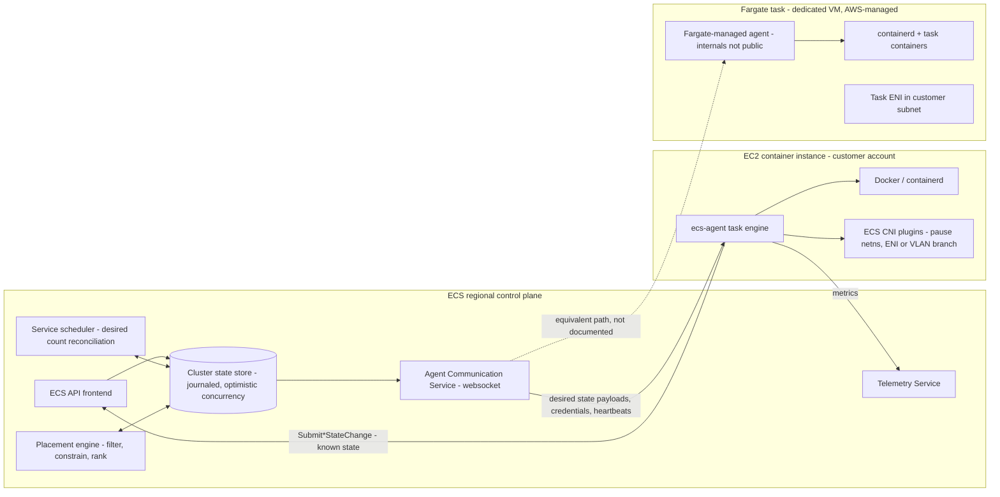

# Container Services: ECS and Fargate

## TL;DR

- Amazon ECS splits a regional control plane from a per-host data plane. The control plane holds the cluster state store, the schedulers, and the Agent Communication Service. The data plane is the ECS agent, which keeps moving each container's known status toward the desired status it is pushed.
- Scheduling works on shared state with optimistic concurrency. A scheduler reads cluster state, filters hosts on resources and constraints, ranks them with up to five ordered placement strategies, and commits. If another writer committed first, the scheduler has to retry.
- When the control plane goes away, already-running tasks keep running, because the agent keeps the last state it was given. What you lose is scale-out, replacement, and deployment. Design for static stability: provision for the loss of a zone before the event, not during it.
- `awsvpc` mode gives every task its own ENI, security group, and VPC IP. Without ENI trunking, density on EC2 is capped by the instance's ENI limit (a c5.large fits 2 tasks; with trunking its ENI limit rises to 12). On Fargate, every task always uses one subnet IP.
- Fargate swaps host management for a per-task VM isolation boundary, per-second vCPU and GB billing, and a cold start on every task. Fargate has no placement strategies, no GPUs, no image cache between tasks, and no automatic fallback from Spot to On-Demand.

## Mental Model



The control plane only ever writes desired state ("this task should be RUNNING on that instance"), and only the data plane reports known state ("these containers are RUNNING, with these ports and this exit code").
The two halves are joined by one long-lived, outbound websocket from each agent, so the control plane never has to reach into a customer VPC.
That direction is the design. A host that loses its link to the control plane keeps running its last desired state, and a control plane that loses a host simply stops scheduling onto it.
Fargate puts the same contract inside an AWS-owned VM that is dedicated to a single task. The task's ENI is placed in your subnet, so the task looks like any other VPC resource on the network, while the host and kernel stay out of reach.
Read the rest of the chapter as a description of what each side can see, what each side can decide, and what happens when the websocket breaks.

## Internals

### The control plane: a journaled state store and shared-state schedulers

When ECS launched, it was described as a cluster manager built on a distributed, transactional key/value store with a journal. That store is the single source of truth for cluster state and for every state transition ([Vogels, "Under the Hood of Amazon EC2 Container Service", 2015](https://www.allthingsdistributed.com/2015/07/under-the-hood-of-the-amazon-ec2-container-service.html)).
A write succeeds only if it is the latest transaction since the writer's last read. That compare-and-commit primitive lets many scheduler instances work against the same cluster without a global lock ([Vogels, 2015](https://www.allthingsdistributed.com/2015/07/under-the-hood-of-the-amazon-ec2-container-service.html)).
This is the shared-state scheduling model from Google's Omega paper, where every scheduler sees the whole cluster and conflicts are resolved at commit time ([Schwarzkopf et al., Omega, EuroSys 2013](https://research.google/pubs/omega-flexible-scalable-schedulers-for-large-compute-clusters/)).
Contrast it with Borg's monolithic scheduler, which scores candidates centrally and relies on equivalence classes and caching to scale ([Verma et al., Borg, EuroSys 2015](https://research.google/pubs/large-scale-cluster-management-at-google-with-borg/)).
In practice this means two services scaling out at the same time in the same cluster can both pick the last free slot on a host. One of them commits, and the other re-reads and places the task somewhere else.
Under heavy contention (many services scaling together in one dense EC2 cluster), the retries show up as extra placement latency, not as double booking.
This is one structural reason to keep very large, contended workloads in separate clusters: the separation caps how much contention one optimistic-concurrency domain sees.

The service scheduler is a level-triggered reconciliation loop over `desiredCount`, the deployment configuration, and the health signals from ELB and container health checks.
It compares running tasks against desired tasks, then emits start or stop intents and writes them back through the state store. This is the same pattern Kubernetes controllers use, covered in [[17-Cloud-AI-Engineering/Volume_05_Kubernetes_and_Platform_Engineering/Chapter_01_Kubernetes_Control_Loop_Internals|Kubernetes Control Loop Internals]].
There are two scheduling strategies, `REPLICA` and `DAEMON`. By default, `REPLICA` spreads tasks across Availability Zones (AWS ECS service definition docs, as of 2026-10).

### The agent protocol: how desired state reaches a host

Everything in this subsection comes from the open-source agent ([aws/amazon-ecs-agent](https://github.com/aws/amazon-ecs-agent)) and the agent-only APIs in the ECS API reference. None of it appears in getting-started material.

1. Bootstrap. `ecs-init` starts the agent, and the agent calls `RegisterContainerInstance`. It reports registered CPU (1024 units per vCPU), registered memory (physical memory minus `ECS_RESERVED_MEMORY` and OS overhead), and a set of `ecs.capability.*` attributes that the placement engine matches against task definition requirements.
2. Endpoint discovery. The agent calls `DiscoverPollEndpoint`, an API that exists only for the agent, to get the URLs of its ACS (Agent Communication Service) and TCS (Telemetry Service) endpoints.
3. Session. The agent opens an outbound websocket to ACS. Over that socket it receives task payloads that carry desired state and a sequence number, IAM role credential refresh messages, and heartbeats. It acknowledges each message.
4. Task engine. Each task gets a managed-task goroutine that drives every container through `NONE -> PULLED -> CREATED -> RUNNING -> STOPPED`. A transition is only taken when it moves known status toward desired status and all `dependsOn` conditions are met (`START`, `COMPLETE`, `SUCCESS`, `HEALTHY`).
5. Observation. The agent consumes the container runtime's event stream. When a container exits, the agent sets known status to `STOPPED` without waiting for any instruction, records the exit code, and reports through `SubmitContainerStateChange` and `SubmitTaskStateChange`.
6. Checkpointing. The agent writes its task and container state to a local data file under `/var/lib/ecs/data`. After an agent restart it matches its records against the runtime by container ID, so an agent crash or upgrade does not orphan or restart workloads.

The invariant: the control plane is the only writer of desired status, and the agent is the only writer of known status.
An agent never decides on its own that a task should run. It can only report that a task stopped.
Because of this split, the system converges after a partition heals: ACS resends desired state, the agent replays its checkpointed known state, and both sides compare.
While the websocket is down, the instance reports `agentConnected=false`. The scheduler stops placing tasks there, and the tasks already on the instance keep running.
This is static stability at host granularity, the same property described in [[17-Cloud-AI-Engineering/Volume_01_Cloud_Architecture_Principles/Chapter_02_Regions_Zones_and_Static_Stability|Regions, Zones, and Static Stability]] and in the Builders' Library article on [static stability using Availability Zones](https://aws.amazon.com/builders-library/static-stability-using-availability-zones/).
The cost of that property is staleness. A disconnected host keeps serving, but it cannot be drained, it gets no new credentials once its cached ones expire, and the control plane cannot replace its tasks.

Containers that use the task IAM role get credentials through the agent's local endpoint at `169.254.170.2`. The path is a random identifier that the agent puts into the container as `AWS_CONTAINER_CREDENTIALS_RELATIVE_URI`.
The credentials themselves arrive from ACS as refresh messages, which ties the lifetime of credentials to the health of the agent session ([amazon-ecs-agent](https://github.com/aws/amazon-ecs-agent)).

The control plane exposes the task lifecycle as `PROVISIONING -> PENDING -> ACTIVATING -> RUNNING -> DEACTIVATING -> STOPPING -> DEPROVISIONING -> STOPPED`.
`PROVISIONING` covers work done before containers exist: ENI creation and attachment, and on Fargate, getting capacity.
`ACTIVATING` and `DEACTIVATING` cover load balancer registration, deregistration, and service discovery.
`DescribeTasks` returns `createdAt`, `connectivityAt`, `pullStartedAt`, `pullStoppedAt`, and `startedAt`, which lets you break cold-start latency into its phases (the worked example measures them).

### Placement: filter, constrain, rank

For EC2-backed capacity, the placement engine runs a fixed pipeline for each task (AWS ECS task placement docs, as of 2026-10):

1. Filter on resources. Drop instances that lack free CPU units, memory, GPUs, host ports (in `bridge` and `host` modes), or a free ENI or branch ENI slot (in `awsvpc` mode).
2. Apply constraints. `distinctInstance` puts each task of the group on a different instance. `memberOf` restricts candidates with a cluster query language expression, for example `attribute:ecs.instance-type =~ g5.*` or `attribute:ecs.availability-zone in [us-east-1a, us-east-1b]`. `distinctInstance` is accepted on services and `RunTask`, not in task definitions (AWS ECS service definition docs, as of 2026-10).
3. Rank with strategies, in order. `spread` balances on a field (`instanceId`, `attribute:ecs.availability-zone`, or any custom attribute). `binpack` picks the instance with the least remaining `cpu` or `memory`. `random` picks uniformly. Each later strategy only breaks ties left by the earlier ones.

Order matters, and the default order is the safe one.
`[spread(attribute:ecs.availability-zone), binpack(memory)]` balances across zones first, then packs densely within each zone.
`[binpack(memory)]` alone fills one instance before touching the next. A service's replicas can all end up on one host, so a single EC2 retirement or kernel panic takes down every replica.
`[spread(instanceId)]` alone balances across hosts but ignores zones. In a cluster with uneven host counts per zone, losing one zone can remove more than a third of capacity.
On Fargate, placement strategies and constraints are not supported. Fargate spreads tasks across the Availability Zones of the subnets you give it, and the subnet list is the only placement lever you have.

### Capacity providers: binding scheduling to EC2 Auto Scaling

A capacity provider ties a cluster to an Auto Scaling group (or to `FARGATE` or `FARGATE_SPOT`) and sits between the scheduler and the capacity pool.
With managed scaling, ECS publishes `CapacityProviderReservation = M / N x 100`. N is the number of instances in the group that are running, and M is the number of instances needed to hold all running tasks plus the tasks stuck in `PROVISIONING`. A target-tracking policy then drives that metric toward your `targetCapacity`.
A `targetCapacity` of 100 means "no idle instances": cheapest at steady state, slowest to absorb a burst, because every scale-out waits for EC2 launch, AMI boot, and agent registration.
A value of 70 to 90 keeps a warm buffer. This is the constant-work trade-off from [[17-Cloud-AI-Engineering/Volume_01_Cloud_Architecture_Principles/Chapter_05_Constant_Work_and_Workload_Smoothing|Constant Work and Workload Smoothing]], expressed as one parameter.
A capacity provider strategy splits tasks across providers with `base` (a guaranteed minimum on one provider) and `weight` (the ratio for everything above the base).

### awsvpc networking: ENIs, the pause container, and trunking

In `awsvpc` mode on EC2, the agent first starts an `amazon-ecs-pause` container, whose only job is to own the task's network namespace. Application containers then join that namespace.
The ECS CNI plugins ([aws/amazon-ecs-cni-plugins](https://github.com/aws/amazon-ecs-cni-plugins), [aws/amazon-vpc-cni-plugins](https://github.com/aws/amazon-vpc-cni-plugins)) attach an ENI, move it into the namespace, assign the ENI's primary private IP, and set up a bridge so the namespace can reach `169.254.170.2` for credentials and metadata.
Every task therefore has its own security group, its own VPC flow log identity, and its own IP. A target group of type `ip` routes straight to that IP, with no dynamic host-port mapping.
The cost is density. The primary network interface counts against the instance's ENI limit, so a c5.large, which takes 3 ENIs, can run only 2 `awsvpc` tasks (AWS ECS ENI trunking docs, as of 2026-10).

ENI trunking (the `awsvpcTrunking` account setting) attaches a trunk ENI when the instance registers. Each task then gets a branch ENI that is multiplexed over the trunk with 802.1Q VLAN tagging, and the CNI creates a VLAN sub-interface inside the task's namespace.
With trunking, a c5.large's ENI limit becomes 12 (AWS ECS ENI trunking docs, as of 2026-10). That is primary, plus trunk, plus 10 branches. An r5.xlarge goes from 3 `awsvpc` tasks to 20 ([DoiT, as of 2026-04](https://www.doit.com/blog/increasing-ecs-tasks-per-host)).
Trunking only applies to instances launched after the setting is enabled, and only to supported Nitro instance types. The trunk ENI also takes one ENI slot and one subnet IP per instance.
EKS security groups for pods uses the same trunk-and-branch mechanism, covered in [[17-Cloud-AI-Engineering/Volume_02_AWS_Deep_Dive/Chapter_07_Amazon_EKS_Control_Plane_and_Networking|Amazon EKS: Control Plane and Networking]].
How the ENI is plumbed underneath, through the Nitro card and the VPC mapping service, is covered in [[17-Cloud-AI-Engineering/Volume_02_AWS_Deep_Dive/Chapter_03_VPC_Networking_Internals|VPC Networking Internals]].

### Fargate: the per-task VM boundary

The contract AWS documents is that each Fargate task has its own isolation boundary and does not share the underlying kernel, CPU resources, memory resources, or ENI with any other task (AWS ECS docs, as of 2026-10).
The Firecracker paper says Firecracker was deployed in production for Lambda and Fargate ([Agache et al., NSDI 2020](https://www.usenix.org/conference/nsdi20/presentation/agache)).
AWS documentation, however, does not name the VMM that backs Fargate today. AWS CDK documentation even notes that a task's CPU and memory values determine "the instance type and size that tasks run on" (AWS CDK docs, as of 2026-10).
The engineering-grade reading: the guarantee is VM-level isolation with a guest kernel per task, and whether that VM is a Firecracker microVM or a single-use Nitro EC2 instance is an implementation detail AWS can change without notice. The specific VMM in use as of 2026-10 is UNVERIFIED.
Do not build anything that depends on the substrate: kernel version, CPU model, or noisy-neighbor behavior. Treat Fargate as "one task, one VM, one ENI, one IP".

Platform version 1.4.0 on Linux moved the runtime to containerd and sends all task traffic through the task ENI. That includes ECR image pulls, Secrets Manager and SSM Parameter Store fetches, and awslogs delivery (UNVERIFIED against current docs).
As a result, a Fargate task in a private subnet needs either a NAT path or VPC endpoints for `ecr.api`, `ecr.dkr`, S3 (gateway endpoint, for image layers), `logs`, and any secrets service it uses.
Each task is a fresh VM, so no image layers are cached across tasks, and image pull time is paid on every task start.
Seekable OCI (SOCI) indexes let Fargate start a container before the whole image has been pulled, by fetching layers on demand. This matters most for multi-gigabyte ML inference images (current SOCI capabilities on Fargate are UNVERIFIED).
For the ML angle: Fargate does not offer GPUs. GPU and Neuron workloads on ECS need EC2 capacity providers with GPU-capable AMIs, plus `resourceRequirements` of type `GPU` or device mappings, as covered in [[17-Cloud-AI-Engineering/Volume_11_LLM_Serving_and_Inference_Systems_on_Cloud/Chapter_08_Cloud_GPU_Autoscaling_and_Cold_Start_Mitigation|Cloud GPU Autoscaling and Cold-Start Mitigation]].

### Newer capacity modes

AWS launched ECS Managed Instances, in which AWS runs and patches EC2 capacity in the customer's account while ECS picks instance types (UNVERIFIED: GA status and feature set as of 2026-10).
ECS also gained built-in blue/green, linear, and canary deployment strategies alongside rolling updates (UNVERIFIED: GA dates and parameter names as of 2026-10).
Verify both against the current ECS developer guide before you depend on them.

## Numbers to Know

| Quantity | Value | Source |
| --- | --- | --- |
| Services per cluster | 5,000, not adjustable | (AWS ECS service quotas via OneUptime summary, as of 2026-10) |
| Tasks per service | 5,000, not adjustable | (AWS ECS service quotas, as of 2026-10) |
| Container instances per cluster | 5,000 | (AWS ECS service quotas, as of 2026-10) |
| Tasks launched per `RunTask` call | 10 | (AWS ECS service quotas, as of 2026-10) |
| Containers per task definition | 10 | (AWS ECS service quotas, as of 2026-10) |
| Subnets per `awsvpcConfiguration` | 16 | (AWS ECS service quotas, as of 2026-10) |
| Capacity providers per cluster | 20 | (AWS ECS service quotas via awsfundamentals, as of 2026-10) |
| Fargate tasks launched by one service | 500 per minute | (AWS ECS service quotas; [AWS Containers blog](https://aws.amazon.com/blogs/containers/scale-to-15000-tasks-in-a-single-amazon-elastic-container-service-ecs-cluster/), as of 2026-10) |
| Observed service scale-out on Fargate | about 1,000 tasks in about 15 min, 5,000 in about 40 min, including ALB and service discovery registration | (AWS Containers blog, published 2023, as of 2026-10) |
| Largest Fargate task | 16 vCPU, 120 GB memory, set in 8 GB steps | (AWS CDK FargateTaskDefinition docs, as of 2026-10) |
| Smallest Fargate task | 0.25 vCPU with 0.5, 1, or 2 GB | (AWS CDK FargateTaskDefinition docs, as of 2026-10) |
| Fargate ephemeral storage | 20 GiB default, 200 GiB max (Linux platform version 1.4.0+) | (AWS CDK FargateTaskDefinition docs, as of 2026-10) |
| Fargate Linux/x86 On-Demand, us-east-1 | $0.04048 per vCPU-hour, $0.004445 per GB-hour | ([AWS Fargate pricing](https://aws.amazon.com/fargate/pricing/), cross-checked via Usage.ai snapshot, as of 2026-10) |
| Fargate Linux/ARM On-Demand, us-east-1 | $0.03238 per vCPU-hour, $0.00356 per GB-hour | (AWS Fargate pricing via Vantage and Pump snapshots, as of 2026-10) |
| Fargate billing granularity | per second, 1-minute minimum | (AWS Fargate pricing via Vantage, as of 2026-10) |
| Fargate Spot, us-east-1, historical snapshot | $0.01246287 per vCPU-hour, $0.00136851 per GB-hour; price varies | (Vantage snapshot, 2020; current price UNVERIFIED) |
| `awsvpc` tasks on a c5.large | 2 without trunking; ENI limit 12 with trunking (10 tasks) | (AWS ECS ENI trunking docs, as of 2026-10) |
| `awsvpc` tasks on an r5.xlarge | 3 without trunking, 20 with trunking | (DoiT, citing the AWS table, as of 2026-10) |
| Fargate Spot interruption notice | 2 minutes, delivered as SIGTERM plus an EventBridge task state change | UNVERIFIED against current docs |
| Fargate `stopTimeout` maximum | 120 seconds | UNVERIFIED against current docs |
| Reserved IPs per VPC subnet | 5 (a /24 gives 251 usable) | UNVERIFIED against current docs; long-standing VPC behavior |
| Public IPv4 address charge | $0.005 per IP-hour | UNVERIFIED against current VPC pricing |

## AWS vs GCP Mechanism Parity

| Dimension | AWS ECS / Fargate | Google Cloud equivalent | Critical difference |
| --- | --- | --- | --- |
| Orchestrator model | Proprietary regional control plane; journaled state store with optimistic-concurrency commits | GKE (Kubernetes, etcd-backed apiserver) or Cloud Run (proprietary, Knative-shaped API) | ECS has no CRDs or extensible controllers; customization goes through the API, EventBridge, and capacity providers. |
| Host agent | `ecs-agent` on an outbound websocket to ACS; agent writes known status, control plane writes desired status | kubelet watching the apiserver (GKE); Cloud Run has no customer-visible agent | Both keep running workloads through control plane loss; neither can scale or replace during it. |
| Serverless isolation | Per-task VM with dedicated kernel, CPU, memory, and ENI; VMM unnamed in current docs | Cloud Run gen1 uses gVisor syscall interception; gen2 offers full Linux compatibility (see [[17-Cloud-AI-Engineering/Volume_03_GCP_Deep_Dive/Chapter_08_Cloud_Run_and_Serverless_Container_Execution\|Cloud Run]]) | Fargate bills a fixed task shape continuously; Cloud Run can bill per request and multiplexes concurrent requests per instance. |
| Per-workload network identity | `awsvpc` ENI per task, with its own security group | GKE VPC-native alias IPs per pod; Cloud Run Direct VPC egress or connectors | AWS enforces security groups per task ENI; GCP enforces firewall rules and policies on VM, tag, or service account, with pod-level control through network policy. |
| IP consumption | 1 subnet IP per Fargate task, doubled during 200% rolling deploys | GKE allocates per-node pod CIDR blocks from secondary ranges | GKE exhausts secondary ranges a block at a time (per node); ECS exhausts a subnet one IP per task. |
| Density limit on VMs | ENI attachment limit, raised by trunking (VLAN branches) | Max pods per node (set per node pool) | ECS density is a hardware and Nitro ENI constraint; GKE's is an IPAM configuration constraint. |
| Placement | Filter, `memberOf` / `distinctInstance` constraints, ordered `spread` / `binpack` / `random` strategies | kube-scheduler filter and score plugins, topology spread, affinity | Kubernetes scoring is weighted and pluggable; ECS strategies are strictly lexicographic. |
| Elastic capacity | Capacity providers with `CapacityProviderReservation` target tracking | Cluster autoscaler or node auto-provisioning; Autopilot | Both use pending-work signals; ECS exposes one scalar target, GKE exposes per-pool profiles. |
| Spot | `FARGATE_SPOT` capacity provider; no automatic fallback to On-Demand | GKE Spot VMs and Spot Pods on Autopilot; Cloud Run has no Spot tier | Fallback has to be engineered on both clouds. |
| Workload credentials | Task role served at `169.254.170.2` by the agent, delivered through ACS | GKE Workload Identity Federation and Cloud Run service identity via the metadata server | AWS separates the execution role (agent: pull, logs, secrets) from the task role (application). |
| Image start acceleration | SOCI lazy loading | GKE image streaming; Cloud Run image handling | Fargate never reuses a host cache, so lazy loading is the main lever. |
| Accelerators | GPU and Neuron only on EC2 capacity; none on Fargate | GPUs on GKE node pools; NVIDIA GPUs on Cloud Run (GA status UNVERIFIED as of 2026-10) | On AWS, serverless GPU containers mean SageMaker or Bedrock rather than Fargate. |

## Worked Example: Fargate service with Spot mix, launch-phase timing, and budget guard

### What this lab proves

You will deploy a three-AZ Fargate service that splits tasks between the `FARGATE` and `FARGATE_SPOT` capacity providers.
You will read a task's ENI attachment and its `lastStatus` versus `desiredStatus`, which is the reconciliation contract from the Internals section, as data.
You will then break cold-start latency into ENI provisioning, image pull, and container start with a `boto3` script.

### Cost estimate (us-east-1, as of 2026-10)

The task shape is 0.25 vCPU and 0.5 GB on ARM64. Cost per task-hour is `0.25 x 0.03238 + 0.5 x 0.00356 = 0.008095 + 0.00178 = $0.009875`.
Three tasks at On-Demand rates cost `$0.029625` per hour, and the Spot share lowers that further.
Three public IPv4 addresses add about `$0.015` per hour (UNVERIFIED rate).
The total is at most about `$0.045` per hour, roughly `$1.07` per day. CloudWatch Logs ingestion at this volume is negligible.
The lab avoids NAT gateways, load balancers, and interface endpoints on purpose, because each of those would cost more per hour than all three tasks together.

### Terraform / OpenTofu

```hcl
# main.tf - ECS on Fargate lab, Volume 02 Chapter 06
terraform {
  required_version = ">= 1.6"
  required_providers {
    aws = {
      source  = "hashicorp/aws"
      version = ">= 5.0, < 7.0"
    }
  }
}

variable "region" {
  type    = string
  default = "us-east-1"
}

variable "alert_email" {
  type = string
}

variable "my_cidr" {
  description = "Your public IP in CIDR form, e.g. 203.0.113.7/32"
  type        = string
}

provider "aws" {
  region = var.region
  default_tags {
    tags = { lab = "v02-ch06-ecs-fargate" }
  }
}

data "aws_availability_zones" "azs" {
  state = "available"
}

resource "aws_vpc" "lab" {
  cidr_block           = "10.42.0.0/16"
  enable_dns_support   = true
  enable_dns_hostnames = true
}

resource "aws_internet_gateway" "igw" {
  vpc_id = aws_vpc.lab.id
}

resource "aws_subnet" "public" {
  count             = 3
  vpc_id            = aws_vpc.lab.id
  availability_zone = data.aws_availability_zones.azs.names[count.index]
  cidr_block        = cidrsubnet(aws_vpc.lab.cidr_block, 8, count.index)
}

resource "aws_route_table" "public" {
  vpc_id = aws_vpc.lab.id
  route {
    cidr_block = "0.0.0.0/0"
    gateway_id = aws_internet_gateway.igw.id
  }
}

resource "aws_route_table_association" "public" {
  count          = 3
  subnet_id      = aws_subnet.public[count.index].id
  route_table_id = aws_route_table.public.id
}

resource "aws_security_group" "task" {
  name   = "v02-ch06-task"
  vpc_id = aws_vpc.lab.id

  ingress {
    from_port   = 80
    to_port     = 80
    protocol    = "tcp"
    cidr_blocks = [var.my_cidr]
  }

  egress {
    from_port   = 0
    to_port     = 0
    protocol    = "-1"
    cidr_blocks = ["0.0.0.0/0"]
  }
}

resource "aws_cloudwatch_log_group" "app" {
  name              = "/ecs/v02-ch06"
  retention_in_days = 1
}

data "aws_caller_identity" "me" {}

data "aws_iam_policy_document" "ecs_tasks_trust" {
  statement {
    actions = ["sts:AssumeRole"]
    principals {
      type        = "Service"
      identifiers = ["ecs-tasks.amazonaws.com"]
    }
    condition {
      test     = "StringEquals"
      variable = "aws:SourceAccount"
      values   = [data.aws_caller_identity.me.account_id]
    }
  }
}

# Execution role: used by the agent for image pull and log delivery, never by app code.
resource "aws_iam_role" "execution" {
  name               = "v02-ch06-execution"
  assume_role_policy = data.aws_iam_policy_document.ecs_tasks_trust.json
}

resource "aws_iam_role_policy_attachment" "execution" {
  role       = aws_iam_role.execution.name
  policy_arn = "arn:aws:iam::aws:policy/service-role/AmazonECSTaskExecutionRolePolicy"
}

# Task role: what the application can do. Intentionally empty.
resource "aws_iam_role" "task" {
  name               = "v02-ch06-task"
  assume_role_policy = data.aws_iam_policy_document.ecs_tasks_trust.json
}

resource "aws_ecs_cluster" "lab" {
  name = "v02-ch06"
}

resource "aws_ecs_cluster_capacity_providers" "lab" {
  cluster_name       = aws_ecs_cluster.lab.name
  capacity_providers = ["FARGATE", "FARGATE_SPOT"]
}

resource "aws_ecs_task_definition" "web" {
  family                   = "v02-ch06-web"
  requires_compatibilities = ["FARGATE"]
  network_mode             = "awsvpc"
  cpu                      = "256"
  memory                   = "512"
  execution_role_arn       = aws_iam_role.execution.arn
  task_role_arn            = aws_iam_role.task.arn

  runtime_platform {
    operating_system_family = "LINUX"
    cpu_architecture        = "ARM64"
  }

  container_definitions = jsonencode([
    {
      name         = "web"
      image        = "public.ecr.aws/nginx/nginx:stable"
      essential    = true
      stopTimeout  = 30
      portMappings = [{ containerPort = 80, protocol = "tcp" }]
      linuxParameters = { initProcessEnabled = true }
      logConfiguration = {
        logDriver = "awslogs"
        options = {
          awslogs-group         = aws_cloudwatch_log_group.app.name
          awslogs-region        = var.region
          awslogs-stream-prefix = "web"
        }
      }
    }
  ])
}

resource "aws_ecs_service" "web" {
  name            = "web"
  cluster         = aws_ecs_cluster.lab.id
  task_definition = aws_ecs_task_definition.web.arn
  desired_count   = 3

  # One guaranteed On-Demand task, then a 1:1 split for the rest.
  capacity_provider_strategy {
    capacity_provider = "FARGATE"
    base              = 1
    weight            = 1
  }
  capacity_provider_strategy {
    capacity_provider = "FARGATE_SPOT"
    weight            = 1
  }

  deployment_minimum_healthy_percent = 100
  deployment_maximum_percent         = 200

  deployment_circuit_breaker {
    enable   = true
    rollback = true
  }

  network_configuration {
    subnets          = aws_subnet.public[*].id
    security_groups  = [aws_security_group.task.id]
    assign_public_ip = true
  }

  wait_for_steady_state = true
  depends_on            = [aws_ecs_cluster_capacity_providers.lab]
}

resource "aws_budgets_budget" "lab" {
  name         = "v02-ch06-lab"
  budget_type  = "COST"
  limit_amount = "5"
  limit_unit   = "USD"
  time_unit    = "MONTHLY"

  notification {
    comparison_operator        = "GREATER_THAN"
    threshold                  = 80
    threshold_type             = "PERCENTAGE"
    notification_type          = "FORECASTED"
    subscriber_email_addresses = [var.alert_email]
  }

  notification {
    comparison_operator        = "GREATER_THAN"
    threshold                  = 100
    threshold_type             = "PERCENTAGE"
    notification_type          = "ACTUAL"
    subscriber_email_addresses = [var.alert_email]
  }
}

output "cluster" {
  value = aws_ecs_cluster.lab.name
}
```

Deploy it:

```bash
tofu init
tofu apply -var "alert_email=you@example.com" -var "my_cidr=$(curl -s https://checkip.amazonaws.com)/32"
```

### Inspect the reconciliation contract and ENI attachment

```bash
TASKS=$(aws ecs list-tasks --cluster v02-ch06 --service-name web --query 'taskArns' --output text)
aws ecs describe-tasks --cluster v02-ch06 --tasks $TASKS \
  --query 'tasks[].{az:availabilityZone,cp:capacityProviderName,last:lastStatus,desired:desiredStatus,eni:attachments[0].details[?name==`networkInterfaceId`].value|[0],ip:attachments[0].details[?name==`privateIPv4Address`].value|[0]}' \
  --output table
```

Each row should show a separate ENI and IP, a different subnet for each AZ, and `capacityProviderName` matching the `base` and `weight` split.

### Decompose cold start with boto3

```python
# launch_phases.py - prints per-task cold-start phases from DescribeTasks timestamps
import boto3

ecs = boto3.client("ecs", region_name="us-east-1")
arns = ecs.list_tasks(cluster="v02-ch06", serviceName="web")["taskArns"]
for t in ecs.describe_tasks(cluster="v02-ch06", tasks=arns)["tasks"]:
    c = t["createdAt"]
    def d(k):
        v = t.get(k)
        return None if v is None else round((v - c).total_seconds(), 1)
    print(t["taskArn"].split("/")[-1][:8], t.get("capacityProviderName"),
          "connectivity+%ss" % d("connectivityAt"),
          "pull_start+%ss" % d("pullStartedAt"),
          "pull_stop+%ss" % d("pullStoppedAt"),
          "started+%ss" % d("startedAt"))
```

Use `connectivityAt - createdAt` as the capacity and ENI provisioning phase, `pullStoppedAt - pullStartedAt` as the image transfer phase, and `startedAt - pullStoppedAt` as the container start phase.
Re-run the script after forcing a new deployment (`aws ecs update-service --cluster v02-ch06 --service web --force-new-deployment`). The pull phase does not shrink on the second run, because Fargate keeps no cache across tasks.

### Teardown

```bash
tofu destroy -var "alert_email=you@example.com" -var "my_cidr=0.0.0.0/32" -auto-approve
```

Deleting the subnets and security group can stall for a few minutes while Fargate detaches and deletes the requester-managed task ENIs. That is expected and resolves on its own.

### Capacity sizing: a production service, step by step

Requirement: 6,000 requests per second at peak, and the service must survive the loss of one of three AZs without scaling during the event.
Load test assumption: a 1 vCPU / 2 GB task sustains 400 requests per second at 60% CPU. This is your number to measure, not a published figure.
Tasks needed at peak: `6000 / 400 = 15`.
For static stability, the 2 surviving AZs must hold 15 tasks on their own: `ceil(15 / 2) = 8` per AZ, so `8 x 3 = 24` tasks provisioned.
Cost on x86: `0.04048 + 2 x 0.004445 = $0.04937` per task-hour, `24 x 0.04937 = $1.18488` per hour, and `x 730 = $864.96` per month.
Cost on ARM: `0.03238 + 2 x 0.00356 = $0.0395` per task-hour, `24 x 0.0395 = $0.948` per hour, and `x 730 = $692.04` per month, a 20.0% saving before any Savings Plan.
Subnet IPs: with `maximumPercent=200`, a deployment can briefly run 48 tasks, so each AZ subnet needs 16 free IPs. Add headroom for 3x autoscaling during deployment (`72 x 2 / 3 = 48` per subnet), which a /24 holds easily and a /27 (27 usable) does not.
Time to new capacity: scale-out is quota-bounded at 500 tasks per minute per service, so adding 48 tasks is not the bottleneck. The bottleneck is `connectivityAt` plus the pull, plus the container start, plus load balancer health checks. With ALB target group defaults of a 30-second interval and a healthy threshold of 5 (UNVERIFIED as current defaults), health checks alone can add up to 150 seconds. Set an explicit 10-second interval and a threshold of 2 to 3 for services that autoscale.
Fargate versus EC2 break-even: EC2 is cheaper when `P_instance / (vCPU_instance x E_pack) < P_fargate_per_vCPU_equivalent`. Here `E_pack` is the fraction of registered CPU and memory that tasks actually use after binpacking and the buffer kept by `targetCapacity`. Measure `E_pack` from your own cluster rather than assuming it.

## Failure Modes and Pitfalls

### Control plane impairment: tasks keep running, but nothing heals

The AWS summary of the 2025-10-19/20 us-east-1 event describes a DynamoDB DNS failure that cascaded into EC2 instance launches and network configuration propagation. Container services in the region saw launch failures and scaling delays ([AWS PIR 101925](https://aws.amazon.com/message/101925/); ECS-specific details UNVERIFIED).
The 2021-12-07 us-east-1 event, triggered by congestion on AWS's internal network, impaired control plane APIs for many services. Existing workloads mostly kept running ([AWS PIR 12721](https://aws.amazon.com/message/12721/)).
Both match the agent model: data plane tasks keep running, but replacing crashed tasks, scaling out, and deploying all depend on a control plane that is down.
Mitigation: run at the AZ-loss provisioning level all the time, avoid tying load-proportional autoscaling to emergency response, and freeze deployments during regional events. Background is in [[17-Cloud-AI-Engineering/Volume_07_Reliability_and_SRE/Chapter_07_Anatomy_of_Major_Cloud_Outages|Anatomy of Major Cloud Outages]].

### Subnet IP exhaustion during deployments

Every Fargate task and every `awsvpc` task on EC2 uses one subnet IP. A 200% rolling deployment of a large service doubles that for the length of the rollout.
The failure surfaces as tasks stuck in `PROVISIONING` or stopped with an ENI or address-allocation reason. The service then makes no progress, and the circuit breaker may roll back a release that was actually healthy.
It gets worse when many services share small subnets, because their deployments compete for the same addresses.
Mitigation: size subnets for `sum(desired x maximumPercent)` plus autoscaling headroom, alarm on `AvailableIpAddressCount` per subnet, and use secondary CIDRs or IPv6 where your dependencies support them.

### ENI density ceiling on EC2

Without trunking, a task can wait on an instance that has plenty of free CPU and memory, because no ENI slot is free.
Managed scaling counts that task as `PROVISIONING` and adds instances, so you pay for idle CPU to get ENI slots.
Trunking fixes the ceiling but only for instances launched after the account setting changes. The usual failure is turning the setting on and forgetting to replace the Auto Scaling group's instances.

### Missing egress path on Fargate platform version 1.4.0

Because pulls, secrets, and logs go through the task ENI, a private subnet without NAT or the right VPC endpoints fails with `CannotPullContainerError` or secret retrieval errors before any application code runs.
Missing the S3 gateway endpoint is the common case: ECR's API endpoints are in place, but the image layers, which are served from S3, have no route.

### Registry rate limits and pull storms

Fargate has no host cache, so scaling a service to 500 tasks means 500 full pulls.
Public registries such as Docker Hub enforce pull limits, and a scale event can turn into a fleet-wide `CannotPullContainerError`.
Mitigation: mirror images into ECR with pull-through cache, keep images small, and use SOCI indexes for large ML images.

### Fargate Spot does not fall back

When Spot capacity is reclaimed or unavailable, the scheduler keeps trying `FARGATE_SPOT` for the Spot-weighted share. It does not move that share to On-Demand (UNVERIFIED that no fallback exists in current behavior; design as if it does not).
Reclamations are correlated within a zone and a capacity pool, so a weight-heavy Spot service can lose most of its tasks at once.
Mitigation: set `base` on `FARGATE` to cover your static-stability floor, keep Spot for headroom only, and use EventBridge task state change events to drive an out-of-band On-Demand surge. Spot economics are covered in [[17-Cloud-AI-Engineering/Volume_09_FinOps_and_Cloud_Economics/Chapter_03_Spot_Economics_and_Interruption_Handling|Spot Economics and Interruption Handling]].

### Signal handling and shutdown races

ECS sends SIGTERM, waits `stopTimeout`, then sends SIGKILL.
If the application runs as PID 1 under a shell wrapper, SIGTERM never reaches it, and every scale-in or Spot interruption becomes a hard kill with in-flight requests dropped.
`initProcessEnabled` adds an init process that forwards signals and reaps zombies.
Load balancer deregistration delay has to be shorter than `stopTimeout`, or connections are cut while the target is still draining.

### Binpack hotspots and post-event AZ skew

`binpack` alone concentrates replicas, so one instance failure is a correlated loss.
After a zone recovers, the replacement tasks launched in the surviving zones stay there, and the service is left skewed until something forces new placements.
ECS has added Availability Zone rebalancing for services (UNVERIFIED: GA status and default-on behavior as of 2026-10). Without it, skew lasts until the next deployment.

### Deployment health-check misconfiguration

A short `healthCheckGracePeriodSeconds` on a service that loads model weights or warms a JIT gets its tasks killed before they are ready. The circuit breaker then rolls back a good release, or, if rollback is disabled, the service churns forever.
For ML inference containers, base the grace period on the measured `startedAt` plus the time to load weights, not on web-service defaults.

### API throttling at scale

`RunTask` accepts at most 10 tasks per call. Batch fan-out that loops `RunTask` without backoff will hit token-bucket throttles and amplify itself through client retries.
Use the backoff guidance in [[17-Cloud-AI-Engineering/Volume_07_Reliability_and_SRE/Chapter_03_Resilient_Communication_Retries_Jitter_and_Circuit_Breakers|Resilient Communication: Retries, Jitter, and Circuit Breakers]], or let a service or queue-driven scaler manage concurrency.

## Security and Cost Angles

### IAM scoping: two roles, two principals

The execution role is used by the agent (or the Fargate-managed agent) to pull from ECR, write to CloudWatch Logs, and resolve `secrets` from Secrets Manager or SSM. Application code never receives it.
The task role is what the application receives through `169.254.170.2`. Scope it per service, never per cluster.
Add `aws:SourceAccount`, and where possible `aws:SourceArn`, conditions to the `ecs-tasks.amazonaws.com` trust policy to prevent confused-deputy role assumption, as the lab does.
For resource policies on secrets and KMS keys, scope `kms:Decrypt` on the execution role to the specific secret ARNs it injects. Policy evaluation is covered in [[17-Cloud-AI-Engineering/Volume_02_AWS_Deep_Dive/Chapter_01_IAM_Policy_Evaluation_Engine|IAM Policy Evaluation Engine]].

### Credential exposure paths on EC2 capacity

In `bridge` mode, containers share the host's network path to IMDS, so an SSRF in any container can reach the instance role's credentials unless IMDS is blocked.
Enforce IMDSv2 with a hop limit of 1, which stops bridge-mode containers because their traffic takes an extra hop. In `awsvpc` mode, also set the agent's `ECS_AWSVPC_BLOCK_IMDS=true`.
The task credential endpoint is shielded by an unguessable path in an environment variable. An SSRF that can also read environment variables, for example through a debug endpoint, defeats that shield.
On Fargate, the instance-role risk does not exist, because the customer has no host and no instance role.

### Isolation tiers for untrusted code

On EC2 capacity, tasks share a Linux kernel, so container escape crosses tenant boundaries. Treat a host as a single trust domain.
On Fargate, the boundary is a VM. Privileged containers are not allowed, and only a narrow set of Linux capabilities can be added (UNVERIFIED: exact allow list, commonly cited as `SYS_PTRACE` only).
For multi-tenant platforms that run customer-supplied code, Fargate or a microVM substrate is the minimum. See [[17-Cloud-AI-Engineering/Volume_00_Foundations_Under_the_Cloud/Chapter_01_Hypervisors_MicroVMs_and_Sandboxing|Hypervisors, MicroVMs, and Sandboxing]] and [[17-Cloud-AI-Engineering/Volume_12_AI_Applications_MLOps_and_Data_Platforms/Chapter_08_Cloud_Security_for_AI_Systems_Attacks_and_Defenses|Cloud Security for AI Systems]].

### Encryption and private boundaries

Fargate encrypts ephemeral storage on platform version 1.4.0 and later with an AWS-managed key, and customer-managed KMS keys for ephemeral storage are available at the cluster level (UNVERIFIED: current GA scope).
Secrets injected through `secrets` are fetched at task start, decrypted with KMS envelope encryption, and exposed as environment variables. That makes them visible to anything that can read the process environment, including ECS Exec sessions. Prefer fetching secrets at runtime, with caching, for high-value credentials. Envelope encryption is covered in [[17-Cloud-AI-Engineering/Volume_08_Security_Identity_and_the_Data_Perimeter/Chapter_04_Encryption_Key_Hierarchies_and_Envelope_Encryption|Encryption Key Hierarchies and Envelope Encryption]].
ECS Exec runs through the SSM agent and needs `ssmmessages` permissions on the task role. Gate it with an SCP or permission boundary and log sessions, because it is interactive shell access to production.
Put ECR, S3, Logs, Secrets Manager, and STS behind VPC endpoints with endpoint policies restricted to your organization, as part of [[17-Cloud-AI-Engineering/Volume_08_Security_Identity_and_the_Data_Perimeter/Chapter_06_Constructing_an_Impenetrable_Data_Perimeter|Constructing an Impenetrable Data Perimeter]].

### Unit-economics levers

- Graviton. ARM Fargate is about 20% cheaper per vCPU-hour and per GB-hour than x86 at the published us-east-1 rates (as of 2026-10), assuming your images are multi-arch.
- Task-shape rounding. Fargate only accepts fixed CPU and memory combinations. A container that needs 1.1 GB on 0.25 vCPU pays for 2 GB, so profile and fit the shape.
- Spot as headroom only. Put the static-stability floor on `FARGATE` `base` and the elastic share on `FARGATE_SPOT`.
- Commitments. Compute Savings Plans apply to Fargate as well as EC2, so the commitment survives a migration between them (current discount levels UNVERIFIED). See [[17-Cloud-AI-Engineering/Volume_09_FinOps_and_Cloud_Economics/Chapter_02_Commitment_Discounts_Savings_Plans_vs_CUDs|Commitment Discounts]].
- Network. NAT gateway data processing on image pulls and log shipping can exceed task compute for small, chatty services. Compare interface endpoint hourly cost against NAT per-GB processing for your actual volumes (see [[17-Cloud-AI-Engineering/Volume_09_FinOps_and_Cloud_Economics/Chapter_04_Network_Egress_Economics_and_Optimization|Network Egress Economics]]).
- Public IPv4. Every Fargate task with `assign_public_ip=true` carries a per-hour IPv4 charge. At fleet scale, private subnets with shared egress or IPv6 are cheaper.

## Interview Questions and Model Answers

### Question 1 (L5 - Senior)

An ECS container instance shows `agentConnected=false` in the console. What happens to the tasks on it, to the service, and what do you do?

#### Model Answer

The agent writes known state and the control plane writes desired state, and the two are joined by an outbound websocket to ACS.
When that socket drops, the containers keep running, because the runtime does not depend on the agent being connected to anything and the agent keeps its checkpointed state.
The control plane stops placing new tasks on the instance, because it can no longer confirm the instance's resources or deliver payloads to it.
Health is the subtle part. Container health status in the API freezes at the last reported value, so a task can look `HEALTHY` while it is actually wedged.
Load balancer target health keeps working, because the load balancer probes the task directly, so traffic still drains away from broken containers.
Task role credentials are refreshed through ACS, so a long disconnection will eventually let cached credentials expire and break AWS SDK calls from the tasks.
Diagnose in this order: is the agent process alive (`systemctl status ecs`), is there an outbound route to the ECS endpoints (NAT, endpoints, proxy, security group egress), and is clock skew or instance profile credential failure blocking the TLS or SigV4 handshake?
If the agent cannot be repaired quickly, drain the instance (set it to `DRAINING`) once connectivity returns, or terminate it so the service scheduler replaces its tasks on healthy capacity.
The design lesson is that a disconnected agent fails safe for availability and fails unsafe for credential freshness and observability.

#### Follow-up Interviewer Question

If the agent restarts while containers keep running, how does it avoid starting duplicate containers or losing track of the existing ones?

### Question 2 (L5 - Senior)

A team moved a service from `bridge` to `awsvpc` mode on m5.large instances, and now tasks sit in `PROVISIONING` even though CPU usage is 30%. Explain it and fix it.

#### Model Answer

In `awsvpc` mode, every task needs its own ENI. The resource filter in the placement pipeline counts ENI slots as a resource, just like CPU and memory.
An m5.large has a small ENI attachment limit, and the primary interface uses one slot, so only a couple of tasks fit no matter how much CPU is free.
Managed scaling sees tasks waiting in `PROVISIONING`, raises `CapacityProviderReservation` above target, and adds instances. The team ends up buying CPU it will not use, just to get ENI slots.
The fix is the `awsvpcTrunking` account setting plus replacing the instances, because the trunk ENI is only attached at registration on supported Nitro types.
With trunking, branch ENIs ride the trunk using VLAN tags, and density rises by several times: a c5.large goes from 2 tasks to 10 (AWS docs, as of 2026-10).
Then check subnet IP capacity, because higher density moves the bottleneck from ENI slots to subnet addresses.
Alternatives are larger instances, which have more ENIs, or moving the service to Fargate, which removes the ENI-slot problem but keeps the one-IP-per-task cost.

#### Follow-up Interviewer Question

What does trunking change about the failure domain and the security group model for tasks on the same host?

### Question 3 (L6 - Staff)

Design placement and capacity for a latency-critical ECS-on-EC2 service that must survive the loss of one of three AZs without relying on scale-out during the event.

#### Model Answer

Start with the invariant: capacity sufficient for peak must exist in any two AZs before the event, because during a zonal event, EC2 launches and the control plane itself may be impaired, as the 2025-10 us-east-1 PIR showed for launches.
If peak needs N tasks, provision `3 x ceil(N / 2)` tasks spread evenly. That is a 50% overhead, and it is the price of not depending on a control plane that may be degraded.
Placement strategy: `[spread(attribute:ecs.availability-zone), spread(instanceId)]` for this service, not `binpack`. Packing would put several replicas on one host and add host-level correlated failure on top of zone-level failure.
Use a separate capacity provider per workload class. Densify batch or cost-optimized services with `[spread(AZ), binpack(memory)]` on their own Auto Scaling groups, so their packing decisions never strand the critical service.
Set the critical capacity provider's managed scaling `targetCapacity` below 100, for example 80, so routine deploys and task replacements land on warm instances instead of waiting for EC2 launch. Size the Auto Scaling group's minimum so the AZ-loss floor survives even if scaling is down.
Turn on managed termination protection so scale-in never terminates an instance that still runs tasks.
Deployments: use `minimumHealthyPercent=100` and a `maximumPercent` that the buffer can absorb, because a deploy during an AZ event must not drop below the floor.
Check subnet IPs per AZ for `desired x maximumPercent`, because one AZ can run out of addresses while the others still have room.
After recovery, tasks stay concentrated in the two surviving AZs unless rebalancing is enabled or a deployment forces new placements. Treat rebalancing as a step in the runbook.
The trade-offs, stated explicitly: about 50% more steady-state compute, in exchange for no dependence on scale-out during the event. `spread` gives lower density than `binpack`. Separate capacity providers mean more Auto Scaling groups to operate.

#### Follow-up Interviewer Question

Your CFO wants to cut the 50% overhead. Which parts of the overhead can you safely move to Spot or to faster scale-out, and which parts can you not move?

### Question 4 (L6 - Staff)

A product team says, "Fargate is just EC2 with a markup, so we should always use EC2 capacity providers." Make the decision rigorous.

#### Model Answer

Compare cost per useful vCPU-hour, not list prices.
On EC2, the effective price is the instance price divided by the fraction of registered CPU and memory that tasks actually use. That fraction is pushed down by binpacking fragmentation, the `targetCapacity` buffer, daemon and agent overhead, and idle capacity during troughs.
On Fargate, you pay for the task shape you request, per second. The waste is the rounding to valid CPU and memory combinations plus whatever you over-request.
So EC2 wins for large, steady, well-packed fleets, especially with mixed task shapes that pack well together and Savings Plans or Reserved Instances on the base load.
Fargate wins for spiky, small, or numerous services, where the buffer EC2 needs dominates the cost, and for scale-to-zero batch work.
Non-price factors usually decide it.
Isolation: Fargate gives a per-task VM boundary, while EC2 shares a kernel per host. For multi-tenant or untrusted code, that difference is a requirement, not a preference.
Operations: on EC2 you own AMI patching, agent upgrades, the ENI trunking rollout, drain automation, and responses to instance retirement, which means headcount.
Capability gaps on Fargate: no GPUs, no privileged containers, no host-level daemons, a 16 vCPU / 120 GB ceiling (as of 2026-10), no image cache, and no placement strategies.
Cold start: Fargate pulls the image on every task, so large ML images favor EC2 with pre-pulled AMIs, or SOCI on Fargate.
A Compute Savings Plan covers both, so the commitment decision can be separated from the substrate decision.
A defensible answer is per workload class: Fargate as the default for stateless services, EC2 capacity providers for GPU, very large fleets, and pull-heavy images, with the measured packing efficiency on EC2 as the number that decides.

#### Follow-up Interviewer Question

How would you measure your EC2 cluster's real packing efficiency from ECS and CloudWatch data, and what value would flip your recommendation?

### Question 5 (L6 - Staff)

A marketing event will take a Fargate service from 200 to 2,000 tasks in ten minutes. Walk through every limit and latency in the path.

#### Model Answer

Launch rate: one service can launch at most 500 Fargate tasks per minute (AWS quotas, as of 2026-10), so 1,800 new tasks need at least about 4 minutes of rate even in an ideal case. AWS's own test reached about 1,000 tasks in about 15 minutes including ALB and service discovery registration, so do not plan on the theoretical rate.
Tasks per service: the cap is 5,000, so 2,000 fits.
Fargate vCPU quota: account-level Fargate On-Demand and Spot vCPU quotas must cover `2000 x task vCPU`. Raise them weeks ahead, not on the day.
Subnet IPs: 2,000 tasks need 2,000 IPs, plus room for a deployment that might overlap. Three /24 subnets (753 usable) cannot hold that, so you need /21-class subnets or more of them.
Image pull: 1,800 cold pulls from ECR. Keep images small, keep everything in-region, check that NAT or endpoint throughput can absorb the burst, and use SOCI if the image is large.
Health checks: with ALB defaults, a new target can spend up to 150 seconds proving itself healthy (UNVERIFIED as current defaults). Tighten interval and threshold for this service.
Downstream: 10x tasks means 10x database connections, so check connection limits, RDS Proxy, and the warm-up behavior of caches.
Mechanics: do not rely on reactive target tracking for a known event. Use scheduled scaling to pre-warm to about 2,000 thirty minutes early, which turns a latency problem into a cost of about 30 minutes of idle tasks.
At `0.5 vCPU / 1 GB` x86, that pre-warm costs `1800 x 0.024685 x 0.5 = $22.22` per half hour, which is cheap insurance.
Disable scale-in during the event window so a temporary dip does not shed capacity you will need again two minutes later.

#### Follow-up Interviewer Question

Ten minutes before the event, the ECS control plane in the region starts returning elevated errors. What is already safe, what is at risk, and what do you do?

### Question 6 (L7+ - Principal)

You are building an internal platform where customers upload containers that run arbitrary code, including AI agent tools, on AWS. Use ECS. Defend the isolation, identity, and network design.

#### Model Answer

The threat model is a hostile tenant who wants to escape their container, steal other tenants' credentials, or use the platform as a launch point for exfiltration or lateral movement.
Compute: Fargate only, because the documented contract is a per-task VM with no shared kernel, CPU, memory, or ENI. That converts container escape from a cross-tenant event into an escape from a VM, which carries much higher cost and much lower probability.
Fargate also removes host-level attack surface: privileged containers are not allowed, the capability set is narrow, and there is no instance role to steal.
Identity: one task role per tenant workload, generated from a template, with a permission boundary. The execution role is platform-owned and unreachable from tenant code. Trust policies carry `aws:SourceAccount` and `aws:SourceArn`.
For stronger separation, put each tenant, or each tenant tier, in its own AWS account through Organizations, because an account is the IAM blast-radius unit. ECS clusters are not security boundaries.
Network: tasks in private subnets with no public IP. Per-tenant security groups that deny lateral traffic between tenants. Egress only through an inspected path: centralized egress with Network Firewall or proxy allow-lists, VPC endpoints with org-restricted endpoint policies for AWS APIs, and DNS firewalling.
The ENI-per-task model is the key AWS-specific advantage here: security groups and flow logs attach to the tenant task itself, not to a shared host.
Secrets: never inject platform secrets into tenant tasks. Tenant secrets are fetched at runtime through scoped roles, so they never appear in the task definition environment, where ECS Exec or a describe call could expose them.
Operations: disable ECS Exec for tenant tasks through policy, rate-limit `RunTask` per tenant at the platform API, and cap per-tenant vCPU so one tenant cannot drain the shared Fargate vCPU quota. That last point is a noisy-neighbor problem at the quota layer, not the hardware layer.
Residual risks: hypervisor or microarchitectural side channels below the VM boundary, which AWS owns; the egress policy as the real exfiltration control; and the cost and latency of cold starts per task. Snapshot-based warm pools on a Firecracker substrate would cut that cold start, but it is an engineering investment ECS does not provide.

#### Follow-up Interviewer Question

A tenant's agent tool needs a GPU. Fargate cannot provide one. How do you preserve the isolation argument on GPU capacity?

### Question 7 (L7+ - Principal)

ECS's state store uses optimistic concurrency with multiple schedulers. Compare this to Borg's monolithic scheduler and Kubernetes' single default scheduler, and say when the ECS design breaks down.

#### Model Answer

ECS described its store as journaled and transactional: a write commits only if it is the latest transaction since the writer's read ([Vogels, 2015](https://www.allthingsdistributed.com/2015/07/under-the-hood-of-the-amazon-ec2-container-service.html)). That is Omega's shared-state model, in which each scheduler sees the whole cluster and conflicts are detected at commit.
The benefit is parallelism and independent evolution. The service scheduler, `RunTask`, and third-party schedulers built on the ECS API can all make placement decisions concurrently without a central queue.
Borg centralizes scoring in one scheduler per cell and gets its scale from equivalence classes, score caching, and relaxed randomization. It avoids conflicts, but it serializes decisions and keeps all policy inside one binary.
Kubernetes is in between: one scheduler process does the binding, optimistic concurrency on `resourceVersion` guards the API objects, and the kubelet admits the pod as a final check.
Omega's own analysis showed that conflict rates, and so wasted scheduling work, grow with how much the schedulers' targets overlap and how long each decision takes.
For ECS, that means one very dense, binpacked EC2 cluster where many services scale at once is the worst case: everyone fights over the same nearly full hosts, retries pile up, and placement latency degrades just when demand spikes.
Mitigations follow from the model: shard into multiple clusters, use separate capacity providers so schedulers target disjoint host sets, keep a `targetCapacity` buffer so the hosts are not all near full, or use Fargate, where the contention is pushed down into AWS's capacity layer.
The quotas, 5,000 instances per cluster and 5,000 tasks per service (as of 2026-10), also effectively bound the size of any one optimistic-concurrency domain.
At principal level, the answer is to treat the cluster as a contention and blast-radius boundary, the same way cells are treated in [[17-Cloud-AI-Engineering/Volume_01_Cloud_Architecture_Principles/Chapter_03_Cell_Based_Architecture_and_Shuffle_Sharding|Cell-Based Architecture]], and not as an organizational container.

#### Follow-up Interviewer Question

How would you instrument ECS to detect that scheduling contention, rather than capacity shortage, is behind slow scale-out?

## Further Reading

- [Under the Hood of Amazon EC2 Container Service (Vogels, 2015)](https://www.allthingsdistributed.com/2015/07/under-the-hood-of-the-amazon-ec2-container-service.html) - The only first-party description of the ECS state store and its optimistic-concurrency commit rule.
- [State Management and Scheduling with the Amazon EC2 Container Service (Vogels, 2015)](https://www.allthingsdistributed.com/articles.html) - The companion post explaining why ECS separates state management from pluggable schedulers.
- [Omega: flexible, scalable schedulers for large compute clusters (EuroSys 2013)](https://research.google/pubs/omega-flexible-scalable-schedulers-for-large-compute-clusters/) - The theory of shared-state optimistic scheduling and its conflict costs, which apply directly to ECS.
- [Large-scale cluster management at Google with Borg (EuroSys 2015)](https://research.google/pubs/large-scale-cluster-management-at-google-with-borg/) - The monolithic-scheduler baseline against which to judge ECS and Kubernetes placement.
- [Firecracker: Lightweight Virtualization for Serverless Applications (NSDI 2020)](https://www.usenix.org/conference/nsdi20/presentation/agache) - The microVM design and isolation reasoning behind AWS serverless, including Fargate's stated history.
- [aws/amazon-ecs-agent on GitHub](https://github.com/aws/amazon-ecs-agent) - The source for ACS session handling, the task engine state machine, checkpointing, and the credentials endpoint.
- [aws/amazon-vpc-cni-plugins on GitHub](https://github.com/aws/amazon-vpc-cni-plugins) - The branch-ENI and VLAN plumbing behind ENI trunking, shared with EKS security groups for pods.
- [Amazon ECS task placement documentation](https://docs.aws.amazon.com/AmazonECS/latest/developerguide/task-placement.html) - The authoritative filter, constraint, and strategy semantics and the cluster query language.
- [Amazon ECS ENI trunking documentation](https://docs.aws.amazon.com/AmazonECS/latest/developerguide/container-instance-eni.html) - Per-instance-type `awsvpc` density tables with and without trunking.
- [Scale to 15,000+ tasks in a single ECS cluster (AWS Containers blog)](https://aws.amazon.com/blogs/containers/scale-to-15000-tasks-in-a-single-amazon-elastic-container-service-ecs-cluster/) - Measured launch-rate behavior against the 500 tasks per minute quota.
- [Static stability using Availability Zones (Amazon Builders' Library)](https://aws.amazon.com/builders-library/static-stability-using-availability-zones/) - The design principle behind pre-provisioning for AZ loss instead of scaling during it.
- [AWS PIR: us-east-1, October 2025](https://aws.amazon.com/message/101925/) - A recent case of control plane and launch-path impairment cascading into container services.
- [AWS PIR: us-east-1, December 2021](https://aws.amazon.com/message/12721/) - A canonical case of data planes surviving while control plane APIs degrade.
- [[17-Cloud-AI-Engineering/Volume_02_AWS_Deep_Dive/Chapter_05_Serverless_Compute_and_Lambda_Internals|Serverless Compute and Lambda Internals]] - The previous chapter, covering the microVM placement and snapshot mechanics that contrast with Fargate's per-task cold start.
- [[17-Cloud-AI-Engineering/Volume_02_AWS_Deep_Dive/Chapter_07_Amazon_EKS_Control_Plane_and_Networking|Amazon EKS: Control Plane and Networking]] - The next chapter, where the same trunk-and-branch ENI mechanism and IP exhaustion problems reappear under Kubernetes.
- [[04-System-Design/07-Infrastructure-and-Orchestration/Docker-and-Container-Runtimes|Docker and Container Runtimes]] - Background on namespaces, cgroups, and the runtimes the ECS agent drives.
