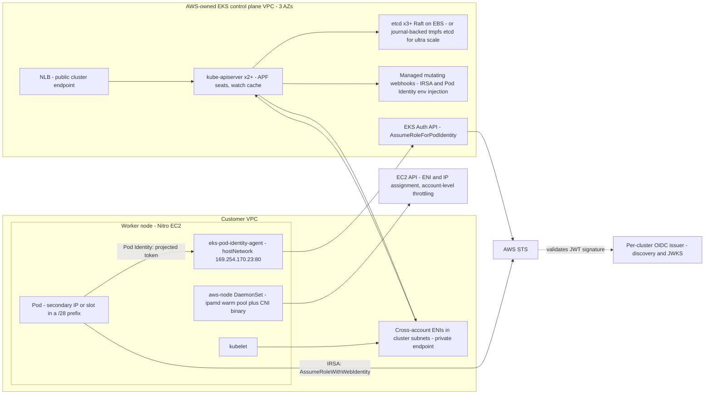

# Amazon EKS: Control Plane and Networking

## TL;DR

- The EKS control plane runs in an AWS-owned VPC with at least two API server instances behind an NLB and at least three etcd members across three AZs. Standard mode scales itself in about 10 minutes, and Provisioned Control Plane (PCP) tiers trade a fixed hourly fee for capacity that is already there when the load arrives (AWS docs and AWS Builder Center, as of 2026-10).
- The API server's real currency is APF (API Priority and Fairness) "seats", not requests per second. LIST calls cost more seats than GETs, so one DaemonSet that lists cluster-wide on every node can overload a control plane that easily handles 100x more targeted GETs.
- The VPC CNI gives every pod a real VPC IP from the node subnet. It does this through EC2 API calls (CreateNetworkInterface, AttachNetworkInterface, AssignPrivateIpAddresses), and its warm pools hold many more IPs than pods actually use. Subnet exhaustion is usually caused by the warm pools, not by the pod count.
- IRSA federates a per-cluster OIDC issuer into IAM through STS AssumeRoleWithWebIdentity. EKS Pod Identity replaces the OIDC trust with a node-local agent on 169.254.170.23 that calls the EKS Auth API, which makes roles reusable across clusters and adds session tags you can use for ABAC.
- Whoever can schedule a pod with a given ServiceAccount effectively holds that ServiceAccount's IAM role. The namespace, Kubernetes RBAC, IMDS hop limits and the right to create associations are the actual security boundary - IAM alone is not.

## Mental Model



EKS splits into three independent planes that people usually blur together, and each one fails in its own way.
The Kubernetes control plane is a managed tenant inside an AWS-owned VPC.
It reaches into your VPC only through cross-account ENIs that EKS places in the subnets you name at cluster creation.
The pod network plane belongs to you: pod IPs are real VPC addresses that ipamd leases from EC2 ahead of demand, so EC2 API rate limits and subnet free space are capacity limits of your cluster.
The identity plane is a credential-vending path that runs either through STS and a public OIDC discovery document (IRSA) or through a node-local agent and the regional EKS Auth endpoint (Pod Identity).
A pod that looks healthy needs all three at once: the API server to admit it, a free IP to start it, and a credential path to do useful work.
An incident that hits one plane often looks like a different plane failing.

## Internals

### Control plane topology and the cross-account ENI

The control plane runs API server nodes in an auto-scaling group with at least two instances in distinct AZs, and at least three etcd instances spanning three AZs ([EKS Best Practices, Control Plane](https://aws.github.io/aws-eks-best-practices/reliability/docs/controlplane/); [AWS Builder Center](https://builder.aws.com/content/3Bf1NRlLFIJPYbzmFSsRnATfyZn), as of 2026-10).
The public endpoint is fronted by a Network Load Balancer (AWS Builder Center, as of 2026-10).
The mechanism most getting-started guides skip is the cross-account ENI (X-ENI).
EKS creates network interfaces in your cluster subnets that are owned by your account but attached to control plane instances in the AWS account.
Traffic to the private endpoint takes this path: nodes resolve the cluster hostname through an EKS-managed private hosted zone and get the X-ENI IPs back.
The API server also uses this path in the other direction to reach your VPC: `kubectl exec` and `logs` traffic to kubelet port 10250, admission webhooks served by pods, and aggregated APIs.
This has three consequences:

- The cluster security group and your NACLs are in the API server's path to your webhooks. A blocked port shows up as webhook timeouts on the control plane side, not as a networking error on the node.
- Pod IPs must be routable from the cluster subnets. Custom networking with 100.64.0.0/10 pod subnets still works because both are in the same VPC route domain.
- Cluster subnets need free IPs for the cluster's whole life. EKS creates replacement X-ENIs during upgrades and control plane scaling, so if pods share those subnets and use up the space, upgrades can fail. The docs give minimum free IP counts for cluster subnets, but this pass could not re-verify the exact numbers (UNVERIFIED). The design rule is to put X-ENIs in small dedicated subnets that pods never use.

### etcd: Raft, the 8 GB ceiling, and the journal offload

In standard clusters, etcd is a three-member Raft group: every write must be persisted by a quorum before it is applied to the BoltDB MVCC store (Ongaro and Ousterhout, USENIX ATC 2014; [[08-Distinguished-Engineering/02-Distributed-Systems-Internals/Raft-Consensus|Raft Consensus]]).
Raft caps write throughput because every write is serialized through one leader, and it caps database size because snapshot transfer and defragmentation time grow with the size of the database.
The standard EKS etcd limit is 8 GB, PCP tiers raise it to 16 GB, and ultra-scale clusters reach 20 GB ([re:Post CNS429 summary](https://repost.aws/articles/ARZ3qVRVY8SUKZ_6mj32xAiQ/re-invent-2025-under-the-hood-architecting-amazon-eks-for-scale-and-performance); AWS Builder Center, as of 2026-10).

For ultra-scale clusters, EKS made a change you will not find in the user guide ([AWS Containers blog](https://aws.amazon.com/blogs/containers/under-the-hood-amazon-eks-ultra-scale-clusters/), as of 2026-10).
It replaced etcd's Raft backend with "journal", an internal AWS replicated-log service that provides ordered, multi-AZ durable replication.
Because consensus is now external, etcd replicas no longer peer with each other and are no longer bound to quorum sizes of 3, 5 or 7, so read replicas can scale horizontally.
Because the journal holds durability, BoltDB moved from EBS volumes to tmpfs, which takes fsync latency out of the commit path.
The New Stack summarized this as a disk-bound system becoming compute-bound ([The New Stack](https://thenewstack.io/eks-kubernetes-etcd-scale/)).
Finally, the hottest resource types - nodes, pods, leases and events - are placed in separate etcd partitions.
This works because Kubernetes never needs serializable transactions across resource types.
AWS reports that static partitions are enough for 100K nodes, and these improvements apply only to new clusters created with ultra scale enabled (AWS Containers blog, as of 2026-10).
This is the same separation of log and state that Aurora uses ([[17-Cloud-AI-Engineering/Volume_02_AWS_Deep_Dive/Chapter_11_Amazon_Aurora_Log_Is_The_Database|Aurora: Log-Is-The-Database]]).
Once the log is a separate, highly durable service, the state machine becomes a cache that can be rebuilt from it.

### API server admission: APF seats, LIST cost, and consistent reads from cache

Every request that reaches kube-apiserver is classified by a FlowSchema into a PriorityLevelConfiguration.
It then occupies one or more "seats" from that level's concurrency share while it executes (KEP-1040, API Priority and Fairness).
The work estimator charges LIST requests more seats in proportion to the number of objects they are expected to return.
The AWS docs say plainly that Kubernetes penalizes LIST requests more than GET requests when consuming tier capacity (EKS PCP docs, as of 2026-10).
PCP tiers are expressed directly in seats, and the metric to watch is `apiserver_flowcontrol_current_executing_seats` (EKS PCP docs, as of 2026-10).

Kubernetes v1.31 added strongly consistent reads from the watch cache.
The API server confirms the cache is at least as fresh as etcd's current revision and then serves the read from memory.
Before this, filtered reads such as a kubelet listing the pods bound to its node made the API server fetch the whole collection from etcd and filter it in memory.
AWS reports that the cache path cut server-side CPU by 30% and made LIST requests 3x faster ([InfoQ](https://www.infoq.com/news/2025/09/aws-eks-kubernetes-ultrascale/); AWS Containers blog, as of 2026-10).
The design rule: use informers with resourceVersion-based watches, never periodic full LISTs.
A controller that re-lists every 30 seconds on 5,000 nodes generates a seat load that scales with node count multiplied by object count.

### Standard control plane autoscaling versus Provisioned Control Plane

In Standard mode, EKS scales API server and etcd instances on signals that grew over time.
Per the re:Invent 2025 session CNS429, it started with CPU and memory and later added node count, etcd database size and API server performance metrics ([session summary](https://zenn.dev/kiiwami/articles/b22c1ffcc3ab11ef?locale=en); re:Post CNS429, as of 2026-10).
Scale-up takes roughly 10 minutes (re:Post CNS429 summary, as of 2026-10).
That 10-minute delay matters for AI workloads.
A 20,000-pod job submission, or a gang-scheduled training restart after a node failure, produces a load step that lasts minutes, which is shorter than the scaling reaction time.
In that window, APF queues fill up and clients start seeing HTTP 429s.
Clients then retry, which turns a short burst into sustained overload ([[17-Cloud-AI-Engineering/Volume_07_Reliability_and_SRE/Chapter_03_Resilient_Communication_Retries_Jitter_and_Circuit_Breakers|Retries, Jitter, and Circuit Breakers]]).
PCP pins the control plane to a tier, so capacity does not depend on reacting to load.
Changing tiers takes several minutes, and EKS brings up new API servers before draining the old ones, so there is no API downtime (EKS PCP docs, as of 2026-10).
This is constant work applied to the control plane ([[17-Cloud-AI-Engineering/Volume_01_Cloud_Architecture_Principles/Chapter_05_Constant_Work_and_Workload_Smoothing|Constant Work]]).
You pay for peak capacity in exchange for never waiting for it.

### VPC CNI: ipamd, warm pools, and why subnets drain

The VPC CNI has two parts.
The `aws-node` DaemonSet runs ipamd, a long-running daemon that keeps a local pool of IPs.
The CNI binary is invoked by the kubelet's container runtime on every pod sandbox create and delete.
ipamd talks to EC2 ahead of demand, so pod start does not wait for an EC2 call when the pool is warm.
The CNI binary takes an IP from the local pool, creates a veth pair, programs a host route and policy routing rules, and returns.

In secondary-IP mode, each ENI has one primary IP and (IPs per ENI - 1) secondary slots.
The maximum pod count is ENIs x (IPv4 per ENI - 1) + 2, where the +2 covers the hostNetwork pods aws-node and kube-proxy ([amazon-vpc-cni-k8s](https://github.com/aws/amazon-vpc-cni-k8s); UNVERIFIED in this pass, long-standing formula).
The warm-pool knobs determine how many subnet IPs a node holds:

- `WARM_ENI_TARGET` (default 1) keeps one whole spare ENI's worth of secondary IPs free. On an m5.4xlarge (8 ENIs x 30 IPv4, UNVERIFIED), a node running 5 pods holds 2 ENIs and 60 subnet IPs.
- `WARM_IP_TARGET` and `MINIMUM_IP_TARGET` switch the pool to per-IP accounting. This trades subnet efficiency for many more AssignPrivateIpAddresses and UnassignPrivateIpAddresses calls during pod churn.
- `ENABLE_PREFIX_DELEGATION=true` assigns /28 prefixes (16 IPs each) to ENI slots on Nitro instances. One EC2 call now covers 16 pods, but each prefix needs 16 contiguous, aligned free addresses in the subnet.
- `AWS_VPC_K8S_CNI_CUSTOM_NETWORK_CFG=true` with per-AZ `ENIConfig` objects places pod ENIs in separate subnets, typically from a 100.64.0.0/10 secondary CIDR. The primary ENI is no longer used for pods, so the maximum pod count drops to (ENIs - 1) x (IPv4 per ENI - 1) + 2 (UNVERIFIED in this pass).

Here is a mechanism the getting-started docs do not cover.
In prefix mode, allocation fails when the subnet has free addresses but no free aligned /28 block.
The usual cause is that individually assigned secondary IPs from other ENIs, Lambda functions, or load balancer nodes are scattered across the address space.
EC2 reports `InsufficientCidrBlocks` even though the subnet shows hundreds of free addresses.
The fix is structural: reserve prefix space up front with `aws ec2 create-subnet-cidr-reservation --reservation-type prefix`, or give prefix-mode nodes subnets that nothing else uses.

A second hidden coupling is that every ipamd in the account draws on the same EC2 API request token buckets.
Karpenter, the AWS Load Balancer Controller, Terraform runs and the CNI all compete for those buckets (EC2 API throttling docs; bucket sizes UNVERIFIED in this pass).
A fast scale-out of 500 nodes, each attaching ENIs and assigning IPs, can throttle every other EC2 caller in that account and Region.
Prefix delegation is as much an EC2 API rate-limit fix as an IP-density fix.

### IRSA mechanics

IRSA, launched in 2019, has five steps:

1. Each EKS cluster exposes a public OIDC issuer (`https://oidc.eks.<region>.amazonaws.com/id/<id>`) that serves a discovery document and a JWKS (the public keys that verify its tokens).
2. You register the issuer as an IAM OIDC identity provider in every account where pods will assume roles.
3. The `amazon-eks-pod-identity-webhook` is a mutating admission webhook. For any pod whose ServiceAccount carries the `eks.amazonaws.com/role-arn` annotation, it injects `AWS_ROLE_ARN`, `AWS_WEB_IDENTITY_TOKEN_FILE`, and a projected ServiceAccount token volume with audience `sts.amazonaws.com` ([amazon-eks-pod-identity-webhook](https://github.com/aws/amazon-eks-pod-identity-webhook)).
4. The SDK's web-identity provider calls `sts:AssumeRoleWithWebIdentity` with that JWT. STS validates the signature against the issuer's JWKS, then evaluates the role trust policy, whose `<issuer>:sub` condition must equal `system:serviceaccount:<ns>:<sa>` and whose `:aud` condition must equal `sts.amazonaws.com`.
5. The kubelet rotates the projected token before it expires, and the SDK refreshes STS credentials before they expire.

Trust lives in the role, so every new cluster means another OIDC provider per account and another trust policy statement per role.
That runs into the account's OIDC provider quota and the role trust policy length quota (both UNVERIFIED in this pass).
Worse, recreating a cluster mints a new issuer ID.
Every trust policy that names the old issuer silently stops matching, so blue/green cluster replacement turns into an IAM migration.

### EKS Pod Identity mechanics

Pod Identity, launched at re:Invent 2023, moves trust from the role to an EKS-side association: (cluster, namespace, ServiceAccount) maps to a role ARN.
The data path works like this (EKS docs; addresses and env var names UNVERIFIED in this pass):

1. At pod admission, an EKS-managed webhook injects `AWS_CONTAINER_CREDENTIALS_FULL_URI=http://169.254.170.23/v1/credentials` and `AWS_CONTAINER_AUTHORIZATION_TOKEN_FILE`. The second points at a projected token whose audience is `pods.eks.amazonaws.com`.
2. The `eks-pod-identity-agent` DaemonSet runs with hostNetwork and binds the link-local address 169.254.170.23 (and `fd00:ec2::23` for IPv6) on each node.
3. The SDK's container-credentials provider sends the token to the agent. The agent calls `eks-auth:AssumeRoleForPodIdentity` using the node role's permission.
4. The EKS Auth service validates the token against the cluster, looks up the association, and assumes the role. The role's trust policy names the service principal `pods.eks.amazonaws.com` with `sts:AssumeRole` and `sts:TagSession`.
5. The session carries tags: `eks-cluster-arn`, `eks-cluster-name`, `kubernetes-namespace`, `kubernetes-service-account`, `kubernetes-pod-name`, `kubernetes-pod-uid` (UNVERIFIED in this pass). Policies can therefore use `aws:PrincipalTag/kubernetes-namespace` for ABAC, so one role can serve 50 namespaces without 50 roles.

The trade-offs:

- Pod Identity needs no OIDC provider and no trust policy edits per cluster, which removes the issuer-ID trap.
- It requires the agent DaemonSet on every node, an SDK new enough to support the full-URI container provider, and reachability of the EKS Auth endpoint (the `eks-auth` interface VPC endpoint in private clusters).
- IRSA still wins for Fargate pods (Pod Identity not supported on Fargate, UNVERIFIED), for clusters that are not EKS, and for setups that need a native cross-account trust without role chaining.
- A pod configured for both reads both sets of env vars. Which one wins depends on the SDK's default credential chain order. Most SDKs evaluate web identity before container credentials, so IRSA typically wins (UNVERIFIED across SDKs).
- The most dangerous failure is a silent fallback. If the container provider is missing because the SDK is old, the chain falls through to IMDS. If IMDS is reachable from the pod, the pod gets the node role. The pod works, with the wrong identity and the wrong audit trail.

### Authentication to the cluster: access entries

EKS access entries map IAM principals to Kubernetes identities through the EKS API rather than through the `aws-auth` ConfigMap.
The cluster `authenticationMode` moves one way: `CONFIG_MAP`, then `API_AND_CONFIG_MAP`, then `API` (EKS docs; UNVERIFIED in this pass).
Access entries remove the classic lockout where a malformed `aws-auth` edit removes every administrator.
The mapping is stored outside etcd, so fixing it no longer requires working Kubernetes access.

## Numbers to Know

| Item | Value | Source and status |
|---|---|---|
| Standard control plane price | $0.10 per cluster-hour (about $73 per 730-hour month) | AWS Builder Center and EKS pricing references, as of 2026-10 |
| Extended support control plane price | $0.60 per cluster-hour | UNVERIFIED in this pass |
| Standard control plane SLA | 99.95% | AWS Builder Center, as of 2026-10 |
| PCP SLA | 99.99%, measured in 1-minute intervals | EKS PCP docs, as of 2026-10 |
| Standard minimum footprint | 2+ API servers in distinct AZs, 3+ etcd across 3 AZs, NLB front | EKS Best Practices; AWS Builder Center, as of 2026-10 |
| Standard scale-up reaction time | about 10 minutes | re:Post CNS429 summary, as of 2026-10 |
| etcd DB size limit | Standard 8 GB, PCP 16 GB, ultra scale 20 GB | re:Post CNS429; AWS Containers blog, as of 2026-10 |
| PCP XL (K8s 1.34+) | 2,000 seats, 167 pods/s, 16 GB, +$1.65/hr | EKS PCP docs; AWS Containers blog, as of 2026-10 |
| PCP 2XL (K8s 1.34+) | 4,000 seats, 283 pods/s, 16 GB, +$3.40/hr | EKS PCP docs; AWS Containers blog, as of 2026-10 |
| PCP 4XL (K8s 1.34+) | 8,000 seats, 400 pods/s, 16 GB, +$6.90/hr | EKS PCP docs; AWS Containers blog, as of 2026-10 |
| PCP 8XL (K8s 1.34+) | 16,000 seats, 400 pods/s, 16 GB, +$13.90/hr | EKS PCP docs; AWS Builder Center, as of 2026-10 |
| PCP seats on K8s 1.30-1.33 | 1,700 / 3,400 / 6,800 / 13,600 for XL / 2XL / 4XL / 8XL | EKS PCP docs, as of 2026-10 |
| PCP minimum Kubernetes version | 1.28 | re:Post CNS429 summary, as of 2026-10 |
| Ultra-scale cluster size | 100,000 nodes per cluster | AWS Containers blog, as of 2026-10 |
| Consistent reads from cache (K8s 1.31) | 30% less API server CPU, 3x faster LIST | AWS Containers blog; InfoQ, as of 2026-10 |
| Secondary-IP max pods | ENIs x (IPv4 per ENI - 1) + 2 | VPC CNI repo; UNVERIFIED in this pass |
| Prefix-mode max pods guidance | 110 below 30 vCPU, 250 at 30+ vCPU | UNVERIFIED in this pass |
| t3.medium / m5.large / m5.4xlarge ENI limits | 3x6 / 3x10 / 8x30 (ENIs x IPv4 per ENI) | EC2 docs; UNVERIFIED in this pass, check with `describe-instance-types` |
| IPs AWS reserves per subnet | 5 | Amazon VPC docs; UNVERIFIED in this pass |
| GKE single-cluster scale reference | 65,000 nodes | etcd-io discussion #20687 citing the GKE announcement, as of 2026-10 |

## AWS vs GCP Mechanism Parity

| Dimension | Amazon EKS | Google GKE | Critical difference |
|---|---|---|---|
| Control plane hosting | AWS-owned VPC; X-ENIs in your subnets for the private path | Google-managed tenant project reached through a private endpoint (UNVERIFIED for current default mechanism) | EKS consumes IPs from your cluster subnets for the control plane itself |
| Control plane scaling | Standard autoscaling (about 10 min) or pinned PCP tiers (AWS docs, as of 2026-10) | Automatic, no customer-selectable tiers (UNVERIFIED) | EKS lets you buy capacity ahead of time; GKE gives you no such option |
| State store | etcd on Raft, 3+ members; ultra scale uses journal, tmpfs BoltDB and partitions (AWS blog, as of 2026-10) | etcd for typical clusters; a Spanner-based backend for very large clusters (UNVERIFIED) | Both providers replaced etcd's consensus layer to go beyond about 15K nodes |
| Max cluster size | 100K nodes (ultra scale, AWS blog, as of 2026-10) | 65K nodes (per etcd-io discussion #20687, as of 2026-10) | Both require explicit opt-in or support engagement at the top end |
| Pod IP source | Secondary IPs or /28 prefixes on ENIs, allocated at runtime through EC2 APIs | Alias IP: a per-node pod range carved from a subnet secondary range at node creation (UNVERIFIED for defaults) | EKS waste comes from warm pools and runtime API calls; GKE waste is a fixed per-node range |
| IP exhaustion escape | Custom networking with 100.64.0.0/10, prefix delegation, IPv6 /80 per node (UNVERIFIED) | Discontiguous multi-Pod CIDR, non-RFC1918 ranges, dual-stack (UNVERIFIED) | GKE can add pod ranges per node pool; EKS adds subnets through ENIConfig |
| Network policy dataplane | VPC CNI eBPF network policy agent (UNVERIFIED for GA version) | Dataplane V2, built on Cilium eBPF (UNVERIFIED) | See [[17-Cloud-AI-Engineering/Volume_05_Kubernetes_and_Platform_Engineering/Chapter_03_CNI_and_eBPF_with_Cilium\|CNI and eBPF with Cilium]] |
| Workload identity (federated) | IRSA: per-cluster OIDC issuer, STS AssumeRoleWithWebIdentity | Workload Identity Federation for GKE: metadata server DaemonSet plus Google STS token exchange (UNVERIFIED for details) | IRSA trust lives in each role; GKE trust lives in a project-level pool |
| Workload identity (agent) | Pod Identity: agent at 169.254.170.23, EKS Auth API, session tags | gke-metadata-server intercepting 169.254.169.254 (UNVERIFIED) | EKS uses a separate link-local address so the agent and IMDS can coexist |
| Cluster authn mapping | Access entries via the EKS API; legacy aws-auth ConfigMap | IAM plus RBAC, with Google Groups bindable in RBAC (UNVERIFIED) | Both moved the mapping out of etcd |
| SLA | 99.95% standard, 99.99% PCP (AWS docs, as of 2026-10) | Regional versus zonal tiers (UNVERIFIED for values) | EKS ties the higher SLA to a paid tier |
| Control plane fee | $0.10/hr plus optional PCP add-on (as of 2026-10) | Per-cluster management fee with a free-tier credit (UNVERIFIED) | Model fleet cost per cluster, not per node |

For cross-cloud identity design, see [[17-Cloud-AI-Engineering/Volume_08_Security_Identity_and_the_Data_Perimeter/Chapter_02_Workload_Identity_Federation|Workload Identity Federation]].
For the GKE side in depth, see [[17-Cloud-AI-Engineering/Volume_03_GCP_Deep_Dive/Chapter_07_GKE_Deep_Dive_Standard_vs_Autopilot|GKE Deep Dive]].

## Worked Example: Prefix-Delegated EKS Cluster with Pod Identity ABAC and an IP Budget

### Step 1 - Size the IP budget before writing any Terraform

The planner below is runnable offline and needs only the Python standard library.
With `--live` it reads ENI limits through boto3 `describe_instance_types`, using the `NetworkInfo.MaximumNetworkInterfaces` and `Ipv4AddressesPerInterface` fields.
Run it with `--live` before trusting the static limits table.

```python
#!/usr/bin/env python3
"""EKS VPC CNI IP consumption planner (secondary-IP, prefix, custom networking).

Offline by default. Pass --live to read ENI limits from the EC2 API via boto3.
"""
import argparse
import math

# ENI limits: (max ENIs, IPv4 addresses per ENI, vCPUs). Verify with --live.
STATIC_LIMITS = {
    "t3.medium": (3, 6, 2),
    "m5.large": (3, 10, 2),
    "m5.4xlarge": (8, 30, 16),
}


def live_limits(itype, region):
    import boto3
    ec2 = boto3.client("ec2", region_name=region)
    it = ec2.describe_instance_types(InstanceTypes=[itype])["InstanceTypes"][0]
    ni = it["NetworkInfo"]
    return (ni["MaximumNetworkInterfaces"], ni["Ipv4AddressesPerInterface"],
            it["VCpuInfo"]["DefaultVCpus"])


def max_pods(enis, ips, vcpus, mode):
    if mode == "secondary":
        return enis * (ips - 1) + 2
    if mode == "custom":
        return (enis - 1) * (ips - 1) + 2
    if mode == "prefix":
        raw = enis * (ips - 1) * 16 + 2
        return min(raw, 110 if vcpus < 30 else 250)
    raise ValueError(mode)


def node_ips(pods, enis, ips, mode, warm_eni=1, warm_ip=0, min_ip=0,
             warm_prefix=1):
    """Return (subnet IPs held by one node, ENIs attached) for `pods` non-hostNetwork pods."""
    slots = ips - 1  # secondary slots per ENI (one slot is the ENI primary IP)
    if mode in ("secondary", "custom"):
        usable_enis = enis - 1 if mode == "custom" else enis
        if warm_ip or min_ip:
            alloc = max(min_ip, pods + warm_ip)
            n = max(1, math.ceil(alloc / slots))
        else:
            n = 1 if pods == 0 else math.ceil(pods / slots) + warm_eni
            alloc = n * slots
        n = min(n, usable_enis)
        alloc = min(alloc, n * slots)
        return alloc + n, n
    if mode == "prefix":
        if warm_ip or min_ip:
            need = max(min_ip, pods + warm_ip)
            prefixes = math.ceil(need / 16)
        else:
            prefixes = math.ceil(pods / 16) + warm_prefix
        n = max(1, math.ceil(prefixes / slots))
        return prefixes * 16 + n, n
    raise ValueError(mode)


def main():
    ap = argparse.ArgumentParser()
    ap.add_argument("--instance", default="m5.4xlarge")
    ap.add_argument("--nodes", type=int, default=400)
    ap.add_argument("--pods-per-node", type=int, default=20)
    ap.add_argument("--subnet-prefix", type=int, default=20, help="per-AZ subnet mask, e.g. 20 for /20")
    ap.add_argument("--azs", type=int, default=3)
    ap.add_argument("--live", action="store_true")
    ap.add_argument("--region", default="us-east-1")
    a = ap.parse_args()

    enis, ips, vcpus = (live_limits(a.instance, a.region) if a.live
                        else STATIC_LIMITS[a.instance])
    usable = (2 ** (32 - a.subnet_prefix) - 5) * a.azs  # AWS reserves 5 IPs per subnet
    print(f"{a.instance}: ENIs={enis} IPv4/ENI={ips} vCPU={vcpus}; "
          f"usable subnet IPs={usable} across {a.azs} AZs")
    scenarios = [
        ("secondary, WARM_ENI_TARGET=1 (default)", "secondary", {}),
        ("secondary, WARM_IP_TARGET=5 MINIMUM_IP_TARGET=20", "secondary", {"warm_ip": 5, "min_ip": 20}),
        ("prefix /28, WARM_PREFIX_TARGET=1", "prefix", {}),
        ("prefix /28, WARM_IP_TARGET=5 MINIMUM_IP_TARGET=20", "prefix", {"warm_ip": 5, "min_ip": 20}),
    ]
    for label, mode, kw in scenarios:
        per_node, n = node_ips(a.pods_per_node, enis, ips, mode, **kw)
        total = per_node * a.nodes
        fit = usable // per_node
        print(f"- {label}: maxPods={max_pods(enis, ips, vcpus, mode)} "
              f"ENIs/node={n} IPs/node={per_node} fleet={total} "
              f"nodes-that-fit={fit} {'OK' if total <= usable else 'EXHAUSTED'}")


if __name__ == "__main__":
    main()
```

The model is approximate: it ignores IP cooldown and leaked ENIs and assumes uniform pod density.
Output for 400 m5.4xlarge nodes at 20 pods each, with three /20 subnets (12,273 usable IPs):

```text
- secondary, WARM_ENI_TARGET=1 (default): maxPods=234 ENIs/node=2 IPs/node=60 fleet=24000 nodes-that-fit=204 EXHAUSTED
- secondary, WARM_IP_TARGET=5 MINIMUM_IP_TARGET=20: maxPods=234 ENIs/node=1 IPs/node=26 fleet=10400 nodes-that-fit=472 OK
- prefix /28, WARM_PREFIX_TARGET=1: maxPods=110 ENIs/node=1 IPs/node=49 fleet=19600 nodes-that-fit=250 EXHAUSTED
- prefix /28, WARM_IP_TARGET=5 MINIMUM_IP_TARGET=20: maxPods=110 ENIs/node=1 IPs/node=33 fleet=13200 nodes-that-fit=371 EXHAUSTED
```

How to read it:

1. With the default warm ENI, 20 real pods hold 60 IPs per node, so the fleet uses up the VPC at about 204 nodes. That is half the target, while the pods themselves need only 8,000 IPs.
2. Per-IP warm targets fit the fleet, but each pod churn event becomes an EC2 call. At 400 nodes, a rolling restart produces thousands of AssignPrivateIpAddresses calls competing with Karpenter in the same account bucket.
3. Prefix mode is less IP-efficient at low density, because 20 pods need two /28 blocks (32 IPs). It needs 16x fewer EC2 calls, though, and it becomes the most efficient mode at high density. At 100 pods per node, prefix mode holds 129 IPs per node against 150 for the secondary-mode default.
4. The answer for this fleet is to stop sharing node subnets with pods. A 100.64.0.0/16 secondary CIDR split into three /18s gives about 49K pod IPs, with prefix mode and subnet CIDR reservations on the pod subnets.

### Step 2 - Control plane sizing

At 400 nodes, the Standard control plane is usually sufficient.
The trigger to buy PCP is burst shape, not steady state.
Submitting 10,000 pods at once takes about 60 s to bind at the XL rate of 167 pods/s and about 25 s at the 4XL rate of 400 pods/s (EKS PCP docs, as of 2026-10).
Under Standard mode, the same burst arrives before the roughly 10-minute scale-up reaction completes.
4XL costs $6.90 x 730 = $5,037 per month on top of the $73 base fee (as of 2026-10).
Compare that to the GPU-hours lost when a training restart is throttled by 429s, not to the base fee.

### Step 3 - Lab Terraform (OpenTofu compatible)

This lab builds the following:

- Two small dedicated control-plane subnets for the X-ENIs.
- Two public node subnets, so there is no NAT gateway cost.
- A cluster in `API` authentication mode.
- The VPC CNI with prefix delegation.
- The Pod Identity agent.
- One ABAC-scoped role.
- A budget alarm.

```hcl
terraform {
  required_version = ">= 1.6"
  required_providers {
    aws = {
      source  = "hashicorp/aws"
      version = ">= 5.40"
    }
  }
}

provider "aws" {
  region = var.region
  default_tags {
    tags = { lab = "eks-ch07" }
  }
}

variable "region" {
  type    = string
  default = "us-east-1"
}

variable "name" {
  type    = string
  default = "eks-ch07-lab"
}

variable "admin_cidr" {
  type        = string
  description = "Your public IP in CIDR form, for example 203.0.113.10/32"
}

variable "budget_email" {
  type = string
}

data "aws_availability_zones" "az" {
  state = "available"
}

data "aws_caller_identity" "me" {}

resource "aws_vpc" "this" {
  cidr_block           = "10.42.0.0/16"
  enable_dns_support   = true
  enable_dns_hostnames = true
  tags                 = { Name = var.name }
}

resource "aws_internet_gateway" "this" {
  vpc_id = aws_vpc.this.id
}

# Dedicated /28 subnets for EKS cross-account ENIs; pods never draw from these.
resource "aws_subnet" "cp" {
  count             = 2
  vpc_id            = aws_vpc.this.id
  availability_zone = data.aws_availability_zones.az.names[count.index]
  cidr_block        = cidrsubnet("10.42.255.0/24", 4, count.index)
  tags              = { Name = "${var.name}-cp-${count.index}" }
}

# Node and pod subnets (/20 each); public to avoid NAT gateway cost in a lab.
resource "aws_subnet" "nodes" {
  count                   = 2
  vpc_id                  = aws_vpc.this.id
  availability_zone       = data.aws_availability_zones.az.names[count.index]
  cidr_block              = cidrsubnet("10.42.0.0/16", 4, count.index)
  map_public_ip_on_launch = true
  tags                    = { Name = "${var.name}-nodes-${count.index}" }
}

resource "aws_route_table" "public" {
  vpc_id = aws_vpc.this.id
  route {
    cidr_block = "0.0.0.0/0"
    gateway_id = aws_internet_gateway.this.id
  }
}

resource "aws_route_table_association" "nodes" {
  count          = 2
  subnet_id      = aws_subnet.nodes[count.index].id
  route_table_id = aws_route_table.public.id
}

data "aws_iam_policy_document" "eks_trust" {
  statement {
    actions = ["sts:AssumeRole", "sts:TagSession"]
    principals {
      type        = "Service"
      identifiers = ["eks.amazonaws.com"]
    }
  }
}

resource "aws_iam_role" "cluster" {
  name               = "${var.name}-cluster"
  assume_role_policy = data.aws_iam_policy_document.eks_trust.json
}

resource "aws_iam_role_policy_attachment" "cluster" {
  role       = aws_iam_role.cluster.name
  policy_arn = "arn:aws:iam::aws:policy/AmazonEKSClusterPolicy"
}

resource "aws_eks_cluster" "this" {
  name     = var.name
  role_arn = aws_iam_role.cluster.arn

  access_config {
    authentication_mode                         = "API"
    bootstrap_cluster_creator_admin_permissions = true
  }

  vpc_config {
    subnet_ids              = aws_subnet.cp[*].id
    endpoint_private_access = true
    endpoint_public_access  = true
    public_access_cidrs     = [var.admin_cidr]
  }

  depends_on = [aws_iam_role_policy_attachment.cluster]
}

resource "aws_eks_addon" "vpc_cni" {
  cluster_name                = aws_eks_cluster.this.name
  addon_name                  = "vpc-cni"
  resolve_conflicts_on_create = "OVERWRITE"
  resolve_conflicts_on_update = "OVERWRITE"
  configuration_values = jsonencode({
    env = {
      ENABLE_PREFIX_DELEGATION = "true"
      WARM_PREFIX_TARGET       = "1"
    }
  })
}

resource "aws_eks_addon" "pod_identity_agent" {
  cluster_name = aws_eks_cluster.this.name
  addon_name   = "eks-pod-identity-agent"
}

data "aws_iam_policy_document" "ec2_trust" {
  statement {
    actions = ["sts:AssumeRole"]
    principals {
      type        = "Service"
      identifiers = ["ec2.amazonaws.com"]
    }
  }
}

resource "aws_iam_role" "node" {
  name               = "${var.name}-node"
  assume_role_policy = data.aws_iam_policy_document.ec2_trust.json
}

resource "aws_iam_role_policy_attachment" "node" {
  for_each = toset([
    "arn:aws:iam::aws:policy/AmazonEKSWorkerNodePolicy",
    "arn:aws:iam::aws:policy/AmazonEKS_CNI_Policy",
    "arn:aws:iam::aws:policy/AmazonEC2ContainerRegistryReadOnly",
  ])
  role       = aws_iam_role.node.name
  policy_arn = each.value
}

resource "aws_eks_node_group" "default" {
  cluster_name    = aws_eks_cluster.this.name
  node_group_name = "default"
  node_role_arn   = aws_iam_role.node.arn
  subnet_ids      = aws_subnet.nodes[*].id
  instance_types  = ["t3.medium"]
  disk_size       = 20

  scaling_config {
    desired_size = 2
    min_size     = 2
    max_size     = 2
  }

  depends_on = [
    aws_iam_role_policy_attachment.node,
    aws_eks_addon.vpc_cni,
  ]
}

resource "aws_s3_bucket" "lab" {
  bucket_prefix = "${var.name}-"
  force_destroy = true
}

data "aws_iam_policy_document" "pod_trust" {
  statement {
    actions = ["sts:AssumeRole", "sts:TagSession"]
    principals {
      type        = "Service"
      identifiers = ["pods.eks.amazonaws.com"]
    }
    condition {
      test     = "StringEquals"
      variable = "aws:SourceAccount"
      values   = [data.aws_caller_identity.me.account_id]
    }
  }
}

resource "aws_iam_role" "reader" {
  name               = "${var.name}-reader"
  assume_role_policy = data.aws_iam_policy_document.pod_trust.json
}

# ABAC: only sessions tagged with namespace team-a may list the lab bucket.
data "aws_iam_policy_document" "reader" {
  statement {
    actions   = ["s3:ListBucket"]
    resources = [aws_s3_bucket.lab.arn]
    condition {
      test     = "StringEquals"
      variable = "aws:PrincipalTag/kubernetes-namespace"
      values   = ["team-a"]
    }
  }
}

resource "aws_iam_role_policy" "reader" {
  role   = aws_iam_role.reader.id
  policy = data.aws_iam_policy_document.reader.json
}

resource "aws_eks_pod_identity_association" "reader" {
  cluster_name    = aws_eks_cluster.this.name
  namespace       = "team-a"
  service_account = "reader"
  role_arn        = aws_iam_role.reader.arn
}

resource "aws_budgets_budget" "lab" {
  name         = "${var.name}-budget"
  budget_type  = "COST"
  limit_amount = "25"
  limit_unit   = "USD"
  time_unit    = "MONTHLY"

  notification {
    comparison_operator        = "GREATER_THAN"
    threshold                  = 80
    threshold_type             = "PERCENTAGE"
    notification_type          = "ACTUAL"
    subscriber_email_addresses = [var.budget_email]
  }
}

output "bucket" {
  value = aws_s3_bucket.lab.bucket
}
```

How to read the Terraform:

- The node group `depends_on` the VPC CNI add-on so the add-on configuration exists before the nodes join. Whether managed node groups automatically compute the prefix-mode maxPods from the add-on configuration is UNVERIFIED. Check it with `kubectl get node -o jsonpath='{.items[0].status.allocatable.pods}'` and expect about 110 rather than 17.
- The `aws:SourceAccount` condition in the Pod Identity trust policy follows the confused-deputy pattern. The exact condition keys EKS Auth populates are UNVERIFIED in this pass, so test the assume path before relying on it.

### Step 4 - Exercise the mechanisms

```bash
set -euo pipefail
tofu init && tofu apply -var admin_cidr="$(curl -s https://checkip.amazonaws.com)/32" -var budget_email="you@example.com"
aws eks update-kubeconfig --name eks-ch07-lab --region us-east-1
BUCKET=$(tofu output -raw bucket)

# Pod Identity: env injection happens at admission, so create the pod after the association exists.
for NS in team-a team-b; do
  kubectl create namespace "$NS"
  kubectl -n "$NS" create serviceaccount reader
done
kubectl -n team-a run probe --image=public.ecr.aws/aws-cli/aws-cli:latest \
  --overrides='{"spec":{"serviceAccountName":"reader"}}' --command -- sleep 3600
kubectl -n team-a wait --for=condition=Ready pod/probe --timeout=180s
kubectl -n team-a exec probe -- env | grep AWS_CONTAINER
kubectl -n team-a exec probe -- aws sts get-caller-identity
kubectl -n team-a exec probe -- aws s3 ls "s3://${BUCKET}"

# Negative test: team-b has no association; expect node-role fallback or no credentials.
# If this pod succeeds as the node role, IMDS is reachable from pods: fix the hop limit.
kubectl -n team-b run probe --image=public.ecr.aws/aws-cli/aws-cli:latest \
  --overrides='{"spec":{"serviceAccountName":"reader"}}' --command -- sleep 3600
kubectl -n team-b wait --for=condition=Ready pod/probe --timeout=180s
kubectl -n team-b exec probe -- aws sts get-caller-identity || true

# Prefix delegation: inspect /28 prefixes attached to node ENIs.
IID=$(kubectl get node -o jsonpath='{.items[0].spec.providerID}' | awk -F/ '{print $NF}')
aws ec2 describe-network-interfaces --filters Name=attachment.instance-id,Values="$IID" \
  --query 'NetworkInterfaces[].{eni:NetworkInterfaceId,prefixes:Ipv4Prefixes[].Ipv4Prefix}'
```

The team-b probe exists so you can see the silent fallback with your own eyes.

### Cost estimate (us-east-1)

| Line item | Rate | 4-hour lab | If left running 730 h |
|---|---|---|---|
| EKS control plane | $0.10/hr (as of 2026-10) | $0.40 | $73.00 |
| 2x t3.medium On-Demand | about $0.0416/hr each (UNVERIFIED) | $0.33 | $60.74 |
| 2x 20 GB gp3 | about $0.08/GB-month (UNVERIFIED) | $0.02 | $3.20 |
| 2 public IPv4 on nodes | about $0.005/hr each (UNVERIFIED) | $0.04 | $7.30 |
| Total | | about $0.80 | about $144 |

The budget fires an email at $20 actual spend (80% of $25).
Budgets are evaluated with a delay, so treat the alarm as a backstop, not a kill switch.

### Teardown

```bash
set -euo pipefail
kubectl delete namespace team-a team-b --wait=true
tofu destroy -auto-approve -var admin_cidr=0.0.0.0/32 -var budget_email=you@example.com
# Verify no leaked CNI ENIs block VPC deletion or keep holding IPs.
aws ec2 describe-network-interfaces --filters Name=tag:lab,Values=eks-ch07 Name=status,Values=available \
  --query 'NetworkInterfaces[].NetworkInterfaceId'
```

If `destroy` stalls on the VPC or subnets, the cause is almost always ENIs in `available` state.
ipamd creates them after a node is killed abruptly, and they can carry the `node.k8s.amazonaws.com/instance_id` tag rather than your default tags.
Delete them with `aws ec2 delete-network-interface` and rerun `destroy`.

## Failure Modes and Pitfalls

### 1. Warm-pool subnet exhaustion

**Symptom:** Pods stay in `ContainerCreating` with "failed to assign an IP address to container", while the node has CPU to spare.
**Cause:** ipamd cannot get an IP from EC2. The subnet is out of free addresses (`InsufficientFreeAddressesInSubnet`) even though the pod count is well below the subnet size, because every node's warm pool reserves a whole spare ENI's worth of IPs.
**Fix:**

- Tune `WARM_IP_TARGET` and `MINIMUM_IP_TARGET`, or switch to prefix delegation.
- Move pods into 100.64.0.0/10 subnets with custom networking.
- Alarm on subnet `AvailableIpAddressCount` well before it reaches zero.

### 2. Control plane subnet starvation during upgrade

**Symptom:** A Kubernetes version upgrade or control plane scaling event fails with no pod-level symptom at all.
**Cause:** The cluster subnets are shared with pods and have been drained, so EKS cannot create the replacement X-ENIs it needs.
**Fix:** Put the X-ENIs in dedicated subnets, as the worked example does.

### 3. Prefix fragmentation

**Symptom:** `InsufficientCidrBlocks` errors while the subnet reports plenty of free IPs.
**Cause:** No aligned /28 block is left, because single secondary IPs from other ENIs are scattered across the subnet.
**Fix:**

- Reserve prefix space with subnet CIDR reservations.
- Give prefix-mode nodes subnets that nothing else uses.
- Avoid mixing secondary-IP and prefix-mode node groups in one subnet.

### 4. EC2 API throttling cascade

**Symptom:** `RequestLimitExceeded` errors across unrelated tools - CNI IP assignment, Karpenter node launches, Terraform runs - all at once.
**Cause:** A large scale-out sends ENI and IP calls from hundreds of ipamd instances into the account's EC2 token buckets, which Karpenter and everything else also draw on.
**What happens next:** Karpenter's launches slow down, pods stay pending longer, so more nodes are requested. The retries feed the overload.
**Fix:**

- Use prefix mode and steady warm pools to cut the number of calls.
- Use separate accounts for very large clusters (see [[17-Cloud-AI-Engineering/Volume_01_Cloud_Architecture_Principles/Chapter_06_Multi_Account_and_Multi_Project_Landing_Zones|Landing Zones]]).
- Request rate-limit increases for large fleets.

### 5. LIST storm overloading the control plane, with a circular dependency on recovery

**Incident:** OpenAI's public postmortem of its 2024-12-11 outage (summarized here from memory; details UNVERIFIED in this pass).
A newly deployed telemetry service caused every node in large clusters to issue expensive Kubernetes API operations, which overwhelmed the API servers.
Cluster DNS-based service discovery degraded as caches expired, and remediation was hard because the tools needed to roll back depended on the same overloaded control plane.
**Lessons:**

- Cap DaemonSet API usage with APF FlowSchemas that put per-node agents in a low-priority level.
- Require informers over polling LISTs.
- Stage DaemonSet rollouts by cluster and by fraction of nodes.
- Keep a break-glass path that does not need the API server, such as node-level kill switches or IaC that scales the offending DaemonSet's nodes away.

### 6. etcd database size alarm

**Symptom:** Writes start failing cluster-wide as the database approaches its limit.
**Cause:** CRD-heavy controllers, high-churn Events, large ConfigMaps and Secrets, and workflow engines that keep completed objects push etcd toward 8 GB on Standard (as of 2026-10).
**Fix:**

- Track `apiserver_storage_size_bytes`, and `etcd_mvcc_db_total_size_in_use_in_bytes` in CloudWatch (EKS PCP docs, as of 2026-10).
- Set object TTLs and garbage-collect completed jobs.
- Treat the jump from 8 GB to 16 GB with PCP as headroom, not as a fix.

### 7. Webhook deadlock

**Symptom:** The API server cannot admit pods, including the pods that would serve the webhook. The cluster cannot recover on its own.
**Cause:** A `failurePolicy: Fail` webhook whose backing pods are down, or are unreachable because the cluster security group blocks the X-ENI-to-pod path, rejects all pod creates.
**Fix:**

- Use `namespaceSelector` to exclude `kube-system`.
- Set tight `timeoutSeconds`.
- Give webhook pods PodDisruptionBudgets.

### 8. IRSA issuer drift on cluster replacement

**Symptom:** After a blue/green cluster swap, every workload gets `AccessDenied` from STS.
**Cause:** The new cluster has a new OIDC issuer ID, and no trust policy names it yet.
**What makes it worse:** Teams often discover the trust policy length quota at the same moment, while adding the new issuer next to the old one.
**Fix:** Migrate to Pod Identity, or template trust policies from cluster outputs and pre-stage them before the cutover.

### 9. Pod Identity silent fallback to the node role

**Symptom:** A pod works, but CloudTrail shows the node role's identity on its API calls.
**Causes:**

- An old SDK that does not support the container full-URI provider.
- A pod created before its association existed, which therefore never received the injected env vars.
- An agent DaemonSet missing from tainted GPU nodes because it lacks the tolerations.

In each case the credential chain falls through to IMDS.
**Fix:**

- Set the IMDSv2 hop limit to 1 so pods outside hostNetwork cannot reach IMDS.
- Make sure the agent tolerates every taint.
- Alarm on node-role sessions calling data-plane APIs such as S3 or DynamoDB.

### 10. Regional event blocking node launches

**Incident:** The 2025-10-20 us-east-1 event, in which a DynamoDB DNS automation fault cascaded into EC2 instance launch impairment ([AWS post-event summary](https://aws.amazon.com/message/101925/); details and URL UNVERIFIED in this pass).
**Effect:** Clusters that depended on just-in-time autoscaling could not add capacity, while clusters that already had their nodes ran on.
**Lesson:** This is static stability applied to Kubernetes ([[17-Cloud-AI-Engineering/Volume_01_Cloud_Architecture_Principles/Chapter_02_Regions_Zones_and_Static_Stability|Static Stability]]). Keep N+1 zonal headroom already provisioned for critical serving. Do not make recovery depend on control plane or EC2 launch availability.

For broader outage anatomy, see [[17-Cloud-AI-Engineering/Volume_07_Reliability_and_SRE/Chapter_07_Anatomy_of_Major_Cloud_Outages|Anatomy of Major Cloud Outages]].

## Security and Cost Angles

### IAM scoping

- **Get the CNI policy off the node role.** `AmazonEKS_CNI_Policy` grants ENI and IP mutation rights. On the node role, any pod that can reach IMDS inherits the power to rewire your VPC's ENIs. Bind it to the `aws-node` ServiceAccount through IRSA or Pod Identity, and set the IMDSv2 hop limit to 1.
- **Treat association creation as privileged.** The right to call `eks:CreatePodIdentityAssociation` is equivalent to the right to grant any role that trusts `pods.eks.amazonaws.com` to any ServiceAccount. Gate it with an SCP and require `iam:PassRole` on a narrow role path. Whether PassRole is enforced on this API is UNVERIFIED, so test it.
- **Treat pod creation as role assumption.** Any principal that can create a pod in namespace N can mount any ServiceAccount in N, so `pods/create` in N carries every IAM role bound to N. Grant RBAC accordingly.
- **Use session tags for ABAC.** With `aws:PrincipalTag/kubernetes-namespace` and `aws:PrincipalTag/eks-cluster-arn` in resource policies, a single role can serve many tenants safely. This also keeps role counts below IAM quotas.

### Encryption

- Enable envelope encryption of Kubernetes Secrets with a customer-managed KMS key (`encryption_config`) when you need key-level revocation and CloudTrail visibility of decrypt calls ([[17-Cloud-AI-Engineering/Volume_08_Security_Identity_and_the_Data_Perimeter/Chapter_04_Encryption_Key_Hierarchies_and_Envelope_Encryption|Envelope Encryption]]).
- Whether EKS now applies default KMS v2 envelope encryption to all API data on recent versions is UNVERIFIED in this pass.

### Private network boundaries

- A private-endpoint-only cluster with fully private nodes needs interface endpoints for STS, EC2 (the CNI calls it), ECR API and ECR DKR, CloudWatch Logs, and `eks-auth` for Pod Identity, plus an S3 gateway endpoint.
- Missing the EC2 endpoint produces exactly the IP exhaustion symptom from failure mode 1, which makes it an expensive misdiagnosis.
- Layer the VPC endpoint policies into a perimeter ([[17-Cloud-AI-Engineering/Volume_08_Security_Identity_and_the_Data_Perimeter/Chapter_06_Constructing_an_Impenetrable_Data_Perimeter|Data Perimeter]]).

### Unit economics

- **Control plane fees:** The base fee is fixed at $73 per cluster-month, while PCP adds $1,205 to $10,147 per month for XL through 8XL (as of 2026-10). A fleet of 300 small clusters pays about $21.9K per month in base fees before any compute.
- **Extended support:** At a reported 6x the standard rate (UNVERIFIED), running an old Kubernetes version past standard support is a cost decision as much as a risk decision.
- **NAT data processing:** Pulling images and model weights through a NAT gateway costs a per-GB processing fee. Use the S3 gateway endpoint and the ECR pull-through cache instead ([[17-Cloud-AI-Engineering/Volume_09_FinOps_and_Cloud_Economics/Chapter_04_Network_Egress_Economics_and_Optimization|Egress Economics]]).
- **Cross-AZ traffic:** Topology-aware routing for Services reduces cross-AZ bytes, but it concentrates load in one zone and can cut into the zonal headroom that failure mode 10 depends on.

## Interview Questions and Model Answers

### Question 1 (L5 - Senior)

Pods on a new node group stay in `ContainerCreating` with "failed to assign an IP address to container" while the subnet console shows about 300 free IPs. Walk me through the diagnosis.

#### Model Answer

First I separate "the node has no IPs in its local pool" from "EC2 refused to give it more".
The aws-node logs show the ipamd side; CloudTrail shows the EC2 side, so I look for AssignPrivateIpAddresses or AssignIpv6Addresses errors from the node role or the aws-node role.
If I see `InsufficientCidrBlocks`, the node group is in prefix mode and there is no aligned /28 free, even though 300 scattered addresses are.
That is fragmentation, and the fix is subnet CIDR reservations or dedicated pod subnets.
If I see `RequestLimitExceeded`, this is EC2 API throttling, probably from a concurrent mass scale-out.
I check how many other callers share the account's token bucket, and I back off by slowing node launches or switching to prefix mode to cut call volume.
If there is no error but the node is at its maximum ENIs, the node has reached its per-instance IP ceiling.
The scheduler should not have placed the pod there, so I check whether `max-pods` on the kubelet matches the CNI mode.
A node bootstrapped for prefix mode while the CNI runs in secondary mode will over-admit pods.
If the subnet shows free IPs but they are being drained quickly, I calculate warm-pool holdings with the WARM_ENI_TARGET arithmetic: a node with 5 pods can be holding 60 IPs, so 300 free is about five nodes away from zero.
Throughout, I check whether the CNI can reach EC2 at all.
A private cluster without an EC2 interface endpoint produces this same symptom.

#### Follow-up Interviewer Question

You switch the node group to `WARM_IP_TARGET=2`, and a week later p99 pod start time doubles during deploys. Why, and what would you change?

### Question 2 (L5 - Senior)

Explain exactly how a pod gets AWS credentials under IRSA and under EKS Pod Identity, and name one situation where you would still choose IRSA.

#### Model Answer

Under IRSA, a mutating webhook sees the role annotation on the ServiceAccount.
It injects `AWS_ROLE_ARN`, `AWS_WEB_IDENTITY_TOKEN_FILE`, and a projected ServiceAccount token with audience `sts.amazonaws.com` that the kubelet rotates.
The SDK calls `sts:AssumeRoleWithWebIdentity` with that JWT.
STS fetches the cluster's OIDC discovery document and JWKS, verifies the signature, and evaluates the role's trust policy against the `sub` claim (`system:serviceaccount:ns:sa`) and the `aud` claim.
The trust lives in the role, and the identity provider must be registered in every target account.

Under Pod Identity, an EKS-side association maps cluster, namespace and ServiceAccount to a role.
At admission the pod gets `AWS_CONTAINER_CREDENTIALS_FULL_URI` pointing at 169.254.170.23 plus a token file.
The SDK's container provider presents the token to the node-local agent, which calls `eks-auth:AssumeRoleForPodIdentity`.
EKS validates the token, resolves the association, and returns credentials for a role that trusts the `pods.eks.amazonaws.com` service principal, with session tags for cluster, namespace, ServiceAccount and pod.

I would still choose IRSA in four cases:

- For Fargate pods, where the agent DaemonSet cannot run.
- For non-EKS Kubernetes, where any OIDC issuer works.
- Where I want the target account to own the trust decision directly, without role chaining.
- For workloads whose SDKs are too old for the container full-URI provider.

#### Follow-up Interviewer Question

A pod has both the IRSA annotation and a Pod Identity association. Which credentials does it use, and how would you prove it in production?

### Question 3 (L6 - Staff)

You are building a 3,000-node GPU training and inference cluster in a VPC that has a /16 already 60% allocated to other teams. Design the pod IP plan and defend it against the alternatives.

#### Model Answer

First, the arithmetic.
Even at a modest 30 non-hostNetwork pods per GPU node, the default WARM_ENI_TARGET can hold 60 or more IPs per node, which is about 180K IPs, while a /16 has 65K.
The node subnets therefore hold node primary IPs and nothing else.

Pods go into a secondary VPC CIDR from 100.64.0.0/10, split into three per-AZ subnets with custom networking and one ENIConfig per AZ, keyed on the zone label.
The cost of custom networking is losing the primary ENI's slots for pods.
On GPU instances, ENI slots also carry other attachments such as EFA, so I verify the effective ENI count per instance type with `describe-instance-types` rather than assuming it.

In those pod subnets I run prefix delegation, for three reasons:

- It cuts EC2 calls by 16x during the burst after a gang-scheduled restart, and those calls share the account's token bucket with Karpenter.
- GPU nodes are dense with sidecars and inference replicas, so /28 utilization is high.
- Subnet CIDR reservations prevent fragmentation, which is only possible because nothing else lives in those subnets.

Pod-to-anywhere traffic is SNATed to the node primary IP by default.
That is fine for egress, but on-premises peers cannot initiate connections to 100.64.0.0/10 pods, and I state that limitation explicitly.

The alternative is IPv6: each node gets a prefix and pod IP exhaustion disappears entirely.
I reject IPv6 here only if the toolchain is not IPv6-clean, such as license servers, some NCCL bootstrap paths, and on-premises dataset mounts.
That is an audit item with an owner, not a permanent reason to stay on IPv4.

I keep the control plane X-ENIs in their own small subnets in the original /16, so upgrades never compete with pods for addresses.
Finally, I put alarms on free IPs per pod subnet and on EC2 throttle counts per account.

#### Follow-up Interviewer Question

Six months later the training team wants pods reachable from an on-premises parameter-server rack over Direct Connect. What breaks in your design, and how do you fix it without renumbering?

### Question 4 (L6 - Staff)

During a large batch submission, `kubectl` starts returning 429s and Karpenter stops provisioning for about eight minutes. Explain the mechanism and the fix, including whether Provisioned Control Plane is the right answer.

#### Model Answer

The 429s come from API Priority and Fairness.
Requests are mapped to priority levels, each level has a share of concurrency seats, and once a level's seats and queues are full, new requests in that level are rejected.
The eight-minute window matches the roughly 10-minute reaction time of Standard control plane scaling (as of 2026-10): demand stepped up faster than the autoscaler could respond.
The batch submission itself matters less than its side effects:

- Each new pod triggers watch events to every informer.
- Job controllers or operators may re-LIST.
- Per-node DaemonSets may LIST pods cluster-wide. LISTs cost seats in proportion to the objects returned, so this usage is the most expensive.

Karpenter stalls because its requests share levels with this noise, or because the scheduler's binding throughput is starved.
The fix comes in layers:

1. Find who consumes the seats with `apiserver_flowcontrol_current_executing_seats` and the audit logs grouped by user agent.
2. Put the noisy agents into a dedicated low-share priority level with a FlowSchema.
3. Make sure provisioning and scheduling clients sit in a protected level.
4. Fix the clients: informers with watch bookmarks rather than polling LISTs, and paginated LISTs.

PCP is justified when the burst is a normal part of the business, such as gang restarts of training jobs.
In that case I size the tier by load-testing at 8XL, as AWS recommends, and then step down to the smallest tier whose peak seat usage leaves headroom.
At $5,037 per month for 4XL (as of 2026-10), the comparison is against the GPU-hours idled during eight minutes of throttling, which for a large fleet is usually larger.
PCP without client fixes only raises the ceiling: a badly behaved DaemonSet whose LIST cost scales with node count will reach it again as the cluster grows.

#### Follow-up Interviewer Question

How do you prevent a single tenant's controller from using up the seats in a shared multi-tenant cluster without throttling every tenant equally?

### Question 5 (L6 - Staff)

Your security team finds that S3 data in a production bucket was read by a session of the EKS node role, but no workload is supposed to use that role for S3. Explain the likely paths and design a control that makes this impossible rather than merely detectable.

#### Model Answer

The node role reaches pods through IMDS, so the question is which pods could reach IMDS and why their credential chain ended there:

- A pod without an association, created before its association existed, or on a node where the Pod Identity agent was not scheduled (a missing toleration on a tainted GPU pool) falls through the SDK chain to IMDS.
- An old SDK that does not support the container full-URI provider does the same.
- An attacker with pod-create rights in any namespace can deliberately call IMDS.

The node role could read the bucket at all because someone attached a broad policy to it, or because the bucket policy allows the account broadly.

Preventive controls, in order of how hard they are to bypass:

1. Set the IMDSv2 hop limit to 1 on every launch template, and enforce it with an SCP condition on `ec2:MetadataHttpPutResponseHopLimit` at launch, so non-hostNetwork pods cannot reach IMDS at all.
2. Keep the node role minimal and move CNI permissions to the aws-node ServiceAccount.
3. Add a bucket policy that denies any principal whose `aws:PrincipalTag/kubernetes-namespace` does not match an allowed list. This rejects node-role sessions because they carry no such tag.
4. Add an SCP or resource control policy that denies data-plane S3 actions to roles on the node-role path.

Detection remains as a backstop: CloudTrail alerts on node-role sessions calling data APIs.
The control is fail-closed: a misconfigured pod gets AccessDenied instead of quietly working with the wrong identity.

#### Follow-up Interviewer Question

Some legitimate hostNetwork pods, such as a storage driver, need IMDS. How do you keep them working without reopening the path?

### Question 6 (L7+ - Principal)

You own identity for 400 EKS clusters across 150 accounts, with clusters replaced blue/green every quarter. Choose between IRSA and Pod Identity as the org standard and design the fleet identity architecture.

#### Model Answer

The deciding property is where trust lives and how often it changes.
With IRSA, every cluster replacement mints a new OIDC issuer.
At 400 clusters replaced quarterly, that is about 1,600 issuer changes a year, each one fanning out to every role in every account that the cluster's workloads use.
Each change also has to fit within the per-account OIDC provider quota and the per-role trust policy length quota.
That turns IAM into a hot control plane that has to be updated in lockstep with cluster lifecycle, and a missed update fails at the worst moment: during cutover.

Pod Identity moves the binding to EKS associations.
Associations are created in the cluster's own account as part of cluster provisioning, roles trust only the `pods.eks.amazonaws.com` principal, and session tags carry cluster, namespace and ServiceAccount.
So I standardize on Pod Identity, with these rules:

1. **Roles are per application, not per cluster.** Permissions are scoped by ABAC on `kubernetes-namespace` and `eks-cluster-arn` tags, so a new cluster needs zero IAM changes, only association records generated from the same GitOps source as the namespaces.
2. **Cross-account access uses explicit role chaining** into target-account roles whose trust policies condition on the source role and its tags. Data owners keep the final decision, and audit trails show both hops.
3. **Association creation is restricted** to the platform pipeline role by SCP, because that API is the new privilege-escalation surface.
4. **IMDS is hop-limited fleet-wide** and the node role is minimal, so a missing association fails closed.
5. **IRSA remains a documented exception** for Fargate and non-EKS clusters.

The residual risks are the Pod Identity agent and the regional EKS Auth endpoint, which now sit in the credential refresh path.
I make that statically stable:

- Run the agent as a system-critical DaemonSet with tolerations for every taint.
- In private clusters, add the `eks-auth` VPC endpoint per AZ.
- Load-test the credential refresh storm that follows a mass pod restart, because thousands of simultaneous assumes can hit STS and EKS Auth rate quotas.

Migration runs per namespace, shadowed by CloudTrail comparison of the principals used, with the IRSA annotation removed only after the Pod Identity path has been observed serving traffic.

#### Follow-up Interviewer Question

A regulator requires that a specific dataset be readable only from two named clusters, and that the restriction holds even if the platform team is compromised. How does your design satisfy that, and where does it fall short?

### Question 7 (L7+ - Principal)

Now that EKS supports 100K-node clusters, an executive asks why you still run 40 medium clusters instead of one. Make the argument either way, grounded in mechanism.

#### Model Answer

Ultra scale removed the mechanical ceiling.
Journal-backed etcd, a tmpfs BoltDB, and partitioning of nodes, pods, leases and events took etcd out of the Raft and disk bottleneck.
Consistent reads from cache moved LIST traffic off etcd (AWS Containers blog, as of 2026-10).
But a cluster is still one failure domain in several ways that capacity does not change:

- One API server fleet and one admission chain: a single bad webhook or CRD conversion breaks every tenant.
- One RBAC and Pod Identity namespace space.
- One Kubernetes version and upgrade event.
- One set of DaemonSets whose API cost grows with node count, which is exactly the shape of the 2024-12-11 OpenAI incident.

Forty clusters are cells ([[17-Cloud-AI-Engineering/Volume_01_Cloud_Architecture_Principles/Chapter_03_Cell_Based_Architecture_and_Shuffle_Sharding|Cell-Based Architecture]]): a bad rollout or upgrade hits 2.5% of capacity, and version skew lets us canary at the cluster level.
The cost of cells is real.
Fragmentation strands GPU capacity because a 2,000-GPU gang cannot span clusters.
Each cluster pays its own control plane fee, and add-on and policy drift has to be managed by GitOps.

So my position is role-based, not dogmatic:

- Large synchronous training jobs that need gang scheduling over tens of thousands of accelerators get a small number of very large clusters. These run PCP tiers, strict APF isolation, a minimal set of DaemonSets, and upgrades treated as scheduled maintenance windows.
- Multi-tenant inference and services stay cellular, because their workloads are independent and blast radius matters more than packing efficiency.

The metric that arbitrates is stranded accelerator capacity weighed against expected blast-radius cost, measured from our own incident history rather than vendor maximums.

#### Follow-up Interviewer Question

The training org wants to merge three 8,000-node clusters into one 24,000-node cluster to run bigger gangs. What do you require to be true before you approve it, and how do you measure it?

## Further Reading

- [Under the hood: Amazon EKS ultra scale clusters](https://aws.amazon.com/blogs/containers/under-the-hood-amazon-eks-ultra-scale-clusters/) - The primary source for the journal consensus offload, tmpfs BoltDB, key-space partitioning, and API server tuning behind 100K nodes.
- [Amazon EKS introduces Provisioned Control Plane](https://aws.amazon.com/blogs/containers/amazon-eks-introduces-provisioned-control-plane/) - Defines tier attributes in seats, pods per second and database size, with launch pricing.
- [EKS Provisioned Control Plane user guide](https://docs.aws.amazon.com/eks/latest/userguide/eks-provisioned-control-plane.html) - Version-specific tier tables and the exact metrics that map to each tier dimension.
- [re:Invent 2025 CNS429 summary on re:Post](https://repost.aws/articles/ARZ3qVRVY8SUKZ_6mj32xAiQ/re-invent-2025-under-the-hood-architecting-amazon-eks-for-scale-and-performance) - Standard-mode scaling behavior, etcd limits per mode, and an operator's view from a frontier-scale customer.
- [EKS Best Practices Guide](https://docs.aws.amazon.com/eks/latest/best-practices/reliability.html) - The AWS-maintained reference for control plane, networking and IP planning practices.
- [amazon-vpc-cni-k8s on GitHub](https://github.com/aws/amazon-vpc-cni-k8s) - The ipamd source and documentation for warm-pool variables, prefix delegation and custom networking; the ground truth when the docs are ambiguous.
- [amazon-eks-pod-identity-webhook on GitHub](https://github.com/aws/amazon-eks-pod-identity-webhook) - The IRSA mutation logic, showing exactly which env vars and projected volumes are injected.
- [KEP-1040: API Priority and Fairness](https://github.com/kubernetes/enhancements/tree/master/keps/sig-api-machinery/1040-priority-and-fairness) - The design of seats, flow schemas and fair queuing that governs every 429 you will debug.
- [Ongaro and Ousterhout, In Search of an Understandable Consensus Algorithm, USENIX ATC 2014](https://www.usenix.org/conference/atc14/technical-sessions/presentation/ongaro) - The Raft paper; needed to understand why etcd write throughput and recovery time are bounded.
- [Verma et al., Large-scale cluster management at Google with Borg, EuroSys 2015](https://research.google/pubs/large-scale-cluster-management-at-google-with-borg/) - The scheduling and failure-domain lineage that Kubernetes inherits ([[17-Cloud-AI-Engineering/Volume_13_Seminal_Papers_and_Case_Studies/Chapter_07_Google_Borg_and_Omega|Borg and Omega]]).
- [Burns et al., Borg, Omega, and Kubernetes, ACM Queue 2016](https://queue.acm.org/detail.cfm?id=2898444) - Explains why Kubernetes centralizes state in an API server over a consistent store, the design that EKS ultra scale changes.
- [AWS Builders' Library: Static stability using Availability Zones](https://aws.amazon.com/builders-library/static-stability-using-availability-zones/) - The principle behind pre-provisioned node headroom when EC2 launches or the control plane degrade.
- [AWS Builders' Library: Avoiding overload in distributed systems by putting the smaller service in control](https://aws.amazon.com/builders-library/avoiding-overload-in-distributed-systems-by-putting-the-smaller-service-in-control/) - The control plane fan-out reasoning that applies directly to DaemonSets hammering kube-apiserver.
- [etcd-io discussion #20687](https://github.com/etcd-io/etcd/discussions/20687) - Upstream maintainers' discussion of the journal offload and how it compares with GKE's approach.
