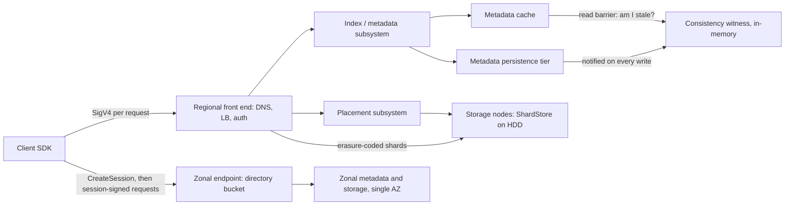

# S3 Deep Dive: Consistency and ShardStore

## TL;DR

- Since December 2020, S3 gives strong read-after-write consistency for object PUT, GET, HEAD, and LIST within a single bucket, at no extra cost. Bucket configuration, replication, lifecycle, and event delivery are still eventually consistent or asynchronous.
- Strong consistency is a cache-coherence protocol: a write-notified, in-memory "witness" acts as a read barrier in front of the metadata cache. It is not a rewrite of the storage tier, so it adds no ordering or isolation, and concurrent writers still get last-writer-wins unless you use conditional writes (`If-None-Match`, `If-Match`).
- The S3 key index is range-partitioned and splits automatically under sustained load. The documented budget is roughly 3,500 writes/s and 5,500 reads/s per partitioned prefix, so key design decides whether traffic can spread across partitions or piles onto a hot tail.
- ShardStore is the Rust storage-node engine under S3. It is an LSM index over append-only disk extents and gets crash consistency from soft-updates-style write ordering instead of a write-ahead log. Its main contribution is how it was validated: executable reference models, property-based conformance testing, crash-state enumeration, and stateless model checking (SOSP 2021).
- S3 Express One Zone moves the request path into one Availability Zone. It uses directory buckets, zonal endpoints, and session-based auth via `CreateSession`, which buys single-digit-millisecond latency at the price of AZ-scoped durability, unsorted LIST, per-GB request surcharges, and up to session-lifetime permission revocation lag.

## Mental Model



Think of S3 as two systems held together by a key.

A strongly consistent, range-partitioned metadata index maps each bucket/key pair to a set of shard locations.

A huge, mostly-HDD storage fleet holds erasure-coded shards whose layout is chosen by a placement service to spread "heat" across millions of spindles.

Every GET goes index first and data second, so every consistency property you observe comes from the index path, and every throughput limit you hit is either an index-partition limit or a spindle-IOPS limit.

S3 Express One Zone shortens both legs by pinning metadata and data to one AZ and paying the authorization cost once per session instead of once per request.

The previous chapter, [[17-Cloud-AI-Engineering/Volume_02_AWS_Deep_Dive/Chapter_07_Amazon_EKS_Control_Plane_and_Networking|Amazon EKS: Control Plane and Networking]], covers how pods reach S3 through IRSA and Pod Identity credentials.

This chapter covers what happens after the request leaves the ENI.

## Internals

### Subsystem decomposition

The February 2017 us-east-1 post-incident review is the most detailed public description of S3's regional decomposition ([AWS PIR 41926](https://aws.amazon.com/message/41926/)).

It names an index subsystem that manages metadata and location information for every object in the region, and serves all GET, LIST, PUT, and DELETE requests.

It names a placement subsystem that allocates storage for new objects and depends on the index subsystem to work.

The front-end fleet (DNS, load balancers, request authentication and authorization) is stateless and scales horizontally; Andy Warfield's FAST '23 keynote write-up describes S3 as composed of many independent microservices behind that front end ([All Things Distributed, 2023-07](https://www.allthingsdistributed.com/2023/07/building-and-operating-a-pretty-big-storage-system.html)).

The storage fleet holds object data as erasure-coded shards on hard drives, and ShardStore is the per-node engine that manages those shards ([Bornholt et al., SOSP 2021](https://doi.org/10.1145/3477132.3483540)).

S3 Standard stores data redundantly across a minimum of three Availability Zones (AWS docs, last confirmed 2025; UNVERIFIED as of 2026-10).

The control plane (CreateBucket, PutBucketPolicy, PutBucketVersioning, lifecycle and replication configuration) is a separate path, and its state reaches the data plane asynchronously.

This is why bucket configuration is documented as eventually consistent even though object operations are strong.

See [[17-Cloud-AI-Engineering/Volume_01_Cloud_Architecture_Principles/Chapter_04_Control_Plane_vs_Data_Plane_Separation|Control Plane vs Data Plane Separation]] for the general pattern.

### Strong consistency: what changed and how

Before December 2020, S3 gave read-after-write consistency for PUTs of new keys, with one caveat.

If a client issued a GET or HEAD for a key before it existed, a later read-after-write could come back eventually consistent.

Overwrites, DELETEs, and LIST were eventually consistent.

That caveat is a fingerprint of the mechanism: the staleness came from a metadata cache that could hold a negative entry ("key does not exist") or an old version, sitting in front of an authoritative persistence tier.

Werner Vogels' 2021 deep dive confirms this framing and describes the fix ([All Things Distributed, 2021-04, verified 2026-10](https://www.allthingsdistributed.com/2021/04/s3-strong-consistency.html)).

AWS added a new component to the metadata subsystem that witnesses writes.

The witness is notified every time an object changes.

On every read it acts as a read barrier, telling the cache whether its view is stale.

If the cached entry is current it is served; otherwise it is invalidated and the read goes to the persistence tier.

The witness keeps a small amount of state, in memory only, which is what lets it handle very high request rates at low latency and be replaced quickly on host failure without long state transfer.

AWS states that it treated correctness of the coherence protocol as a hard requirement, and that the witness design had to keep S3's existing availability.

AWS also describes using formal reasoning to check the protocol before relying on it at S3 scale.

#### Inferred model of the witness protocol

The following is a reconstruction consistent with the public description, not a disclosed design; treat the specific fields as illustrative.

- Each committed write to a key produces a monotonically increasing version or sequence number in the persistence tier.
- The commit path notifies the witness, which records the latest sequence for that key, or for a hash bucket of keys, so its memory stays bounded.
- Each cache entry records the sequence it was filled at.
- On read, the cache asks the witness for the current high-water mark and serves the entry only if its own sequence is at least that high.
- A lossy witness is safe if it errs toward "stale": hash-bucket collisions and freshly restarted witnesses cause extra cache misses, never stale hits.

Why a read barrier rather than write-time invalidation?

Invalidation messages to N cache nodes can be delayed or lost, and every lost message is a stale read.

A read barrier puts correctness on a component that sits on both the write's commit path and the read's serve path, so no broadcast has to arrive.

The trade-off is that every read now depends on a round trip to the witness and on witness availability.

That is why AWS describes the witness fleet as scale-out, in-memory, and backed by automation that responds to load concentration and host failure.

The latency budget you pay for strong consistency is one extra in-memory RPC per read, not a quorum read against durable storage.

#### What strong consistency does not give you

- It does not give isolation: two concurrent PUTs to one key both succeed, and readers see one of them (last writer wins by S3's internal ordering).
- It does not serialize across keys: there are no multi-key transactions, and a reader can observe key A's new version and key B's old version.
- It does not cover bucket configuration: AWS recommends waiting 15 minutes after enabling versioning before issuing writes (AWS docs, last confirmed 2025; UNVERIFIED as of 2026-10).
- It does not cover replication: Cross-Region and Same-Region Replication are asynchronous, so a read through a Multi-Region Access Point that routes to a replica can return an older version.
- It does not cover event notifications: S3 Event Notifications are delivered at least once and can arrive out of order, and the `sequencer` field exists so consumers can order events for the same key.
- It does not cover caches you add yourself: CloudFront, Mountpoint metadata caching, and client-side caches each bring their own staleness windows.

### Conditional writes: the concurrency primitive built on consistency

Strong consistency made a compare-and-swap primitive possible, and AWS shipped it in two steps.

Put-if-absent (`If-None-Match: *` on PutObject and CompleteMultipartUpload) arrived in August 2024 ([Barking Iguana summary, verified 2026-10](https://barkingiguana.com/writing/how-s3-actually-works/)).

Compare-and-swap on ETag (`If-Match`) arrived in November 2024 (same source).

The same source reports conditional copy in October 2025, and bucket-level enforcement of conditional writes through bucket policy.

If the precondition fails, S3 returns `412 Precondition Failed`.

If concurrent conditional requests race on the same key, S3 can return `409 ConditionalRequestConflict`, and the client must re-read and retry (AWS docs, last confirmed 2025; UNVERIFIED as of 2026-10).

This is what lets table formats and checkpoint managers commit a manifest pointer atomically without an external lock service such as DynamoDB.

Think of a conditional PUT as one linearizable register per key, not as a transaction.

### Auto-partitioning of the key index

The index is partitioned by key range in lexicographic order.

That ordering is what lets LIST return keys in UTF-8 binary order for general purpose buckets.

When a key range sees sustained high request rates, S3 splits the partition.

The documented steady-state budget is at least 3,500 PUT/COPY/POST/DELETE and 5,500 GET/HEAD requests per second per partitioned prefix, with no limit on the number of prefixes (AWS S3 performance docs, last confirmed 2025; UNVERIFIED as of 2026-10).

The July 2018 update that raised these numbers also removed the old advice to randomize key prefixes for performance (AWS News Blog, 2018-07; UNVERIFIED as of 2026-10).

Several consequences of the mechanism are not in the getting-started guides.

A "prefix" in the performance docs means a partition boundary chosen by S3, not a string you declare.

Writing to `a/` and `b/` gives you two partitions only after S3 has split there, and it splits in response to sustained load, not in anticipation of it.

Splits take time, and in that window clients see `503 Slow Down`, which the SDK's retry with backoff absorbs if retry budgets are sized for it.

A single key is the smallest unit that can be split, so one object cannot exceed the per-partition read budget no matter how many readers you add.

Monotonic keys such as `logs/2026/10/20/12/...` or ULIDs put every new write at the tail of the key space, creating a moving hot spot that splitting has to keep chasing.

Putting a high-cardinality token early in the key, as in `logs/<hash4>/2026/10/20/...`, spreads writes from the start and costs you the ability to range-LIST by time.

A sudden traffic shift onto a cold key range is the classic 503 storm: an hourly job that writes 50,000 objects/s into a brand-new prefix at the top of the hour has no partition history to lean on.

Historically, AWS Support could pre-partition buckets for known launch events (UNVERIFIED as of 2026-10).

### Heat management and erasure coding

Warfield's keynote explains the physical constraint behind S3's design ([All Things Distributed, 2023-07](https://www.allthingsdistributed.com/2023/07/building-and-operating-a-pretty-big-storage-system.html)).

Hard drive capacity has grown enormously while random IOPS per drive has stayed around 120, so IOPS per terabyte keeps falling.

The scarce resource in S3 is therefore not bytes but spindle-seconds, and placement exists to spread load ("heat") evenly across drives.

Erasure coding splits each object into k data shards plus parity shards placed on different drives and failure domains, so any k shards can rebuild the object.

That gives two levers: reads can avoid a busy or failed drive by reconstructing from other shards, and one customer's working set gets spread over a very large number of spindles.

The keynote states that many customers have data spread across over a million drives, which is why one tenant's burst is absorbed as noise across the fleet.

That decorrelation, together with the per-prefix index budget, is what S3 sells.

It is also why S3 Standard first-byte latency is tens of milliseconds and variable: a GET may wait on a drive seek, a remote shard, or a cache miss.

### ShardStore: the storage node engine

ShardStore is the key-value store that runs on S3 storage nodes and maps shard identifiers to shard data ([Bornholt et al., SOSP 2021](https://doi.org/10.1145/3477132.3483540)).

The paper describes it as over 40,000 lines of Rust (as reported in the paper; not re-verified in this pass).

#### Data layout

The disk is divided into extents, contiguous regions that are written append-only through a per-extent write pointer.

Shard data is stored as chunks appended into extents.

An LSM tree maps each shard ID to the list of chunk locators that make up the shard.

The LSM tree's own SSTables are stored as chunks in extents too, so the whole engine runs on a single append-only allocation discipline.

A superblock records extent ownership and the persisted write pointers.

Space is reclaimed by evacuating live chunks from a victim extent, rewriting them elsewhere, updating the index to point at the new locations, and only then resetting the victim extent's write pointer.

For HDDs this design is deliberate: append-only extents turn random small writes into sequential writes, and the LSM tree batches index updates into large sequential flushes.

#### Crash consistency without a write-ahead log

ShardStore does not use a WAL for crash consistency.

It uses a soft-updates-style approach in which each write returns a Dependency object, and later writes declare which earlier writes they depend on.

The I/O scheduler issues writes to disk only in an order that respects the dependency graph.

For a shard PUT, the chunk data write must persist before the index entry that references it, and the index entry must persist before the superblock and write-pointer update that makes it reachable.

During reclamation, the index update that points at a relocated chunk must persist before the old extent's write pointer is reset, or a crash would leave the index pointing at overwritten bytes.

The trade-off against a WAL is fewer redundant writes, which matters on IOPS-starved HDDs, in exchange for much more complex ordering logic.

That complexity is exactly what drove the investment in validation.

Soft updates comes from file systems research; see Ganger and Patt's work in Further Reading.

#### Lightweight formal methods: the part to steal

The paper's thesis is that validation should be cheap enough for the engineering team that owns the code to keep it running continuously.

Executable reference models are written in Rust with the same interface as the real component (for example, a hash map standing in for the LSM tree), and they live in the same repository as the implementation.

Property-based conformance tests generate random operation sequences, run them against both implementation and model, and check that their results match.

The test generator is biased toward interesting arguments, such as reusing recently written keys and generating sizes near page boundaries, because uniform random inputs rarely hit edge cases.

Failing sequences are automatically minimized to short reproducers.

Crash consistency is checked by injecting crashes, enumerating the disk states that the outstanding dependency graph permits, and checking two properties after recovery.

Persistence: if a Dependency reported itself persistent before the crash, its data must be readable afterward.

Forward progress: after a clean shutdown, every write must eventually become persistent.

Concurrency is checked with stateless model checking: Loom exhaustively explores interleavings for small harnesses, and AWS's open-source Shuttle uses randomized scheduling for larger ones ([Shuttle](https://github.com/awslabs/shuttle)).

The paper reports that this approach stopped 16 issues, including subtle crash-consistency and concurrency bugs, from reaching production (as reported in the paper; not re-verified in this pass).

It is honest about the limits: the reference models are not proven correct, the properties only cover what the models specify, and liveness and performance bugs are mostly out of scope.

The deeper treatment lives in [[17-Cloud-AI-Engineering/Volume_13_Seminal_Papers_and_Case_Studies/Chapter_05_Amazon_S3_ShardStore_Formal_Methods|Validating Amazon S3 ShardStore with Formal Methods (2021 SOSP)]].

### S3 Express One Zone

S3 Express One Zone launched at re:Invent in November 2023 as a storage class for directory buckets, which live in a single AZ that you choose (AWS News Blog, 2023-11; UNVERIFIED as of 2026-10).

AWS positioned it as delivering consistent single-digit-millisecond request latency, up to 10x faster than S3 Standard (launch claim, AWS News Blog, 2023-11; UNVERIFIED as of 2026-10).

#### Mechanisms that differ from general purpose buckets

A directory bucket name embeds the AZ ID, in the form `base-name--use1-az4--x-s3`, and you create it with a `Location` of type `AvailabilityZone` and a `Bucket` of type `Directory`.

It uses the AZ ID, not the account-specific AZ name, because AZ names map to different physical zones in different accounts.

Data-plane requests go to a zonal endpoint, while bucket-level control-plane operations go to a regional `s3express-control` endpoint (AWS docs, last confirmed 2025; UNVERIFIED as of 2026-10).

Authorization is session-based.

The client calls `CreateSession`, which evaluates IAM and bucket policy once and returns short-lived session credentials (documented lifetime 5 minutes), and then signs data requests with those credentials (AWS docs, last confirmed 2025; UNVERIFIED as of 2026-10).

AWS SDKs cache and refresh sessions transparently, which is why `s3express:CreateSession` is the IAM action that gates object access in directory buckets.

The namespace is hierarchical: directories are real entities, created implicitly when objects are written and removed when they become empty.

Prefixes in LIST requests must end in the delimiter `/`.

ListObjectsV2 results from directory buckets are not returned in lexicographic order, which breaks any code that relies on `StartAfter` or on sorted listing for merges (AWS docs, last confirmed 2025; UNVERIFIED as of 2026-10).

Later additions include appending to existing objects through a write-offset header (reported 2024-11) and an atomic RenameObject API (reported 2025-06); both UNVERIFIED as of 2026-10.

Features available on general purpose buckets, such as versioning, Object Lock, and replication, have historically not been available on directory buckets; check the current feature matrix before designing around them (UNVERIFIED as of 2026-10).

#### Why it is faster, mechanically

The request path stays inside one AZ, which removes cross-AZ network round trips from metadata and data access.

Session auth takes per-request IAM policy evaluation off the hot path, which for small-object workloads is a meaningful slice of total request latency.

Directory buckets scale request capacity per bucket rather than requiring the index to learn prefix splits from traffic, so there is no prefix-warming period to design around (AWS docs, last confirmed 2025; UNVERIFIED as of 2026-10).

AWS describes purpose-built hardware and software but has not published media details in the sources used here, so do not assert "it is SSD" in an interview without a citation.

#### Trade-offs

Durability and availability are scoped to one AZ: data is stored redundantly on multiple devices in the zone, but losing the zone means losing access and possibly losing data.

The designed availability is 99.95% versus 99.99% for S3 Standard (AWS docs, last confirmed 2025; UNVERIFIED as of 2026-10).

Session credentials mean permission revocation can lag by up to the session lifetime for clients holding a valid session.

That last point follows from the session model; it is an inference, so confirm the current documented behavior.

## Numbers to Know

| Quantity | Value | Source and date |
|---|---|---|
| Strong read-after-write consistency for objects and LIST | GA December 2020, automatic, no added cost | AWS News Blog 2020-12; UNVERIFIED as of 2026-10 |
| Witness state | In-memory, minimal, scale-out fleet | All Things Distributed 2021-04, verified 2026-10 |
| Conditional writes | `If-None-Match` 2024-08, `If-Match` 2024-11, conditional copy 2025-10 | Secondary summary of AWS launches, verified 2026-10 |
| Per partitioned prefix | >= 3,500 writes/s and >= 5,500 reads/s | AWS S3 performance docs, last confirmed 2025; UNVERIFIED as of 2026-10 |
| Number of prefixes per bucket | Unlimited | AWS S3 performance docs, last confirmed 2025; UNVERIFIED as of 2026-10 |
| Max object size | 5 TB long-standing; an increase to 50 TB was reported in late 2025 | AWS docs, last confirmed 2025; UNVERIFIED as of 2026-10 |
| Single PUT max | 5 GB | AWS docs, last confirmed 2025; UNVERIFIED as of 2026-10 |
| Multipart limits | 10,000 parts, 5 MiB to 5 GiB per part (last part may be smaller) | AWS docs, last confirmed 2025; UNVERIFIED as of 2026-10 |
| LIST page size | Up to 1,000 keys per ListObjectsV2 response | AWS API reference, last confirmed 2025; UNVERIFIED as of 2026-10 |
| Designed durability | 99.999999999% (S3 Standard, multi-AZ) | AWS docs, last confirmed 2025; UNVERIFIED as of 2026-10 |
| Designed availability | 99.99% Standard, 99.95% Express One Zone | AWS docs, last confirmed 2025; UNVERIFIED as of 2026-10 |
| Versioning propagation guidance | Wait 15 minutes after enabling before writes | AWS docs, last confirmed 2025; UNVERIFIED as of 2026-10 |
| Replication Time Control | 99.99% of objects replicated within 15 minutes (SLA-backed) | AWS docs, last confirmed 2025; UNVERIFIED as of 2026-10 |
| Default general purpose bucket quota | 10,000 per account (raised from 100 in 2024-11) | AWS News, last confirmed 2025; UNVERIFIED as of 2026-10 |
| HDD random IOPS | About 120 per drive, roughly flat across generations | All Things Distributed 2023-07 |
| Fleet scale (2023) | 280 trillion objects, over 100 million requests/s | All Things Distributed 2023-07; newer figures UNVERIFIED |
| Express session lifetime | 5 minutes | AWS docs, last confirmed 2025; UNVERIFIED as of 2026-10 |
| S3 Standard storage, us-east-1 | $0.023/GB-month first 50 TB | AWS pricing, last confirmed 2025; UNVERIFIED as of 2026-10 |
| S3 Standard requests, us-east-1 | PUT/COPY/POST/LIST $0.005 per 1,000; GET $0.0004 per 1,000 | AWS pricing, last confirmed 2025; UNVERIFIED as of 2026-10 |
| Express One Zone storage, us-east-1 | $0.11/GB-month after the 2025-04 price cut (was $0.16) | AWS News Blog 2025-04; UNVERIFIED as of 2026-10 |
| Express One Zone requests, us-east-1 | PUT $0.00113 per 1,000; GET $0.00003 per 1,000 | AWS News Blog 2025-04; UNVERIFIED as of 2026-10 |
| Express per-GB request charges | Upload $0.0032/GB and retrieval $0.0006/GB for bytes beyond 512 KB per request | AWS News Blog 2025-04; UNVERIFIED as of 2026-10 |
| NAT Gateway data processing, us-east-1 | $0.045/GB (avoid for S3 with gateway endpoints) | AWS pricing, last confirmed 2025; UNVERIFIED as of 2026-10 |
| GCS initial bucket capacity | About 1,000 writes/s and 5,000 reads/s, ramp by doubling every 20 minutes | Google Cloud docs, last confirmed 2025; UNVERIFIED as of 2026-10 |
| GCS same-object write rate | About 1 write per second per object name | Google Cloud docs, last confirmed 2025; UNVERIFIED as of 2026-10 |
| GCS Standard storage, us-central1 | $0.020/GB-month | Google Cloud pricing, last confirmed 2025; UNVERIFIED as of 2026-10 |
| ShardStore size and yield | Over 40k lines of Rust; 16 issues stopped before production | SOSP 2021 paper |

## AWS vs GCP Mechanism Parity

| Dimension | AWS S3 | Google Cloud Storage | Critical difference |
|---|---|---|---|
| Object consistency | Strong read-after-write for PUT, GET, HEAD, LIST since 2020-12 | Strong for object writes, reads, metadata, and listing | Both strong for objects; both keep configuration and IAM propagation eventual |
| How consistency is achieved | Witness read barrier in front of the metadata cache | Metadata reported to live on Spanner (UNVERIFIED) | GCS inherits strong consistency from a transactional store; S3 retrofitted it onto a cached index |
| Optimistic concurrency token | ETag with `If-Match` and `If-None-Match: *` | Object `generation` and `metageneration` with `ifGenerationMatch` (0 means create-only) | GCS has offered generation preconditions for many years; S3 got CAS in 2024 |
| Request scaling unit | Partitioned key-range prefix, split reactively | Bucket-level initial capacity plus auto-scaling under gradual ramp | Both punish sequential key names and step-function traffic |
| Hot single object | Bounded by one partition's budget | About 1 write/s per object name | GCS's per-object mutation cap bites lock and counter patterns much sooner |
| Durability topology | Standard spans >= 3 AZs; One Zone classes are single-AZ | Regional, dual-region, and multi-region location types | GCS dual-region turbo replication targets a 15-minute RPO; S3 uses CRR with RTC |
| Low-latency zonal tier | S3 Express One Zone with directory buckets (GA) | Rapid Storage zonal buckets, announced 2025-04 (Preview then; status UNVERIFIED) | Check GA status before treating the GCS tier as production-grade |
| Hierarchical namespace | Directory buckets (Express only), unsorted LIST | Hierarchical namespace buckets with atomic folder rename (GA 2024, UNVERIFIED) | GCS HNS applies to regional storage; S3 hierarchy is tied to the Express class |
| Read caching near compute | Mountpoint for S3 local cache; Express as a cache tier | Anywhere Cache, a zonal SSD cache in front of buckets (GA, UNVERIFIED) | GCS cache is managed and transparent; on AWS you assemble the tier yourself |
| Authentication on hot path | SigV4 per request; `CreateSession` for directory buckets | OAuth 2.0 bearer tokens, cached for token lifetime | GCS token model is already session-like; S3 general purpose evaluates per request |
| Private access | Gateway endpoint (free) or interface endpoint (PrivateLink) | Private Google Access, Private Service Connect | S3 gateway endpoints are route-table entries, not ENIs |
| Exfiltration perimeter | SCPs, RCPs, endpoint policies, `aws:ResourceOrgID` | VPC Service Controls perimeters | VPC SC is a single API-level perimeter; AWS is a composition of policies |
| Server-side encryption | SSE-S3 default since 2023-01; SSE-KMS with Bucket Keys; DSSE-KMS | Google default encryption; CMEK via Cloud KMS; CSEK | Bucket Keys cut KMS calls but change encryption context granularity |
| Event delivery | S3 Event Notifications and EventBridge, at least once, `sequencer` for ordering | Pub/Sub notifications, at least once | Neither is ordered by default; consumers must be idempotent |

For translation-layer detail see [[17-Cloud-AI-Engineering/Volume_04_AWS_vs_GCP_Translation/Chapter_04_Storage_and_Database_Translation|Storage and Database Translation]] and [[17-Cloud-AI-Engineering/Volume_03_GCP_Deep_Dive/Chapter_09_Cloud_Storage_and_Colossus_Filesystem|Cloud Storage and Colossus Filesystem]].

## Worked Example: Proving Consistency, Building CAS, and Sizing Express vs Standard

### What the lab does

The script below creates one general purpose bucket and one Express One Zone directory bucket.

It checks read-after-write and LIST-after-write, including the negative-lookup case that was eventually consistent before 2020.

It runs a multi-threaded compare-and-swap counter on `If-Match`, which loses no updates despite contention.

It measures p50 and p99 GET latency for 4 KiB objects on both bucket types.

It tears everything down.

Run the benchmark from an EC2 instance in the AZ whose ID matches the directory bucket, or the numbers measure your WAN, not S3.

Find the AZ name for an AZ ID with `aws ec2 describe-availability-zones --region us-east-1 --zone-ids use1-az4 --query 'AvailabilityZones[0].ZoneName' --output text`.

Express One Zone is only offered in specific AZ IDs per region; pass one listed in the current docs (the commonly cited us-east-1 IDs are use1-az4, use1-az5, and use1-az6, UNVERIFIED as of 2026-10).

Use a boto3 release from 2025 or later, because directory buckets, `IfNoneMatch`, and `IfMatch` were added to the SDK across late 2023 and 2024.

### Cost estimate

The lab issues fewer than 3,000 requests and stores a few kilobytes.

At the list prices in the Numbers table, S3 request and storage charges come to well under $0.01.

An EC2 instance for the benchmark is the dominant cost; a small general-purpose instance for under an hour typically costs well under $1 (check current EC2 pricing).

### Budget alarm (create before running)

```bash
ACCOUNT_ID=$(aws sts get-caller-identity --query Account --output text)
aws budgets create-budget --account-id "$ACCOUNT_ID" \
  --budget '{"BudgetName":"s3-lab-5usd","BudgetLimit":{"Amount":"5","Unit":"USD"},"TimeUnit":"MONTHLY","BudgetType":"COST"}' \
  --notifications-with-subscribers '[{"Notification":{"NotificationType":"ACTUAL","ComparisonOperator":"GREATER_THAN","Threshold":80,"ThresholdType":"PERCENTAGE"},"Subscribers":[{"SubscriptionType":"EMAIL","Address":"you@example.com"}]}]'
```

### Minimum IAM for the lab principal

`s3:CreateBucket`, `s3:DeleteBucket`, `s3:PutObject`, `s3:GetObject`, `s3:ListBucket`, and `s3:DeleteObject` on the general purpose bucket.

`s3express:CreateBucket`, `s3express:DeleteBucket`, and `s3express:CreateSession` on the directory bucket ARN.

### The script

```python
#!/usr/bin/env python3
# s3_lab.py - S3 consistency, conditional writes, and Express One Zone latency lab.
# Usage:
#   python3 s3_lab.py up --region us-east-1 --az-id use1-az4
#   python3 s3_lab.py check --n 50
#   python3 s3_lab.py cas --threads 8 --increments 10
#   python3 s3_lab.py bench --n 500
#   python3 s3_lab.py down
import argparse
import json
import os
import random
import threading
import time
import uuid

import boto3
from botocore.config import Config
from botocore.exceptions import ClientError

STATE_FILE = "/tmp/s3_lab_state.json"
CONFLICT_CODES = {"PreconditionFailed", "ConditionalRequestConflict"}


def s3_client(region):
    cfg = Config(retries={"max_attempts": 10, "mode": "adaptive"},
                 max_pool_connections=32)
    return boto3.client("s3", region_name=region, config=cfg)


def load_state():
    with open(STATE_FILE) as f:
        return json.load(f)


def cmd_up(args):
    s3 = s3_client(args.region)
    tag = uuid.uuid4().hex[:8]
    gp = "s3lab-gp-" + tag
    db = "s3lab-dir-%s--%s--x-s3" % (tag, args.az_id)
    if args.region == "us-east-1":
        s3.create_bucket(Bucket=gp)
    else:
        s3.create_bucket(Bucket=gp, CreateBucketConfiguration={
            "LocationConstraint": args.region})
    s3.create_bucket(Bucket=db, CreateBucketConfiguration={
        "Location": {"Type": "AvailabilityZone", "Name": args.az_id},
        "Bucket": {"Type": "Directory",
                   "DataRedundancy": "SingleAvailabilityZone"}})
    with open(STATE_FILE, "w") as f:
        json.dump({"region": args.region, "gp": gp, "dir": db}, f)
    print("general purpose bucket:", gp)
    print("directory bucket:      ", db)


def cmd_check(args):
    st = load_state()
    s3 = s3_client(st["region"])
    for bucket in (st["gp"], st["dir"]):
        key = "lab/raw-" + uuid.uuid4().hex
        # Negative lookup first: under the pre-2020 model this made the
        # following read-after-write only eventually consistent.
        try:
            s3.head_object(Bucket=bucket, Key=key)
        except ClientError:
            pass
        stale = 0
        for i in range(args.n):
            body = ("v%d" % i).encode()
            s3.put_object(Bucket=bucket, Key=key, Body=body)
            got = s3.get_object(Bucket=bucket, Key=key)["Body"].read()
            if got != body:
                stale += 1
        keys = []
        pages = s3.get_paginator("list_objects_v2").paginate(
            Bucket=bucket, Prefix="lab/")
        for page in pages:
            keys.extend(o["Key"] for o in page.get("Contents", []))
        print("%s: %d overwrites, %d stale reads, visible in LIST: %s"
              % (bucket, args.n, stale, key in keys))


def cas_increment(s3, bucket, key, stats, lock):
    while True:
        try:
            obj = s3.get_object(Bucket=bucket, Key=key)
            value = int(obj["Body"].read())
            s3.put_object(Bucket=bucket, Key=key,
                          Body=str(value + 1).encode(), IfMatch=obj["ETag"])
            return
        except ClientError as e:
            if e.response["Error"]["Code"] in CONFLICT_CODES:
                with lock:
                    stats["conflicts"] += 1
                time.sleep(random.uniform(0, 0.05))  # jittered retry
                continue
            raise


def cmd_cas(args):
    st = load_state()
    s3 = s3_client(st["region"])
    bucket, key = st["gp"], "lab/counter"
    s3.put_object(Bucket=bucket, Key=key, Body=b"0")
    try:
        s3.put_object(Bucket=bucket, Key=key, Body=b"x", IfNoneMatch="*")
        print("UNEXPECTED: put-if-absent overwrote an existing key")
    except ClientError as e:
        print("put-if-absent on existing key ->", e.response["Error"]["Code"])
    stats, lock = {"conflicts": 0}, threading.Lock()

    def worker():
        for _ in range(args.increments):
            cas_increment(s3, bucket, key, stats, lock)

    threads = [threading.Thread(target=worker) for _ in range(args.threads)]
    t0 = time.perf_counter()
    for t in threads:
        t.start()
    for t in threads:
        t.join()
    final = int(s3.get_object(Bucket=bucket, Key=key)["Body"].read())
    print("expected=%d final=%d conflicts_retried=%d elapsed=%.1fs"
          % (args.threads * args.increments, final, stats["conflicts"],
             time.perf_counter() - t0))


def pctl(xs, p):
    xs = sorted(xs)
    return xs[min(len(xs) - 1, int(round(p / 100.0 * (len(xs) - 1))))]


def cmd_bench(args):
    st = load_state()
    s3 = s3_client(st["region"])
    payload = os.urandom(4096)
    for bucket in (st["gp"], st["dir"]):
        key = "lab/bench-4k"
        s3.put_object(Bucket=bucket, Key=key, Body=payload)
        for _ in range(20):  # warm TCP/TLS and the Express session
            s3.get_object(Bucket=bucket, Key=key)["Body"].read()
        lat = []
        for _ in range(args.n):
            t0 = time.perf_counter()
            s3.get_object(Bucket=bucket, Key=key)["Body"].read()
            lat.append((time.perf_counter() - t0) * 1000.0)
        print("%s GET 4KiB: p50=%.2fms p99=%.2fms max=%.2fms"
              % (bucket, pctl(lat, 50), pctl(lat, 99), max(lat)))


def empty_bucket(s3, bucket):
    for page in s3.get_paginator("list_objects_v2").paginate(Bucket=bucket):
        objs = [{"Key": o["Key"]} for o in page.get("Contents", [])]
        if objs:
            s3.delete_objects(Bucket=bucket,
                              Delete={"Objects": objs, "Quiet": True})


def cmd_down(args):
    st = load_state()
    s3 = s3_client(st["region"])
    for bucket in (st["gp"], st["dir"]):
        empty_bucket(s3, bucket)
        s3.delete_bucket(Bucket=bucket)
        print("deleted", bucket)
    os.remove(STATE_FILE)


def main():
    p = argparse.ArgumentParser()
    sub = p.add_subparsers(dest="cmd", required=True)
    up = sub.add_parser("up")
    up.add_argument("--region", default="us-east-1")
    up.add_argument("--az-id", default="use1-az4")
    ck = sub.add_parser("check")
    ck.add_argument("--n", type=int, default=50)
    cs = sub.add_parser("cas")
    cs.add_argument("--threads", type=int, default=8)
    cs.add_argument("--increments", type=int, default=10)
    bn = sub.add_parser("bench")
    bn.add_argument("--n", type=int, default=500)
    sub.add_parser("down")
    args = p.parse_args()
    {"up": cmd_up, "check": cmd_check, "cas": cmd_cas,
     "bench": cmd_bench, "down": cmd_down}[args.cmd](args)


if __name__ == "__main__":
    main()
```

Expected results: `check` reports zero stale reads and `visible in LIST: True` for both buckets.

`cas` reports `final` equal to `expected`, with a non-zero `conflicts_retried` count that grows with `--threads`.

That count is direct evidence that the 412/409 path is what keeps updates from being lost.

`bench` from an in-AZ instance should show the directory bucket's p50 and p99 clearly below the general purpose bucket's; record your own numbers rather than quoting launch claims.

### Teardown

```bash
python3 s3_lab.py down
# Fallback if the state file is lost (substitute the printed bucket names):
aws s3 rm s3://s3lab-gp-XXXXXXXX --recursive && aws s3api delete-bucket --bucket s3lab-gp-XXXXXXXX --region us-east-1
aws s3 rm s3://s3lab-dir-XXXXXXXX--use1-az4--x-s3 --recursive && aws s3api delete-bucket --bucket s3lab-dir-XXXXXXXX--use1-az4--x-s3 --region us-east-1
aws budgets delete-budget --account-id "$ACCOUNT_ID" --budget-name s3-lab-5usd
```

### Capacity sizing: an image-training data path

Scenario: 50 million images at 150 KB each (7.5 TB), read by a cluster that consumes 20,000 samples/s.

The input data path is covered in more depth in [[17-Cloud-AI-Engineering/Volume_10_AI_Infrastructure_on_Cloud/Chapter_07_High_Throughput_Data_Loaders_and_Storage_IO|High-Throughput Data Loaders and Storage I/O]].

Step 1, bandwidth: 20,000 x 150 KB = 3.0 GB/s aggregate, which is easy for S3 and a few dozen instances' NICs.

Step 2, request rate with one object per sample: 20,000 GET/s divided by 5,500 per partition is 3.6, so you need at least 4 warm partitions.

Design for 2x headroom by spreading keys over at least 8 high-cardinality leading prefixes, and pre-warm them by ramping traffic before the job starts.

Step 3, request cost on S3 Standard: 20,000 x 86,400 = 1.728 billion GETs/day, which is 1.728e9 / 1,000 x $0.0004 = $691/day.

Step 4, request cost on Express One Zone: 1.728e9 / 1,000 x $0.00003 = $51.84/day, and the per-GB retrieval charge does not apply because each request is under 512 KB.

Step 5, storage: 7.5 TB on Standard is 7,500 x $0.023 = $172.50/month, and on Express it is 7,500 x $0.11 = $825/month.

Step 6, the shard alternative: pack samples into 256 MB WebDataset tar shards, giving 7.5e12 / 256e6, about 29,300 objects.

An epoch then costs about 29,300 GETs (a few cents) on Standard, with no partition pressure, at the price of coarser shuffling and some engineering effort.

Decision: per-sample objects on Standard burn about $20,700/month in GETs, Express cuts that to about $1,560/month plus $650/month of extra storage, and sharding on Standard makes request cost negligible.

The principal-level answer is to shard on Standard for the durable copy, and to use Express only as an AZ-local staging tier when random access or low latency is a real requirement.

### Capacity sizing: checkpoints

A 70B-parameter model with mixed-precision Adam state is about 16 bytes/param, so 1.12 TB per full checkpoint.

With 64 MiB multipart parts that is about 16,700 PUTs (sharded across at least 2 object keys, or using 128 MiB parts to respect S3's 10,000-part limit per object), roughly $0.08 in request charges on Standard and well within one partition's write budget if parts spread across keys.

On Express, PUT charges are trivial ($0.02), but the per-GB upload charge for bytes beyond 512 KB adds about 1,120 x $0.0032 = $3.58 per checkpoint.

At 10 checkpoints/day that is about $36/day in upload fees, before storage at $0.11/GB-month.

Express pays off for checkpoints when write-completion latency directly gates GPU idle time; otherwise write asynchronously to Standard ([[17-Cloud-AI-Engineering/Volume_10_AI_Infrastructure_on_Cloud/Chapter_06_High_Throughput_Checkpointing_to_Object_Storage|High-Throughput Checkpointing to Object Storage]]).

## Failure Modes and Pitfalls

### The 2017 us-east-1 index restart

On 2017-02-28, an operator ran an established playbook command with a mistyped input that removed more servers than intended, including servers supporting the index and placement subsystems ([AWS PIR 41926](https://aws.amazon.com/message/41926/)).

Both subsystems needed a full restart, which had not been done in the larger regions for years, and the restart plus safety checks took hours.

Dependent AWS services in the region degraded, and the AWS Service Health Dashboard could not update because it depended on S3.

AWS's stated remediations included making the capacity-removal tool remove capacity more slowly with safeguards against dropping below minimum capacity, and partitioning the index into smaller cells to cut recovery time.

The lesson for platform designers is that recovery time of a stateful metadata tier scales with its size, so cell size is a recovery-time decision, not just a blast-radius decision ([[17-Cloud-AI-Engineering/Volume_01_Cloud_Architecture_Principles/Chapter_03_Cell_Based_Architecture_and_Shuffle_Sharding|Cell-Based Architecture and Shuffle Sharding]]).

Wider outage context is in [[17-Cloud-AI-Engineering/Volume_07_Reliability_and_SRE/Chapter_07_Anatomy_of_Major_Cloud_Outages|Anatomy of Major Cloud Outages]].

### Consistency misreadings

Treating strong consistency as transactions leads to lost updates when two writers do read-modify-write on a manifest without `If-Match`.

Reading through a Multi-Region Access Point right after writing can route to a replica that has not received the object yet.

Event-driven pipelines that assume exactly-once, in-order notifications double-process or regress state; dedupe on key plus `sequencer` and apply only newer sequencers.

Enabling versioning, or changing a bucket policy, and immediately depending on the new behavior can fail during the propagation window.

### Partitioning and throttling

Midnight-rollover prefixes, ULID keys, and "new run ID" prefixes put a step function of traffic onto a cold key range and produce 503 storms.

Clients with no retry budget turn 503s into failures, and clients with unbounded retries turn them into retry storms that make partition pressure worse ([[17-Cloud-AI-Engineering/Volume_07_Reliability_and_SRE/Chapter_03_Resilient_Communication_Retries_Jitter_and_Circuit_Breakers|Resilient Communication: Retries, Jitter, and Circuit Breakers]]).

Hot-object fan-out, such as 10,000 workers reading one config or tokenizer file at job start, hits the single-key ceiling; put a cache or replicated copies in front of it.

Versioned buckets with heavy overwrite or delete churn pile up noncurrent versions and delete markers, which slows LIST and quietly grows storage cost.

### Express One Zone specifics

Code that assumes lexicographic LIST order (merge-sort of listings, `StartAfter` pagination resumes, some Hadoop or Spark committers) misbehaves on directory buckets.

Clients that bypass SDK session caching call `CreateSession` per request, which adds latency and can hit throttling.

Compute in a different AZ from the directory bucket loses most of the latency benefit and may add cross-AZ network cost (verify current data transfer rules).

An AZ impairment makes the bucket unavailable, so Express is unsafe as the only copy of anything you cannot regenerate ([[17-Cloud-AI-Engineering/Volume_01_Cloud_Architecture_Principles/Chapter_02_Regions_Zones_and_Static_Stability|Regions, Zones, and Static Stability]]).

### Cost traps

Abandoned multipart uploads are billed until aborted; add a lifecycle rule with `AbortIncompleteMultipartUpload`.

S3 traffic from private subnets through a NAT Gateway pays per-GB processing that a free gateway endpoint would avoid.

SSE-KMS without Bucket Keys turns every PUT and GET into a KMS call, which can hit KMS request quotas and makes KMS a hidden data-plane dependency.

## Security and Cost Angles

### IAM scoping

Grant object-level actions on `arn:aws:s3:::bucket/prefix/*` and `s3:ListBucket` with an `s3:prefix` condition, not `s3:*` on `*` ([[17-Cloud-AI-Engineering/Volume_02_AWS_Deep_Dive/Chapter_01_IAM_Policy_Evaluation_Engine|IAM Policy Evaluation Engine]]).

For directory buckets, object access is gated by `s3express:CreateSession`, and session mode (ReadWrite vs ReadOnly) can be constrained in policy with the `s3express:SessionMode` condition key (AWS docs, last confirmed 2025; UNVERIFIED as of 2026-10).

Because session credentials outlive the policy check, an emergency revocation can take effect only after outstanding sessions expire; size incident runbooks for that window.

Bucket policies can require conditional writes through condition keys, so uncoordinated writers cannot overwrite shared manifests (reported 2024-2025; exact keys UNVERIFIED as of 2026-10).

### Encryption hierarchy

All new objects have been encrypted with SSE-S3 by default since January 2023 (AWS docs, last confirmed 2025; UNVERIFIED as of 2026-10).

With SSE-KMS, S3 asks KMS for a data key under your KMS key, encrypts the object with it, and stores the wrapped data key with the object; reads call KMS Decrypt to unwrap it.

S3 Bucket Keys have S3 fetch a bucket-level key from KMS and derive per-object data keys locally for a period, which cuts KMS request volume and cost substantially.

The subtle side effect is that the KMS encryption context becomes the bucket ARN instead of the object ARN, so key policies, grants, and CloudTrail detections keyed on object ARNs stop matching.

Envelope encryption mechanics are covered in [[17-Cloud-AI-Engineering/Volume_08_Security_Identity_and_the_Data_Perimeter/Chapter_04_Encryption_Key_Hierarchies_and_Envelope_Encryption|Encryption Key Hierarchies and Envelope Encryption]] and [[17-Cloud-AI-Engineering/Volume_02_AWS_Deep_Dive/Chapter_15_Security_and_Cryptography_KMS_and_Nitro_Enclaves|Security and Cryptography: KMS and Nitro Enclaves]].

### Network perimeter

Gateway VPC endpoints for S3 are route-table prefix-list targets with no hourly or per-GB charge, while interface endpoints are PrivateLink ENIs with hourly and per-GB charges that are reachable from on-premises.

Endpoint policies that restrict to `aws:ResourceOrgID` stop principals inside your VPC from writing to attacker-owned buckets.

Bucket policies that require `aws:SourceVpce` or `aws:PrincipalOrgID` stop stolen credentials from being used off-network.

Block Public Access and disabled ACLs have been defaults for new buckets since April 2023 (AWS docs, last confirmed 2025; UNVERIFIED as of 2026-10).

The full composition is in [[17-Cloud-AI-Engineering/Volume_08_Security_Identity_and_the_Data_Perimeter/Chapter_06_Constructing_an_Impenetrable_Data_Perimeter|Constructing an Impenetrable Data Perimeter]].

### Unit-economics levers

Request-dominated workloads (many small objects) favor Express or object packing; byte-dominated workloads (large sequential reads) favor Standard.

Lifecycle transitions to Infrequent Access or Glacier classes carry per-object transition charges and minimum storage durations, so they lose money on small, short-lived objects.

S3 Intelligent-Tiering charges a per-object monitoring fee, which dominates for billions of tiny objects.

Cross-region replication doubles storage and adds inter-region transfer cost, so replicate only what your RPO actually requires ([[17-Cloud-AI-Engineering/Volume_09_FinOps_and_Cloud_Economics/Chapter_04_Network_Egress_Economics_and_Optimization|Network Egress Economics and Optimization]]).

## Interview Questions and Model Answers

### Question 1 (L5 - Senior)

A teammate says "S3 is strongly consistent now, so we can drop the DynamoDB lock table that guards our manifest updates." Is that right?

#### Model Answer

No, because strong consistency and concurrency control are different properties.

Strong read-after-write means that once a PUT returns success, any later GET or LIST sees that write or a newer one.

It does not stop two writers who both read version N from both writing N+1, and S3 will accept both, keeping whichever it orders last.

The lock table exists to prevent that lost update, so removing it without a replacement brings back the bug.

The replacement is S3 conditional writes: read the manifest and its ETag, then PUT with `If-Match` set to that ETag, and on 412 or 409, re-read, rebase, and retry with jitter.

For creating a new immutable file, use `If-None-Match: *` so only one writer can create the key.

This removes a dependency and a failure mode, since the lock table can no longer drift out of sync with the data.

Its limits: it covers exactly one key, so a commit that touches several objects must be structured as "write immutable data files first, then CAS a single pointer."

Under heavy contention, latency and retry cost rise because each attempt is a full GET plus PUT round trip at tens of milliseconds.

#### Follow-up Interviewer Question

Fifty writers commit to the same table every second: what happens to commit latency, and how would you redesign?

### Question 2 (L5 - Senior)

You must serve 120,000 GET/s of 50 KB feature files from S3 Standard to an inference fleet. How do you design key names and the client side?

#### Model Answer

The per-partition budget is about 5,500 GET/s, so 120,000 / 5,500 = 21.8 means at least 22 warm partitions, and I would plan for about 40 for headroom and uneven load.

I would put a high-cardinality token early in the key, such as two hex characters of a hash of the entity ID (256 leading prefixes), so S3 has natural split points across the whole key space.

I would not use time-ordered keys, because new writes and the hottest reads would pile onto the tail partition.

I would ramp traffic over tens of minutes before peak, because partitions split in response to sustained load and a cold step-change will see 503 Slow Down.

On the client, I would use SDK adaptive retry with capped exponential backoff and jitter, a bounded retry budget, and connection pools large enough for the target concurrency.

The concurrency math is Little's law: at 30 ms mean latency, 120,000 x 0.03 = 3,600 requests in flight across the fleet.

Cost is 120,000 x 86,400 / 1,000 x $0.0004 = about $4,150/day in GETs, which is the number that should trigger the next design conversation.

The next design is a cache tier, Express One Zone in each serving AZ, or packing features into larger objects with byte-range reads.

#### Follow-up Interviewer Question

Traffic is heavily skewed and 1% of entities get 50% of reads; what changes?

### Question 3 (L6 - Staff)

Explain how S3 retrofitted strong consistency onto a cached metadata tier, and what failure behavior you would expect from that design.

#### Model Answer

The staleness came from a metadata cache in front of the authoritative persistence tier, which is why the old model had the "negative GET before PUT" exception: the cache could hold a "not found" entry.

AWS added a witness component that is notified on every object write and is consulted on every read as a read barrier, so the cache can tell whether its entry is stale.

The key design choice is a read barrier instead of write-time invalidation.

Broadcast invalidation to many cache nodes is fragile, because any delayed or lost message becomes a stale read.

A read barrier puts correctness on a single component that sits on both the commit path and the read path.

The witness holds minimal in-memory state, so it can sustain very high request rates and be replaced quickly without state transfer.

To be safe, it must fail toward "stale": a freshly started witness, or one tracking hash buckets instead of exact keys, causes extra cache misses, never stale hits.

So the failure behavior I would expect is a latency and load shift, not a correctness failure.

If a witness partition is lost, more reads fall through to the persistence tier, raising tail latency and persistence-tier load until the witness has rebuilt its high-water marks.

The availability risk is that the witness now sits on every read and write path, which is why it must be over-provisioned, scale-out, and automatically replaced.

The write path must not acknowledge to the client until the witness has been told, or the guarantee breaks.

The cost of the guarantee is one extra in-memory RPC per read, which is why AWS could ship it at no extra charge.

#### Follow-up Interviewer Question

How would you continuously verify in production that the protocol is never serving stale reads, without doubling read load?

### Question 4 (L6 - Staff)

Your training team wants to move all datasets and checkpoints to S3 Express One Zone "because it is 10x faster." Write the decision.

#### Model Answer

I would split by access pattern and by whether the data can be regenerated, because Express trades durability scope and price structure for latency.

Durability: a directory bucket lives in one AZ, so Express cannot be the only copy of datasets or checkpoints you cannot regenerate cheaply.

The system of record stays on S3 Standard, which spans at least three AZs.

Price shape: Express storage is about $0.11/GB-month versus $0.023, but GET requests are about 13x cheaper, and there is a per-GB charge for bytes beyond 512 KB per request.

Request-dominated, small-object, random-access workloads, such as per-sample image reads, win: for 20,000 GET/s of 150 KB samples, GET cost falls from about $691/day to about $52/day.

Byte-dominated workloads such as large checkpoints lose on price: a 1.12 TB checkpoint carries about $3.58 in upload fees on Express versus about $0.08 in PUT fees on Standard.

Latency matters only where it gates accelerators.

For synchronous checkpoint writes that stall the step, a fast AZ-local tier can pay for itself in recovered GPU time, but async checkpointing to Standard usually removes the stall anyway.

Placement: compute must run in the same AZ ID as the bucket, which couples job placement to storage placement and constrains capacity reservations.

Semantics: directory-bucket LIST is unsorted and hierarchy rules differ, so I would audit data loaders and committers before migrating.

My recommendation is Standard as the system of record with sharded layouts, Express as an AZ-local cache or staging tier for hot random-access sets, and a lifecycle or delete policy so Express storage does not quietly grow into the largest line item.

#### Follow-up Interviewer Question

The AZ holding your Express staging bucket is impaired mid-run; walk through what the job does and how long it takes to recover.

### Question 5 (L6 - Staff)

Design leader election for a fleet of batch coordinators using only S3. What are the hazards?

#### Model Answer

The lock is one object, such as `leases/coordinator`, whose body holds the owner ID, a fencing token, and a lease expiry.

To acquire an absent lease, PUT with `If-None-Match: *`; exactly one contender succeeds and the rest get 412 or 409.

To renew, the holder PUTs an updated expiry with `If-Match` set to the ETag it last wrote, so a renewal can never overwrite another holder's takeover.

To take over an expired lease, a contender reads the object, checks that expiry plus a safety margin has passed on its own clock, and PUTs with `If-Match` on the observed ETag, incrementing the fencing token.

Only one takeover can win, because S3 orders conditional writes per key.

The fundamental hazard is that a lease is a timing argument: a holder that pauses for a GC stall, VM migration, or network partition longer than the lease can keep acting after losing leadership.

So every downstream side effect must carry the fencing token, and resources must reject tokens lower than the highest they have seen; this is Kleppmann's argument.

If the protected resource is itself S3, I would make the critical write a CAS on a manifest whose ETag chain acts as the fence.

Clock skew only shifts safety margins, because takeover correctness comes from CAS, not clocks.

Operationally, the lease key's request rate is tiny, but every attempt costs a GET and a PUT at tens of milliseconds, so this fits leader election, not fine-grained locking.

On GCS the same design uses `ifGenerationMatch`, with the extra constraint of about one write per second per object name.

#### Follow-up Interviewer Question

How do you prevent a paused ex-leader from completing a multipart upload that it started before losing the lease?

### Question 6 (L7+ - Principal)

ShardStore gets crash consistency without a write-ahead log. Explain the mechanism and how you would justify, and validate, that choice for a new storage engine at your company.

#### Model Answer

ShardStore stores shard chunks in append-only extents with write pointers, and keeps an LSM tree, itself stored in extents, mapping shard IDs to chunk locators.

Each write returns a Dependency, and later writes declare which earlier ones they depend on, so the I/O scheduler only issues writes in dependency order.

A PUT persists the data chunk before the index entry, and the index entry before the metadata that makes it reachable.

Reclamation persists the relocated chunk's index update before resetting the old extent.

The result is that any crash leaves an on-disk state in which every reachable pointer refers to durable data, with no redo log.

The justification is media economics.

On HDDs with about 120 IOPS that do not grow with capacity, a WAL's extra writes and seeks are a direct tax on the scarcest resource, while ordering constraints cost mainly CPU and engineering complexity.

The cost is that correctness now lives in a large, implicit dependency graph that ordinary tests will not exercise.

I would only approve the design together with ShardStore-style validation as a release gate.

That means executable reference models in the same language and repository, property-based conformance tests with biased generators and automatic minimization, crash-state enumeration checking persistence and forward progress, and stateless model checking of concurrent paths with Loom for small exhaustive cases and Shuttle for randomized coverage.

I would be explicit about what this does not prove: model bugs, performance cliffs, firmware lies about flush semantics, and fleet-level emergent behavior.

So I would add fault injection at the disk layer, canary deployment with shadow reads, and end-to-end checksums verified on read and by background scrubbing.

The organizational argument matters as much as the technical one: AWS made validation cheap enough for service engineers to extend, which is what keeps it alive after the formal-methods experts move on.

#### Follow-up Interviewer Question

Your engine runs on NVMe instead of HDD; does the WAL-versus-soft-updates trade-off flip, and what evidence would you collect?

### Question 7 (L7+ - Principal)

The 2017 S3 outage took hours largely because the index subsystem had to restart from scratch. How should that shape the design of an internal AI platform that depends on S3?

#### Model Answer

The first lesson is about the provider: recovery time of a stateful metadata tier grows with its size, and AWS's own remediation was smaller cells for the index.

When you build your own metadata services, such as model registries, feature indexes, or dataset catalogs, cap cell size by restart time measured in game days, not by blast-radius arithmetic alone.

The second lesson is about dependency on S3.

A regional S3 impairment takes down everything in the region that uses S3 on the request path, and that included AWS's own status dashboard.

I would sort platform dependencies into a request-path set and a control-path set.

The inference request path must be statically stable: model weights already loaded into accelerator memory and cached on local NVMe, so serving continues for hours without S3 GETs.

Autoscaling during an S3 event would fail to load weights, so I would keep warm headroom sized for the expected outage duration, with peer-to-peer weight transfer from healthy replicas as a fallback.

Training must tolerate S3 write failures by buffering checkpoints locally and retrying, rather than crashing the job and wasting GPU-hours.

For RPO-sensitive artifacts, I would replicate to a second region with RTC, accepting that a cross-region read can be stale and only promoting the replica during a declared failover.

Finally, I would remove circular dependencies: deploy tooling, runbooks, and status pages must not live only in the region they diagnose.

#### Follow-up Interviewer Question

Quantify the warm-headroom cost of making serving survive a four-hour regional S3 impairment for a 2,000-GPU fleet, and argue whether it is worth paying.

### Question 8 (L7+ - Principal)

Why does S3 publish per-prefix request limits instead of per-bucket limits, and why does a single-AZ product like Express change that model?

#### Model Answer

Per-prefix limits expose the real scaling unit, which is a key-range partition of the lexicographically ordered index, each served by a bounded amount of metadata capacity.

Partitions split under sustained load, so total bucket throughput is effectively unbounded but grows reactively, and a single key range or object is bounded.

Range partitioning rather than hash partitioning is what makes ordered LIST cheap, which customers depend on for prefix listing and pagination.

That is the price of the hot-tail problem for monotonic keys.

The data side is different: erasure-coded shards are deliberately spread across a huge number of drives, so for most workloads per-drive IOPS are not visible at the prefix level.

Express changes the model because the hierarchy is explicit: directories are first-class, LIST does not promise lexicographic order, and per-bucket capacity is provisioned rather than learned from traffic.

Dropping global ordering removes the constraint that forces range partitioning, which lets the service shard metadata more evenly and avoid split-warming.

Keeping the path within one AZ and amortizing auth per session takes the remaining fixed costs off each request.

The design lesson is that every ordering guarantee is a scaling liability, and a principal engineer should ask which consumers actually need sorted listing before paying for it.

#### Follow-up Interviewer Question

If you were designing S3 Express's metadata layer, how would you partition directories with millions of children, and what would LIST pagination tokens encode?

## Further Reading

- [Diving Deep on S3 Consistency (Vogels, 2021)](https://www.allthingsdistributed.com/2021/04/s3-strong-consistency.html) - the primary public source on the witness read-barrier protocol and how AWS reasoned about its availability.
- [Building and operating a pretty big storage system called S3 (Warfield, 2023)](https://www.allthingsdistributed.com/2023/07/building-and-operating-a-pretty-big-storage-system.html) - heat management, flat HDD IOPS, erasure-coded spreading, and the cultural side of running S3.
- [Using Lightweight Formal Methods to Validate a Key-Value Storage Node in Amazon S3 (Bornholt et al., SOSP 2021)](https://doi.org/10.1145/3477132.3483540) - ShardStore's extents, LSM index, dependency-ordered crash consistency, and a validation method you can copy.
- [How Amazon Web Services Uses Formal Methods (Newcombe et al., CACM 2015)](https://doi.org/10.1145/2699417) - the earlier TLA+ work on S3 and DynamoDB that set the cultural precedent.
- [Shuttle (awslabs)](https://github.com/awslabs/shuttle) - the randomized concurrency testing library used for ShardStore, worth adopting for any Rust service.
- [Summary of the Amazon S3 Service Disruption, us-east-1, 2017 (AWS PIR)](https://aws.amazon.com/message/41926/) - the canonical description of the index and placement subsystems and their restart-time failure mode.
- [S3 performance guidelines (AWS docs)](https://docs.aws.amazon.com/AmazonS3/latest/userguide/optimizing-performance.html) - the authoritative per-prefix numbers and retry guidance; re-check before every design review.
- [S3 conditional writes (AWS docs)](https://docs.aws.amazon.com/AmazonS3/latest/userguide/conditional-writes.html) - exact 412/409 semantics and supported operations for the CAS primitive.
- [S3 Express One Zone (AWS docs)](https://docs.aws.amazon.com/AmazonS3/latest/userguide/s3-express-one-zone.html) - directory bucket naming, zonal endpoints, CreateSession, and the feature-difference matrix.
- [Kleppmann, How to do distributed locking (2016)](https://martin.kleppmann.com/2016/02/08/how-to-do-distributed-locking.html) - why leases need fencing tokens, required background for any S3-based lock design.
- [Google Cloud Storage request rate guidelines](https://cloud.google.com/storage/docs/request-rate) - the GCS counterpart to S3 prefix scaling, useful for parity reasoning.
- Ganger, McKusick, Soules, Patt, "Soft Updates: A Solution to the Metadata Update Problem in File Systems" (ACM TOCS, 2000) - the origin of dependency-ordered crash consistency that ShardStore adapts.
- O'Neil, Cheng, Gawlick, O'Neil, "The Log-Structured Merge-Tree" (Acta Informatica, 1996) - the index structure under ShardStore and much of cloud storage.
- [[17-Cloud-AI-Engineering/Volume_02_AWS_Deep_Dive/Chapter_09_Elastic_Block_Store_and_Network_Storage|Elastic Block Store and Network Storage]] - next chapter, contrasting S3's object semantics with EBS's Physalia-backed block replication.
- [[04-System-Design/05-Data-Stores/Amazon-S3-and-Object-Storage|Amazon S3 and Object Storage]] - the system-design-level companion note in this vault.
