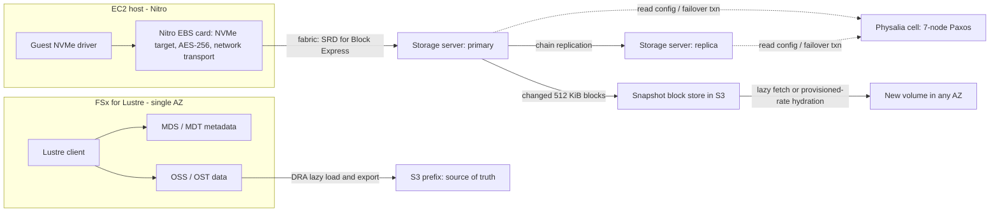

# Elastic Block Store and Network Storage

## TL;DR

An EBS volume is not a disk; it is a chain-replicated, AZ-scoped network service exposed to the guest as an NVMe device by the Nitro card, and every I/O pays a network round trip plus replication.
Correctness rests on a strongly consistent configuration store, Physalia, built as millions of 7-node Paxos cells placed physically close to the storage servers they serve, which shrinks both blast radius and the chance of a partition separating a volume from its configuration.
Delivered IOPS is bounded by the minimum of volume provisioning, instance EBS bandwidth, and Little's law (IOPS = outstanding I/Os / latency), so gp3 at 80,000 IOPS or io2 Block Express at 256,000 IOPS is only reachable with enough queue depth (AWS docs, as of 2026-10).
Snapshots are incremental 512 KiB block lineages stored in S3; restored volumes hydrate lazily on first touch unless you pay for Fast Snapshot Restore or a Provisioned Rate for Volume Initialization, which is capped at 5,000 MiB/s per Region across concurrent requests (AWS re:Post, as of 2026-10).
FSx for Lustre is a single-AZ parallel file system whose SSD tier fronts S3 via Data Repository Associations, so S3 is the durable source of truth and the file system is a cache with a metadata server that becomes the bottleneck on small-file datasets.

## Mental Model



Think of EBS as three decoupled loops that share nothing on the hot path.
The data loop moves blocks from the guest through the Nitro card to a primary storage server and along a replication chain, and it never consults consensus on a normal read or write.
The configuration loop, Physalia, is only touched when membership changes, such as a replica failing or a volume being created, and it must be linearizable because two servers that both believe they are primary would silently fork a volume.
The durability loop copies changed blocks to S3 as snapshots, which decouples long-term durability and cross-AZ mobility from the AZ-local replicas.
FSx for Lustre applies the same decoupling one layer up: S3 holds the durable bytes, and a striped SSD file system holds the hot working set for POSIX-speaking GPU clients.

## Internals

### The data plane: guest NVMe to replicated storage servers

On Nitro instances the guest sees EBS volumes as NVMe block devices, and the Nitro card terminates the NVMe queue pairs in hardware, so the host CPU and hypervisor are not on the I/O path (see [[17-Cloud-AI-Engineering/Volume_02_AWS_Deep_Dive/Chapter_04_EC2_Nitro_Architecture_and_Graviton|EC2, Nitro Architecture, and Graviton]]).
The card encrypts data with the volume's data key before it leaves the host, which is why EBS encryption has no guest-visible CPU cost and why the plaintext data key lives on the host rather than in the storage fleet.
From the card, each I/O crosses the datacenter fabric to a storage server that holds the primary copy of the relevant portion of the volume.
The Physalia paper describes EBS as using a chain replication scheme similar to van Renesse and Schneider, in which replicated data flows from the client to the primary to the replica with no coordination on the normal path ([Brooker et al., NSDI 2020](https://www.usenix.org/conference/nsdi20/presentation/brooker)).
Chain replication is the critical design choice: it keeps consensus off the data path, so a write costs network hops plus media writes rather than a Paxos round per I/O.
The price is that chain membership must be changed atomically and agreed on by everyone, which is exactly the job pushed into the control plane.

EBS has evolved from shared spinning drives to a network storage system serving over 140 trillion operations per day, and Marc Olson's history attributes most gains to incremental queueing-theory-driven changes rather than one rewrite ([All Things Distributed, 2024-08](https://www.allthingsdistributed.com/2024/08/continuous-reinvention-a-brief-history-of-block-storage-at-aws.html)).
io2 Block Express is the current high-end architecture, and it runs over SRD (Scalable Reliable Datagram), the AWS transport implemented in Nitro hardware that sprays packets of a single flow across many ECMP paths and retransmits on microsecond timers instead of TCP's millisecond-scale retransmission timeout (SRD design: Shalev et al., IEEE Micro 2020; Block Express use of SRD and its use by other volume types UNVERIFIED this review).
Multipath spraying matters for storage because tail latency in a Clos fabric is dominated by the unlucky flow that hashes onto a congested link, and spraying converts a per-flow lottery into an averaged load (see [[17-Cloud-AI-Engineering/Volume_00_Foundations_Under_the_Cloud/Chapter_02_Datacenter_Networking_Fabrics|Datacenter Networking Fabrics]]).
AWS states io2 Block Express delivers an average latency under 500 microseconds for 16 KiB I/O on Nitro instances and reduces the frequency of I/Os exceeding 800 microseconds by more than 10x compared with General Purpose volumes, while gp3 is designed for single-digit millisecond latency (AWS EBS product pages, as of 2026-10).

### The control plane: Physalia as millions of tiny databases

Physalia is a custom transactional key-value store that plays the role of configuration master for EBS, its development started in 2013, and the 2011 us-east-1 event is the canonical illustration of the problem it solves ([Brooker, 2020](https://brooker.co.za/blog/2020/02/17/physalia.html); [AWS PIR 65648](https://aws.amazon.com/message/65648/)).
The configuration master answers one question per volume with linearizable semantics: which servers form the chain, and which one is primary right now.
Strong consistency is non-negotiable because the EBS replication protocol's correctness depends on it, so by CAP (Gilbert and Lynch) Physalia must accept that some clients will be unavailable during some partitions.
The design insight is to choose which clients lose availability by controlling physical placement.
Physalia is built as a colony of cells, each cell is a Paxos state machine over a small set of nodes, and each physical server hosts thousands of nodes belonging to different cells ([Amazon Science, 2020](https://www.amazon.science/blog/amazon-ebs-addresses-the-challenge-of-the-cap-theorem-at-scale)).
A cell holds the configuration for a small number of volumes, and the control plane places a cell's nodes near the storage servers that are its clients, moving cells as volumes move.

This placement turns a CAP liability into a mostly free property.
If a partition separates a cell from its clients, it very likely also separates those clients from each other and from the EC2 instance, in which case the volume could not have served I/O anyway, so the configuration store's unavailability is correlated with an outage that already exists rather than adding a new one.
A single regional configuration database would instead be unavailable to whichever clients ended up on the minority side of any partition anywhere, coupling unrelated failures.
In the EBS installation each cell runs Paxos over seven nodes, chosen to trade durability, which improves exponentially with cell size, against the O(cell size) message cost of Paxos and the cost of storing more copies ([Brooker et al., NSDI 2020](https://www.usenix.org/system/files/nsdi20-paper-brooker.pdf)).
Seven nodes tolerate three simultaneous node failures while still committing, and because EBS configuration data is tiny and transaction rates are low, the extra copies are cheap.
The paper frames cell size as a trade-off between tolerance to random independent failures, which favors larger cells, and tolerance to large correlated failures in a small physical area, which favors placement diversity.

Several implementation details recur in staff-level interviews.
Each cell uses a distinguished proposer and batches and pipelines Paxos log entries, with batch sizes and pipeline depths kept small so per-item work is bounded and recovery after a node failure is short (Brooker et al., NSDI 2020).
Because cells must sit close to clients, Physalia cannot get durability for free from multi-datacenter spread, so the Java Paxos implementation persists all required state and was tested heavily against dirty reboots.
A learner with log gaps that no peer can fill runs a procedure the authors call whack-a-mole, proposing a no-op into the vacant slot so that either the no-op is chosen or the real value is discovered and re-proposed ([Colyer summary, 2020](https://blog.acolyer.org/2020/03/04/millions-of-tiny-databases/)).
Cells reconfigure membership using the Paxos-in-the-log approach from Lampson's 1996 consensus paper, which lets a cell migrate node by node without a separate membership service.
The control plane deliberately gives each node a different mix of cells, so a poison-pill transaction or a load spike that kills nodes of one cell cannot take down an aligned set of other cells.
The authors also emphasize misuse resistance: the API is shaped so that a buggy client cannot easily drive a cell into an unsafe state.
For the full paper treatment see [[17-Cloud-AI-Engineering/Volume_13_Seminal_Papers_and_Case_Studies/Chapter_03_Physalia_EBS_Control_Plane|Physalia: Millions of Distributed Databases]] and for the general pattern see [[17-Cloud-AI-Engineering/Volume_01_Cloud_Architecture_Principles/Chapter_03_Cell_Based_Architecture_and_Shuffle_Sharding|Cell-Based Architecture and Shuffle Sharding]].

### What failover actually does

When a replica loses contact with its peer, it cannot tell a dead peer from a partition, so it must not unilaterally continue as a single copy.
The 2011 PIR describes the pre-Physalia behavior: a node that lost its replica assumed the peer failed, searched the cluster for space to re-mirror, and blocked I/O to that data until a new writable primary was established ([AWS PIR 65648](https://aws.amazon.com/message/65648/)).
In the Physalia era the survivors run a linearizable transaction on the volume's cell that installs a new chain configuration, and only the server named primary in the committed configuration may accept writes.
The safety argument is that the cell's log is the single serialization point for membership, so two servers can never both hold a committed primary role for the same configuration epoch.
The availability argument is the placement argument above: the cell is reachable from wherever the volume's servers are reachable.
Re-mirroring to restore redundancy is then a background data-plane job, and its admission rate is a capacity-planning problem rather than a correctness problem.

### Performance isolation and the Little's law triangle

Provisioned IOPS and throughput are enforced as rate limits per volume, and separately the instance has an EBS bandwidth and IOPS ceiling enforced on the Nitro card.
Delivered IOPS is the minimum of the volume limit, the instance limit, and what the application's concurrency can sustain.
Little's law fixes the last term: outstanding I/Os = IOPS x latency.
At 40,000 IOPS and 0.5 ms average latency you need 20 I/Os in flight, at 1 ms you need 40, and at 2 ms you need 80.
A single-threaded synchronous writer such as a database WAL flusher at queue depth 1 on a 1 ms volume cannot exceed about 1,000 IOPS no matter how many IOPS you provision.
This is why io2 Block Express is a latency product, not just an IOPS product: halving latency halves the concurrency required to hit a target rate and makes commit-latency-bound workloads faster at the same queue depth.
For SSD-backed volumes, AWS counts I/Os up to 256 KiB as one operation and splits larger ones, so throughput and IOPS limits interact with I/O size (AWS docs, UNVERIFIED this review).
A 16 KiB random workload at 40,000 IOPS moves 625 MiB/s, so a gp3 volume provisioned at 40,000 IOPS but left at the 125 MiB/s baseline throughput throttles at about 8,000 16 KiB IOPS.
Instance EBS limits are queryable rather than memorized: `aws ec2 describe-instance-types --query 'InstanceTypes[].EbsInfo.EbsOptimizedInfo'` returns baseline and maximum bandwidth, throughput, and IOPS per type, and smaller sizes have a burst maximum above a much lower sustained baseline.

### gp3 versus io2 Block Express

gp3 decouples performance from capacity: every volume gets 3,000 IOPS and 125 MiB/s, and you can provision up to 80,000 IOPS and 2,000 MiB/s on volumes up to 64 TiB, raised in 2025 from 16,000 IOPS, 1,000 MiB/s, and 16 TiB with unchanged pricing (AWS What's New, 2025-09).
gp3 provisioning is ratio-limited, with a maximum of 500 IOPS per GiB, so 80,000 IOPS requires at least 160 GiB (AWS docs, UNVERIFIED this review).
gp3 durability is 99.9% annual, which AWS frames as a reason to prefer one large gp3 volume over a RAID-0 stripe of small ones, since stripe durability multiplies down with every member (AWS Storage Blog, as of 2026-10).
io2 Block Express provides up to 256,000 IOPS, 4,000 MB/s, 64 TiB, up to 1,000 IOPS per GiB, and 99.999% durability defined as an AFR of 0.001% for complete or partial volume loss (AWS EBS product pages, as of 2026-10).
io2 throughput is not a separate knob; it scales with provisioned IOPS (third-party documentation cites 0.256 MiB/s per IOPS, UNVERIFIED against AWS docs this review).
io1 and io2 support Multi-Attach to multiple Nitro instances in the same AZ, which gives shared block access but no coherence, so a cluster-aware file system or application-level fencing is mandatory (AWS docs, UNVERIFIED limit of 16 instances this review).

### Elastic Volumes: changing a live volume

`ModifyVolume` changes size, type, IOPS, or throughput without detaching, and the volume moves through `modifying`, `optimizing`, and `completed` states.
During `optimizing` the backend redistributes data, and performance sits between the source and target configuration.
A fully used 1 TiB volume takes about six hours to optimize and larger volumes take proportionally longer (AWS re:Post, as of 2026-10).
Since January 2026 a volume supports up to four modifications in a rolling 24-hour window, each starting once the previous completes, replacing the old six-hour cooldown (AWS What's New, 2026-01).
Growing the block device does not grow the file system; you still run `growpart` and `xfs_growfs` or `resize2fs` in the guest.
Volumes cannot shrink, so the only path down is a new smaller volume plus a file-level copy.

### Snapshots: block lineage, not backup files

A snapshot is a point-in-time, crash-consistent image whose blocks are stored in S3 at 512 KiB granularity, and each snapshot after the first stores only blocks that changed since its parent in the lineage.
The snapshot's point in time is fixed when `CreateSnapshot` is accepted, the volume remains fully usable while the copy proceeds, and writes after that instant are not included.
Each snapshot is logically a complete block map, and physically it references blocks owned by ancestors.
Deleting a snapshot removes only blocks not referenced by any other snapshot, which is the mechanism most teams misunderstand: deleting the oldest snapshot in a chain frees almost nothing if its blocks were never overwritten, because the next snapshot now owns them.
The EBS direct APIs expose this structure: `ListSnapshotBlocks` returns a snapshot's block indexes and tokens, `ListChangedBlocks` diffs two snapshots of the same lineage, and `StartSnapshot`, `PutSnapshotBlock`, and `CompleteSnapshot` let you build a snapshot from any source without an EC2 instance.
Multi-volume snapshots via `CreateSnapshots` take a crash-consistent cut across all volumes of an instance at one instant, which is what you need for a database whose data and WAL live on separate volumes.
Crash-consistent is not application-consistent: the image matches a power loss, so engines that recover from power loss recover from it, and anything relying on unflushed page cache does not.

### Restore: lazy hydration and its three cures

A volume created from a snapshot is usable immediately, but its blocks are fetched from S3 on first access, and until hydration completes those first touches suffer increased latency and reduced throughput (AWS EBS docs, as of 2026-10).
This is a deliberate design: volume creation becomes an O(1) metadata operation, and the cost is moved to first access.
The first cure is manual initialization, reading every block with `fio` or `dd`, which hydrates at an unpredictable default rate.
The second cure is Fast Snapshot Restore, enabled per snapshot per AZ, which pre-hydrates so that volumes created from it deliver full performance at creation; it costs $0.75 per DSU-hour with a one-hour minimum, and it rate-limits creation with a credit bucket whose size depends on snapshot size (AWS pricing via eon.io summary, as of 2026-09; credit formula UNVERIFIED).
The third cure, GA since May 2025, is the Provisioned Rate for Volume Initialization: you specify 100 to 300 MiB/s at create time, EBS delivers within 10% of that rate 99% of the time, and you pay per GB of full snapshot size (AWS docs, as of 2026-10).
The hidden constraint is a Regional cap of 5,000 MiB/s total across concurrent volume creation requests, which matters enormously for fleet launches (AWS re:Post, as of 2026-10).

### Archive, locks, and cross-Region copies

EBS Snapshots Archive moves a snapshot to a lower-cost tier as a full, non-incremental copy, with restores that take 24 to 72 hours (secondary source, as of 2026-10; archive price and 90-day minimum UNVERIFIED this review).
Because archived snapshots are full copies, archiving a snapshot whose unique incremental footprint is small can increase cost.
Snapshot copies across Regions or accounts re-encrypt with a key the destination can use, and snapshots encrypted with the AWS managed key `aws/ebs` cannot be shared with another account, so cross-account DR requires a customer managed KMS key (AWS docs, UNVERIFIED this review).
Time-based snapshot copy lets you pay for a guaranteed cross-Region completion window (AWS pricing via eon.io summary, as of 2026-09).

### FSx for Lustre: a parallel file system as a tier over S3

Lustre separates metadata from data: a metadata server (MDS) with metadata targets (MDTs) handles namespace operations, and object storage servers (OSSs) with object storage targets (OSTs) hold file stripes, so a client reads one large file in parallel from many OSTs after a single metadata lookup (Braam, The Lustre Storage Architecture).
Aggregate throughput scales with the number of OSTs, which in FSx scales with provisioned storage and a per-TiB throughput tier, while metadata operations scale with MDS capacity (FSx per-TiB tiers and metadata IOPS options UNVERIFIED this review).
Scratch deployment types do not replicate data and lose data on a file server failure, while persistent types replicate within one AZ, so every FSx for Lustre file system is an AZ-scoped failure domain.
A Data Repository Association (DRA) links a file system directory to an S3 prefix.
On import, FSx creates only the file metadata, names, sizes, and permissions, and file contents are fetched from S3 on first read, the same lazy-hydration pattern as EBS restore one layer up.
Files have Lustre HSM state: a file can be resident, archived to S3, or released, meaning its SSD blocks were freed while the S3 copy remains, and a released file is transparently re-fetched on next read.
Data repository tasks perform bulk export, import, and release, and automatic import and export propagate S3 changes in and file system changes out asynchronously.
The tiering mechanism is therefore explicit: S3 is the capacity and durability tier, Lustre SSD is the performance tier, and release policies evict cold files.
The pitfall is that every one of those transitions is asynchronous, so a checkpoint written to Lustre is not durable in S3 until export completes, which must be part of the checkpoint protocol (see [[17-Cloud-AI-Engineering/Volume_10_AI_Infrastructure_on_Cloud/Chapter_06_High_Throughput_Checkpointing_to_Object_Storage|High-Throughput Checkpointing to Object Storage]]).
FSx for Lustre supports EFA and GPUDirect Storage on persistent file systems for supported GPU instances, moving data from OSTs into GPU memory without a CPU bounce buffer (AWS launch posts, UNVERIFIED this review).

## Numbers to Know

| Item | Value | Source |
| --- | --- | --- |
| gp3 size range | 1 GiB to 64 TiB | (AWS EMR docs, as of 2026-10) |
| gp3 baseline included | 3,000 IOPS and 125 MiB/s at any size | (AWS EBS pricing, as of 2026-10) |
| gp3 maximum | 80,000 IOPS and 2,000 MiB/s per volume | (AWS What's New, 2025-09) |
| gp3 durability | 99.9% | (AWS Storage Blog, as of 2026-10) |
| gp3 latency contract | single-digit ms, provisioned performance 99% of the time | (AWS EBS features, as of 2026-10) |
| io2 Block Express maximum | 256,000 IOPS, 4,000 MB/s, 64 TiB, 1,000 IOPS per GiB | (AWS EBS product page, as of 2026-10) |
| io2 Block Express latency | average under 500 us for 16 KiB I/O on Nitro; more than 10x fewer I/Os over 800 us than General Purpose volumes | (AWS EBS product pages, as of 2026-10) |
| io2 Block Express durability | 99.999%, AFR 0.001% | (AWS EBS features, as of 2026-10) |
| gp3 price, us-east-1 | $0.08 per GB-month, $0.005 per IOPS-month over 3,000, $0.04 per MB/s-month over 125 | (AWS EBS pricing via multiple summaries, as of 2026-09) |
| io2 price, us-east-1 | $0.125 per GB-month; IOPS $0.065 up to 32,000, $0.0455 for 32,001 to 64,000, $0.032 above 64,000 | (AWS EBS pricing, as of 2026-09; middle tier cross-checked against China Region ratios) |
| st1 and sc1 price, us-east-1 | $0.045 and $0.015 per GB-month | (AWS EBS pricing via CloudZero summary, as of 2026-09) |
| Snapshot storage, standard tier | $0.05 per GB-month of stored blocks | (AWS EBS pricing via multiple summaries, as of 2026-09) |
| Fast Snapshot Restore | $0.75 per DSU-hour per snapshot per AZ, one-hour minimum | (AWS EBS pricing via eon.io, as of 2026-09) |
| EBS direct APIs | List $0.0006 per 1,000 requests; GetSnapshotBlock $0.003 per 1,000; PutSnapshotBlock $0.006 per 1,000 (512 KiB units) | (AWS EBS pricing via eon.io, as of 2026-09) |
| Provisioned Rate for Volume Initialization | 100 to 300 MiB/s per volume; within 10% of target 99% of the time | (AWS EBS docs, as of 2026-10) |
| Initialization Regional cap | 5,000 MiB/s total across concurrent creates | (AWS re:Post, as of 2026-10) |
| Initialization price | $0.0036 per GB of full snapshot size at 300 MB/s | (AWS EBS pricing via eon.io, as of 2026-09) |
| Elastic Volumes rate limit | 4 modifications per volume per rolling 24 h | (AWS What's New, 2026-01) |
| Optimization time | about 6 h for a full 1 TiB volume, proportional beyond | (AWS re:Post, as of 2026-10) |
| Archive restore time | 24 to 72 h | (secondary source, as of 2026-10) |
| Physalia cell size in EBS | 7 nodes, Paxos | (Brooker et al., NSDI 2020) |
| Physalia nodes per server | typically thousands | (Amazon Science, 2020) |
| EBS daily operations | over 140 trillion | (All Things Distributed, 2024-08) |
| 2011 us-east-1 event | about 13% of volumes in the affected AZ stuck | (AWS PIR 65648, 2011-04) |

## AWS vs GCP Mechanism Parity

| Dimension | AWS | Google Cloud | Critical difference |
| --- | --- | --- | --- |
| Block service | EBS gp3, io2 Block Express, st1, sc1 | Persistent Disk and Hyperdisk (Balanced, Extreme, Throughput, ML) | Hyperdisk is the newer line; per-type limits UNVERIFIED this review |
| Performance model | Per-volume provisioned IOPS and throughput (gp3, io2) | Per-disk provisioned IOPS and throughput on Hyperdisk; Hyperdisk Storage Pools pool capacity and performance across disks (UNVERIFIED) | Pooled performance has no direct EBS equivalent |
| Replication scope | AZ-local replicas; no synchronous cross-AZ block volume | Zonal disks plus synchronously replicated two-zone options (Regional PD, Hyperdisk Balanced High Availability, UNVERIFIED) | On AWS, cross-AZ block durability is an application or snapshot concern |
| Configuration consensus | Physalia cells placed near clients, published at NSDI 2020 | No equivalent public paper for the PD control plane | Physalia is the citable design; do not assume GCP internals |
| Host offload | Nitro card presents NVMe, encrypts, runs transport | Titanium offload presents storage to the VM (see [[17-Cloud-AI-Engineering/Volume_03_GCP_Deep_Dive/Chapter_06_Compute_Engine_and_Titanium_Architecture\|Titanium]]) | Both remove storage processing from host CPUs |
| Transport | SRD multipath datagrams in Nitro hardware for Block Express | Google fabric transport; storage-specific details not public | AWS transport is documented in IEEE Micro |
| Shared attach | io1 and io2 Multi-Attach in one AZ, no coherence | Hyperdisk multi-writer and Hyperdisk ML read-only attach to many VMs (UNVERIFIED counts) | Hyperdisk ML targets read-only fan-out of model weights |
| Snapshot scope | Regional; copy needed for other Regions | Snapshots are global resources stored in a chosen multi-region or region (UNVERIFIED) | GCP restores cross-region without an explicit copy step |
| Snapshot format | Incremental 512 KiB blocks in S3, direct block APIs | Incremental, Colossus-backed (see [[17-Cloud-AI-Engineering/Volume_03_GCP_Deep_Dive/Chapter_09_Cloud_Storage_and_Colossus_Filesystem\|Colossus]]) | EBS direct APIs give block-level diff access |
| Restore behavior | Lazy hydration; FSR or provisioned init rate to fix | Restore performance mechanics UNVERIFIED this review | Benchmark both before relying on restore RTO |
| Online modification | 4 per rolling 24 h, size only grows | Hyperdisk performance changes rate-limited (UNVERIFIED interval) | Both forbid shrinking |
| Parallel file system | FSx for Lustre with DRA to S3 | Google Cloud Managed Lustre with import and export to GCS (UNVERIFIED GA status) | Both are single-zone caches over object storage |
| Encryption | KMS envelope, per-volume data key on Nitro | Default Google-managed keys or CMEK via Cloud KMS | AWS default key blocks cross-account sharing |

## Worked Example: Little's law on gp3 and snapshot lineage with EBS direct APIs

The lab has two parts.
Part A launches one instance with a tuned gp3 data volume and sweeps fio queue depth to show that delivered IOPS tracks outstanding I/Os divided by latency.
Part B builds two snapshots directly with the EBS direct APIs, no instance needed, and proves incremental storage and deletion semantics.

### Cost estimate

Part A uses an m7i.large on-demand instance, about $0.10 per hour in us-east-1 (UNVERIFIED this review), plus a 100 GiB gp3 volume at 6,000 IOPS and 250 MiB/s.
The volume costs 100 x $0.08 + 3,000 x $0.005 + 125 x $0.04 = $28.00 per month, about $0.038 per hour.
A one-hour run of Part A costs about $0.15 including the 8 GiB root volume.
Part B writes 68 blocks of 512 KiB, costing 68 x $0.006 / 1,000 = $0.0004 in API charges, and stores about 34 MiB, about $0.0017 per month if forgotten.
Total lab cost is under $1 if torn down within an hour.

### Budget alarm

```bash
#!/usr/bin/env bash
set -euo pipefail
ACCOUNT_ID="$(aws sts get-caller-identity --query Account --output text)"
EMAIL="you@example.com"
aws budgets create-budget --account-id "$ACCOUNT_ID" \
  --budget '{"BudgetName":"ebs-lab-5usd","BudgetLimit":{"Amount":"5","Unit":"USD"},"TimeUnit":"MONTHLY","BudgetType":"COST"}' \
  --notifications-with-subscribers "[{\"Notification\":{\"NotificationType\":\"ACTUAL\",\"ComparisonOperator\":\"GREATER_THAN\",\"Threshold\":80,\"ThresholdType\":\"PERCENTAGE\"},\"Subscribers\":[{\"SubscriptionType\":\"EMAIL\",\"Address\":\"$EMAIL\"}]}]"
```

### Part A: queue depth sweep

```bash
#!/usr/bin/env bash
set -euo pipefail
export AWS_REGION="${AWS_REGION:-us-east-1}"
AMI="$(aws ssm get-parameter --name /aws/service/ami-amazon-linux-latest/al2023-ami-kernel-default-x86_64 --query Parameter.Value --output text)"

cat > /tmp/ebs-lab-userdata.sh <<'EOF'
#!/bin/bash
exec > >(tee /dev/console) 2>&1
dnf install -y fio nvme-cli jq
ROOT="$(lsblk -no PKNAME "$(findmnt -no SOURCE /)")"
DEV=""
for d in /dev/nvme*n1; do
  [ "$(basename "$d")" = "$ROOT" ] && continue
  nvme id-ctrl "$d" | grep -q "Elastic Block Store" && DEV="$d"
done
echo "LAB data device: $DEV"
fio --name=prefill --filename="$DEV" --direct=1 --ioengine=libaio --rw=write \
    --bs=1m --iodepth=16 --size=20G --output=/dev/null
for QD in 1 4 16 64; do
  fio --name=qd$QD --filename="$DEV" --direct=1 --ioengine=libaio --rw=randread \
      --bs=16k --iodepth=$QD --numjobs=1 --time_based --runtime=60 --size=20G \
      --output-format=json \
    | jq -r --arg qd "$QD" '"LAB qd=\($qd) read_iops=\(.jobs[0].read.iops|floor) lat_mean_us=\(.jobs[0].read.lat_ns.mean/1000|floor)"'
done
echo "LAB DONE"
EOF

INSTANCE_ID="$(aws ec2 run-instances --image-id "$AMI" --instance-type m7i.large \
  --user-data file:///tmp/ebs-lab-userdata.sh \
  --block-device-mappings '[{"DeviceName":"/dev/sdf","Ebs":{"VolumeSize":100,"VolumeType":"gp3","Iops":6000,"Throughput":250,"DeleteOnTermination":true,"Encrypted":true}}]' \
  --metadata-options HttpTokens=required \
  --tag-specifications 'ResourceType=instance,Tags=[{Key=lab,Value=ebs-ch09}]' 'ResourceType=volume,Tags=[{Key=lab,Value=ebs-ch09}]' \
  --query 'Instances[0].InstanceId' --output text)"
echo "$INSTANCE_ID" > /tmp/ebs-lab-instance-id
aws ec2 wait instance-running --instance-ids "$INSTANCE_ID"
echo "Wait about 8 minutes, then run:"
echo "aws ec2 get-console-output --instance-id $INSTANCE_ID --latest --output text | grep LAB"
```

The prefill writes the first 20 GiB so the read test touches allocated blocks rather than never-written ones, and the JSON fields `read.iops` and `read.lat_ns.mean` are the total-latency view that Little's law uses.
The expected shape is that QD 1 delivers roughly 1 / latency, for example about 1,000 IOPS at 1 ms, QD 4 roughly quadruples it, and by QD 16 or 64 the curve flattens at the 6,000 IOPS provisioning limit while mean latency climbs, which is Little's law hitting a rate limiter.
At 16 KiB, 6,000 IOPS is about 94 MiB/s, safely under the 250 MiB/s throughput limit, so IOPS is the binding constraint by design.
Repeat with `--bs=256k` to watch throughput become the binding constraint at 250 MiB/s, which is only about 1,000 IOPS.

### Part B: snapshot lineage via EBS direct APIs

```python
#!/usr/bin/env python3
"""Build a parent and child snapshot with EBS direct APIs and inspect lineage."""
import base64
import hashlib
import os
import uuid

import boto3

REGION = os.environ.get("AWS_REGION", "us-east-1")
BLOCK = 524288
ebs = boto3.client("ebs", region_name=REGION)
ec2 = boto3.client("ec2", region_name=REGION)
TAGS = [{"Key": "lab", "Value": "ebs-ch09"}]


def put(snap_id, idx, data):
    digest = base64.b64encode(hashlib.sha256(data).digest()).decode()
    ebs.put_snapshot_block(SnapshotId=snap_id, BlockIndex=idx, BlockData=data,
                           DataLength=BLOCK, Checksum=digest, ChecksumAlgorithm="SHA256")


def build(parent, indexes):
    kwargs = {"VolumeSize": 1, "Tags": TAGS, "Encrypted": True,
              "ClientToken": str(uuid.uuid4()), "Description": "ebs-ch09 lab"}
    if parent:
        kwargs["ParentSnapshotId"] = parent
    snap = ebs.start_snapshot(**kwargs)["SnapshotId"]
    for i in indexes:
        put(snap, i, os.urandom(BLOCK))
    ebs.complete_snapshot(SnapshotId=snap, ChangedBlocksCount=len(indexes))
    ec2.get_waiter("snapshot_completed").wait(SnapshotIds=[snap])
    return snap


def count_blocks(snap):
    n, token = 0, None
    while True:
        kw = {"SnapshotId": snap}
        if token:
            kw["NextToken"] = token
        page = ebs.list_snapshot_blocks(**kw)
        n += len(page.get("Blocks", []))
        token = page.get("NextToken")
        if not token:
            return n


parent = build(None, range(64))
child = build(parent, range(10, 14))
diff = ebs.list_changed_blocks(FirstSnapshotId=parent, SecondSnapshotId=child)
print("parent", parent, "blocks", count_blocks(parent))
print("child", child, "blocks", count_blocks(child))
print("changed block indexes", [b["BlockIndex"] for b in diff["ChangedBlocks"]])
ec2.delete_snapshot(SnapshotId=parent)
print("after deleting parent, child still maps", count_blocks(child), "blocks")
print("child id for teardown:", child)
```

The child reports 64 blocks even though only 4 were written into it, because its logical block map includes the 60 it inherits from the parent.
`ListChangedBlocks` returns exactly indexes 10 to 13, which is the primitive backup vendors use for incremental-forever backup without reading the volume.
After the parent is deleted, the child still maps 64 blocks, which demonstrates that deletion only frees blocks no surviving snapshot references; the 60 inherited blocks are now billed to the child.

### Capacity sizing: a 40,000 IOPS PostgreSQL volume

Requirements: 4 TiB, 40,000 random 16 KiB IOPS, 1,000 MiB/s for sequential scans and checkpoints, us-east-1.
Step 1, bandwidth: 40,000 x 16 KiB = 625 MiB/s for the random workload, so the 1,000 MiB/s scan requirement dominates throughput provisioning.
Step 2, gp3 cost: 4,096 GB x $0.08 = $327.68, plus (40,000 - 3,000) x $0.005 = $185.00, plus (1,000 - 125) x $0.04 = $35.00, totaling $547.68 per month.
Step 3, io2 Block Express cost: 4,096 GB x $0.125 = $512.00, plus 32,000 x $0.065 = $2,080.00, plus 8,000 x $0.0455 = $364.00, totaling $2,956.00 per month, with throughput scaling from IOPS.
Step 4, concurrency: at gp3 single-digit ms latency, assume 1.5 ms mean under load, so 40,000 IOPS needs 60 I/Os in flight; at io2's sub-500 us average, 20 in flight suffices.
Step 5, decide: if the database's commit path is a queue-depth-1 WAL fsync, io2 cuts commit latency by several x and is worth about $2,400 per month; if the workload is many concurrent readers, gp3 meets the rate at 18.5% of the cost.
Step 6, instance: confirm the instance's sustained EBS baseline exceeds 1,000 MiB/s and 40,000 IOPS with `describe-instance-types`, because a burst-only instance would meet the target for minutes and then throttle.
Step 7, durability: gp3 at 99.9% means an expected 1 in 1,000 volumes suffers loss per year, so a fleet of 500 database volumes should plan for about one event every two years and must keep snapshots and replicas regardless of type.

### Capacity sizing: a 500-node GPU fleet boot storm

Scenario: 500 GPU instances launch from an AMI whose 200 GiB root snapshot contains model weights.
At 300 MiB/s, one volume hydrates in 200 x 1,024 / 300 = 683 s, about 11 minutes.
The Regional cap of 5,000 MiB/s admits only about 16 volumes at 300 MiB/s concurrently, so hydrating all 100,000 GiB takes 100,000 x 1,024 / 5,000 = 20,480 s, about 5.7 hours.
The provisioned rate would cost 500 x 200 GB x $0.0036 = $360 per launch and still not meet a sub-hour target.
The architectural fix is to keep the root volume small and stream weights from S3 or FSx for Lustre into local NVMe or GPU memory (see [[17-Cloud-AI-Engineering/Volume_11_LLM_Serving_and_Inference_Systems_on_Cloud/Chapter_08_Cloud_GPU_Autoscaling_and_Cold_Start_Mitigation|Cloud GPU Autoscaling and Cold-Start Mitigation]]).

### Teardown

```bash
#!/usr/bin/env bash
set -euo pipefail
export AWS_REGION="${AWS_REGION:-us-east-1}"
aws ec2 terminate-instances --instance-ids "$(cat /tmp/ebs-lab-instance-id)"
aws ec2 wait instance-terminated --instance-ids "$(cat /tmp/ebs-lab-instance-id)"
for s in $(aws ec2 describe-snapshots --owner-ids self --filters Name=tag:lab,Values=ebs-ch09 --query 'Snapshots[].SnapshotId' --output text); do
  aws ec2 delete-snapshot --snapshot-id "$s"
done
aws ec2 describe-volumes --filters Name=tag:lab,Values=ebs-ch09 --query 'Volumes[].VolumeId' --output text
aws budgets delete-budget --account-id "$(aws sts get-caller-identity --query Account --output text)" --budget-name ebs-lab-5usd
```

The `describe-volumes` call should print nothing, because `DeleteOnTermination` removed the data volume with the instance.

## Failure Modes and Pitfalls

### Re-mirroring storms (us-east-1, April 2011)

An incorrect network change shifted primary EBS traffic onto a lower-capacity redundant network, isolating many storage nodes from their replicas ([AWS PIR 65648](https://aws.amazon.com/message/65648/)).
When connectivity returned, the nodes simultaneously searched for free space to re-mirror, exhausted cluster capacity, and looped, leaving about 13% of volumes in the AZ stuck.
The degraded cluster backed up `CreateVolume` requests with long timeouts, starving control-plane threads and raising EBS API error rates across the entire Region, so an AZ-scoped data-plane fault became a Region-scoped control-plane fault.
AWS disabled EBS control APIs in the affected AZ for much of the event to stabilize the cluster.
The lessons generalize: recovery work must be admission-controlled and backed off, recovery capacity must be reserved headroom rather than shared free space, and control planes must be cellular so one AZ's backlog cannot consume Regional threads (see [[17-Cloud-AI-Engineering/Volume_01_Cloud_Architecture_Principles/Chapter_05_Constant_Work_and_Workload_Smoothing|Constant Work and Workload Smoothing]]).
Physalia's small, locally placed cells are a direct structural response to this event.

### Other public EBS events

In October 2012 a latent memory leak in an EBS storage server data-collection agent, triggered by a DNS change, degraded volumes in one us-east-1 AZ ([AWS PIR 680342](https://aws.amazon.com/message/680342/), UNVERIFIED this review).
In August 2019 a cooling control failure in one Tokyo AZ overheated servers and impaired EC2 instances and EBS volumes in that AZ ([AWS PIR 56489](https://aws.amazon.com/message/56489/), UNVERIFIED this review).
Both reinforce that EBS is AZ-scoped: a workload with every replica on EBS in one AZ inherits that AZ's thermal, power, and software failure domain (see [[17-Cloud-AI-Engineering/Volume_00_Foundations_Under_the_Cloud/Chapter_06_Physical_Failure_Domains_and_Blast_Radius|Physical Failure Domains and Blast Radius]]).

### Configuration and operational pitfalls

- Provisioned IOPS that the application cannot use because queue depth is too low; the fix is concurrency or io2 latency, not more IOPS.
- gp3 IOPS raised without raising throughput, so 16 KiB to 64 KiB I/O hits the 125 MiB/s baseline first.
- Instance EBS limits below volume limits, especially burstable sustained baselines on smaller sizes that look fine in a 10-minute benchmark and throttle in production.
- One-minute CloudWatch averages hiding sub-second microbursts that saturate the volume; per-second statistics from the NVMe log page exist on Nitro (UNVERIFIED this review) and should back any latency SLO investigation.
- Benchmarking a volume restored from a snapshot before hydration, then concluding the volume type is slow.
- Leaving Fast Snapshot Restore enabled: at $0.75 per DSU-hour it costs about $547 per month per snapshot per AZ, or about $1,640 per month across three AZs, for a feature used during a few launches.
- Deleting old snapshots expecting large savings while the chain's unique footprint lives in recent snapshots.
- Multi-Attach used with ext4 or XFS from two writers, which corrupts the file system because neither node invalidates the other's cache.
- ModifyVolume succeeding while the file system still shows the old size because nobody ran the guest-side grow.
- Scheduled KMS key deletion or a disabled key making every snapshot encrypted under it unrecoverable after the waiting period.
- FSx for Lustre on millions of small files where metadata operations, not OST bandwidth, set the ceiling; pack small files into large shards (see [[17-Cloud-AI-Engineering/Volume_10_AI_Infrastructure_on_Cloud/Chapter_07_High_Throughput_Data_Loaders_and_Storage_IO|High-Throughput Data Loaders and Storage I/O]]).
- FSx scratch file systems used for checkpoints that are never exported to S3, losing them on a single file server failure.
- Auto-release evicting a file that the next epoch reads, converting SSD-speed reads into S3 first-byte latency in the middle of a training step.

## Security and Cost Angles

### Encryption hierarchy

EBS uses envelope encryption: a KMS key encrypts a per-volume data key, the encrypted data key is stored with volume metadata, and the Nitro host obtains the plaintext data key from KMS at attach time and uses it for AES-256 on the host (see [[17-Cloud-AI-Engineering/Volume_08_Security_Identity_and_the_Data_Perimeter/Chapter_04_Encryption_Key_Hierarchies_and_Envelope_Encryption|Encryption Key Hierarchies and Envelope Encryption]]).
Snapshots of encrypted volumes are encrypted, and volumes restored from them inherit encryption, so enabling account-level encryption by default per Region closes the unencrypted-volume gap permanently.
EC2 uses KMS grants to let the EBS service use the key on your behalf, so key policies must allow `kms:CreateGrant` with the condition `kms:GrantIsForAWSResource` set to true, rather than broad `kms:Decrypt` to humans.
Disabling a key affects future attaches and restores rather than instantly blinding already-attached volumes, so key revocation is not an instant kill switch for running instances (AWS docs, UNVERIFIED this review).
Cross-account snapshot sharing requires a customer managed key whose policy grants the target account, which also makes that key a single point of failure for DR and a candidate for multi-Region keys.

### IAM scoping

- Require encryption on creation with a condition on `ec2:Encrypted` in `ec2:CreateVolume` and `ec2:RunInstances` policies, and back it with an SCP (see [[17-Cloud-AI-Engineering/Volume_02_AWS_Deep_Dive/Chapter_01_IAM_Policy_Evaluation_Engine|IAM Policy Evaluation Engine]]).
- Restrict `ec2:ModifySnapshotAttribute` because a single call can share a snapshot with another account or make it public.
- Enable block public access for EBS snapshots at the account level so public sharing is impossible regardless of IAM (UNVERIFIED feature mode names this review).
- Treat `ebs:GetSnapshotBlock` as a raw data-read permission equivalent to `s3:GetObject` on a database backup, and scope it to backup roles only.
- Reach the EBS direct APIs through an interface VPC endpoint so block reads never traverse the internet and can be constrained by endpoint policy (see [[17-Cloud-AI-Engineering/Volume_08_Security_Identity_and_the_Data_Perimeter/Chapter_06_Constructing_an_Impenetrable_Data_Perimeter|Constructing an Impenetrable Data Perimeter]]).
- Protect backup integrity with Recycle Bin retention rules and snapshot locks so a compromised admin cannot delete the recovery point (UNVERIFIED lock mode details this review).
- For FSx for Lustre, restrict the security group to Lustre ports for client subnets only, and use a KMS customer managed key for at-rest encryption (port numbers UNVERIFIED this review).

### Unit-economics levers

- Migrate gp2 to gp3 online with Elastic Volumes; gp3 is $0.08 versus gp2 at $0.10 per GB-month and decouples IOPS from size (AWS pricing via CloudZero, as of 2026-09).
- Right-size gp3 IOPS and throughput against p99 of per-volume metrics, now that four modifications per day allow scale-up for a batch window and scale-down afterward.
- Prefer one large gp3 volume over a RAID-0 stripe when the 80,000 IOPS and 2,000 MiB/s ceiling suffices, which simplifies snapshots and improves effective durability.
- Reserve io2 Block Express for latency-bound commit paths and durability-critical single-copy data; its IOPS charges dominate its storage charges at high rates.
- Use Data Lifecycle Manager policies to bound snapshot lineages, and remember that the bill tracks unique changed blocks, so churn rate, not volume size, predicts snapshot cost.
- Enable Fast Snapshot Restore only around planned launches and automate disablement.
- For AI fleets, move weights off EBS roots onto S3 or FSx for Lustre, and tie FSx capacity to the active working set with release policies (see [[17-Cloud-AI-Engineering/Volume_09_FinOps_and_Cloud_Economics/Chapter_05_GPU_and_TPU_Unit_Economics|GPU and TPU Unit Economics]]).

## Interview Questions and Model Answers

### Question 1 (L5 - Senior)

**A PostgreSQL primary on a gp3 volume provisioned at 16,000 IOPS and 500 MiB/s shows only about 3,000 IOPS with 3 ms commit latency during peak, and VolumeQueueLength sits near 9. What is happening and what do you change?**

#### Model Answer

Queue length near 9 is the tell: by Little's law, L = lambda * W, so 9 outstanding I/Os with 3 ms commit latency sustains 9 / 0.003 s = 3,000 IOPS across roughly nine effective concurrent commit streams, nowhere near what 16,000 IOPS requires.
The volume is not throttling; the workload is concurrency- and latency-bound, and the individual transaction WAL fsync paths serialize commits.
I would first confirm the volume is not the limit by checking that throughput and IOPS are well under provisioning and that the instance's sustained EBS baseline is not being hit, using `describe-instance-types` and instance-level EBS metrics.
I would check whether the volume was restored from a snapshot recently, since unhydrated blocks inflate latency.
Then I would attack latency or serialization: group commit settings that batch more transactions per fsync, `wal_compression` to shrink WAL bytes, moving WAL to its own volume so data-file checkpoint writes do not queue behind it, and if commit latency is the SLO, moving the WAL volume to io2 Block Express for sub-500 us average latency.
Raising gp3 IOPS would cost money and change nothing.
The trade-off I would state is that io2 at this scale costs several times gp3 per IOPS, so I would put only the WAL on io2 and keep data files on gp3.

#### Follow-up Interviewer Question

How would you prove, with metrics rather than intuition, that the instance EBS limit and not the volume is the bottleneck when both are near their limits?

### Question 2 (L5 - Senior)

**You must launch 500 GPU inference nodes in 20 minutes from an AMI with a 200 GiB root volume that contains model weights. Walk through the storage behavior and fix it.**

#### Model Answer

Each instance gets a new volume from the AMI's snapshot, which is created instantly but hydrates lazily from S3, so every first read of a weight file pays S3 fetch latency and the model load takes far longer than on a warm volume.
Provisioned Rate for Volume Initialization caps at 300 MiB/s per volume, so one volume needs about 11 minutes, and the Regional cap of 5,000 MiB/s across concurrent creates admits only about 16 volumes at full rate, putting full hydration of 500 volumes at about 5.7 hours and about $360 per launch.
Fast Snapshot Restore avoids hydration but is billed per snapshot per AZ per hour and rate-limits creation with a credit bucket, so it is a partial fix for bursty launches and an expensive one if left on.
The structural fix is to separate the image from the weights: a small root volume for the OS and runtime, and weights streamed in parallel from S3 with a high-concurrency client or read from FSx for Lustre, landing on local NVMe or directly in GPU memory.
That converts a per-volume hydration problem into an aggregate S3 or Lustre bandwidth problem that scales with request parallelism.
I would also bake a warm pool of stopped or hibernated instances if the launch SLO is tighter than the weight streaming time.

#### Follow-up Interviewer Question

If the weights live on FSx for Lustre linked to S3, what happens on the first launch after a new model version is uploaded, and how do you avoid 500 nodes stampeding the metadata server and S3 at once?

### Question 3 (L6 - Staff)

**Explain why EBS uses millions of small Paxos cells for its configuration store instead of one well-engineered replicated database, and what you would give up by changing it.**

#### Model Answer

The configuration master must be linearizable because it decides which server is primary for each volume, so CAP forces it to sacrifice availability for some clients during partitions.
A single replicated database, even multi-AZ, picks the losers arbitrarily: any client on the minority side of any partition loses the ability to fail over volumes, and those clients are unrelated to the fault.
Physalia instead partitions the keyspace into cells serving a few volumes each and places each cell's seven nodes near the storage servers that use it, so the clients that lose a cell are mostly clients that already lost their volume's peers or instance.
That correlation makes the CAP cost close to free in practice.
Cellularity also bounds blast radius: a poison-pill transaction, a bug triggered by one volume's state, or a load spike affects one cell, and nodes host a varied mix of cells so failures do not align across cells.
Seven nodes give three-failure tolerance with exponential durability gains, and the message cost is negligible because configuration data and transaction rates are tiny.
What you give up is cross-cell transactions and global queries, operational simplicity of one database, and you take on a placement controller that must migrate cells as volumes move, plus the risk that correlated local failures exceed a cell's tolerance, which the paper explicitly trades against random failure tolerance.
Changing to one global store would also reintroduce the 2011 pattern where an AZ-level data-plane fault becomes a Region-level control-plane fault.

#### Follow-up Interviewer Question

The paper says locality means Physalia cannot rely on multi-datacenter spread for durability; what specific failure would make a co-located cell lose committed state, and how would you test for it?

### Question 4 (L6 - Staff)

**Design snapshot-based disaster recovery for a 20 TiB OLTP database on EBS with RPO 15 minutes in-Region and 4 hours cross-Region, and a 1-hour RTO. Quantify cost and name the failure modes.**

#### Model Answer

Snapshots are block-incremental, so a 15-minute schedule costs roughly the unique changed blocks per interval rather than the volume size, and blocks overwritten repeatedly within an interval are stored once.
I would take multi-volume crash-consistent snapshots with `CreateSnapshots` so data and WAL volumes share one instant, because separately timed snapshots can produce a WAL that is behind the data files.
The base is 20,480 GB at $0.05, about $1,024 per month, and if 3% of blocks change per day with 30-day retention, the incremental footprint is up to about 18,432 GB, another $922 per month as an upper bound.
Cross-Region copies every 4 hours re-encrypt with a destination-Region key, so the source must use a customer managed key, and I would pay inter-Region transfer on changed blocks.
The RTO is where naive designs fail: restoring 20 TiB lazily means the database starts quickly but runs at S3-fetch latency on cold blocks, and a provisioned initialization rate of 300 MiB/s per volume needs about 19.4 hours for 20 TiB on one volume.
So I would either stripe across about 17 volumes restored in parallel at 300 MiB/s each, which saturates the Regional 5,000 MiB/s cap and bounds full hydration at about 70 minutes for 20 TiB, or pre-enable Fast Snapshot Restore on the latest DR snapshot in the DR AZ, accepting its hourly cost, or more realistically treat snapshots as the RPO backstop and run a streaming replica for the RTO.
Failure modes include snapshot schedule lag behind RPO when a snapshot is still pending, KMS key misconfiguration discovered only at restore, lineage deletions by lifecycle rules that remove the last good point, and untested application recovery from crash-consistent images.
I would close with a quarterly restore drill measured end to end, because a DR plan whose restore path is never timed has an unknown RTO.

#### Follow-up Interviewer Question

If an attacker with admin credentials in the source account deletes every snapshot, what prevents data loss in your design?

### Question 5 (L6 - Staff)

**A 1,024-GPU training job reads a 2 PB dataset from S3 through FSx for Lustre and checkpoints 8 TB every 30 minutes. Size the file system and explain where it breaks.**

#### Model Answer

I would start from required bandwidth, not capacity: if each GPU consumes about 50 MB/s of preprocessed samples, the job needs about 50 GB/s of sustained reads, and an 8 TB checkpoint written in 5 minutes needs about 27 GB/s of writes, which must not collide with the read stream.
FSx for Lustre aggregate throughput scales with storage times the per-TiB tier, so the file system size is max(working set, bandwidth / per-TiB throughput); with a 1,000 MB/s per TiB tier that is at least 50 TiB, and with a lower tier several hundred TiB, even if the hot working set is smaller (tier values UNVERIFIED this review).
The 2 PB dataset should not be fully resident; a DRA imports metadata, the first epoch lazy-loads from S3, and I would preload the next shards with a data repository task or `lfs hsm_restore` ahead of the reader, using release policies to evict consumed shards.
It breaks first on metadata if the dataset is millions of small files, so I would require WebDataset-style tar shards of hundreds of MB, which turn per-sample metadata operations into per-shard operations.
It breaks second on S3 first-byte latency in epoch one, which I would hide with read-ahead.
It breaks third on checkpoint durability: the checkpoint is only on single-AZ SSD until export to S3 completes, so the checkpoint protocol must record a checkpoint as committed only after export, and I would stripe checkpoint files widely across OSTs.
The whole file system is one AZ, which is fine because the GPU cluster is in one AZ anyway for placement-group locality, but S3 must stay the source of truth.

#### Follow-up Interviewer Question

How would you decide between FSx for Lustre and streaming directly from S3 with a high-concurrency client for this job, and which metric would flip your decision?

### Question 6 (L7+ - Principal)

**You own a block storage service and a network event isolates 30% of storage servers in an AZ for ten minutes. Design the recovery behavior so the 2011 re-mirroring storm cannot recur, with numbers.**

#### Model Answer

The 2011 failure was positive feedback: every isolated node simultaneously sought free space, free space ran out, and retries plus long timeouts consumed control-plane threads Region-wide.
My first principle is that durability repair is a scheduled background job with a global admission budget, never an unbounded reaction.
I would not re-mirror immediately: a peer unreachable for seconds to minutes is more likely partitioned than dead, so volumes run degraded on a confirmed single copy with a timer, and re-replication starts only after a grace window, prioritized by risk, such as single-copy volumes on hardware with prior errors first.
Repair bandwidth is a fixed fraction of cluster capacity, enforced by tokens granted from a per-cell or per-rack controller, so 30% of servers needing repair cannot claim more than, say, 10% of free capacity and network at once.
Capacity headroom is reserved explicitly for repair: if any 30% of an AZ's servers may need re-protection, the cluster must hold enough reserved, not opportunistic, free space to re-mirror the hottest fraction within the durability SLO, and the repair plan is computed from that reserve.
Peer-finding is a placement decision made by a placement service with a capacity view, not a cluster-wide search by each node, which removes the O(N squared) discovery load.
Configuration changes go through cellular, locally placed consensus like Physalia, so the failover transactions for affected volumes land on many small cells near the affected servers rather than a Regional database.
Control-plane APIs for unaffected AZs are isolated by cell and by thread pools with short timeouts and load shedding, so `CreateVolume` backlogs in one AZ cannot starve another.
When the partition heals, servers reconcile with their original peers using the configuration epoch, and only volumes whose peers were replaced by committed configurations catch up or discard state, which means most of the 30% recovers with no data movement at all.
I would validate this with game days injecting rack and AZ-fraction partitions and measure repair queue depth, time single-copy, and API p99 for unaffected cells.

#### Follow-up Interviewer Question

Your grace window increases the time volumes spend with a single copy; how do you quantify the added durability risk and set the window from that?

### Question 7 (L7+ - Principal)

**Leadership wants a standard: all stateful services on io2 Block Express for durability. Argue for or against with durability math, cost, and alternatives.**

#### Model Answer

I would argue against a blanket rule and for a durability budget per data class.
gp3's 99.9% durability means an expected 1-in-1,000 annual loss per volume, while io2 Block Express at 99.999% means 1 in 100,000, a 100x difference that matters for single-copy data such as a lone database primary.
Many stateful services already replicate across AZs, for example a Kafka cluster with replication factor 3 across three AZs or Cassandra with RF 3 per Region; for them volume loss is a routine replica rebuild, and the probability of losing all copies before rebuild is dominated by rebuild time and correlated AZ events, not per-volume AFR.
For those systems io2 buys little durability per dollar; the better spend is faster rebuild, cross-AZ placement, and possibly instance store with application replication.
On cost, a 40,000 IOPS 4 TiB volume is about $548 per month on gp3 versus about $2,956 on io2, so a fleet-wide mandate on a thousand such volumes is roughly $29 million per year of incremental spend for durability the replication layer already provides.
io2 is justified where there is one authoritative copy with a tight RPO, where commit latency is the product SLO, or where Multi-Attach with a cluster file system is required.
The policy I would propose: classify data by copies and RPO, require io2 for single-copy authoritative stores, require cross-AZ replication or 15-minute snapshots for everything else, and audit with Config rules.
I would also note that neither type protects against logical corruption or deletion, which is why snapshot locks and cross-account copies sit outside the volume-type decision.

#### Follow-up Interviewer Question

How does correlated failure, such as a single-AZ cooling event, change your durability arithmetic for a three-replica system that places all replicas on EBS in one AZ?

### Question 8 (L6 - Staff)

**How do EBS and Google Cloud block storage differ on cross-zone durability, and how does that change a stateful architecture ported from GCP to AWS?**

#### Model Answer

On AWS every EBS volume is AZ-scoped and replicated only within its AZ, so a design that relied on a synchronously replicated two-zone disk on GCP has no direct block-level equivalent on AWS.
The ported design must move zone-failure tolerance up a layer: database-native replication across AZs, a managed engine such as Aurora whose storage spans AZs (see [[17-Cloud-AI-Engineering/Volume_02_AWS_Deep_Dive/Chapter_11_Amazon_Aurora_Log_Is_The_Database|Amazon Aurora: Log-Is-The-Database]]), or snapshot-based recovery with a measured RPO.
Snapshots are another difference: EBS snapshots are Regional and need explicit cross-Region copies, while GCP snapshots are global resources, so DR runbooks must add copy schedules and destination keys (GCP behavior UNVERIFIED this review).
Restore behavior must be re-benchmarked because EBS lazy hydration is a specific, documented mechanism with paid accelerators.
The trade-off of AWS's choice is lower write latency, since no synchronous cross-AZ hop on every write, and cleaner failure domains, at the cost of pushing cross-AZ durability into the application.
I would document the change as an explicit RPO and RTO delta to stakeholders rather than a silent architecture translation.

#### Follow-up Interviewer Question

What write latency penalty would you expect from synchronous cross-zone replication, and how would you measure it before committing to either model?

## Further Reading

- [Millions of Tiny Databases, Brooker, Chen, Ping, NSDI 2020](https://www.usenix.org/conference/nsdi20/presentation/brooker) - the primary source for Physalia's cell design, placement-for-availability argument, and testing practices.
- [Physalia: Millions of Tiny Databases, Marc Brooker's blog](https://brooker.co.za/blog/2020/02/17/physalia.html) - the author's short framing of why EBS wanted millions of databases instead of one.
- [Amazon Science: Amazon EBS addresses the challenge of the CAP theorem at scale](https://www.amazon.science/blog/amazon-ebs-addresses-the-challenge-of-the-cap-theorem-at-scale) - accessible explanation of cells, nodes, and why consistency is per cell.
- [Continuous reinvention: A brief history of block storage at AWS, Marc Olson](https://www.allthingsdistributed.com/2024/08/continuous-reinvention-a-brief-history-of-block-storage-at-aws.html) - insider history of EBS performance evolution, queueing, and instrumentation.
- [Summary of the Amazon EC2 and Amazon RDS Service Disruption in the US East Region, April 2011](https://aws.amazon.com/message/65648/) - the canonical re-mirroring storm PIR and the motivating failure for Physalia.
- Shalev et al., A Cloud-Optimized Transport Protocol for Elastic and Scalable HPC, IEEE Micro 2020 - the SRD design, multipath spraying, and hardware retransmission that underlie Block Express latency.
- van Renesse and Schneider, Chain Replication for Supporting High Throughput and Availability, OSDI 2004 - the replication model EBS's data path follows.
- Lampson, How to Build a Highly Available System Using Consensus, 1996 - the reconfiguration approach Physalia cells use.
- [Initialize Amazon EBS volumes, AWS docs](https://docs.aws.amazon.com/ebs/latest/userguide/initalize-volume.html) - authoritative description of lazy hydration and the initialization rate guarantee.
- [Accelerate the transfer of data from an Amazon EBS snapshot to a new EBS volume, AWS News Blog](https://aws.amazon.com/blogs/aws/accelerate-the-transfer-of-data-from-an-amazon-ebs-snapshot-to-a-new-ebs-volume/) - launch details and billing model for Provisioned Rate for Volume Initialization.
- [Improve application resiliency with larger and faster Amazon EBS gp3 volumes, AWS Storage Blog](https://aws.amazon.com/blogs/storage/improve-your-application-resiliency-with-larger-and-faster-gp3-volumes/) - the 2025 gp3 limit increase and the durability argument against striping.
- AWS re:Invent 2025 STG319, Maximizing block storage performance for high-intensity workloads - EBS engineers on gp3 versus io2 latency behavior and tuning.
- Braam, The Lustre Storage Architecture - the MDS, OSS, and striping model under FSx for Lustre.
- Related chapters: [[17-Cloud-AI-Engineering/Volume_02_AWS_Deep_Dive/Chapter_08_S3_Deep_Dive_Consistency_and_ShardStore|S3 Deep Dive: Consistency and ShardStore]] for the store under snapshots, [[17-Cloud-AI-Engineering/Volume_00_Foundations_Under_the_Cloud/Chapter_05_Storage_Media_and_Block_Storage_Foundations|Storage Media and Block Storage Foundations]] for NVMe media behavior, and [[17-Cloud-AI-Engineering/Volume_02_AWS_Deep_Dive/Chapter_10_Amazon_DynamoDB_Architecture_and_Partitioning|Amazon DynamoDB: Architecture and Partitioning]] for the next step in AWS partitioned replication.
