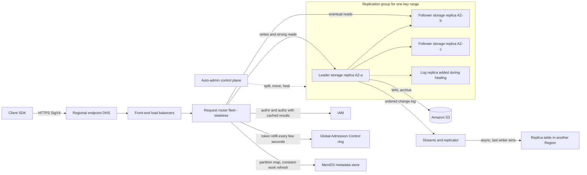

# Amazon DynamoDB: Architecture and Partitioning

## TL;DR

- DynamoDB hashes each partition key into a contiguous key range, and each range is held by a three-replica Multi-Paxos group spread across Availability Zones. Only the leader accepts writes and strongly consistent reads, and any replica can serve eventually consistent reads.
- Your table-level capacity is a promise about the total. Each partition still has its own physical ceiling (roughly 3,000 RCU and 1,000 WCU per second), so key skew, not total throughput, causes most throttling in production.
- Admission control has moved through four stages: static per-partition token buckets, then bursting and adaptive capacity, then Global Admission Control (GAC) at the request routers, then split-for-consumption. None of these can make a single hot key, or a key range written in strictly increasing order, go faster than one partition.
- Request routers are stateless proxies. They cache partition metadata, and they refresh it with a fixed amount of background work whether or not the cache hits, so a cold cache cannot cause a metadata stampede like the one behind the 2015 us-east-1 outage.
- Global tables come in two flavors. Multi-Region eventual consistency (MREC) replicates asynchronously and resolves conflicts with last-writer-wins. Multi-Region strong consistency (MRSC) trades write latency for zero-RPO strong reads. Choose per workload, because conditional writes in MREC only check the local Region.

## Mental Model



Think of DynamoDB as a huge, multi-tenant fleet of small Paxos databases, each owning a slice of hashed key space, with a stateless routing layer in front.
The routing layer does three things per request.
It authenticates the caller, charges the request against a token bucket for the whole table, and looks up which replication group owns the hashed key.
After that, the request goes to exactly one storage node, or to a quorum of them for writes.
Scaling happens in the control plane, which splits and moves those small databases.
Throughput, latency, and availability are all bounded by what one replication group can do, which is why partition-key design matters more than any capacity setting.

## Internals

### Request path end to end

The client SDK resolves the regional endpoint, for example `dynamodb.us-east-1.amazonaws.com`, via DNS and reaches a fleet of front-end load balancers.
The load balancers forward to request routers.
Those routers are stateless, and per Jack Vanlightly's [analysis of the paper](https://jack-vanlightly.com/analyses/2023/11/14/amazon-dynamodb-asds-chapter-1) they handle authentication, authorization, and table-level rate limiting as well as forwarding.
The router hashes the partition key, finds the owning partition and its current leader in its metadata cache, and sends the request over the internal network to the right storage node.
Writes and strongly consistent reads must go to the leader.
Eventually consistent reads can go to any replica, which is why they cost half and survive a leader election ([Elhemali et al., USENIX ATC 2022](https://www.usenix.org/system/files/atc22-elhemali.pdf)).
Each storage node hosts replicas from many partitions and many customers, so the storage fleet is multi-tenant by design.
DynamoDB proactively rebalances replicas across nodes based on throughput and data size (Elhemali et al., ATC 2022).

### Partitioning: hashed key ranges and replication groups

Each partition of a table holds a disjoint, contiguous part of the table's key range (Elhemali et al., ATC 2022).
The range is over the hash of the partition key, so neighboring customer IDs do not end up on neighboring partitions.
Within one partition key value, items are sorted by the sort key.
A table without local secondary indexes can split one item collection across partitions by sort-key range.
A table with an LSI cannot, which is the physical reason for the 10 GB item-collection limit on LSI tables (AWS docs; UNVERIFIED as of 2026-10).
The replicas of a partition form a replication group, and the group uses Multi-Paxos for leader election and consensus (Elhemali et al., ATC 2022).
The three replicas sit in three different AZs, so losing one AZ costs each group one replica and leaves it with a quorum.

### Multi-Paxos replication, leader leases, and log replicas

When a write arrives, the leader builds a write-ahead log record and sends it to its peers.
The write is acknowledged once a quorum of peers has persisted the record to their local WALs (Elhemali et al., ATC 2022).
A storage replica holds both the WAL and a B-tree of the key-value data.
A log replica keeps only recent WAL entries and no key-value data, and the paper compares it to a Paxos acceptor (Elhemali et al., ATC 2022).
The leader keeps its role by periodically renewing a lease.
If a peer detects that the leader has failed, it can call an election to make itself leader.
The new leader then serves no writes or consistent reads until the old leader's lease has expired (Elhemali et al., ATC 2022).
That lease wait is the price of linearizable leader reads without a quorum round-trip on every read.
It also means a failover shows up as a short window of unavailable writes and strong reads, while eventual reads on the followers keep working.
Repairing a lost storage replica takes several minutes, because the repair copies both the B-tree and the WAL.
Adding a log replica takes seconds, because it only copies recent log entries, so DynamoDB restores write durability quickly and rebuilds the full replica in the background (Elhemali et al., ATC 2022).

### Failure detection and gray failures

A follower that cannot reach the leader does not start an election straight away.
It first asks the other replicas whether they can still reach the leader, so a one-way link fault on one node does not cause a needless leader change (Elhemali et al., ATC 2022; UNVERIFIED this pass).
This matters because every election puts writes behind the lease wait.
A detector that is too eager turns gray network failures into write outages, and the extra confirmation step trades a little detection delay for far fewer false elections.

### Admission control: from static buckets to GAC

At launch, a table's provisioned throughput was split evenly across its partitions, and each partition enforced its share with a local token bucket.
A storage node also had a node-level token bucket to protect co-located tenants from each other.
Bursting let a partition spend unused tokens, but only when both its burst bucket and the node-level bucket had tokens.
Adaptive capacity moved more throughput to hot partitions, but it was reactive and only started after throttling had been observed (Elhemali et al., ATC 2022).
The failure mode was called throughput dilution.
Splitting a partition divided its allocation between the children, so a table that had grown into many partitions could throttle at a small fraction of its provisioned total under skewed load.
DynamoDB then replaced adaptive capacity with Global Admission Control.
GAC tracks table-level token consumption centrally.
Each request router keeps a local token bucket and refills it from GAC at intervals on the order of a few seconds (Elhemali et al., ATC 2022).
GAC servers keep only short-lived state, form their own hash ring, and can restart without affecting the service (Elhemali et al., ATC 2022).
The node-level and partition-level buckets stayed as the last line of defense.
That is why a single hot key still throttles at the partition ceiling even when GAC shows table capacity left over.

### Partition split mechanics

Partitions split for two reasons: size and heat.
A split for size happens when a partition's data grows past an internal threshold.
The 10 GB figure in older docs is not a documented contract today (UNVERIFIED as of 2026-10).
A split for consumption happens when a partition is consistently hot.
The split point is chosen from the observed distribution of accessed keys, not from the midpoint of the key range, so each child gets roughly half the load (Elhemali et al., ATC 2022; UNVERIFIED this pass).
The paper also lists when splitting is pointless and is skipped.
One case is a single hot item.
The other is a key range being accessed sequentially, because after the split all traffic lands in the right-hand child again.
The AWS docs describe the same behavior as adaptive capacity that "isolates frequently accessed items" (AWS docs; UNVERIFIED as of 2026-10).
For you as a designer, the rule is direct.
A write-heavy item collection keyed by a timestamp sort key under one partition key is limited to about 1,000 WCU per second however long you wait, because every split leaves the hot edge in one child.
A split creates a new replication group and moves data between storage nodes, so it takes time and cannot absorb a sudden spike.
This is an inference from the paper's minutes-scale replica repair times.
It is also why the warm throughput feature exists: you can ask for the partitions to be created before the traffic arrives, as described in the AWS docs (UNVERIFIED as of 2026-10).

### The mechanism most engineers miss: constant-work metadata refresh

Every request router needs the partition map, which says which replication group and leader own which hashed key range.
Originally, routers cached this map and went to the metadata service on a cache miss.
Under steady state the hit rate was very high, which hid a bimodal risk.
When caches went cold, for example after a router fleet deployment or a mass leader change, the load on the metadata service jumped from almost nothing to the full request rate within seconds.
The redesign moved partition metadata into an in-memory distributed store called MemDS, built on a Patricia-tree and Merkle-tree hybrid the paper calls a Perkle (Elhemali et al., ATC 2022; UNVERIFIED this pass).
The key change is in the routers.
A router serves from its local cache, but even on a cache hit it asynchronously asks MemDS to refresh that entry.
So MemDS load equals the router request rate whether the cache is warm or cold (Elhemali et al., ATC 2022; UNVERIFIED this pass).
This is the constant-work pattern from the [Builders' Library](https://aws.amazon.com/builders-library/reliability-and-constant-work/) applied to a cache.
You spend extra metadata capacity during normal operation so that there is no cold-cache mode left to fail in.
The trade-off is a metadata fleet sized for 100 percent of request rate instead of the miss rate, which only makes sense when the cost of a stampede is a regional outage.
See [[17-Cloud-AI-Engineering/Volume_01_Cloud_Architecture_Principles/Chapter_05_Constant_Work_and_Workload_Smoothing|Constant Work and Workload Smoothing]] for the general pattern.

### Durability and continuous verification

WALs are kept on all three replicas and are also archived to Amazon S3 periodically.
That archive is what point-in-time recovery and backups read from, so a restore does not use the live replicas' throughput (Elhemali et al., ATC 2022; UNVERIFIED this pass).
Log entries and messages carry checksums.
A background scrub checks that live replicas match each other and also match a replica rebuilt offline from the archived WAL (Elhemali et al., ATC 2022; UNVERIFIED this pass).
AWS has said publicly that it model-checked the DynamoDB replication protocol in TLA+ and found subtle bugs before they shipped ([Newcombe et al., CACM 2015](https://lamport.azurewebsites.net/tla/formal-methods-amazon.pdf)).

### Transactions

`TransactWriteItems` and `TransactGetItems` are coordinated by transaction coordinators in the request routing layer.
They use a timestamp-ordering protocol with a prepare phase and a commit phase across the participating partitions, not long-held two-phase locks ([Idziorek et al., USENIX ATC 2023](https://www.usenix.org/conference/atc23/presentation/idziorek); details UNVERIFIED this pass).
Non-transactional reads and writes are not blocked by in-flight transactions, which keeps single-item latency predictable.
The costs are that every transactional item is billed twice (two WCU or RCU per unit), and that conflicts show up as `TransactionCanceledException`, which the client has to retry with jitter.

### Global tables: MREC and MRSC

Under MREC, each Region's replica table accepts writes locally.
Changes travel to the other Regions asynchronously through the table's change log, and concurrent updates to the same item are settled with last-writer-wins (AWS docs; UNVERIFIED as of 2026-10).
Replication latency is usually under a second and is exposed as the `ReplicationLatency` CloudWatch metric (AWS docs; UNVERIFIED as of 2026-10).
Condition expressions are evaluated only against the local replica.
So a `ConditionExpression` like `stock > 0` cannot stop two Regions from both decrementing the last unit.
MRSC replicates writes synchronously to at least one other Region before acknowledging.
It needs exactly three Regions, either three full replicas or two replicas plus a witness, and was announced GA in mid-2025 (AWS launch post; UNVERIFIED as of 2026-10).
MRSC gives an RPO of zero and strongly consistent reads in any Region.
In exchange, every write pays at least one inter-Region round trip, and some APIs are restricted, for example transactions (UNVERIFIED as of 2026-10; check current docs).

### Control plane versus data plane

CreateTable, UpdateTable, splits, moves, and replica repair run in the auto-admin control plane.
GetItem, PutItem, Query, and the other item APIs run only through the request routers and storage nodes.
The paper describes caching IAM and AWS KMS results in the routers so the data plane keeps serving through short impairments of those dependencies (Elhemali et al., ATC 2022; UNVERIFIED this pass).
That is static stability in the sense of [[17-Cloud-AI-Engineering/Volume_01_Cloud_Architecture_Principles/Chapter_02_Regions_Zones_and_Static_Stability|Regions, Zones, and Static Stability]].
The October 2025 outage showed that the regional DNS record for the endpoint is part of the data plane too, and that it has its own automation control plane.

## Numbers to Know

| Quantity | Value | Mechanism implication | Source |
|---|---|---|---|
| Replicas per partition | 3, across AZs | AZ loss leaves every group with a 2-of-3 quorum | Elhemali et al., ATC 2022 |
| Peak request rate, Prime Day 2021 | 89.2 million requests/s | Same multi-tenant fleet customers use | Elhemali et al., ATC 2022 |
| GAC token refill interval | Order of a few seconds | Table-level limits converge over seconds, not milliseconds | Elhemali et al., ATC 2022 |
| Storage replica heal time | Several minutes | Durability gap during heal is closed by log replicas | Elhemali et al., ATC 2022 |
| Log replica add time | Seconds | Write quorum restored quickly after node loss | Elhemali et al., ATC 2022 |
| MemDS router cache hit rate | 99.75 percent | Explains why miss-driven designs hide stampede risk | Elhemali et al., ATC 2022; UNVERIFIED this pass |
| Per-partition read ceiling | 3,000 RCU/s | Hard limit per hashed key range regardless of table capacity | AWS docs; UNVERIFIED as of 2026-10 |
| Per-partition write ceiling | 1,000 WCU/s | Single hot key ceiling, about 1,000 x 1 KB writes/s | AWS docs; UNVERIFIED as of 2026-10 |
| Read unit size | 4 KB per RCU strong, 0.5 RCU eventual, 2 RCU transactional | Item size rounds up per 4 KB | AWS docs; UNVERIFIED as of 2026-10 |
| Write unit size | 1 KB per WCU, 2 WCU transactional | A 1.1 KB item costs 2 WCU | AWS docs; UNVERIFIED as of 2026-10 |
| Maximum item size | 400 KB | Attribute names count toward size | AWS docs; UNVERIFIED as of 2026-10 |
| Partition key / sort key max length | 2,048 / 1,024 bytes | Bounds composite-key schemes | AWS docs; UNVERIFIED as of 2026-10 |
| Burst capacity retention | Up to 300 s of unused capacity | Covers spikes, not sustained skew | AWS docs; UNVERIFIED as of 2026-10 |
| New on-demand table initial capacity | 4,000 WRU/s and 12,000 RRU/s | Launch spikes above this need warm throughput | AWS docs; UNVERIFIED as of 2026-10 |
| On-demand scaling rule | Up to 2x previous peak; faster growth within 30 min may throttle | Pre-warm before launches | AWS docs; UNVERIFIED as of 2026-10 |
| Default per-table throughput quota | 40,000 RCU and 40,000 WCU (us-east-1) | Large tables need a quota increase in advance | AWS docs; UNVERIFIED as of 2026-10 |
| Default per-account throughput quota | 80,000 RCU and 80,000 WCU (us-east-1) | Shared across tables in a Region | AWS docs; UNVERIFIED as of 2026-10 |
| Tables per account per Region | 2,500 default | Caps table-per-tenant designs | AWS docs; UNVERIFIED as of 2026-10 |
| GSIs / LSIs per table | 20 / 5 default | LSIs fix item collections to one partition, 10 GB limit | AWS docs; UNVERIFIED as of 2026-10 |
| Transaction size | 100 actions, 4 MB aggregate | Cross-partition coordination limit | AWS docs; UNVERIFIED as of 2026-10 |
| BatchWriteItem / BatchGetItem | 25 items / 100 items, 16 MB | Partial failures returned as UnprocessedItems/Keys | AWS docs; UNVERIFIED as of 2026-10 |
| Query and Scan page size | 1 MB before filter | Filters do not reduce RCU consumed | AWS docs; UNVERIFIED as of 2026-10 |
| Streams retention | 24 hours | Consumer lag beyond this loses change records | AWS docs; UNVERIFIED as of 2026-10 |
| PITR window | Configurable up to 35 days | Restore creates a new table | AWS docs; UNVERIFIED as of 2026-10 |
| SLA | 99.99% single-Region, 99.999% global tables | Multi-Region is the only path to five nines | AWS SLA page; UNVERIFIED as of 2026-10 |
| On-demand price, Standard class, us-east-1 | $0.625 per million WRU, $0.125 per million RRU | Post-November-2024 price cut | AWS pricing; UNVERIFIED as of 2026-10 |
| Provisioned price, Standard class, us-east-1 | $0.00065 per WCU-hour, $0.00013 per RCU-hour | Breakeven vs on-demand at about 29% utilization | AWS pricing; UNVERIFIED as of 2026-10 |
| Storage price, Standard class, us-east-1 | $0.25 per GB-month | Standard-IA trades lower storage for higher throughput prices | AWS pricing; UNVERIFIED as of 2026-10 |

## AWS vs GCP Mechanism Parity

| Dimension | Amazon DynamoDB | Google Cloud Bigtable | Google Cloud Spanner | Critical difference |
|---|---|---|---|---|
| Unit of partitioning | Partition over hashed partition-key range | Tablet over lexicographic row-key range | Split over primary-key range | Only DynamoDB hashes for you; Bigtable and Spanner sort, so you must avoid monotonic leading keys yourself |
| Replication within a Region | 3-replica Multi-Paxos group across AZs, leader lease | Data in Colossus; nodes serve tablets, durability below the node | Paxos group per split with leader lease | Bigtable moves a tablet by reassigning a pointer, not copying data, so rebalancing is fast; DynamoDB splits and moves data (inference) |
| Storage engine | B-tree plus WAL per storage replica | LSM: memtable plus SSTables on Colossus | Log-structured files on Colossus | Write-amplification profiles differ; Bigtable compactions can cause latency spikes |
| Admission control | GAC token buckets per table plus partition and node buckets | Node-count capacity; CPU-based throttling and autoscaling | Compute capacity; CPU-based | DynamoDB bills and throttles per request unit; GCP bills provisioned nodes or compute |
| Hot-key handling | Split-for-consumption; does not help single key or sequential range | Load-based tablet split and rebalancing; Key Visualizer | Load-based splitting; Key Visualizer | All three are limited by one hot row; Spanner and Bigtable also hot-spot on sequential keys |
| Hot-key diagnostics | CloudWatch Contributor Insights | Key Visualizer | Key Visualizer and lock statistics | Same purpose, different access model |
| Read consistency | Leader strong read or follower eventual read, per request | Strong within a single cluster; eventual across replicated clusters | External consistency via TrueTime; stale reads optional | Spanner gives linearizable reads anywhere without a leader-only route |
| Multi-Region writes | MREC: async, last writer wins; MRSC: synchronous, 3 Regions | Multi-cluster replication, eventual, app profile routing | Multi-region configs with Paxos across Regions and witness replicas | MREC silently resolves conflicts; Spanner never has conflicting commits |
| Transactions | Up to 100 items, timestamp ordering, 2x unit cost | Single-row atomicity only | Full ACID, two-phase commit across Paxos groups | Bigtable has no multi-row transactions |
| Change data capture | DynamoDB Streams, 24 h; Kinesis Data Streams integration | Change streams | Change streams | Retention windows differ; check current docs |
| Secondary indexes | GSI (async, separate capacity), LSI (sync, same partition) | None native | Synchronous secondary indexes | An under-provisioned DynamoDB GSI throttles base-table writes |
| Private access | Gateway VPC endpoint; interface endpoint via PrivateLink | Private Google Access, Private Service Connect | Private Google Access, Private Service Connect | Gateway endpoints are route-table based and free; PSC is IP-based |
| Data perimeter | Endpoint policies, SCPs, RCPs, `aws:SourceVpce` | VPC Service Controls perimeter | VPC Service Controls perimeter | VPC SC is one service-level perimeter; AWS composes several policy types |
| Encryption at rest | Always on; AWS owned, AWS managed, or customer managed KMS key | Google-managed or CMEK via Cloud KMS | Google-managed or CMEK via Cloud KMS | Revoking the key makes data unreadable on both; check recovery windows |
| Pricing model | Per request unit or provisioned units plus GB-month | Per node-hour plus storage | Per compute (nodes or processing units) plus storage | DynamoDB on-demand scales to zero; Bigtable and Spanner have a minimum footprint |

For the GCP internals, see [[17-Cloud-AI-Engineering/Volume_03_GCP_Deep_Dive/Chapter_11_Cloud_Bigtable_LSM_Storage_and_Tablet_Serving|Cloud Bigtable: LSM Storage and Tablet Serving]] and [[17-Cloud-AI-Engineering/Volume_03_GCP_Deep_Dive/Chapter_10_Cloud_Spanner_TrueTime_and_External_Consistency|Cloud Spanner: TrueTime and External Consistency]].
For service selection, see [[17-Cloud-AI-Engineering/Volume_04_AWS_vs_GCP_Translation/Chapter_04_Storage_and_Database_Translation|Storage and Database Translation]].

## Worked Example: Measuring the Partition Ceiling and Sizing a Production Table

### What the lab demonstrates

You create an on-demand table with a hard cap on its throughput.
You then write the same number of items twice: once to a single partition key, once spread across 32 sharded partition keys.
The single-key run levels off near the per-partition write ceiling and throttles.
The sharded run goes up to the table cap.
The difference you observe is the gap between a table-level budget and a partition-level physical limit.

### Lab cost estimate

Each run writes 200,000 items of under 1 KB, so each write costs 1 WRU.
Two runs come to 400,000 WRU, or about $0.25 at $0.625 per million WRU (AWS pricing; UNVERIFIED as of 2026-10).
Storage for 400,000 small items is well under 1 GB, and the first 25 GB per month are in the free tier (AWS pricing; UNVERIFIED as of 2026-10).
Contributor Insights adds a small per-event charge, under $1 for this lab (UNVERIFIED as of 2026-10).
Budget for under $2 in total, provided you tear everything down the same day.

### Terraform / OpenTofu

```hcl
terraform {
  required_version = ">= 1.6.0"
  required_providers {
    aws = {
      source  = "hashicorp/aws"
      version = ">= 5.60"
    }
  }
}

variable "region" {
  type    = string
  default = "us-east-1"
}

variable "alert_email" {
  type = string
}

provider "aws" {
  region = var.region
}

resource "aws_dynamodb_table" "lab" {
  name         = "ddb-partition-lab"
  billing_mode = "PAY_PER_REQUEST"
  hash_key     = "pk"
  range_key    = "sk"

  attribute {
    name = "pk"
    type = "S"
  }

  attribute {
    name = "sk"
    type = "S"
  }

  # Hard cost ceiling: the table cannot exceed these request rates.
  on_demand_throughput {
    max_read_request_units  = 4000
    max_write_request_units = 4000
  }

  point_in_time_recovery {
    enabled = true
  }

  # Without kms_key_arn this uses the AWS managed key aws/dynamodb.
  server_side_encryption {
    enabled = true
  }

  ttl {
    attribute_name = "expires_at"
    enabled        = true
  }

  deletion_protection_enabled = false

  tags = {
    purpose = "ddb-partition-lab"
  }
}

resource "aws_dynamodb_contributor_insights" "lab" {
  table_name = aws_dynamodb_table.lab.name
}

resource "aws_cloudwatch_metric_alarm" "write_throttles" {
  alarm_name          = "ddb-partition-lab-write-throttles"
  namespace           = "AWS/DynamoDB"
  metric_name         = "WriteThrottleEvents"
  dimensions          = { TableName = aws_dynamodb_table.lab.name }
  statistic           = "Sum"
  period              = 60
  evaluation_periods  = 1
  threshold           = 100
  comparison_operator = "GreaterThanThreshold"
  treat_missing_data  = "notBreaching"
}

resource "aws_budgets_budget" "lab" {
  name         = "ddb-partition-lab-budget"
  budget_type  = "COST"
  limit_amount = "10"
  limit_unit   = "USD"
  time_unit    = "MONTHLY"

  cost_filter {
    name   = "Service"
    values = ["Amazon DynamoDB"]
  }

  notification {
    comparison_operator        = "GREATER_THAN"
    threshold                  = 50
    threshold_type             = "PERCENTAGE"
    notification_type          = "ACTUAL"
    subscriber_email_addresses = [var.alert_email]
  }
}

output "table_name" {
  value = aws_dynamodb_table.lab.name
}
```

```bash
terraform init
terraform apply -var "alert_email=you@example.com"
```

### Load generator (Python, boto3)

```python
#!/usr/bin/env python3
"""Compare one hot partition key against N sharded keys.
SDK retries are disabled so every throttle is counted, not hidden."""
import sys
import time
import uuid
from concurrent.futures import ThreadPoolExecutor

import boto3
from botocore.config import Config
from botocore.exceptions import ClientError

TABLE = "ddb-partition-lab"
ITEMS = 200_000
THREADS = 64
cfg = Config(
    retries={"total_max_attempts": 1, "mode": "standard"},
    max_pool_connections=THREADS,
)
ddb = boto3.client("dynamodb", region_name="us-east-1", config=cfg)
THROTTLE_CODES = {"ProvisionedThroughputExceededException", "ThrottlingException"}


def put(i, shards):
    pk = "tenant-hot" if shards == 1 else f"tenant-hot#{i % shards:02d}"
    try:
        ddb.put_item(
            TableName=TABLE,
            Item={
                "pk": {"S": pk},
                "sk": {"S": str(uuid.uuid4())},
                "payload": {"S": "x" * 200},
                "expires_at": {"N": str(int(time.time()) + 86400)},
            },
        )
        return 0
    except ClientError as e:
        if e.response["Error"]["Code"] in THROTTLE_CODES:
            return 1
        raise


def run(shards):
    start = time.time()
    with ThreadPoolExecutor(max_workers=THREADS) as pool:
        throttled = sum(pool.map(lambda i: put(i, shards), range(ITEMS)))
    elapsed = time.time() - start
    ok = ITEMS - throttled
    print(f"shards={shards:3d} ok={ok} throttled={throttled} "
          f"elapsed={elapsed:.1f}s accepted_wps={ok / elapsed:.0f}")


if __name__ == "__main__":
    run(int(sys.argv[1]) if len(sys.argv) > 1 else 1)
```

```bash
python3 hotkey.py 1     # expect accepted rate to level off near the partition write ceiling
python3 hotkey.py 32    # expect accepted rate near the 4,000 WRU table cap
```

How to read the result:
In the single-key run, the throttles come from the partition and node token buckets, not from GAC, because table-level capacity is still free.
Contributor Insights will show `tenant-hot` as the only top key.
If you leave the single-key run going for several minutes, split-for-consumption may split the item collection by sort key, because the UUID sort keys arrive in random order.
Repeat the experiment with a monotonically increasing sort key such as a timestamp and you should see no gain, because every write hits the right-hand edge of the range.
That last prediction comes from the paper's split rules and is the experiment worth running yourself.

### Teardown

```bash
terraform destroy -var "alert_email=you@example.com" -auto-approve
aws dynamodb list-backups --table-name ddb-partition-lab --region us-east-1
```

PITR history goes away with the table.
On-demand backups created by hand are kept and billed until you delete them, which is why the second command lists them.

### Capacity sizing: production order-events table

Workload assumptions:
- Peak 50,000 writes/s, average 20,000 writes/s.
- 2.5 KB items.
- Peak 120,000 eventually consistent reads/s, average 50,000 reads/s.
- 3 TB stored.

Step 1, write units.
A 2.5 KB item rounds up to 3 WCU, so peak demand is 50,000 x 3 = 150,000 WCU/s.
Step 2, read units.
A 2.5 KB item fits in one 4 KB read unit, and an eventually consistent read costs 0.5 RCU, so peak demand is 120,000 x 0.5 = 60,000 RCU/s.
Step 3, quotas.
150,000 WCU is well above the default 40,000 per-table quota (UNVERIFIED as of 2026-10), so file the increase weeks before launch.
Step 4, partition floor.
Writes need at least 150,000 / 1,000 = 150 partitions, and reads need at least 60,000 / 3,000 = 20.
Storage drives about 300 partitions if partitions hold around 10 GB (UNVERIFIED as of 2026-10), so the aggregate partition ceiling is not the constraint.
Step 5, per-key check.
If the largest tenant produces 1 percent of writes, that is 500 writes/s x 3 WCU = 1,500 WCU on one partition key, which is above the 1,000 WCU ceiling.
That throttles no matter how much table capacity you buy.
Fix it either by write-sharding that tenant across 4 suffixes (375 WCU each), or by trimming items below 1 KB so they cost 1 WCU, which brings the tenant to 500 WCU.
Step 6, on-demand cost.
Average writes: 20,000 x 3 = 60,000 WRU/s, times 2,592,000 s in a 30-day month, is 155,520 million WRU, which at $0.625 per million is $97,200.
Average reads: 25,000 RRU/s x 2,592,000 s is 64,800 million RRU, which at $0.125 per million is $8,100.
Storage: 3,000 GB x $0.25 = $750.
On-demand total: about $106,000 per month (prices UNVERIFIED as of 2026-10).
Step 7, provisioned cost with auto scaling at a 70 percent target.
Average provisioned writes are 60,000 / 0.7 = 85,714 WCU, and 85,714 x 730 h x $0.00065 is about $40,700.
Average provisioned reads are 25,000 / 0.7 = 35,714 RCU, and 35,714 x 730 h x $0.00013 is about $3,400.
Provisioned total with storage: about $44,800 per month.
Step 8, breakeven rule.
One provisioned WCU-second costs $0.00065 / 3600 = $1.81e-7, and one on-demand write costs $6.25e-7, so the ratio is 0.289.
Provisioned is cheaper whenever the provisioned capacity you pay for is used more than about 29 percent of the time on average.
The read prices have the same ratio, so the same rule applies to reads.
Step 9, global tables.
A three-Region MREC table bills each write in every Region as a replicated write, so write cost roughly triples (UNVERIFIED as of 2026-10).
Replication also moves about 20,000 x 2.5 KB x 2 destinations = 100 MB/s, which is about 259 TB per month.
At $0.02 per GB for inter-Region transfer that adds about $5,200 per month (UNVERIFIED as of 2026-10).

## Failure Modes and Pitfalls

### Hot keys and sequential keys

Throttling while table-level capacity is unused is almost always partition skew.
Typical causes are a celebrity tenant, a single global counter item, or a "status = PENDING" GSI partition key.
Timestamp sort keys under one partition key are the worst case, because split-for-consumption deliberately does not split sequential ranges.
To diagnose, turn on Contributor Insights and compare per-key consumption against the 1,000 WCU and 3,000 RCU ceilings.
To fix, write-shard with a computed suffix, put a cache in front of hot reads (DAX or a regional cache), or move counters to sharded counters that you add up when reading.

### GSI back-pressure

A GSI is updated asynchronously but has its own capacity.
If a provisioned GSI runs out of write capacity, DynamoDB throttles writes to the base table so the index does not fall behind without bound (AWS docs; UNVERIFIED as of 2026-10).
A low-cardinality GSI partition key concentrates all index writes on a few partitions, which in turn throttles the whole base table.

### Retry amplification and metastable failure

The SDK retries throttles by default.
Under partition throttling, every client retrying with short backoff multiplies offered load on the hot partition without adding capacity, which is the textbook pattern for a metastable failure ([Bronson et al., HotOS 2021](https://sigops.org/s/conferences/hotos/2021/papers/hotos21-s11-bronson.pdf)).
Use the SDK's adaptive retry mode or a client-side token bucket, cap the number of attempts, and add full jitter, as described in [[17-Cloud-AI-Engineering/Volume_07_Reliability_and_SRE/Chapter_03_Resilient_Communication_Retries_Jitter_and_Circuit_Breakers|Resilient Communication: Retries, Jitter, and Circuit Breakers]].

### Launch spikes on on-demand tables

On-demand is not unlimited burst.
It absorbs up to double the previous peak straight away, and faster growth within about 30 minutes can throttle while partitions split (AWS docs; UNVERIFIED as of 2026-10).
A new table that goes from zero to 100,000 writes/s at a product launch will throttle unless warm throughput was set ahead of time.

### Global tables conflicts

Under MREC, two Regions that both read `stock = 1` and conditionally decrement it will both succeed locally.
Last-writer-wins then converges to one value and silently loses one decrement.
That is an oversell with no error anywhere.
Write affinity per item (a home Region), MRSC, or a single-writer service per entity are the only correct fixes.

### Streams consumer lag

Streams records expire after 24 hours (AWS docs; UNVERIFIED as of 2026-10).
A Lambda or KCL consumer stuck on a poison record for a day loses data downstream.
Global tables replication, by contrast, is managed by the service and does not depend on your consumers.

### Encryption key revocation

When the table uses a customer managed KMS key and that key is disabled or its grants are removed, the table becomes inaccessible.
If the key stays inaccessible long enough, DynamoDB archives the table (AWS docs; seven-day threshold UNVERIFIED as of 2026-10).
A badly scoped key policy change in an automation pipeline is a real way to cause an outage.

### PIR: September 2015 us-east-1 metadata overload

In the [2015 DynamoDB disruption](https://aws.amazon.com/message/5467D2/), a brief network disruption made many storage servers request their membership data from the metadata service at the same moment.
GSI adoption had made those membership responses larger, so the responses ran past the storage servers' timeouts.
The storage servers took themselves out of service and retried, keeping the metadata service overloaded in a self-sustaining loop.
Recovery required pausing metadata requests so capacity could be added.
The structural lesson is that load-proportional, retry-amplified dependence on a metadata service is a latent regional failure mode.
The constant-work MemDS refresh described in Internals is the later architectural answer to this class of failure.

### PIR: October 2025 us-east-1 DNS race condition

In the [October 2025 event](https://aws.amazon.com/message/101925/), a latent race condition in DynamoDB's automated DNS management left the regional endpoint `dynamodb.us-east-1.amazonaws.com` with an empty DNS record, and the automation could not repair it on its own.
The system has a planner that generates DNS plans and redundant enactors that apply them.
One enactor was badly delayed and applied an old plan after a newer plan had been applied.
A cleanup step then deleted the old plan as stale, which removed every IP address from the record and left the state unrepairable by automation.
Operators fixed the record by hand after several hours (exact timestamps UNVERIFIED as of 2026-10).
The impact cascaded.
EC2's instance-management subsystem depends on DynamoDB for leases on physical hosts, and after DynamoDB recovered it went into congestive collapse while re-establishing leases.
That delayed instance launches and network configuration for many more hours, with knock-on Network Load Balancer health-check failures (AWS PIR; detailed sequencing UNVERIFIED as of 2026-10).
The lesson is that the storage engine was healthy the whole time, while the data path failed at name resolution.
DNS for the endpoint was part of the data plane, and two writers racing with no ordering guard on plan generation is a classic lost-update bug.
For the cross-service view, see [[17-Cloud-AI-Engineering/Volume_07_Reliability_and_SRE/Chapter_07_Anatomy_of_Major_Cloud_Outages|Anatomy of Major Cloud Outages]].

### Smaller pitfalls

- Scan and Query charge for data read before filters are applied, so `FilterExpression` saves bandwidth, not RCU.
- Long attribute names are billed in every item, so `customer_identifier_v2` repeated over a billion items is real money.
- TTL deletes happen in the background, typically within days rather than at expiry (UNVERIFIED as of 2026-10), so queries must also filter out expired items.
- Clients that cache DNS indefinitely, such as a JVM with infinite TTL, cannot follow endpoint changes during recovery.

## Security and Cost Angles

### IAM scoping

Use the `dynamodb:LeadingKeys` condition key to limit a principal to items whose partition key equals its tenant ID or federated identity.
This is item-level isolation inside a shared table.
Use `dynamodb:Attributes` together with `dynamodb:Select` to restrict which attributes a principal can read or write.
Resource-based policies on tables and streams allow cross-account access without assuming a role (AWS docs; GA status UNVERIFIED as of 2026-10).
Deny `dynamodb:DeleteTable` and `dynamodb:UpdateTable` with an SCP outside break-glass roles, and turn on deletion protection for production tables.
For how SCPs, RCPs, identity policies, and resource policies combine, see [[17-Cloud-AI-Engineering/Volume_02_AWS_Deep_Dive/Chapter_01_IAM_Policy_Evaluation_Engine|IAM Policy Evaluation Engine]].

### Encryption key hierarchy

DynamoDB always encrypts at rest, with your choice of an AWS owned key, the AWS managed `aws/dynamodb` key, or a customer managed KMS key.
The service uses envelope encryption with a per-table key wrapped by the KMS key and cached by the service, so KMS request volume does not grow with item traffic (AWS docs; caching details UNVERIFIED as of 2026-10).
Customer managed keys give you a CloudTrail record of key use and the ability to revoke access cryptographically.
The cost is the key-revocation failure mode described above.
For the general pattern, see [[17-Cloud-AI-Engineering/Volume_08_Security_Identity_and_the_Data_Perimeter/Chapter_04_Encryption_Key_Hierarchies_and_Envelope_Encryption|Encryption Key Hierarchies and Envelope Encryption]].

### Private network boundary

A gateway VPC endpoint for DynamoDB is added as a prefix-list route in your route tables and has no hourly or per-GB charge (AWS docs; UNVERIFIED as of 2026-10).
Interface endpoints via PrivateLink are billed per hour and per GB, but they are reachable from on-premises networks and peered VPCs, which gateway endpoints are not.
Add `aws:SourceVpce` or `aws:SourceVpc` conditions in resource policies or SCPs so stolen credentials cannot be used from the internet.
For the full design, see [[17-Cloud-AI-Engineering/Volume_08_Security_Identity_and_the_Data_Perimeter/Chapter_06_Constructing_an_Impenetrable_Data_Perimeter|Constructing an Impenetrable Data Perimeter]].

### Unit-economics levers

- Choose the billing mode by measured utilization against the roughly 29 percent breakeven computed in the Worked Example, and revisit it each quarter.
- Reserved capacity discounts provisioned throughput further in exchange for a term commitment (AWS pricing; discount levels UNVERIFIED as of 2026-10).
- The Standard-IA table class cuts storage price and raises request price, so it pays off for tables dominated by storage and rarely read (UNVERIFIED as of 2026-10).
- Shrink items: short attribute names, compressed blobs, and large payloads moved to S3 behind a pointer, because WCU rounds up per 1 KB.
- Use sparse GSIs with `KEYS_ONLY` or `INCLUDE` projections, because every projected attribute is written again into every index.
- Prefer eventually consistent reads when staleness is acceptable: they cost half and are served by any replica.
- Use `on_demand_throughput` maximums as a cost circuit breaker against runaway clients.

## Interview Questions and Model Answers

### Question 1 (L5 - Senior)

A provisioned table with 40,000 WCU throttles writes while CloudWatch shows only 6,000 WCU consumed. Walk through your diagnosis and fix.

#### Model Answer

The table-level number is a budget managed by GAC at the request routers.
The partitions that store the data each have a physical ceiling of about 1,000 WCU per second.
Throttling at 15 percent of table capacity means some partition is at its ceiling, so I look for skew first, not for a capacity shortage.
Step one: turn on Contributor Insights and look at the top partition keys by consumed write units.
I also check whether a GSI's top keys are the actual source, because GSI back-pressure throttles the base table.
Step two: work out per-key demand.
If one key gets 400 writes/s of 3 KB items, that is 1,200 WCU, above the partition ceiling, and adaptive capacity cannot help because a single item cannot be split.
Step three: check the sort-key pattern.
If the hot key is an item collection with a timestamp sort key, split-for-consumption will not split it, because the hot spot follows the right-hand edge of the range.
Fixes, in order of how little they disturb the application:
- Shrink the item below the next 1 KB boundary.
- Write-shard the key with a deterministic suffix and scatter-gather on read.
- Move hot counters to sharded counters.
- Put reads behind DAX or a cache.
I also check client retry settings, because standard-mode retries without a client-side rate limiter multiply load on the very partition that is throttling.
Raising table capacity is the wrong fix: it adds cost and leaves the partition ceiling where it was.

#### Follow-up Interviewer Question

Your write-shard fix uses 10 suffixes, but read latency p99 doubles. Why, and how would you choose N?

### Question 2 (L5 - Senior)

What physically happens on a strongly consistent GetItem compared with an eventually consistent one, and what does each do during a leader failure?

#### Model Answer

The request router hashes the partition key and looks up the replication group in its cached partition map.
For a strongly consistent read it routes to the leader replica, which holds a lease and can therefore answer from its local B-tree without a quorum round trip, because no other replica can be accepting writes.
For an eventually consistent read it routes to any of the three replicas, so the read may miss writes the leader has acknowledged but that follower has not yet applied.
The cost difference, one RCU versus half an RCU per 4 KB, reflects that eventual reads can be spread over three replicas while strong reads all land on one.
During a leader failure, a follower confirms with its peers that the leader is unreachable, wins a Multi-Paxos election, and then waits for the old lease to expire before serving.
In that window, strong reads and writes fail or time out, and eventual reads keep being served by the healthy followers.
GSIs only support eventual reads, because they are updated asynchronously from the base table's change propagation and have no leader whose state matches the base table.
In practice, I default read paths to eventual consistency, reserve strong reads for read-modify-write flows, and set client timeouts and retries for a leader-change window of seconds rather than milliseconds.

#### Follow-up Interviewer Question

Why can't DynamoDB serve linearizable reads from a follower the way Spanner can at any replica, and what would it need to add?

### Question 3 (L6 - Staff)

A product launch will take a brand-new on-demand table from zero to 150,000 writes/s within ten minutes. Design the capacity plan and the failure handling.

#### Model Answer

A new on-demand table starts at about 4,000 WRU/s.
On-demand absorbs up to double the previous peak straight away, but faster growth needs partition splits, and splits move data and take minutes (UNVERIFIED numbers as of 2026-10).
So without pre-provisioning, the launch will throttle hard during exactly the period that matters.
First, set warm throughput on the table ahead of time to the target, so DynamoDB creates enough partitions in advance, and confirm via DescribeTable that warm throughput has reached its target.
Second, file a quota increase, because 150,000 WRU is well above the default 40,000 per-table quota (UNVERIFIED as of 2026-10).
Third, verify key distribution by load-testing with production-shaped keys, because pre-split partitions still cannot rescue a key carrying more than 1,000 WCU.
Fourth, protect the client side with an adaptive-mode SDK retry policy, a capped number of attempts, and a bounded local queue that sheds non-critical writes first.
That way a throttling event degrades features instead of collapsing the service through retry amplification.
Fifth, set `on_demand_throughput` maximums at roughly two times the expected peak, so a client bug cannot generate unbounded spend.
Sixth, alarm on `WriteThrottleEvents` and on the `ThrottlingReasons`-style detail exposed in current SDK exceptions (UNVERIFIED as of 2026-10), plus a burn-rate alert on the launch SLO.
Cost check: 150,000 WRU/s sustained for one hour is 540 million WRU, about $340 at $0.625 per million (UNVERIFIED as of 2026-10).
That is trivial next to the revenue at risk, so pre-warming is clearly justified.
The trade-off: warm throughput is billed as a one-time charge, and leftover partitions remain after the launch, which slightly increases per-partition dilution risk for later skewed workloads under provisioned mode.

#### Follow-up Interviewer Question

After launch, traffic settles at 8,000 writes/s. Should you switch to provisioned mode, and what changes in your throttling risk when you do?

### Question 4 (L6 - Staff)

Your inventory service runs on an MREC global table in three Regions and has oversold during a flash sale. Explain the mechanism and redesign it.

#### Model Answer

With MREC, each Region evaluates a write's `ConditionExpression` against its local replica only, then replicates asynchronously, usually within a second.
Two Regions both saw `stock = 1`, both conditional decrements succeeded locally, and last-writer-wins reconciliation converged to one final value.
One decrement disappeared without any error, so the oversell is invisible in error metrics.
I would offer three redesigns, with these trade-offs.
Option one, home-Region write affinity: each SKU has a home Region stored in the item, all decrements for that SKU are routed there, and the other Regions forward to it.
This keeps MREC's cheap local reads, but cross-Region decrements pay one inter-Region round trip, and if the home Region fails you need an explicit, fenced transfer of ownership.
Option two, MRSC: writes synchronously reach at least one other Region before they are acknowledged, so conditional checks run against strongly consistent state.
That gives an RPO of zero, but every write pays inter-Region latency, you are limited to three-Region configurations, and some API restrictions apply (UNVERIFIED as of 2026-10).
Option three, reservations: split stock into per-Region allocations that each Region decrements locally, and rebalance asynchronously.
This keeps local latency and turns the consistency problem into a capacity-planning problem, at the cost of selling out in one Region while another still has stock.
I would choose option three for flash sales where latency matters, and MRSC for low-volume, high-value items such as tickets with seat numbers.
The principle is that last-writer-wins is only safe for idempotent overwrites, not for read-modify-write invariants.

#### Follow-up Interviewer Question

How would you detect, after the fact, how many lost updates MREC produced last week?

### Question 5 (L6 - Staff)

Explain the 2015 DynamoDB metadata outage as a mechanism, and how constant-work metadata refresh prevents the same class of failure. Apply it to your own service-discovery cache.

#### Model Answer

In 2015, storage servers fetched membership metadata from a shared metadata service.
GSIs had made responses larger, so their latency was close to the client timeout.
A short network disruption made many storage servers re-request at once.
Responses went past the timeout, servers took themselves out of service and retried, and the metadata service stayed overloaded even after the trigger was gone.
That is a metastable failure: the load was caused by the failure itself.
The deeper design flaw was that metadata load depended on the cache-miss rate, which is near zero in steady state and near 100 percent after a correlated event.
Capacity planned for steady state was off by orders of magnitude for exactly the moment it was needed.
The MemDS redesign makes the request routers refresh metadata asynchronously even on cache hits.
Metadata load therefore always equals the request rate, and a cold cache only changes latency, not load on MemDS.
For my own service-discovery cache, I would:
- Refresh on a fixed schedule or on every lookup, asynchronously, whether or not the entry is fresh.
- Serve stale entries indefinitely when the refresh fails, instead of evicting them.
- Size the discovery backend for full refresh load, and test that by running it at that load permanently.
- Cap retries and add jitter, so a backend brown-out does not double its own load.
The cost is paying for a metadata tier sized for the worst case all the time, which is cheap next to a regional outage but has to be justified per system.

#### Follow-up Interviewer Question

Constant work removes the stampede but not stale-data risk. When would serving a stale partition map indefinitely be unsafe for DynamoDB, and how does the storage node protect against a router using an old map?

### Question 6 (L7+ - Principal)

The October 2025 us-east-1 incident started with an empty DNS record for the DynamoDB endpoint and spread into EC2. As the principal engineer for a platform that depends on DynamoDB, what do you change?

#### Model Answer

First, the mechanism.
Redundant DNS enactors applied plans with no ordering guard, a delayed enactor applied a stale plan, and cleanup deleted it, leaving an empty record that the automation could not repair.
The storage engine was healthy, but the data path failed at name resolution, and dependent control planes then failed during recovery because they re-established leases all at once.
For my platform, I would treat the endpoint as a dependency with its own failure mode and design along three lines.
Line one, Region independence for critical paths.
Tier-zero services run active-active or warm-standby in a second Region, with global tables replicating state.
Failover is done by data-plane mechanisms only: pre-provisioned capacity, health-checked DNS records in a provider that was not the one that failed, and no control-plane API calls needed during the event.
The cost is roughly two times the compute plus replicated-write fees, so I would justify it per service against its error budget and revenue at risk, not blanket the fleet.
Line two, degrade instead of fail inside a Region.
Read paths serve from a local cache with bounded staleness when DynamoDB is unreachable, and write paths append to a durable local queue or to SQS in the standby Region, then replay idempotently.
Line three, recovery behavior.
The longest part of that outage came from synchronized recovery, so every client uses capped, jittered reconnects, and every lease-holding subsystem of mine re-acquires leases with admission control and priority ordering.
I would require a regional game day that blackholes the DynamoDB endpoint while measuring time to steady state after it comes back, not just during the outage.
I would also check the less obvious dependencies.
Many services, mine and AWS's, use DynamoDB internally, so the dependency graph includes other AWS services built on DynamoDB, not just my own SDK calls.
On the organization side, I would set an RTO per tier, fund multi-Region only where the RTO demands it, and have leadership explicitly accept the remaining us-east-1 concentration risk for the others.

#### Follow-up Interviewer Question

Your failover runbook itself uses AWS APIs in us-east-1, such as IAM and Route 53 control-plane changes. How do you make it statically stable?

### Question 7 (L7+ - Principal)

You run a SaaS platform with 20,000 tenants whose sizes follow a power-law distribution. Choose between one shared table, table-per-tenant, and account-per-tenant on DynamoDB, and defend the choice on isolation, operations, and unit economics.

#### Model Answer

A shared table with tenant ID as the leading key is the cheapest and simplest to run.
Isolation comes from IAM `dynamodb:LeadingKeys` conditions scoped to the federated tenant identity.
But every tenant shares GAC table tokens, and the big tenants become hot keys.
A tenant at 1 percent of traffic can exceed a 1,000 WCU partition ceiling and throttle itself, and any table-level throttling hits everyone.
Table-per-tenant gives each tenant its own GAC budget, its own on-demand scaling history, per-tenant CMKs, and per-tenant PITR restores.
With on-demand billing, an idle table costs only storage, so the unit economics stay flat.
The limits are the default 2,500 tables per Region per account (UNVERIFIED as of 2026-10), control-plane rate limits on CreateTable, and per-table alarms and Contributor Insights that grow linearly with tenants.
Account-per-tenant gives the strongest blast-radius and quota isolation and clean cost allocation, but it brings account-vending, cross-account identity, and fleet-wide schema migration as permanent operational costs.
My recommendation is a tiered cell model.
- Put the long tail of small tenants in a set of shared tables, each acting as a cell of a few thousand tenants, using shuffle-sharding-style assignment so a noisy tenant affects one cell.
- Give the top few hundred tenants dedicated tables in shared accounts.
- Give regulated or very large tenants dedicated accounts with their own CMKs.
Tenants move between tiers through a dual-write and backfill migration triggered by measured consumption, not by contract tier alone.
I would track unit economics as cost per thousand tenant requests plus storage per tenant, using cost allocation tags on dedicated tables and Contributor Insights sampling on shared ones.
For the cell math, see [[17-Cloud-AI-Engineering/Volume_01_Cloud_Architecture_Principles/Chapter_03_Cell_Based_Architecture_and_Shuffle_Sharding|Cell-Based Architecture and Shuffle Sharding]].

#### Follow-up Interviewer Question

How do you migrate a hot tenant from a shared table to a dedicated table with no downtime and no lost writes, given that DynamoDB has no cross-table transactions across accounts?

## Further Reading

- [Elhemali et al., Amazon DynamoDB: A Scalable, Predictably Performant, and Fully Managed NoSQL Database Service, USENIX ATC 2022](https://www.usenix.org/conference/atc22/presentation/elhemali) - The primary source for request routers, Multi-Paxos groups, log replicas, GAC, split-for-consumption, and MemDS.
- [Idziorek et al., Distributed Transactions at Scale in Amazon DynamoDB, USENIX ATC 2023](https://www.usenix.org/conference/atc23/presentation/idziorek) - How transactions were added without locking or slowing non-transactional traffic.
- [DeCandia et al., Dynamo: Amazon's Highly Available Key-value Store, SOSP 2007](https://www.allthingsdistributed.com/files/amazon-dynamo-sosp2007.pdf) - The leaderless predecessor whose trade-offs DynamoDB explicitly reversed.
- [Newcombe et al., How Amazon Web Services Uses Formal Methods, CACM 2015](https://lamport.azurewebsites.net/tla/formal-methods-amazon.pdf) - Evidence that the DynamoDB replication protocol was model-checked in TLA+.
- [Summary of the Amazon DynamoDB Service Disruption, September 2015](https://aws.amazon.com/message/5467D2/) - The canonical metadata-stampede PIR behind the constant-work redesign.
- [Summary of the Amazon DynamoDB Service Disruption, October 2025](https://aws.amazon.com/message/101925/) - A DNS automation race condition and a cascading recovery failure across AWS services.
- [AWS Builders' Library: Reliability, constant work, and a good cup of coffee](https://aws.amazon.com/builders-library/reliability-and-constant-work/) - The design pattern behind MemDS refresh.
- [AWS Builders' Library: Timeouts, retries, and backoff with jitter](https://aws.amazon.com/builders-library/timeouts-retries-and-backoff-with-jitter/) - Required background for safe client behavior under throttling.
- [Bronson et al., Metastable Failures in Distributed Systems, HotOS 2021](https://sigops.org/s/conferences/hotos/2021/papers/hotos21-s11-bronson.pdf) - The theory that explains both DynamoDB PIRs.
- [Jack Vanlightly, Amazon DynamoDB - ASDS Chapter 1](https://jack-vanlightly.com/analyses/2023/11/14/amazon-dynamodb-asds-chapter-1) - A rigorous third-party walkthrough of the paper's architecture.
- [Corbett et al., Spanner: Google's Globally-Distributed Database, OSDI 2012](https://www.usenix.org/conference/osdi12/technical-sessions/presentation/corbett) - The comparison point for multi-Region strong consistency.
- [Chang et al., Bigtable: A Distributed Storage System for Structured Data, OSDI 2006](https://research.google/pubs/bigtable-a-distributed-storage-system-for-structured-data/) - The comparison point for range partitioning on shared storage.
- [AWS DynamoDB Developer Guide: Service quotas](https://docs.aws.amazon.com/amazondynamodb/latest/developerguide/ServiceQuotas.html) - Re-check every quota in this chapter here before relying on it.
- [AWS DynamoDB Developer Guide: Burst and adaptive capacity](https://docs.aws.amazon.com/amazondynamodb/latest/developerguide/burst-adaptive-capacity.html) - The product-level description of the admission mechanisms covered in Internals.
- Related chapters:
  - [[17-Cloud-AI-Engineering/Volume_02_AWS_Deep_Dive/Chapter_09_Elastic_Block_Store_and_Network_Storage|Elastic Block Store and Network Storage]] - Physalia applies the same small-Paxos-cell idea to the EBS control plane.
  - [[17-Cloud-AI-Engineering/Volume_02_AWS_Deep_Dive/Chapter_11_Amazon_Aurora_Log_Is_The_Database|Amazon Aurora: Log-Is-The-Database]] - The next chapter, contrasting log-structured quorum storage for relational workloads.
  - [[17-Cloud-AI-Engineering/Volume_13_Seminal_Papers_and_Case_Studies/Chapter_01_Dynamo_and_DynamoDB|Dynamo and DynamoDB]] - A paper-level comparison of the two designs.
  - [[08-Distinguished-Engineering/02-Distributed-Systems-Internals/Raft-Consensus|Raft Consensus]] - A leader-lease consensus refresher that maps directly onto DynamoDB's replication groups.
  - [[08-Distinguished-Engineering/02-Distributed-Systems-Internals/Consistent-Hash-Ring|Consistent Hash Ring]] - The partitioning scheme of the original Dynamo, which GAC servers still use for their own ring.
