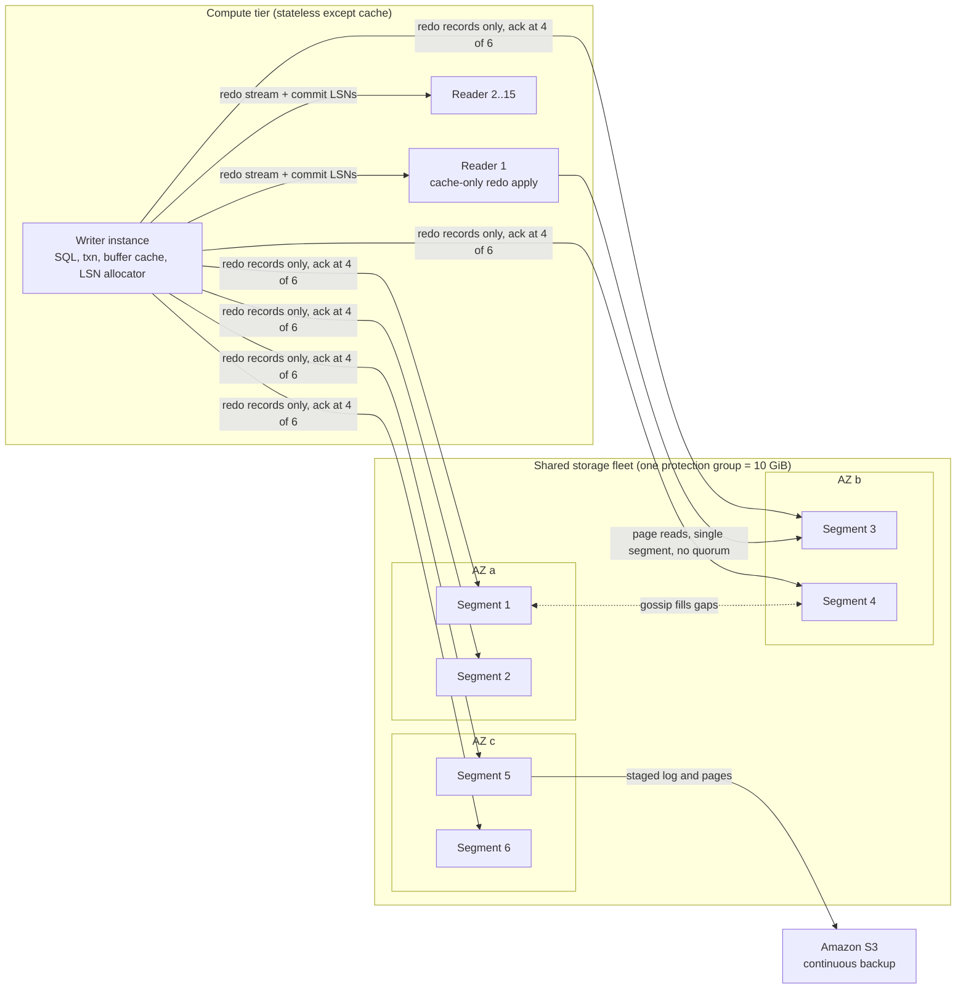

# Amazon Aurora: Log-Is-The-Database

## TL;DR

- Aurora splits the database engine from storage. Only redo log records cross the network to a shared, multi-tenant storage fleet, and each storage node replays those records into pages on its own, asynchronously.
- The volume is cut into 10 GiB protection groups, and each one is copied 6 ways, 2 copies per AZ across 3 AZs. A write needs 4 of 6 acknowledgements and a read needs 3 of 6, so the volume survives losing a whole AZ plus one more node ("AZ+1") without losing data.
- Commit, read and membership change do not run a consensus protocol on every operation. A single writer hands out log sequence numbers (LSNs), tracks which LSNs are durable (VCL and VDL, defined below), and uses epochs to fence off stale writers and stale storage configurations.
- Up to 15 readers share the same storage volume. Each reader receives the redo stream and applies it only to pages already in its buffer cache, so lag is usually milliseconds and a failover does not need a data copy.
- What you give up: you still have one writer per cluster. Long-running reads on readers can hold back cleanup (purge or vacuum) cluster-wide. On Aurora Standard, I/O is a metered bill that can be larger than the compute bill, which is why choosing between Standard and I/O-Optimized is an architecture decision.

## Mental Model



In a traditional database, the engine owns the disk. It writes redo for durability and later writes full pages for checkpoints, and it ships those page images to a mirror.
Aurora turns that around: the redo log is the only thing written in the foreground, and pages are a cache that storage nodes rebuild from the log whenever it suits them.
The writer's job shrinks to three things: generate redo, track how far a durable prefix of the log reaches, and serve queries from its cache.
Everything that is expensive and bursty (checkpointing, page materialization, backup, repair) moves into a fleet of storage nodes that does it in parallel, in the background, across thousands of 10 GiB units.
Readers are not replicas in the MySQL binlog sense. They are extra caches over the same volume, kept warm by the same redo stream.
Hold one invariant and the rest of the system follows: the database state is the longest durable, consistent prefix of the log, and that prefix is defined by LSN bookkeeping, not by a consensus vote.

## Internals

### The problem Aurora was built to remove

In the SIGMOD 2017 paper, Verbitski et al. argue that the bottleneck of a cloud RDBMS moves from compute and storage to the network once storage is disaggregated and replicated.
A mirrored MySQL setup on network block storage writes several kinds of data for one logical change: redo log, binlog, full data pages, the double-write buffer copy of each page, and metadata files.
Each of those then gets copied again to a standby over synchronous block replication, so the foreground path pays for every copy in serial.
Aurora's answer is to send only redo records over the network and to let storage build pages from them.
The paper reports, for a 30-minute SysBench write-only run, about 35 times more transactions than mirrored MySQL and about 7.7 times fewer I/Os per transaction (Verbitski et al., SIGMOD 2017). These are paper-era figures and should not be read as current benchmarks.
The current AWS docs claim up to 6x the throughput of stock PostgreSQL and of stock MySQL on similar hardware (AWS docs, as of 2026-10). This is a vendor claim, not an independent benchmark.

### Segments, protection groups, and quorum arithmetic

The volume is logically divided into 10 GiB protection groups (PGs). Each PG is replicated six ways into physical segments spread across a large storage fleet (Vogels, All Things Distributed, 2019).
The six copies sit two per AZ across three AZs.
The quorum is Gifford-style weighted voting with V = 6, Vw = 4 and Vr = 3, so Vw + Vr > V and 2 * Vw > V hold.
The first inequality means every read quorum overlaps the latest write quorum.
The second means two conflicting write quorums cannot both succeed.
Failure arithmetic:

- Lose a whole AZ (2 segments): 4 remain, so both writes and reads still work.
- Lose an AZ plus one more node (3 segments): 3 remain. That is enough to read and to rebuild the lost copies, but not enough to write until repair restores a fourth.
- Lose any 2 nodes in different AZs: 4 remain, so writes continue.

Why 10 GiB: durability depends on the chance of a second, correlated failure landing inside the repair window (MTTR) of the first.
Mean time between failures per node is hard to improve, but MTTR scales with how much data must be re-replicated.
A 10 GiB segment can be copied in seconds. The paper's figure is about 10 seconds on a 10 Gbps link (Verbitski et al., SIGMOD 2017), and Vogels describes repair as "done in seconds".
That makes the AZ+1 failure window very small, and it lets operators deliberately take storage nodes out of service for patching or heat management as if they had failed.

There is a latency effect that rarely appears in docs.
Suppose the writer sits in AZ a.
The two AZ a segments acknowledge first, so commit latency is set by the second-fastest of the four segments in AZs b and c.
A single slow storage node, or even a single degraded remote AZ, is therefore hidden from the commit path.
The quorum acts as a built-in hedged request, not only a durability mechanism.

### The write path and the storage node pipeline

The paper describes eight steps on a storage node. Only the first two are on the foreground path:

1. Receive the log record and add it to an in-memory queue.
2. Persist it to local SSD (the "hot log") and acknowledge.
3. Sort records and find gaps, since boxcarred, batched delivery can arrive out of order or incomplete.
4. Gossip with peer segments of the same PG to fill gaps.
5. Coalesce log records into new versions of data pages.
6. Periodically stage log and pages to Amazon S3 for backup.
7. Garbage-collect old page versions.
8. Periodically scrub pages by validating CRCs.

Steps 3 through 8 are asynchronous and can be deprioritized under foreground load. That is how Aurora turns write amplification into background work, rather than latency.
Each storage node is multi-tenant and holds segments for many customer volumes. The isolation and placement questions from [[17-Cloud-AI-Engineering/Volume_02_AWS_Deep_Dive/Chapter_09_Elastic_Block_Store_and_Network_Storage|EBS]] therefore apply here as well.

### LSN bookkeeping: SCL, VCL, CPL, VDL, LAL

This is the mechanism you will not find in a getting-started guide, and it explains almost every Aurora behaviour.

- **LSN (log sequence number)**: a monotonically increasing number that the single writer assigns to every redo record.
- **SCL (Segment Complete LSN)**: per segment, the highest LSN below which that segment holds every record. Segments use SCL in gossip to discover which records they are missing.
- **VCL (Volume Complete LSN)**: the highest LSN below which every record has met write quorum in its PG.
- **CPL (Consistency Point LSN)**: an LSN that marks the end of a mini-transaction (MTR). An MTR is the atomic unit of a physical change, such as a B-tree page split touching several pages. The engine tags MTR boundaries.
- **VDL (Volume Durable LSN)**: the highest CPL that is less than or equal to VCL. VDL is the database state: everything at or below it is durable and structurally consistent.
- **LAL (LSN Allocation Limit)**: the writer may not hand out an LSN more than LAL ahead of VDL. The paper gives 10 million. This is backpressure that stops the foreground racing ahead of storage durability.

Commit is asynchronous.
A worker thread that issues COMMIT records the transaction's commit LSN, parks the transaction on a pending list, and goes back to other work.
A dedicated thread acknowledges commits to clients once VDL moves past each commit LSN.
This is group commit without the usual serialization on a log flush: thousands of transactions ride one VDL advance.

Page eviction follows a rule you can derive from this: a page may be evicted from the writer's cache only if its page LSN is at or below VDL. That way a later read from storage can never return a version older than what the cache served.

### Reads without quorum

Although Vr = 3, normal reads do not read 3 copies.
The writer knows which segments acknowledged which LSNs, so for a read at "read point" LSN R it can pick one segment whose SCL is at or above R and read the page there, usually the lowest-latency candidate.
Quorum reads happen only during recovery, when the writer's transient state is gone.
Each instance tracks the oldest read point any of its open transactions might need. These are combined per PG into the Protection Group Min Read Point LSN (PGMRPL), a low-water mark below which storage may garbage-collect old page versions.
This is the mechanical root of the long-running reader pitfall covered in Failure Modes.

### Crash recovery and epoch fencing

A traditional engine replays redo from the last checkpoint before it opens. That makes recovery time grow with the checkpoint interval and the write rate.
In Aurora, storage nodes replay redo continuously, so the only work at restart is to rebuild the LSN bookkeeping:

1. The new writer, either a restarted process or a promoted reader, contacts a read quorum of every PG and rebuilds each PG's SCLs.
2. From those it computes VCL, then VDL as the highest CPL at or below VCL.
3. It sends a truncation range covering every LSN above VDL to all segments, tagged with a new, higher volume epoch.
4. Storage nodes reject writes from any instance carrying an older epoch. This fences a zombie writer that a network partition left half-alive.
5. The database opens. Undo for in-flight transactions runs in the background after open.

The paper reports recovery in under 10 seconds even at around 100,000 write statements per second (Verbitski et al., SIGMOD 2017).
The truncation step is subtle: records above VDL that are still in flight when recovery runs are cancelled even if they later reach a quorum, because their epoch is stale.

### Membership change without consensus

The SIGMOD 2018 paper ("On Avoiding Distributed Consensus for I/Os, Commits, and Membership Changes") explains how a segment is replaced without stopping I/O and without Paxos.
Suppose segment F is suspected bad in PG {A,B,C,D,E,F}.
The storage control plane increments a membership epoch and moves the PG into a dual-quorum state: a write must reach 4/6 of {A..F} AND 4/6 of {A..E,G}, and a read must reach 3/6 of either set.
G is hydrated from its peers in the background.
If F turns out healthy, the change rolls back by reverting to the old set under another epoch increment. If F is dead, the PG commits to {A..E,G}.
Every step is a single epoch-guarded metadata write, and I/O keeps flowing throughout. It is a quorum-set transition rather than a consensus round per change.
The same paper describes mixing "full" segments (log plus pages) with "tail" segments (log only), to cut the storage cost of six-way replication while keeping six-way log durability. Read rules then require at least one full segment.

### Read replicas: cache-only redo apply

Readers attach to the same volume. The writer sends them the redo stream and commit LSNs, in addition to sending redo to storage.
A reader follows two rules:

- If a record targets a page in the reader's buffer cache, apply it. If not, discard it, because the page will be fetched from storage at the right version on its next miss.
- Apply only records at or below the writer's VDL, and apply each MTR atomically, so a reader never sees a half-split B-tree.

Replica lag is therefore the time to ship and apply in memory, not the time to replay a full write workload. That is why the docs describe lag as often single-digit milliseconds (AWS docs, as of 2026-10).
Because nothing has to be copied, promoting a reader is a recovery run (VDL computation plus truncation) with no rebuild.
The cost of this design is that every reader holds a connection to every storage node it reads from, plus one redo stream from the writer.
Up to 15 replicas per cluster are supported (AWS docs, as of 2026-10).
On Aurora MySQL, readers always use REPEATABLE READ for InnoDB tables, and you can change isolation level only on the primary (AWS docs, as of 2026-10).

### Control plane versus data plane

Data plane: the writer and reader engines, the storage nodes, and the gossip and backup paths to S3.
Control plane: the RDS control plane (provisioning, instance health, failover orchestration, endpoint DNS updates) and the storage control plane (segment placement, repair, membership epochs).
According to the 2017 paper, the storage control plane kept volume metadata and backup descriptions in DynamoDB and ran long operations such as repair and restore through Amazon SWF. Treat this as paper-era detail that may have changed.
Static-stability lesson (see [[17-Cloud-AI-Engineering/Volume_01_Cloud_Architecture_Principles/Chapter_04_Control_Plane_vs_Data_Plane_Separation|Control Plane vs Data Plane Separation]]): a running writer keeps committing even when the control plane is impaired. Failover, scaling and creating new replicas all depend on the control plane, so readers you need in a crisis should already be running.

### Features that fall out of the architecture

- **Fast clone**: storage-level copy-on-write over segment pages. A clone shares pages until either side modifies them, so creation time does not depend on volume size.
- **Backtrack** (Aurora MySQL only): rewinds the volume to an earlier LSN by keeping change records for a bounded window.
- **Global Database**: replication at the storage layer to up to 10 secondary Regions (AWS docs, as of 2026-10). Lag is typically under one second, per secondary sources (as of 2026-10). A secondary Region is a separate volume, not a cross-Region quorum member, so writes there are asynchronous.
- **Serverless v2**: the same engine and storage, with instance capacity resized in 0.5 ACU steps from 0 to 256 ACU on recent versions, or 128 on older ones (AWS API reference, as of 2026-10).
- **Volume ceiling**: 256 TiB per cluster volume (AWS docs, as of 2026-10). Aurora MySQL doubled from 128 TiB in 2025 (AWS What's New, 2025-07). The limit depends on engine version.
- **Write scale-out**: still a single writer per cluster. Aurora Limitless Database (sharded Aurora PostgreSQL) and [[17-Cloud-AI-Engineering/Volume_02_AWS_Deep_Dive/Chapter_12_Aurora_DSQL_Multi_Region_Active_Active_SQL|Aurora DSQL]] are the escape routes.

## Numbers to Know

| Quantity | Value | Source |
| --- | --- | --- |
| Protection group size | 10 GiB, 6 copies, 2 per AZ across 3 AZs | (Vogels, All Things Distributed 2019; Verbitski et al. SIGMOD 2017) |
| Write / read quorum | 4 of 6 / 3 of 6 | (Verbitski et al. SIGMOD 2017) |
| Segment repair time | "seconds", about 10 s per 10 GiB at 10 Gbps | (Vogels 2019; SIGMOD 2017) |
| LSN Allocation Limit | 10 million LSNs ahead of VDL | (SIGMOD 2017, paper-era) |
| Crash recovery | under 10 s at about 100K writes/s | (SIGMOD 2017, paper-era) |
| Max cluster volume | 256 TiB, depends on version | (AWS docs, as of 2026-10) |
| Aurora Replicas per cluster | up to 15 | (AWS docs, as of 2026-10) |
| In-Region replica lag | "often single-digit milliseconds", FAQ says "tens of milliseconds" | (AWS docs, as of 2026-10) |
| Global Database secondaries | up to 10 secondary Regions | (AWS docs, as of 2026-10) |
| Global replication lag | typically under 1 s | (secondary sources, as of 2026-10) |
| Serverless v2 range | 0 to 256 ACU in 0.5 steps, 128 on older versions | (AWS API reference, as of 2026-10) |
| Serverless v2 memory per ACU | about 2 GiB | (secondary sources, as of 2026-10) |
| Auto-pause idle timeout | 300 to 86,400 s; PG 13.15+, MySQL 3.08.0+ | (secondary sources, as of 2026-10) |
| Aurora Standard storage | $0.10 per GB-month, us-east-1 PG | (Vantage/CloudZero summaries of AWS pricing, as of 2026-10) |
| Aurora Standard I/O | $0.20 per million requests | (Vantage/CloudZero, as of 2026-10) |
| I/O-Optimized storage | $0.225 per GB-month, no I/O charge | (Vantage/CloudZero, as of 2026-10) |
| I/O-Optimized instance premium | about 30% over Standard | (Bytebase summary, as of 2026-10) |
| Serverless v2 compute | about $0.12 per ACU-hour, us-east-1 Standard | (secondary source, as of 2026-10) |
| Vendor throughput claim | up to 6x stock MySQL / PostgreSQL | (AWS docs, as of 2026-10) |

## AWS vs GCP Mechanism Parity

The closest Google Cloud equivalent is AlloyDB for PostgreSQL. It is covered in depth in [[17-Cloud-AI-Engineering/Volume_03_GCP_Deep_Dive/Chapter_12_AlloyDB_for_PostgreSQL_Disaggregated_Architecture|AlloyDB: Disaggregated Architecture]].
Spanner is listed to show the line between scaling up and scaling out.

| Dimension | Amazon Aurora | AlloyDB for PostgreSQL | Cloud Spanner (contrast) |
| --- | --- | --- | --- |
| Engines | MySQL- and PostgreSQL-compatible | PostgreSQL-compatible only | GoogleSQL and PostgreSQL dialect |
| What crosses the network on write | Redo records only | WAL records to a low-latency log storage service | Paxos log writes per split |
| Where pages are built | Each storage node coalesces redo per 10 GiB segment | A separate Log Processing Service (LPS) replays WAL into blocks | Tablet servers on Colossus |
| Durability unit | Protection group, 6 copies over 3 AZs, 4/6 write quorum | Regional log and block storage across zones (internal quorum not published) | Paxos group per split, majority quorum |
| Consensus on the hot path | None per I/O; writer LSN bookkeeping plus epochs | Not publicly documented at this depth | Yes, Paxos per write plus TrueTime commit wait |
| Writers | One per cluster (Limitless for sharding) | One primary per cluster | Every split leader accepts writes |
| Read scaling | Up to 15 readers on the shared volume, cache-only redo apply | Read pool instances on shared storage | Any replica, with bounded-staleness or strong reads |
| In-Region HA | Promote a reader (priority tiers), no data copy | HA primary with standby node in another zone | Built-in, no failover concept |
| Cross-Region | Global Database, storage-level async, up to 10 secondaries | Cross-region secondary clusters, async | Multi-region configs, synchronous |
| Serverless | Serverless v2, 0 to 256 ACU, scale to zero | No scale-to-zero equivalent | Granular compute (processing units) |
| I/O pricing | Standard meters I/O; I/O-Optimized bundles it | Not metered per request | Not metered per request |
| Analytics offload | Zero-ETL to Redshift | Built-in columnar engine | Data Boost |

Key difference: Aurora pushes page materialization into the same nodes that store the log. AlloyDB, as Google describes it, puts log storage, log processing and block storage in separate services, so each can scale on its own.
Aurora's design has fewer network hops on a cache-miss read. AlloyDB's design isolates replay CPU from storage capacity.
For translation tables across the whole storage portfolio, see [[17-Cloud-AI-Engineering/Volume_04_AWS_vs_GCP_Translation/Chapter_04_Storage_and_Database_Translation|Storage and Database Translation]].

## Worked Example: Replica Lag, Failover Drill, and Standard vs I/O-Optimized Sizing

### Lab cost estimate and guardrails

The lab runs one Aurora PostgreSQL Serverless v2 writer and one reader with a 0 to 4 ACU range, for about 2 hours.
Estimate: 2 instances at about 2 ACU average for 2 hours is 8 ACU-hours, at about $0.12 per ACU-hour, so about $0.96. Storage and I/O add cents (secondary pricing sources, as of 2026-10).
Set a $10 monthly budget alarm before you create anything.

```bash
#!/usr/bin/env bash
set -euo pipefail
export AWS_REGION="${AWS_REGION:-us-east-1}"
ACCOUNT_ID="$(aws sts get-caller-identity --query Account --output text)"

aws budgets create-budget --account-id "$ACCOUNT_ID" \
  --budget '{"BudgetName":"aurora-lab","BudgetLimit":{"Amount":"10","Unit":"USD"},"TimeUnit":"MONTHLY","BudgetType":"COST"}' \
  --notifications-with-subscribers '[{"Notification":{"NotificationType":"ACTUAL","ComparisonOperator":"GREATER_THAN","Threshold":80,"ThresholdType":"PERCENTAGE"},"Subscribers":[{"SubscriptionType":"EMAIL","Address":"you@example.com"}]}]'
```

### Provision (AWS CLI)

The script uses the default VPC subnet group and the RDS Data API, so no bastion host or public endpoint is needed.
The engine version is looked up at run time instead of hard-coded, because the list of available versions changes.

```bash
#!/usr/bin/env bash
set -euo pipefail
export AWS_REGION="${AWS_REGION:-us-east-1}"
CLUSTER=aurora-lab

ENGINE_VERSION="$(aws rds describe-db-engine-versions --engine aurora-postgresql \
  --query 'DBEngineVersions[?starts_with(EngineVersion, `16.`)] | [-1].EngineVersion' --output text)"
echo "Using aurora-postgresql ${ENGINE_VERSION}"

aws rds create-db-cluster \
  --db-cluster-identifier "$CLUSTER" \
  --engine aurora-postgresql \
  --engine-version "$ENGINE_VERSION" \
  --master-username labadmin \
  --manage-master-user-password \
  --storage-type aurora \
  --storage-encrypted \
  --enable-http-endpoint \
  --serverless-v2-scaling-configuration MinCapacity=0,MaxCapacity=4,SecondsUntilAutoPause=600 \
  --backup-retention-period 1

for i in writer reader; do
  aws rds create-db-instance \
    --db-instance-identifier "${CLUSTER}-${i}" \
    --db-cluster-identifier "$CLUSTER" \
    --engine aurora-postgresql \
    --db-instance-class db.serverless
done

aws rds wait db-instance-available --db-instance-identifier "${CLUSTER}-writer"
aws rds wait db-instance-available --db-instance-identifier "${CLUSTER}-reader"
```

### Observe the write path and replica lag (Python, boto3)

```python
import time
import boto3

REGION = "us-east-1"
CLUSTER = "aurora-lab"
rds = boto3.client("rds", region_name=REGION)
data = boto3.client("rds-data", region_name=REGION)
cw = boto3.client("cloudwatch", region_name=REGION)

c = rds.describe_db_clusters(DBClusterIdentifier=CLUSTER)["DBClusters"][0]
ARN = c["DBClusterArn"]
SECRET = c["MasterUserSecret"]["SecretArn"]


def sql(stmt):
    return data.execute_statement(
        resourceArn=ARN, secretArn=SECRET, database="postgres", sql=stmt
    )


sql("CREATE TABLE IF NOT EXISTS t (id bigserial PRIMARY KEY, pad text)")

t0 = time.time()
for _ in range(200):
    sql("INSERT INTO t (pad) SELECT repeat('x', 500) FROM generate_series(1, 50)")
elapsed = time.time() - t0
print(f"10000 rows in {elapsed:.1f}s, {200 / elapsed:.1f} commits/s via Data API")

# Aurora-specific view of every instance attached to the shared volume.
r = sql("SELECT server_id, replica_lag_in_msec FROM aurora_replica_status()")
for rec in r["records"]:
    print(rec)

time.sleep(120)
end = time.time()
m = cw.get_metric_statistics(
    Namespace="AWS/RDS",
    MetricName="AuroraReplicaLag",
    Dimensions=[{"Name": "DBInstanceIdentifier", "Value": f"{CLUSTER}-reader"}],
    StartTime=end - 900,
    EndTime=end,
    Period=60,
    Statistics=["Maximum"],
)
print("Reader lag max ms:", sorted(p["Maximum"] for p in m["Datapoints"]))
```

### Failover drill

The drill shows that promotion means "recompute VDL and truncate", not "copy data".
Poll the Data API in a second shell, run the command below, and record how long writes are unavailable.

```bash
aws rds failover-db-cluster --db-cluster-identifier aurora-lab \
  --target-db-instance-identifier aurora-lab-reader
```

Then confirm the row count matches before and after. No acknowledged commit should be lost, because the reader shares the volume.

### Teardown (exact)

```bash
#!/usr/bin/env bash
set -euo pipefail
export AWS_REGION="${AWS_REGION:-us-east-1}"
ACCOUNT_ID="$(aws sts get-caller-identity --query Account --output text)"
for i in writer reader; do
  aws rds delete-db-instance --db-instance-identifier "aurora-lab-${i}" --skip-final-snapshot || true
done
aws rds wait db-instance-deleted --db-instance-identifier aurora-lab-writer
aws rds wait db-instance-deleted --db-instance-identifier aurora-lab-reader
aws rds delete-db-cluster --db-cluster-identifier aurora-lab --skip-final-snapshot
aws budgets delete-budget --account-id "$ACCOUNT_ID" --budget-name aurora-lab
```

Deleting the cluster also deletes the managed master secret, though Secrets Manager may apply a recovery window. Check that the secret and all automated snapshots are gone.

### Back-of-the-envelope: network, I/O, and the storage-type decision

Workload: OLTP at 20,000 commits per second with about 1.5 KB of redo per transaction. One writer at about 32 ACU average, two readers at 16 ACU each, 2,000 GB stored, us-east-1.

Step 1 - redo bandwidth: 20,000 * 1.5 KB = 30 MB/s of redo.

Step 2 - writer network egress: 6 segment copies * 30 MB/s = 180 MB/s, about 1.44 Gbps. Each reader adds one stream (2 * 30 MB/s = 60 MB/s). Total is about 1.9 Gbps before client traffic.
This is why the instance's network bandwidth, not its storage throughput, sets a writer's ceiling.

Step 3 - write I/Os depend on batching: if redo is packed into 4 KB billing units, 30 MB/s is about 7,500 write I/Os per second. If every commit flushes alone, it is about 20,000 per second. The 4 KB unit and the batching effect are UNVERIFIED.
Add 100,000 logical page reads per second at a 95% cache hit rate, which gives 5,000 read I/Os per second.

Step 4 - monthly I/O at the good-batching case: 12,500 I/O/s * 2,628,000 s = 32.85 billion I/Os, times $0.20 per million, is about $6,570 per month.

Step 5 - compute: 64 ACU * 730 h * $0.12 = about $5,606 per month on Standard. With an assumed 30% premium on I/O-Optimized, that is about $7,288.

Step 6 - storage: 2,000 GB costs $200 on Standard and $450 on I/O-Optimized.

Step 7 - totals: Standard is about $12,376 per month, with I/O at 53% of the bill. I/O-Optimized is about $7,738 per month, a saving of about 37%.

Step 8 - break-even rule: I/O-Optimized wins when monthly I/O spend is greater than 0.30 * compute + 0.125 * GB stored.
Here that is 0.30 * 5,606 + 0.125 * 2,000, about $1,932, or about 3,700 sustained I/O/s.
The rule of thumb that I/O-Optimized pays off once I/O is more than about 25% of the Aurora bill (secondary sources, as of 2026-10) is the same inequality, stated as a share of the bill.

## Failure Modes and Pitfalls

### Long-running readers hold back cleanup on the writer

Readers share the writer's storage, and storage garbage collection and engine cleanup are bounded by the cluster-wide minimum read point (PGMRPL).
On Aurora MySQL, a long transaction or open read view on a reader stops InnoDB purge on the writer, so the history list length grows. Undo chains then get longer for everyone, and writer queries slow down even though the writer did nothing wrong.
On Aurora PostgreSQL, the equivalent is a reader snapshot that holds back vacuum, or conflicts between query snapshots and replayed cleanup records. These lead to cancelled queries or, if a reader falls too far behind, a reader restart. The exact restart threshold is UNVERIFIED.
Mitigation: put statement and idle-in-transaction timeouts on reader endpoints, and send long analytics to a fast clone or a zero-ETL target rather than the production reader pool.

### Write ceiling and the binlog trap

There is one writer. When its network or CPU saturates, adding readers does not help.
On Aurora MySQL, turning on the binlog for downstream CDC adds a second serialized log on the commit path. Aurora replicas do not need it, so enable it only for external consumers and measure commit latency before and after.

### Failover blackouts caused by clients

The cluster and reader endpoints are DNS names that the control plane repoints during failover.
Clients that cache DNS, such as JVMs with an infinite networkaddress.cache.ttl, or connection pools that never revalidate, keep talking to the demoted writer and see read-only errors well after the storage-level failover is done.
Mitigation: use short DNS caching, a topology-aware driver (for example the AWS Advanced JDBC Wrapper), or RDS Proxy, and test with `failover-db-cluster` under load.

### Reader endpoint imbalance

The reader endpoint balances at DNS resolution time, per new connection, not per query.
Long-lived pools pin to whichever reader they first resolved, and readers added by autoscaling get almost no traffic until pools recycle.

### AZ+1 is a durability promise, not a write-availability promise

After losing an AZ, every PG runs at 4 of 4 for writes. One more failed node in any PG blocks writes to that PG until repair restores a fourth copy.
Repair takes seconds, but under correlated stress, for example a power event that degrades many nodes at once, the write path can stall while reads continue.
For static stability, keep at least one reader in each AZ you depend on, sized to take over as writer. See [[17-Cloud-AI-Engineering/Volume_01_Cloud_Architecture_Principles/Chapter_02_Regions_Zones_and_Static_Stability|Regions, Zones, and Static Stability]].

### Global Database RPO is replication lag

Global Database secondaries are asynchronous.
A managed switchover (planned) waits for the secondary to catch up. An unplanned failover with data loss allowed loses whatever was within the lag window, typically under a second (secondary sources, as of 2026-10), but unbounded during an impairment.
The usual mistake is an RPO of zero written in the DR plan with nothing in the architecture enforcing it.
See [[17-Cloud-AI-Engineering/Volume_07_Reliability_and_SRE/Chapter_04_Disaster_Recovery_Tiers_and_RTO_RPO_Engineering|DR Tiers and RTO/RPO Engineering]].

### I/O bill shock on Standard

A missing index on a hot query, or a reporting job doing full scans on a reader, turns buffer-cache misses straight into metered read I/Os.
Alarm on the VolumeReadIOPs and VolumeWriteIOPs CloudWatch metrics. Do not wait for the Cost Explorer lag.

### Serverless v2 resume latency

A cluster scaled to 0 ACU must resume on the first connection, and that first request waits for it.
Never use a minimum of 0 for latency-sensitive production traffic. Keep a floor large enough for the steady-state buffer cache, because shrinking capacity also shrinks the cache and causes a burst of read I/Os on the next spike.

### Post-incident reviews

AWS publishes multi-service post-event summaries at the [AWS Post-Event Summaries](https://aws.amazon.com/premiumsupport/technology/pes/) page. Read them for the control-plane dependency patterns that affect RDS and Aurora failover, scaling and endpoint updates during regional events.
This pass did not verify an Aurora-specific public post-incident review, so none is cited here.
A cross-provider analysis is in [[17-Cloud-AI-Engineering/Volume_07_Reliability_and_SRE/Chapter_07_Anatomy_of_Major_Cloud_Outages|Anatomy of Major Cloud Outages]].

## Security and Cost Angles

### IAM and authentication

Control-plane actions (`rds:CreateDBCluster`, `rds:FailoverDBCluster`, `rds:ModifyDBCluster`) should be granted to deployment roles only. Use SCPs to deny `rds:DeleteDBCluster` outside break-glass roles. See [[17-Cloud-AI-Engineering/Volume_02_AWS_Deep_Dive/Chapter_01_IAM_Policy_Evaluation_Engine|IAM Policy Evaluation Engine]].
For database login, IAM database authentication (`rds-db:connect` scoped to a specific DB user resource) or Secrets Manager-managed master credentials remove long-lived passwords.
Data API access is governed by IAM on the cluster ARN plus read access to the secret, so scope `secretsmanager:GetSecretValue` to the exact secret ARN.

### Encryption

Storage encryption is set when the cluster is created and covers the volume, the S3-staged backups and snapshots, through envelope encryption under a KMS key. See [[17-Cloud-AI-Engineering/Volume_08_Security_Identity_and_the_Data_Perimeter/Chapter_04_Encryption_Key_Hierarchies_and_Envelope_Encryption|Encryption Key Hierarchies]].
An unencrypted cluster cannot be encrypted in place. You must snapshot, copy the snapshot with a KMS key, and restore, so plan the cutover.
Cross-Region snapshot copies and Global Database secondaries need a KMS key in the destination Region. A customer-managed key policy that does not allow the RDS service in that Region is a common late blocker in DR setups.
Enforce TLS on the server side with `rds.force_ssl` on PostgreSQL and `require_secure_transport` on MySQL.

### Network boundaries

Keep instances in private subnets with security groups that admit only application tiers.
Reach the RDS control-plane API through an interface VPC endpoint (PrivateLink), and attach endpoint policies as described in [[17-Cloud-AI-Engineering/Volume_08_Security_Identity_and_the_Data_Perimeter/Chapter_06_Constructing_an_Impenetrable_Data_Perimeter|Constructing a Data Perimeter]].
Database Activity Streams push a KMS-encrypted audit stream that DBAs cannot tamper with, which supports separation of duties.

### Unit-economics levers

- **Storage type**: use the break-even inequality from the Worked Example and re-evaluate it quarterly as I/O patterns drift.
- **Graviton instance classes** and commitments: reserved instances for steady writers and readers. For Database Savings Plans, see [[17-Cloud-AI-Engineering/Volume_09_FinOps_and_Cloud_Economics/Chapter_02_Commitment_Discounts_Savings_Plans_vs_CUDs|Savings Plans vs CUDs]]; their availability and discount for Aurora are UNVERIFIED here.
- **Fast clones** for test and analytics: you pay only for pages that diverge, unlike a full snapshot restore.
- **Serverless v2 scale-to-zero** for dev and ephemeral environments; provisioned instances for steady production.
- **Reader right-sizing**: each reader is a full instance bill but adds no storage cost. Readers are cheap to add for HA and expensive to keep idle.
- **AI angle**: Aurora PostgreSQL with pgvector works as a vector store, including for Bedrock Knowledge Bases. HNSW index builds and heavy upserts produce large redo volumes, which drive I/O cost on Standard. Size them with the Worked Example method. See [[17-Cloud-AI-Engineering/Volume_12_AI_Applications_MLOps_and_Data_Platforms/Chapter_01_Vector_Databases_and_Similarity_Search_on_Cloud|Vector Databases on Cloud]].

## Interview Questions and Model Answers

### Question 1 (L5 - Senior)

Why does Aurora keep six copies across three AZs with a 4/6 write quorum and a 3/6 read quorum, instead of three copies with a 2/3 majority?

#### Model Answer

With three copies, one per AZ, losing an AZ leaves two copies. One more node failure, which is routine at fleet scale, leaves a single copy: you can no longer form a read quorum, and you cannot tell whether that copy is current.
Aurora's design goal is AZ+1: survive losing a whole AZ plus one more node without losing data.
Six copies, two per AZ, with Vw = 4 and Vr = 3, give 3 + 4 > 6 for read-write overlap and 2 * 4 > 6 for write-write exclusion.
Losing an AZ leaves 4, enough to write. Losing an AZ plus one leaves 3, which still forms a read quorum and allows repair.
The other half of the argument is MTTR: 10 GiB segments repair in seconds, so the window for a correlated second failure is tiny.
The cost of six copies is reduced by sending only redo, not pages, and by the full-versus-tail segment design in the 2018 paper. You get six-way log durability without six full page copies.
A latency bonus: with the writer's two local copies acknowledging first, commit waits for the second-fastest of four remote copies, so one slow node or one slow AZ is hidden.

#### Follow-up Interviewer Question

If AWS added a fourth AZ to the placement, what quorum would you pick and what would it cost?

### Question 2 (L5 - Senior)

A reader shows 15 ms of AuroraReplicaLag. What exactly is that lag, and why is it so much smaller than MySQL binlog replica lag?

#### Model Answer

A binlog replica re-executes logical changes, so its lag tracks the writer's full write workload, often serialized on a single applier thread.
An Aurora reader does not write to storage at all. It receives the physical redo stream and commit LSNs from the writer.
It applies a record only if the target page is in its own buffer cache, and discards it otherwise, because a later cache miss will read the correct version from shared storage.
It applies only up to the writer's VDL, and applies whole mini-transactions atomically, so it never exposes a structurally inconsistent B-tree.
So the lag is network transit plus in-memory apply of the cached subset, which is milliseconds.
Lag rises when the reader's CPU is saturated, when it holds a huge hot cache that needs every record applied, or when long queries conflict with replay.
Because the reader shares storage, lag never means lost data on promotion. It only means stale reads until promotion recovery finishes.

#### Follow-up Interviewer Question

How would you give a user read-your-writes consistency when their next request lands on a reader?

### Question 3 (L6 - Staff)

Walk through what happens between a client issuing COMMIT and receiving OK, and then what happens if the writer crashes after a quorum of storage nodes has received some, but not all, of an in-flight mini-transaction.

#### Model Answer

The engine produces redo records for the transaction, each with an LSN from the single writer. It marks MTR boundaries as CPLs and refuses to allocate LSNs more than LAL (10 million in the paper) beyond VDL.
Records are batched and sent to all six segments of each affected PG. Each storage node enqueues, persists to its hot log, and acknowledges. Nothing else is in the foreground.
The writer tracks acknowledgements per PG and advances VCL, the highest LSN with no quorum holes below it, and then VDL, the highest CPL at or below VCL.
The committing thread does not block. It records the commit LSN and moves on, and a commit thread sends OK once VDL is at or past that LSN. This is group commit without a serialized flush.
On a crash with a partial MTR, the new writer reads a read quorum of every PG to rebuild segment SCLs, computes VCL and VDL, and finds that the partial MTR's last CPL is above VDL.
It bumps the volume epoch and sends a truncation of every LSN above VDL.
Partial records already persisted are discarded, records still in flight are rejected because of the stale epoch, and the client was never told OK, so atomicity holds.
There is no consensus round per commit because a single writer has authority over LSN order. Consensus-like agreement is needed only at epoch changes, which are rare.
The trade-off is that this only works with a single writer. Multi-writer needs conflict detection, which is exactly what Aurora DSQL and Spanner pay for.

#### Follow-up Interviewer Question

What breaks in this argument if two writers could both believe they own the volume, and what in the protocol stops that?

### Question 4 (L6 - Staff)

A team runs a 3 TB Aurora PostgreSQL cluster whose bill is 60% I/O. They want to move to I/O-Optimized immediately. What do you check, and what else could you change?

#### Model Answer

First, confirm the decision with the inequality: I/O-Optimized wins when I/O spend is greater than about 0.30 * compute + 0.125 * GB stored. At 60% I/O it almost certainly wins, but write the numbers into the decision record.
Second, ask why I/O is 60%. Read I/Os are buffer-cache misses, so check the cache hit ratio per instance, missing indexes, and readers sized smaller than the writer that miss more on the same queries.
Write I/Os scale with redo volume and commit batching, so look for chatty single-row autocommit loops, oversized JSONB rewrites and frequent large index maintenance.
Third, check operational limits: storage-type switches are rate-limited (I recall once per 30 days in one direction, UNVERIFIED), the instance premium also applies to readers, and reserved instance coverage may need re-planning.
Fourth, look at structural options: move analytics off readers to a clone or zero-ETL target, raise instance memory where the working set barely misses, and batch commits in the application.
The staff-level answer is to do both: switch to stop the bleeding, then fix the access pattern so the system stays cheap if the storage type is ever changed back.

#### Follow-up Interviewer Question

How would you build an alert that fires before I/O crosses the break-even point, given that billing data lags by hours?

### Question 5 (L6 - Staff)

Writer latency on an Aurora MySQL cluster degraded over a week, with no change in write rate. Readers run nightly reports. Diagnose.

#### Model Answer

The suspect is purge lag from reader read views.
All instances share one volume, so the writer cannot purge undo for row versions that any reader's open read view might still need. The cluster-wide minimum read point holds back cleanup.
A reader running multi-hour REPEATABLE READ reports, the only isolation readers allow for InnoDB, pins old versions. History list length grows, undo chains lengthen, and writer queries walk longer chains on secondary index lookups and in-place updates.
Confirm by plotting history list length (the RollbackSegmentHistoryListLength CloudWatch metric on Aurora MySQL) against the report schedule, and by listing the oldest transactions on each reader.
Fix: cap reader transaction duration, split reports into shorter transactions, or move them to a fast clone that does not share read points with production.
The broader point: shared storage couples instances through MVCC garbage collection, so readers are not fully isolated tenants. Workload isolation needs a separate volume, not just a separate instance.

#### Follow-up Interviewer Question

Would the same problem appear on Aurora PostgreSQL, and how would it show up differently?

### Question 6 (L7+ - Principal)

The CTO wants zero RPO and an RTO under one minute for a payments ledger across two Regions. Compare Aurora Global Database, Aurora DSQL and Spanner, and recommend one.

#### Model Answer

Start with physics: zero RPO across Regions requires a synchronous cross-Region acknowledgement before commit, which adds at least one inter-Region round trip to every commit.
Aurora Global Database is asynchronous storage-level replication. Lag is typically under a second, but on an unplanned failover the RPO equals the lag at failure time, so it cannot honestly promise zero RPO.
What Global Database is good at: local reads in up to 10 Regions, fast managed switchover for planned events, and keeping the single-writer commit latency of in-Region Aurora.
Aurora DSQL and multi-region Spanner commit synchronously across Regions, so they can offer zero RPO and no failover step. The cost is higher commit latency, a different concurrency model (optimistic conflicts in DSQL, Paxos plus commit wait in Spanner) and porting effort.
For a ledger, retries on optimistic conflict are acceptable if transactions are short and idempotent, and per-commit latency of tens of milliseconds is usually acceptable for payments.
Recommendation: put the ledger core on a synchronous multi-Region system (DSQL if the estate is AWS-native, Spanner if on GCP), keep satellite services on Aurora for cost and compatibility, and replace "zero RPO" with explicit RPO tiers per data class.
Also check the operational truth: RTO under a minute requires client routing that does not depend on an impaired Region's control plane, which takes you back to static stability and pre-provisioned capacity.

#### Follow-up Interviewer Question

Walk me through the exact client-side behavior during a Region impairment for your chosen design, including DNS, connection pools and in-flight transactions.

### Question 7 (L7+ - Principal)

Critique log-is-the-database. Where does it stop scaling, and what would you change if you were designing Aurora's successor for AI-era workloads?

#### Model Answer

Strengths: the foreground path sends only redo, durability comes from quorum without per-I/O consensus, recovery time no longer depends on checkpoint interval, and readers are cheap shared caches.
Limit 1, single-writer ceiling: one instance's network and CPU bound total write throughput. At six copies plus N reader streams, writer egress grows as (6 + N) * redo rate.
Limit 2, the writer is both the LSN authority and the coordinator of the quorum, so its failover time sets the RTO floor.
Limit 3, coupling through shared MVCC state: reader snapshots throttle writer cleanup.
Limit 4, workloads with much more redo than useful data, such as vector index maintenance and wide JSON rewrites, pay full redo cost six times on the network and in metered I/O.
For a successor: shard the LSN space (as Limitless and DSQL do in different ways), separate log durability from page serving (closer to AlloyDB's LPS split or Socrates' tiers) so replay can scale on its own, and push some reads down into storage (filters, vector distance) to cut cache-miss traffic.
I would keep the core idea, that the durable log prefix defines the state, and the epoch-based fencing. Both are cheap and provably safe, and the 2018 paper's membership protocol is the part I would protect most.

#### Follow-up Interviewer Question

If you sharded the LSN space across writers, how would you provide cross-shard snapshot reads without reintroducing a global sequencer bottleneck?

## Further Reading

- [Vogels, "Amazon Aurora ascendant: How we designed a cloud-native relational database" (2019)](https://www.allthingsdistributed.com/2019/03/amazon-aurora-design-cloud-native-relational-database.html) - the official design summary of protection groups, six-way replication and quick repair.
- Verbitski et al., "Amazon Aurora: Design Considerations for High Throughput Cloud-Native Relational Databases", SIGMOD 2017 - the primary source for the redo-only network path, the eight-step storage pipeline and VCL/VDL recovery. A readable summary is at [the morning paper](https://blog.acolyer.org/2019/03/25/amazon-aurora-design-considerations-for-high-throughput-cloud-native-relational-databases/).
- [Verbitski et al., "Amazon Aurora: On Avoiding Distributed Consensus for I/Os, Commits, and Membership Changes", SIGMOD 2018](https://dl.acm.org/doi/10.1145/3183713.3196937) ([PDF](https://pages.cs.wisc.edu/~yxy/cs839-s20/papers/aurora-sigmod-18.pdf)) - the essential paper for epochs, quorum-set membership change and reads without quorum.
- [Murat Demirbas, notes on both Aurora papers](https://muratbuffalo.blogspot.com/2022/03/amazon-aurora-design-considerations-and.html) - a distributed-systems researcher's critical reading of the consensus-avoidance arguments.
- [Aurora SIGMOD Systems Award 2019](https://www.allthingsdistributed.com/2019/07/aurora-sigmod-award.html) - context on why the database research community considers the design important.
- Gifford, "Weighted Voting for Replicated Data", SOSP 1979 - the quorum arithmetic that Aurora's 4/6 and 3/6 rules rest on.
- Antonopoulos et al., "Socrates: The New SQL Server in the Cloud", SIGMOD 2019 - Microsoft's contrasting design, which separates log, page servers and compute into distinct tiers.
- [What is Amazon Aurora (AWS docs)](https://docs.aws.amazon.com/AmazonRDS/latest/AuroraUserGuide/CHAP_AuroraOverview.html) - current authoritative limits, including the 256 TiB volume ceiling.
- [Aurora Global Database (AWS docs)](https://docs.aws.amazon.com/AmazonRDS/latest/AuroraUserGuide/aurora-global-database.html) - secondary-Region limits, switchover versus failover semantics.
- [Replication with Aurora MySQL (AWS docs)](https://docs.aws.amazon.com/AmazonRDS/latest/AuroraUserGuide/AuroraMySQL.Replication.html) - reader isolation rules and replica behavior, which matter for the purge-lag failure mode.
- [ServerlessV2ScalingConfiguration API reference](https://docs.aws.amazon.com/AmazonRDS/latest/APIReference/API_ServerlessV2ScalingConfiguration.html) - exact ACU bounds and version dependence.
- [Deep dive into AlloyDB architecture](https://securityboulevard.com/2022/07/deep-dive-into-googles-alloydb-architecture-for-postgresql/) - a summary of AlloyDB's log storage, log processing and block storage split, for the GCP parity comparison.
- Related chapters: [[17-Cloud-AI-Engineering/Volume_02_AWS_Deep_Dive/Chapter_10_Amazon_DynamoDB_Architecture_and_Partitioning|DynamoDB Architecture and Partitioning]] (previous), [[17-Cloud-AI-Engineering/Volume_02_AWS_Deep_Dive/Chapter_12_Aurora_DSQL_Multi_Region_Active_Active_SQL|Aurora DSQL]] (next), [[17-Cloud-AI-Engineering/Volume_13_Seminal_Papers_and_Case_Studies/Chapter_02_Amazon_Aurora|Amazon Aurora (2017 SIGMOD) paper chapter]], [[04-System-Design/05-Data-Stores/PostgreSQL-Architecture|PostgreSQL Architecture]], [[04-System-Design/05-Data-Stores/MySQL-and-InnoDB|MySQL and InnoDB]], [[08-Distinguished-Engineering/02-Distributed-Systems-Internals/Raft-Consensus|Raft Consensus]] for contrast with consensus on every write.
