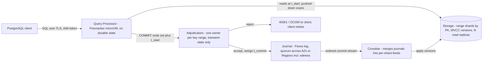

# Aurora DSQL: Multi-Region Active-Active SQL

## TL;DR

Aurora DSQL is a disaggregated, PostgreSQL-compatible OLTP database: stateless query processors (QPs) in Firecracker microVMs, range-sharded MVCC storage, scale-out adjudicators that detect conflicts, and a Paxos-replicated Journal that makes commits durable.
Coordination happens once per transaction, at COMMIT, and never once per statement: reads run at a precision-clock start timestamp with no locks, and writes are buffered inside the QP until commit.
The isolation level is strong snapshot isolation (snapshot isolation plus linearizability, equivalent to PostgreSQL REPEATABLE READ), so transactions abort only on write-write conflicts, with SQLSTATE 40001 / OC000, and write skew is still possible.
Multi-Region means two full Regions plus a witness Region that holds only Journal state: commits pay cross-Region latency, reads stay in-Region, and on a partition the endpoint on the minority side stops serving reads and writes.
Hard per-transaction limits (3,000 modified rows, 10 MiB, 5 minutes) and an OCC hot-key throughput ceiling are what you pay for horizontal scale, so the schema and the retry logic have to be designed around them.

## Mental Model



Think of DSQL as a version of the Aurora idea that "the log is the database" (see [[17-Cloud-AI-Engineering/Volume_02_AWS_Deep_Dive/Chapter_11_Amazon_Aurora_Log_Is_The_Database|Amazon Aurora: Log-Is-The-Database]]), split one level further.
In Aurora the writer instance both decides commit order and ships redo.
In DSQL the decision (adjudicator), the durable log (Journal), the fan-out (crossbar) and the materialized state (storage) are separate services with narrow contracts.
A transaction is just a timestamp plus a buffered write set until COMMIT.
Reads are a pure function of `(key range, t_start)` that any sufficiently caught-up replica can answer, so they need no locks and no conversation with other QPs.
All of the distributed-systems difficulty sits in the single commit step, which is why commit latency, write-set size, and hot-key contention are the three things you have to engineer around.

## Internals

### Component contracts

The 2026 DSQL paper describes every component as exposing a narrow interface.
QPs accept SQL and emit reads against storage plus write sets for adjudicators.
Adjudicators accept write sets and return commit decisions.
Journals accept committed transactions and emit ordered streams.
Crossbars consume Journal streams and emit per-shard change feeds for storage ([Brooker et al., arXiv 2607.13276](https://arxiv.org/pdf/2607.13276), 2026-07).
The team kept the PostgreSQL engine for parsing, planning, execution and the wire protocol, and threw away its local storage and transaction-processing layers ([Murat Demirbas review of the paper](https://muratbuffalo.blogspot.com/2026/07/aurora-dsql-scalable-multi-region-oltp.html), 2026-07).
Each transaction runs in a customized Postgres engine inside a Firecracker microVM dedicated to your database, and QPs never talk to each other ([Brooker, Reads and Compute](https://brooker.co.za/blog/2024/12/04/inside-dsql.html), 2024-12).
For the microVM isolation boundary see [[17-Cloud-AI-Engineering/Volume_13_Seminal_Papers_and_Case_Studies/Chapter_04_Firecracker_MicroVM|Firecracker: Lightweight Virtualization]].

### Data plane: the read path

Tables are index-organized on the primary key, and storage is sharded primarily by primary-key range, not by hash ([Brooker, Dynamo, DynamoDB, and Aurora DSQL](https://brooker.co.za/blog/2025/08/15/dynamo-dynamodb-dsql.html), 2025-08).
Each shard can have as many read replicas as read traffic needs, and storage keeps multiple versions per key (MVCC) ([arXiv 2607.13276](https://arxiv.org/pdf/2607.13276)).
At BEGIN the QP picks `t_start` from EC2's precision time infrastructure, and every read in the transaction, including the implicit read in an `UPDATE`, is served "as of" `t_start` ([Brooker, Dynamo, DynamoDB, and Aurora DSQL](https://brooker.co.za/blog/2025/08/15/dynamo-dynamodb-dsql.html)).
Filters and projections are pushed down to storage, so an index-only scan on the primary key returns only the selected columns, which removes QP-storage round trips ([Brooker, Reads and Compute](https://brooker.co.za/blog/2024/12/04/inside-dsql.html)).
Brooker cites in-Region reads as fast as 1.2 ms ([Brooker, DSQL Vignette: Aurora DSQL, and A Personal Story](https://brooker.co.za/blog/2024/12/03/aurora-dsql.html), 2024-12).

### Beyond the getting-started guide: how a local replica proves it is not stale

The point product docs leave out is how a read served by an in-Region replica can be linearizable when the commit it must observe may have been accepted in another Region.
The answer is a progress watermark, not a lock.
The crossbar merges many Journals into a per-shard stream ordered by commit timestamp.
A storage replica can answer a read at `t_start` only once it knows it has applied every commit with `t_commit <= t_start` from every Journal that could contain writes to its range.
In other words, it needs `min(progress over all contributing journals) >= t_start`.
If the replica is behind, the read waits for the stream to catch up.
It never returns an older version and never contacts a leader.
This is the same idea as Spanner's `t_safe` in [Corbett et al., OSDI 2012](https://www.usenix.org/conference/osdi12/technical-sessions/presentation/corbett), where a replica serves a snapshot read at `t` only if `t <= t_safe`.
Spanner, however, derives `t_safe` from Paxos leader state and pending two-phase-commit prepares.
DSQL derives it from Journal stream progress, because a transaction never reaches a Journal until the adjudicator has accepted it, so there are no pending prepares to wait on.
The operational consequence is that an unhealthy Journal-to-storage pipeline shows up as higher read latency in the affected Region, not as stale reads.
The exact watermark bookkeeping is not published in this form.
The paragraphs above are a synthesis from the published component contracts and the Spanner analogy, and the precise implementation is marked UNVERIFIED.

### Data plane: the write and commit path

An `UPDATE` only records a planned change inside the QP.
Nothing is replicated or stored until COMMIT, which keeps statement latency in-Region and often in-AZ ([Brooker, Transactions and Durability](https://brooker.co.za/blog/2024/12/05/inside-dsql-writes.html), 2024-12).
At COMMIT three things must happen: check whether the isolation rules allow the commit, make the result atomic and durable, and replicate it to every AZ and Region where it must be visible ([arXiv 2607.13276](https://arxiv.org/pdf/2607.13276)).
Brooker's decomposition calls these adjudicate, persist and apply, and notes that a read-only transaction skips the persist step ([Brooker, Decomposing Aurora DSQL](https://brooker.co.za/blog/2025/04/17/decomposing.html), 2025-04).

Adjudication is a variant of Kung and Robinson's optimistic concurrency control ([arXiv 2607.13276](https://arxiv.org/pdf/2607.13276); [Kung and Robinson, ACM TODS 1981](https://doi.org/10.1145/319566.319567)).
The QP sends the write set and `t_start` to the adjudicator that owns those keys.
The adjudicator rejects the transaction if any key in the write set was committed by another transaction after `t_start`.
Otherwise it accepts, assigns `t_commit`, and records the new last-write time for those keys so that later conflicting transactions are rejected.
Each key belongs to at most one adjudicator at any moment, and adjudicators scale by sharding the key space ([arXiv 2607.13276](https://arxiv.org/pdf/2607.13276)).
When a write set spans several adjudicators, a cross-adjudicator coordination protocol runs, which Brooker's vignette deliberately leaves unexplained ([Brooker, Transactions and Durability](https://brooker.co.za/blog/2024/12/05/inside-dsql-writes.html)).
Treat multi-adjudicator commits as costing more than single-adjudicator commits, by an amount AWS has not published.

Accepted transactions are written to the Journal, a distributed transaction log that AWS also uses inside MemoryDB ([Brooker, Personal Story](https://brooker.co.za/blog/2024/12/03/aurora-dsql.html)).
The Journal replicates a log with a Paxos variant and sits as its own component, separate from storage nodes, which is what allows reads and writes to scale independently and allows atomic commits across shards ([Brooker, Dynamo, DynamoDB, and Aurora DSQL](https://brooker.co.za/blog/2025/08/15/dynamo-dynamodb-dsql.html)).
A whole commit goes into one Journal however many rows it touches, which settles atomicity and durability without a two-phase commit across logs ([Vogels, Just make it scale](https://www.allthingsdistributed.com/2025/05/just-make-it-scale-an-aurora-dsql-story.html), 2025-05).
Journals scale per transaction: each transaction lands atomically in a single Journal, and the system can run as many Journals as it needs ([arXiv 2607.13276](https://arxiv.org/pdf/2607.13276)).
For the general consensus mechanics see [[08-Distinguished-Engineering/02-Distributed-Systems-Internals/Raft-Consensus|Raft Consensus]].

### Beyond the getting-started guide: the conflict window is not the transaction duration

Under OCC a hot key's throughput ceiling is set by the conflict window `W = t_adjudicated - t_start`, not by wall-clock statement time.
`W` covers every statement round trip plus the QP-to-adjudicator hop.
In a multi-Region cluster the adjudicator leader for a shard lives in only one Region at a time ([Brooker, Wait! Isn't That Impossible?](https://brooker.co.za/blog/2024/12/06/inside-dsql-cap.html), 2024-12).
A transaction started in Region B that writes keys whose adjudicator leader sits in Region A therefore has a `W` that includes a cross-Region round trip before the decision is made.
The Journal quorum write that follows adjudication adds commit latency, but it does not widen `W` for later conflicts, because the key's last-write time was already recorded at acceptance.
This asymmetry is why the same schema can show a higher 40001 rate in one Region than the other, and why traffic that keeps writers of a key range in the Region where its adjudicator leader currently sits lowers abort rates.
Adjudicator leader placement is managed by the service and is not a customer-visible API (as of 2026-10).

### Isolation: strong snapshot isolation

DSQL supports exactly one isolation level, strong snapshot isolation, which the paper defines as snapshot isolation plus linearizability ([arXiv 2607.13276](https://arxiv.org/pdf/2607.13276)).
It is equivalent to PostgreSQL REPEATABLE READ, and transactions abort only on write-write conflicts, never on read-write conflicts as serializability would require ([arXiv 2607.13276](https://arxiv.org/pdf/2607.13276)).
The paper's argument is that most OLTP writes are also reads, so serializable OCC would abort far more often ([arXiv 2607.13276](https://arxiv.org/pdf/2607.13276)).
On Kleppmann's Hermitage tests DSQL's level behaves like PostgreSQL REPEATABLE READ ([Brooker, Personal Story](https://brooker.co.za/blog/2024/12/03/aurora-dsql.html); [Hermitage](https://github.com/ept/hermitage)).
The anomaly you keep is write skew from [Berenson et al., 1995](https://arxiv.org/abs/cs/0701157): two transactions read an overlapping set, write disjoint rows, and together break an invariant that neither broke alone.
Conflicts surface at COMMIT as `ERROR: change conflicts with another transaction, please retry: (OC000)` with SQLSTATE 40001 ([AWS Heroes walkthrough](https://dev.to/aws-heroes/optimistic-concurrency-control-alice-and-bob-couldnt-sit-together-5bh), 2024-12).

### Control plane versus data plane

The control plane is the `dsql` management API (CreateCluster, UpdateCluster, GetCluster, DeleteCluster) together with IAM token generation, which is signed locally by the SDK and makes no network call.
The data plane is the PostgreSQL wire endpoint plus the QP, adjudicator, Journal, crossbar and storage fleets behind it.
Token generation is a local SigV4 presign, so a control-plane brownout does not block new connections as long as IAM credentials are already cached.
That is a static-stability property in the sense of [[17-Cloud-AI-Engineering/Volume_01_Cloud_Architecture_Principles/Chapter_02_Regions_Zones_and_Static_Stability|Regions, Zones, and Static Stability]].
The local-presign claim rests on how the SDK implements `generate_db_connect_admin_auth_token` and is marked UNVERIFIED for DSQL specifically.

### Replication topology and failure domains

A single-Region cluster commits across AZs, and a multi-Region cluster commits across Regions ([Brooker, Personal Story](https://brooker.co.za/blog/2024/12/03/aurora-dsql.html)).
Storage is replicated across three AZs and billed as one logical copy per Region ([AWS Database Blog, cost monitoring](https://aws.amazon.com/blogs/database/monitor-amazon-aurora-dsql-costs-with-the-aurora-dsql-console-and-cloudwatch-alarms/), 2026-10).
A multi-Region cluster uses three Regions: two that each have an endpoint and a full copy of the data, and a third witness Region that takes part in Journal durability ([Brooker, Wait! Isn't That Impossible?](https://brooker.co.za/blog/2024/12/06/inside-dsql-cap.html)).
If one full Region is partitioned off, its endpoint stops serving both reads and writes, while the majority-side endpoint stays available with strong consistency, isolation and multi-Region durability ([Brooker, Wait! Isn't That Impossible?](https://brooker.co.za/blog/2024/12/06/inside-dsql-cap.html)).
The only component that has to move is the adjudicator leader.
Adjudicators hold no durable state, so the majority side rebuilds their transient state from the committed transactions it already knows ([Brooker, Wait! Isn't That Impossible?](https://brooker.co.za/blog/2024/12/06/inside-dsql-cap.html)).
Brooker contrasts this with pessimistic locking, where losing lock state forces every in-flight transaction to abort ([Brooker, Wait! Isn't That Impossible?](https://brooker.co.za/blog/2024/12/06/inside-dsql-cap.html)).
The paper groups Spanner and CockroachDB as pessimistic designs that coordinate continuously during execution, typically on every statement ([arXiv 2607.13276](https://arxiv.org/pdf/2607.13276)).

### Why the transaction limits exist

A commit is absorbed by the Journal, crossbar and storage as one indivisible unit, so a huge commit stalls the readers and writers queued behind it.
Capping write size bounds that tail-latency effect, and the caps apply only to writes, never to how many rows a read can scan ([Brooker, DSQL: Simplifying Architectures](https://brooker.co.za/blog/2025/11/02/thinking-dsql.html), 2025-11).
AWS also presents the 5-minute and 3,000-row caps as what allows automatic garbage collection of old MVCC versions with no VACUUM ([AWS DEV308 recap](https://dev.to/aws/dev-track-spotlight-build-modern-applications-with-amazon-aurora-dsql-dev308-4g5o), 2025-12).
The mechanism: a 5-minute maximum transaction age gives a hard upper bound on the oldest `t_start` that can still be reading, so versions older than roughly `now - 5 min` that have been superseded can be reclaimed without tracking each reader.

## Numbers to Know

| Quantity | Value | Source and date |
| --- | --- | --- |
| Preview / GA dates | Preview 2024-12-03, GA 2025-05-27 | [AWS What's New](https://aws.amazon.com/about-aws/whats-new/2025/05/amazon-aurora-dsql-generally-available), as of 2026-10 |
| Design availability | 99.99% single-Region, 99.999% multi-Region | AWS What's New, as of 2026-10 |
| Regional footprint | Multi-Region clusters in 16 Regions, single-Region in 20 | [AWS What's New 2026-07](https://aws.amazon.com/about-aws/whats-new/2026/07/amazon-aurora-dsql-adds-multi-region-clusters-four-more-regions/), as of 2026-10 |
| In-Region read latency | As low as 1.2 ms | Brooker blog 2024-12, vendor figure |
| Max connections per cluster | 10,000 (adjustable), error 53300 | [awslabs DSQL starter kit quotas](https://awslabs.github.io/aurora-dsql-starter-kit/quotas-and-limits.html), as of 2026-10 |
| Connection rate | 100/s refill, burst bucket 1,000, not adjustable, error 53400 | awslabs quotas, as of 2026-10 |
| Rows modified per transaction | 3,000, error 54000 | awslabs quotas; AWS Database Blog, as of 2026-10 |
| Data modified per transaction | 10 MiB, error 54000 | awslabs quotas, as of 2026-10 |
| Max transaction duration | 5 minutes (300 s), error 54000 | awslabs quotas, as of 2026-10 |
| Indexes per table | 24 | awslabs quotas, as of 2026-10 |
| Schemas per database | 10 | awslabs quotas, as of 2026-10 |
| Max session duration | 1 hour | Secondary source from the preview era, UNVERIFIED for GA |
| Preview-era row limit (historical) | 10,000 rows per transaction | awsfundamentals.com, 2024-12 |
| DPU price | USD 8.00 per 1M DPU (us-east-1, us-east-2) | AWS Database Blog 2026-10, as of 2026-10 |
| Storage price | USD 0.33 per GB-month, one logical copy per Region | AWS Database Blog, as of 2026-10 |
| Multi-Region write surcharge | MultiRegionWriteDPU equal to the originating WriteDPU | usage.ai citing the AWS pricing page, as of 2026-10 |
| Free tier | 100,000 DPU + 1 GB per month, does not expire | AWS Database Blog, as of 2026-10 |
| Budget alarm conversion | USD 100/month = 12.5M DPU = ~17,123 DPU/hour | AWS Database Blog, as of 2026-10 |
| Spanner TrueTime uncertainty | epsilon sawtooth ~1-7 ms, leader leases 10 s | Corbett et al., OSDI 2012 (paper values) |

## AWS vs GCP Mechanism Parity

Google Cloud's closest counterpart is Cloud Spanner (see [[17-Cloud-AI-Engineering/Volume_03_GCP_Deep_Dive/Chapter_10_Cloud_Spanner_TrueTime_and_External_Consistency\|Cloud Spanner: TrueTime and External Consistency]]).
AlloyDB is a single-writer engine and does not belong in this comparison.
GCP-side figures that change over time were not re-verified in this revision and are tagged.

| Dimension | Aurora DSQL | Cloud Spanner | Critical difference |
| --- | --- | --- | --- |
| Concurrency control | OCC: no locks during execution, validation at COMMIT by adjudicators | Pessimistic 2PL with wound-wait at Paxos leaders for read-write transactions (OSDI 2012) | DSQL aborts at commit, while Spanner blocks or wounds during execution |
| Default isolation | Strong snapshot isolation only (PostgreSQL REPEATABLE READ) | Serializable with external consistency (paper), other levels UNVERIFIED as of 2026-10 | DSQL allows write skew and Spanner does not |
| Coordination frequency | Once per transaction, at COMMIT | Per statement for lock acquisition, plus 2PC across groups at commit | DSQL statements stay in-Region, while Spanner locking reads go to the leader |
| Clock role | Precision EC2 time picks `t_start` and orders commits | TrueTime interval `[earliest, latest]`, commit wait ~2 epsilon | Spanner exposes uncertainty in the protocol, while DSQL's use of clock bounds is not published in detail |
| Replicated log | Journal (Paxos variant), separate from storage, one Journal per commit | Paxos group per split, colocated with tablet storage | DSQL scales the log independently of the data |
| Cross-shard atomicity | Single-Journal write, no cross-log 2PC; cross-adjudicator protocol for decisions | 2PC with a coordinator Paxos group | DSQL takes 2PC off the durability path |
| Read path | Any caught-up replica at `t_start`, no leader | Snapshot reads at any replica with `t <= t_safe` | Equivalent watermark idea with different safe-time inputs |
| Multi-Region topology | Two full Regions + witness Region (Journal only) | Multi-Region configs with read-write, read-only and witness replicas (UNVERIFIED as of 2026-10) | Spanner offers more topologies, DSQL offers two writable endpoints |
| Partition behavior | Minority-side endpoint stops serving, majority continues | Minority replicas cannot serve strong reads or writes | Both choose CP, and DSQL rebuilds adjudicator state from the log |
| SQL surface | PostgreSQL wire protocol and dialect subset | GoogleSQL plus a PostgreSQL interface (UNVERIFIED as of 2026-10) | Neither is a drop-in PostgreSQL |
| Capacity model | Serverless DPU, scales to zero | Provisioned compute capacity with optional autoscaling (UNVERIFIED as of 2026-10) | DSQL has no idle compute floor |
| Per-transaction caps | 3,000 rows, 10 MiB, 5 min | Mutation-count and commit-size limits exist, values UNVERIFIED as of 2026-10 | DSQL caps are stricter and shape batch design |
| AuthN to the data plane | Short-lived IAM SigV4 token used as the Postgres password | IAM, plus database roles and fine-grained access control | DSQL removes static DB passwords entirely |
| Private access | AWS PrivateLink | Private Service Connect / Private Google Access, VPC Service Controls perimeter | GCP has a perimeter primitive with no direct AWS counterpart (see [[17-Cloud-AI-Engineering/Volume_03_GCP_Deep_Dive/Chapter_03_VPC_Service_Controls_Security_Perimeters\|VPC Service Controls]]) |

## Worked Example: Peered Multi-Region Ledger with OCC-Safe Retries

### Lab cost estimate

An idle cluster bills no DPU, only storage.
A lab that writes a few thousand rows and runs a few thousand transactions stays well inside the 100,000 DPU and 1 GB monthly free tier (AWS Database Blog, as of 2026-10).
Expected spend is under USD 1 if you tear down the same day.
In a multi-Region cluster storage bills in each Region, so a 1 GB test dataset costs about 2 x USD 0.33 per month before the free tier.

### Step 1: budget guardrail first

```bash
#!/usr/bin/env bash
set -euo pipefail
ACCOUNT_ID="$(aws sts get-caller-identity --query Account --output text)"
EMAIL="you@example.com"

# Account-wide monthly cost budget with an 80 percent actual-spend alert.
aws budgets create-budget --account-id "$ACCOUNT_ID" \
  --budget '{"BudgetName":"dsql-lab","BudgetLimit":{"Amount":"20","Unit":"USD"},"TimeUnit":"MONTHLY","BudgetType":"COST"}' \
  --notifications-with-subscribers "[{\"Notification\":{\"NotificationType\":\"ACTUAL\",\"ComparisonOperator\":\"GREATER_THAN\",\"Threshold\":80,\"ThresholdType\":\"PERCENTAGE\"},\"Subscribers\":[{\"SubscriptionType\":\"EMAIL\",\"Address\":\"$EMAIL\"}]}]"
```

### Step 2: create two peered clusters with a witness Region

```bash
#!/usr/bin/env bash
set -euo pipefail
R1=us-east-1; R2=us-east-2; WITNESS=us-west-2

A_ID=$(aws dsql create-cluster --region "$R1" --no-deletion-protection-enabled \
  --multi-region-properties "{\"witnessRegion\":\"$WITNESS\"}" --query identifier --output text)
B_ID=$(aws dsql create-cluster --region "$R2" --no-deletion-protection-enabled \
  --multi-region-properties "{\"witnessRegion\":\"$WITNESS\"}" --query identifier --output text)

A_ARN=$(aws dsql get-cluster --region "$R1" --identifier "$A_ID" --query arn --output text)
B_ARN=$(aws dsql get-cluster --region "$R2" --identifier "$B_ID" --query arn --output text)

# Peer each cluster with the other; the clusters become ACTIVE after peering completes.
aws dsql update-cluster --region "$R1" --identifier "$A_ID" \
  --multi-region-properties "{\"witnessRegion\":\"$WITNESS\",\"clusters\":[\"$B_ARN\"]}"
aws dsql update-cluster --region "$R2" --identifier "$B_ID" \
  --multi-region-properties "{\"witnessRegion\":\"$WITNESS\",\"clusters\":[\"$A_ARN\"]}"

echo "A=$A_ID ($R1)  B=$B_ID ($R2)"
echo "Endpoints: $A_ID.dsql.$R1.on.aws and $B_ID.dsql.$R2.on.aws"
echo "export A_ID=$A_ID B_ID=$B_ID ACCOUNT_ID=$ACCOUNT_ID" > ~/.dsql_lab_env
```

The `--multi-region-properties` JSON shape and the `<id>.dsql.<region>.on.aws` endpoint format follow the GA API as best known at the time of writing; check them against `aws dsql help` before running (listed as UNVERIFIED).

### Step 3: schema designed for range sharding and OCC

```sql
-- Random UUID keys spread inserts across range shards; monotonic keys would pile onto the last shard.
CREATE TABLE accounts (
  id         UUID PRIMARY KEY,
  balance    BIGINT NOT NULL CHECK (balance >= 0),
  updated_at TIMESTAMPTZ NOT NULL DEFAULT now()
);

CREATE TABLE transfers (
  idempotency_key TEXT PRIMARY KEY,   -- retries become idempotent replays, not double posts
  src UUID NOT NULL,
  dst UUID NOT NULL,
  amount BIGINT NOT NULL CHECK (amount > 0),
  created_at TIMESTAMPTZ NOT NULL DEFAULT now()
);
```

Run each DDL statement in its own transaction, because DSQL does not allow DDL and DML in the same transaction (secondary source; recheck current docs).

### Step 4: Python client with token auth and bounded jittered retries

```python
# pip install boto3 "psycopg[binary]"
import random, time, uuid
import boto3, psycopg
from psycopg import errors

REGION = "us-east-1"
HOST = "<cluster-id>.dsql.us-east-1.on.aws"

def connect():
    token = boto3.client("dsql", region_name=REGION).generate_db_connect_admin_auth_token(
        Hostname=HOST, Region=REGION)
    return psycopg.connect(host=HOST, port=5432, dbname="postgres", user="admin",
                           password=token, sslmode="require", autocommit=False)

def transfer(conn, key, src, dst, amount, max_attempts=6):
    for attempt in range(max_attempts):
        try:
            with conn.transaction():
                cur = conn.cursor()
                cur.execute("SELECT 1 FROM transfers WHERE idempotency_key = %s", (key,))
                if cur.fetchone():
                    return "replayed"
                cur.execute("UPDATE accounts SET balance = balance - %s, updated_at = now() "
                            "WHERE id = %s AND balance >= %s", (amount, src, amount))
                if cur.rowcount != 1:
                    raise ValueError("insufficient funds")
                cur.execute("UPDATE accounts SET balance = balance + %s, updated_at = now() "
                            "WHERE id = %s", (amount, dst))
                cur.execute("INSERT INTO transfers VALUES (%s, %s, %s, %s)", (key, src, dst, amount))
            return "committed"
        except errors.SerializationFailure:  # SQLSTATE 40001, OC000 at COMMIT
            time.sleep(random.uniform(0, min(1.0, 0.01 * 2 ** attempt)))  # full jitter
    raise RuntimeError("OCC retries exhausted; shed or queue this request")

if __name__ == "__main__":
    with connect() as c:
        a, b = uuid.uuid4(), uuid.uuid4()
        with c.transaction():
            c.execute("INSERT INTO accounts (id, balance) VALUES (%s, 1000), (%s, 0)", (a, b))
        print(transfer(c, str(uuid.uuid4()), a, b, 10))
```

The retry wraps the whole transaction, not the failed statement, because the OCC abort invalidates every read made at the old `t_start`.
Full jitter follows [[17-Cloud-AI-Engineering/Volume_07_Reliability_and_SRE/Chapter_03_Resilient_Communication_Retries_Jitter_and_Circuit_Breakers|Resilient Communication: Retries, Jitter, and Circuit Breakers]].
The idempotency row is also written, so two concurrent retries of the same key collide as a write-write conflict and cannot both commit.

### Step 5: DPU alarm per cluster

```bash
[ -f ~/.dsql_lab_env ] && source ~/.dsql_lab_env
# Hourly threshold for a USD 100/month budget at USD 8 per 1M DPU: 0.8 * 12.5e6 / 730 = ~13,699 DPU.
aws cloudwatch put-metric-alarm --region us-east-1 --alarm-name dsql-lab-dpu \
  --namespace "AWS/AuroraDSQL" --metric-name TotalDPU \
  --dimensions Name=ClusterId,Value="$A_ID" \
  --statistic Sum --period 3600 --evaluation-periods 1 \
  --threshold 13699 --comparison-operator GreaterThanThreshold
```

The metric name `TotalDPU` and the threshold arithmetic come from the AWS Database Blog (as of 2026-10).
The namespace and dimension name are UNVERIFIED and should be checked in the CloudWatch console.

### Step 6: teardown

```bash
[ -f ~/.dsql_lab_env ] && source ~/.dsql_lab_env
ACCOUNT_ID=${ACCOUNT_ID:-$(aws sts get-caller-identity --query Account --output text)}
aws dsql delete-cluster --region us-east-1 --identifier "$A_ID"
aws dsql delete-cluster --region us-east-2 --identifier "$B_ID"
aws budgets delete-budget --account-id "$ACCOUNT_ID" --budget-name dsql-lab
aws cloudwatch delete-alarms --region us-east-1 --alarm-names dsql-lab-dpu
rm -f ~/.dsql_lab_env
```

### Capacity and cost sizing

The workload is a payments ledger with 200 write transactions/s and 2,000 read transactions/s on average, across two peered Regions.
A month is 730 h x 3,600 s = 2,628,000 s.
That gives 525.6M write transactions and 5.256B read transactions per month.
DPU per transaction depends on the workload and must be measured from `TotalDPU` during a load test.
For this example only, assume 2.0 WriteDPU + 1.0 ComputeDPU per write transaction and 0.5 DPU per read transaction (ASSUMPTION).
Single-Region DPU = 525.6M x 3.0 + 5.256B x 0.5 = 4,204.8M DPU, which is about USD 33,638/month at USD 8 per 1M.
Multi-Region adds MultiRegionWriteDPU equal to WriteDPU, giving 525.6M x 5.0 + 2,628M = 5,256M DPU, which is about USD 42,048/month.
Storage at 500 GB is 2 Regions x 500 x USD 0.33 = USD 330/month.
Concurrency by Little's law: at 200 TPS with a 30 ms mean transaction lifetime, about 6 connections are busy on average.
Size pools for the p99 lifetime and the burst factor, not the mean.
The binding connection constraint is the 100 connections/s refill rate, not the 10,000-connection cap.
Hot-key ceiling: with conflict window `W`, a single row cannot sustain much more than `1/W` successful read-modify-write commits per second.
Under Poisson competition at rate `lambda`, the abort probability is about `1 - exp(-lambda x W)`.
For a single-Region `W` of 6.5 ms and 50 competing commits/s on one row, aborts are about 28%.
If `W` widens to 18.5 ms because the adjudicator leader is remote, the same load aborts about 60% of the time, so hot rows must be sharded (for example into bucketed counters) before they reach that regime.

## Failure Modes and Pitfalls

### OCC retry amplification on hot rows

Under heavy contention DSQL aborts transactions that a lock-based database would have queued, and hot keys see write-write conflicts across the read-modify-commit window ([Demirbas review](https://muratbuffalo.blogspot.com/2026/07/aurora-dsql-scalable-multi-region-oltp.html)).
Retries without jitter re-synchronize the contenders and push the abort rate toward 1, which is a metastable loop.
Mitigations: shard counters and inventory into N bucket rows, encode invariants as `CHECK` constraints plus conditional `UPDATE ... WHERE qty >= n`, and treat 40001 as "retry elsewhere" rather than "retry the same row" ([AWS Builder Center oversell write-up](https://builder.aws.com/content/3FkzBWnxJmVlPI9Z9XHMtA83Q5O/a-million-agents-100-units-zero-oversells-engineering-around-aurora-dsqls-optimistic-concurrency), 2026-06).
Export the 40001 count as a first-class SLI, because a rising abort ratio is the leading indicator of a hot key.

### Write skew under snapshot isolation

The textbook case is two on-call engineers who each check that someone else is on call and then each remove themselves; they modify different rows, so snapshot isolation sees no conflict ([andrewbaker.ninja](https://andrewbaker.ninja/2025/11/19/amazon-aurora-dsql-performance-limits-architecture/), 2025-11).
Fix it by materializing the conflict: have every participating transaction write a shared guard row (for example, increment `shift.version`), which turns the read-write dependency into a write-write conflict that the adjudicator does detect.

### Batch jobs and ORMs exceeding transaction caps

A single `INSERT ... SELECT` followed by a `DELETE` over an unbounded predicate fails once it passes 3,000 rows ([AWS Database Blog, pagination](https://aws.amazon.com/blogs/database/pagination-patterns-in-amazon-aurora-dsql/), 2026-06).
Library defaults break silently: one open-source project found that a 1,000-entity batch already writes 3,000 rows once you count change-log and guard rows, and the resulting SQLSTATE 54000 surfaced as an HTTP 500 ([GitHub issue](https://github.com/Lychee-Technology/forma/issues/692), 2026-10).
Count physical rows written, including secondary tables, not logical entities, and run batches through keyset pagination in idempotent chunks.
Foreign keys with `ON DELETE CASCADE` over unbounded fan-out can hit the same ceiling, because cascaded rows count against the 3,000 limit ([daily.dev summary of the AWS FK launch](https://daily.dev/posts/aurora-dsql-adds-foreign-key-constraints-enforced-with-optimistic-concurrency-control-8xxxqhspg), 2026-10).

### Connection storms

When thousands of Lambda functions or pods cold-start together, the cluster connection rate (100/s refill, 1,000 burst) runs out long before the 10,000-connection cap, and clients receive 53400 (awslabs quotas, as of 2026-10).
Hold long-lived pools, reconnect before the session cap, and add jitter to reconnects after deploys.

### Monotonic primary keys on a range-sharded store

Because storage is sharded by key range, timestamp-prefixed or sequence-like keys send every insert to the tail shard and its single owning adjudicator.
That serializes write throughput no matter how much the rest of the system scales.

### Regional impairment semantics

DSQL does not steer clients.
When a full Region ends up on the minority side, its endpoint stops serving both reads and writes ([Brooker, Wait! Isn't That Impossible?](https://brooker.co.za/blog/2024/12/06/inside-dsql-cap.html)).
Your routing layer (for example Route 53 health checks, see [[17-Cloud-AI-Engineering/Volume_00_Foundations_Under_the_Cloud/Chapter_03_DNS_Anycast_and_Global_Traffic_Management|DNS, Anycast, and Global Traffic Management]]) must move traffic, and health checks must test a real transaction rather than TCP reachability.
Losing the witness Region alone leaves two of three sites, but a second simultaneous loss takes away the quorum.
Transactions in flight when a Region drops do not commit and must be retried idempotently on the surviving endpoint.

### Side effects inside transactions

Any external side effect (HTTP call, queue publish) performed before COMMIT runs again on each OCC retry.
Use a transactional outbox row and publish it after the commit succeeds (see [[17-Cloud-AI-Engineering/Volume_02_AWS_Deep_Dive/Chapter_13_Messaging_and_Streaming_SQS_SNS_EventBridge_and_MSK|Messaging and Streaming: SQS, SNS, EventBridge, and MSK]]).

### Public incident lessons

No public post-incident review specific to Aurora DSQL was found as of 2026-10.
The closest lesson is the AWS us-east-1 event of 2025-10-19/20, in which a race in DynamoDB's DNS automation removed a regional endpoint record and the failure cascaded into dependent services (UNVERIFIED in this revision; see [[17-Cloud-AI-Engineering/Volume_07_Reliability_and_SRE/Chapter_07_Anatomy_of_Major_Cloud_Outages|Anatomy of Major Cloud Outages]]).
For DSQL designers the takeaway is that multi-Region data replication does nothing for you if failover depends on a control plane or DNS automation in the impaired Region.

## Security and Cost Angles

### Identity

There are no static database passwords: the client presents a short-lived SigV4-signed token as the Postgres password.
The IAM action `dsql:DbConnectAdmin` gates the `admin` role, and `dsql:DbConnect` gates custom database roles mapped to IAM roles (action names UNVERIFIED as of 2026-10; see [[17-Cloud-AI-Engineering/Volume_02_AWS_Deep_Dive/Chapter_01_IAM_Policy_Evaluation_Engine|IAM Policy Evaluation Engine]]).
Restrict `DbConnectAdmin` to break-glass roles, scope `DbConnect` by cluster ARN, and deny the management API's `DeleteCluster` with an SCP outside the platform pipeline.
Workloads should obtain AWS credentials through [[17-Cloud-AI-Engineering/Volume_08_Security_Identity_and_the_Data_Perimeter/Chapter_02_Workload_Identity_Federation|Workload Identity Federation]] patterns such as EKS Pod Identity, so the token chain never touches a long-lived key.

### Encryption and network boundary

At GA, DSQL listed integration with AWS KMS, AWS PrivateLink, CloudTrail, CloudFormation and AWS Backup ([aws-news GA summary](https://aws-news.com/article/01971309-9066-883d-510a-dff50286c8bd), 2025-05).
Use customer-managed KMS keys when key revocation is a compliance requirement, and expect a revoked key to make the cluster inaccessible, which is the intended behavior and also an availability risk (see [[17-Cloud-AI-Engineering/Volume_08_Security_Identity_and_the_Data_Perimeter/Chapter_04_Encryption_Key_Hierarchies_and_Envelope_Encryption|Encryption Key Hierarchies and Envelope Encryption]]).
Put connection traffic on PrivateLink interface endpoints and enforce endpoint-scoped access with the data-perimeter approach in [[17-Cloud-AI-Engineering/Volume_08_Security_Identity_and_the_Data_Perimeter/Chapter_06_Constructing_an_Impenetrable_Data_Perimeter|Constructing an Impenetrable Data Perimeter]].

### Unit economics levers

DPU combines compute, read I/O, write I/O, multi-Region write and CDC streaming into a single meter (AWS Database Blog, as of 2026-10).
Multi-Region doubles the write component, so put only the tables that need active-active RPO=0 into the peered cluster and keep high-volume, low-value writes (telemetry, sessions) elsewhere.
Every OCC abort spends DPU without producing a commit, so lowering the abort rate is a cost lever as well as a latency lever.
Pushed-down, index-covered reads cost fewer DPU than broad scans, so composite indexes that match the access pattern pay for themselves.
Because DSQL scales to zero, dev and test clusters cost only storage while idle, unlike provisioned engines; see [[17-Cloud-AI-Engineering/Volume_09_FinOps_and_Cloud_Economics/Chapter_01_Cloud_Billing_Models_and_Unit_Cost_Allocation|Cloud Billing Models and Unit Cost Allocation]].

## Interview Questions and Model Answers

### Question 1 (L5 - Senior)

Your service on DSQL gets `40001` at COMMIT but never on the `UPDATE` itself. Why, and how do you write a correct retry?

#### Model Answer

DSQL buffers writes inside the query processor and talks to the adjudicator only at COMMIT, so there is nothing to conflict with until then.
At COMMIT the adjudicator checks whether any key in the write set was committed by another transaction after this transaction's `t_start`.
If one was, it rejects the commit with OC000 / SQLSTATE 40001.
The retry has to re-run the entire transaction from BEGIN, because every read was made at a snapshot that is now known to be stale, and replaying only the last statement would commit decisions based on old data.
I bound the attempts (around five or six), use full-jitter exponential backoff so contenders spread out, and make the operation idempotent with a client-supplied key stored in a unique-keyed row.
That row is written inside the same transaction, so two concurrent retries collide as a write-write conflict and only one commits.
Side effects go into an outbox table and are published only after the commit succeeds.
Once attempts run out, I return a retryable 429/503 to the caller rather than looping, so a hot key cannot use up the thread pool.
I export the abort ratio per endpoint, because a rising ratio is the earliest sign of contention.

#### Follow-up Interviewer Question

Under what conditions would one Region of a peered cluster show a materially higher abort rate than the other for the same code?

### Question 2 (L5 - Senior)

You need to purge 40 million expired rows from a DSQL table every night. Design the job.

#### Model Answer

A single `DELETE` fails because DSQL caps a transaction at 3,000 modified rows, 10 MiB of modified data and 5 minutes.
I iterate with keyset pagination on an index whose leading column is the expiry predicate, and delete chunks of about 1,000 to 2,000 primary keys, leaving headroom for index maintenance and any cascades.
Each chunk is its own transaction, which keeps each OCC window short and lets a failed chunk retry on its own.
The job is idempotent because deleting a key that is already gone is a no-op, and it records a resume cursor so it can restart after interruption.
40 million rows divided by 2,000 is 20,000 transactions, so finishing in one hour needs about 5.6 commits/s.
I run a few parallel workers over disjoint key ranges and cap concurrency to protect online traffic.
Disjoint ranges also mean the workers never conflict with each other, and the live write path only conflicts if it is updating rows that are expiring right now.
If the data has a natural time partition, a cheaper design is to write it into per-period tables and drop a whole table, because dropping a table avoids the per-row work (subject to the DDL rules).

#### Follow-up Interviewer Question

How does the 3,000-row limit interact with a foreign key declared `ON DELETE CASCADE` from this table to a child table?

### Question 3 (L6 - Staff)

A reader in us-east-2 begins a transaction 2 ms after a writer in us-east-1 receives its COMMIT acknowledgment. Explain mechanically why the reader sees the write, without any read talking to us-east-1.

#### Model Answer

The writer's commit was acknowledged only after the adjudicator accepted it with some `t_commit` and the Journal replicated it to a quorum spanning Regions, so `t_commit` is earlier than the acknowledgment.
The reader picks `t_start` from EC2 precision time, and with tightly bounded clock error, `t_start` falls after the writer's `t_commit` (the exact clock-bound handling is unpublished).
The storage replica in us-east-2 may serve a read at `t_start` only once its crossbar-fed stream shows that every Journal contributing to that key range has advanced past `t_start`.
So it either already holds the version, or it waits until replication delivers it.
The read never contacts a leader or the other Region.
The only thing that can happen is a short wait proportional to Journal propagation lag, which shows up as latency, never as staleness.
This is the same idea as Spanner's `t_safe`.
The difference is that Spanner has to account for prepared-but-uncommitted 2PC transactions in its safe time, while DSQL transactions enter the Journal only after adjudication, so there is nothing pending to hold the watermark back.
The trade-off is that a degraded replication path in one Region becomes a read-latency incident in that Region, so I alert on read p99 per Region, not just on errors.

#### Follow-up Interviewer Question

What would break if storage replicas served reads at `t_start` without waiting for the watermark, and which isolation guarantee would you lose first?

### Question 4 (L6 - Staff)

A scheduling app enforces "at least one doctor on call per ward" by checking the count before letting a doctor leave. It works on single-node PostgreSQL in SERIALIZABLE mode but fails on DSQL. Diagnose and fix it without moving to another database.

#### Model Answer

This is write skew.
DSQL supports only strong snapshot isolation, so two transactions can both read "two doctors on call", each delete a different doctor's row, and both commit, because their write sets do not overlap.
SERIALIZABLE PostgreSQL catches the read-write dependency with SSI, and DSQL deliberately does not, because aborting on read-write conflicts would raise abort rates for ordinary OLTP traffic.
The fix is to materialize the invariant as a row that both transactions must write: a `ward_oncall` row holding a count or version, which every on-call change updates in the same transaction.
The two transactions now conflict write-write on that row, and the adjudicator lets only one commit.
The other gets 40001, retries, re-reads the count as one, and refuses.
The cost is that all on-call changes for a ward serialize through one row, which is acceptable at human change rates but would not be for a high-rate counter.
For high rates I would partition the guard row by sub-scope only where the invariant allows it.
I would also add a reconciliation job that alerts if the invariant is ever violated, because constraint enforcement in application code needs an independent detector.

#### Follow-up Interviewer Question

Name a second invariant class where materializing the conflict is impractical, and describe how you would enforce it.

### Question 5 (L6 - Staff)

Compare DSQL and Spanner for a flash-sale inventory row that receives 5,000 decrement attempts per second.

#### Model Answer

Neither engine can serialize 5,000 read-modify-writes per second on one row at multi-Region commit latencies.
They fail in different ways.
On Spanner, 2PL at the split leader queues the writers.
Throughput is about `1 / (lock hold time)`, and lock hold time includes the Paxos commit plus commit wait, so tail latency grows and wound-wait aborts younger transactions.
On DSQL nothing blocks: all 5,000 run in parallel, and at COMMIT the adjudicator accepts the first per key per window and rejects the rest.
With a conflict window of 6.5 ms the row tops out near 150 commits/s.
The abort probability is about `1 - exp(-lambda x W)`, which is close to 1 at this load, so DPU is spent on work that gets thrown away.
The right design is the same on both: split stock into N bucket rows (for example N = 64), have clients choose a random bucket with a conditional decrement and `CHECK (qty >= 0)`, and treat a 40001 or zero-rows result as "try another bucket".
A periodic rebalancer moves stock between buckets, and the total is the sum, so the invariant "never oversell" is enforced per bucket by the constraint.
Choosing between them for this workload then comes down to SQL dialect, cloud placement, and whether you need writable endpoints in two Regions (DSQL) or richer topology choices (Spanner), not to raw single-row throughput.

#### Follow-up Interviewer Question

How do you choose N, and what does over-sharding the buckets cost you near sell-out?

### Question 6 (L7+ - Principal)

The CFO asks why a "two-Region active-active" ledger needs a third Region, and what RPO and RTO you can promise. Answer for the executive and for the review board.

#### Model Answer

For the executive: with only two sites, when the link between them fails, neither site can tell a dead peer from a severed link.
Either both keep writing and the ledger diverges, or both stop and we are down.
A third site acting as a tie-breaker lets exactly one side keep going safely.
DSQL's witness Region stores only Journal state, so it costs little and holds no queryable data.
For the board: commits are acknowledged only after the Journal reaches quorum across Regions, so any acknowledged transaction survives the loss of a full Region, and RPO for acknowledged writes is zero.
On a partition, the minority-side endpoint stops serving reads and writes, and the majority side keeps going once adjudicator leadership moves.
Adjudicators carry no durable state and rebuild from committed history, so that move is quick, but its duration is not published, and I would measure it in a game day rather than promise a number.
Our application RTO is set by our own detection and routing: health-check interval times the failure threshold, plus DNS TTL, plus client pool reconnect, typically tens of seconds to low minutes.
I would set the SLO from game-day measurements (see [[17-Cloud-AI-Engineering/Volume_07_Reliability_and_SRE/Chapter_05_Chaos_Engineering_and_Game_Days|Chaos Engineering and Game Days]]).
Residual risks: simultaneous loss of two of the three sites means unavailability, all writes pay cross-Region commit latency, and write DPU doubles.
I would also check that failover does not depend on a control plane in the failed Region, because that is the pattern behind most large cloud outages.

#### Follow-up Interviewer Question

Which of the three Regions would you choose as witness for a cluster peered between us-east-1 and us-east-2, and what correlated-failure analysis would drive that choice?

### Question 7 (L7+ - Principal)

You own the data platform for a payments company that runs on both AWS and GCP. Product wants one strongly consistent ledger writable from both clouds. Evaluate the options.

#### Model Answer

First I would push back on the requirement.
A single strongly consistent write path spanning two providers puts consensus traffic on inter-cloud links.
Every commit pays the inter-cloud RTT, the interconnect becomes a correlated failure domain that neither provider's SLA covers, and egress is billed on every replicated byte (see [[17-Cloud-AI-Engineering/Volume_04_AWS_vs_GCP_Translation/Chapter_07_Multi_Cloud_and_Hybrid_Architecture_Reality|Multi-Cloud and Hybrid Architecture Reality]]).
Managed DSQL and managed Spanner each replicate only inside their own cloud, so "one ledger in both clouds" means self-managing a cross-cloud engine such as CockroachDB (see [[04-System-Design/05-Data-Stores/CockroachDB-Distributed-SQL|CockroachDB Distributed SQL]]).
That means taking on operations, upgrades and quorum placement, with a pessimistic protocol that coordinates per statement over the slowest link.
The design I would recommend: assign each account a home cloud, run the authoritative ledger for that account on DSQL (multi-Region on AWS) or Spanner (multi-Region on GCP), and treat cross-cloud transfers as an idempotent two-leg saga with an outbox and a reconciliation process.
Intra-cloud transfers, the large majority, then get single ACID transactions, and the saga's eventual consistency is confined to the rare cross-home case, where a payments business already needs reconciliation for external rails.
The decision criteria I would put in front of the board: share of transfers that cross homes, latency budget per commit, regulator stance on RPO=0 across providers, and the full cost of running a self-managed consensus engine across clouds.

#### Follow-up Interviewer Question

How do you migrate an account's home from GCP to AWS without a double-spend window?

## Further Reading

- [Brooker et al., "Aurora DSQL: Scalable, Multi-Region OLTP", arXiv 2607.13276 (2026)](https://arxiv.org/pdf/2607.13276) - The primary architecture paper, covering component contracts, the OCC choice, and the strong snapshot isolation rationale.
- [Brooker, "DSQL Vignette: Reads and Compute"](https://brooker.co.za/blog/2024/12/04/inside-dsql.html) - MVCC read path, Firecracker QPs, and storage pushdown from the system's lead engineer.
- [Brooker, "DSQL Vignette: Transactions and Durability"](https://brooker.co.za/blog/2024/12/05/inside-dsql-writes.html) - Commit-time adjudication and the Journal handoff.
- [Brooker, "DSQL Vignette: Wait! Isn't That Impossible?"](https://brooker.co.za/blog/2024/12/06/inside-dsql-cap.html) - Witness Region, partition behavior, and why stateless adjudicators make failover cheap.
- [Brooker, "Decomposing Aurora DSQL"](https://brooker.co.za/blog/2025/04/17/decomposing.html) - The adjudicate, persist, apply breakdown of a transaction.
- [Brooker, "DSQL: Simplifying Architectures"](https://brooker.co.za/blog/2025/11/02/thinking-dsql.html) - Why write-size limits protect tail latency.
- [Brooker, "Dynamo, DynamoDB, and Aurora DSQL"](https://brooker.co.za/blog/2025/08/15/dynamo-dynamodb-dsql.html) - Range sharding and a separate Paxos log, compared with the Dynamo lineage in [[17-Cloud-AI-Engineering/Volume_13_Seminal_Papers_and_Case_Studies/Chapter_01_Dynamo_and_DynamoDB|Dynamo and DynamoDB]].
- [Vogels, "Just make it scale: An Aurora DSQL story"](https://www.allthingsdistributed.com/2025/05/just-make-it-scale-an-aurora-dsql-story.html) - The single-Journal-per-commit decision and the engineering history behind it.
- [Corbett et al., "Spanner", OSDI 2012](https://www.usenix.org/conference/osdi12/technical-sessions/presentation/corbett) - The pessimistic, TrueTime-based counterpart, read alongside [[17-Cloud-AI-Engineering/Volume_13_Seminal_Papers_and_Case_Studies/Chapter_06_Google_Spanner|Google Spanner]].
- [Kung and Robinson, "On Optimistic Methods for Concurrency Control", ACM TODS 1981](https://doi.org/10.1145/319566.319567) - The OCC scheme that DSQL's adjudication adapts.
- [Berenson et al., "A Critique of ANSI SQL Isolation Levels", SIGMOD 1995](https://arxiv.org/abs/cs/0701157) - Formal definition of snapshot isolation and write skew.
- [Kleppmann, Hermitage](https://github.com/ept/hermitage) - Executable isolation-anomaly tests for checking DSQL's REPEATABLE READ equivalence yourself.
- [AWS Database Blog, "Monitor Amazon Aurora DSQL costs"](https://aws.amazon.com/blogs/database/monitor-amazon-aurora-dsql-costs-with-the-aurora-dsql-console-and-cloudwatch-alarms/) - Official DPU meter breakdown and alarm-threshold arithmetic.
- [AWS Database Blog, "Pagination patterns in Amazon Aurora DSQL"](https://aws.amazon.com/blogs/database/pagination-patterns-in-amazon-aurora-dsql/) - Keyset batching within the 3,000-row cap.
- [AWS Database Blog, "Aurora DSQL for global-scale financial transactions"](https://aws.amazon.com/blogs/database/amazon-aurora-dsql-for-global-scale-financial-transactions/) - Ledger design patterns under OCC from the service team.
