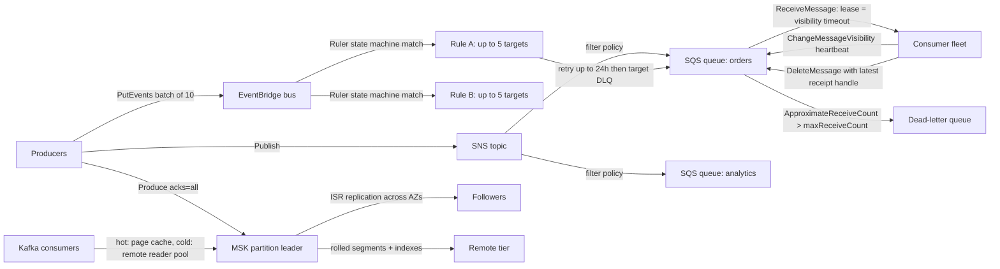

# Messaging and Streaming: SQS, SNS, EventBridge, and MSK

## TL;DR

SQS is a distributed, replicated buffer, not a log: a message gets a new receipt handle every time it is received, and a `DeleteMessage` call made with an old handle can return success without deleting anything, so consumers must be idempotent.
The visibility timeout is a lease with no fencing token: if a consumer stalls past the lease, two consumers process the same message, and the only real defenses are heartbeat extension and idempotent side effects.
SNS and EventBridge are push routers with at-least-once delivery and no ordering on standard paths; EventBridge matches every rule on the bus against every event using a compiled state machine, so adding rules costs fan-out, not matching latency.
FIFO ordering is enforced per message group by blocking the group while one of its messages is in flight, so throughput scales with the number of active groups, and a hot group can starve the others.
MSK tiered storage (KIP-405) moves rolled, inactive log segments to a remote tier, which separates retention from broker disk and moves replay reads off the page cache, at the price of higher cold-read latency and some topic-type restrictions.

## Mental Model



There are three different contracts here, and most production incidents come from mixing them up.
SQS is a lease-based work queue: a message is a unit of work, and ownership is a time-bounded lease that ends when the consumer deletes the message or the lease expires.
SNS and EventBridge are routers: they evaluate a predicate on each message, copy it to every matching target, and retry delivery for a bounded time, but they keep no consumer position.
MSK is a replicated, partitioned log: messages are never "consumed" in the destructive sense, each consumer group stores its own offset, and retention is a storage policy, not an acknowledgment policy.
To pick the right primitive, first ask whether the consumer needs to replay history (log), whether work units need independent leases (queue), or whether producers must not know who consumes (router).

## Internals

### SQS: what is public and what is not

AWS has not published a paper on the SQS storage engine, so anyone describing its internal data structures in detail is guessing.
What the documentation does commit to is enough to explain every important behavior.
SQS stores copies of each message on multiple servers for redundancy, and standard queues are spread across many servers with no single ordering point ([SQS docs](https://docs.aws.amazon.com/AWSSimpleQueueService/latest/SQSDeveloperGuide/standard-queues.html)).
Two documented consequences follow from that distribution, and getting-started guides rarely connect them.

First, short polling (`WaitTimeSeconds=0`) samples a weighted-random subset of the servers holding the queue, so a single receive can return nothing even when the queue holds messages ([SQS short and long polling](https://docs.aws.amazon.com/AWSSimpleQueueService/latest/SQSDeveloperGuide/sqs-short-and-long-polling.html)).
Long polling queries all servers and holds the connection for up to 20 seconds until a message arrives ([AWS docs, as of 2026-10](https://docs.aws.amazon.com/AWSSimpleQueueService/latest/SQSDeveloperGuide/quotas-fifo.html)).
This is why a short-polling consumer on a low-traffic queue sees "empty" receives and phantom latency, and why every empty receive is billed as a request.

Second, at-least-once delivery on standard queues is a side effect of replication, not a design quirk.
If a server holding a copy is unavailable when a delete arrives, that copy can resurface later, so a message can be received again after a successful delete ([DeleteMessage API](https://docs.aws.amazon.com/AWSSimpleQueueService/latest/APIReference/API_DeleteMessage.html)).

### The visibility timeout is a lease without a fencing token

`ReceiveMessage` does not remove a message.
It hides the message for `VisibilityTimeout` seconds and returns a receipt handle bound to that specific receive.
Every receive of the same message produces a different receipt handle.
The DeleteMessage reference requires the most recently received handle; with an older handle, the request can succeed while the message is not deleted (AWS docs, UNVERIFIED as of 2026-10: verify exact wording in the API reference).
That silent success is the mechanism behind most "we delete after processing and still see duplicates" tickets.

Here is the race, step by step.

1. Consumer A receives message M with handle h1 and a 60 s timeout.
2. A hits a 70 s stall: a GC pause, a slow downstream call, or a throttled database.
3. At t=60 s, M becomes visible again, and consumer B receives it with handle h2.
4. A finishes and calls `DeleteMessage(h1)`, which can return HTTP 200 without deleting M.
5. B finishes and deletes with h2, but the side effect has already happened twice.

In distributed-systems terms, the visibility timeout is a lease with no monotonic fencing token that downstream systems could check.
The receipt handle looks like a token, but only SQS understands it, and your database never sees it.
So the fencing has to live in your own state, through a conditional write on a business idempotency key (see the Worked Example), as the Builders' Library recommends for making retries safe ([Making retries safe with idempotent APIs](https://aws.amazon.com/builders-library/making-retries-safe-with-idempotent-APIs/)).

`ChangeMessageVisibility` extends the lease, and the new timeout counts from the time of the call, not from the original receive.
The documented ceiling is 12 hours total from the first receive, and extensions do not reset that ceiling (AWS docs, UNVERIFIED as of 2026-10).
A heartbeat that extends the lease at about one-third of the timeout tolerates one missed beat and keeps the timeout short, which in turn keeps crash-recovery latency short.
The trade-off is explicit: a long visibility timeout delays retries after a crash, a short one causes duplicate processing during stalls, and heartbeating costs one extra billed request per beat per message.

### Receive counts, DLQs, and the enqueue-timestamp trap

Each receive increments `ApproximateReceiveCount`.
When the count exceeds `maxReceiveCount` in the redrive policy, SQS moves the message to the dead-letter queue on the next receive attempt.
For standard queues, the message keeps its original enqueue timestamp when it moves to the DLQ, so a DLQ with the same retention as its source can expire a poison message within hours of it landing there (AWS docs, UNVERIFIED as of 2026-10).
The rule is to set DLQ retention to the maximum and to alarm on DLQ depth, not just on source-queue age.
Note that a receive with no processing still counts, so a consumer that receives batches and drops them during a deploy can push healthy messages into the DLQ.

### FIFO: ordering by group blocking

A FIFO queue orders messages within a `MessageGroupId`.
It enforces that order by not returning another message from a group while any message from that group is in flight.
FIFO queues support up to 120,000 in-flight messages; at that limit SQS returns no error, but processing may be impacted ([AWS docs, as of 2026-10](https://docs.aws.amazon.com/AWSSimpleQueueService/latest/SQSDeveloperGuide/quotas-fifo.html)).
The scheduler scans the first 120,000 messages to find available message groups, so if those messages belong to groups blocked by in-flight messages, messages from other groups further back are not returned ([AWS docs, as of 2026-10](https://docs.aws.amazon.com/AWSSimpleQueueService/latest/SQSDeveloperGuide/avoid-backlog-with-the-same-message-group-id.html)).
That bounded scan window is the mechanism behind FIFO head-of-line blocking: one tenant with a two-million-message backlog in a single group can make every other tenant look idle.

Deduplication uses a 5-minute window keyed on `MessageDeduplicationId`, or on a SHA-256 of the body if content-based deduplication is enabled (AWS docs, UNVERIFIED as of 2026-10).
That makes it a producer-retry dedupe, not an end-to-end exactly-once guarantee.

High-throughput FIFO is configured, not automatic.
`FifoThroughputLimit` takes `perQueue` or `perMessageGroupId`, and `perMessageGroupId` is allowed only when `DeduplicationScope` is `messageGroup` ([SetQueueAttributes, as of 2026-10](https://docs.aws.amazon.com/AWSSimpleQueueService/latest/APIReference/API_SetQueueAttributes.html)).
Without high throughput, FIFO handles 300 transactions per second, and requests above that get `ThrottlingException` even when messages are available ([AWS re:Post, as of 2026-10](https://repost.aws/knowledge-center/sqs-fifo-messages-not-returned)).

Standard queues gained a "fair queues" mode: setting `MessageGroupId` on a standard queue gives tenant-fairness during dwell-time skew without ordering (UNVERIFIED as of 2026-10: confirm GA status and semantics before relying on it).

### SNS: fan-out with per-subscription filtering

An SNS topic is a fan-out router.
A publish is durably accepted, then delivered once per matching subscription, and each delivery is retried independently.
Filter policies are evaluated per subscription, either on message attributes or on the JSON body when `FilterPolicyScope=MessageBody` ([SNS message filtering](https://docs.aws.amazon.com/sns/latest/dg/sns-message-filtering.html)).
Filter policy changes are eventually consistent, and AWS documents up to 15 minutes for a change to fully take effect (AWS docs, UNVERIFIED as of 2026-10).
That means a "tighten the filter, then deploy the consumer" rollout can deliver non-matching messages for minutes, so consumers must re-check the predicate themselves.

The delivery retry policy depends on the endpoint type.
For AWS-managed endpoints such as SQS and Lambda, SNS retries for days across many attempts (documented as 100,015 attempts over 23 days, UNVERIFIED as of 2026-10).
HTTP/S endpoints use a customizable, much shorter policy.
After retries are exhausted, a message is dropped unless the subscription has a redrive policy pointing to an SQS DLQ.

### EventBridge: content-based routing as a compiled state machine

An EventBridge event bus receives `PutEvents` calls, evaluates every rule on the bus against each event, and invokes the targets of every matching rule.
Unlike a router table, there is no "first match wins": every matching rule fires, in no defined order.

The matching engine is the part a getting-started guide never explains.
AWS open-sourced Event Ruler, the Java pattern-matching library behind EventBridge-style matching ([aws/event-ruler](https://github.com/aws/event-ruler)).
Ruler flattens an event into sorted `(path, value)` pairs and compiles all rule patterns into a single finite-state machine keyed on field names and values.
Matching walks that machine once over the event's fields, so the cost depends mostly on the event's shape and size, not on how many rules exist ([event-ruler README](https://github.com/aws/event-ruler)).
Tim Bray, who worked on the original Ruler at AWS, documents the same design in his open-source re-implementation, Quamina ([timbray/quamina](https://github.com/timbray/quamina)).
The operational consequences are concrete.

- Adding the 200th rule does not slow matching for the other 199, but every additional match is an extra target invocation and an extra failure surface.
- Wildcard and `anything-but` patterns can blow up the number of automaton states, which is why EventBridge rejects patterns it considers too complex (UNVERIFIED as of 2026-10: exact complexity limit not published).
- Numeric matching works on a bounded, fixed-precision range rather than arbitrary floats (documented as -5.0e9 to +5.0e9 with 15 significant digits and 6 decimal places, UNVERIFIED as of 2026-10), so nanosecond epoch timestamps are not numerically matchable.
- Matching is purely per event and stateless: no joins, no windows, no "event A then event B" patterns.

The pattern operators include exact match, `prefix`, `suffix`, `anything-but`, `numeric`, `cidr` for IP addresses, `exists`, `equals-ignore-case`, `wildcard`, and `$or` ([EventBridge event patterns](https://docs.aws.amazon.com/eventbridge/latest/userguide/eb-event-patterns.html)).

Each target has a retry policy (`MaximumEventAgeInSeconds` and `MaximumRetryAttempts`, default 24 hours and 185 attempts, UNVERIFIED as of 2026-10) with backoff and jitter.
Non-retriable errors, such as a missing resource or a permission or KMS denial, skip retries and go directly to the target's DLQ, or are dropped if no DLQ exists.
Delivery is at-least-once with no ordering.
Archive and replay re-inject historical events into the bus, where they are re-matched against the rules as they exist now, not as they were when the events were archived.

Pipes is a separate point-to-point construct: it polls a source (SQS, Kinesis, DynamoDB Streams, MSK, self-managed Kafka, Amazon MQ), filters, optionally enriches, and delivers to one target.
It is billed after filtering (UNVERIFIED as of 2026-10), which makes "filter in Pipes before Lambda" a direct cost lever.

### MSK: replicated log mechanics

MSK runs Apache Kafka, so the replication model is Kafka's ([Kreps et al., NetDB 2011](https://www.microsoft.com/en-us/research/wp-content/uploads/2017/09/Kafka.pdf); [Wang et al., VLDB 2015](https://www.vldb.org/pvldb/vol8/p1654-wang.pdf)).
Each partition has a leader and followers.
The in-sync replica set (ISR) is the set of followers that have caught up within `replica.lag.time.max.ms`.
With `acks=all`, the leader acknowledges a write once every ISR member has it, and `min.insync.replicas` sets the floor below which writes are rejected.
Leader epochs, which are monotonic per partition, act as the fencing token Kafka has and SQS lacks: a deposed leader's writes are truncated on rejoin.
Since Kafka 3.0, producers enable idempotence and `acks=all` by default (KIP-679), which removes duplicates caused by producer retries within a session.
Transactions plus `isolation.level=read_committed` extend this to read-process-write pipelines inside Kafka only.

MSK places brokers across AZs and spreads replicas across them.
During patching and version upgrades, MSK restarts brokers one at a time.
With RF=3 and `min.insync.replicas=2`, `acks=all` producers stay available during a single broker restart.
With RF=2 and min ISR 2, they do not.

Recent Kafka versions on MSK can run in KRaft mode instead of ZooKeeper (KIP-500).
Apache Kafka 4.0 removed ZooKeeper entirely (Apache Kafka release notes, 2025).
Check the MSK supported-versions page before assuming a specific version is available (UNVERIFIED as of 2026-10).

### MSK tiered storage (KIP-405), mechanism first

Kafka stores each partition as a sequence of segment files plus offset, time, and transaction indexes.
Only the active segment receives writes.
Tiered storage ([KIP-405](https://cwiki.apache.org/confluence/display/KAFKA/KIP-405%3A+Kafka+Tiered+Storage)) adds a `RemoteLogManager` on each broker.
For partitions it leads, that broker copies rolled (inactive) segments and their indexes, leader-epoch checkpoints, and producer snapshots to a remote storage plugin.
It records segment metadata in a remote log metadata manager, which by default is backed by the internal topic `__remote_log_metadata`.
Two retention policies then apply.

- `local.retention.ms` and `local.retention.bytes` control how long data stays on broker EBS.
- `retention.ms` and `retention.bytes` control the total lifetime across both tiers.

When a fetch asks for an offset below the local log start offset, the broker serves it through a remote-reader thread pool that reads from the remote tier.
Remote reads bypass the page cache and the `sendfile` zero-copy path.
That is both the cost and the benefit.
The cost is higher time-to-first-byte and broker CPU and heap spent on remote I/O.
The benefit is that a backfill consumer reading 30-day-old data no longer evicts the hot tail from the page cache, which is the classic way a replay job degrades p99 produce and consume latency for real-time consumers on a classic Kafka cluster.

There is a second, less visible benefit.
Broker replacement and partition reassignment only copy local data, so recovery time scales with local retention instead of total retention.
On a broker with 10 TiB of local data, that is the difference between hours and minutes of under-replication.

The constraints matter in practice.

- Compacted topics are not supported by KIP-405 tiering.
- Only rolled segments move, so a low-volume partition with a large `segment.bytes` or long `segment.ms` may never tier anything, and local disk does not shrink.
- On MSK, tiered storage requires specific Kafka versions (documented as 2.8.2.tiered and 3.6.0 or later) and is unavailable on the smallest burstable brokers (AWS docs, UNVERIFIED as of 2026-10).
- Disabling tiering on a topic after enabling it is restricted (UNVERIFIED as of 2026-10: check the current MSK docs, because upstream KIP-950 changed the semantics).

The remote tier on MSK is managed by AWS and billed per GB-month; you do not see or own an S3 bucket.

MSK Express brokers are a different design point (GA, launched 2024-11, UNVERIFIED as of 2026-10).
Storage is decoupled and pay-as-you-go, and AWS advertises higher per-broker throughput and much faster scaling and recovery than Standard brokers, because the broker no longer owns the bulk of the data.
Confluent's Kora paper describes the same architectural move: separating the compute of a Kafka broker from durable cloud object storage ([Povzner et al., VLDB 2023](https://www.vldb.org/pvldb/vol16/p3822-povzner.pdf)).
The upstream "diskless topics" proposal (KIP-1150) is a proposal, not shipped Kafka (as of 2026-10).

### Failure-domain boundaries

| Service | Failure-domain unit | What is regional | What crosses AZs |
|---|---|---|---|
| SQS | Queue, spread across a server fleet | Queue, quotas, endpoint | Message replicas |
| SNS | Topic, with each subscription delivered independently | Topic, quotas | Durable publish storage |
| EventBridge | Bus, rule, target | Bus, account-region `PutEvents` and invocation quotas | Internal |
| MSK | Broker and partition | Cluster | ISR replication, which is free within the cluster, and consumer fetches, which are billed cross-AZ unless rack-aware |

For cell design around these boundaries, see [[17-Cloud-AI-Engineering/Volume_01_Cloud_Architecture_Principles/Chapter_03_Cell_Based_Architecture_and_Shuffle_Sharding|Cell-Based Architecture and Shuffle Sharding]].

## Numbers to Know

Rows marked UNVERIFIED are long-standing documented values that this revision could not re-check against the live docs; re-validate them before using them in a design review.

| Item | Value | Source and date |
|---|---|---|
| SQS long-poll max wait | 20 s | (AWS docs, as of 2026-10) |
| SQS FIFO in-flight max | 120,000, no error at the limit | (AWS docs, as of 2026-10) |
| SQS FIFO group-scan window | First 120,000 messages | (AWS docs, as of 2026-10) |
| SQS FIFO throughput, no high-throughput mode | 300 TPS per API action, `ThrottlingException` above | (AWS re:Post, as of 2026-10) |
| SQS FIFO with batching of 10 | 3,000 messages/s | (AWS docs, UNVERIFIED as of 2026-10) |
| SQS FIFO high-throughput mode | Region-dependent, up to tens of thousands of TPS per API action in the largest regions | (AWS docs, UNVERIFIED as of 2026-10) |
| SQS standard in-flight | About 120,000, `OverLimit` error on receive | (AWS docs, UNVERIFIED as of 2026-10) |
| SQS visibility timeout | Default 30 s, max 12 h | (AWS docs, UNVERIFIED as of 2026-10) |
| SQS retention | 60 s to 14 days, default 4 days | (AWS docs, UNVERIFIED as of 2026-10) |
| SQS delay | 0 to 15 min | (AWS docs, UNVERIFIED as of 2026-10) |
| SQS max payload | 1 MiB (raised from 256 KiB in 2025) | (AWS launch post, UNVERIFIED as of 2026-10) |
| SQS billing unit | Each 64 KB chunk of a payload counts as 1 request | (AWS pricing, UNVERIFIED as of 2026-10) |
| SQS price, us-east-1 | Standard $0.40 per million requests, FIFO $0.50 per million, first 1M per month free | (AWS pricing, UNVERIFIED as of 2026-10) |
| SQS FIFO dedupe window | 5 min | (AWS docs, UNVERIFIED as of 2026-10) |
| SQS SSE-KMS data key reuse | 60 s to 24 h, default 300 s | (AWS docs, UNVERIFIED as of 2026-10) |
| Lambda SQS event source mapping | Visibility timeout at least 6x the function timeout | (AWS docs, UNVERIFIED as of 2026-10) |
| SNS filter policy propagation | Up to 15 min | (AWS docs, UNVERIFIED as of 2026-10) |
| SNS publish price | $0.50 per million publishes, SQS delivery free | (AWS pricing, UNVERIFIED as of 2026-10) |
| EventBridge targets per rule | 5 | (AWS docs, UNVERIFIED as of 2026-10) |
| EventBridge rules per bus | 300 default, adjustable | (AWS docs, UNVERIFIED as of 2026-10) |
| EventBridge `PutEvents` | 10 entries per call, region-dependent TPS quota per account | (AWS docs, UNVERIFIED as of 2026-10) |
| EventBridge target retry default | 24 h, 185 attempts | (AWS docs, UNVERIFIED as of 2026-10) |
| EventBridge custom events | $1.00 per million, 64 KB chunks | (AWS pricing, UNVERIFIED as of 2026-10) |
| MSK Standard broker storage | EBS, priced per GB-month (about $0.10 in us-east-1) | (AWS pricing, UNVERIFIED as of 2026-10) |
| MSK tiered storage | Per GB-month, lower than primary (about $0.06 in us-east-1) | (AWS pricing, UNVERIFIED as of 2026-10) |
| MSK intra-cluster replication traffic | Not billed | (AWS pricing, UNVERIFIED as of 2026-10) |
| Kafka producer defaults since 3.0 | `enable.idempotence=true`, `acks=all` | (Apache Kafka KIP-679, stable) |

## AWS vs GCP Mechanism Parity

| Concern | AWS | Google Cloud | Critical difference |
|---|---|---|---|
| Work queue | SQS: receive, visibility-timeout lease, delete with receipt handle | Pub/Sub pull subscription: ack deadline lease, `modifyAckDeadline`, ack by ack ID | Pub/Sub ack deadline maxes out at 600 s, versus SQS's 12 h (Google Cloud docs, UNVERIFIED as of 2026-10). Pub/Sub has an exactly-once delivery option for pull subscriptions; SQS standard has no such option. |
| Ordering | SQS FIFO `MessageGroupId`, with group blocking | Pub/Sub ordering keys | Both serialize per key. SQS FIFO adds a 5-min send dedupe window; Pub/Sub ordering is per region. |
| Fan-out | SNS topic -> subscriptions with attribute or body filters | Pub/Sub topic -> many subscriptions with attribute filters | Pub/Sub filters are attribute-only and immutable after subscription creation (Google Cloud docs, UNVERIFIED as of 2026-10). SNS filters are mutable but eventually consistent. |
| Retention and replay on queues | SQS up to 14 days, no replay after delete | Pub/Sub topic retention and seek-to-timestamp (Google Cloud docs, UNVERIFIED as of 2026-10) | Pub/Sub can rewind a subscription; SQS cannot. |
| Content-based event router | EventBridge buses, rules with Ruler patterns, archive and replay | Eventarc Standard (triggers) and Eventarc Advanced (bus and pipelines, CloudEvents) | Eventarc is built on CloudEvents. Its filter expressiveness and quotas differ, so check the GA scope (UNVERIFIED as of 2026-10). |
| Dead letters | SQS redrive policy (`maxReceiveCount` up to 1000), per-target DLQ on EventBridge and SNS | Pub/Sub dead-letter topic, max delivery attempts 5 to 100 (UNVERIFIED as of 2026-10) | The Pub/Sub DLQ is a topic, the SQS DLQ is a queue. |
| Managed Kafka | MSK Provisioned (Standard and Express brokers), MSK Serverless | Google Cloud Managed Service for Apache Kafka | Storage tiering and broker sizing are exposed differently; GCP's storage model is UNVERIFIED as of 2026-10. |
| Partitioned log alternative | Kinesis Data Streams | Pub/Sub Lite is deprecated, with shutdown scheduled for 2026 (UNVERIFIED date) | Do not design new systems on Pub/Sub Lite. |
| Private access | Interface VPC endpoints for SQS, SNS, and EventBridge, MSK multi-VPC private connectivity | Private Google Access, Private Service Connect, VPC Service Controls perimeters | VPC SC is a perimeter around APIs. AWS composes the same idea from endpoint policies, resource policies, and SCPs. |

For the GCP-side internals, see [[17-Cloud-AI-Engineering/Volume_03_GCP_Deep_Dive/Chapter_14_Messaging_and_Streaming_Cloud_Pub_Sub_and_Dataflow|Messaging and Streaming: Cloud Pub/Sub and Dataflow]] and [[17-Cloud-AI-Engineering/Volume_04_AWS_vs_GCP_Translation/Chapter_05_Messaging_Streaming_and_Analytics_Translation|Messaging, Streaming, and Analytics Translation]].

## Worked Example: Fenced SQS consumer behind SNS and EventBridge content routing

### What gets built

The stack is an SNS topic filtering high-value EU orders by body content into an SQS queue, plus an EventBridge custom bus routing fraud candidates into a second queue.
It includes one CMK, a source DLQ, a per-target EventBridge DLQ, a DynamoDB idempotency table, and a budget alarm.
The consumer heartbeats its lease and fences side effects with a conditional write.

Cost estimate for one day of lab use in us-east-1: about $0.03 for the prorated KMS key (the key costs about $1 per month), $0 for SQS and SNS within the monthly free tier, less than $0.01 for EventBridge custom events at lab volume, and less than $0.01 for DynamoDB on-demand.
The total is under $1, assuming you tear down the same day (AWS pricing, UNVERIFIED as of 2026-10).
After teardown, the KMS key stays pending deletion for 7 days; a key pending deletion is not billed (UNVERIFIED as of 2026-10).

### Terraform / OpenTofu

```hcl
terraform {
  required_version = ">= 1.6"
  required_providers {
    aws = { source = "hashicorp/aws", version = ">= 5.60" }
  }
}

provider "aws" { region = var.region }

variable "region" {
  type    = string
  default = "us-east-1"
}

variable "alert_email" { type = string }

data "aws_caller_identity" "me" {}

locals {
  acct = data.aws_caller_identity.me.account_id
}

# One CMK for SNS, SQS, and EventBridge -> SQS delivery.
# SNS and EventBridge must be able to generate data keys, or delivery fails with a non-retriable KMS error.
resource "aws_kms_key" "msg" {
  description             = "messaging-lab CMK"
  enable_key_rotation     = true
  deletion_window_in_days = 7
  policy = jsonencode({
    Version = "2012-10-17"
    Statement = [
      {
        Sid       = "AccountAdmin"
        Effect    = "Allow"
        Principal = { AWS = "arn:aws:iam::${local.acct}:root" }
        Action    = "kms:*"
        Resource  = "*"
      },
      {
        Sid       = "ServicePrincipalsForDelivery"
        Effect    = "Allow"
        Principal = { Service = ["sns.amazonaws.com", "events.amazonaws.com"] }
        Action    = ["kms:GenerateDataKey*", "kms:Decrypt"]
        Resource  = "*"
        Condition = { StringEquals = { "aws:SourceAccount" = local.acct } }
      }
    ]
  })
}

resource "aws_sqs_queue" "orders_dlq" {
  name                              = "orders-dlq"
  message_retention_seconds         = 1209600 # max, because standard DLQs keep the original enqueue timestamp
  kms_master_key_id                 = aws_kms_key.msg.arn
  kms_data_key_reuse_period_seconds = 300
}

resource "aws_sqs_queue" "orders" {
  name                              = "orders"
  visibility_timeout_seconds        = 60
  receive_wait_time_seconds         = 20 # long polling by default
  message_retention_seconds         = 345600
  kms_master_key_id                 = aws_kms_key.msg.arn
  kms_data_key_reuse_period_seconds = 300
  redrive_policy = jsonencode({
    deadLetterTargetArn = aws_sqs_queue.orders_dlq.arn
    maxReceiveCount     = 5
  })
}

resource "aws_sqs_queue_redrive_allow_policy" "orders_dlq" {
  queue_url = aws_sqs_queue.orders_dlq.id
  redrive_allow_policy = jsonencode({
    redrivePermission = "byQueue"
    sourceQueueArns   = [aws_sqs_queue.orders.arn]
  })
}

resource "aws_sqs_queue" "fraud" {
  name                       = "fraud-candidates"
  visibility_timeout_seconds = 60
  receive_wait_time_seconds  = 20
  kms_master_key_id          = aws_kms_key.msg.arn
}

resource "aws_sqs_queue" "eb_target_dlq" {
  name                      = "eventbridge-target-dlq"
  message_retention_seconds = 1209600
  kms_master_key_id         = aws_kms_key.msg.arn
}

resource "aws_sns_topic" "orders" {
  name              = "orders"
  kms_master_key_id = aws_kms_key.msg.arn
}

resource "aws_sns_topic_subscription" "eu_high_value" {
  topic_arn            = aws_sns_topic.orders.arn
  protocol             = "sqs"
  endpoint             = aws_sqs_queue.orders.arn
  raw_message_delivery = true
  filter_policy_scope  = "MessageBody"
  filter_policy = jsonencode({
    amount = [{ numeric = [">=", 1000] }]
    region = [{ prefix = "eu-" }]
  })
}

resource "aws_cloudwatch_event_bus" "orders" { name = "orders-bus" }

resource "aws_cloudwatch_event_rule" "fraud" {
  name           = "fraud-candidates"
  event_bus_name = aws_cloudwatch_event_bus.orders.name
  event_pattern = jsonencode({
    source        = ["com.example.orders"]
    "detail-type" = ["OrderPlaced"]
    detail = {
      amount   = [{ numeric = [">", 5000] }]
      country  = [{ "anything-but" = ["US", "CA"] }]
      ip       = [{ cidr = "198.51.100.0/24" }]
    }
  })
}

resource "aws_cloudwatch_event_target" "fraud_q" {
  rule           = aws_cloudwatch_event_rule.fraud.name
  event_bus_name = aws_cloudwatch_event_bus.orders.name
  arn            = aws_sqs_queue.fraud.arn
  dead_letter_config { arn = aws_sqs_queue.eb_target_dlq.arn }
  retry_policy {
    maximum_event_age_in_seconds = 3600
    maximum_retry_attempts       = 20
  }
}

# Resource policies scoped with aws:SourceArn to prevent confused-deputy delivery from other topics or rules.
resource "aws_sqs_queue_policy" "orders" {
  queue_url = aws_sqs_queue.orders.id
  policy = jsonencode({
    Version = "2012-10-17"
    Statement = [{
      Effect    = "Allow"
      Principal = { Service = "sns.amazonaws.com" }
      Action    = "sqs:SendMessage"
      Resource  = aws_sqs_queue.orders.arn
      Condition = { ArnEquals = { "aws:SourceArn" = aws_sns_topic.orders.arn } }
    }]
  })
}

resource "aws_sqs_queue_policy" "fraud" {
  queue_url = aws_sqs_queue.fraud.id
  policy = jsonencode({
    Version = "2012-10-17"
    Statement = [{
      Effect    = "Allow"
      Principal = { Service = "events.amazonaws.com" }
      Action    = "sqs:SendMessage"
      Resource  = aws_sqs_queue.fraud.arn
      Condition = { ArnEquals = { "aws:SourceArn" = aws_cloudwatch_event_rule.fraud.arn } }
    }]
  })
}

resource "aws_sqs_queue_policy" "eb_dlq" {
  queue_url = aws_sqs_queue.eb_target_dlq.id
  policy = jsonencode({
    Version = "2012-10-17"
    Statement = [{
      Effect    = "Allow"
      Principal = { Service = "events.amazonaws.com" }
      Action    = "sqs:SendMessage"
      Resource  = aws_sqs_queue.eb_target_dlq.arn
      Condition = { ArnEquals = { "aws:SourceArn" = aws_cloudwatch_event_rule.fraud.arn } }
    }]
  })
}

resource "aws_dynamodb_table" "idem" {
  name         = "consumer-idempotency"
  billing_mode = "PAY_PER_REQUEST"
  hash_key     = "pk"
  attribute {
    name = "pk"
    type = "S"
  }
  ttl {
    attribute_name = "expires_at"
    enabled        = true
  }
}

resource "aws_budgets_budget" "lab" {
  name         = "messaging-lab"
  budget_type  = "COST"
  limit_amount = "10"
  limit_unit   = "USD"
  time_unit    = "MONTHLY"
  notification {
    comparison_operator        = "GREATER_THAN"
    threshold                  = 50
    threshold_type             = "PERCENTAGE"
    notification_type          = "ACTUAL"
    subscriber_email_addresses = [var.alert_email]
  }
}

output "orders_queue_url" { value = aws_sqs_queue.orders.id }
output "fraud_queue_url" { value = aws_sqs_queue.fraud.id }
output "topic_arn" { value = aws_sns_topic.orders.arn }
output "bus_name" { value = aws_cloudwatch_event_bus.orders.name }
output "idem_table" { value = aws_dynamodb_table.idem.name }
```

Apply it with `tofu init && tofu apply -var alert_email=you@example.com`, or the equivalent `terraform` commands.

### Producer that does not lose events on partial failure

`PutEvents`, `SendMessageBatch`, and SNS `PublishBatch` return HTTP 200 even when individual entries fail.
A producer that ignores the per-entry results loses events silently.

```python
import json, os, time, uuid, boto3

events = boto3.client("events")
sns = boto3.client("sns")
BUS = os.environ["BUS_NAME"]
TOPIC = os.environ["TOPIC_ARN"]

def put_events_reliably(entries, max_attempts=5):
    pending = entries
    for attempt in range(max_attempts):
        resp = events.put_events(Entries=pending)
        if resp["FailedEntryCount"] == 0:
            return
        pending = [e for e, r in zip(pending, resp["Entries"]) if "ErrorCode" in r]
        time.sleep(min(2 ** attempt, 8) * 0.1)
    raise RuntimeError(f"{len(pending)} events not accepted after retries")

order_id = str(uuid.uuid4())
detail = {"order_id": order_id, "version": 1, "amount": 7200,
          "country": "DE", "ip": "198.51.100.7", "region": "eu-central-1"}

put_events_reliably([{
    "Source": "com.example.orders",
    "DetailType": "OrderPlaced",
    "Detail": json.dumps(detail),
    "EventBusName": BUS,
}])
sns.publish(TopicArn=TOPIC, Message=json.dumps(detail))
print("published", order_id)
```

### Consumer with lease heartbeat and fenced side effects

The idempotency key is a business key (`order_id:version`), not the SQS `MessageId`.
A producer that retries `SendMessage` after a network timeout creates a new message with a new `MessageId`, so deduplicating on `MessageId` misses that duplicate.

```python
import json, os, threading, time, boto3
from botocore.exceptions import ClientError

sqs = boto3.client("sqs")
ddb = boto3.client("dynamodb")
QUEUE_URL = os.environ["QUEUE_URL"]
TABLE = os.environ["IDEM_TABLE"]
VIS = 60
BEAT = VIS // 3
LEASE = VIS * 2

class Heartbeat(threading.Thread):
    def __init__(self, handle):
        super().__init__(daemon=True)
        self.handle, self.stop, self.lost = handle, threading.Event(), False
    def run(self):
        while not self.stop.wait(BEAT):
            try:
                sqs.change_message_visibility(QueueUrl=QUEUE_URL,
                    ReceiptHandle=self.handle, VisibilityTimeout=VIS)
            except ClientError:
                self.lost = True  # lease lost: another consumer may own the message now
                return

def claim(key, now):
    try:
        ddb.put_item(
            TableName=TABLE,
            Item={"pk": {"S": key}, "status": {"S": "IN_PROGRESS"},
                  "lease_until": {"N": str(now + LEASE)},
                  "expires_at": {"N": str(now + 7 * 86400)}},
            ConditionExpression="attribute_not_exists(pk) OR (#s = :ip AND lease_until < :now)",
            ExpressionAttributeNames={"#s": "status"},
            ExpressionAttributeValues={":ip": {"S": "IN_PROGRESS"}, ":now": {"N": str(now)}})
        return "CLAIMED"
    except ClientError as e:
        if e.response["Error"]["Code"] != "ConditionalCheckFailedException":
            raise
        item = ddb.get_item(TableName=TABLE, Key={"pk": {"S": key}}, ConsistentRead=True)["Item"]
        return item["status"]["S"]  # DONE, or IN_PROGRESS held by a live lease

def complete(key):
    ddb.update_item(TableName=TABLE, Key={"pk": {"S": key}},
        UpdateExpression="SET #s = :d", ExpressionAttributeNames={"#s": "status"},
        ExpressionAttributeValues={":d": {"S": "DONE"}})

def side_effect(order):
    time.sleep(0.2)  # replace with the real downstream call, passing key as its idempotency token

while True:
    resp = sqs.receive_message(QueueUrl=QUEUE_URL, MaxNumberOfMessages=10,
        WaitTimeSeconds=20, VisibilityTimeout=VIS,
        MessageSystemAttributeNames=["ApproximateReceiveCount"])
    for m in resp.get("Messages", []):
        order = json.loads(m["Body"])
        key = f'{order["order_id"]}:{order["version"]}'
        hb = Heartbeat(m["ReceiptHandle"]); hb.start()
        try:
            state = claim(key, int(time.time()))
            if state == "CLAIMED":
                side_effect(order)
                complete(key)
            if state in ("CLAIMED", "DONE") and not hb.lost:
                sqs.delete_message(QueueUrl=QUEUE_URL, ReceiptHandle=m["ReceiptHandle"])
            # IN_PROGRESS by another live owner: do nothing, let the lease expire.
        finally:
            hb.stop.set()
```

The DynamoDB lease is the fencing layer SQS lacks.
A consumer whose SQS lease expired can still see `CLAIMED`, but only if its DynamoDB lease also expired, and it sets that lease to twice the visibility timeout so a heartbeating owner is never pre-empted.
The residual risk is a side effect that started before a stall and finished after another owner re-claimed the key.
Closing that gap requires the downstream to accept the idempotency key itself, for example the `Idempotency-Key` header that payment APIs commonly support.

### MSK tiered storage enablement (not provisioned in this lab)

```bash
# Cluster-level enablement. Verify the flag against the current AWS CLI reference before running.
aws kafka update-storage --cluster-arn "$CLUSTER_ARN" \
  --current-version "$(aws kafka describe-cluster-v2 --cluster-arn "$CLUSTER_ARN" --query 'ClusterInfo.CurrentVersion' --output text)" \
  --storage-mode TIERED

# Topic-level: 1 day local, 30 days total. Tiering needs rolled segments, so bound segment.ms.
kafka-configs.sh --bootstrap-server "$BS" --command-config client.properties \
  --alter --entity-type topics --entity-name clickstream \
  --add-config 'remote.storage.enable=true,local.retention.ms=86400000,retention.ms=2592000000,segment.ms=3600000'
```

### Capacity sizing, step by step

**SQS fan-in, 20,000 messages/s average, 1 KB bodies.**

1. Monthly messages: 20,000 x 2,592,000 s = 5.18e10.
2. Unbatched cost: send, receive, and delete each count as one request, so 3 requests per message gives 1.56e11 requests per month.
   At $0.40 per million for the first 100B and a lower tier above that (UNVERIFIED as of 2026-10), that is roughly $40,000 + 55.5B x $0.30 per million, or about $56,600 per month.
3. Batched by 10 on all three calls: 0.3 requests per message gives 1.56e10 requests, or about $6,200 per month.
   Batching is a 9x cost lever before any architecture change.
4. Payloads just over 64 KB double the request count, so keep bodies small or use a claim check (an S3 pointer).

**SQS in-flight, from Little's Law.**

1. In-flight messages = arrival rate x time held per message.
2. With 10-message batches processed in 2 s: 20,000 x 2 = 40,000 in flight, under the roughly 120,000 standard-queue limit.
3. If downstream latency triples to 6 s, in-flight reaches 120,000 and receives start failing with `OverLimit`.
   That is a limit you can compute in advance, so alarm on consumer latency x arrival rate, not only on queue depth.

**Visibility timeout.**

1. Set it to the p99.9 processing time for a whole batch plus headroom, for example 20 s x 3 = 60 s, with a heartbeat every 20 s.
2. Crash-recovery latency for a dead consumer equals the visibility timeout, so 60 s, not the 12 minutes a "just set it high" approach would cost.

**MSK, 200 MB/s ingress, RF=3, 7-day retention.**

1. One copy of 7 days of data: 200 MB/s x 604,800 s = 121 TB.
2. All local: 121 TB x 3 replicas = 363 TB of EBS, about $36,300 per month at $0.10 per GB-month (UNVERIFIED price).
3. Tiered with 1 day local: 17.3 TB x 3 = 52 TB local, about $5,200, plus 121 TB remote at about $0.06, about $7,300 (UNVERIFIED price).
   That totals about $12,500 per month, roughly a 3x saving, and broker recovery copies at most 1 day of data per partition.
4. Broker network: each broker carries ingress share + 2x replication out + consumer egress.
   With 3 consumer groups, cluster egress is 600 MB/s of consumers + 400 MB/s of replication.
   Size per-broker network and EBS throughput against those numbers, not against ingress alone.
5. Cross-AZ consumer traffic: without `client.rack` set (follower fetching, KIP-392), about two-thirds of consumer bytes cross AZs.
   Across 3 groups that is 600 MB/s x 2/3 x 2.59e6 s, about 1.04 PB per month, billed per GB in each direction (price UNVERIFIED as of 2026-10).
   This line item can exceed the broker bill.

### Teardown

```bash
tofu destroy -auto-approve -var alert_email=you@example.com
aws kms list-aliases --query "Aliases[?contains(AliasName,'messaging')]"  # confirm nothing lingers
```

## Failure Modes and Pitfalls

**Silent delete with a stale receipt handle.**
The consumer's success path "works", yet duplicates appear exactly when latency rises.
The signal is `ApproximateReceiveCount > 1` on messages whose consumers reported success.
The fix is a heartbeat plus idempotent sinks, as in the Worked Example.

**Insurmountable backlog.**
After a downstream outage, a FIFO-ordered or "process everything" backlog keeps consumers working on stale data while fresh traffic waits.
The Builders' Library catalogues the mitigations ([Avoiding insurmountable queue backlogs](https://aws.amazon.com/builders-library/avoiding-insurmountable-queue-backlogs/)): measure the age of the oldest message, split workloads into separate queues, sideline old or excess traffic to a spillover queue, drop messages past a business TTL, and send backpressure upstream.
Drain time is backlog / (capacity - arrival rate), and when capacity is close to the arrival rate the denominator approaches zero.

**DLQ expiry trap.**
Standard-queue DLQs keep the original enqueue timestamp, so poison messages that took 3.5 days to fail out of a 4-day source queue expire from a 4-day DLQ almost immediately (UNVERIFIED as of 2026-10).

**Redrive stampede.**
Redriving 5 million DLQ messages at full speed re-creates the outage that put them there.
Use a rate-limited message move task (`StartMessageMoveTask` with `MaxNumberOfMessagesPerSecond`, UNVERIFIED as of 2026-10) and cap consumer concurrency.

**Lambda batch semantics.**
Without `ReportBatchItemFailures`, one failed record makes Lambda retry the whole batch, which multiplies duplicates and burns `maxReceiveCount` for healthy messages.
With a visibility timeout shorter than the function timeout, in-flight invocations race their own redeliveries.

**FIFO starvation.**
One giant message group fills the 120,000-message scan window, and other groups appear empty ([AWS docs, as of 2026-10](https://docs.aws.amazon.com/AWSSimpleQueueService/latest/SQSDeveloperGuide/avoid-backlog-with-the-same-message-group-id.html)).
The FIFO in-flight limit returns no error, so only age-of-oldest-message per group reveals it.

**KMS-encrypted queue behind SNS or EventBridge with the AWS-managed key.**
The AWS-managed `aws/sqs` key policy cannot grant `sns.amazonaws.com` or `events.amazonaws.com`, so delivery fails.
For EventBridge, the event goes to the target DLQ if one exists; otherwise it is dropped.
Use a customer-managed key with a service-principal grant.

**Partial batch failures ignored.**
`FailedEntryCount` and the `Failed` lists are returned with HTTP 200.
This is the quietest data-loss bug in AWS messaging.

**EventBridge loops.**
A rule matches events that its own target re-emits, for example a Lambda that writes an `OrderUpdated` event the same rule matches.
The loop multiplies cost and quota consumption until someone notices the bill.
Exclude self-emitted sources with `anything-but` on `source`, and alarm on the `Invocations` / `MatchedEvents` ratio.

**Shared account-region quotas.**
`PutEvents` and target invocation quotas are per account per region, so one team's backfill throttles every other team's producers on that account.
This is a noisy-neighbor path that bus-level isolation does not fix; fix it with account-level cells.

**Upstream dependency failures in messaging control paths.**
In the 2020-11-25 us-east-1 Kinesis event, adding front-end capacity pushed servers past an operating-system thread limit, because each front-end server keeps threads to its peers.
The resulting failures to build the shard-map cache cascaded into CloudWatch, Cognito, Lambda, and CloudWatch Events, the predecessor of EventBridge ([AWS PIR](https://aws.amazon.com/message/11201/)).
In the 2025-10-19/20 us-east-1 event, a race condition in DynamoDB's DNS automation left an empty DNS record for the regional endpoint, and dependent services degraded ([AWS PIR](https://aws.amazon.com/message/101925/)).
The PIR's discussion of Lambda event source mapping impact on SQS processing should be read directly; the exact scope is UNVERIFIED here.
The lesson for designers is that your queue being up does not mean your pollers, metrics, and alarms are, so keep a static-stability posture ([[17-Cloud-AI-Engineering/Volume_01_Cloud_Architecture_Principles/Chapter_02_Regions_Zones_and_Static_Stability|Regions, Zones, and Static Stability]]).

**MSK under-replication during patching.**
RF=2 or `min.insync.replicas` equal to RF turns every rolling restart into a producer outage for `acks=all` clients.

**MSK disk full.**
Brokers that fill EBS go offline.
Storage auto-scaling only grows, and successive storage updates have a cooldown (UNVERIFIED as of 2026-10), so a fast ingest spike can outrun it.
Tiered storage is the structural fix, but only after segments roll.

**Tiered storage that never tiers.**
Large `segment.bytes` on low-throughput partitions means the active segment holds days of data locally.
Compacted topics cannot tier at all.

**Replay starving real-time consumers on a classic cluster.**
On a cluster without tiering, a backfill reading cold segments from EBS evicts hot pages and pushes tail latency up for everyone.
On a tiered cluster, cold reads move to the remote reader pool, where the failure mode becomes pool saturation and higher fetch latency for the replaying group only.

**SNS filter policy lag.**
Changes can take minutes to propagate (UNVERIFIED as of 2026-10), so consumers must validate the predicate locally during rollouts.

## Security and Cost Angles

### IAM scoping

- Producers get only `sqs:SendMessage` on specific queue ARNs, `sns:Publish` on specific topic ARNs, and `events:PutEvents` on a specific bus ARN.
- Consumers get `sqs:ReceiveMessage`, `sqs:DeleteMessage`, and `sqs:ChangeMessageVisibility`, never `sqs:*`.
- `events:PutEvents` supports conditions on `events:source` and `events:detail-type`, so a team can publish only its own event namespace (UNVERIFIED as of 2026-10: confirm condition keys in the service authorization reference).
- Resource policies on queues and buses must carry `aws:SourceArn` or `aws:SourceAccount` to block confused-deputy delivery, as the Worked Example does.
- Cross-account bus-to-bus delivery requires a policy on the receiving bus, and each hop is billed as a separate custom event.
- On MSK, prefer IAM access control (SASL/IAM, with `kafka-cluster:*` actions scoped by cluster, topic, and group ARNs) over SCRAM.
  This removes long-lived passwords; see [[17-Cloud-AI-Engineering/Volume_08_Security_Identity_and_the_Data_Perimeter/Chapter_02_Workload_Identity_Federation|Workload Identity Federation]].

### Encryption hierarchy

- SQS offers SSE-SQS (service-owned keys) or SSE-KMS.
  With SSE-KMS, SQS caches a data key for `KmsDataKeyReusePeriodSeconds`.
  Raising it from 60 s toward hours cuts KMS calls, and KMS throttling risk, by orders of magnitude, at the cost of a larger amount of ciphertext under each data key.
- SNS encrypts at rest with KMS.
  Delivery to an encrypted SQS queue needs the CMK grant described in Failure Modes.
- MSK encrypts EBS and the remote tier at rest with KMS, and in transit with TLS between clients and brokers and between brokers.
- The envelope-encryption mechanics are covered in [[17-Cloud-AI-Engineering/Volume_08_Security_Identity_and_the_Data_Perimeter/Chapter_04_Encryption_Key_Hierarchies_and_Envelope_Encryption|Encryption Key Hierarchies and Envelope Encryption]].

### Private boundaries

- Interface VPC endpoints exist for SQS, SNS, and EventBridge (`events`).
  Attach endpoint policies restricting access to your organization's resources, and add `aws:SourceVpce` or `aws:PrincipalOrgID` conditions on resource policies.
- MSK lives in your VPC.
  Cross-VPC and cross-account access uses MSK multi-VPC private connectivity (PrivateLink-based) rather than public endpoints.
- The full perimeter pattern is in [[17-Cloud-AI-Engineering/Volume_08_Security_Identity_and_the_Data_Perimeter/Chapter_06_Constructing_an_Impenetrable_Data_Perimeter|Constructing an Impenetrable Data Perimeter]].

### Unit-economics levers

1. Batch every SQS call, which is the 9x lever shown in the sizing section.
2. Use long polling everywhere; empty short-poll receives are billed requests.
3. Keep payloads under 64 KB per request chunk, and use a claim check (an S3 pointer) for anything large.
4. Filter at the router.
   SNS filter policies and Pipes filters prevent downstream invocations, and Lambda invocations usually cost more than the messaging layer itself.
5. Prefer the default bus for AWS service events, which are free to receive, and avoid unnecessary bus-to-bus hops, each billed as a custom event.
6. On MSK, use tiered storage for retention beyond a day, use rack-aware consumers to avoid cross-AZ consumer bytes, run Graviton-based brokers, and evaluate Express brokers when operational cost dominates.
7. For broader allocation practice, see [[17-Cloud-AI-Engineering/Volume_09_FinOps_and_Cloud_Economics/Chapter_04_Network_Egress_Economics_and_Optimization|Network Egress Economics and Optimization]].

## Interview Questions and Model Answers

### Question 1 (L5 - Senior)

A team's SQS standard-queue consumer always calls `DeleteMessage` after a successful database write, yet about 0.1% of orders are charged twice, mostly during traffic peaks.
Enumerate the mechanisms and fix it.

#### Model Answer

There are at least five independent duplicate sources, and the peak correlation points to the first.

1. **Lease expiry with a stale receipt handle.**
   During peaks, processing time exceeds the visibility timeout, another consumer receives the message with a new handle, and the first consumer's delete uses the old handle.
   That delete can return success without deleting the message.
2. **Replication-level redelivery.**
   Standard queues are at-least-once because a server holding a copy can miss the delete.
3. **Crash after the side effect but before the delete.**
4. **Upstream duplication.**
   SNS and EventBridge are at-least-once, and producers that retry `SendMessage` after a timeout create new messages with new `MessageId`s.
5. **Batch-level retries.**
   With Lambda and no partial batch response, one bad record retries all ten.

I would confirm the first cause by logging `ApproximateReceiveCount` and processing duration per message, and checking whether duplicates cluster where duration exceeds the timeout.
The fix has three layers.
First, heartbeat with `ChangeMessageVisibility` at one-third of the timeout, and abandon work if the heartbeat fails.
Second, fence side effects with a conditional write on a business key (`order_id:version`), not on `MessageId`.
Third, pass the same key to the payment provider as its idempotency token, because a conditional write in my database cannot make a third-party charge atomic.
I would not "fix" it by raising the visibility timeout to 15 minutes, because that turns every consumer crash into a 15-minute delay and still does not remove causes 2, 4, and 5.

#### Follow-up Interviewer Question

The payment provider has no idempotency key; how do you get effectively-once charging?

### Question 2 (L5 - Senior)

When do you choose SNS plus SQS fan-out over EventBridge rules, and when the reverse?

#### Model Answer

Both are at-least-once, unordered routers, but they differ in five ways.

- **Filtering.** EventBridge matches arbitrary JSON content with prefix, suffix, numeric, CIDR, wildcard, and `anything-but` operators.
  SNS body filtering covers a smaller operator set, and its policy changes are eventually consistent.
- **Fan-out width.** An SNS topic fans out to a very large number of subscriptions.
  An EventBridge rule has 5 targets, so wide fan-out means many rules, which is fine for matching cost because the Ruler state machine scales with the event, not the rule count, but it consumes rule quota.
- **Cost.** SNS-to-SQS delivery is free on top of the publish, while EventBridge charges per custom event published and per bus-to-bus hop.
  At billions of events per month, that difference is real money.
- **Throughput and quotas.** EventBridge `PutEvents` and invocation quotas are per account-region and shared by every team in that account.
- **Operations.** EventBridge has archive and replay, a schema registry, cross-account bus routing, and global endpoints.
  SNS has none of those, but it does have FIFO topics for ordered fan-out into FIFO queues.

My default is EventBridge for low-to-medium-volume domain events crossing team or account boundaries, where decoupling and replay matter.
I choose SNS plus SQS for high-volume, latency-sensitive fan-out inside one domain, and whenever ordering is required.
Either way, every consumer gets its own SQS queue as a buffer, so a slow consumer cannot exert backpressure on the router's retry budget.

#### Follow-up Interviewer Question

An EventBridge target is throttled for 30 hours; what exactly happens to the events, and what would you change?

### Question 3 (L6 - Staff)

You run a multi-tenant SaaS with 5,000 tenants and per-tenant ordering on one SQS FIFO queue.
A tenant bulk-imports 2 million events, and every other tenant's latency goes to hours.
Explain the mechanism and redesign the system.

#### Model Answer

FIFO enforces order by blocking a message group while any of its messages is in flight.
The scheduler scans only the first 120,000 messages to find available groups.
The 2 million messages enqueued at the head all belong to one group, which can have only one batch in flight at a time.
Every scan finds that group blocked, and the other 4,999 tenants' messages sit behind the window, invisible.
No error is raised, so the failure looks like a slow consumer.

The deeper modeling error is choosing the wrong ordering grain.
Most domains need ordering per entity (an order, a document), not per tenant, so the group key should be `tenant:entity`.
That multiplies parallelism and shrinks any single group's backlog.
I would also enable high-throughput mode (`DeduplicationScope=messageGroup`, `FifoThroughputLimit=perMessageGroupId`).

Structurally, I would add admission control at enqueue: a per-tenant token bucket.
Tenants over budget spill into a per-tenant or shuffle-sharded sideline queue that is drained at a capped rate.
This follows the Builders' Library backlog guidance and the workload-isolation principle ([shuffle sharding](https://aws.amazon.com/builders-library/workload-isolation-using-shuffle-sharding/)).
If strict per-tenant ordering truly applies to bulk imports, then a queue is the wrong primitive.
A partitioned log (MSK or Kinesis) keyed by tenant gives ordering with bounded per-partition blast radius and lets the import run as its own consumer.

To verify the fix, alarm on per-group age of oldest message, sampled through a metrics side channel, because the queue-level age metric hides starvation.

#### Follow-up Interviewer Question

How would you size the number of shuffle-sharded queues so that any two heavy tenants share at most one queue with high probability?

### Question 4 (L6 - Staff)

A downstream database was down for 6 hours.
The SQS queue now holds 50 million messages, normal arrival is 2,000/s, and the consumers can safely do 3,000/s against the recovering database.
Walk through recovery.

#### Model Answer

First, the arithmetic.
Net drain is 3,000 - 2,000 = 1,000/s, so 50 million messages take 50,000 s, about 14 hours.
During that time, fresh messages wait behind stale ones, because standard queues are roughly FIFO in practice.
Second, retention.
With 4-day retention nothing is lost yet, but the clock is running.
Any message already moved to the DLQ keeps its original enqueue timestamp, so I check DLQ retention immediately.

Third, I decide on business semantics with the product owner: does a 6-hour-old event still matter?
If it is notification-like, I drop messages past a TTL inside the consumer, which is the cheapest drain there is.
If everything matters, I protect freshness.
New producers write to a fresh queue, and a separate, concurrency-capped consumer pool drains the old queue, so live traffic sees normal latency and the backlog uses only spare capacity.

Fourth, I protect the database.
I cap concurrency at the consumer (Lambda maximum concurrency or a worker-pool cap) and add adaptive backoff on database latency, so recovery cannot re-trigger the outage.
I would not autoscale consumers on queue depth here, because depth-based autoscaling is precisely what turns a recovering database back into a failed one.

Fifth, I redrive the DLQ last, rate-limited, after confirming the poison cause is fixed.
The success metric is age of oldest message on the live queue staying flat, not total depth.

#### Follow-up Interviewer Question

Your consumers are Lambda functions; which settings and metrics control the drain rate, and what failure modes do they introduce?

### Question 5 (L6 - Staff)

You need 30-day retention at 300 MB/s ingress on MSK for replay by ML feature backfills.
Design storage, and describe how tiered storage changes failure behavior.

#### Model Answer

One copy of 30 days is 300 MB/s x 2.59e6 s, about 778 TB.
At RF=3 on EBS that is about 2.3 PB, which is both uneconomical and operationally dangerous, because replacing a broker means re-replicating tens of terabytes.

With tiered storage, I keep 1 day local (26 TB x 3 = 78 TB of EBS across brokers) and tier the rest.
Remote storage holds a single logical copy, billed per GB-month.
I set `segment.ms` to about 1 hour so segments roll and tier promptly, avoid compacted topics for this data, and keep `local.retention.ms` comfortably above the worst real-time consumer lag.

The failure-behavior changes are the point of the design.

1. Broker recovery and reassignment copy only local data, so the under-replication window shrinks roughly 30x.
2. Backfills read through the remote reader path instead of the page cache, so they no longer evict the hot tail that real-time consumers and replication depend on.
   The new failure mode is remote-reader pool saturation, which raises fetch latency for backfill groups.
   I contain it by running backfills as separate consumer groups with bounded `fetch.max.bytes` and concurrency, and by monitoring remote fetch metrics.
3. A real-time consumer that falls behind local retention silently moves onto the slow path and can enter a death spiral where it never catches up.
   So I alarm on consumer lag measured in time, against local retention.

For cost, I set `client.rack` on consumers so cross-AZ consumer bytes are not billed at petabyte scale.
I would compare this against Express brokers, which remove storage management entirely, and against exporting cold data to S3 in Parquet for backfills that do not need Kafka semantics.
That last option is often the cheapest and fastest path for ML training reads.

#### Follow-up Interviewer Question

The backfill needs exactly the bytes the online pipeline saw, including transactional aborts; does reading from tiered segments preserve `read_committed` semantics, and why?

### Question 6 (L7+ - Principal)

You are asked to make EventBridge the event backbone for 200 teams across 400 accounts.
What is your architecture, and what will break first?

#### Model Answer

The first thing to break is not matching.
Ruler's state machine makes matching cost proportional to the event, not the rule count.
What breaks first is the shared quota and the blast radius.
`PutEvents` and invocation quotas are per account-region, so a single central bus account becomes the multi-tenant noisy-neighbor point for the whole company, and one team's backfill throttles everyone's producers.

So I design cells.
Each domain gets its own account and bus, events are published locally, and only contract events are forwarded through explicit bus-to-bus rules to consumer-domain buses.
That bounds the quota blast radius per domain, at the cost of one billed hop per crossing.
Governance is schema-first: a registry with compatibility checks in CI, `source` namespaces enforced through IAM condition keys on `PutEvents`, and versioned `detail-type`.

Every consumer target is an SQS queue it owns, never a direct Lambda target.
That keeps the router's retry budget, 24 hours by default, from becoming the consumer's buffer, and it gives each consumer its own DLQ, redrive, and backpressure.

I set explicit retry policies and DLQs on every target, alarm on `FailedInvocations` and DLQ depth, and add loop detection through an `anything-but` on self-emitted sources.
I document replay semantics loudly: replays are re-matched against current rules, so every current subscriber receives them, and consumers must be idempotent.

For regional resilience, I use global endpoints or dual-publish for tier-0 domains, and accept that no-ordering plus at-least-once semantics hold across failover.
Ordering-dependent or very high-volume flows (above roughly 10k events/s per domain) belong on Kafka or Kinesis, with EventBridge Pipes bridging selected streams.
The cost model is reviewed quarterly, because per-event pricing times hop count is the line item that grows superlinearly as domains integrate.
The platform team owns the bus topology and contracts, not the consumers, which is the separation [[17-Cloud-AI-Engineering/Volume_01_Cloud_Architecture_Principles/Chapter_04_Control_Plane_vs_Data_Plane_Separation|Control Plane vs Data Plane Separation]] argues for.

#### Follow-up Interviewer Question

A regulator requires proof that a specific event reached every subscribed system within 5 minutes; how do you produce that evidence on an at-least-once, unordered router?

### Question 7 (L7+ - Principal)

A vendor claims their pipeline is "exactly-once" because it uses SQS FIFO deduplication and Kafka transactions.
Evaluate the claim.

#### Model Answer

Each mechanism is narrower than the claim.

- **SQS FIFO deduplication** suppresses duplicate sends carrying the same deduplication ID within a 5-minute window.
  It does nothing for consumer-side redelivery after a visibility expiry, or for producer retries after the window.
- **Kafka's idempotent producer** removes retry duplicates per producer session and partition.
  Transactions with `read_committed` make a read-process-write loop atomic, but only when both the input and output are Kafka topics and the offset commit is part of the transaction.
  The moment the sink is a database, an HTTP API, or an SQS queue, the transaction boundary ends and you are back to at-least-once.

End-to-end exactly-once is therefore a property of the sink.
It requires an idempotent write keyed on a stable business key, or a transactional outbox and inbox pattern where the consumer's offset or dedupe record commits atomically with the side effect in the same store.
I would ask the vendor four questions.

1. Where is the dedupe state stored, and is it updated in the same transaction as the effect?
2. What is the dedupe retention, and what happens to a replay older than it?
3. How do producer retries that generate new IDs get collapsed?
4. What is the behavior during a consumer group rebalance or a visibility expiry?

If the answers involve "the queue guarantees it", the claim fails.
The precise phrasing for a design document is "effectively-once processing, via at-least-once delivery plus idempotent, fenced side effects".

#### Follow-up Interviewer Question

Design the inbox table and its retention so that a 30-day Kafka replay remains effectively-once without the inbox growing unbounded.

## Further Reading

- [Kafka: a Distributed Messaging System for Log Processing (Kreps, Narkhede, Rao, NetDB 2011)](https://www.microsoft.com/en-us/research/wp-content/uploads/2017/09/Kafka.pdf) - The original log-centric design: why sequential segments and consumer-held offsets beat per-message broker state.
- [Building a Replicated Logging System with Apache Kafka (Wang et al., VLDB 2015)](https://www.vldb.org/pvldb/vol8/p1654-wang.pdf) - ISR replication, leader election, and the durability-availability trade-off that `min.insync.replicas` encodes.
- [Kora: A Cloud-Native Event Streaming Platform for Kafka (Povzner et al., VLDB 2023)](https://www.vldb.org/pvldb/vol16/p3822-povzner.pdf) - How disaggregating Kafka storage onto object storage changes elasticity and recovery, which is the design point behind tiered and Express-style brokers.
- [KIP-405: Kafka Tiered Storage](https://cwiki.apache.org/confluence/display/KAFKA/KIP-405%3A+Kafka+Tiered+Storage) - The authoritative mechanism for remote segment copy, metadata, and read paths that MSK tiered storage implements.
- [Avoiding insurmountable queue backlogs (AWS Builders' Library)](https://aws.amazon.com/builders-library/avoiding-insurmountable-queue-backlogs/) - AWS's own operational playbook for queue-based systems: sidelining, TTLs, and backlog-age alarms.
- [Making retries safe with idempotent APIs (AWS Builders' Library)](https://aws.amazon.com/builders-library/making-retries-safe-with-idempotent-APIs/) - The idempotency-token design every at-least-once consumer needs.
- [Workload isolation using shuffle-sharding (AWS Builders' Library)](https://aws.amazon.com/builders-library/workload-isolation-using-shuffle-sharding/) - The combinatorics behind isolating noisy tenants across queues and cells.
- [aws/event-ruler](https://github.com/aws/event-ruler) - The open-source matching engine whose state-machine design explains EventBridge pattern cost and limits.
- [timbray/quamina](https://github.com/timbray/quamina) - An independent re-implementation, with design notes from an engineer on the original Ruler work.
- [SQS FIFO quotas](https://docs.aws.amazon.com/AWSSimpleQueueService/latest/SQSDeveloperGuide/quotas-fifo.html) and [Avoid large backlogs with the same message group ID](https://docs.aws.amazon.com/AWSSimpleQueueService/latest/SQSDeveloperGuide/avoid-backlog-with-the-same-message-group-id.html) - Primary statements of the in-flight limit and the scan window that cause FIFO starvation.
- [AWS PIR: Amazon Kinesis event, us-east-1, 2020-11-25](https://aws.amazon.com/message/11201/) - A canonical cascade from a streaming front-end fleet into EventBridge's predecessor, CloudWatch, and Lambda.
- [AWS PIR: us-east-1 event, 2025-10-19/20](https://aws.amazon.com/message/101925/) - Dependency cascades through DNS automation, essential reading for anyone who assumes regional messaging is independent.
- Within this vault: [[04-System-Design/06-Messaging-and-Streaming/Apache-Kafka|Apache Kafka]], [[04-System-Design/06-Messaging-and-Streaming/RabbitMQ|RabbitMQ]], [[17-Cloud-AI-Engineering/Volume_07_Reliability_and_SRE/Chapter_03_Resilient_Communication_Retries_Jitter_and_Circuit_Breakers|Retries, Jitter, and Circuit Breakers]], [[17-Cloud-AI-Engineering/Volume_07_Reliability_and_SRE/Chapter_02_Load_Shedding_Backpressure_and_Admission_Control|Load Shedding, Backpressure, and Admission Control]], the previous chapter [[17-Cloud-AI-Engineering/Volume_02_AWS_Deep_Dive/Chapter_12_Aurora_DSQL_Multi_Region_Active_Active_SQL|Aurora DSQL]], and the next chapter [[17-Cloud-AI-Engineering/Volume_02_AWS_Deep_Dive/Chapter_14_Observability_CloudWatch_Metrics_Logs_and_X_Ray|Observability: CloudWatch, Metrics, Logs, and X-Ray]].
