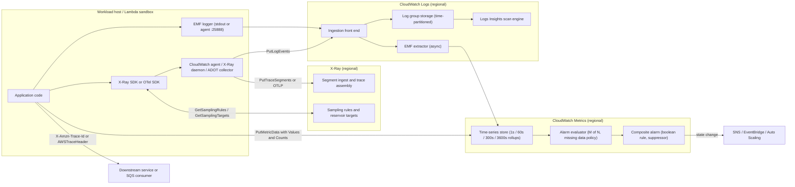

# Observability: CloudWatch, Metrics, Logs, and X-Ray

## TL;DR

- A CloudWatch metric's identity is the tuple (namespace, metric name, full dimension set), so every distinct dimension-value combination is its own time series and its own monthly charge, and percentiles never aggregate across those series after you write them.
- Embedded Metric Format (EMF) turns one structured log event into metrics asynchronously inside the CloudWatch Logs ingestion path, so your request path never blocks, but a malformed directive drops the metric with no error to the caller, and the only signal is `EMFValidationErrors` / `EMFParsingErrors` in the `AWS/Logs` namespace.
- CloudWatch alarms have one threshold and a temporal M-of-N filter, so they have no native amplitude hysteresis, and you build a Schmitt trigger by joining two metric alarms in a composite alarm, where a 1-of-N alarm acts as bounded memory.
- Logs Insights is a time-range scan engine billed per byte scanned, so the time window, the log group set, and field indexes decide cost and latency, and a dashboard widget that re-runs a query is a recurring scan bill.
- X-Ray decides sampling at the head and carries context in one `X-Amzn-Trace-Id` header (or the SQS `AWSTraceHeader` system attribute), so a trace survives only as far as each hop forwards that header, and every fan-in batch boundary breaks the parent-child tree model.

## Mental Model



Think of the system as three independent regional pipelines that share only identifiers.
Metrics are pre-aggregated numbers keyed by dimension tuples.
They are cheap to query and alarm on, but they lose the event detail.
Logs are full-fidelity events that you pay to ingest and pay again to scan.
Traces are sampled causal trees stitched together by a trace ID that each hop has to forward on purpose.
EMF is the bridge: one log event carries both the full context and the metric directive, and the log pipeline (not your process) does the extraction.
A trace ID written into that same log event lets you join all three signals at query time.
Every pipeline runs in the same region as the workload it watches, so a regional infrastructure event can impair the monitoring path and the workload together.

## Internals

### Control plane versus data plane

The telemetry data planes are `PutMetricData`, `PutLogEvents`, `PutTraceSegments` (and the OTLP endpoints), plus the read paths `GetMetricData`, `StartQuery`/`GetQueryResults`, and `BatchGetTraces`.
The control planes are alarm definitions (`PutMetricAlarm`, `PutCompositeAlarm`), log group lifecycle and retention, metric filters, subscription filters, account policies, and X-Ray sampling rules and groups.
Alarm evaluation is a continuously running data-plane loop over stored data.
It does not depend on the control plane being reachable after you create the alarm, which is the static-stability property you want (see [[17-Cloud-AI-Engineering/Volume_01_Cloud_Architecture_Principles/Chapter_02_Regions_Zones_and_Static_Stability|Regions, Zones, and Static Stability]]).
The ingestion data plane is not independent of other regional infrastructure, though.
AWS's post-event summary of the 2020-11-25 us-east-1 Kinesis event states that CloudWatch used Kinesis Data Streams to process metric and log data, so a Kinesis front-end failure surfaced as delayed and failed CloudWatch writes ([AWS PIR 11201](https://aws.amazon.com/message/11201/)).
That summary also explains why the failure cascaded: consumers of CloudWatch metrics, including Auto Scaling policies and reactive alarms, lost their inputs in the same event.

AWS has not published a peer-reviewed paper on CloudWatch's storage engine.
The closest public analogues for the design space are Google's Monarch, a regionally partitioned in-memory time-series database that favors availability over consistency ([Adams et al., VLDB 2020](https://www.vldb.org/pvldb/vol13/p3181-adams.pdf)), and Facebook's Gorilla.
Gorilla's delta-of-delta timestamp encoding and XOR float compression showed that hot time-series data can be held in memory at about 1.37 bytes per point ([Pelkonen et al., VLDB 2015](https://www.vldb.org/pvldb/vol8/p1816-teller.pdf)).
Treat any claim about CloudWatch's internal storage layout as inference unless it is in AWS documentation or a post-event summary.

### Metric identity, rollup, and why percentiles do not compose

A metric is uniquely identified by namespace, metric name, and the complete set of dimension name-value pairs.
`{Service=checkout}` and `{Service=checkout, Operation=PlaceOrder}` are two unrelated time series.
CloudWatch does not derive one from the other.
This is the root of most cost surprises: the EMF specification states that every DimensionSet used creates a new metric in CloudWatch ([AWS EMF specification, as of 2026-10](https://docs.aws.amazon.com/AmazonCloudWatch/latest/monitoring/CloudWatch_Embedded_Metric_Format_Specification.html)).

Each stored datapoint keeps SampleCount, Sum, Minimum, and Maximum.
When you publish raw values, it also keeps a distribution that supports percentile, trimmed-mean, and percentile-rank statistics.
If you publish a pre-summarized `StatisticSet`, the distribution is lost and percentiles become unavailable for that data.
Percentiles are not linear, so the p99 of a fleet is not the average, maximum, or any other function of per-host p99 series.
The only correct way to get a fleet p99 is to publish the raw values (or value-count histograms) under the fleet-level dimension set at write time.
EMF makes that cheap by letting one event list several DimensionSets, but each additional set multiplies the metric count.

Datapoints roll up by age: sub-minute data is available for 3 hours, 1-minute data for 15 days, 5-minute data for 63 days, and 1-hour data for 455 days (AWS docs, as of 2026-10, UNVERIFIED).
A metric that receives no data for 15 months expires, and there is no delete API (AWS docs, as of 2026-10, UNVERIFIED).

### EMF: the extraction path most guides skip

EMF is the externalized form of the request-log pattern described in the AWS Builders' Library.
In that pattern, each unit of work emits one structured log entry that holds its counters and timers, and metrics are derived from those entries afterwards ([Yanacek, "Instrumenting distributed systems for operational visibility"](https://aws.amazon.com/builders-library/instrumenting-distributed-systems-for-operational-visibility/)).
The wire format is a JSON log event with a reserved `_aws` member.
That member contains `Timestamp` (epoch milliseconds) and a `CloudWatchMetrics` array of MetricDirectives.
Each directive has a `Namespace`, a `Dimensions` array of DimensionSets, and a `Metrics` array of MetricDefinitions (`Name`, optional `Unit`, optional `StorageResolution`).
The metric values and dimension values live as root-level "target members" of the same JSON object.

Spec limits that matter operationally (AWS EMF specification, as of 2026-10):

- A directive's `Metrics` array must not contain more than 100 MetricDefinitions.
- A DimensionSet must not contain more than 30 dimension keys, and it may be empty.
- A dimension target member must be a string of at most 1024 characters.
- `StorageResolution` is 1 (high resolution) or 60 (the default).
- An EMF event inherits the CloudWatch Logs event size limit, which the current specification gives as 1 MB.
- Older mirrors of the same page still say 256 KB, so check which limit your agent version and SDK enforce.

The non-obvious part is where and when extraction happens.
Your process writes a log line to stdout (Lambda), to the CloudWatch agent's EMF listener (EC2, ECS, EKS; port 25888 by default, UNVERIFIED), or directly via `PutLogEvents`.
The log is accepted and stored first.
Extraction then runs inside the CloudWatch Logs ingestion pipeline, after the write has already succeeded.
That gives EMF three properties a getting-started guide does not spell out:

1. The emitter never sees a metric error, because `PutLogEvents` succeeds even when the `_aws` block is invalid.
A misspelled dimension key, a dimension value that is a number instead of a string, or 101 metric definitions produce a stored log line and no metric.
CloudWatch Logs reports the drop only as `EMFValidationErrors` and `EMFParsingErrors` in the `AWS/Logs` namespace, by `LogGroupName` ([CloudWatch Logs metrics docs, as of 2026-10](https://docs.aws.amazon.com/AmazonCloudWatch/latest/logs/CloudWatch-Logs-Monitoring-CloudWatch-Metrics.html)).
2. An account policy of type `METRIC_EXTRACTION_POLICY` can make CloudWatch Logs ignore EMF events in matching log groups, and those ignored events are counted in a separate `AWS/Logs` metric (CloudWatch Logs metrics docs, as of 2026-10).
That makes extraction a centrally governed cost control, not just an application choice.
3. Extraction is coupled to log delivery latency.
If your agent buffers and flushes every few seconds, or a Lambda extension delays log shipping, metric datapoints arrive late relative to the alarm evaluator's view of "now".

EMF value arrays are capped at 100 values per metric per event (AWS EMF specification, as of 2026-10, UNVERIFIED), and EMF has no counts array.
`PutMetricData` accepts a `Values` array with a parallel `Counts` array, up to 150 unique values per metric per call (AWS API reference, as of 2026-10, UNVERIFIED).
A host can therefore quantize a minute of latencies into at most 150 log-spaced buckets and ship one weighted histogram, which EMF cannot express.
That difference decides the economics at high request rates, as the sizing section shows.

### Alarm evaluation engine and the absence of amplitude hysteresis

A metric alarm is defined by `Period`, `EvaluationPeriods` (N), `DatapointsToAlarm` (M), `Threshold`, `ComparisonOperator`, `TreatMissingData`, and, for percentile statistics, `EvaluateLowSampleCountPercentile`.
On each evaluation the alarm computes the state from the most recent N periods.
It is ALARM if at least M of them breach.
It is OK otherwise.
It is INSUFFICIENT_DATA when there is not enough data to decide and the missing-data policy does not resolve it.
State is recomputed from the window each time, not latched.
An alarm configured as M=1, N=10 therefore stays in ALARM for ten periods after the last breaching datapoint and then returns to OK.

`TreatMissingData` takes `missing`, `notBreaching`, `breaching`, or `ignore`.
CloudWatch documents an "evaluation range" for missing data.
The evaluator retrieves more datapoints than N, and if the retrieved count is below M, it fills the gaps with the missing-data policy.
The consequence is that sparse metrics (error counts that are only published when non-zero) behave differently from dense metrics under the same M-of-N.
`notBreaching` on a heartbeat-style metric turns a dead emitter into a green alarm.

M-of-N gives temporal hysteresis: it suppresses short spikes.
It gives no amplitude hysteresis: a signal oscillating around the threshold still flaps between ALARM and OK every few periods.
A control engineer would use a Schmitt trigger, which enters at a high threshold H and exits only below a lower threshold L.
CloudWatch has no native two-threshold alarm.
A composite alarm rule is a stateless boolean over child alarm states, using `ALARM()`, `OK()`, `INSUFFICIENT_DATA()`, `AND`, `OR`, `NOT`, `TRUE`, and `FALSE`, and composites cannot reference themselves.
The trick is to borrow memory from the M-of-N window of a child alarm:

- Child `RecentHigh`: statistic above H, M=1, N=K, so it is ALARM if any of the last K periods exceeded H.
- Child `AboveLow`: statistic above L, M=1, N=1, so it is ALARM while the current period is above L.
- Composite: `ALARM(RecentHigh) AND ALARM(AboveLow)`.

The composite enters ALARM when a period exceeds H, because that period is also above L.
It stays in ALARM while the signal sits between L and H, as long as an H breach happened within K periods.
It exits when the signal drops below L, or when K periods pass with the signal between L and H.
The second exit condition is the deliberate safety valve: a pure Schmitt trigger could latch forever on a signal that plateaus just under H.
The trade-off is entry sensitivity, since a single period above H trips the composite.
You debounce entry by computing the child on a longer `Period`, or by OR-ing in a stricter entry alarm, and accepting that the stricter alarm's memory is only N periods long.

Composite alarms also carry `ActionsSuppressor`, `ActionsSuppressorWaitPeriod`, and `ActionsSuppressorExtensionPeriod`.
These suppress actions while a named "cause" alarm, such as a dependency-down alarm or a deployment window alarm, is in ALARM.
They are the native way to stop an alarm storm from paging once per symptom.

Alarm state changes emit EventBridge events (`CloudWatch Alarm State Change`).
That is where you implement any stateful logic CloudWatch cannot, for example a true latched Schmitt trigger in a Lambda function that persists state in DynamoDB.
The cost is one more component that has to be up during the incident it is reporting.

### Logs Insights execution model

A log group contains log streams, and each event carries an event timestamp and an ingestion time.
AWS does not publish the Logs Insights engine design.
Its documented behavior implies a distributed scan over time-partitioned storage:

- Cost is per GB scanned, and `GetQueryResults` returns `recordsScanned`, `recordsMatched`, and `bytesScanned`.
- The time range and the log group selection are the only pruning you get by default.
- `filter` predicates run after data is read, not before, unless a field index applies.
- `stats ... by` executes as a partial aggregation per partition with a final merge, which is why `count`, `sum`, `min`, `max`, and `avg` are exact, and `pct()` is computed over matched events.

Two consequences follow from that.
First, `pct(field, 99)` in Logs Insights is computed over log events, not over values inside an EMF array, so the p99 from Insights and the p99 from the extracted metric are different quantities.
Second, results are capped at 10,000 rows (AWS docs, as of 2026-10, UNVERIFIED), so a high-cardinality `stats ... by customerId` is silently truncated.

Field indexes, configured with an index policy on fields such as `requestId` or `traceId`, let the engine skip events that cannot match an equality or `IN` predicate on an indexed field.
That reduces `bytesScanned` for needle-in-haystack lookups.
It does not help full-range aggregations (AWS docs, as of 2026-10, UNVERIFIED for limits and pricing interaction).
The Infrequent Access log class halves ingestion cost.
It gives up features such as metric filters, subscription filters, and EMF extraction (AWS docs, as of 2026-10, UNVERIFIED for the exact feature list), so it suits forensic logs, not EMF logs.

### X-Ray trace context, sampling, and assembly

The X-Ray header looks like `X-Amzn-Trace-Id: Root=1-5759e988-bd862e3fe1be46a994272793;Parent=53995c3f42cd8ad8;Sampled=1`.
`Root` is version `1`, then 8 hex digits of Unix epoch seconds, then 24 hex digits (96 bits) of randomness.
`Parent` is the 64-bit ID of the calling segment or subsegment.
`Sampled` is `1`, `0`, or `?` (defer the decision).
Lambda exposes the incoming context as the `_X_AMZN_TRACE_ID` environment variable and, for loop detection, may append a `Lineage` field that you must forward unchanged (AWS docs, as of 2026-10, UNVERIFIED for field format).
For SQS, the context travels as the `AWSTraceHeader` message system attribute, not as a user message attribute.
That is why it survives SNS-to-SQS and Lambda event source mappings without code changes.

The W3C mapping is mechanical.
The X-Ray root `1-5759e988-bd862e3fe1be46a994272793` corresponds to the W3C `trace-id` `5759e988bd862e3fe1be46a994272793`, the parent ID maps to `parent-id`, and `Sampled=1` maps to trace-flags `01`.
The OpenTelemetry X-Ray ID generator puts epoch seconds in the high 32 bits to keep this mapping valid.
Historically X-Ray rejected trace IDs whose embedded timestamp was too far from the current time, and current docs state support for W3C-format random trace IDs (AWS docs, as of 2026-10, UNVERIFIED for exact acceptance rules).

Sampling is head-based and centrally coordinated.
A sampling rule has a priority, matching criteria (service name, host, HTTP method, URL path, and others), a reservoir size, and a fixed rate.
The default rule samples the first request each second and 5% of additional requests (AWS docs, as of 2026-10, UNVERIFIED).
The reservoir in a centralized rule applies to the whole fleet, not per host.
SDKs and collectors poll `GetSamplingRules` for rule definitions and `GetSamplingTargets` for per-client reservoir quotas and adjusted rates, and report their request counts with each poll (roughly every 5 minutes and 10 seconds respectively, UNVERIFIED).
When a client's target lease expires, for example because the X-Ray API is unreachable, it falls back to the fixed rate without a reservoir.
That is a silent reduction in trace volume during exactly the events you want traced.

Segments are JSON documents of at most 64 KB (AWS docs, as of 2026-10, UNVERIFIED).
They are shipped either as UDP datagrams to a local daemon on port 2000, which batches them into `PutTraceSegments`, or as OTLP to a collector.
X-Ray assembles traces server-side by `trace_id`.
It builds the service map from `parent_id` edges, and it uses wall-clock `start_time`/`end_time` from each host, so clock skew between hosts shows up as children that start before their parents.
Traces are retained for 30 days (AWS docs, as of 2026-10, UNVERIFIED).
With CloudWatch Transaction Search, spans are ingested as structured logs into the `aws/spans` log group, and a configurable percentage is indexed as X-Ray trace summaries (AWS docs, as of 2026-10, UNVERIFIED for GA scope and pricing).
AWS has announced that the X-Ray SDKs and daemon are moving to maintenance mode in favor of OpenTelemetry and ADOT (AWS docs, as of 2026-10, UNVERIFIED for exact dates), so new instrumentation should be OpenTelemetry.

The intellectual lineage is Dapper, which established low-overhead, application-transparent tracing.
Dapper used a sampling rate as low as 1/1024 on high-throughput services and collected spans out of band through per-host daemons into Bigtable ([Sigelman et al., Google Technical Report 2010](https://research.google/pubs/dapper-a-large-scale-distributed-systems-tracing-infrastructure/)).
Canopy generalized this into an event-based trace model with flexible post-hoc processing ([Kaldor et al., SOSP 2017](https://dl.acm.org/doi/10.1145/3132747.3132749)).
X-Trace introduced cross-layer metadata propagation ([Fonseca et al., NSDI 2007](https://www.usenix.org/conference/nsdi-07/x-trace-pervasive-network-tracing-framework)).

### Failure domain boundaries

All three services are regional.
Cross-account and cross-region viewing uses CloudWatch cross-account observability (Observability Access Manager sinks and links), which shares read access but does not move the data path out of the source region.
Route 53 health-check metrics are published only in us-east-1 (AWS docs, as of 2026-10, UNVERIFIED), which is a hidden cross-region dependency for any alarm built on them.
Your independent "is the region healthy" signal must be evaluated outside the region it judges.
In practice that means synthetic canaries running from at least one other region, with alarms and paging defined there.

## Numbers to Know

| Quantity | Value | Source and date | Status |
|---|---|---|---|
| EMF MetricDefinitions per directive | 100 | AWS EMF specification, as of 2026-10 | Verified |
| EMF dimension keys per DimensionSet | 30 | AWS EMF specification, as of 2026-10 | Verified |
| EMF dimension value length | 1024 characters | AWS EMF specification, as of 2026-10 | Verified |
| EMF / log event max size | 1 MB (older mirrors: 256 KB) | AWS EMF specification, as of 2026-10 | Verified |
| EMF StorageResolution values | 1 or 60 seconds | AWS EMF specification, as of 2026-10 | Verified |
| EMF error metrics | `EMFValidationErrors`, `EMFParsingErrors` in `AWS/Logs` | CloudWatch Logs docs, as of 2026-10 | Verified |
| EMF values per metric array | 100 | AWS EMF specification, as of 2026-10 | UNVERIFIED |
| Dimensions per metric (PutMetricData) | 30 | AWS docs, as of 2026-10 | UNVERIFIED |
| PutMetricData unique values per metric (Values/Counts) | 150 | AWS API reference, as of 2026-10 | UNVERIFIED |
| PutMetricData items per request / payload | 1,000 / 1 MB | AWS quotas, as of 2026-10 | UNVERIFIED |
| Datapoint timestamp acceptance window | 2 weeks past, 2 hours future | AWS docs, as of 2026-10 | UNVERIFIED |
| Retention by resolution | <60 s: 3 h; 60 s: 15 d; 300 s: 63 d; 3600 s: 455 d | AWS docs, as of 2026-10 | UNVERIFIED |
| High-resolution alarm periods | 10 s, 30 s, or multiples of 60 s | AWS docs, as of 2026-10 | UNVERIFIED |
| Subscription filters per log group | 2 | AWS quotas, as of 2026-10 | UNVERIFIED |
| Logs Insights max result rows / query timeout | 10,000 / 60 min | AWS docs, as of 2026-10 | UNVERIFIED |
| X-Ray segment document max | 64 KB | AWS docs, as of 2026-10 | UNVERIFIED |
| X-Ray default sampling | 1 req/s reservoir + 5% | AWS docs, as of 2026-10 | UNVERIFIED |
| X-Ray trace retention | 30 days | AWS docs, as of 2026-10 | UNVERIFIED |
| X-Ray daemon listener | UDP 2000 | AWS docs, as of 2026-10 | UNVERIFIED |
| Custom metric price (us-east-1) | $0.30 first 10k, $0.10 next 240k, $0.05 next 750k, $0.02 beyond | AWS pricing, as of 2026-10 | UNVERIFIED |
| Alarm price (us-east-1) | $0.10 standard / $0.30 high-res per alarm metric-month; $0.50 composite | AWS pricing, as of 2026-10 | UNVERIFIED |
| API price (us-east-1) | $0.01 per 1,000 PutMetricData requests; $0.01 per 1,000 metrics via GetMetricData | AWS pricing, as of 2026-10 | UNVERIFIED |
| Logs ingestion (us-east-1) | $0.50/GB Standard, $0.25/GB Infrequent Access | AWS pricing, as of 2026-10 | UNVERIFIED |
| Logs storage (us-east-1) | $0.03/GB-month | AWS pricing, as of 2026-10 | UNVERIFIED |
| Logs Insights (us-east-1) | $0.005/GB scanned | AWS pricing, as of 2026-10 | UNVERIFIED |
| X-Ray (us-east-1) | $5.00 per 1M traces recorded; $0.50 per 1M traces retrieved or scanned | AWS pricing, as of 2026-10 | UNVERIFIED |
| Gorilla compression | about 1.37 bytes per datapoint | Pelkonen et al., VLDB 2015 | Paper |
| Dapper sampling on high-QPS services | 1/1024 | Sigelman et al., 2010 | Paper |

## AWS vs GCP Mechanism Parity

| Concern | AWS (CloudWatch / X-Ray) | Google Cloud (Cloud Monitoring / Logging / Trace) | Critical difference |
|---|---|---|---|
| Metric store lineage | Proprietary, no public paper | Monarch, regionally partitioned in-memory TSDB (VLDB 2020) | GCP's design is published, AWS's must be inferred from docs and PIRs |
| Series identity | Namespace + name + up to 30 dimensions | Metric type + monitored resource labels + metric labels | GCP binds every series to a monitored-resource schema, AWS dimensions are free-form |
| Log-to-metric | EMF (extraction at ingest, multiple DimensionSets) and metric filters | Log-based metrics (counter and distribution) | EMF defines metrics inside the event, GCP defines them centrally on the sink side |
| Histograms | Raw values or Values+Counts, percentiles computed server-side | Native `DISTRIBUTION` value type with explicit buckets | GCP distributions aggregate across series correctly at query time, CloudWatch percentiles do not aggregate across dimensions |
| Alert temporal filter | Period, M of N, TreatMissingData | Alignment period, condition duration (retest window), `evaluationMissingData` | Similar semantics, different names; GCP duration requires continuous violation |
| Alert hysteresis | None native; composite-alarm memory trick or EventBridge plus state store | None native; autoclose duration and duration windows only | Neither cloud offers a two-threshold alert primitive |
| Alert dedup / suppression | Composite alarms with ActionsSuppressor | Alerting policy conditions combined with AND/OR; snoozes | AWS suppression is keyed on another alarm's state |
| Log query | Logs Insights (pipe language, plus OpenSearch PPL and SQL, UNVERIFIED), per-GB scanned | Logs Explorer plus Log Analytics (SQL on BigQuery-backed buckets) | GCP Log Analytics uses the Dremel/BigQuery engine, AWS uses a proprietary scan engine with field indexes |
| Log storage classes | Standard vs Infrequent Access | Log buckets with configurable retention; Log Analytics upgrade | AWS IA removes features to cut ingest price, GCP prices storage beyond default retention |
| Trace header | `X-Amzn-Trace-Id`, `AWSTraceHeader` on SQS, W3C via OTel | `traceparent` (W3C), legacy `X-Cloud-Trace-Context` | Both accept W3C via OpenTelemetry, legacy formats differ |
| Sampling | Centralized rules with fleet-wide reservoir leases | Client-side samplers in OTel SDKs; collector tail sampling | AWS has a server-coordinated reservoir, GCP relies on the SDK or collector |
| Cross-account view | Observability Access Manager sinks and links | Metrics scopes and log views / aggregated sinks | Both are read federation, the data stays in its home region |
| Private access | Interface endpoints for `monitoring`, `logs`, `xray` | Private Google Access, Private Service Connect, VPC Service Controls | VPC-SC adds an API-level exfiltration perimeter that AWS approximates with endpoint policies plus SCPs |
| Encryption | Log groups and X-Ray with KMS customer keys | CMEK on log buckets | Both use envelope encryption, and key loss makes data unreadable |

For the GCP side in depth, see [[17-Cloud-AI-Engineering/Volume_03_GCP_Deep_Dive/Chapter_16_Observability_Cloud_Monitoring_Logging_and_Trace|Observability: Cloud Monitoring, Logging, and Trace]].

## Worked Example: EMF with Schmitt-Trigger Alarms, a Priced Logs Insights Query, and Trace Propagation Through SQS

### What the lab proves

The lab proves four things:

- An EMF emitter with two DimensionSets creates fleet-level and per-operation latency metrics with zero metric API calls.
- A single-threshold p99 alarm flaps on a stepped latency profile, while a composite built from M-of-N memory holds through the middle band and clears cleanly.
- Logs Insights reports `bytesScanned`, so every query has a computable price.
- An X-Ray trace survives an SQS hop via `AWSTraceHeader`.

### Cost estimate and budget guard

The emitter writes 2 events per second for 15 minutes, about 1,800 events of roughly 0.5 KB, so about 1 MB of log ingestion, which is about $0.0005 at $0.50/GB (UNVERIFIED price).
Extraction creates 2 metric names under 3 dimension combinations, so about 6 custom metrics active for one hour, which is about 6 x $0.30 / 730 = $0.0025 (UNVERIFIED price).
Four alarms (three standard, one composite) for one hour cost about (3 x 0.10 + 0.50) / 730 = $0.0011 (UNVERIFIED price).
X-Ray records a handful of traces, which falls in the free tier, and SQS uses a few requests, also in the free tier.
The expected total is under $0.05, and the budget below alerts at $4 of a $5 monthly cap.

```bash
#!/usr/bin/env bash
set -euo pipefail
export AWS_REGION=us-east-1
ACCOUNT_ID=$(aws sts get-caller-identity --query Account --output text)
ALERT_EMAIL="you@example.com"

aws budgets create-budget --account-id "$ACCOUNT_ID" \
  --budget '{"BudgetName":"cwlab-5usd","BudgetLimit":{"Amount":"5","Unit":"USD"},"TimeUnit":"MONTHLY","BudgetType":"COST"}' \
  --notifications-with-subscribers "[{\"Notification\":{\"NotificationType\":\"ACTUAL\",\"ComparisonOperator\":\"GREATER_THAN\",\"Threshold\":80,\"ThresholdType\":\"PERCENTAGE\"},\"Subscribers\":[{\"SubscriptionType\":\"EMAIL\",\"Address\":\"${ALERT_EMAIL}\"}]}]"

aws logs create-log-group --log-group-name /cwlab/checkout
aws logs put-retention-policy --log-group-name /cwlab/checkout --retention-in-days 1
aws logs create-log-stream --log-group-name /cwlab/checkout --log-stream-name host-a
QUEUE_URL=$(aws sqs create-queue --queue-name cwlab-orders --query QueueUrl --output text)
echo "export QUEUE_URL=$QUEUE_URL ACCOUNT_ID=$ACCOUNT_ID" > ~/.cwlab_env
echo "QUEUE_URL=$QUEUE_URL"
```

### Least-privilege IAM for the lab runner

```json
{
  "Version": "2012-10-17",
  "Statement": [
    {"Effect": "Allow",
     "Action": ["logs:CreateLogGroup", "logs:PutRetentionPolicy", "logs:CreateLogStream",
                "logs:PutLogEvents", "logs:StartQuery", "logs:DeleteLogGroup"],
     "Resource": "arn:aws:logs:us-east-1:ACCOUNT_ID:log-group:/cwlab/*"},
    {"Effect": "Allow", "Action": ["logs:GetQueryResults"], "Resource": "*"},
    {"Effect": "Allow",
     "Action": ["cloudwatch:PutMetricAlarm", "cloudwatch:PutCompositeAlarm", "cloudwatch:DeleteAlarms",
                "cloudwatch:DescribeAlarms", "cloudwatch:DescribeAlarmHistory"],
     "Resource": "arn:aws:cloudwatch:us-east-1:ACCOUNT_ID:alarm:cwlab-*"},
    {"Effect": "Allow", "Action": ["xray:PutTraceSegments", "xray:BatchGetTraces", "xray:GetTraceSummaries"],
     "Resource": "*"},
    {"Effect": "Allow",
     "Action": ["sqs:CreateQueue", "sqs:SendMessage", "sqs:ReceiveMessage", "sqs:DeleteMessage", "sqs:DeleteQueue"],
     "Resource": "arn:aws:sqs:us-east-1:ACCOUNT_ID:cwlab-orders"}
  ]
}
```

### Step 1 - EMF emitter with a stepped latency profile

The profile is 4 minutes at a base of 150 ms (p99 about 200 ms), 4 minutes at 700 ms (p99 about 945 ms), 3 minutes at 450 ms (p99 about 607 ms, between L=500 and H=800), and then back to 150 ms.

```python
#!/usr/bin/env python3
"""emf_emitter.py - emit EMF events with a stepped latency profile."""
import argparse
import json
import os
import random
import time

import boto3

NS = "CWLab"
OPS = ("PlaceOrder", "GetCart")


def base_latency_ms(minute):
    if minute < 4:
        return 150.0
    if minute < 8:
        return 700.0
    if minute < 11:
        return 450.0
    return 150.0


def trace_id():
    return "1-%08x-%s" % (int(time.time()), os.urandom(12).hex())


def sample(base):
    v = random.gauss(base, 0.15 * base)
    if random.random() < 0.005:
        v *= 3.0
    return round(max(v, 1.0), 1)


def emf_doc(ts_ms, op, values, faults):
    return {
        "_aws": {
            "Timestamp": ts_ms,
            "CloudWatchMetrics": [{
                "Namespace": NS,
                "Dimensions": [["Service"], ["Service", "Operation"]],
                "Metrics": [
                    {"Name": "Latency", "Unit": "Milliseconds", "StorageResolution": 60},
                    {"Name": "Faults", "Unit": "Count", "StorageResolution": 60},
                ],
            }],
        },
        "Service": "checkout",
        "Operation": op,
        "Latency": values,
        "Faults": faults,
        "requestCount": len(values),
        "latencyMaxMs": max(values),
        "traceId": trace_id(),
    }


def main():
    p = argparse.ArgumentParser()
    p.add_argument("--log-group", default="/cwlab/checkout")
    p.add_argument("--stream", default="host-a")
    p.add_argument("--minutes", type=int, default=15)
    p.add_argument("--per-second", type=int, default=20)
    a = p.parse_args()
    if a.per_second > 100:
        raise SystemExit("EMF value arrays are capped at 100 values per metric")
    logs = boto3.client("logs")
    t0 = time.time()
    sent = 0
    while time.time() - t0 < a.minutes * 60:
        minute = int((time.time() - t0) // 60)
        base = base_latency_ms(minute)
        now_ms = int(time.time() * 1000)
        batch = []
        for op in OPS:
            vals = [sample(base) for _ in range(a.per_second)]
            faults = sum(1 for v in vals if v > 2.7 * base)
            doc = emf_doc(now_ms, op, vals, faults)
            batch.append({"timestamp": now_ms, "message": json.dumps(doc, separators=(",", ":"))})
        logs.put_log_events(logGroupName=a.log_group, logStreamName=a.stream, logEvents=batch)
        sent += len(batch)
        if sent % 120 == 0:
            print("minute=%d base=%.0fms events=%d" % (minute, base, sent), flush=True)
        time.sleep(max(0.0, 1.0 - ((time.time() - t0) % 1.0)))


if __name__ == "__main__":
    main()
```

### Step 2 - Single-threshold alarm versus composite Schmitt trigger

Create the alarms before or right after starting the emitter.

```bash
DIMS="Name=Service,Value=checkout Name=Operation,Value=PlaceOrder"

# Baseline: single threshold, flaps on a signal near 800 ms and clears the moment p99 dips.
aws cloudwatch put-metric-alarm --alarm-name cwlab-p99-single-800 \
  --namespace CWLab --metric-name Latency --dimensions $DIMS \
  --extended-statistic p99 --period 60 --evaluation-periods 1 --datapoints-to-alarm 1 \
  --threshold 800 --comparison-operator GreaterThanThreshold --treat-missing-data notBreaching

# Memory: ALARM if ANY of the last 10 minutes had p99 > 800 (M=1, N=10).
aws cloudwatch put-metric-alarm --alarm-name cwlab-p99-recent-breach-800 \
  --namespace CWLab --metric-name Latency --dimensions $DIMS \
  --extended-statistic p99 --period 60 --evaluation-periods 10 --datapoints-to-alarm 1 \
  --threshold 800 --comparison-operator GreaterThanThreshold --treat-missing-data notBreaching

# Exit threshold: ALARM while the current minute is above the low threshold.
aws cloudwatch put-metric-alarm --alarm-name cwlab-p99-above-500 \
  --namespace CWLab --metric-name Latency --dimensions $DIMS \
  --extended-statistic p99 --period 60 --evaluation-periods 1 --datapoints-to-alarm 1 \
  --threshold 500 --comparison-operator GreaterThanThreshold --treat-missing-data notBreaching

# Schmitt trigger: enter above 800, stay while above 500, bounded memory of 10 minutes.
aws cloudwatch put-composite-alarm --alarm-name cwlab-p99-schmitt \
  --alarm-rule 'ALARM("cwlab-p99-recent-breach-800") AND ALARM("cwlab-p99-above-500")'

python3 emf_emitter.py --minutes 15

for a in cwlab-p99-single-800 cwlab-p99-schmitt; do
  echo "== $a"
  aws cloudwatch describe-alarm-history --alarm-name "$a" --history-item-type StateUpdate \
    --query 'reverse(AlarmHistoryItems)[].[Timestamp,HistorySummary]' --output text
done
```

Expected behavior:

- The single-threshold alarm goes to ALARM at about minute 4-5 and returns to OK at about minute 8-9, while p99 is still about 607 ms and the system is still degraded.
- The composite enters with it and stays in ALARM through the 450 ms band, then clears at about minute 11-12 when p99 drops below 500 ms.
- Sustained 607 ms with no new 800 ms breach would clear the composite after 10 minutes, which is the designed safety valve.

### Step 3 - Logs Insights with an explicit price per query

```python
#!/usr/bin/env python3
"""insights_query.py - run a Logs Insights query and price it from bytesScanned."""
import sys
import time

import boto3

QUERIES = {
    "per_minute": (
        'fields @timestamp, Operation, latencyMaxMs, requestCount\n'
        '| filter Service = "checkout"\n'
        '| stats sum(requestCount) as requests, max(latencyMaxMs) as worst_ms, '
        'pct(latencyMaxMs, 99) as p99_of_event_max by bin(1m), Operation\n'
        '| sort @timestamp asc'
    ),
    "find_slow_traces": (
        'fields @timestamp, Operation, traceId, latencyMaxMs\n'
        '| filter latencyMaxMs > 1500\n'
        '| sort latencyMaxMs desc\n'
        '| limit 20'
    ),
}
PRICE_PER_GB = 0.005  # us-east-1 list price, UNVERIFIED as of 2026-10


def run(group, name, minutes):
    logs = boto3.client("logs")
    end = int(time.time())
    start = end - minutes * 60
    qid = logs.start_query(logGroupName=group, startTime=start, endTime=end,
                           queryString=QUERIES[name], limit=1000)["queryId"]
    while True:
        r = logs.get_query_results(queryId=qid)
        if r["status"] in ("Complete", "Failed", "Cancelled", "Timeout"):
            break
        time.sleep(1)
    for row in r["results"][:40]:
        print({f["field"]: f["value"] for f in row})
    st = r["statistics"]
    print("status=%s matched=%d scanned=%d bytes=%d est_cost_usd=%.6f" % (
        r["status"], int(st["recordsMatched"]), int(st["recordsScanned"]),
        int(st["bytesScanned"]), st["bytesScanned"] / 1e9 * PRICE_PER_GB))


if __name__ == "__main__":
    run("/cwlab/checkout", sys.argv[1] if len(sys.argv) > 1 else "per_minute", 30)
```

Compare `p99_of_event_max` with the metric's p99.
They differ because Insights computes percentiles over events, not over the values inside each EMF array.

### Step 4 - X-Ray context across an SQS hop

```python
#!/usr/bin/env python3
"""xray_sqs.py - propagate X-Ray context through SQS AWSTraceHeader."""
import json
import os
import sys
import time

import boto3

xray = boto3.client("xray")
sqs = boto3.client("sqs")


def new_trace_id():
    return "1-%08x-%s" % (int(time.time()), os.urandom(12).hex())


def new_id():
    return os.urandom(8).hex()


def parse_header(h):
    return dict(kv.split("=", 1) for kv in h.split(";") if "=" in kv)


def put(doc):
    resp = xray.put_trace_segments(TraceSegmentDocuments=[json.dumps(doc)])
    if resp.get("UnprocessedTraceSegments"):
        raise RuntimeError(resp["UnprocessedTraceSegments"])


def main(queue_url):
    tid, root_id, sqs_sub_id = new_trace_id(), new_id(), new_id()
    t0 = time.time()
    header = "Root=%s;Parent=%s;Sampled=1" % (tid, sqs_sub_id)
    sqs.send_message(QueueUrl=queue_url, MessageBody=json.dumps({"order": 42}),
                     MessageSystemAttributes={"AWSTraceHeader": {"DataType": "String", "StringValue": header}})
    t1 = time.time()
    put({"name": "checkout-api", "id": root_id, "trace_id": tid, "start_time": t0, "end_time": t1 + 0.001,
         "annotations": {"lab": "cwlab"},
         "subsegments": [{"name": "SQS", "id": sqs_sub_id, "start_time": t0, "end_time": t1,
                          "namespace": "aws", "aws": {"operation": "SendMessage", "queue_url": queue_url}}]})

    msgs = sqs.receive_message(QueueUrl=queue_url, AttributeNames=["AWSTraceHeader"],
                               WaitTimeSeconds=10, MaxNumberOfMessages=1).get("Messages", [])
    for m in msgs:
        ctx = parse_header(m["Attributes"]["AWSTraceHeader"])
        c0 = time.time()
        time.sleep(0.05)
        put({"name": "order-worker", "id": new_id(), "trace_id": ctx["Root"], "parent_id": ctx["Parent"],
             "start_time": c0, "end_time": time.time(), "annotations": {"lab": "cwlab"}})
        sqs.delete_message(QueueUrl=queue_url, ReceiptHandle=m["ReceiptHandle"])

    time.sleep(15)
    traces = xray.batch_get_traces(TraceIds=[tid])["Traces"]
    segs = traces[0]["Segments"] if traces else []
    print("trace_id=%s segments=%d names=%s" % (
        tid, len(segs), [json.loads(s["Document"])["name"] for s in segs]))


if __name__ == "__main__":
    main(sys.argv[1])
```

Run it with `python3 xray_sqs.py "$QUEUE_URL"`.
The expected output is `segments=2` with names `checkout-api` and `order-worker` under a single trace ID.

### Teardown

```bash
[ -f ~/.cwlab_env ] && source ~/.cwlab_env
ACCOUNT_ID=${ACCOUNT_ID:-$(aws sts get-caller-identity --query Account --output text)}
QUEUE_URL=${QUEUE_URL:-$(aws sqs get-queue-url --queue-name cwlab-orders --query QueueUrl --output text 2>/dev/null || true)}
aws cloudwatch delete-alarms --alarm-names cwlab-p99-schmitt
aws cloudwatch delete-alarms --alarm-names cwlab-p99-single-800 cwlab-p99-recent-breach-800 cwlab-p99-above-500
aws logs delete-log-group --log-group-name /cwlab/checkout
[ -n "$QUEUE_URL" ] && aws sqs delete-queue --queue-url "$QUEUE_URL"
aws budgets delete-budget --account-id "$ACCOUNT_ID" --budget-name cwlab-5usd
rm -f ~/.cwlab_env
# Custom metrics cannot be deleted; they stop billing when no new data arrives and expire after 15 months.
```

The composite is deleted first because it references the child alarms.

### Capacity and cost sizing for a production fleet

Assumptions: a checkout service at 50,000 requests/s across 300 hosts in 3 AZs, with 3 operations and 5 metrics per operation (Latency, Requests, Errors, Faults, Throttles), at us-east-1 list prices (UNVERIFIED as of 2026-10).

1. Metric count.
The dimension combinations are [Service] = 1, [Service, Operation] = 3, [Service, Operation, AZ] = 9, and [Service, InstanceId] = 300, for 313 combinations.
At 5 metrics each that is 1,565 metrics, and 1,565 x $0.30 = $469.50/month.
Instance churn from autoscaling adds new InstanceId series that are billed prorated by the hour.
2. The cardinality trap.
Adding `CustomerId` with 10,000 values to [Service, Operation] creates 10,000 x 3 x 5 = 150,000 metrics.
The cost is 10,000 x $0.30 + 140,000 x $0.10 = $17,000/month, which is 36x the baseline, for data that is better served by logs.
3. Per-request `PutMetricData` is ruled out.
50,000 calls/s x 2.592M s/month = 129.6B requests, and at $0.01 per 1,000 that is $1.296M/month, before throttling.
4. Host-side histograms via `PutMetricData` with Values and Counts.
Each host sees about 167 requests/s, or 10,000 latencies/minute, which quantize into 150 or fewer log-spaced buckets per metric.
Flushing one call per host per minute gives 300 x 43,200 = 12.96M requests/month, which is $129.60/month.
5. The same percentiles via EMF.
The 100-value array cap forces 100 events/min/host for latency alone, which is about 0.9 KB x 100 x 300 = 27 MB/min, or 1.17 TB/month.
That costs about $583/month in ingestion, plus storage.
EMF wins on simplicity and non-blocking emission, while Values+Counts wins about 4.5x on unit cost at this request rate.
6. Full request logs at 1 KB per request.
That is 50 MB/s, or 4,320 GB/day, or 129,600 GB/month, which costs $64,800/month in Standard or $32,400 in Infrequent Access.
The design response is to log 100% of errors and slow requests (above p99) plus a 1% uniform sample, which cuts this to about 2% of the volume and roughly $1,300/month in Standard.
7. Logs Insights dashboard tax.
Against unsampled request logs, one widget with a 3-hour window scans 540 GB, which is $2.70 per refresh.
A 5-minute auto-refresh runs 288 times a day, which is $777.60/day, or about $23,300/month for one tile.
Drive dashboards from metrics instead, and reserve Insights for investigation.
8. X-Ray.
At the default 5% rate, 2,500 traces/s x 2.592M s = 6.48B traces/month, which is $32,400/month.
A rule at 0.1% plus a 1/s fleet reservoir gives about 51 traces/s, or about 132M/month, which is about $660/month.
Rare-error capture then comes from tail sampling in the collector or from error logs that carry the trace ID.

## Failure Modes and Pitfalls

1. Monitoring shares fate with the region it monitors.
In the 2020-11-25 us-east-1 event, a Kinesis front-end failure delayed and failed CloudWatch metric and log processing, and that took down metric-driven automation with it ([AWS PIR 11201](https://aws.amazon.com/message/11201/)).
In the 2021-12-07 us-east-1 event, internal network congestion impaired AWS operators' own real-time monitoring data, which slowed diagnosis ([AWS PIR 12721](https://aws.amazon.com/message/12721/)).
The mitigation is out-of-region canaries and alarms, plus static runbooks that do not need live dashboards.
2. Silent EMF drop.
An invalid directive still yields `PutLogEvents` success, so the metric never appears.
An alarm with `TreatMissingData=notBreaching` then shows OK forever.
Alarm on `EMFValidationErrors` and `EMFParsingErrors` per log group, and keep a heartbeat metric whose alarm uses `breaching` for missing data.
3. Treating missing as good.
`notBreaching` is correct for sparse error counters and wrong for throughput, heartbeats, and canary success.
Choose the policy per metric based on what absence means.
4. Averaging percentiles.
Dashboards that average per-host p99 under-report tail latency by large factors during partial failures, because one bad host's tail is diluted by healthy ones.
Publish the fleet dimension set at write time.
5. Pre-summarized data loses percentiles.
`StatisticSet` uploads cannot back p99 alarms.
Teams discover this after the incident.
6. Leading-edge partial periods.
When ingestion is delayed (agent buffering, log shipping lag, a regional ingestion slowdown), the newest period holds fewer samples.
`Sum` and `SampleCount` alarms then see an apparent traffic drop, and low-traffic alarms fire falsely.
Use `DatapointsToAlarm` lower than N, longer periods, or alarm on ratios (errors / requests) that are invariant to partial periods.
7. Low-sample percentiles.
At 3 a.m. a p99 over 40 requests is the second-highest value.
Set `EvaluateLowSampleCountPercentile=ignore` and pair the alarm with a minimum-traffic condition in a composite.
8. Cardinality explosions from user input.
A dimension populated from a header, a URL path with IDs, or an exception message creates unbounded series and an unbounded bill.
Enforce allowlists in the metrics library and use a `METRIC_EXTRACTION_POLICY` account policy as the backstop.
9. Telemetry in the request path.
Synchronous `PutMetricData` from request threads turns a CloudWatch throttle or slowdown into application latency, and retries amplify load during the very event you are measuring.
Emit asynchronously with bounded buffers that drop on overflow, never block (see [[17-Cloud-AI-Engineering/Volume_07_Reliability_and_SRE/Chapter_03_Resilient_Communication_Retries_Jitter_and_Circuit_Breakers|Retries, Jitter, and Circuit Breakers]]).
10. Alarm actions that cannot deliver.
An alarm that targets an SNS topic encrypted with a customer KMS key whose key policy does not allow `cloudwatch.amazonaws.com` to use it changes state and pages nobody.
Test every paging path end to end with `set-alarm-state` on a schedule.
11. Alarm storms.
One dependency failure trips hundreds of symptom alarms.
Use composite alarms with `ActionsSuppressor` keyed on the dependency alarm, and page on customer-facing SLO burn rates rather than component metrics (see [[17-Cloud-AI-Engineering/Volume_07_Reliability_and_SRE/Chapter_01_SLIs_SLOs_and_Error_Budget_Engineering|SLIs, SLOs, and Error Budget Engineering]]).
12. Logs Insights truncation and recurring scans.
The 10,000-row cap silently truncates high-cardinality `stats` results.
Dashboard widgets re-scan on every refresh.
Queries over "all log groups" multiply bytes scanned.
13. Never-expire retention.
New log groups default to no expiry, so storage grows linearly forever.
Enforce retention through IaC policy checks (see [[17-Cloud-AI-Engineering/Volume_06_Infrastructure_as_Code_and_Delivery/Chapter_04_Policy_as_Code_OPA_Sentinel_and_Guardrails|Policy as Code]]).
14. Broken trace context.
Hand-rolled HTTP clients, message buses that drop unknown headers, thread pools that do not carry context, and Lambda functions that strip `Lineage` all break traces.
Batch consumers (SQS to Lambda with batch size above 1, Kinesis) receive N parent contexts for one invocation, and a tree cannot represent that fan-in.
OpenTelemetry span links can.
15. Sampling bias.
Head sampling at 0.1% misses most one-in-a-million errors.
When the sampling-target lease lapses during an X-Ray API impairment, clients drop to the fixed rate and you get fewer traces exactly when you need more.
16. Clock skew.
X-Ray assembles timelines from host wall clocks, so a host with drift renders children before parents and produces negative gaps that mislead latency attribution.
Keep hosts on the Amazon Time Sync Service and treat sub-millisecond cross-host ordering as unreliable.
17. Global configuration pushes.
The 2025-06-12 Google Cloud outage began with a policy change that crashed Service Control's new code path globally because the path lacked feature-flag protection ([Google Cloud incident report](https://status.cloud.google.com/incidents/ow5i3PPK96RduMcb1SsW)).
The same shape applies to centrally pushed metric extraction policies, sampling rules, and subscription filter policies.
Stage them per account or region and gate on telemetry-health metrics.

## Security and Cost Angles

### IAM scoping

- Scope `cloudwatch:PutMetricData` with the `cloudwatch:namespace` condition key so a workload can write only its own namespace and cannot spoof another team's SLO metrics.
- Scope `logs:PutLogEvents` and `logs:CreateLogStream` to specific log-group ARNs.
- Grant `logs:StartQuery` per log group, because Insights reads raw events that may contain PII.
- Separate the readers of raw logs from the readers of metrics.
- Metrics are aggregates and usually safe to share widely, while logs are not.
- CloudWatch Logs data protection policies can detect and mask sensitive data patterns at ingestion.
- Revealing masked values requires `logs:Unmask`, which should be held by a break-glass role only.
- X-Ray annotations and metadata are searchable or retrievable by anyone with read access to traces.
- Never put tokens, full request bodies, or user identifiers you would not put in an access log into segments.
- Cross-account access through Observability Access Manager links should be granted per telemetry type (metrics, logs, traces), from workload accounts to a central monitoring account, with no write path back.

### Encryption

- Log groups can be associated with a customer managed KMS key.
- The key policy must allow the regional CloudWatch Logs service principal and should constrain usage with the `kms:EncryptionContext:aws:logs:arn` condition to the specific log-group ARN.
- X-Ray supports encryption with a customer managed KMS key through its encryption configuration.
- Disabling or scheduling deletion of these keys makes historical telemetry unreadable, which turns a key-management mistake into a forensic blind spot.
- The KMS hierarchy and grant mechanics are covered in [[17-Cloud-AI-Engineering/Volume_02_AWS_Deep_Dive/Chapter_15_Security_and_Cryptography_KMS_and_Nitro_Enclaves|Security and Cryptography: KMS and Nitro Enclaves]].

### Network boundaries

- Interface VPC endpoints exist for `com.amazonaws.<region>.monitoring`, `com.amazonaws.<region>.logs`, and `com.amazonaws.<region>.xray`.
- With endpoint policies, you can restrict telemetry writes to your organization's accounts and prevent a compromised workload from exfiltrating data into a foreign account's log group over an allowed AWS endpoint.
- Combine this with SCP data-perimeter conditions as described in [[17-Cloud-AI-Engineering/Volume_08_Security_Identity_and_the_Data_Perimeter/Chapter_06_Constructing_an_Impenetrable_Data_Perimeter|Constructing an Impenetrable Data Perimeter]].

### Unit-economics levers

1. Put low-cardinality, alarmable signals in metrics.
2. Put high-cardinality context in logs.
3. Use exemplar trace IDs in logs to bridge to traces.
4. Use `PutMetricData` with Values+Counts histograms when per-host request rates exceed what 100-value EMF arrays can carry in a few events per minute.
5. Use EMF when emission simplicity and non-blocking stdout matter more, which is typically the case for Lambda.
6. Use Infrequent Access for logs you only query during investigations, and keep EMF and metric-filter logs in Standard.
7. Sample request logs by outcome: keep all errors and slow requests, plus a uniform sample.
8. Set X-Ray fixed rates per route by traffic volume, and use tail sampling in a collector for error retention.
9. Track telemetry cost as a unit metric (dollars per million requests) next to compute cost, as described in [[17-Cloud-AI-Engineering/Volume_09_FinOps_and_Cloud_Economics/Chapter_01_Cloud_Billing_Models_and_Unit_Cost_Allocation|Cloud Billing Models and Unit Cost Allocation]].

## Interview Questions and Model Answers

### Question 1 (L5 - Senior)

A p99 latency alarm on a checkout API flaps between ALARM and OK every 3-5 minutes during a partial degradation, paging the on-call six times in an hour.
How do you fix it without hiding real incidents?

#### Model Answer

First I separate the two kinds of flapping, because they have different fixes.
Temporal noise means isolated spikes in otherwise healthy minutes.
I handle it with M-of-N, for example 3 of 5 one-minute periods, which trades about two extra minutes of detection latency for spike immunity.
Amplitude oscillation means the signal is hovering around the threshold, and M-of-N alone does not fix it.
The signal just alternates between 3-of-5 true and false.
CloudWatch has no two-threshold alarm, so I build a Schmitt trigger from a composite.
One child alarms when any of the last K periods exceeded the high threshold (M=1, N=K).
The other alarms while the current period exceeds a lower exit threshold.
The composite is the AND of the two.
It enters at H, holds while the signal is above L, and self-clears after K periods without a new H breach, so it cannot latch forever.
I would also check `EvaluateLowSampleCountPercentile`, because a p99 over very few samples is just the maximum.
I would gate the composite with a minimum-traffic alarm.
Finally I would ask whether this should page at all, or whether an SLO burn-rate alarm on the error-plus-slow-request ratio is the right paging signal, with the p99 alarm as a ticket.

#### Follow-up Interviewer Question

Your composite stays in ALARM for K minutes after recovery if the signal plateaus between L and H.
How do you choose K, and what does that do to MTTR metrics?

### Question 2 (L5 - Senior)

Your dashboard shows fleet p99 as the average of 300 per-host p99 metrics, and it reads 180 ms while customers report multi-second checkouts.
Explain the discrepancy and the correct instrumentation.

#### Model Answer

Percentiles are order statistics, and averaging them has no statistical meaning.
If 3 of 300 hosts are sick with a 4-second p99 and the rest sit at 150 ms, the average of p99s is about 188 ms.
The true fleet p99 is set by the 1% of requests that are slow, and the sick hosts may supply far more than 1% of the fleet's slow requests.
CloudWatch stores a distribution per series, but it cannot merge distributions across dimension combinations after the fact.
So the fleet-level series must be written at emission time.
With EMF I list both `["Service"]` and `["Service","InstanceId"]` in the directive's Dimensions array, and the same raw values feed both series.
With `PutMetricData` I publish Values+Counts histograms under both dimension sets.
The cost is one more series per metric per dimension set, which is small for a fleet aggregate and large if someone adds a high-cardinality set.
I would never use `StatisticSet` for latency, because it discards the distribution entirely.

#### Follow-up Interviewer Question

The per-host series costs 300 x 5 metrics, and autoscaling churns 40% of instances per day.
Do you keep InstanceId as a dimension, and what replaces it if you drop it?

### Question 3 (L6 - Staff)

A team adds `CustomerId` as an EMF dimension "for per-tenant dashboards", and the CloudWatch bill rises $17,000 in a month.
Walk through the mechanism, the immediate containment, and the durable platform design.

#### Model Answer

Every DimensionSet in an EMF directive creates a distinct metric for every distinct tuple of values.
`[Service, Operation, CustomerId]` with 10,000 customers, 3 operations, and 5 metrics is 150,000 series.
At tiered list prices that is roughly $3,000 for the first 10,000 plus $14,000 for the next 140,000.
The emitter received no signal, because extraction happens asynchronously inside CloudWatch Logs.

For containment, I would apply a `METRIC_EXTRACTION_POLICY` account policy scoped to that log group so EMF events are stored but not extracted.
That stops new series within the billing hour while keeping raw data, and the effect is visible in the ignored-events metric in `AWS/Logs`.
I would also ship a library change that rejects non-allowlisted dimension keys.

For the durable design, I would split signals by cardinality.
Low-cardinality, alarmable dimensions (service, operation, AZ, status class) go in metrics.
Per-tenant questions go to logs, queried through Logs Insights with a field index on `CustomerId`, or to Contributor Insights for top-N tenants.
Tenant SLOs that actually need alarms are limited to a paid tier list that the platform controls.
I would make dimension governance a platform contract: an allowlist in the metrics SDK, a CI check, a per-namespace metric-count budget alarm, and cost showback per team.
The trade-off is that per-tenant real-time alarming becomes a product decision with an explicit price, not something an engineer gets for free by adding a key.

#### Follow-up Interviewer Question

A top-20 enterprise customer demands a per-tenant latency SLO with paging.
How do you deliver it without reopening the cardinality hole for all 10,000 tenants?

### Question 4 (L6 - Staff)

Traces show the API layer and then stop at an SQS queue.
The Lambda consumer appears as a separate, disconnected trace, and with batch size 10 the picture gets worse.
Explain the propagation mechanism and how you would design for it.

#### Model Answer

X-Ray context is the `Root`, `Parent`, and `Sampled` triple.
Over HTTP it rides in `X-Amzn-Trace-Id`.
On SQS it rides in the `AWSTraceHeader` message system attribute, which the SDK populates on `SendMessage` when the caller is inside an active trace.
Disconnection usually means one of three things.
The producer was not instrumented, or it sent outside an active segment.
Someone serialized context into a user message attribute instead.
Or a hop in between (SNS raw delivery, an EventBridge pipe, a custom relay) was not forwarding it.

Batch size 10 is a model problem, not a bug.
One Lambda invocation consumes 10 messages from 10 different traces, but a segment has exactly one `parent_id`, so a tree cannot express fan-in.
The correct representation is OpenTelemetry span links.
The invocation span links to each message's context, and per-message processing spans can be children of their own producer context if the handler iterates and creates one span per record.
The trade-offs are span volume (10x) versus attribution clarity.
Sampling also gets more complicated: if the 10 parents have mixed `Sampled` flags, you must decide whether the per-record child honors its parent's decision, and you should honor it to keep traces complete.
I would standardize this in a shared consumer wrapper, and I would test it with a contract test that asserts trace continuity across the queue in CI.

#### Follow-up Interviewer Question

Messages can be retried after a visibility timeout and land on a DLQ days later.
How should the trace look for a message that failed three times, and what does that do to trace retention and cost?

### Question 5 (L6 - Staff)

You run 50,000 requests/s and leadership wants "100% tracing so we never miss an error".
Size it, explain why the default sampler will not give them what they want, and propose a design.

#### Model Answer

At $5 per million recorded traces, 100% is 50,000 x 2.592M seconds, or about 129.6B traces/month, which is about $648,000/month before retrieval.
Even the default 5% is about $32,400/month.
The deeper issue is that head sampling decides at the first hop, before the outcome is known.
A 0.1% head sample captures 0.1% of errors, so "never miss an error" is unreachable with head sampling at any affordable rate.
The centralized reservoir in X-Ray guarantees a fleet-wide floor per rule (for example 1 trace/s per route), which ensures every route is visible.
It does not make rare events visible.
The design I would propose has three layers:

1. Log every error and every request above the latency SLO threshold in a structured log that includes the trace ID.
That is 100% of the interesting events at log prices.
2. Run tail sampling in an OpenTelemetry collector tier.
It buffers spans per trace for a decision window and keeps every trace with an error or high latency plus a small uniform sample.
3. Keep a low head rate with per-route reservoirs for service-map continuity.

The cost of tail sampling is the collector tier itself.
It must see all spans of a trace, which means trace-ID-affinity load balancing to the collectors.
It needs memory proportional to request rate times decision window.
And it becomes a new failure domain that must fail open to head-sampled output.
Transaction Search, which ingests spans as logs and indexes a percentage, is the managed alternative, and I would compare its per-GB cost against the collector fleet.

#### Follow-up Interviewer Question

The tail-sampling collectors fall behind during a traffic spike and start dropping spans.
What should be dropped first, and how do you know the sample is still representative?

### Question 6 (L7+ - Principal)

During a regional event, your CloudWatch dashboards are blank, alarms sit in INSUFFICIENT_DATA, and Auto Scaling stops reacting.
Design an observability and alerting architecture that remains useful when the region's telemetry plane is impaired.

#### Model Answer

The 2020 us-east-1 Kinesis event is the reference failure.
CloudWatch depended on Kinesis to process metrics and logs, so the monitoring plane failed in the same event as the workload, and metric-driven automation (Auto Scaling, alarms) lost its inputs.
The principle is that the system detecting a regional failure cannot share that region's failure domain, and automation must be statically stable when its signal disappears.

First, detection from outside.
Synthetic canaries in at least two other regions hit the regional endpoints, and their alarms and paging routes live in those regions.
The paging path itself (SNS topic, incident tool integration) is pre-provisioned in a second region and tested weekly with `set-alarm-state`.

Second, alarm semantics.
Customer-facing alarms treat missing data as breaching where absence implies failure.
Composites distinguish "telemetry missing" from "service healthy" so on-call sees a telemetry-plane incident rather than silence.

Third, static stability for automation.
Capacity is pre-scaled to absorb the loss of an AZ, so Auto Scaling going blind does not cause brownout.
Scale-in is disabled when metrics are missing, because a blind scale-in during an outage is the classic self-inflicted cascade.

Fourth, local buffering.
Agents buffer EMF and spans to disk with bounded size and backfill when ingestion recovers, which is possible because CloudWatch accepts timestamps up to about two weeks in the past (UNVERIFIED).
Backfilled data will not retroactively fire alarms, so the postmortem uses it and the incident does not.

Fifth, an independent minimal signal path.
The load balancer or edge tier reports a small golden-signal set to a second, independent store, either a cross-region metric stream copy or a third-party system.
I would accept the extra cost only for those few signals.

The trade-off I would state to leadership is cost and complexity versus mean time to detect during exactly the rare events that dominate annual downtime.
I would quantify that with the error budget.

#### Follow-up Interviewer Question

Your out-of-region canaries now disagree with in-region metrics during a partial event: canaries say 30% failure, in-region shows 2%.
Which do you trust, and why might both be correct?

### Question 7 (L7+ - Principal)

You own observability for an organization of 4,000 engineers, 1,200 services, and 300 AWS accounts, and telemetry spend has grown to 18% of compute.
Lay out the strategy for the next four quarters.

#### Model Answer

I would treat telemetry as a product with unit economics: dollars of telemetry per million requests per service, shown back to every team next to compute cost.
Without showback, no lever sticks.

Quarter 1 is measurement and guardrails.
Bring billing exports and CloudWatch usage metrics into a cost model by account, namespace, and log group.
Enforce default retention on every log group through IaC policy.
Deploy account policies centrally: metric extraction policies as a cardinality backstop, data protection policies for PII, and subscription filter policies for the central log pipeline.
Roll them out per OU in stages, because a bad centrally pushed policy is a global outage shape, as the 2025 Google Service Control incident showed.

Quarter 2 is the signal-tier contract in the shared SDK, built on OpenTelemetry.
Metrics carry allowlisted low-cardinality dimensions.
High-rate services use Values+Counts histograms, and EMF is the default for Lambda.
Request logs follow outcome-aware sampling: all errors and slow requests plus a 1% uniform sample.
Investigation-only logs go to Infrequent Access.
Traces use a low head rate with per-route reservoirs plus tail sampling for errors.

Quarter 3 is query economics.
Move dashboards off Logs Insights and onto metrics.
Add field indexes on trace ID and request ID.
Define query budgets per team.

Quarter 4 is reliability of the telemetry plane itself.
Use cross-account observability into a central monitoring account, out-of-region canaries, and paging-path drills.

The risks to state are under-sampling a future incident class and developer friction from allowlists.
I mitigate the first with a fast exception path and a "sampling-up" switch that incident commanders can flip per service.
I mitigate the second with SDK defaults that make the right path the easy path.
The target I would commit to is a measured unit cost, not a percentage of compute, because compute efficiency work would otherwise make telemetry look worse.

#### Follow-up Interviewer Question

A VP proposes replacing CloudWatch entirely with a self-hosted open-source stack to cut cost by 60%.
How do you evaluate the claim, and what hidden costs and failure domains do you price in?

## Further Reading

- [AWS Builders' Library: Instrumenting distributed systems for operational visibility](https://aws.amazon.com/builders-library/instrumenting-distributed-systems-for-operational-visibility/) - the request-log pattern that EMF externalizes, written from inside Amazon's service teams.
- [AWS Builders' Library: Building dashboards for operational visibility](https://aws.amazon.com/builders-library/building-dashboards-for-operational-visibility/) - how Amazon layers customer, service, and component dashboards, and why.
- [CloudWatch Embedded Metric Format specification](https://docs.aws.amazon.com/AmazonCloudWatch/latest/monitoring/CloudWatch_Embedded_Metric_Format_Specification.html) - the normative MUST/MUST NOT rules that decide whether a metric is extracted or silently dropped.
- [CloudWatch Logs metrics (AWS/Logs namespace)](https://docs.aws.amazon.com/AmazonCloudWatch/latest/logs/CloudWatch-Logs-Monitoring-CloudWatch-Metrics.html) - where `EMFValidationErrors`, `EMFParsingErrors`, and extraction-policy drops become visible.
- [AWS post-event summary, 2020-11-25 us-east-1 Kinesis event](https://aws.amazon.com/message/11201/) - shows CloudWatch's dependency on Kinesis and the cascade into metric-driven automation.
- [AWS post-event summary, 2021-12-07 us-east-1 network event](https://aws.amazon.com/message/12721/) - shows monitoring visibility loss when the internal network is impaired.
- [Dapper (Sigelman et al., Google, 2010)](https://research.google/pubs/dapper-a-large-scale-distributed-systems-tracing-infrastructure/) - the foundational design for sampled, out-of-band distributed tracing that X-Ray and OpenTelemetry descend from.
- [Canopy (Kaldor et al., SOSP 2017)](https://dl.acm.org/doi/10.1145/3132747.3132749) - Facebook's end-to-end tracing system, which separates the trace model from instrumentation.
- [Monarch (Adams et al., VLDB 2020)](https://www.vldb.org/pvldb/vol13/p3181-adams.pdf) - Google's planet-scale time-series database behind Cloud Monitoring, the best public reference for regional TSDB design.
- [Gorilla (Pelkonen et al., VLDB 2015)](https://www.vldb.org/pvldb/vol8/p1816-teller.pdf) - time-series compression and in-memory design that explains why hot metric stores are cheap per point.
- [X-Trace (Fonseca et al., NSDI 2007)](https://www.usenix.org/conference/nsdi-07/x-trace-pervasive-network-tracing-framework) - origin of cross-layer trace metadata propagation.
- [Google SRE Book: Monitoring Distributed Systems](https://sre.google/sre-book/monitoring-distributed-systems/) - golden signals, symptom-versus-cause alerting, and why pages must be actionable.
- [W3C Trace Context](https://www.w3.org/TR/trace-context/) - the header standard that X-Ray, Cloud Trace, and OpenTelemetry converge on.
- Previous chapter: [[17-Cloud-AI-Engineering/Volume_02_AWS_Deep_Dive/Chapter_13_Messaging_and_Streaming_SQS_SNS_EventBridge_and_MSK|Messaging and Streaming: SQS, SNS, EventBridge, and MSK]] - queue semantics that determine where trace context survives.
- Next chapter: [[17-Cloud-AI-Engineering/Volume_02_AWS_Deep_Dive/Chapter_15_Security_and_Cryptography_KMS_and_Nitro_Enclaves|Security and Cryptography: KMS and Nitro Enclaves]] - the key hierarchy behind encrypted log groups and traces.
- [[17-Cloud-AI-Engineering/Volume_07_Reliability_and_SRE/Chapter_07_Anatomy_of_Major_Cloud_Outages|Anatomy of Major Cloud Outages]] - broader treatment of the PIRs referenced here.
- [[15-Technical-Whitepapers/01-Systems-Performance-and-Tracing/Linux-Tracing-and-Instrumentation|Linux Tracing and Instrumentation]] - host-level tracing that complements request-level distributed tracing.
