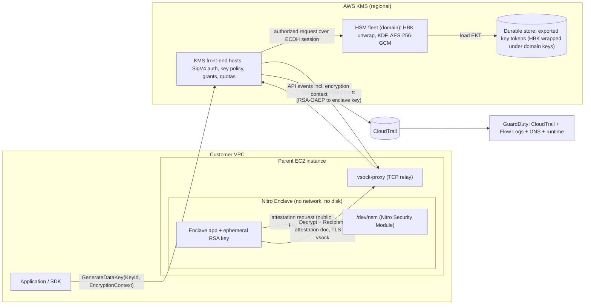

# Security and Cryptography: KMS and Nitro Enclaves

## TL;DR

KMS keys never leave FIPS 140-3 Level 3 HSMs in plaintext, and the hard ceiling is the per-account, per-Region request quota (10,000 to 100,000 TPS depending on Region), not the cryptography (AWS Security Blog, as of 2026-10).
Envelope encryption exists because KMS `Encrypt` accepts at most 4 KB, and because a KMS call costs latency, quota and $0.03 per 10,000 requests (AWS Security Blog, as of 2026-10).
Each KMS encryption uses a fresh 256-bit key derived from the HSM backing key with a random 128-bit nonce, so AES-GCM nonce-reuse limits never apply to the KMS key itself, while the data key you keep in your own process stays fully exposed to them.
Nitro Enclaves turn "who may decrypt" from an IAM identity question into a code-measurement question: KMS checks a signed attestation document against PCR condition keys and re-encrypts the plaintext to a key that only the enclave holds.
GuardDuty is a detective control that reads independent copies of CloudTrail, VPC Flow Logs and Route 53 Resolver DNS logs; it detects compromise after the fact and prevents nothing, so its value is limited by how fast you act on its findings.

## Mental Model



The intuition is three nested trust boundaries, each enforced by a different mechanism.
The HSM boundary guarantees that key material is never plaintext outside validated hardware, and enforces this through domain keys and quorum-controlled operator access.
The KMS front-end boundary decides who may ask the HSM to use a key: SigV4 identity, key policy, grants, encryption context and attestation condition keys are all evaluated there before an HSM sees a request.
The Nitro Enclave boundary decides which code may receive the plaintext answer, and enforces this with hypervisor memory isolation plus measurement-bound encryption of the response.
GuardDuty sits outside all three and watches the audit and network exhaust for evidence that one of the earlier decisions was made on behalf of an attacker.

## Internals

### KMS key hierarchy: KMS key, HBK, EKT, derived key

A KMS key is a logical container (ARN, policy, metadata) and holds no key material directly ([KMS Cryptographic Details](https://docs.aws.amazon.com/kms/latest/cryptographic-details/intro.html)).
When you create a key, an HSM in the regional domain generates an HSM backing key (HBK), which is designed never to leave the HSM in plaintext.
The HBK is exported only after being wrapped under HSM-managed domain keys, and the result is an exported key token (EKT) kept in durable, low-latency storage ([KMS Cryptographic Details](https://docs.aws.amazon.com/pdfs/kms/latest/cryptographic-details/kms-crypto-details.pdf)).
Rotation creates a new HBK and makes it the active version, while older HBKs are kept indefinitely so that old ciphertexts still decrypt.
This is why KMS rotation never requires re-encrypting data, and also why rotation does nothing to protect data already encrypted under a compromised HBK.

The mechanism most engineers miss is that the HBK never encrypts your data directly.
For each symmetric `Encrypt` or `GenerateDataKey` call, the HSM draws a random 128-bit nonce N and derives a one-time 256-bit key `K = KDF(HBK, N)` with the NIST SP 800-108r1 counter-mode KDF using HMAC-SHA256 ([AWS Security Blog](https://aws.amazon.com/blogs/security/how-aws-kms-and-aws-encryption-sdk-overcome-symmetric-encryption-bounds/)).
`K` then encrypts the payload with AES-256-GCM, using the encryption context as additional authenticated data.
The ciphertext blob carries the HBK identifier and N, and on `Decrypt` the HSM unwraps the EKT, reads N from the ciphertext and regenerates the same `K` ([KMS Decrypt internals](https://docs.aws.amazon.com/kms/latest/cryptographic-details/decrypt-operation.html)).
NIST SP 800-38D caps AES-GCM with random 96-bit IVs at 2^32 invocations per key, because past that point the chance of an IV collision becomes unacceptable.
A repeated IV under GCM leaks the XOR of the two plaintexts and lets an attacker forge authentication tags.
KMS sidesteps the cap because each derived key encrypts exactly one message, which moves the collision question to the 128-bit nonce space.
At 2^48 calls per HBK, the birthday-bound probability of any nonce collision is about 2^96 / 2^129 = 2^-33.
The operational consequence is that the KMS key never "wears out" from use, while the data key you cache and reuse in your own process does, unless your library derives per-message keys the same way.
The AWS Encryption SDK does derive per-message keys, which is one reason to use it rather than calling `AESGCM` directly.

Communication between KMS front-end hosts and HSMs runs over sessions established by authenticated ECDH between operator identities and HSMs.
Changes to HSM software and domain membership require quorum approval, which is how AWS backs its claim that no single operator can extract plaintext keys ([KMS Cryptographic Details](https://docs.aws.amazon.com/kms/latest/cryptographic-details/keys.html)).

### Control plane vs data plane in KMS

The control plane covers `CreateKey`, `PutKeyPolicy`, `CreateGrant`, `ScheduleKeyDeletion`, `EnableKeyRotation` and aliases.
The data plane covers `Encrypt`, `Decrypt`, `ReEncrypt`, `GenerateDataKey*`, `Sign`, `Verify`, `GenerateMac` and `DeriveSharedSecret`.
All symmetric data-plane operations in an account and Region draw on one shared token bucket, so a batch job's `GenerateDataKey` storm and S3's `Decrypt` calls on your behalf compete for the same quota ([AWS KMS request quotas](https://docs.amazonaws.cn/en_us/kms/latest/developerguide/requests-per-second.html)).
Grants are evaluated by the front end and are eventually consistent.
A newly created grant may not be usable straight away unless the caller passes the returned grant token, and that delay is a classic cause of intermittent `AccessDeniedException` in autoscaling paths.

Authorization is a policy-evaluation problem, and AWS proves properties of it with SMT solving.
The Zelkova engine encodes IAM and resource policies as SMT formulas to answer questions such as "can any principal outside my organization call `kms:Decrypt`?" (Backes et al., "Semantic-based Automated Reasoning for AWS Access Policies using SMT", FMCAD 2018).
IAM Access Analyzer runs on this technique, and it is the right tool for checking that key policies match the intent you describe in a design review.
See [[17-Cloud-AI-Engineering/Volume_02_AWS_Deep_Dive/Chapter_01_IAM_Policy_Evaluation_Engine|IAM Policy Evaluation Engine]] for the evaluation order.

### Envelope encryption and the key-commitment gap

`GenerateDataKey` returns a plaintext data key (DEK) and the same key encrypted under the KMS key (EDK).
You encrypt bulk data locally with the DEK, store the EDK next to the ciphertext, and wipe the DEK from memory.
AES-GCM is not key-committing.
An attacker who controls key choice can build one ciphertext that decrypts validly under two different keys, which gives two different plaintexts (Len, Grubbs, Ristenpart, "Partitioning Oracle Attacks", USENIX Security 2021; Albertini et al., "How to Abuse and Fix Authenticated Encryption Without Key Commitment", USENIX Security 2022).
In envelope systems with several wrapping keys or several recipients, this lets a malicious sender hand different readers different plaintexts.
Current AWS Encryption SDK message formats add a key commitment value to address this, and it is one more reason not to hand-roll envelope formats in production.

A ciphertext blob from symmetric KMS also names the KMS key that produced it.
If you call `Decrypt` without `KeyId`, KMS uses whichever key the blob names, which can be a key in an attacker's account that grants you decrypt.
Pinning `KeyId` on decrypt closes that confused-deputy path.

### Custom key stores: CloudHSM and external key store (XKS)

A CloudHSM key store backs KMS keys with key material in a CloudHSM cluster that you own, while KMS keeps the API, policy and integrations.
KMS requires the cluster to contain active HSMs in at least two Availability Zones before it will connect.
An external key store (XKS) sends each request through an XKS proxy to a key manager outside AWS.
Data keys are double encrypted, first under KMS-held material and then by the external key, so neither party alone can decrypt.
The trade-off is availability coupling.
With XKS, every `Decrypt` depends on your proxy, your WAN link and your key manager, and those are usually less available than KMS itself.

### CloudHSM key hierarchy and trust bootstrapping

CloudHSM gives you single-tenant HSMs, exposed as ENIs inside your VPC, and is FIPS 140-3 Level 3 validated (AWS Security Blog, as of 2026-10).
Cluster ownership is bootstrapped by PKI.
The first HSM issues a CSR, which you sign with your own issuing CA, and the client SDK then pins your CA when it opens end-to-end encrypted channels that terminate inside the HSM.
The HSM's own certificate chains back to the manufacturer and to AWS hardware roots, so you can verify the device is genuine before you trust it.
Users are split into crypto officers (COs), who manage users, and crypto users (CUs), who own and use keys.
M-of-N quorum authentication can be required for CO operations.
Keys are owned by a CU and shared explicitly, and a lost CO credential cannot be recovered by AWS.
Backups follow their own key hierarchy.
The HSM encrypts each backup under an ephemeral backup key (EBK), and the EBK is wrapped under a persistent backup key derived from manufacturer-held and AWS-held key-backup keys, so a backup can only be restored into genuine CloudHSM hardware ([CloudHSM backups](https://docs.aws.amazon.com/cloudhsm/latest/userguide/backups.html)).
The client SDK load-balances across the HSMs in a cluster, and the cluster synchronizes token keys among them.
A key created on one HSM is not durable against that HSM failing until the sync finishes, so the SDK's key-availability checks should be enforced for production keys.

### Nitro Enclaves: isolation and attestation

A Nitro Enclave is a separate VM carved out of the parent instance's vCPUs and memory by the Nitro Hypervisor.
It has no persistent storage, no external networking and no interactive access, and its only channel is a vsock to the parent ([The Security Design of the AWS Nitro System](https://docs.aws.amazon.com/whitepapers/latest/security-design-of-aws-nitro-system/security-design-of-aws-nitro-system.html)).
Root on the parent cannot read enclave memory, because the hypervisor never maps those pages into the parent.
The vCPUs given to an enclave are removed from the parent as whole cores, which keeps SMT siblings from being shared across the boundary.
That narrows, but does not remove, the microarchitectural side-channel surface described in work like Spectre (Kocher et al., IEEE S&P 2019).
Compared with Intel SGX, which places the trust boundary inside a process and relies on CPU memory encryption (McKeen et al., HASP 2013; Costan and Devadas, "Intel SGX Explained", IACR ePrint 2016/086), Nitro Enclaves trust the Nitro Hypervisor and the AWS hardware.
That makes the programming model a normal Linux VM, at the price of trusting AWS as the root of the TCB (see Sabt et al., "Trusted Execution Environment: What It Is, and What It Is Not", IEEE TrustCom 2015, for the taxonomy).

Attestation runs through the Nitro Security Module (NSM) device inside the enclave.
The enclave asks NSM for an attestation document and may supply a public key, a nonce and user data.
NSM returns a CBOR-encoded, COSE_Sign1-signed document (ECDSA P-384 with SHA-384) whose certificate chain leads to the AWS Nitro Enclaves root ([attestation process](https://github.com/aws/aws-nitro-enclaves-nsm-api/blob/main/docs/attestation_process.md)).
The document carries SHA-384 platform configuration registers (PCRs), which are listed below.

| PCR | Measures | Changes when |
| --- | --- | --- |
| PCR0 | Enclave image file (EIF) | Any change to the image |
| PCR1 | Linux kernel and bootstrap | The kernel or init changes |
| PCR2 | Application (user-space) | Application code changes |
| PCR3 | IAM role of the parent instance | The parent instance profile role changes |
| PCR4 | Instance ID of the parent | Every instance (too specific for fleets) |
| PCR8 | EIF signing certificate | The signing key changes, not the code |

An enclave started in debug mode reports all-zero PCRs, so a policy that pins real measurements rejects debug enclaves automatically.

KMS integrates with attestation through the `Recipient` parameter on `Decrypt`, `GenerateDataKey`, `GenerateDataKeyPair`, `GenerateRandom` and `DeriveSharedSecret` ([KMS and Nitro Enclaves](https://docs.aws.amazon.com/kms/latest/developerguide/services-nitro-enclaves.html)).
The steps are as follows.
1. The enclave generates an RSA key pair in enclave memory and obtains an attestation document that embeds the public key.
2. The enclave sends the KMS request, signed with credentials the parent forwards, with the TLS session terminated inside the enclave and carried as raw bytes over the parent's vsock-proxy.
3. KMS validates the document's signature chain, evaluates condition keys such as `kms:RecipientAttestation:ImageSha384` and `kms:RecipientAttestation:PCR0` through `PCR8` in the key policy, and only then runs the operation.
4. KMS leaves `Plaintext` null and returns `CiphertextForRecipient`, which is the result encrypted to the enclave's public key with RSAES-OAEP-SHA-256.
Even if the parent terminated TLS, it would only ever see a ciphertext it cannot open.
This is the mechanism that keeps model weights, signing keys or PII decryptable only by reviewed code, and not by every admin with `kms:Decrypt`.
One limitation matters for AI workloads: enclaves have no GPU access, so they protect key release and CPU-side processing, not GPU inference (see [[17-Cloud-AI-Engineering/Volume_12_AI_Applications_MLOps_and_Data_Platforms/Chapter_08_Cloud_Security_for_AI_Systems_Attacks_and_Defenses|Cloud Security for AI Systems]]).

### GuardDuty detection pipeline

GuardDuty builds its foundational detections from CloudTrail management events, VPC Flow Logs and DNS query logs from the Route 53 Resolver.
It reads these through independent, AWS-internal streams, so you do not need to turn on Flow Logs or trails, and your own logging settings do not change what it sees ([GuardDuty docs](https://docs.aws.amazon.com/guardduty/latest/ug/what-is-guardduty.html)).
Optional protection plans add more telemetry: S3 data events, EKS audit logs, Runtime Monitoring (an eBPF-based agent for EKS, ECS and EC2), Malware Protection (agentless EBS snapshot scans and S3 object scans), RDS login activity and Lambda network activity.
Detection combines threat-intelligence matching (known-bad IPs and domains), rules (for example, EC2 instance-role credentials used from outside AWS, reported as `UnauthorizedAccess:IAMUser/InstanceCredentialExfiltration.OutsideAWS`) and per-account behavioral baselines.
Extended Threat Detection correlates multiple signals into attack-sequence findings across a multi-stage intrusion (launched 2024-12, UNVERIFIED as of 2026-10).
Findings are regional, and you aggregate them with a delegated administrator account in AWS Organizations.

## Numbers to Know

| Item | Value | Source |
| --- | --- | --- |
| KMS shared symmetric crypto request quota | 10,000 to 100,000 TPS per account per Region, depending on Region; adjustable | (AWS Security Blog, as of 2026-10) |
| KMS customer managed key price | $1 per key per month, prorated hourly | (AWS Security Blog, as of 2026-10) |
| KMS symmetric request price | $0.03 per 10,000 requests | (AWS Security Blog, as of 2026-10) |
| KMS rotation surcharge | +$1/month for each of the first two rotations, capped after the second (so $3/month max per key) | (AWS What's New, 2024-04, as of 2026-10) |
| KMS rotation period | 90 to 2,560 days, plus on-demand rotation | (AWS What's New, 2024-04, as of 2026-10) |
| KMS `Encrypt` max plaintext | 4 KB | (AWS Security Blog, as of 2026-10) |
| KMS per-call derived key | 256-bit AES-GCM key from a 128-bit random nonce, SP 800-108r1 HMAC-SHA256 KDF | (AWS Security Blog, as of 2026-10) |
| KMS keys per account per Region | 100,000 (adjustable) | (AWS KMS docs, as of 2026-10) |
| Grants per KMS key | 50,000 (adjustable) | (AWS KMS docs, as of 2026-10) |
| Key policy document size | 32 KB (not adjustable) | (AWS KMS docs, as of 2026-10) |
| Custom key stores per account per Region | 10 (not adjustable) | (AWS KMS docs, as of 2026-10) |
| Key deletion waiting period | 7 to 30 days (default 30) | (AWS KMS docs, as of 2026-10) |
| KMS and CloudHSM hardware validation | FIPS 140-3 Level 3 | (AWS Security Blog, as of 2026-10) |
| CloudHSM price | $1.60 per HSM-hour in us-east-1 (about $1,168 per HSM per 730-hour month) | (AWS Security Blog, as of 2026-10) |
| CloudHSM Region coverage | 32 Regions | (AWS Security Blog, as of 2026-10) |
| CloudHSM HSMs per cluster | 28 | UNVERIFIED |
| AES-GCM random-IV invocation cap per key | 2^32 | (NIST SP 800-38D) |
| S3 Bucket Keys KMS request reduction | Up to 99% | (Amazon S3 docs, UNVERIFIED as of 2026-10) |
| GuardDuty updated-finding export to EventBridge | 6 h default; configurable to 1 h or 15 min | (GuardDuty docs, UNVERIFIED as of 2026-10) |
| GuardDuty finding retention | 90 days | (GuardDuty docs, UNVERIFIED as of 2026-10) |
| GuardDuty free trial | 30 days per account per Region | (GuardDuty docs, UNVERIFIED as of 2026-10) |
| Nitro Enclaves price | No additional charge beyond the parent instance | (Nitro Enclaves docs, UNVERIFIED as of 2026-10) |

## AWS vs GCP Mechanism Parity

| Dimension | AWS | Google Cloud | Critical difference |
| --- | --- | --- | --- |
| Managed key service | KMS: regional, multi-tenant HSM fleet, FIPS 140-3 L3 | Cloud KMS with protection levels SOFTWARE, HSM, EXTERNAL, EXTERNAL_VPC | GCP lets you pick software-only protection per key; on AWS, every KMS key is HSM-backed |
| Key versions | HBK versions are hidden; old versions cannot be disabled one at a time | Key versions are first-class and can be disabled or destroyed individually | GCP supports targeted crypto-shredding of one version; AWS needs the whole key deleted |
| Rotation | Automatic every 90-2,560 days or on demand; symmetric keys only | Automatic rotation schedule on symmetric keys; new primary version | Neither re-encrypts existing data; both only change the key for new encryptions |
| Direct encrypt payload | 4 KB | 64 KiB (UNVERIFIED as of 2026-10) | Envelope encryption is mandatory on both for bulk data |
| Dedicated HSM | CloudHSM: single-tenant cluster in your VPC, PKCS#11/JCE/OpenSSL | Cloud HSM is multi-tenant behind the Cloud KMS API (UNVERIFIED for single-tenant offerings) | AWS offers customer-administered HSM partitions as a first-party service |
| External keys | XKS proxy, double encryption | Cloud EKM, with Key Access Justifications | Both put your external key manager on the decrypt critical path |
| Cross-region keys | Multi-Region keys (`mrk-` prefix, shared material, independent policies) | Multi-region and global key locations | AWS replicas are separate resources whose policies can drift apart |
| Confidential compute release | Nitro Enclaves + KMS `Recipient` attestation condition keys | Confidential Space: confidential VM + attestation token consumed by Workload Identity Federation attribute conditions | AWS binds release to PCR hashes in the key policy; GCP binds it to OIDC claims in a WIF provider |
| TEE trust root | Nitro Hypervisor and Nitro cards (AWS TCB) | AMD SEV/SEV-SNP or Intel TDX memory encryption plus Google firmware | GCP adds CPU memory encryption against the host; Nitro relies on the hypervisor not mapping enclave pages |
| Perimeter for key APIs | VPC interface endpoint, `aws:SourceVpce`, `kms:ViaService`, SCPs and RCPs | VPC Service Controls around `cloudkms.googleapis.com`, org policies | VPC SC is perimeter-wide; AWS composes per-policy conditions |
| Threat detection | GuardDuty (CloudTrail, Flow, DNS, runtime, malware) | Security Command Center Event Threat Detection, Container Threat Detection | Both detect after the fact; both read independent copies of logs |

See [[17-Cloud-AI-Engineering/Volume_03_GCP_Deep_Dive/Chapter_15_Security_and_Confidential_Computing_Cloud_KMS|Security and Confidential Computing: Cloud KMS]] for the GCP internals.

## Worked Example: Envelope Encryption with Encryption Context, Attestation-Gated Keys, and GuardDuty

### Cost estimate

The KMS key costs $1 per month prorated hourly, about $0.0014 per hour, and the lab's few hundred requests cost under $0.01 (AWS Security Blog, as of 2026-10).
GuardDuty falls inside the 30-day free trial on a new detector (UNVERIFIED as of 2026-10).
The optional enclave part uses one m5.xlarge on-demand instance, roughly $0.19 per hour in us-east-1 (UNVERIFIED as of 2026-10).
Expect the whole lab to cost under $1 if torn down the same day.

### Step 0: budget alarm

```bash
#!/usr/bin/env bash
set -euo pipefail
ACCOUNT_ID=$(aws sts get-caller-identity --query Account --output text)
EMAIL="you@example.com"
cat > /tmp/budget.json <<'EOF'
{"BudgetName":"kms-enclave-lab","BudgetLimit":{"Amount":"5","Unit":"USD"},
 "TimeUnit":"MONTHLY","BudgetType":"COST"}
EOF
cat > /tmp/notif.json <<EOF
[{"Notification":{"NotificationType":"ACTUAL","ComparisonOperator":"GREATER_THAN",
  "Threshold":80,"ThresholdType":"PERCENTAGE"},
  "Subscribers":[{"SubscriptionType":"EMAIL","Address":"${EMAIL}"}]}]
EOF
aws budgets create-budget --account-id "$ACCOUNT_ID" \
  --budget file:///tmp/budget.json \
  --notifications-with-subscribers file:///tmp/notif.json
```

### Step 1: create a key and enable GuardDuty

```bash
#!/usr/bin/env bash
set -euo pipefail
export AWS_REGION=us-east-1
KEY_ARN=$(aws kms create-key --description "lab envelope key" \
  --key-usage ENCRYPT_DECRYPT --key-spec SYMMETRIC_DEFAULT \
  --query KeyMetadata.Arn --output text)
aws kms enable-key-rotation --key-id "$KEY_ARN" --rotation-period-in-days 180
aws kms create-alias --alias-name alias/lab-envelope --target-key-id "$KEY_ARN"
DETECTOR_ID=$(aws guardduty create-detector --enable \
  --finding-publishing-frequency FIFTEEN_MINUTES \
  --query DetectorId --output text)
echo "KEY_ARN=$KEY_ARN DETECTOR_ID=$DETECTOR_ID" | tee /tmp/lab.env
```

### Step 2: envelope encryption in Python (educational; use the AWS Encryption SDK in production)

```python
# envelope.py - requires boto3 and cryptography
import base64, json, os, boto3
from cryptography.hazmat.primitives.ciphers.aead import AESGCM

kms = boto3.client("kms", region_name="us-east-1")
KEY_ARN = os.environ["KEY_ARN"]

def _aad(ctx: dict) -> bytes:
    # Canonical form so the same context always yields identical AAD bytes.
    return json.dumps(ctx, sort_keys=True, separators=(",", ":")).encode()

def encrypt(plaintext: bytes, ctx: dict) -> dict:
    # Encryption context is bound into the EDK by KMS and logged in CloudTrail.
    # Never put secrets in it.
    dk = kms.generate_data_key(KeyId=KEY_ARN, KeySpec="AES_256",
                               EncryptionContext=ctx)
    nonce = os.urandom(12)
    ct = AESGCM(dk["Plaintext"]).encrypt(nonce, plaintext, _aad(ctx))
    # Python cannot reliably zero memory; production code should use the
    # Encryption SDK, which also derives per-message keys and adds key commitment.
    return {"edk": base64.b64encode(dk["CiphertextBlob"]).decode(),
            "nonce": base64.b64encode(nonce).decode(),
            "ct": base64.b64encode(ct).decode(), "ctx": ctx}

def decrypt(env: dict) -> bytes:
    # Pin KeyId so a blob that names an attacker-controlled key is rejected.
    resp = kms.decrypt(CiphertextBlob=base64.b64decode(env["edk"]),
                       EncryptionContext=env["ctx"], KeyId=KEY_ARN)
    return AESGCM(resp["Plaintext"]).decrypt(
        base64.b64decode(env["nonce"]), base64.b64decode(env["ct"]),
        _aad(env["ctx"]))

if __name__ == "__main__":
    ctx = {"tenant": "t-42", "purpose": "model-weights"}
    env = encrypt(b"layer0.weight bytes...", ctx)
    assert decrypt(env) == b"layer0.weight bytes..."
    try:
        decrypt({**env, "ctx": {"tenant": "t-43", "purpose": "model-weights"}})
    except kms.exceptions.InvalidCiphertextException:
        print("context mismatch rejected by KMS, as designed")
```

Run it with `source /tmp/lab.env && KEY_ARN=$KEY_ARN python3 envelope.py`.
The tampered-context call fails inside KMS, before your process ever holds a DEK, because the context is AAD on the HSM's derived-key encryption.

### Step 3 (optional): attestation-gated key policy for a Nitro Enclave

Build the enclave image on an instance launched with `--enclave-options Enabled=true`, then read the measurements.

```bash
nitro-cli build-enclave --docker-uri my-enclave-app:latest --output-file app.eif
# Output JSON includes "Measurements": {"PCR0": "...", "PCR1": "...", "PCR2": "..."}
nitro-cli run-enclave --eif-path app.eif --cpu-count 2 --memory 1024 --enclave-cid 16
# On the parent, relay TCP from vsock to the KMS endpoint (TLS stays end to end):
vsock-proxy 8000 kms.us-east-1.amazonaws.com 443 &
```

Put a key policy statement in place that denies all decrypt-class calls (including `ReEncrypt` and `ReEncryptFrom`, which have no `Recipient` parameter and could otherwise be abused to re-encrypt under an unattensted key) unless the request carries a matching attestation.
The statement uses `StringNotEqualsIgnoreCase`, which also evaluates true when the condition key is missing, so a plain `Decrypt` from the parent's role is denied as well.
Producer pipelines that only generate data keys (`kms:GenerateDataKey`) are kept out of this Deny block so they can encrypt model weights without enclave attestation.

```json
{
  "Sid": "DenyDecryptUnlessAttestedImage",
  "Effect": "Deny",
  "Principal": "*",
  "Action": ["kms:Decrypt", "kms:ReEncryptFrom", "kms:ReEncrypt*"],
  "Resource": "*",
  "Condition": {
    "StringNotEqualsIgnoreCase": {
      "kms:RecipientAttestation:ImageSha384": "<PCR0-hex-from-build-output>"
    },
    "ArnNotEquals": {
      "aws:PrincipalArn": "arn:aws:iam::<account>:role/BreakGlassKeyAdmin"
    }
  }
}
```

The break-glass carve-out is intentional.
Without it, a bad PCR0 rollout leaves the data undecryptable by anyone until the policy is fixed, and that fix itself needs `kms:PutKeyPolicy` rights that the Deny does not cover.

### Capacity sizing: S3 SSE-KMS at scale

Assume a training data loader reads 20,000 SSE-KMS objects per second from S3 (see [[17-Cloud-AI-Engineering/Volume_10_AI_Infrastructure_on_Cloud/Chapter_07_High_Throughput_Data_Loaders_and_Storage_IO|High-Throughput Data Loaders]]).
Without S3 Bucket Keys, every GET makes S3 call `Decrypt` on your behalf, which is 20,000 KMS TPS charged to your account's shared quota.
In a Region with a 10,000 TPS default, the loader is throttled at half its target rate before anything else in the account uses KMS.
Monthly cost: 20,000 x 86,400 x 30 = 5.184e10 requests, and 5.184e10 / 1e4 x $0.03 = $155,520 per month.
With Bucket Keys, S3 uses a bucket-level key with a limited lifetime to make object data keys, which cuts KMS calls by up to 99% (UNVERIFIED as of 2026-10).
That brings the load to about 200 TPS and about $1,555 per month.
The trade-off is that CloudTrail then logs one bucket-key ARN in place of per-object events, and the encryption context changes from object ARN to bucket ARN, which breaks any key-policy conditions written against the object ARN.

### Capacity sizing: application DEK caching

An ingest tier of 200 hosts encrypts 50,000 records per second in total, which is 250 records per second per host.
One `GenerateDataKey` per record would need 50,000 TPS, which exceeds most Regional defaults.
With a cache policy of max age 300 s and at most 100,000 messages per DEK, each host makes 250 x 300 = 75,000 messages per key, so the age limit rotates the key first.
KMS load is 200 hosts / 300 s = 0.67 TPS, a reduction of about 75,000 times.
The price is a revocation window: after a key policy change or key disable, hosts keep encrypting for up to 300 s with DEKs already in memory.
A further price is that a memory-disclosure bug exposes up to 75,000 records per leaked DEK.

### Teardown

```bash
export AWS_REGION=us-east-1
source /tmp/lab.env 2>/dev/null || true
aws kms delete-alias --region "$AWS_REGION" --alias-name alias/lab-envelope
aws kms schedule-key-deletion --region "$AWS_REGION" --key-id "$KEY_ARN" --pending-window-in-days 7
aws guardduty delete-detector --region "$AWS_REGION" --detector-id "$DETECTOR_ID"
nitro-cli terminate-enclave --all 2>/dev/null || true
# Terminate the enclave parent instance if you launched one:
# aws ec2 terminate-instances --instance-ids <id>
aws budgets delete-budget --account-id "$(aws sts get-caller-identity --query Account --output text)" \
  --budget-name kms-enclave-lab
```

## Failure Modes and Pitfalls

### Shared-quota starvation

The symmetric KMS quota is per account and Region, shared across all keys and across calls AWS services make on your behalf.
A backfill job or a new SSE-KMS data loader can push the account past the quota and cause `ThrottlingException` for unrelated production paths, including EBS volume attach and Secrets Manager reads.
Mitigations are account-level isolation of heavy KMS consumers (see [[17-Cloud-AI-Engineering/Volume_01_Cloud_Architecture_Principles/Chapter_06_Multi_Account_and_Multi_Project_Landing_Zones|Landing Zones]]), Bucket Keys, DEK caching, and CloudWatch alarms on KMS usage metrics against Service Quotas.
Retries without jitter turn a brief throttle into a retry storm (see [[17-Cloud-AI-Engineering/Volume_07_Reliability_and_SRE/Chapter_03_Resilient_Communication_Retries_Jitter_and_Circuit_Breakers|Retries, Jitter, and Circuit Breakers]]).

### Encryption does not stop an authorized principal

In the 2019 Capital One breach (described in the public US v. Paige Thompson complaint, W.D. Wash.), an SSRF against an EC2-hosted WAF reached the instance metadata service and obtained role credentials.
The attacker then read S3 objects that S3 decrypted transparently, because the role was authorized to decrypt.
Server-side encryption protects against media theft and some operator access, not against stolen credentials.
The controls that would have helped are IMDSv2 hop limits, key-policy conditions such as `aws:SourceVpce` or `kms:ViaService`, data-perimeter conditions, and fast response to GuardDuty's `InstanceCredentialExfiltration` findings (see [[17-Cloud-AI-Engineering/Volume_08_Security_Identity_and_the_Data_Perimeter/Chapter_06_Constructing_an_Impenetrable_Data_Perimeter|Data Perimeter]]).

### Cryptographic ransomware against your own storage

The publicly reported "Codefinger" campaign in January 2025 used stolen keys to rewrite S3 objects with SSE-C, under a customer-provided key the victim never held, and then set lifecycle deletion (UNVERIFIED as of 2026-10).
The KMS variants of this attack are re-encrypting under a key in an attacker account, attaching an XKS the attacker controls, or calling `ScheduleKeyDeletion` on your own keys.
Preventive controls include the following.
- SCPs that deny `s3:PutObject` when the SSE-C algorithm header (`s3:x-amz-server-side-encryption-customer-algorithm`) is present (condition key name UNVERIFIED as of 2026-10).
- SCPs that deny `kms:ScheduleKeyDeletion`, `kms:PutKeyPolicy` and `kms:CreateCustomKeyStore` outside a break-glass role.
- Resource control policies that keep principals outside the organization off your keys and buckets.
- Detection through CloudTrail and EventBridge alarms on `ScheduleKeyDeletion`, because the 7- to 30-day waiting period is a response window only if someone is paged.

### Key policy lockout

A key policy that omits the account principal and any working admin role makes the key unmanageable.
`PutKeyPolicy` performs a lockout safety check that `BypassPolicyLockoutSafetyCheck` disables, and that flag should be blocked by SCP.
Recovery requires AWS Support, and for enclave-gated keys a wrong PCR0 is a self-inflicted outage with no time limit.

### Attestation policy drift on every build

PCR0 changes on every image rebuild, so pinning PCR0 means a key-policy deployment must ship before every enclave rollout, and the old and new values must both be allowed during the transition.
Pinning PCR8 (the signing certificate) avoids policy churn but moves trust to whoever holds the EIF signing key, which becomes the most sensitive key you own.
Including PCR3 (parent IAM role) stops a stolen EIF from obtaining keys on an instance in another account or role.

### Grant eventual consistency

New grants may be invisible to other KMS front-end hosts for a short period.
Pipelines that create a grant and immediately launch a consumer see intermittent `AccessDeniedException` unless they pass grant tokens or retry with backoff.

### GuardDuty blind spots

DNS-based findings depend on instances using the Amazon-provided Route 53 Resolver.
Workloads that send DNS to self-managed resolvers or straight to the internet produce no DNS telemetry for GuardDuty.
GuardDuty is regional, so enabling it only in "used" Regions leaves the Regions attackers like for crypto-mining unmonitored.
Updated findings reach EventBridge every 6 hours by default (UNVERIFIED as of 2026-10), so an alert pipeline that relies on updates rather than new findings can lag by hours.

### Regional dependency cascades

KMS is a regional service, and many AWS services call it on their data paths, so a KMS or IAM degradation in one Region spreads into EBS, S3 SSE-KMS, Lambda environment variable decryption and Secrets Manager.
The 2025-10-20 us-east-1 post-incident summary attributed a broad multi-service outage to a latent race condition in DynamoDB's automated DNS management, which spread to dependent services (UNVERIFIED as of 2026-10).
The lesson for key design is to know which encryption paths have no cache and therefore fail closed the moment KMS degrades (see [[17-Cloud-AI-Engineering/Volume_07_Reliability_and_SRE/Chapter_07_Anatomy_of_Major_Cloud_Outages|Anatomy of Major Cloud Outages]]).

### Crypto-shredding defeated by backups

Deleting a per-tenant branch key or DEK from a DynamoDB key store does not shred the data while point-in-time recovery (up to 35 days) or AWS Backup copies still hold the key items.
A shredding SLA must cover the longest backup retention of the key store, not of the data store.

## Security and Cost Angles

### IAM scoping

Split key administration (`kms:Create*`, `kms:Put*`, `kms:ScheduleKeyDeletion`) from key usage (`kms:Decrypt`, `kms:GenerateDataKey*`) into different principals, and never grant `kms:*` on `*` in identity policies.
Use `kms:EncryptionContext:<key>` conditions to bind a principal to its tenant, for example allowing `Decrypt` only when `kms:EncryptionContext:tenant` equals `${aws:PrincipalTag/tenant}`.
Use `kms:ViaService` so a key can only be used through, for example, `s3.us-east-1.amazonaws.com`, which blocks direct `Decrypt` calls with exfiltrated credentials.
Use `kms:CallerAccount` and `aws:PrincipalOrgID` on cross-account keys.
See [[17-Cloud-AI-Engineering/Volume_08_Security_Identity_and_the_Data_Perimeter/Chapter_04_Encryption_Key_Hierarchies_and_Envelope_Encryption|Encryption Key Hierarchies]] for the general KEK/DEK theory.

### Network boundaries

A KMS interface VPC endpoint keeps calls off the internet path, and `aws:SourceVpce` in the key policy makes the key unusable from anywhere else.
That also breaks AWS-service-initiated calls, which do not come through your endpoint, unless they are carved out with `kms:ViaService` or `aws:CalledVia`.
Nitro Enclaves have no network at all, so the vsock-proxy allowlist on the parent is the only egress, and it should name only the KMS endpoint.

### Key hierarchy choices

Per-tenant KMS keys give clean revocation and per-tenant CloudTrail attribution at $1 per key per month, or $100,000 per month at 100,000 tenants.
One KMS key with tenant encryption context costs $1 per month and still gives per-tenant authorization and audit, but revocation means a policy change, not a key disable.
A hierarchical keyring (per-tenant branch keys stored encrypted in DynamoDB, unwrapped by one KMS key and cached with a TTL) sits between the two.
It gives per-tenant shredding, KMS call volume proportional to (hosts x tenants / TTL), and a revocation latency equal to the TTL.

### Unit-economics levers

The S3 Bucket Keys math above shows KMS request cost overtaking storage cost on hot SSE-KMS data.
Use AWS-owned or AWS-managed keys where policy control and audit are not required, because their request charges and key fees differ from customer managed keys (UNVERIFIED as of 2026-10 for the exact pricing differences).
CloudHSM costs about $1,168 per HSM per month at $1.60 per hour, so a two-AZ minimum cluster runs about $2,336 per month before any traffic (AWS Security Blog, as of 2026-10).
Choose it only when single-tenancy, PKCS#11 or algorithms outside KMS (for example AES key wrap, CBC or CTR modes) are hard requirements.
GuardDuty cost scales with CloudTrail event volume and Flow/DNS log volume.
Chatty automation that emits millions of management events inflates the bill, and the GuardDuty usage-statistics API shows which accounts and data sources drive cost.

## Interview Questions and Model Answers

### Question 1 (L5 - Senior)

Why do we use envelope encryption with KMS rather than calling `Encrypt` on every object, and what exactly is protected by what?

#### Model Answer

`Encrypt` accepts at most 4 KB, and every call is a network round trip, a debit against a shared regional quota and a billed request.
Envelope encryption calls `GenerateDataKey` once to get a plaintext DEK and an EDK, encrypts bulk data locally with AES-GCM, and stores the EDK beside the ciphertext.
The KMS key protects the DEK, and KMS, the HSM fleet and IAM protect the KMS key.
Security therefore rests on two things: plaintext DEKs living only briefly in memory, and `Decrypt` on the EDK being authorized narrowly.
I would bind an encryption context such as tenant and object identifier, because KMS authenticates it as AAD and writes it to CloudTrail, which gives integrity binding plus an audit trail per object.
I would pin `KeyId` on decrypt so a ciphertext naming a foreign key cannot route the call elsewhere.
I would use the AWS Encryption SDK for per-message key derivation and key commitment rather than raw AES-GCM.
Raw AES-GCM with a reused DEK hits the 2^32 random-IV limit and offers no key commitment.

#### Follow-up Interviewer Question

KMS's own AES-GCM key is used billions of times; why doesn't KMS hit the same 2^32 limit you just described?

### Question 2 (L5 - Senior)

A new data loader reading SSE-KMS objects from S3 causes Secrets Manager reads in an unrelated service to fail in the same account; explain the mechanism and the fix.

#### Model Answer

S3 calls KMS `Decrypt` on our behalf for each GET of an SSE-KMS object, and that call counts against the account's shared symmetric cryptographic quota in the Region.
Secrets Manager also calls KMS to decrypt secrets, so both workloads draw on one token bucket, and the loader's thousands of TPS starve the other.
The immediate fix is enabling S3 Bucket Keys, which replaces per-object KMS calls with calls for a time-limited bucket-level key, cutting requests by up to about 99%.
Note that the context and CloudTrail granularity change from object to bucket.
Structural fixes are moving the heavy consumer to its own account so its quota is isolated, requesting a quota increase sized to measured p99 demand plus headroom, and alarming on KMS request usage as a percentage of quota.
I would also check client retry behavior, because synchronized retries after throttling make the overload worse.

#### Follow-up Interviewer Question

The security team requires per-object CloudTrail attribution for this bucket; how do you meet that requirement and the throughput target at the same time?

### Question 3 (L6 - Staff)

Design the key hierarchy for a multi-tenant SaaS with 200,000 tenants that requires per-tenant crypto-shredding, per-tenant audit and 50,000 writes per second.

#### Model Answer

I rule out one KMS key per tenant first.
200,000 keys is above the 100,000 default key quota, costs about $200,000 per month in key fees, and does nothing for the throughput problem, because every key shares one regional request quota.
I would use a hierarchical keyring.
One KMS key per Region wraps per-tenant branch keys stored in a DynamoDB key store, and each branch key derives per-record data keys locally.
Hosts cache unwrapped branch keys with a TTL such as 5 minutes, so KMS load is roughly active (host, tenant) pairs divided by the TTL, not writes per second.
With 300 hosts and tenants sharded so each host serves about 1,000 active tenants, that is 300,000 / 300 s = 1,000 TPS, well under quota.
Per-tenant audit comes from putting the tenant ID in the encryption context of the branch-key unwrap, which CloudTrail records, plus application-level logs of data-key derivation.
Crypto-shredding means deleting the tenant's branch key versions.
The shredding SLA must cover DynamoDB PITR (up to 35 days) and any AWS Backup copies, so either exclude the key store from long backups or encrypt the backups with a key whose deletion is part of the shred.
The trade-offs to state explicitly are that revocation latency equals the cache TTL, that a host memory compromise exposes every cached tenant branch key, and that DynamoDB availability now sits on the encryption path.
Isolating noisy tenants into cells limits the blast radius (see [[17-Cloud-AI-Engineering/Volume_01_Cloud_Architecture_Principles/Chapter_03_Cell_Based_Architecture_and_Shuffle_Sharding|Cell-Based Architecture]]).

#### Follow-up Interviewer Question

A regulator requires that revoking a tenant takes effect in under 10 seconds; what do you change, and what does it cost in KMS TPS and latency?

### Question 4 (L6 - Staff)

We want model weights decryptable only by audited code, not by any engineer with admin access; walk through how a Nitro Enclave plus KMS achieves that, and where it can still fail.

#### Model Answer

The enclave is a VM split off from the parent by the Nitro Hypervisor, with no network, disk or shell, and root on the parent cannot map its memory.
At startup the enclave generates an RSA key pair, asks the NSM for an attestation document embedding the public key and a nonce, and calls KMS `Decrypt` with that document as the `Recipient`.
The TLS session terminates inside the enclave and travels over a vsock-proxy on the parent.
KMS verifies the COSE_Sign1 signature chain up to the Nitro root.
KMS then evaluates `kms:RecipientAttestation:ImageSha384` or the PCR keys in the key policy, and returns `CiphertextForRecipient` encrypted to the enclave's public key, so the parent only ever relays a ciphertext.
The key policy must contain an explicit Deny on decrypt-class actions (specifically `kms:Decrypt`, `kms:ReEncryptFrom`, and `kms:ReEncrypt*`, because `ReEncrypt` lacks a `Recipient` parameter and could otherwise be used to move ciphertext to an unattensted key) when the attestation does not match, because otherwise any admin whose IAM policy grants `kms:Decrypt` can simply call it without a recipient.
I would pin PCR0 for strictness, or PCR8 for operational ease, and add PCR3 to bind to the parent role.
Failure modes:
- Debug-mode enclaves report zero PCRs and are correctly rejected, but a policy that only checks PCR8 trusts every image the signing key has ever signed.
- A bad rollout without both old and new PCR0 values allowed is an outage.
- Side channels are narrowed by dedicated cores but not removed.
- The enclave has no GPU, so for GPU inference this pattern protects key release and CPU-side unwrapping, but the weights eventually sit decrypted in GPU memory under the instance's normal trust model.

#### Follow-up Interviewer Question

How do you design the rollout so a new enclave image can be deployed with zero decrypt failures, and how do you make sure the old image stops being able to decrypt afterwards?

### Question 5 (L6 - Staff)

Roll out GuardDuty across a 400-account organization so findings lead to action within 15 minutes, and explain what it can and cannot see.

#### Model Answer

Make a security tooling account the delegated administrator, auto-enable GuardDuty for all existing and new members in every enabled Region, and enforce this with an SCP that denies `guardduty:DeleteDetector` and `guardduty:DisassociateFromAdministratorAccount`.
Set the finding publishing frequency to 15 minutes and route new findings through EventBridge to a triage pipeline.
High-severity findings with clear automatic responses, such as `InstanceCredentialExfiltration` or crypto-mining DNS findings, trigger automated containment: revoking role sessions issued before the finding with an inline deny on `aws:TokenIssueTime`, and quarantining security groups.
Foundational coverage comes from independent copies of CloudTrail management events, VPC Flow Logs and Resolver DNS logs.
GuardDuty is blind to DNS sent to custom resolvers and to S3 data events or EKS audit activity unless those protection plans are on.
It is also blind to anything in Regions where it is disabled, so every Region must be enabled even if unused.
Suppression rules handle known-benign scanners, but each suppression is a documented risk acceptance with an owner and an expiry.
GuardDuty is not prevention: its value is set by mean time to respond, so I would track MTTR from finding creation to containment as the service's SLO.

#### Follow-up Interviewer Question

GuardDuty costs are 3x the forecast in two accounts; how do you diagnose the cause without turning off coverage?

### Question 6 (L7+ - Principal)

KMS in your primary Region degrades for 45 minutes; design the encryption architecture for static stability and explain what you give up.

#### Model Answer

First separate the paths.
New encryptions can continue on cached DEKs or cached branch keys, so encryption is statically stable as long as caches are warm and TTLs exceed the outage, but that same TTL is the revocation latency.
Decryption of data whose key is not cached fails closed unless the ciphertext can be unwrapped by a key in another Region.
I would wrap each DEK under two KMS keys in different Regions using a multi-keyring, or use Multi-Region keys, so a reader in the secondary Region can decrypt.
Multi-Region keys share key material but have independent policies, so policy drift between replicas must be detected by Config rules or Zelkova-based checks.
AWS-integrated paths such as S3 SSE-KMS and EBS have no cache that I control, so I would list them as hard dependencies and design failover to replicas in a Region with healthy KMS, not try to cache around them.
XKS or CloudHSM key stores add our own availability to the decrypt path, so I would not use them for tier-0 data paths unless the external stack is multi-site with an SLO equal to or better than KMS.
The explicit trade-offs:
- Longer caches mean more availability but slower revocation and more exposure per memory compromise.
- Multi-region wrapping means more resilience but a larger set of principals and Regions able to decrypt, which conflicts with data residency.
I would put these on the risk register with numbers: cache TTL, the share of reads served from cache, and RTO per data class (see [[17-Cloud-AI-Engineering/Volume_01_Cloud_Architecture_Principles/Chapter_02_Regions_Zones_and_Static_Stability|Static Stability]]).

#### Follow-up Interviewer Question

The data-residency team forbids any key in a second Region being able to decrypt EU customer data; what is your availability story now?

### Question 7 (L7+ - Principal)

A board member asks whether moving all keys to CloudHSM or an external key manager would make us safer than KMS; give a recommendation.

#### Model Answer

Both KMS and CloudHSM run FIPS 140-3 Level 3 validated hardware, so the question is not cryptographic strength but who controls administration and who is on the availability path.
CloudHSM gives single-tenant partitions and customer-held CO credentials, and adds PKCS#11 and algorithms KMS lacks.
It costs about $1,168 per HSM per month in us-east-1 with at least two HSMs for availability, and it makes us responsible for user management, quorum policies and capacity planning.
Lost CO credentials are unrecoverable.
XKS keeps key material outside AWS and adds a kill switch we control, but every decrypt now depends on our proxy and WAN, which almost certainly lowers availability.
The largest real-world risk is credential compromise of authorized principals, as Capital One and SSE-C ransomware campaigns show, and none of these options reduces it.
Narrow key policies, encryption-context conditions, data-perimeter controls, SCPs on destructive key actions and enclave-gated release for the most sensitive keys do reduce it.
My recommendation is KMS with customer managed keys as the default.
CloudHSM key stores or XKS apply only to the data classes where a regulator or contract requires single tenancy or external control, with the availability cost written into those systems' SLOs.

#### Follow-up Interviewer Question

How would you prove to an auditor that no AWS operator and no internal admin can decrypt one specific dataset, using evidence rather than assertions?

## Further Reading

- [AWS KMS Cryptographic Details](https://docs.aws.amazon.com/kms/latest/cryptographic-details/intro.html) - the primary source for HBKs, EKTs, domain keys, quorum controls and the per-call derived-key construction.
- [How AWS KMS and AWS Encryption SDK overcome symmetric encryption bounds](https://aws.amazon.com/blogs/security/how-aws-kms-and-aws-encryption-sdk-overcome-symmetric-encryption-bounds/) - explains why derived keys remove the AES-GCM invocation limit, with the KDF parameters.
- [AWS KMS or AWS CloudHSM: Choose the right key management solution](https://aws.amazon.com/blogs/security/aws-kms-or-aws-cloudhsm-choose-the-right-key-management-solution/) - current quotas, prices and decision criteria from AWS.
- [The curious case of faster AWS KMS symmetric key rotation](https://aws.amazon.com/blogs/security/the-curious-case-of-faster-aws-kms-symmetric-key-rotation/) - rotation semantics, configurable periods and the pricing cap.
- [The Security Design of the AWS Nitro System](https://docs.aws.amazon.com/whitepapers/latest/security-design-of-aws-nitro-system/security-design-of-aws-nitro-system.html) - the trust model behind both the "no operator access" claim and enclave isolation.
- [Nitro Enclaves attestation process (NSM API docs)](https://github.com/aws/aws-nitro-enclaves-nsm-api/blob/main/docs/attestation_process.md) - document format, COSE signing and certificate-chain validation steps.
- [How AWS Nitro Enclaves uses AWS KMS](https://docs.aws.amazon.com/kms/latest/developerguide/services-nitro-enclaves.html) - `Recipient`, `CiphertextForRecipient` and the attestation condition keys.
- [Amazon GuardDuty User Guide](https://docs.aws.amazon.com/guardduty/latest/ug/what-is-guardduty.html) - data sources, protection plans and finding types.
- [NIST SP 800-38D](https://csrc.nist.gov/pubs/sp/800/38/d/final) - the GCM specification and the source of the IV and invocation limits.
- [Albertini et al., USENIX Security 2022](https://www.usenix.org/conference/usenixsecurity22/presentation/albertini) - why non-committing AEAD is dangerous in envelope and multi-recipient systems.
- [Len, Grubbs, Ristenpart, USENIX Security 2021](https://www.usenix.org/conference/usenixsecurity21/presentation/len) - partitioning oracle attacks, which motivate key commitment.
- [Costan and Devadas, Intel SGX Explained](https://eprint.iacr.org/2016/086) - the reference TEE design to compare against Nitro's hypervisor-based isolation.
- Backes et al., "Semantic-based Automated Reasoning for AWS Access Policies using SMT", FMCAD 2018 - the Zelkova engine behind provable key-policy analysis.
- [[17-Cloud-AI-Engineering/Volume_02_AWS_Deep_Dive/Chapter_04_EC2_Nitro_Architecture_and_Graviton|EC2, Nitro Architecture, and Graviton]] - the Nitro card and hypervisor internals that enclaves build on.
- [[17-Cloud-AI-Engineering/Volume_02_AWS_Deep_Dive/Chapter_14_Observability_CloudWatch_Metrics_Logs_and_X_Ray|Observability: CloudWatch, Metrics, Logs, and X-Ray]] - previous chapter, for alarming on KMS quota usage and routing GuardDuty findings.
