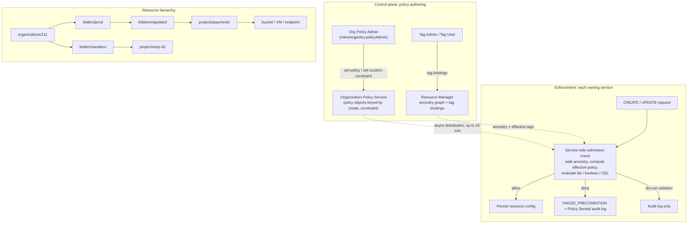

# Resource Hierarchy and Organization Policies

## TL;DR

The Google Cloud resource hierarchy (organization -> folders -> projects -> service resources) is the only structure that carries both IAM allow policies and Organization Policy, so its shape defines the blast radius of every governance decision.
Organization Policy limits what a resource's *configuration* can be, while IAM limits *who* can call an API; they are separate engines, and a control is only as strong as the IAM on `orgpolicy.policyAdmin` and on tag binding.
List-constraint inheritance can loosen as well as tighten: by default a child policy replaces its parent's, `inheritFromParent: true` merges allow and deny sets as unions with deny winning, and `reset` returns to the Google default, so a child can widen what its parent allowed.
Each owning service enforces the policy when a resource is created or updated, so enforcement is not retroactive, coverage differs per service, and policy changes take up to 15 minutes to reach every enforcement point (Google Cloud docs, as of 2026-10).
Safe rollout runs in this order: custom or managed constraint, then Policy Simulator, then a dry-run spec that writes violations to audit logs, then staged live enforcement by folder, with tag-conditioned exceptions instead of project overrides.

## Mental Model



Think of Organization Policy as a distributed admission controller, not a request firewall.
Authors write small declarative objects, one per (hierarchy node, constraint) pair, into a central control plane.
Each Google Cloud service that owns a resource type pulls those objects, plus the resource's ancestry and tags from Resource Manager, and evaluates them in its own control plane when a create or update request tries to change the resource's configuration.
The hierarchy works like a path in a tree: the effective policy at a project is a fold over the policies on the path from the organization root down to that project.
Because that fold allows replacement and union, not just intersection, the tree behaves more like inherited configuration with overrides than like a stack of filters.
Because the check runs only on mutation, anything that already exists is unaffected until someone changes it.

## Internals

### The hierarchy as a governance graph

The organization resource is the root and is bound to a Cloud Identity or Google Workspace customer.
Folders are optional intermediate nodes that can hold folders and projects.
Projects are the leaf containers that own service resources, API enablement, quotas, and the billing link.
You can nest folders up to 10 levels deep, and a parent cannot hold more than 300 direct child folders (Resource Manager docs, as of 2026-10).
Folder display names must be unique among siblings at the same level (Resource Manager docs, as of 2026-10).
Every node has exactly one parent, so the ancestry of any resource is a single path, and that is what makes policy evaluation deterministic.
IAM allow policies, IAM deny policies, Organization Policy, tags, and several network policies all attach to these nodes.
This chapter covers Organization Policy and tags; IAM evaluation is covered in [[17-Cloud-AI-Engineering/Volume_03_GCP_Deep_Dive/Chapter_02_Cloud_IAM_Roles_Policies_and_Conditions|Cloud IAM: Roles, Policies, and Conditions]].

### Two engines with different questions

IAM answers "may principal P call method M on resource R".
Organization Policy answers "may resource R have configuration C, given where it sits in the tree".
The difference matters for threat modeling.
An Owner on a project can do anything IAM allows, but cannot create a bucket in a forbidden region if `gcp.resourceLocations` forbids it, because the storage service rejects that configuration whoever the caller is.
In the other direction, Organization Policy cannot stop a correctly configured resource from being read by an over-privileged principal; IAM and VPC Service Controls cover that ([[17-Cloud-AI-Engineering/Volume_03_GCP_Deep_Dive/Chapter_03_VPC_Service_Controls_Security_Perimeters|VPC Service Controls: Security Perimeters]]).

### Constraint taxonomy

Google now groups constraints into three families, and the family decides which tools work with a constraint.
Legacy managed constraints are the original list and boolean constraints, such as `gcp.resourceLocations`, `iam.allowedPolicyMemberDomains`, and `storage.uniformBucketLevelAccess`.
List rules hold allowed or denied values, and boolean rules turn enforcement on or off (Google Cloud docs, as of 2026-10).
Managed constraints, named `<service>.managed.<name>`, are Google-maintained constraints built on the custom organization policy platform.
They take list or boolean parameters, and they support Policy Simulator and dry-run (Google Cloud docs, as of 2026-10).
Examples include `iam.managed.disableServiceAccountKeyUpload`, `iam.managed.allowedPolicyMembers`, and `iam.managed.preventPrivilegedBasicRolesForDefaultServiceAccounts` (Google Cloud docs, as of 2026-10).
Custom constraints are customer-authored constraints scoped to the organization.
Each one names supported resource types, the methods it applies to, a CEL condition over the resource representation, and an action.
The condition field can contain up to 1000 characters (Google Cloud docs, as of 2026-10).
A managed constraint cannot have more than 100 individual parameter values (Google Cloud docs, as of 2026-10).
Each organization policy enforces exactly one constraint, in active mode, dry-run mode, or both (Google Cloud docs, as of 2026-10).
Because of that cardinality, at most one policy object exists per (node, constraint) pair, and that keeps the hierarchy walk well defined.

Not every service supports custom constraints for every resource type, and support is announced service by service.
For example, custom organization policies for Cloud Resource Manager entered Preview on 2025-03-26 (Resource Manager release notes, as of 2026-10), custom policies for Essential Contacts became GA on 2025-02-19 (as of 2026-10), and custom policies for Memorystore for Valkey were announced on 2026-07-31 (Organization Policy release notes, as of 2026-10).
Check the per-service supported-resources page before you build a control on a custom constraint.
Treat Preview coverage as non-production.

### The hierarchy evaluation algorithm

This is the mechanism most getting-started guides skip, and most guardrail bypasses come from it.
For a list constraint, the documented rules are as follows (Organization Policy hierarchy evaluation docs, as of 2026-10).
If a node has no policy for the constraint, it inherits its parent's effective policy.
If a node has a policy and does not set `inheritFromParent`, its policy supersedes everything above it.
If a node sets `inheritFromParent: true`, its rules are merged with the parent's effective policy: the allowed values are combined, the denied values are combined, and deny values always take precedence when the merged set is evaluated.
If a node sets `inheritFromParent: false` and restores the default (`reset` in the v2 API), the constraint's Google default applies, whatever the ancestors say.

Written as a fold over the ancestry path `[org, f1, ..., fn, project]`:

```
eff(root_parent) = DEFAULT
eff(n) = eff(parent(n))                              if no policy at n
       = DEFAULT                                     if policy(n).reset
       = policy(n)                                   if not policy(n).inheritFromParent
       = (A_parent U A_n, D_parent U D_n)            if policy(n).inheritFromParent
allowed(v) = not matchAny(D, v) and (allowAll or A empty or matchAny(A, v))
```

The fold is non-monotonic.
In AWS, SCPs only ever narrow the set of permitted actions as you go down the tree, because the effective permission is the intersection along the path.
In Google Cloud list policies, a descendant with `inheritFromParent: true` can add allowed values that its parent never listed, because the merge is a union.
A descendant with `inheritFromParent: false` can drop the parent's denies entirely.
`reset` is the extreme case.
The only thing that cannot be widened is an explicit deny that the descendant inherits, because deny-wins applies only inside a merge.
A replacing child policy throws the parent's denies away along with its allows.

So a list policy's text is never the guardrail.
The guardrail is the policy text, plus the set of principals who can write a policy object at or below that node, plus the set of principals who can change the node's ancestry or tags.
The worked example below includes an offline evaluator that reproduces this behavior.

Value matching is richer than string equality.
Values prefixed with `under:` match any node whose ancestry contains the named folder, organization, or project, for example `under:folders/VALUE_A` (Google Cloud docs, as of 2026-10).
`gcp.resourceLocations` also accepts value groups with the `in:` prefix, for example `in:us-locations`, which expand to curated sets of regions and zones (UNVERIFIED in this revision).

Boolean constraints have no merge.
The nearest policy on the path with an unconditional rule decides `enforce: true` or `enforce: false`.
Custom and managed constraints also behave as boolean at the policy layer: the policy turns the constraint on or off for a subtree, and the constraint definition holds the logic.

### Conditional policies and the tag trust boundary

Rules can carry a CEL condition over tags, for example `resource.matchTagId("tagKeys/1111", "tagValues/2222")` (Google Cloud docs, as of 2026-10).
Tags are bound to hierarchy nodes and inherited by their descendants.
That makes tags the cleanest exception mechanism: one org-level policy enforces a constraint everywhere except where the tag `env-exception=approved` is bound, with no project-level override objects to drift.
The cost is a moved trust boundary.
Anyone who can create a tag binding on a project can now switch the constraint for that project.
If you use tag-conditioned exceptions, the IAM on tag binding is part of your security perimeter and must be scoped as tightly as `orgpolicy.policyAdmin`.

### Where and when enforcement happens

The owning service enforces the policy on the mutation path.
Enforcement of most organization policies is not retroactive: if a resource already violates a new policy, it is flagged as a violation, but the service does not change its existing behavior (Google Cloud docs, as of 2026-10).
Changes can take up to 15 minutes to be fully enforced (Google Cloud docs, as of 2026-10).
That bound is consistent with a design in which effective policies and ancestry are cached near each service's control plane and refreshed asynchronously.
Google does not publish the internal distribution topology, so treat any detailed cache model as inference, not documentation.
Three operational consequences follow from the documented behavior.
First, a pipeline that sets a policy and then immediately creates resources can race the propagation window in either direction.
Second, a compliance report has to scan existing resources, for example with Cloud Asset Inventory, because enforcement events only cover new mutations.
Third, coverage depends on the service: a constraint protects only the resource types and methods its owning service checks.
The same eventual-consistency shape exists in IAM, where access changes are eventually consistent and a revoked role can keep working for a while (IAM docs, as of 2026-10).

### Custom constraint evaluation

A custom constraint is a predicate over the resource representation in the request: `resource.<field>`, scoped to listed `resourceTypes` and `methodTypes`.
With `actionType: ALLOW`, the operation is allowed only if the condition is true.
With `actionType: DENY`, the operation is blocked if the condition is true.
If a resource falls under several enforced custom constraints, every applicable constraint must pass, so the semantics are a conjunction.
This is the closest Google Cloud analogue to a Kubernetes validating admission webhook, but it runs inside the provider's control plane, so there is no webhook availability risk on your side ([[17-Cloud-AI-Engineering/Volume_05_Kubernetes_and_Platform_Engineering/Chapter_01_Kubernetes_Control_Loop_Internals|Kubernetes Control Loop Internals]]).
CEL was chosen because it is non-Turing-complete, side-effect free, and linear-time in expression size, which lets the provider run customer predicates on its own control plane hot path without a sandbox ([CEL spec](https://github.com/google/cel-spec)).

### Testing: dry-run and Policy Simulator

A dry-run spec (`dryRunSpec`) is evaluated alongside the live spec, and its violations are written to audit logs without denying the request (Google Cloud docs, as of 2026-10).
Dry-run is limited to custom constraints, managed constraints, and four legacy managed constraints: Restrict service usage, Restrict endpoint usage, Restrict TLS versions, and Restrict TLS cipher suites (Google Cloud docs, as of 2026-10).
Creating a dry-run policy for any other constraint returns an error (Google Cloud docs, as of 2026-10).
Policy Simulator for Organization Policy previews a new custom constraint, or a policy enforcing a custom or managed constraint, and lists the existing resources that would violate it (Policy Intelligence docs, as of 2026-10).
The two tools answer different questions.
The simulator answers "what existing state would be in violation".
Dry-run answers "what future mutations would have been blocked".
You need both, because enforcement is not retroactive while the breakage you care about happens on the mutation path.

### Secure-by-default baseline

Organizations created on or after 2024-05-03 get a bundle of Google Cloud security baseline constraints enforced at creation (Google Cloud docs, as of 2026-10).
The bundle includes `iam.managed.disableServiceAccountKeyUpload` and `essentialcontacts.managed.allowedContactDomains`, and its contents changed on 2025-11-11 (Organization Policy release notes, as of 2026-10).
The announcement also listed `iam.automaticIamGrantsForDefaultServiceAccounts`, which stops default service accounts from receiving the Editor role when they are created ([Google Cloud blog](https://cloud.google.com/blog/products/identity-security/introducing-stronger-default-org-policies-for-our-customers)).
An organization created before that date has a different starting posture.
When you migrate automation between organizations, run `describe --effective` on both, because the same Terraform can behave differently.

### Foundational lineage

Borg's cell and allocation hierarchy introduced the idea that placement and policy follow an administrative tree ([Borg, EuroSys 2015](https://research.google/pubs/large-scale-cluster-management-at-google-with-borg/)).
Zanzibar shows how Google evaluates hierarchical, inherited authorization at global scale, and why snapshot consistency (the "new enemy" problem and zookies) matters when ACLs and their containers change concurrently ([Zanzibar, USENIX ATC 2019](https://www.usenix.org/conference/atc19/presentation/pang)).
Organization Policy is not documented as being built on Zanzibar, so read the paper for the problem class, not as a description of this implementation.
On the AWS side, Zelkova turns IAM and SCP policies into SMT formulas so their semantics can be checked by proof ([Zelkova, FMCAD 2018](https://www.amazon.science/publications/semantic-based-automated-reasoning-for-aws-access-policies-using-smt)).
Cedar shows how a policy language can be designed for analyzability from the start ([Cedar, OOPSLA 2024](https://www.amazon.science/publications/cedar-a-new-language-for-expressive-fast-safe-and-analyzable-authorization)).
Both are the right lens for asking whether an Organization Policy set can be verified rather than only tested.

## Numbers to Know

| Item | Value | Source |
| --- | --- | --- |
| Maximum folder nesting depth | 10 levels | (Resource Manager docs, as of 2026-10) |
| Direct child folders per parent | 300 | (Resource Manager docs, as of 2026-10) |
| Folder display-name uniqueness | Unique among siblings | (Resource Manager docs, as of 2026-10) |
| Organization Policy change propagation | Up to 15 minutes | (Google Cloud docs, as of 2026-10) |
| Constraints per organization policy | Exactly 1 (active, dry-run, or both) | (Google Cloud docs, as of 2026-10) |
| Custom constraint CEL condition length | Up to 1000 characters | (Google Cloud docs, as of 2026-10) |
| Managed constraint parameter values | At most 100 | (Google Cloud docs, as of 2026-10) |
| Dry-run eligible constraints | Custom, managed, and 4 legacy (service usage, endpoint usage, TLS versions, TLS cipher suites) | (Google Cloud docs, as of 2026-10) |
| Policy Simulator for allow policies replay window | Last 90 days of access logs | (Policy Intelligence docs, as of 2026-10) |
| Security baseline auto-enforced for new orgs | Orgs created on or after 2024-05-03 | (Google Cloud docs, as of 2026-10) |
| Baseline bundle last changed | 2025-11-11 | (Organization Policy release notes, as of 2026-10) |
| Project pending-deletion recovery window | 30 days | UNVERIFIED |
| Organization Policy Service list price | No separate charge | UNVERIFIED |
| IAM allow-policy propagation typical / tail | Minutes, eventually consistent | (IAM docs, as of 2026-10); exact figures UNVERIFIED |

## AWS vs GCP Mechanism Parity

All AWS-side numeric limits and semantics in this table are UNVERIFIED in this revision and must be re-checked against AWS Organizations docs before you rely on them.

| Dimension | AWS | Google Cloud | Critical difference |
| --- | --- | --- | --- |
| Hierarchy | Organization root -> OUs -> accounts | Organization -> folders -> projects -> resources | GCP hierarchy reaches service resources; AWS stops at the account |
| Depth / fan-out | OU nesting depth 5 (UNVERIFIED) | Folder depth 10, 300 direct child folders (Resource Manager docs, as of 2026-10) | GCP allows deeper trees, but deep trees make the ancestry fold harder to reason about |
| Identity guardrail | SCP limits maximum permissions of principals in member accounts; RCP limits resource-side access (UNVERIFIED) | IAM deny policies and Principal Access Boundary (see [[17-Cloud-AI-Engineering/Volume_03_GCP_Deep_Dive/Chapter_02_Cloud_IAM_Roles_Policies_and_Conditions\|Cloud IAM]]) | GCP keeps identity guardrails out of Organization Policy entirely |
| Configuration guardrail | Declarative policies for selected EC2/VPC settings; otherwise SCP condition keys on API parameters (UNVERIFIED) | Organization Policy legacy, managed, and custom constraints | GCP evaluates the resource representation with CEL; SCPs only see request context keys |
| Inheritance semantics | Intersection along the path; Allow required at every level, explicit Deny anywhere wins (UNVERIFIED) | Replace by default, union-merge with `inheritFromParent`, deny-wins only inside merges, `reset` to default | GCP is non-monotonic: a descendant can widen what is allowed |
| Exemptions | Management account not affected by SCPs (UNVERIFIED) | No exempt project; exceptions are policies or tag conditions | GCP exceptions are explicit objects you can audit |
| Retroactivity | SCPs apply on every API call, so existing resources lose operations immediately | Mutation-time enforcement, not retroactive (Google Cloud docs, as of 2026-10) | AWS stops actions; GCP stops configurations |
| Pre-deployment testing | IAM policy simulator and Access Analyzer checks; no native SCP dry-run (UNVERIFIED) | Policy Simulator for Org Policy plus `dryRunSpec` (Google Cloud docs, as of 2026-10) | GCP has first-class shadow mode for custom and managed constraints |
| Condition language | IAM JSON condition operators | CEL, up to 1000 characters per custom condition (Google Cloud docs, as of 2026-10) | CEL is typed and can reach nested resource fields |
| Policy size limits | SCP document size and attachments per target are capped (UNVERIFIED) | One constraint per policy; managed parameter values at most 100 | Different sharding pressure: AWS packs statements, GCP multiplies objects |
| Propagation | Eventually consistent (UNVERIFIED) | Up to 15 minutes (Google Cloud docs, as of 2026-10) | Both need settle time in pipelines |
| Formal analysis | Zelkova SMT backend for IAM and SCP reasoning | Policy Analyzer and Simulator; no published SMT-style proof engine | AWS can prove properties; GCP mostly tests them empirically |

## Worked Example: Proving Non-Monotonic Inheritance, Then Rolling Out a Guardrail Safely

### What this lab does

You build a folder and a project, then show that a project-level `inheritFromParent: true` policy widens a folder's region allow list.
You enforce a boolean constraint, put a custom constraint in dry-run, simulate it, and tear everything down.
An offline Python evaluator reproduces the effective-policy computation, so you can unit-test policy sets in CI before you call any API.

### Cost estimate and prerequisites

Folders, projects, tags, organization policies, and custom constraints carry no line-item charge (UNVERIFIED).
The only billable resource is one empty Cloud Storage bucket for under an hour, which rounds to USD 0.00.
The budget below is a tripwire set at USD 5.
You need `roles/orgpolicy.policyAdmin` and `roles/resourcemanager.folderCreator` at the organization, `roles/resourcemanager.projectCreator`, and `roles/billing.user` on the billing account.

### Step 1 - Provision the hierarchy and a budget alarm

```bash
#!/usr/bin/env bash
set -euo pipefail
export ORG_ID="123456789012"            # your organization ID
export BILLING_ACCOUNT="000000-AAAAAA-BBBBBB"
export PROJECT_ID="orgpol-lab-$RANDOM"

gcloud resource-manager folders create --display-name="orgpol-lab" --organization="$ORG_ID"
export FOLDER_ID="$(gcloud resource-manager folders list --organization="$ORG_ID" \
  --filter='displayName=orgpol-lab' --format='value(name)' | sed 's#folders/##')"

gcloud projects create "$PROJECT_ID" --folder="$FOLDER_ID"
gcloud billing projects link "$PROJECT_ID" --billing-account="$BILLING_ACCOUNT"
gcloud services enable storage.googleapis.com orgpolicy.googleapis.com --project="$PROJECT_ID"

gcloud billing budgets create --billing-account="$BILLING_ACCOUNT" \
  --display-name="orgpol-lab-budget" --budget-amount=5USD \
  --filter-projects="projects/$PROJECT_ID" \
  --threshold-rule=percent=0.5 --threshold-rule=percent=1.0
```

### Step 2 - Folder pins US locations, project widens to europe-west4

```bash
cat > /tmp/folder-locations.yaml <<EOF
name: folders/${FOLDER_ID}/policies/gcp.resourceLocations
spec:
  rules:
  - values:
      allowedValues:
      - in:us-locations
EOF

cat > /tmp/project-locations.yaml <<EOF
name: projects/${PROJECT_ID}/policies/gcp.resourceLocations
spec:
  inheritFromParent: true
  rules:
  - values:
      allowedValues:
      - in:europe-west4-locations
EOF

gcloud org-policies set-policy /tmp/folder-locations.yaml
gcloud org-policies set-policy /tmp/project-locations.yaml
sleep 900   # documented propagation bound is up to 15 minutes
gcloud org-policies describe gcp.resourceLocations --effective --project="$PROJECT_ID"
```

The effective policy you get back is the union of both allow lists.
A project-scoped principal holding policy-admin rights has widened the folder's residency control.

### Step 3 - Boolean constraint, and the mutation-path check

```bash
cat > /tmp/folder-ubla.yaml <<EOF
name: folders/${FOLDER_ID}/policies/storage.uniformBucketLevelAccess
spec:
  rules:
  - enforce: true
EOF
gcloud org-policies set-policy /tmp/folder-ubla.yaml
sleep 900

# Expected: rejected by gcp.resourceLocations (asia not in the merged allow set)
gcloud storage buckets create "gs://${PROJECT_ID}-asia" --project="$PROJECT_ID" \
  --location=asia-south1 --uniform-bucket-level-access || echo "denied as expected"

# Expected: allowed, because the project override widened the set
gcloud storage buckets create "gs://${PROJECT_ID}-eu" --project="$PROJECT_ID" \
  --location=europe-west4 --uniform-bucket-level-access
```

### Step 4 - Custom constraint in dry-run, then simulate

The CEL field path below follows the Cloud Storage resource representation and must be checked against the Cloud Storage custom-constraint supported-fields page (UNVERIFIED).

```bash
cat > /tmp/cc.yaml <<EOF
name: organizations/${ORG_ID}/customConstraints/custom.bucketRequiresPap
resourceTypes:
- storage.googleapis.com/Bucket
methodTypes:
- CREATE
- UPDATE
condition: "resource.iamConfiguration.publicAccessPrevention == 'enforced'"
actionType: ALLOW
displayName: Buckets must enforce public access prevention
description: Blocks buckets that could be made public.
EOF
gcloud org-policies set-custom-constraint /tmp/cc.yaml

cat > /tmp/cc-dryrun.yaml <<EOF
name: folders/${FOLDER_ID}/policies/custom.bucketRequiresPap
dryRunSpec:
  rules:
  - enforce: true
EOF
gcloud org-policies set-policy /tmp/cc-dryrun.yaml --update-mask=dryRunSpec

cat > /tmp/cc-live.yaml <<EOF
name: folders/${FOLDER_ID}/policies/custom.bucketRequiresPap
spec:
  rules:
  - enforce: true
EOF
gcloud policy-intelligence simulate orgpolicy --organization="$ORG_ID" \
  --policies=/tmp/cc-live.yaml --format=json > /tmp/sim.json
```

The simulation should list `gs://${PROJECT_ID}-eu` as an existing violation, because it was created without public access prevention.
Any new bucket created without it appears in Policy Denied audit logs (log name `cloudaudit.googleapis.com/policy`, UNVERIFIED) but is not blocked.

### Step 5 - Offline evaluator for CI

```python
"""Offline model of Organization Policy hierarchy evaluation for list constraints.

Implements the documented rules: a child policy replaces the parent by default,
inheritFromParent=true merges with the parent effective policy, deny values win,
and reset (restoreDefault) returns to the constraint default.
"""
from dataclasses import dataclass, field
from typing import Optional


@dataclass
class ListPolicy:
    inherit_from_parent: bool = False
    reset: bool = False
    allow_all: bool = False
    deny_all: bool = False
    allowed: frozenset = field(default_factory=frozenset)
    denied: frozenset = field(default_factory=frozenset)


@dataclass
class Node:
    name: str
    parent: Optional["Node"] = None
    policy: Optional[ListPolicy] = None


DEFAULT = ListPolicy(allow_all=True)


def effective(node: Node) -> ListPolicy:
    parent_eff = effective(node.parent) if node.parent else DEFAULT
    p = node.policy
    if p is None:
        return parent_eff
    if p.reset:
        return DEFAULT
    if not p.inherit_from_parent:
        return p
    # Assumption (conservative): a parent deny_all is never widened by a child merge.
    if parent_eff.deny_all or p.deny_all:
        return ListPolicy(deny_all=True)
    return ListPolicy(
        allow_all=parent_eff.allow_all or p.allow_all,
        allowed=parent_eff.allowed | p.allowed,
        denied=parent_eff.denied | p.denied,
    )


def matches(rule_value: str, value: str, ancestry) -> bool:
    if rule_value.startswith("under:"):
        return rule_value[len("under:"):] in ancestry
    return rule_value == value


def is_allowed(node: Node, value: str, ancestry=None) -> bool:
    eff = effective(node)
    ancestry = ancestry or []
    if eff.deny_all:
        return False
    if any(matches(d, value, ancestry) for d in eff.denied):
        return False
    if eff.allow_all or not eff.allowed:
        return True
    return any(matches(a, value, ancestry) for a in eff.allowed)


if __name__ == "__main__":
    org = Node("organizations/111", policy=ListPolicy(allowed=frozenset({"us-east1", "us-central1"})))
    regulated = Node("folders/222", org, ListPolicy(inherit_from_parent=True, denied=frozenset({"us-east1"})))
    shadow = Node("projects/p-shadow", regulated, ListPolicy(inherit_from_parent=True, allowed=frozenset({"asia-south1"})))
    rogue = Node("projects/p-rogue", regulated, ListPolicy(inherit_from_parent=False, allowed=frozenset({"us-east1"})))
    reset = Node("projects/p-reset", regulated, ListPolicy(reset=True))
    clean = Node("projects/p-clean", regulated)
    for proj in (clean, shadow, rogue, reset):
        verdict = {r: is_allowed(proj, r) for r in ("us-east1", "us-central1", "asia-south1")}
        print(proj.name, verdict)
```

Running it prints the following:

```
projects/p-clean {'us-east1': False, 'us-central1': True, 'asia-south1': False}
projects/p-shadow {'us-east1': False, 'us-central1': True, 'asia-south1': True}
projects/p-rogue {'us-east1': True, 'us-central1': False, 'asia-south1': False}
projects/p-reset {'us-east1': True, 'us-central1': True, 'asia-south1': True}
```

`p-shadow` adds a region the organization never allowed, `p-rogue` drops the folder's deny, and `p-reset` removes residency control entirely.
In CI, load every policy YAML in the repo into this model and assert invariants such as "no project under `folders/regulated` can allow a non-EU location".
Fail the merge if any invariant breaks.
To compare against live state, fetch effective policies with the `google-cloud-org-policy` client (`orgpolicy_v2.OrgPolicyClient.get_effective_policy`, UNVERIFIED) and diff them against the model.

### Step 6 - Teardown

```bash
gcloud storage rm -r "gs://${PROJECT_ID}-eu" || true
gcloud org-policies delete custom.bucketRequiresPap --folder="$FOLDER_ID"
gcloud org-policies delete-custom-constraint custom.bucketRequiresPap --organization="$ORG_ID"
gcloud org-policies delete storage.uniformBucketLevelAccess --folder="$FOLDER_ID"
gcloud org-policies delete gcp.resourceLocations --project="$PROJECT_ID"
gcloud org-policies delete gcp.resourceLocations --folder="$FOLDER_ID"
BUDGET_ID="$(gcloud billing budgets list --billing-account="$BILLING_ACCOUNT" \
  --filter='displayName=orgpol-lab-budget' --format='value(name)')"
gcloud billing budgets delete "$BUDGET_ID" --billing-account="$BILLING_ACCOUNT" --quiet
gcloud projects delete "$PROJECT_ID" --quiet
# Folder deletion may be refused while the project is pending deletion (UNVERIFIED); retry after purge.
gcloud resource-manager folders delete "$FOLDER_ID" || echo "retry folder delete after project purge"
```

### Capacity sizing: hierarchy and rollout for 4,000 projects

Suppose you have 4,000 projects, 12 business units, 3 environments, and about 40 teams per business unit.
A layout of `org / bu (12) / env (3) / team (40) / projects` uses 4 folder levels, well inside the 10-level limit.
The widest fan-out is 40 team folders per environment folder, well under 300 direct children.
A flat `org / team` layout with 480 team folders breaks the 300-children limit at the root, which is why you need at least one intermediate level.
For policy objects: 35 org-level guardrails, plus about 10 environment-specific constraints on 36 environment folders, gives 35 + 360 = 395 policy objects before exceptions.
Handling exceptions with tags adds zero policy objects per exception.
Handling them with per-project overrides at a 5 percent rate across 10 constraints adds 4,000 x 0.05 x 10 = 2,000 objects that drift independently.
For rollout time, each wave costs 15 minutes of propagation plus a soak period.
Waves of 1 percent (40 projects), 10 percent, 50 percent, and 100 percent, each with a 48-hour dry-run soak, take about 8 days per constraint.
Batching 5 constraints per release train brings 35 guardrails to 7 trains, or about 8 weeks.
Audit volume from dry-run: if 4,000 projects average 20 would-be-violating mutations a day, that is 80,000 entries a day.
At about 2 KB per entry, that is about 160 MB a day, or 4.8 GB a month.
Price that at your Cloud Logging ingestion rate (UNVERIFIED for this revision), or route it with a log sink, as described in [[17-Cloud-AI-Engineering/Volume_03_GCP_Deep_Dive/Chapter_16_Observability_Cloud_Monitoring_Logging_and_Trace|Observability: Cloud Monitoring, Logging, and Trace]].

## Failure Modes and Pitfalls

### Guardrail erosion through overrides

Anyone holding `roles/orgpolicy.policyAdmin` at or below the guarded node can write `inheritFromParent: false` or `reset`.
That silently removes the parent's deny list for their subtree.
Detection: periodically enumerate every policy object below each guarded folder and alert on any object that is not on an allow list.
Prevention: grant policy administration only at the organization node to a small group managed through a pipeline, and verify that with Policy Analyzer.

### Ancestry and tag bypass

Moving a project from a restrictive folder to a permissive one changes its effective policy within the propagation window, with no policy edit at all.
Rebinding a tag flips any tag-conditioned exception just as quietly.
Treat `resourcemanager.projects.move`, folder admin, and tag binding as policy-equivalent privileges.
The legacy managed constraints `resourcemanager.allowedExportDestinations` and `resourcemanager.allowedImportSources` exist for controlling cross-organization moves (Google Cloud docs, as of 2026-10).

### False compliance from non-retroactive enforcement

Enforcing `storage.uniformBucketLevelAccess` today leaves last year's ACL-based buckets untouched (Google Cloud docs, as of 2026-10).
Dashboards that count "constraints enforced" overstate posture.
The metric to track is "existing violating resources", which comes from Policy Simulator or asset scans.

### Propagation races in automation

A project factory that sets policies and then deploys workloads in the same run can see resources created before the policy took effect.
That leaves violations that stay forever because enforcement is not retroactive.
In the other direction, a pipeline can be denied by a policy that is still propagating after being relaxed.
Order the operations as policy, wait or verify the effective state, then resources.
For example, poll `describe --effective` and run a canary mutation that must fail.

### Domain restriction breaking public endpoints

Enforcing `iam.allowedPolicyMemberDomains` or `iam.managed.allowedPolicyMembers` blocks grants to `allUsers`.
That breaks public Cloud Run services, public buckets, and some marketing sites.
Google documents custom-policy patterns, using `memberInPrincipalSet`, `memberTypeMatches`, and `memberSubjectMatches`, for allowing special principals selectively (Google Cloud docs, as of 2026-10).
Put public endpoints in a dedicated folder with an explicit exception rather than weakening the org-wide rule.

### Default service account grants

Enforcing `iam.automaticIamGrantsForDefaultServiceAccounts` breaks workloads, such as Compute Engine-based managed services, that silently relied on the default service account having Editor.
Those failures show up as runtime permission errors, not policy-denied errors.
Before you enforce it, inventory every workload that runs as a default service account.

### Coverage gaps

A custom constraint protects only the resource types and methods its owning service checks.
Coverage ships service by service and sometimes in Preview first, as with Resource Manager custom policies in 2025 (Resource Manager release notes, as of 2026-10).
An auditor who reads the constraint text can assume a protection that does not exist for a new resource type.

### Policy data as a global blast radius

On 2025-06-12, Google Cloud had a multi-hour, multi-product outage.
Its incident report attributed the outage to a policy-data change that replicated globally almost immediately and crashed Service Control, the component that runs policy and quota checks on API requests, through an unguarded code path (UNVERIFIED, see status.cloud.google.com).
The generalizable lesson: policy objects are configuration that gets pushed to every enforcement point, and they need the same staged rollout, feature flags, and fail-safe parsing as code.
See [[17-Cloud-AI-Engineering/Volume_07_Reliability_and_SRE/Chapter_07_Anatomy_of_Major_Cloud_Outages|Anatomy of Major Cloud Outages]] and [[17-Cloud-AI-Engineering/Volume_01_Cloud_Architecture_Principles/Chapter_04_Control_Plane_vs_Data_Plane_Separation|Control Plane vs Data Plane Separation]].
Inside your own organization, the same principle means an org-level policy is a 100-percent-blast-radius change and should never skip the folder waves.

### Limit cliffs

The 300-child folder limit and the 100-parameter limit for managed constraints are hard design boundaries (Google Cloud docs, as of 2026-10).
An allow list of 150 approved images or 150 approved projects needs either `under:` folder references or a custom CEL constraint, not a longer list.

## Security and Cost Angles

### IAM scoping

Grant `roles/orgpolicy.policyAdmin` only at the organization node, and only to a pipeline service account plus a break-glass group.
Give humans `roles/orgpolicy.policyViewer`.
Separate tag administration (creating keys and values) from tag use (binding).
Grant binding rights for exception tags only to the governance pipeline.
Restrict project moves and folder administration, because both change ancestry, and ancestry is policy.
Back up org-level controls with IAM deny policies on the dangerous permissions (policy set, tag bind, project move) for everyone except the pipeline identity.
[[17-Cloud-AI-Engineering/Volume_03_GCP_Deep_Dive/Chapter_02_Cloud_IAM_Roles_Policies_and_Conditions|Cloud IAM: Roles, Policies, and Conditions]] covers deny-policy precedence.

### Key hierarchy and CMEK enforcement

Use CMEK-related constraints, such as `gcp.restrictNonCmekServices` and `gcp.restrictCmekCryptoKeyProjects` (UNVERIFIED names in this revision), to require that regulated folders encrypt with keys held in a dedicated key project.
That forms the envelope hierarchy described in [[17-Cloud-AI-Engineering/Volume_08_Security_Identity_and_the_Data_Perimeter/Chapter_04_Encryption_Key_Hierarchies_and_Envelope_Encryption|Encryption Key Hierarchies and Envelope Encryption]] and [[17-Cloud-AI-Engineering/Volume_03_GCP_Deep_Dive/Chapter_15_Security_and_Confidential_Computing_Cloud_KMS|Security and Confidential Computing: Cloud KMS]].

### Network and data perimeter

Organization Policy restricts configuration.
VPC Service Controls restrict data movement across API boundaries.
Neither replaces the other ([[17-Cloud-AI-Engineering/Volume_08_Security_Identity_and_the_Data_Perimeter/Chapter_06_Constructing_an_Impenetrable_Data_Perimeter|Constructing an Impenetrable Data Perimeter]]).
Organization restrictions, GA since 2023-02-16, add a third control: they keep corporate users from reaching resources in Google Cloud organizations that are not authorized (Resource Manager release notes, as of 2026-10).

### AI platform governance

The constraint catalog now includes AI-specific controls such as `vertexai.allowedPartnerModelFeatures`, `discoveryengine.managed.allowedEgressFqdns`, and `discoveryengine.managed.disableCustomMcpServerConnector` (Google Cloud docs, as of 2026-10).
Their names show that agent egress and tool connectors have become governable configuration.
Read each constraint's reference entry for exact semantics before you depend on it.
Combine these with `gcp.resourceLocations` for data residency of model endpoints and datasets ([[17-Cloud-AI-Engineering/Volume_12_AI_Applications_MLOps_and_Data_Platforms/Chapter_07_AI_Safety_Guardrails_and_Governance|AI Safety, Guardrails, and Governance]]).

### Unit economics levers

Organization Policy itself has no line-item cost (UNVERIFIED), so its costs are indirect.
Location constraints that forbid cheaper regions raise unit prices for compute and accelerators.
Model the price delta per region before you pin regulated folders ([[17-Cloud-AI-Engineering/Volume_09_FinOps_and_Cloud_Economics/Chapter_05_GPU_and_TPU_Unit_Economics|GPU and TPU Unit Economics]]).
Constraints that restrict service usage (`gcp.restrictServiceUsage`) are a strong FinOps lever, because they stop expensive services from being enabled in sandbox folders at all.
Constraints that restrict machine types or accelerator configurations, through custom constraints where the service supports them, keep sandbox spend from going to on-demand accelerators.
Folder structure determines billing-export grouping and budget scope.
A hierarchy that mirrors cost ownership makes chargeback a query instead of a tagging project ([[17-Cloud-AI-Engineering/Volume_09_FinOps_and_Cloud_Economics/Chapter_01_Cloud_Billing_Models_and_Unit_Cost_Allocation|Cloud Billing Models and Unit Cost Allocation]]).

## Interview Questions and Model Answers

### Question 1 (L5 - Senior)

The org allows `in:us-locations` for `gcp.resourceLocations`.
Folder `regulated` sets `inheritFromParent: true` and denies `us-east1`.
Project `p1` under it sets `inheritFromParent: true` and allows `asia-south1`.
Where can `p1` create a bucket, and what would you change?

#### Model Answer

Compute the fold from the root.
At `regulated`, the effective policy is the org's allow set merged with the folder's deny set, so US locations except `us-east1`.
At `p1`, the project merges again: the allow set becomes US plus `asia-south1`, and the deny set still contains `us-east1`.
Deny wins inside the merge, so `p1` can create buckets in US locations other than `us-east1`, and also in `asia-south1`.
The project-level policy widened the residency control, which is the non-monotonic property of list policies.
To fix it, delete the project policy, and make sure project-scoped principals cannot write policy objects by granting policy administration only at the organization.
Then add a CI invariant, using an offline evaluator, that no descendant of `regulated` has an effective allow outside the approved set.
If a team really needs Asia, the right answer is a separate folder with its own reviewed policy, not a project override.

#### Follow-up Interviewer Question

What if `p1` had instead set `inheritFromParent: false` with only `us-east1` allowed?

### Question 2 (L5 - Senior)

You enforced `storage.uniformBucketLevelAccess` at the organization last week, yet a security scan still finds 300 buckets using fine-grained ACLs.
Explain the gap and how you close it.

#### Model Answer

Organization Policy is enforced by the owning service on create and update requests, not by scanning existing state, and Google documents that most constraints are not retroactive.
The 300 buckets existed before the policy, so they are flagged as violations but keep their original behavior.
Close the gap in three steps.
First, measure it: use Policy Simulator for constraint types it supports, or a Cloud Asset Inventory query for this legacy boolean constraint, to list violators by folder and owner.
Second, remediate in waves: switch each bucket to uniform access after checking whether ACL-based consumers would break, since object ACLs stop being evaluated when uniform access is enabled.
Third, keep it from coming back: once the backlog is cleared, alert on any newly created or updated resource that fails the constraint, which should now be zero.
Report "violating resources remaining" as the posture metric, not "constraint enforced".

#### Follow-up Interviewer Question

An application team says enabling uniform access on their bucket will break a partner integration that relies on object ACLs; what do you do?

### Question 3 (L6 - Staff)

Design a rollout process for adding 30 new guardrails across 4,000 projects without causing a production incident.

#### Model Answer

Treat policy as code with the same progressive-delivery rigor as binaries, because an org-level policy has a 100-percent blast radius and takes up to 15 minutes to propagate.
Start with authoring: prefer managed or custom constraints, because only those, plus four legacy constraints, support dry-run and simulation.
For each constraint, run Policy Simulator first to measure existing violations, then attach a `dryRunSpec` at the org.
Collect Policy Denied audit entries for at least one full business cycle, including month-end batch jobs, so you see what new mutations would have been blocked.
Triage every hit into one of three buckets: fix the workload, grant a tag-conditioned exception, or narrow the constraint.
Then move to live enforcement in folder waves (sandbox, a non-prod canary folder, 10 percent of prod folders, then all), waiting through propagation plus a soak at each step.
Gate each wave on an alert built from Policy Denied logs per folder, with automated rollback: re-apply the previous spec from git.
Handle exceptions with tags on projects, not per-project override objects.
That keeps a single policy object per constraint, makes exceptions queryable, and keeps them from drifting.
Lock down tag binding to the governance pipeline, because tag binding is now a policy-equivalent privilege.
Capacity math: 4 waves at roughly 48 hours each is about 8 days per constraint, and batching 5 constraints per train brings 30 guardrails to 6 trains, or about 6 to 7 weeks.
Rate-limit changes so no two trains overlap within a propagation window.
Then you can attribute any breakage to one change.

#### Follow-up Interviewer Question

A critical batch job hits a newly enforced constraint at 2am on a Saturday; walk me through the break-glass path and how it stays auditable.

### Question 4 (L6 - Staff)

You are migrating an AWS landing zone with about 40 SCPs to Google Cloud.
What translates directly, what does not, and where do teams get burned?

#### Model Answer

Start by splitting the SCPs by intent.
SCPs that deny identity actions, such as "nobody may disable CloudTrail" or "nobody may leave the organization", map to IAM deny policies and Principal Access Boundary in Google Cloud, not to Organization Policy, because Organization Policy does not reason about principals and actions.
SCPs that act as configuration guards through condition keys, such as region restriction or requiring encryption, map naturally to Organization Policy constraints like `gcp.resourceLocations` or CMEK constraints, or to custom CEL constraints, which can read nested resource fields that SCP condition keys cannot.
Teams get burned in three places.
First, inheritance: SCPs intersect down the tree, but Organization Policy lets descendants replace or widen, so policy-admin scoping becomes the real control, and descendant policies need invariant checks.
Second, retroactivity: an SCP deny stops actions on existing resources immediately, while Organization Policy only gates future mutations, so the migration needs a separate scan-and-remediate plan for existing state.
Third, exemptions: there is no exempt management account, so break-glass must be designed explicitly with tags or a separate folder.
On the plus side, Google Cloud gives you a real shadow mode, dry-run plus simulation, that SCP rollouts do not have natively.
Mapping tables are in [[17-Cloud-AI-Engineering/Volume_04_AWS_vs_GCP_Translation/Chapter_03_Identity_Security_and_Governance_Translation|Identity, Security, and Governance Translation]].

#### Follow-up Interviewer Question

Which of your 40 SCPs would you refuse to translate one-to-one, and why?

### Question 5 (L6 - Staff)

A red team reports that they bypassed your region restriction without touching any organization policy.
Name three plausible paths and the controls for each.

#### Model Answer

First, an ancestry move: someone with move rights on the project and create rights on a permissive destination folder moved the project there.
The effective policy changed within the propagation window, with no policy write.
Control: restrict `resourcemanager.projects.move` and folder admin with IAM deny, alert on move events in audit logs, and use the export and import destination constraints for cross-org moves.
Second, a tag rebind: if the restriction carries a tag-conditioned exception, binding the exception tag to the project turned the exception on.
Control: limit tag binding on exception keys to the pipeline identity, and alert on bindings of those keys.
Third, coverage gaps: they created the resource through a service or resource type the constraint does not cover, or a resource whose location semantics are global, or one created before the policy existed.
Control: maintain a per-service coverage matrix, add custom constraints where a service supports them, and run asset scans for location attributes across all resource types.
A fourth path is worth naming: a principal with policy-admin rights below the org who never touched the org-level policy but wrote a descendant override.
That counts as "no organization policy changed" only if you treat the org-level object as "the policy".
The deeper lesson is that the security of an Organization Policy control equals the closure of all privileges that can change the policy, the ancestry, or the condition inputs.

#### Follow-up Interviewer Question

How would you continuously verify that this closure has not grown since the last audit?

### Question 6 (L7+ - Principal)

You are designing an Organization Policy-style system for a hyperscaler with millions of projects and hundreds of enforcing services.
Walk through distribution, consistency, failure behavior, and blast radius.

#### Model Answer

Separate an authoring control plane from an enforcement data plane embedded in every service.
Authoring stores policy objects keyed by (node, constraint) and the ancestry graph in a strongly consistent store, and validates every write: schema checks, CEL compile and cost bounds, and simulation against current asset state.
Distribution pushes compiled effective-policy deltas to regional caches that sit next to each service's control plane.
The enforcer evaluates locally at admission time, so a policy check never needs a cross-region call on the hot path.
Consistency is bounded staleness, advertised as a hard SLO (Google advertises up to 15 minutes), not linearizability.
Offer read-your-writes only for the author's own verification calls, using something like Zanzibar's zookies.
That gives a mutation an optional "evaluate at least as fresh as token T" mode, for pipelines that set a policy and then immediately depend on it.
Failure behavior has to be decided per constraint class.
Security constraints such as domain restriction should fail closed on a cache miss.
Availability-oriented ones, such as service usage, may fail static: keep enforcing the last known good snapshot indefinitely rather than failing open or closed, as described in [[17-Cloud-AI-Engineering/Volume_01_Cloud_Architecture_Principles/Chapter_02_Regions_Zones_and_Static_Stability|Regions, Zones, and Static Stability]].
Contain blast radius at two levels.
Customer level: staged waves and dry-run.
Provider level: policy data is code-like configuration, so roll it out cell by cell, behind feature flags, with parsers that reject malformed objects instead of crashing.
The 2025-06-12 Service Control incident is the cautionary case: policy data replicated globally in seconds and exercised an unguarded code path everywhere at once (UNVERIFIED details).
Also bound fan-out: an org-root policy change touches every cache, so rate-limit root writes and coalesce deltas.
Use constant-work refresh, periodic full snapshots instead of only deltas, so recovery after a cache wipe does not become a thundering herd against the authoring store ([[17-Cloud-AI-Engineering/Volume_01_Cloud_Architecture_Principles/Chapter_05_Constant_Work_and_Workload_Smoothing|Constant Work and Workload Smoothing]]).
Finally, choose a non-Turing-complete, cost-bounded condition language like CEL, so evaluation is predictable inside every service's latency budget.

#### Follow-up Interviewer Question

Would you make inheritance monotonic like SCPs if you were starting over, and what product use cases would you lose?

### Question 7 (L7+ - Principal)

The CISO wants one guarantee: "no regulated data or model endpoint ever exists outside the EU".
Defend whether Organization Policy can provide it, and design what can.

#### Model Answer

Organization Policy alone cannot provide it, and saying so plainly is part of the answer.
It gates future mutations of covered resource types in its own subtree, with up to 15 minutes of propagation.
It does not move or delete existing resources.
It does not stop data from being copied through an allowed API into an unregulated project.
It is only as strong as the principals who can change the policy, the ancestry, or the tags.
The defensible design has layers.
Put the regulated scope in a dedicated folder whose `gcp.resourceLocations` is set once at that folder, with no descendant policy objects allowed, verified continuously.
Allow policy administration only at the org through a pipeline.
Block project moves out of the folder with IAM deny.
Require CMEK with keys held in an EU key project, so data that leaks elsewhere stays unreadable without key access.
Wrap the folder's projects in a VPC Service Controls perimeter, so data cannot cross API boundaries to projects outside it.
Constrain AI-specific egress, such as partner model features and agent connector constraints, where they apply.
Run continuous asset scans for location attributes as the detective control for coverage gaps.
Then state the residual risks explicitly, each with an owner: services or resource types not covered by location constraints, the propagation window, and break-glass use.
The guarantee becomes "prevented where enforceable, detected within a set window everywhere else, and cryptographically contained if both fail".
An auditor can defend that statement, and an absolute claim would not hold up.

#### Follow-up Interviewer Question

The model team needs a GPU type available only in a US region for a training run on pseudonymized EU data; how do you decide, and what does the exception look like mechanically?

## Further Reading

- [Hierarchy evaluation - Organization Policy](https://cloud.google.com/resource-manager/docs/organization-policy/understanding-hierarchy) - The authoritative statement of replace, merge, deny-wins, and restore-default semantics that this chapter's evaluator models.
- [Organization Policy overview](https://docs.cloud.google.com/resource-manager/docs/organization-policy/overview) - Defines legacy managed, managed, and custom constraints and the dry-run mode.
- [Create organization policies](https://docs.cloud.google.com/organization-policy/create-organization-policies) - Exact YAML shapes for list rules, tag conditions, `under:` values, effective-policy reads, and `dryRunSpec` updates.
- [Test organization policies (dry-run)](https://docs.cloud.google.com/organization-policy/test-policies) - Lists the constraints that support dry-run, which drives rollout design.
- [Policy Simulator for Organization Policy](https://docs.cloud.google.com/policy-intelligence/docs/test-organization-policies) - How to measure existing violations before enforcement.
- [Resource Manager quotas and limits](https://docs.cloud.google.com/resource-manager/docs/limits) - The hard folder depth and fan-out limits that shape hierarchy design.
- [Manage Google Cloud security baseline constraints](https://docs.cloud.google.com/organization-policy/manage-baseline-constraints) - The secure-by-default bundle that new organizations inherit.
- [Organization policy constraints reference](https://docs.cloud.google.com/organization-policy/reference/org-policy-constraints) - The full catalog, including managed and AI-specific constraints.
- [Domain-restricted sharing](https://docs.cloud.google.com/organization-policy/domain-restricted-sharing) - The best worked example of migrating from a legacy list constraint to CEL-based custom policies.
- [Access change propagation - IAM](https://cloud.google.com/iam/docs/access-change-propagation) - The eventual-consistency model that Organization Policy shares in spirit and that pipelines must design around.
- [Zanzibar: Google's Consistent, Global Authorization System (USENIX ATC 2019)](https://www.usenix.org/conference/atc19/presentation/pang) - The reference design for hierarchical, globally distributed authorization with bounded-staleness snapshots.
- [Large-scale cluster management at Google with Borg (EuroSys 2015)](https://research.google/pubs/large-scale-cluster-management-at-google-with-borg/) - The origin of administrative hierarchy and policy-as-placement thinking at Google.
- [Zelkova: Semantic-based Automated Reasoning for AWS Access Policies using SMT (FMCAD 2018)](https://www.amazon.science/publications/semantic-based-automated-reasoning-for-aws-access-policies-using-smt) - Shows what proving guardrail properties looks like, as a contrast to empirical simulation.
- [Common Expression Language specification](https://github.com/google/cel-spec) - The evaluation semantics and cost model behind custom constraints and tag conditions.
- [[17-Cloud-AI-Engineering/Volume_01_Cloud_Architecture_Principles/Chapter_06_Multi_Account_and_Multi_Project_Landing_Zones|Multi-Account and Multi-Project Landing Zones]] - How this hierarchy becomes a full landing zone with log routing and identity federation.
- [[17-Cloud-AI-Engineering/Volume_06_Infrastructure_as_Code_and_Delivery/Chapter_04_Policy_as_Code_OPA_Sentinel_and_Guardrails|Policy as Code: OPA, Sentinel, and Guardrails]] - Pre-apply checks that complement provider-side enforcement.
