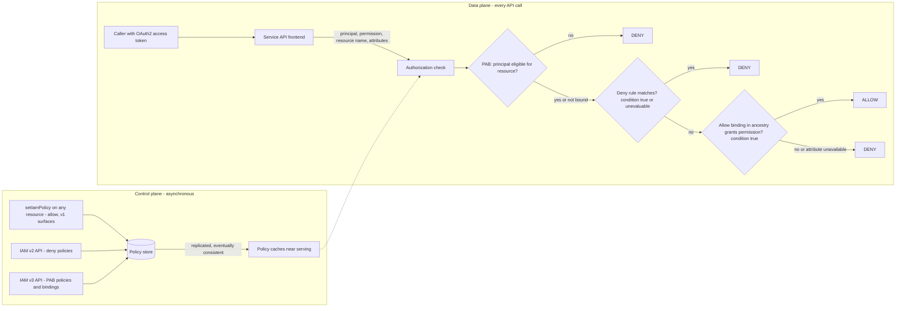

# Cloud IAM: Roles, Policies, and Conditions

## TL;DR

- Google Cloud IAM makes one decision per request from three policy types: Principal Access Boundary (PAB) policies set which resources a principal may reach, deny policies remove permissions, and allow policies grant them; you can think of them as checked in that order (Google Cloud docs, as of 2026-10).
- Allow grants are inherited down the org-folder-project-resource tree and add up, so the effective policy on a resource is the union of every ancestor's allow policy, and the only ways to subtract are a deny rule or a PAB policy.
- Conditions are a subset of CEL (Common Expression Language), limited to 12 logical operators, and they fail closed in different ways: an allow condition that cannot be evaluated never grants, while a deny condition that cannot be evaluated always denies (Google Cloud docs, as of 2026-10).
- Policies are documents edited by read-modify-write with an etag, and the format has versions: a client that reads version 1 sees conditional bindings as opaque `_withcond_<hash>` role names, which is a real way to clobber grants (Google Cloud docs, as of 2026-10).
- A service account key is a bearer credential that lives outside Google's control. Governing keys means removing them (Workload Identity Federation, impersonation, attached service accounts), blocking creation with deny rules and org policy, and making any keys you must keep expire.

## Mental Model



The authorization check sits in the request path of every Google Cloud API.
It turns a tuple (principal, permission, resource, request attributes) into a yes or no by reading policy that a separate, asynchronous control plane wrote earlier.
The two planes are decoupled, which has two consequences.
First, a `setIamPolicy` that returns success is not yet in force everywhere.
Second, the data plane can keep making decisions from cached policy while the control plane is degraded.
Everything else in this chapter is detail about one of three things: what goes into the tuple (permissions and attributes), how the three policy types are combined, or what happens when the tuple is incomplete (unavailable attributes, stale caches, old policy versions).

## Internals

### The policy object model

An allow policy is a list of role bindings plus metadata, and each binding ties one role to a list of principals and an optional condition (Google Cloud docs, as of 2026-10).
A resource has exactly one allow policy (Google Cloud docs, as of 2026-10).
Each service exposes it through its own `getIamPolicy` and `setIamPolicy` methods, so Cloud Storage buckets, BigQuery datasets, service accounts and projects all carry their own policy.
A role is a named set of permissions written `service.resource.verb`, for example `storage.objects.get`.
Basic roles (Owner, Editor, Viewer) bundle thousands of permissions and should be treated as legacy.
Predefined roles are curated by Google and change as services add permissions.
Custom roles are frozen sets that you maintain, which buys predictability at the cost of upkeep.

The three policy types use three API surfaces with three different attachment models (Google Cloud docs, as of 2026-10):

| Policy type | API | Attachment | Fan-out limit | Purpose |
| --- | --- | --- | --- | --- |
| Allow | Each service's `setIamPolicy` | Embedded in the resource | 1 per resource | Grant roles to principals |
| Deny | IAM v2 | Attached to an org, folder, or project | Up to 500 per resource | Stop principals from using permissions on that subtree |
| PAB | IAM v3 | Policy bindings to principal sets | Up to 10 PAB policies per principal set | Limit which resources a principal is eligible to access |

These attachment models determine blast radius.
An allow or deny policy is anchored to a resource and governs everything below it.
A PAB policy is anchored to principals and governs everything they try to reach, wherever it is.
That makes PAB a principal-side perimeter, the natural complement to the resource-side and network-side perimeter of [[17-Cloud-AI-Engineering/Volume_03_GCP_Deep_Dive/Chapter_03_VPC_Service_Controls_Security_Perimeters|VPC Service Controls]].
For individual principals, Google Accounts can appear in allow and deny policies but are not supported as PAB targets; PAB binds to principal sets (Google Cloud docs, as of 2026-10).

### Evaluation: staged in your head, simultaneous in the machine

Google describes evaluation as stages - PAB eligibility, then deny, then allow - and also says IAM actually evaluates all policy types at once and combines the results (Google Cloud docs, as of 2026-10).
For design, the staged model is the right one because every stage can only veto, and allow is the only stage that grants.
For operations, "simultaneous" matters because you cannot tell which stage denied you from the 403 alone.
Use Policy Troubleshooter or the audit log's authorization info instead of guessing.

Inheritance of allow bindings is a union over the ancestry chain: org, folders, project, then any service-level parent such as a bucket, and finally the resource itself.
A grant of `roles/storage.objectViewer` at a folder is effective on every object in every bucket in every project under that folder.
A lower-level allow policy has no way to remove it.
Deny rules are also inherited down the tree, and a deny at the organization removes the permission from every descendant (Google Cloud docs, as of 2026-10).

Deny rules name permissions in a different format from allow roles.
A deny rule uses the service's fully qualified domain name as a prefix, for example `cloudresourcemanager.googleapis.com/projects.delete`, and accepts wildcards such as `cloudresourcemanager.googleapis.com/folders.*` (Google Cloud docs, as of 2026-10).
A deny rule has four parts: `deniedPrincipals`, `exceptionPrincipals`, `deniedPermissions`, and `exceptionPermissions`, plus an optional `denialCondition` (Google Cloud docs, as of 2026-10).
Exception principals are exempt even if they belong to a group named in `deniedPrincipals`.
This allows the most important deny idiom: deny `principalSet://goog/public:all` and exempt one break-glass group.
Only a subset of permissions can be used in deny rules; check the supported-permissions list before you design around one (UNVERIFIED).

### Conditions: a CEL subset with three failure behaviors

IAM Conditions use a subset of CEL.
An expression is built from typed variables such as `request.time` (Timestamp) and `resource.name` (String), joined by `&&`, `||`, and `!` (Google Cloud docs, as of 2026-10).
Both allow conditions and deny conditions are capped at 12 logical operators (Google Cloud docs, as of 2026-10).
Attributes fall into two groups.
Resource attributes are service, type, name, and tags.
Request attributes include time, and for some services destination IP or URL path and access levels.
Which attributes are populated depends on the service and resource type handling the request.

The part a getting-started guide skips is what happens when an attribute is missing.
There are three different behaviors, depending on which policy evaluates the expression:

| Policy | Expression true | Expression false | Expression cannot be evaluated | Source |
| --- | --- | --- | --- | --- |
| Allow condition | Binding grants | Binding does not grant | The unavailable part never counts as granting access | Google Cloud docs, as of 2026-10 |
| Deny condition | Deny applies | Deny does not apply | Deny applies | Google Cloud docs, as of 2026-10 |
| Eventarc access policy with DENY action | Deny applies | No effect | IAM ignores the access policy and continues | Google Cloud docs, as of 2026-10 |

The allow-side behavior catches people who write inherited conditions.
A project-level binding with `resource.name.endsWith('devResource')` never grants on IAM resources, because IAM resources do not supply a resource name.
The documented fix is to guard the clause with `resource.type`, as in `resource.type != 'compute.googleapis.com/Disk' || resource.name.endsWith('devResource')` (Google Cloud docs, as of 2026-10).
Read that guard carefully: it grants the whole role on every other resource type and applies the name check only to disks.
Getting the polarity of the guard wrong is how teams accidentally grant a broad role project-wide.

The deny-side behavior is a sharp edge for availability.
Deny conditions only recognize resource tag functions such as `resource.matchTag('<org-id>/env', 'prod')` (Google Cloud docs, as of 2026-10).
If an author writes a deny condition on `request.time` or `resource.name` expecting narrow scope, the condition cannot be evaluated, the rule applies, and the deny becomes unconditional for every listed principal.
In effect, a deny rule fails open toward denying, so a typo in its condition causes an outage, not an exposure.
That is the correct security posture and the wrong availability posture, so deny rules belong behind a canary rollout like any other production change.

The Eventarc access-policy row is the odd one out, and it shows that "deny" in Google Cloud does not mean "fail-closed" until you have checked which mechanism you are using.
The GA status of IAM v3 access policies was not verified for this chapter and should be checked before relying on them (UNVERIFIED).

### Policy versions, etags, and the `_withcond_` trap

Allow policies have schema versions, and conditional bindings need version 3.
If a caller requests version 1, or no version, from a policy that contains conditions, IAM returns a version 1 view where each conditional binding's role carries the suffix `_withcond_` plus a hash, for example `roles/iam.serviceAccountAdmin_withcond_2b17cc25d2cd9e2c54d8`, and the condition itself is hidden (Google Cloud docs, as of 2026-10).
Google's guidance is to always request version 3, and older gcloud releases below 263.0.0 need an update (Google Cloud docs, as of 2026-10).

The mechanism to remember: every `setIamPolicy` writes the whole policy.
The policy's `etag` provides optimistic concurrency, so a writer that read a stale policy is rejected instead of silently overwriting (Google Cloud docs, as of 2026-10).
The etag protects against concurrent writers.
It does not protect against a single writer that misunderstands the schema, such as a version 1 client or a script that rebuilds bindings by role name and drops the unknown `_withcond_` roles.
The safe client pattern is: get with `requestedPolicyVersion=3`, change only the binding you own, set with the returned etag, and retry the whole read-modify-write cycle on conflict with jittered backoff (see [[17-Cloud-AI-Engineering/Volume_07_Reliability_and_SRE/Chapter_03_Resilient_Communication_Retries_Jitter_and_Circuit_Breakers|Retries and Jitter]]).
In Terraform, this is the difference between `google_project_iam_policy` (authoritative for the whole policy), `google_project_iam_binding` (authoritative for one role), and `google_project_iam_member` (additive).
A whole-policy resource will happily remove Google-managed service agent bindings that it does not know about (see [[17-Cloud-AI-Engineering/Volume_06_Infrastructure_as_Code_and_Delivery/Chapter_01_Terraform_and_OpenTofu_Internals|Terraform Internals]]).

### Consistency and the "new enemy" problem

Policy writes are eventually consistent: changes usually take effect within about 2 minutes and can take 7 minutes or more (UNVERIFIED in this session).
The best public description of the underlying problem is Google's Zanzibar paper (USENIX ATC 2019).
It describes a global authorization system that stores ACLs as relation tuples, keeps a denormalized index (Leopard) for deeply nested groups, and uses "zookie" consistency tokens to solve the "new enemy" problem (UNVERIFIED in this session).
The new enemy problem: if Alice removes Bob from a document's ACL and then adds secret content, an authorization check against a stale ACL lets Bob read content he should never see.
Zanzibar's fix is for the content write to carry a token that forces later checks to see an ACL snapshot at least that fresh.
Google has not publicly documented whether Cloud IAM allow evaluation runs on Zanzibar, so treat the paper as a design reference, not an architecture diagram (UNVERIFIED).

For a Cloud IAM customer, no zookie is exposed, so you have to order operations yourself.
Revoke, wait out the propagation window, verify with a probe call as the revoked principal, and only then put sensitive data in place.
The reverse case matters for automation: a pipeline that grants a role and uses it in the next step will see intermittent 403s and needs retry-until-effective logic, not a fixed sleep.

### Service accounts: identity and resource at once

A service account is both a principal (it can be granted roles) and a resource (it has its own allow policy controlling who can act as it).
There are four ways to obtain credentials for one, and they differ sharply in risk:

| Path | Mechanism | Credential lifetime | Where the secret lives |
| --- | --- | --- | --- |
| Attached service account | The workload asks its metadata server for a token | Short-lived access token, 1 hour default (UNVERIFIED) | Nowhere outside Google |
| Impersonation | Caller with `roles/iam.serviceAccountTokenCreator` calls IAM Credentials `generateAccessToken` | Short-lived, extendable to 12 hours only via org policy (UNVERIFIED) | Nowhere; the caller's own identity is the root |
| Workload Identity Federation | External OIDC/SAML/AWS token exchanged at the Security Token Service, optionally impersonating an SA | Short-lived | The external IdP |
| User-managed key | Workload signs a JWT with an RSA private key and exchanges it for an access token | Valid until the key is deleted, disabled, or expires | A file, a CI secret, a laptop, a git history |

The `iam.serviceAccounts.actAs` permission is a privilege escalation edge.
Anyone who can deploy a workload that runs as a service account gets that account's permissions, so `actAs` on a powerful account is equivalent to holding its roles.
Deny rules evaluate the principal that makes the request.
If Alice impersonates `deployer@` and calls an API, the deny check sees `deployer@`, not Alice.
A deny scoped to a list of humans therefore does not cover impersonation chains, which is why durable deny rules target `principalSet://goog/public:all` with explicit exceptions.

Key governance is enforced with organization policy constraints (see [[17-Cloud-AI-Engineering/Volume_03_GCP_Deep_Dive/Chapter_01_Resource_Hierarchy_and_Organization_Policies|Resource Hierarchy and Organization Policies]]):

- `iam.disableServiceAccountKeyCreation` blocks new user-managed keys (UNVERIFIED).
- `iam.disableServiceAccountKeyUpload` blocks uploading externally generated public keys (UNVERIFIED).
- `iam.serviceAccountKeyExpiryHours` gives newly created keys a maximum lifetime (UNVERIFIED).
- `iam.serviceAccountKeyExposureResponse` lets Google act on keys it detects in public places, for example by disabling them (UNVERIFIED).
- `iam.automaticIamGrantsForDefaultServiceAccounts` stops default service accounts from automatically receiving the Editor role (UNVERIFIED).
- Organizations created after a 2024 "secure by default" change get several of these constraints enforced from creation (UNVERIFIED for exact date and set).

An org policy constraint and a deny rule on `iam.googleapis.com/serviceAccountKeys.create` are two separate layers.
Org policy is a configuration constraint evaluated by the service.
The deny rule is an authorization veto evaluated by IAM.
Use both: the deny rule's exception list gives you an auditable break-glass path that the boolean constraint lacks.

### Control plane and data plane failure domains

The policy data plane is global configuration pushed to every serving stack, and that is the most dangerous kind of change in a hyperscale cloud.
The 12 June 2025 Google Cloud incident is the canonical public example.
A Service Control policy-check code path hit a null-pointer crash on a newly inserted policy with blank fields.
That policy replicated globally within seconds through Spanner, and API requests failed across many products and regions (UNVERIFIED in this session).
The December 2020 Google authentication outage came from a quota for the User ID service being set to zero during a quota-system migration, which shows that the identity lookup, not only the policy, is a global dependency (UNVERIFIED in this session).
The lesson applies equally to your own policy-as-code pipelines: policy changes need staged rollout, a feature flag, and a fail-safe default, exactly like binaries (see [[17-Cloud-AI-Engineering/Volume_07_Reliability_and_SRE/Chapter_07_Anatomy_of_Major_Cloud_Outages|Anatomy of Major Cloud Outages]]).

## Numbers to Know

| Item | Value | Source |
| --- | --- | --- |
| Allow policies per resource | 1 | (Google Cloud docs, as of 2026-10) |
| Principals in all role bindings and audit-logging exemptions of one allow policy | 1,500 | (Google Cloud docs, as of 2026-10) |
| Domains and Google groups in one allow policy | 250 | (Google Cloud docs, as of 2026-10) |
| Logical operators per condition (allow binding or deny rule) | 12 | (Google Cloud docs, as of 2026-10) |
| Deny policies per resource | 500 (5 at the 2022 launch) | (Google Cloud docs, as of 2026-10); (InfoQ, 2022-11) |
| Deny rules per resource, across all its deny policies | 500 | (Google Cloud docs, as of 2026-10) |
| Deny rules in a single deny policy | 500 | (Google Cloud docs, as of 2026-10) |
| Principals across all deny policies on a resource | 2,500 | (Google Cloud docs, as of 2026-10) |
| Domains and groups across all deny policies on a resource | 500 | (Google Cloud docs, as of 2026-10) |
| Rules in one PAB policy | 500 | (Google Cloud docs, as of 2026-10) |
| Resources across all rules of one PAB policy | 500 | (Google Cloud docs, as of 2026-10) |
| PAB policies bound to one principal set | 10 | (Google Cloud docs, as of 2026-10) |
| Access policies (IAM v3) per resource | 5 | (Google Cloud docs, as of 2026-10) |
| IAM API read quota, e.g. listing custom roles | 6,000 per project per minute | (Google Cloud docs, as of 2026-10) |
| IAM API write quota, e.g. creating custom roles | 600 per project per minute | (Google Cloud docs, as of 2026-10) |
| Privileged Access Manager CreateGrant | 200 per project per minute, 600 per org per minute | (Google Cloud docs, as of 2026-10) |
| Privileged Access Manager GetGrant | 3,000 per project per minute, 9,000 per org per minute | (Google Cloud docs, as of 2026-10) |
| Minimum gcloud version that handles policy version 3 correctly | 263.0.0 | (Google Cloud docs, as of 2026-10) |
| Policy change propagation | Typically about 2 minutes, can exceed 7 minutes | UNVERIFIED |
| User-managed keys per service account | 10 | UNVERIFIED |
| Default access token lifetime | 1 hour; up to 12 hours with an org policy exception | UNVERIFIED |
| IAM list price | No charge for IAM itself; audit log ingestion is billed by Cloud Logging | UNVERIFIED |

Use the 1,500 and 250 limits for capacity planning.
A group counts as one principal regardless of how many members it has.
Organizations that grant to individual users hit the limit, while organizations that grant to groups almost never do.

## AWS vs GCP Mechanism Parity

| Dimension | AWS IAM | Google Cloud IAM | Critical difference |
| --- | --- | --- | --- |
| Where grants live | Identity policies on users and roles, plus resource policies on supporting resources | One allow policy embedded in every resource | GCP grants are resource-centric, and every resource is a potential grant point |
| Inheritance | No grant inheritance across accounts; SCPs and RCPs are ceilings and never grant | Allow bindings add up down org, folder, project, resource | An org-level GCP grant is effective everywhere; AWS has no equivalent of a grant that flows down |
| Subtractive controls | Explicit Deny in any policy, SCPs, RCPs, permission boundaries, session policies | Deny policies (IAM v2) and PAB (IAM v3) | AWS has more veto layers; GCP keeps vetoes out of the grant documents |
| Precedence | Explicit deny anywhere beats any allow | Deny beats allow; PAB ineligibility beats both | Same effect: deny always wins |
| Condition language | JSON condition operators on condition keys (`StringEquals`, `aws:PrincipalTag`) | CEL subset, max 12 logical operators | AWS uses principal attributes heavily for ABAC; GCP conditions focus on resource attributes and tags |
| ABAC primitive | Principal and resource tags compared in conditions | Resource tags via `resource.matchTag`; the only attribute deny rules support | GCP deny ABAC depends on tags alone |
| Concurrency on policy edits | Managed policy versions, up to 5 stored (UNVERIFIED) | Whole-document etag with read-modify-write | GCP clients must handle conflict retries and versions |
| Short-lived workload credentials | STS AssumeRole, instance profiles, IRSA and EKS Pod Identity | Metadata server tokens, `generateAccessToken`, GKE Workload Identity | Similar mechanics; GCP impersonation is a separate IAM permission on the SA resource |
| Long-lived credentials | IAM user access keys | User-managed SA keys | Both are bearer secrets; both clouds steer you to federation |
| External federation | IAM Roles Anywhere, OIDC/SAML identity providers | Workload and Workforce Identity Federation via STS | Comparable; see [[17-Cloud-AI-Engineering/Volume_08_Security_Identity_and_the_Data_Perimeter/Chapter_02_Workload_Identity_Federation\|Workload Identity Federation]] |
| Principal-side perimeter | RCPs plus `aws:ResourceOrgID` conditions in SCPs | PAB policies bound to principal sets | PAB is a first-class object; AWS composes it from conditions |
| Analysis tooling | IAM Access Analyzer, built on the Zelkova SMT reasoner (UNVERIFIED) | Policy Troubleshooter, Policy Analyzer, IAM Recommender | AWS publishes its formal-methods foundation; GCP tooling is less documented publicly |
| Consistency | Documented as eventually consistent | Eventually consistent, minutes | Neither offers read-your-write authorization to customers |

For the AWS evaluation engine itself, see [[17-Cloud-AI-Engineering/Volume_02_AWS_Deep_Dive/Chapter_01_IAM_Policy_Evaluation_Engine|IAM Policy Evaluation Engine]] and [[17-Cloud-AI-Engineering/Volume_04_AWS_vs_GCP_Translation/Chapter_03_Identity_Security_and_Governance_Translation|Identity, Security, and Governance Translation]].

## Worked Example: Modeling the Decision Path, Then Enforcing Key Governance

### Part A - local decision model (no cloud, no cost)

This script models the three stages and the documented failure behaviors so you can reason about edge cases before touching production.
Treat it as a teaching model, not a reimplementation of Google's evaluator; for example, real PAB targets use principal-set identifiers, which are stubbed here.

```python
#!/usr/bin/env python3
"""Local model of Google Cloud IAM decision stages: PAB -> deny -> allow.
Pure Python, no cloud calls, no cost. Semantics follow documented behavior:
- deny condition true OR unevaluable -> deny rule applies (fail closed)
- allow condition unevaluable -> binding never grants (fail closed for grant)
"""
import fnmatch
import re

class Unavailable(Exception):
    pass

# Hierarchy: child -> parent
PARENT = {
    "projects/prod-ml": "folders/prod",
    "projects/dev-ml": "folders/dev",
    "folders/prod": "organizations/42",
    "folders/dev": "organizations/42",
    "organizations/42": None,
}
GROUPS = {"group:ml-eng@example.com": {"user:ana@example.com", "serviceAccount:trainer@prod-ml.iam.gserviceaccount.com"},
          "group:breakglass@example.com": {"user:root-oncall@example.com"}}
ROLES = {"roles/storage.objectViewer": {"storage.objects.get", "storage.objects.list"},
         "roles/owner": {"*"}}
TAGS = {"projects/prod-ml": {"env": "prod"}, "projects/dev-ml": {"env": "dev"}}

def ancestry(container):
    node = container
    while node:
        yield node
        node = PARENT[node]

def member_of(principal, member):
    if member == "principalSet://goog/public:all":
        return True
    if member == principal:
        return True
    if member == "principalSet:domain/example.com":  # stand-in for a PAB principal set
        return principal.endswith("@example.com")
    return principal in GROUPS.get(member, set())

def perm_match(perm, patterns):
    return any(fnmatch.fnmatchcase(perm, p) for p in patterns)

def eval_cond(cond, ctx):
    if cond is None:
        return True
    return cond(ctx)

def decide(principal, perm, container, ctx, allow, deny, pab):
    # Stage 1: Principal Access Boundary (eligibility, not a grant)
    bound = [p for p in pab if any(member_of(principal, m) for m in p["principals"])]
    if bound:
        eligible = set().union(*[set(p["resources"]) for p in bound])
        if not eligible.intersection(ancestry(container)):
            return "DENY(pab)"
    # Stage 2: deny rules on resource and all ancestors
    for node in ancestry(container):
        for rule in deny.get(node, []):
            if not any(member_of(principal, m) for m in rule["denied"]):
                continue
            if any(member_of(principal, m) for m in rule.get("except", [])):
                continue
            if not perm_match(perm, rule["perms"]):
                continue
            if perm_match(perm, rule.get("except_perms", [])):
                continue
            try:
                applies = eval_cond(rule.get("cond"), ctx)
            except Unavailable:
                applies = True  # documented fail-closed for deny
            if applies:
                return "DENY(deny@%s)" % node
    # Stage 3: allow bindings, union across hierarchy
    for node in ancestry(container):
        for b in allow.get(node, []):
            if not any(member_of(principal, m) for m in b["members"]):
                continue
            granted = ROLES[b["role"]]
            if "*" not in granted and perm.split("/")[-1] not in granted:
                continue
            try:
                if eval_cond(b.get("cond"), ctx):
                    return "ALLOW(%s@%s)" % (b["role"], node)
            except Unavailable:
                pass  # unavailable attribute never grants
    return "DENY(no-allow)"

def attr(ctx, key):
    if key not in ctx:
        raise Unavailable(key)
    return ctx[key]

CEL_OPS = re.compile(r"&&|\|\||!(?!=)")
def count_logic_ops(expr):
    return len(CEL_OPS.findall(expr))

if __name__ == "__main__":
    allow = {
        "folders/prod": [{"role": "roles/storage.objectViewer", "members": ["group:ml-eng@example.com"],
                          # resource.type guard: non-object types pass, objects must match bucket prefix
                          "cond": lambda c: attr(c, "resource.type") != "storage.googleapis.com/Object"
                                  or attr(c, "resource.name").startswith("projects/_/buckets/prod-datasets/")}],
        "organizations/42": [{"role": "roles/owner", "members": ["group:breakglass@example.com"]}],
    }
    deny = {
        "organizations/42": [{
            "denied": ["principalSet://goog/public:all"],
            "except": ["group:breakglass@example.com"],
            "perms": ["cloudresourcemanager.googleapis.com/projects.delete"],
            "cond": lambda c: TAGS[c["container"]]["env"] == "prod",
        }],
    }
    pab = [{"principals": ["principalSet:domain/example.com"], "resources": ["folders/prod"]}]
    ana = "user:ana@example.com"
    cases = [
        (ana, "storage.googleapis.com/storage.objects.get", "projects/prod-ml",
         {"container": "projects/prod-ml", "resource.type": "storage.googleapis.com/Object",
          "resource.name": "projects/_/buckets/prod-datasets/objects/shard-0001"}),
        (ana, "storage.googleapis.com/storage.objects.get", "projects/prod-ml",
         {"container": "projects/prod-ml", "resource.type": "storage.googleapis.com/Object"}),
        (ana, "storage.googleapis.com/storage.objects.get", "projects/dev-ml",
         {"container": "projects/dev-ml", "resource.type": "storage.googleapis.com/Object",
          "resource.name": "projects/_/buckets/dev/objects/x"}),
        ("user:root-oncall@example.com", "cloudresourcemanager.googleapis.com/projects.delete", "projects/prod-ml",
         {"container": "projects/prod-ml"}),
        ("user:intern@example.com", "cloudresourcemanager.googleapis.com/projects.delete", "projects/prod-ml",
         {"container": "projects/prod-ml"}),
    ]
    for p, perm, res, ctx in cases:
        print("%-40s %-55s %-18s -> %s" % (p, perm, res, decide(p, perm, res, ctx, allow, deny, pab)))

    # Capacity sizing against documented limits (Google Cloud docs, as of 2026-10)
    LIM = {"allow_principals": 1500, "allow_groups_domains": 250, "cond_ops": 12,
           "deny_rules_per_resource": 500, "deny_principals_per_resource": 2500,
           "deny_groups_per_resource": 500}
    teams, envs = 180, 3
    groups_per_folder_policy = teams          # one reader group per team on each env folder
    print("\nallow policy group slots used per env folder: %d / %d" % (groups_per_folder_policy, LIM["allow_groups_domains"]))
    print("headroom: %d groups" % (LIM["allow_groups_domains"] - groups_per_folder_policy))
    expr = ("resource.type != 'storage.googleapis.com/Object' || "
            "resource.name.startsWith('projects/_/buckets/a/') || "
            "resource.name.startsWith('projects/_/buckets/b/') || "
            "(request.time < timestamp('2026-12-31T00:00:00Z') && !resource.name.endsWith('.key'))")
    print("logic operators in expression: %d / %d" % (count_logic_ops(expr), LIM["cond_ops"]))
```

Expected output:

```text
user:ana@example.com                     storage.googleapis.com/storage.objects.get              projects/prod-ml   -> ALLOW(roles/storage.objectViewer@folders/prod)
user:ana@example.com                     storage.googleapis.com/storage.objects.get              projects/prod-ml   -> DENY(no-allow)
user:ana@example.com                     storage.googleapis.com/storage.objects.get              projects/dev-ml    -> DENY(pab)
user:root-oncall@example.com             cloudresourcemanager.googleapis.com/projects.delete     projects/prod-ml   -> ALLOW(roles/owner@organizations/42)
user:intern@example.com                  cloudresourcemanager.googleapis.com/projects.delete     projects/prod-ml   -> DENY(deny@organizations/42)

allow policy group slots used per env folder: 180 / 250
headroom: 70 groups
logic operators in expression: 5 / 12
```

Case 2 shows the inherited-condition pitfall: when the attribute is missing, the binding grants nothing, and no error appears anywhere.
Case 3 shows that PAB blocks a principal even if an allow binding existed in `dev-ml`.
Case 5 shows the tag-scoped deny with a break-glass exception.

### Part B - enforce key governance in a sandbox project

This lab creates only IAM objects: a service account, a conditional binding, and a deny policy.
None of these are billed resources (UNVERIFIED for IAM pricing), so the expected cost is 0 USD.
The budget alarm is still created because the project may have other spend.
The operator running the script must hold `roles/iam.denyAdmin` and project IAM admin rights (UNVERIFIED role name), and must not be in the break-glass group, or the verification step will succeed instead of failing.

```bash
#!/usr/bin/env bash
set -euo pipefail
: "${PROJECT_ID:?disposable sandbox project}"
: "${BILLING_ACCOUNT:?e.g. 000000-000000-000000}"
: "${BREAKGLASS_GROUP:?e.g. breakglass@example.com}"
: "${TEST_USER:?user who receives a time-bound grant}"

SA="iam-lab-sa"
SA_EMAIL="${SA}@${PROJECT_ID}.iam.gserviceaccount.com"
ATTACH="cloudresourcemanager.googleapis.com/projects/${PROJECT_ID}"
EXPIRY="$(date -u -d '+2 hours' +%Y-%m-%dT%H:%M:%SZ 2>/dev/null || date -u -v+2H +%Y-%m-%dT%H:%M:%SZ)"

# 0. Budget alarm at 50 and 100 percent of 5 USD for this project
gcloud billing budgets create \
  --billing-account="${BILLING_ACCOUNT}" \
  --display-name="iam-lab-guard" \
  --budget-amount=5USD \
  --threshold-rule=percent=0.5 \
  --threshold-rule=percent=1.0 \
  --filter-projects="projects/${PROJECT_ID}"

# 1. Keyless service account
gcloud iam service-accounts create "${SA}" --project="${PROJECT_ID}" --display-name="IAM lab SA"

# 2. Time-bound impersonation grant (expires in 2 hours; 1 logical operator budget used: 0 of 12)
gcloud projects add-iam-policy-binding "${PROJECT_ID}" \
  --member="user:${TEST_USER}" \
  --role="roles/iam.serviceAccountTokenCreator" \
  --condition="expression=request.time < timestamp('${EXPIRY}'),title=lab-expiry,description=auto-expiring lab grant"

# 3. Deny SA key creation to everyone except the break-glass group
cat > /tmp/deny-sa-keys.json <<EOF
{
  "displayName": "Deny SA key creation except break-glass",
  "rules": [{
    "denyRule": {
      "deniedPrincipals": ["principalSet://goog/public:all"],
      "exceptionPrincipals": ["principalSet://goog/group/${BREAKGLASS_GROUP}"],
      "deniedPermissions": ["iam.googleapis.com/serviceAccountKeys.create"]
    }
  }]
}
EOF
gcloud iam policies create deny-sa-keys \
  --attachment-point="${ATTACH}" \
  --kind=denypolicies \
  --policy-file=/tmp/deny-sa-keys.json

# 4. Verify: retry until the deny propagates (expect PERMISSION_DENIED caused by deny policy)
for i in $(seq 1 20); do
  if gcloud iam service-accounts keys create /tmp/should-not-exist.json \
       --iam-account="${SA_EMAIL}" --project="${PROJECT_ID}" 2>/tmp/err.txt; then
    echo "attempt ${i}: key created (deny not yet effective) - deleting it"
    KEY_ID="$(gcloud iam service-accounts keys list --iam-account="${SA_EMAIL}" \
      --managed-by=user --format='value(name.basename())' | head -n1)"
    gcloud iam service-accounts keys delete "${KEY_ID}" --iam-account="${SA_EMAIL}" --quiet
    rm -f /tmp/should-not-exist.json
    sleep 30
  else
    if grep -iqE "deny|denypolicies" /tmp/err.txt; then
      echo "attempt ${i}: denied by deny policy as expected"; break
    else
      echo "attempt ${i}: call failed for non-deny cause (e.g. org policy or missing role)"; cat /tmp/err.txt; break
    fi
  fi
done

# 5. Policy version hygiene: always read version 3
gcloud projects get-iam-policy "${PROJECT_ID}" --format=json | grep -c withcond || echo "no withcond artifacts"
```

Teardown, in exact reverse order:

```bash
gcloud iam policies delete deny-sa-keys --attachment-point="cloudresourcemanager.googleapis.com/projects/${PROJECT_ID}" --kind=denypolicies --quiet
gcloud projects remove-iam-policy-binding "${PROJECT_ID}" --member="user:${TEST_USER}" --role="roles/iam.serviceAccountTokenCreator" --all
gcloud iam service-accounts delete "iam-lab-sa@${PROJECT_ID}.iam.gserviceaccount.com" --quiet
BUDGET="$(gcloud billing budgets list --billing-account="${BILLING_ACCOUNT}" --filter='displayName=iam-lab-guard' --format='value(name)')"
gcloud billing budgets delete "${BUDGET}" --quiet
```

### Capacity and cost sizing, step by step

Scenario: an AI platform organization with 3,000 projects, 180 teams, three environment folders (dev, staging, prod), and 2,000 existing user-managed service account keys.

1. Allow policy sizing: give each team one reader group and one writer group per environment folder, which uses 360 group slots per folder policy.
2. That exceeds the 250 domain-and-group limit per allow policy (Google Cloud docs, as of 2026-10), so either split each environment into two sub-folders of 90 teams (180 groups each, 70 slots of headroom) or move writer grants down to team-owned projects.
3. Deny sizing: an org-level guardrail set of 40 rules uses 8 percent of the 500 deny-rule budget per resource, and principal usage is tiny because each rule names `public:all` plus one or two exception groups.
4. Condition budget: a bucket-prefix allowlist costs one `||` per prefix plus one for the `resource.type` guard, so at most 12 prefixes fit under 12 operators (or 11 if one operator is reserved for future guards). Beyond that, move data into fewer buckets or use tags instead of name prefixes.
5. Key risk sizing: with no expiry, a key's exposure window is unbounded. With a 90-day expiry constraint, each key is usable for at most 2,160 hours, so the fleet's total exposure is bounded at 2,000 x 2,160 = 4.32 million key-hours per quarter. Federating 80 percent of those workloads cuts the bound to 864,000 key-hours, a 5x reduction before counting detection.
6. Direct IAM cost is effectively 0 USD (UNVERIFIED). The real cost driver is Data Access audit logging: at 50 million authorized calls per day and about 1.5 KB per entry, ingestion is about 75 GB per day, so multiply by the current Cloud Logging per-GiB ingestion price and use log exclusions for high-volume read paths that do not need auditing (price UNVERIFIED in this session).

## Failure Modes and Pitfalls

### Schema and concurrency

- A v1 client, an old SDK, or a hand-written script reads a policy without `requestedPolicyVersion=3`, sees `_withcond_` roles it does not recognize, and writes back a policy that drops or corrupts the conditional bindings.
- Two pipelines run read-modify-write without retrying on etag conflict, so one fails and stops, or a team "fixes" it by ignoring etags and clobbering the other team's grants.
- A whole-policy Terraform resource removes Google-managed service agent bindings, so services such as Compute Engine or Cloud Build lose access to the project and fail in confusing ways.

### Condition semantics

- An inherited `resource.name` condition at project or folder level grants nothing on resource types that do not expose a name, and the team responds by widening the role instead of adding a `resource.type` guard.
- A guard with reversed logic or wrong boolean operators (for example writing `resource.type == X || name check`, or applying `resource.type == X && name check` to a multi-service role) inadvertently grants the whole role on all other resource types or blocks all other operations.
- A deny condition written on a non-tag attribute cannot be evaluated, so it applies unconditionally and turns a narrow guardrail into an org-wide outage for every listed principal.
- Tag-based deny conditions depend on tag bindings, so whoever can bind or unbind tags (`resourcemanager.tagUser`) can switch the deny on or off. Tag administration is therefore part of your trusted computing base.

### Identity and escalation

- A deny rule targets named humans, and a denied human impersonates a service account that is not denied, because deny evaluation sees the service account as the caller.
- A broad `iam.serviceAccounts.actAs` grant at project level lets any deployer run code as the most privileged service account in the project.
- Default compute service accounts that still hold Editor turn any VM compromise into project compromise (UNVERIFIED for which organizations still have the automatic grant).
- Leaked service account keys in public repositories, container images, notebook outputs, and CI logs are the most common GCP credential-compromise path in public incident write-ups. Keys stay valid until they are disabled or deleted (UNVERIFIED for any blanket statistic).

### Consistency and scale

- Revocation during an incident is not instant, and access tokens already issued remain usable until they expire, so containment needs both policy revocation and disabling the service account or key (UNVERIFIED for exact token revocation semantics).
- Automation that grants and immediately uses the grant fails intermittently. Fixed sleeps are wrong; retry with backoff until a probe call succeeds.
- Granting to individual users instead of groups hits the 1,500-principal limit on a busy project, and the next `setIamPolicy` fails during an incident when you least want it to.
- The IAM API write quota of 600 per project per minute (Google Cloud docs, as of 2026-10) is enough for humans but not for a runaway reconciliation loop that rewrites custom roles on every tick.

### Global policy pushes

- The June 2025 Service Control incident showed that a single malformed policy record, replicated globally in seconds and read by an unflagged code path, can take down API serving across regions (UNVERIFIED in this session).
- Your organization's equivalent is an org-level deny or org policy change pushed from one pipeline to every project at once. Roll these out folder by folder with dry-run and monitoring of 403 rates per service.

## Security and Cost Angles

### Least privilege as a pipeline, not a review

Start from predefined roles, measure actual usage with IAM Recommender, and convert stable usage into custom roles only where the predefined role is materially too broad, because custom roles drift as services add permissions.
Use Privileged Access Manager for just-in-time elevation instead of standing Owner grants.
Its grant API quotas (200 CreateGrant per project per minute) (Google Cloud docs, as of 2026-10) are far above human request rates, so it can sit on every break-glass path.
Use time-bound conditions (`request.time < timestamp(...)`) for contractors and migrations so that grants expire without anyone remembering to remove them.

### Layered vetoes

Organization-level deny rules cover the irreversible actions: project deletion, disabling audit logs, creating SA keys, and changing org policy.
Each rule targets `public:all` with a narrow break-glass exception group.
PAB policies stop a compromised identity from reaching resources outside its organization's allowed set.
[[17-Cloud-AI-Engineering/Volume_03_GCP_Deep_Dive/Chapter_03_VPC_Service_Controls_Security_Perimeters|VPC Service Controls]] stops data from moving across a service perimeter even when the caller is fully authorized.
These three are independent, and each one covers a different exfiltration path: an identity that is too broad, a destination that is out of scope, or a network path that leaves the perimeter.
See [[17-Cloud-AI-Engineering/Volume_08_Security_Identity_and_the_Data_Perimeter/Chapter_06_Constructing_an_Impenetrable_Data_Perimeter|Constructing an Impenetrable Data Perimeter]] for how they combine.

### Key hierarchy for service account credentials

Google-managed service account keys are rotated by Google and never leave Google's infrastructure.
User-managed keys are RSA key pairs where Google holds the public half and you hold the private half (UNVERIFIED for key algorithm details).
If a key truly cannot be avoided, generate it inside an HSM, upload only the public key, and keep the private key non-exportable.
This changes "a leaked file" into "a compromised HSM" (key upload: UNVERIFIED as a currently supported workflow under default org policy).
For data at rest, CMEK and envelope encryption are covered in [[17-Cloud-AI-Engineering/Volume_03_GCP_Deep_Dive/Chapter_15_Security_and_Confidential_Computing_Cloud_KMS|Cloud KMS]] and [[17-Cloud-AI-Engineering/Volume_08_Security_Identity_and_the_Data_Perimeter/Chapter_04_Encryption_Key_Hierarchies_and_Envelope_Encryption|Encryption Key Hierarchies]].
Note that `cloudkms.cryptoKeyVersions.useToDecrypt` is itself an IAM permission, so key access is only as tight as the IAM policy on the key ring.

### Unit economics

IAM evaluation has no direct price (UNVERIFIED), so the costs are indirect: audit log volume, engineering time spent on 403 debugging, and incident cost.
The cheapest controls are structural: groups instead of users, folder-level grants instead of thousands of per-project grants, and federation instead of key rotation tooling.
Data Access audit logs on hot read paths can cost more than the workload they audit, so enable them selectively by service and exempt high-volume, low-sensitivity principals through audit-logging exemptions.
Those exemptions count against the same 1,500-principal budget (Google Cloud docs, as of 2026-10).

## Interview Questions and Model Answers

### Question 1 (L5 - Senior)

A data scientist has `roles/storage.objectViewer` granted at the project level with the condition `resource.name.startsWith("projects/_/buckets/team-a/")`, and reports that they can read objects but `gsutil ls gs://team-a` fails. Why, and how do you fix it?

#### Model Answer

Listing objects checks `storage.objects.list` against the bucket, not against an object, so the request's `resource.name` is the bucket name.
For bucket-level checks the name is `projects/_/buckets/team-a`, with no trailing slash, so `startsWith("projects/_/buckets/team-a/")` is false and the binding does not grant.
Object reads succeed because object names have the form `projects/_/buckets/team-a/objects/...`.
The fix is to match both forms explicitly, for example `resource.name == "projects/_/buckets/team-a" || resource.name.startsWith("projects/_/buckets/team-a/")`, plus a `resource.type` guard if the role has permissions on types that do not expose names.
I would check the result with Policy Troubleshooter rather than guessing, because a 403 does not say which stage denied.
The more general lesson: every condition must be written against the exact resource that each permission in the role is checked on, and a role with mixed resource types needs per-type clauses.
I would also count operators, because each additional prefix spends one of the 12 allowed.

#### Follow-up Interviewer Question

How would you make this scale to 40 teams without hitting the 12-operator limit or the 250-group limit?

### Question 2 (L5 - Senior)

Walk me through exactly how IAM decides whether a service account can call `bigquery.tables.getData` on a table, including every policy that can change the outcome.

#### Model Answer

The caller presents an access token, and the BigQuery frontend extracts the principal, the permission, the table's resource name, and request attributes.
First, if the service account's project or another principal set it belongs to has PAB policies bound, the table must be inside one of the eligible resources, or access is refused no matter what allow says.
Second, IAM collects deny rules from every ancestor container - organization, folders, project - and refuses if any rule matches.
A rule matches when the principal is in `deniedPrincipals` but not in `exceptionPrincipals`, the permission matches `bigquery.googleapis.com/tables.getData` or a wildcard but not an exception permission, and the tag condition is true or cannot be evaluated.
Third, IAM unions the allow bindings from the table, dataset, project, folders, and organization, and grants if any binding includes the permission, contains the principal (directly or through a group), and has a condition that is true.
Unavailable attributes in an allow condition never grant.
Separately, VPC Service Controls can block the request at the API perimeter even if IAM allows it, and BigQuery features such as row-level and column-level policies can further restrict which data comes back.
Finally, all of this is evaluated against policy that may be a few minutes stale.

#### Follow-up Interviewer Question

The same call works from Cloud Shell but fails from a GKE pod using the same service account; list the three most likely causes in order.

### Question 3 (L6 - Staff)

Design guardrails for 3,000 projects so that nobody except a break-glass process can delete production projects, disable audit logs, or create service account keys, without breaking existing automation.

#### Model Answer

I would use an org-level deny policy, because it vetoes regardless of how many Owner grants exist below, and use org policy constraints as a second layer for key creation.
Each rule denies `principalSet://goog/public:all` with one exception group, populated only through Privileged Access Manager just-in-time grants so that membership is time-bound and audited.
Project deletion is scoped with a tag condition `resource.matchTag('<org>/env', 'prod')`, because tags are the only attribute deny conditions recognize, and a condition on anything else would fail closed and deny everyone.
This makes tag binding rights security-critical, so I would also deny tag binding and unbinding on the `env` key to everyone except the platform pipeline.
Key creation is denied unconditionally with `iam.googleapis.com/serviceAccountKeys.create`, backed by the key-creation org policy constraint and an expiry constraint for legacy keys (constraint names to be confirmed against current docs).
Rollout matters as much as content.
I would inventory existing callers of each permission from Cloud Audit Logs, add the legitimate automation identities to temporary exceptions, and deploy to one folder at a time while watching 403 rates per principal.
Then I would remove the temporary exceptions as teams migrate to Workload Identity Federation.
Budget check: this is a handful of rules against a 500-rule and 2,500-principal limit per resource, so capacity is not the constraint; blast radius is.
The failure mode I would rehearse is a mistaken org-level deny, so the break-glass group must be able to edit deny policies, which means its exception must cover `iam.googleapis.com/denypolicies.*` (UNVERIFIED exact permission name).

#### Follow-up Interviewer Question

An attacker gains Owner on a production project; walk through what they can and cannot do under your design, including impersonation paths.

### Question 4 (L6 - Staff)

Two Terraform pipelines and a self-service portal all modify the same project's IAM policy, and grants keep disappearing. Diagnose and fix it.

#### Model Answer

There are three plausible mechanisms, and I would tell them apart using Admin Activity audit logs for `SetIamPolicy`, comparing the before and after policy deltas.
One: a pipeline uses an authoritative resource such as `google_project_iam_policy` or `google_project_iam_binding`, and each apply resets the policy or the role to its state file, removing grants made by others, including Google service agent bindings.
Two: the portal does read-modify-write without retrying on etag conflict, or worse, rebuilds the policy from its own database and ignores the etag.
Three: some client reads version 1, sees `_withcond_<hash>` roles, and writes back a policy without those conditional bindings.
The fix starts with ownership: exactly one writer is authoritative for any (role, resource) pair, and everyone else uses additive member resources.
At the organization level, I would forbid whole-policy resources with a policy-as-code check on Terraform plans.
All clients must request policy version 3, and the portal's client must loop get-modify-set with jittered backoff on conflict.
For drift detection, a scheduled job compares effective policy against the declared state and alerts on unexpected removals rather than reverting automatically, because automatic reverts can fight a human responding to an incident.

#### Follow-up Interviewer Question

How would you prove after the fact which writer removed a specific binding at 03:12 last Tuesday?

### Question 5 (L6 - Staff)

You inherit 5,000 user-managed service account keys across the organization. Produce a 90-day plan to reduce key risk, with metrics.

#### Model Answer

Week 1 is inventory and measurement: list keys per service account with creation time and last-authentication time from key usage activity and audit logs, and classify each key by where it runs.
The first metric is total exposure, key-hours, so a key that has existed for two years and is still active counts heavily.
Weeks 1 to 2: enable the exposure-response constraint so that publicly leaked keys get disabled, and apply a deny rule plus org policy that stops creating new keys, with a narrow exception path.
This stops growth before cleanup starts.
Weeks 2 to 8: migrate by workload class.
GCP-hosted workloads move to attached service accounts or GKE Workload Identity.
GitHub Actions, AWS, and Azure workloads move to Workload Identity Federation with attribute conditions pinned to repository and branch or to the AWS role ARN.
On-premises workloads move to federation through their IdP.
Unused keys are disabled first, then deleted after a two-week soak, because deletion is not reversible and disabling is.
Weeks 8 to 12: apply a key expiry constraint to the remaining exceptions and track key-hours down week over week.
Exit criteria: zero keys without an owner, zero keys older than the expiry window, and every remaining key on a register with a migration date.
The trade-off I would state openly is that federation moves trust to the external IdP's configuration, so pool attribute conditions become security-critical code that needs review.

#### Follow-up Interviewer Question

A team says their vendor appliance only supports a JSON key file; what do you do?

### Question 6 (L7+ - Principal)

Deny rules on Google Cloud fail closed when their condition cannot be evaluated, while Eventarc access policies are ignored when evaluation fails. Defend or attack these choices, and explain what they imply for your own organization's policy platform.

#### Model Answer

Each choice answers a different question: what is the worse error for this mechanism, a false allow or a false deny?
Deny rules are guardrails for irreversible or high-impact actions, so a false allow can be catastrophic, while a false deny is an outage that can be recovered from.
Failing closed is right, and it also lets the platform add new attributes later without silently weakening existing rules.
The cost is that one bad condition can deny every principal everywhere below the attachment point, so the design depends on a supporting system: tags as the only allowed attribute, validation at write time, and staged rollout.
Ignoring a failed access policy is a deliberate availability choice for an event-delivery path, but it means that policy type is not a security boundary under partial failure, and I would not use it as the only control for anything sensitive.
For my own platform, I would make the fail mode an explicit, reviewed property of every policy type rather than an accident of implementation.
Every policy push would go through validation, dry-run against recent production decisions, cell-by-cell rollout, and an automatic halt on rising 403 rates.
The June 2025 Service Control incident is the case study: a policy record took an untested code path and spread globally in seconds, so the missing controls were a feature flag and progressive replication, not a better condition language (incident details UNVERIFIED in this session).
I would also give the policy data plane static stability: serving continues on the last-known-good snapshot when the control plane or replication is unhealthy (see [[17-Cloud-AI-Engineering/Volume_01_Cloud_Architecture_Principles/Chapter_02_Regions_Zones_and_Static_Stability|Static Stability]]).

#### Follow-up Interviewer Question

How would you build a dry-run mode for deny rules that replays real traffic without adding latency to the request path?

### Question 7 (L7+ - Principal)

A model-training service account in project A is compromised through a poisoned dependency. It has read access to training data in project B and write access to a checkpoint bucket. Design the controls that limit damage, and say which ones work in the first 10 minutes.

#### Model Answer

In the first 10 minutes, the controls that matter are the ones that act on the identity itself, because policy propagation takes minutes and tokens already issued keep working until they expire.
I would disable the service account, which stops new token minting, and disable or delete any user-managed keys, then confirm with probe calls instead of trusting the API response.
At the same time, an org-level deny rule naming the service account for all storage and BigQuery data permissions provides a second, independent veto that does not depend on the allow policies being correct.
Preventive controls determine how bad it was.
A PAB policy bound to the training projects' service accounts would have restricted eligible resources to the organization's own projects, so the attacker cannot reach their own buckets as this identity.
A VPC Service Controls perimeter around projects A and B blocks copying data to an outside project even with valid credentials.
Bucket-level conditional grants scoped by prefix limit read access to the dataset the job actually needs, not all of project B.
Checkpoint integrity needs object versioning or retention locks so that a compromised writer cannot quietly corrupt the last good checkpoint.
Detection comes from Data Access logs on the data buckets, with alerts on unusual volume per principal.
The trade-off at L7 is cost and friction: perimeters and PAB break legitimate cross-project workflows, so the platform must provide a paved road (bridges, explicit ingress and egress rules) or teams will route around it.

#### Follow-up Interviewer Question

Which of these controls would you also want on AWS for the same workload, and which AWS primitive replaces PAB?

## Further Reading

- [IAM policy types](https://docs.cloud.google.com/iam/docs/policy-types) - The canonical description of allow, deny, PAB, and access policy evaluation stages and attachment models.
- [Deny policies overview](https://docs.cloud.google.com/iam/docs/deny-overview) - Deny rule structure, exception semantics, tag-only denial conditions, and the v2 permission format.
- [Overview of IAM Conditions](https://docs.cloud.google.com/iam/docs/conditions-overview) - The CEL subset and the documented fail-closed behavior of deny conditions.
- [Attribute reference for IAM Conditions](https://docs.cloud.google.com/iam/docs/conditions-attribute-reference) - Which attributes exist for which resource types, and why inherited `resource.name` conditions grant nothing.
- [Understanding allow policies](https://docs.cloud.google.com/iam/docs/allow-policies) - Policy versions, etags, and the version 1 view of conditional bindings.
- [Troubleshooting withcond](https://cloud.google.com/iam/docs/troubleshooting-withcond) - The exact mechanism behind the most common policy-clobbering bug.
- [IAM quotas and limits](https://docs.cloud.google.com/iam/quotas) - The source for every capacity number in this chapter; check it before designing grant topologies.
- [Zanzibar: Google's Consistent, Global Authorization System (USENIX ATC 2019)](https://www.usenix.org/conference/atc19/presentation/pang) - The public reference for global ACL evaluation, nested-group indexing, and the new enemy problem.
- [CEL specification](https://github.com/google/cel-spec) - The language that IAM Conditions subset; useful for understanding types and evaluation guarantees.
- [AWS IAM policy evaluation logic](https://docs.aws.amazon.com/IAM/latest/UserGuide/reference_policies_evaluation-logic.html) - The AWS counterpart, needed for any parity discussion.
- [Semantic-based Automated Reasoning for AWS Access Policies using SMT (FMCAD 2018)](https://www.amazon.science/publications/semantic-based-automated-reasoning-for-aws-access-policies-using-smt) - Zelkova, the formal-methods basis of AWS policy analysis and a model for verifying your own policy platform.
- [[17-Cloud-AI-Engineering/Volume_03_GCP_Deep_Dive/Chapter_01_Resource_Hierarchy_and_Organization_Policies|Resource Hierarchy and Organization Policies]] - The previous chapter, covering the tree that IAM inheritance follows and the constraints that govern keys.
- [[17-Cloud-AI-Engineering/Volume_03_GCP_Deep_Dive/Chapter_03_VPC_Service_Controls_Security_Perimeters|VPC Service Controls: Security Perimeters]] - The next chapter, covering the perimeter layer that blocks requests IAM would otherwise authorize.
- [[17-Cloud-AI-Engineering/Volume_08_Security_Identity_and_the_Data_Perimeter/Chapter_02_Workload_Identity_Federation|Workload Identity Federation]] - The migration target for every service account key you remove.
