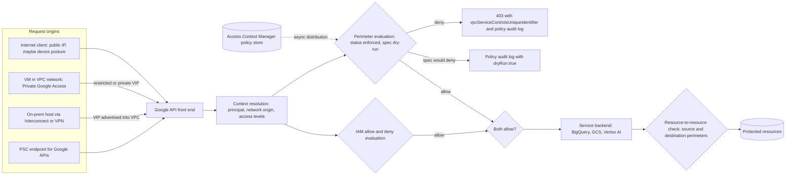

# VPC Service Controls: Security Perimeters

## TL;DR

VPC Service Controls (VPC SC) is a second, network-and-context-aware authorization layer that runs alongside IAM, and a request to a protected Google API needs approval from both layers.
A perimeter is drawn around resource containers (projects, and since 2026-09 folders), not around IP ranges, so the unit of protection is "which project owns the bytes" rather than "which subnet sent the packet".
Every protected request is checked against two boundaries: client context versus target resource (ingress), and every resource the call touches versus the caller's perimeter (egress), so a server-side copy to a foreign bucket fails even when IAM allows it.
Dry-run mode evaluates a candidate `spec` next to the enforced `status` on every request and only logs would-be denials, and that is the only safe way to change a perimeter that sits on the data path of every API call in the org.
VPC SC controls the API call graph, not the bytes that reach a client: once ingress is granted, that endpoint is trusted with the data, so access levels and ingress rules are where exfiltration risk is actually decided.

## Mental Model



The intuition: IAM decides who may do something, and VPC SC decides from where and to where the action may move data.
The front end first works out the network origin of the request from Google's software-defined network, not from the packet's source IP alone.
It then maps every resource the request names to the perimeter that owns its project.
The request is allowed only if the origin and every touched resource are in the same perimeter, or if an explicit ingress or egress rule connects them.
The policy lives in Access Context Manager (ACM), a control plane that is decoupled from the enforcement points and pushes configuration to them asynchronously, so a policy edit is an eventually consistent global rollout and not a local file change.
Dry-run is the same evaluator running a second configuration on live traffic, with the result sent to logs instead of to the decision.

## Internals

### Object model

The root object is an access policy, the container for all access levels and service perimeters.
An organization has one organization-level access policy and can add scoped policies, each scoped to a single folder or project, so admin rights over a business unit's perimeters can be delegated without org-wide rights (Google Cloud docs, as of 2026-10).
An access level is a named predicate over request context.
Basic access levels combine conditions such as IP subnetworks, member principals, regions, device policy, and VPC network sources with AND or OR.
Custom access levels express the predicate in Common Expression Language (CEL), the same language used for IAM Conditions in [[17-Cloud-AI-Engineering/Volume_03_GCP_Deep_Dive/Chapter_02_Cloud_IAM_Roles_Policies_and_Conditions|Cloud IAM: Roles, Policies, and Conditions]].
A service perimeter carries a list of member resources, a list of restricted services (for example `storage.googleapis.com`, `bigquery.googleapis.com`, `aiplatform.googleapis.com`), an optional VPC accessible services list, a list of access levels, and ingress and egress policies.
Perimeters are either regular or bridge.
A project can belong to only one regular perimeter but to many bridges.
Bridges are the older, coarse way to connect two perimeters; ingress and egress rules can replace and simplify most uses that used to need a bridge (Google Cloud docs, as of 2026-10).
Each perimeter holds two configurations: `status`, which is enforced, and `spec`, which is the dry-run candidate, used when `useExplicitDryRunSpec` is true.

### Control plane versus data plane

The control plane is the Access Context Manager API (`accesscontextmanager.googleapis.com`).
It stores the policy, validates it, applies optimistic concurrency through etags on the access policy, and runs mutations as long-running operations.
The data plane is the set of Google API front ends and service backends that evaluate every request to a restricted service.
The two are decoupled: a perimeter edit is accepted by the control plane and then distributed to enforcement points.
Plan for a propagation window of up to about 30 minutes (UNVERIFIED in this revision; re-check the "service perimeter details" page).
This is the same separation described in [[17-Cloud-AI-Engineering/Volume_01_Cloud_Architecture_Principles/Chapter_04_Control_Plane_vs_Data_Plane_Separation|Control Plane vs Data Plane Separation]].
The design consequence is static stability: enforcement uses the last distributed policy, and the policy store is not called synchronously per request.
Google does not publish how policy is cached at the enforcement points, so treat "an ACM outage does not open or close perimeters" as an inference from the architecture and not a contract.

### The evaluation algorithm

For each request to a restricted service, the evaluator builds a tuple of principal, network origin, device context, target service and method, and the set of resources the call touches.
Network origin is one of the following:

- A public IP seen by the front end.
- A VPC network identity attached by the SDN when a VM or an on-prem host behind Cloud Interconnect or VPN reaches Google APIs through Private Google Access.
- A specific Private Service Connect forwarding rule.

Private RFC 1918 addresses mean nothing to an IP-based access level, because the evaluator identifies VPC traffic by network, not by address.
That is why basic access levels gained VPC network sources, and why the ACM quota page lists a separate cap of 500 VPC networks across all access levels in a policy (Google Cloud docs, as of 2026-10).

The decision logic, written as a reasoning model rather than a published pseudocode, is:

1. Resolve each touched resource to its container project, then to the regular perimeter that contains that project, directly or through folder membership.
2. If the origin and all touched resources resolve to the same perimeter, and the service is allowed by that perimeter's VPC accessible services when the origin is a VPC network, VPC SC allows the request and IAM decides alone.
3. If a touched resource is in perimeter P and the origin is outside P, the request is an ingress. It is allowed only if the context satisfies an access level listed on P, or if some ingress rule on P matches on all of from-identity, from-source, to-operation, and to-resource.
4. If the origin is inside P and a touched resource is outside P, the request is an egress. It is allowed only if some egress rule on P matches.
5. If the request crosses from P1 to P2, it needs an egress rule on P1 and an ingress rule on P2. Neither side can open the boundary alone, and this mutual-consent property is what makes the model safe for multi-team organizations.
6. In parallel, the same steps run against each perimeter's `spec`. Any divergence is logged with `dryRun: true`, and the logged result never changes the decision.

Ingress rules have the shape `ingressFrom {identityType | identities, sources[accessLevel | resource | pscEndpoint]}` and `ingressTo {operations[serviceName, methodSelectors] | roles, resources}`.
Egress rules mirror that shape and add `externalResources`, which applies only to BigQuery Omni paths on Amazon S3 or Azure Blob Storage, plus `sourceRestriction` on the from side (Google Cloud docs, as of 2026-10).
`identityType` accepts `ANY_IDENTITY`, `ANY_USER_ACCOUNT`, or `ANY_SERVICE_ACCOUNT`.
`ANY_IDENTITY` also matches unauthenticated requests, and `ANY_SERVICE_ACCOUNT` matches service accounts from any organization (Google Cloud docs, as of 2026-10).
The `identities` list accepts single users and service accounts, Google groups, workforce and workload identity pool principals and principal sets, and agent identities.
Agent identities and SPIFFE-format third-party identities went GA on 2026-06-29, and Workload Identity Federation for GKE principals entered Preview on 2026-10-14 (VPC SC release notes, as of 2026-10).

### The mechanism a getting-started guide skips: two enforcement boundaries per call

Most tutorials present VPC SC as a firewall in front of an API.
That model cannot explain the most important protection, which is that a principal inside the perimeter with `storage.objects.create` on a personal bucket still cannot run a server-side copy out of a protected bucket.
The explanation is that the evaluator checks the set of resources a call touches, not just the URL host.
A Cloud Storage rewrite names a source object and a destination object.
A BigQuery job names a job project, source tables, and a destination table.
A Vertex AI training job names a job project, input URIs, and an output URI.
A cross-project resource reference becomes an egress check from the caller's perimeter even though the HTTP request lands on a single regional endpoint.
When a managed service then acts on the caller's behalf, for example BigQuery reading a Cloud Storage external table or a Vertex AI pipeline reading BigQuery, the service's own calls are evaluated against the perimeter context of the originating request.
A trusted service therefore cannot be used as a laundering hop.
Google does not publish exactly where in the backend this second check runs, so read "front-end check plus service-side resource-graph check" as a model that is consistent with documented behavior, not as a documented architecture.

The operational corollary is the most important sentence in this chapter.
VPC SC governs the graph of API calls between resources and contexts; it does not govern the bytes once they reach a permitted client.
If an access level admits a laptop's IP range, a user on that laptop can download an object and upload it anywhere with two independent requests.
The second request touches no protected resource, so no perimeter is consulted.
An ingress grant is therefore a decision to trust that endpoint with the data, and access levels must be designed as data-handling trust decisions, not as convenience allowlists.

### Access levels on a perimeter versus ingress rules

Listing an access level on a perimeter gives every identity that satisfies the level access to every restricted service and every resource in the perimeter.
An ingress rule that references the same access level can narrow the grant to specific identities, services, methods, and target projects.
The first form is a broad network trust grant and the second is a capability grant, so production designs keep the perimeter's `accessLevels` list empty or near-empty and express access as ingress rules.

### Network-side enforcement: VIPs, VPC accessible services, and PSC

Google API traffic from a VPC can use the restricted VIP `restricted.googleapis.com` (199.36.153.4/30), which serves only APIs that VPC SC supports.
It can also use the private VIP `private.googleapis.com` (199.36.153.8/30), which serves most Google APIs (Google Cloud docs, UNVERIFIED in this revision).
The standard pattern is a private Cloud DNS zone that maps `*.googleapis.com` to the restricted VIP and a route for 199.36.153.4/30 toward the default internet gateway, which stays inside Google's network when Private Google Access is enabled.
That turns "an unsupported API used as an exfiltration channel" into a resolution failure instead of a policy question.
VPC accessible services is the matching policy-side control: it limits which APIs can be called from networks inside the perimeter at all.
Service patterns, GA on 2026-08-06, extend that control to the private VIP and to PSC endpoints that use the all-apis bundle, for both supported and unsupported Google APIs (VPC SC release notes, as of 2026-10).
PSC endpoints as `sources` in ingress and egress rules went GA on 2026-06-30, so you can grant access to a specific internal forwarding rule instead of to a whole network (VPC SC release notes, as of 2026-10).
Connecting a PSC consumer to a producer in a different perimeter does not need explicit egress authorization (VPC release notes, as of 2026-10).
The packet-level mechanics of how Andromeda tags VPC traffic are covered in [[17-Cloud-AI-Engineering/Volume_03_GCP_Deep_Dive/Chapter_04_Global_VPC_Andromeda_SDN_and_Network_Tiers|Global VPC, Andromeda SDN, and Network Tiers]] and the NSDI 2018 Andromeda paper.

### Folder membership and hierarchical rule sources

Since 2026-09-30, folders can be perimeter members, so every current and future project under the folder is protected automatically.
Folders and organizations can also appear as resources in ingress and egress rules, which avoids per-project enumeration limits (VPC SC release notes, as of 2026-10).
The trade-off is written into the docs: a folder or organization in a rule also allows resources parented there that VPC SC cannot protect (Google Cloud docs, as of 2026-10).
Folder-scoped rules are therefore compact but implicitly include future projects, so they should be paired with folder-level IAM and Org Policy guardrails from [[17-Cloud-AI-Engineering/Volume_03_GCP_Deep_Dive/Chapter_01_Resource_Hierarchy_and_Organization_Policies|Resource Hierarchy and Organization Policies]].

### Failure domain boundaries

The enforcement surface spans the whole organization: one perimeter edit changes the authorization of every API call that touches the member projects, in every region.
The only built-in canary is dry-run, and the only built-in administrative cell boundary is the scoped policy.
This is the shared-fate property that [[17-Cloud-AI-Engineering/Volume_01_Cloud_Architecture_Principles/Chapter_03_Cell_Based_Architecture_and_Shuffle_Sharding|Cell-Based Architecture and Shuffle Sharding]] warns about: a centralized policy plane is a global blast radius unless you impose cells on it yourself.

### Lineage

VPC SC is the API-plane counterpart of BeyondCorp, which moved trust from the network location to the device and user context.
It extends that idea with a resource-location predicate, so the decision depends on who calls, from what context, and where the data is going.
Its policy distribution resembles the separation in Zanzibar (USENIX ATC 2019): a centrally authored authorization configuration evaluated at very high request rates by distributed checkers.
The network-origin signal relies on SDN-attached identity of the kind Andromeda (NSDI 2018) provides.

## Numbers to Know

| Quantity | Value | Source |
| --- | --- | --- |
| Ingress plus egress attributes per perimeter configuration | 6,000, applied separately to the dry-run and enforced configurations | (Google Cloud docs, as of 2026-10) |
| What counts as an attribute | Projects, VPC networks, access levels, method selectors, identities, roles, and wildcard `*` uses | (Google Cloud docs, as of 2026-10) |
| Policy-level quota accounting | Enforced plus dry-run usage are summed; 5 resources enforced plus 7 dry-run counts as 12 | (Google Cloud docs, as of 2026-10) |
| Access levels | 500 (listed per organization on the ACM quota page) | (Google Cloud docs, as of 2026-10) |
| Conditions per access level | 40 | (Google Cloud docs, as of 2026-10) |
| List items per access level attribute, for example CIDRs | 200 | (Google Cloud docs, as of 2026-10) |
| VPC networks across all access levels in a policy | 500 | (Google Cloud docs, as of 2026-10) |
| Ingress or egress rule title length | 100 characters; 240,000 characters combined per access policy | (Google Cloud docs, as of 2026-10) |
| Restricted VIP range | 199.36.153.4/30 | UNVERIFIED in this revision |
| Private VIP range | 199.36.153.8/30 | UNVERIFIED in this revision |
| Policy propagation window | Up to about 30 minutes | UNVERIFIED in this revision |
| VPC SC list price | No additional cost for VPC SC features | (itbrief.co.uk report of Google launch, as of 2026-10) |
| Violation analyzer | GA 2025-12-15 | (VPC SC release notes, as of 2026-10) |
| PSC endpoints in rules | GA 2026-06-30 | (VPC SC release notes, as of 2026-10) |
| Service patterns in VPC accessible services | GA 2026-08-06 | (VPC SC release notes, as of 2026-10) |
| Folder membership; folders and orgs in rules | GA 2026-09-30 | (VPC SC release notes, as of 2026-10) |
| Guided remediation suggestions | Preview 2026-10-08 | (VPC SC release notes, as of 2026-10) |
| Workload Identity Federation for GKE principals in rules | Preview 2026-10-14 | (VPC SC release notes, as of 2026-10) |
| Managing perimeters that contain deleted principals | Preview 2026-09-03 | (VPC SC release notes, as of 2026-10) |

## AWS vs GCP Mechanism Parity

| Dimension | Google Cloud VPC SC | AWS data perimeter | Critical difference |
| --- | --- | --- | --- |
| Primitive | Service perimeter around projects or folders, with restricted services | A pattern built from SCPs, RCPs, VPC endpoint policies, and resource policies with global condition keys | GCP ships one product; AWS ships building blocks that you assemble |
| Where it is evaluated | A separate layer next to IAM; both must allow | Inside the IAM policy evaluation engine, as explicit Deny statements | AWS perimeter errors are IAM denies; GCP returns a distinct VPC SC error with a unique ID |
| Network origin signal | VPC network identity from Private Google Access, restricted VIP, or PSC; public IP for internet callers | `aws:SourceVpc` and `aws:SourceVpce` only on traffic through VPC endpoints; `aws:SourceIp` on public endpoints | AWS loses VPC identity on traffic that skips endpoints, so endpoint coverage is mandatory |
| Trusted identities | `identityType` or `identities` in rules; does not restrict the identity's org by itself | `aws:PrincipalOrgID` in RCPs and resource policies | GCP needs Domain Restricted Sharing (`iam.allowedPolicyMemberDomains`) in addition to VPC SC |
| Trusted resources (anti-exfiltration) | Egress rules naming allowed external projects, folders, or orgs | `aws:ResourceOrgID` in SCPs and VPC endpoint policies | Equivalent intent; GCP also checks multi-resource calls automatically |
| Calls made on a caller's behalf | Perimeter context propagates into service-to-service calls | `aws:ViaAWSService`, `aws:PrincipalIsAWSService`, and `aws:SourceOrgID` exceptions written by hand | AWS policies break managed services unless you add these exceptions |
| Unsupported services | Restricted VIP refuses them; service patterns cover the private VIP and PSC | SCP can deny unlisted services; endpoint policies exist only where endpoints exist | Both need an explicit "default deny unknown services" posture |
| Device and context | Access levels with IP, region, device policy, and CEL | No native device posture on AWS API calls (UNVERIFIED in this revision) | GCP can bind API access to managed-device posture |
| Staged rollout | Native `spec` dry-run evaluated on live traffic | No native dry-run; use sandbox OUs, CloudTrail analysis, and IAM Access Analyzer | GCP can measure the blast radius before enforcement |
| Diagnostics | `vpcServiceControlsUniqueIdentifier`, policy audit log, violation analyzer (GA) | CloudTrail `AccessDenied` events, with messages that name the denying policy type | Both join on a request ID; GCP's analyzer proposes fixes (Preview) |
| Size limits | 6,000 attributes per perimeter configuration | SCP document size and per-target attachment limits (UNVERIFIED in this revision) | Both force hierarchy-based rules over enumeration at scale |
| Price | No additional cost | No additional cost for SCPs or RCPs (UNVERIFIED in this revision) | The cost lives in logging volume and engineering time |

For the AWS evaluation order these conditions plug into, see [[17-Cloud-AI-Engineering/Volume_02_AWS_Deep_Dive/Chapter_01_IAM_Policy_Evaluation_Engine|IAM Policy Evaluation Engine]].
For the cross-cloud synthesis, see [[17-Cloud-AI-Engineering/Volume_08_Security_Identity_and_the_Data_Perimeter/Chapter_06_Constructing_an_Impenetrable_Data_Perimeter|Constructing an Impenetrable Data Perimeter]].

## Worked Example: Dry-Run a Perimeter, Measure Violations, Enforce, and Prove the Residual Risk

### Goal and prerequisites

This lab protects a Cloud Storage bucket with a perimeter in a scoped access policy.
It soaks the perimeter in dry-run, summarizes would-be violations, enforces the perimeter, and then shows that an access-level client can still move data out through its own machine.
You need an organization, two projects you own (`inside` and `outside`), billing on both, and `roles/accesscontextmanager.policyAdmin` at the organization.
You also need `roles/billing.costsManager` or an equivalent role on the billing account for the budget, and the `accesscontextmanager`, `storage`, `logging`, and `billingbudgets` APIs enabled.

### Cost estimate

VPC SC and Access Context Manager carry no charge (as of 2026-10).
Two buckets holding a few kilobytes cost fractions of a cent per month.
Policy-denied audit logs for a few hundred lab requests are kilobytes.
Expected total is under 0.10 USD if you tear down the same day; no VMs are created.

### Terraform (OpenTofu compatible)

```hcl
terraform {
  required_providers {
    google = { source = "hashicorp/google", version = ">= 5.0" }
  }
}

variable "org_id"                 { type = string }
variable "billing_account"        { type = string }
variable "inside_project_id"      { type = string }
variable "inside_project_number"  { type = string }
variable "outside_project_id"     { type = string }
variable "my_cidr"                { type = string } # e.g. "203.0.113.7/32"

provider "google" {
  user_project_override = true
  billing_project       = var.inside_project_id
}

resource "google_access_context_manager_access_policy" "lab" {
  parent = "organizations/${var.org_id}"
  title  = "lab-scoped-policy"
  scopes = ["projects/${var.inside_project_number}"]
}

locals {
  policy = "accessPolicies/${google_access_context_manager_access_policy.lab.name}"
}

resource "google_access_context_manager_access_level" "my_ip" {
  parent = local.policy
  name   = "${local.policy}/accessLevels/lab_my_ip"
  title  = "lab_my_ip"
  basic {
    conditions {
      ip_subnetworks = [var.my_cidr]
    }
  }
}

resource "google_access_context_manager_service_perimeter" "lab" {
  parent                    = local.policy
  name                      = "${local.policy}/servicePerimeters/lab_perimeter"
  title                     = "lab_perimeter"
  perimeter_type            = "PERIMETER_TYPE_REGULAR"
  use_explicit_dry_run_spec = true

  # Dry-run candidate only; nothing is enforced until "dry-run enforce".
  spec {
    resources           = ["projects/${var.inside_project_number}"]
    restricted_services = ["storage.googleapis.com"]

    vpc_accessible_services {
      enable_restriction = true
      allowed_services   = ["RESTRICTED-SERVICES"]
    }

    # Capability grant, not a perimeter-wide access level grant.
    ingress_policies {
      ingress_from {
        identity_type = "ANY_USER_ACCOUNT"
        sources {
          access_level = google_access_context_manager_access_level.my_ip.name
        }
      }
      ingress_to {
        resources = ["projects/${var.inside_project_number}"]
        operations {
          service_name = "storage.googleapis.com"
          method_selectors {
            method = "*"
          }
        }
      }
    }
  }

  lifecycle {
    ignore_changes = [status] # status is mutated by "dry-run enforce" in step 5
  }
}

resource "google_storage_bucket" "inside" {
  project                     = var.inside_project_id
  name                        = "${var.inside_project_id}-vpcsc-inside"
  location                    = "US"
  uniform_bucket_level_access = true
  force_destroy               = true
}

resource "google_storage_bucket_object" "hello" {
  bucket  = google_storage_bucket.inside.name
  name    = "hello.txt"
  content = "sensitive-ish lab data\n"
}

resource "google_storage_bucket" "outside" {
  project                     = var.outside_project_id
  name                        = "${var.outside_project_id}-vpcsc-outside"
  location                    = "US"
  uniform_bucket_level_access = true
  force_destroy               = true
}

resource "google_billing_budget" "lab" {
  billing_account = var.billing_account
  display_name    = "vpcsc-lab-budget"
  budget_filter {
    projects = ["projects/${var.inside_project_number}"]
  }
  amount {
    specified_amount {
      currency_code = "USD"
      units         = "5"
    }
  }
  threshold_rules { threshold_percent = 0.5 }
  threshold_rules { threshold_percent = 1.0 }
}

output "policy_id"          { value = google_access_context_manager_access_policy.lab.name }
output "inside_bucket"      { value = google_storage_bucket.inside.name }
output "outside_bucket"     { value = google_storage_bucket.outside.name }
output "inside_project_id"  { value = var.inside_project_id }
```

### Run book

1. Apply.

```bash
export TF_VAR_my_cidr="$(curl -4 -s https://ifconfig.me)/32"
terraform init && terraform apply
POLICY=$(terraform output -raw policy_id)
IN=$(terraform output -raw inside_bucket)
OUT=$(terraform output -raw outside_bucket)
INSIDE_PROJECT_ID=$(terraform output -raw inside_project_id)
```

2. Wait for propagation, plan on up to 30 minutes, and then generate traffic from three contexts.

```bash
# (a) Laptop, IP matches the access level: expected no dry-run violation.
gcloud storage cat "gs://$IN/hello.txt"
# (b) Laptop, server-side copy to a foreign project: expected dry-run egress violation.
gcloud storage cp "gs://$IN/hello.txt" "gs://$OUT/copied.txt"
# (c) Cloud Shell, different public IP: expected dry-run ingress violation.
gcloud storage cat "gs://$IN/hello.txt"
```

3. Summarize the dry-run violations with Python.

```python
# vpcsc_violations.py - pip install google-cloud-logging
import collections
import datetime as dt
import sys

from google.cloud import logging as gcl

project = sys.argv[1]
hours = int(sys.argv[2]) if len(sys.argv) > 2 else 24
since = (dt.datetime.now(dt.timezone.utc) - dt.timedelta(hours=hours)).isoformat()

flt = (
    f'logName="projects/{project}/logs/cloudaudit.googleapis.com%2Fpolicy" '
    'AND protoPayload.metadata."@type"='
    '"type.googleapis.com/google.cloud.audit.VpcServiceControlAuditMetadata" '
    f'AND timestamp>="{since}"'
)

client = gcl.Client(project=project)
hist = collections.Counter()
for entry in client.list_entries(filter_=flt, order_by=gcl.DESCENDING, max_results=5000):
    pp = entry.to_api_repr().get("protoPayload", {})
    md = pp.get("metadata", {})
    key = (
        "DRY_RUN" if md.get("dryRun") else "ENFORCED",
        md.get("violationReason", "?"),
        pp.get("serviceName", "?"),
        pp.get("methodName", "?"),
        pp.get("authenticationInfo", {}).get("principalEmail", "?"),
    )
    hist[key] += 1

for (mode, reason, svc, method, who), n in hist.most_common(50):
    print(f"{n:6d} {mode:8s} {reason:40s} {svc:28s} {method:45s} {who}")
```

```bash
python3 vpcsc_violations.py "${INSIDE_PROJECT_ID:-$TF_VAR_inside_project_id}" 2
```

Expected output: one `DRY_RUN` row for the Cloud Shell read, with an access-level reason such as `NO_MATCHING_ACCESS_LEVEL`, and one row for the copy, with a resource-mismatch reason such as `RESOURCES_NOT_IN_SAME_SERVICE_PERIMETER`.
The exact reason strings can differ, and the violation analyzer explains a single event by its unique ID.

4. Decide.
The soak period must be at least as long as the longest periodic job that touches the perimeter, such as a month-end batch or a quarterly retrain.
A one-hour soak only proves the absence of hourly violators.

5. Enforce the dry-run spec and verify.

```bash
gcloud access-context-manager perimeters dry-run enforce lab_perimeter --policy="$POLICY"
# After propagation:
gcloud storage cp "gs://$IN/hello.txt" "gs://$OUT/copied2.txt"   # expect 403, VPC SC unique id
gcloud storage cat "gs://$IN/hello.txt"                           # from Cloud Shell: expect 403
```

6. Prove the residual risk from the laptop.

```bash
gcloud storage cp "gs://$IN/hello.txt" ./hello.txt      # allowed by ingress rule
gcloud storage cp ./hello.txt "gs://$OUT/leaked.txt"    # allowed: no protected resource touched
```

The server-side copy is blocked, but the two-hop copy through the client succeeds.
That is the access-level trust decision from the Internals section made concrete.

### Teardown

```bash
terraform destroy
# Fallback if state drifted:
gcloud access-context-manager perimeters delete lab_perimeter --policy="$POLICY" --quiet
gcloud access-context-manager policies delete "$POLICY" --quiet
```

### Capacity sizing: the attribute budget

Take a central data-lake perimeter whose 2 serving projects are read by 400 consumer projects.
Each consumer uses one ingress rule with 1 service-account identity, 1 source project, 4 BigQuery method selectors, and 2 target projects.

- Attributes per rule: 1 + 1 + 4 + 2 = 8.
- Enforced configuration: 400 x 8 = 3,200 attributes, which is 53 percent of the 6,000 per-configuration limit.
- Growth to 750 consumers: 750 x 8 = 6,000, which is the limit, so the next onboarding fails at apply time.
- During a migration, the dry-run copy is checked against its own 6,000 limit, but policy-level totals sum both configurations, so staging a full rewrite roughly doubles policy-level usage.
- Hierarchical alternative, GA since 2026-09-30: group consumers into 12 business-unit folders and write 12 rules with an identity group, a folder source, 4 methods, and 2 targets, which is 12 x 8 = 96 attributes.
- The cost of the 62x compression is implicit trust in every future project under those folders, including resources VPC SC cannot protect, so the folders need IAM and Org Policy guardrails that are at least as strict.

### Sizing the dry-run log stream

Suppose a fleet produces 2 million would-be violations per day in the first week of dry-run, at about 3 KB per policy audit entry (UNVERIFIED size).
That is about 6 GB per day of policy-denied logs.
At a Cloud Logging ingestion price of about 0.50 USD per GiB (UNVERIFIED in this revision), that is about 3 USD per day, which is trivial next to the engineering hours spent triaging.
Route policy logs to a dedicated bucket or BigQuery with an aggregated sink, as in [[17-Cloud-AI-Engineering/Volume_03_GCP_Deep_Dive/Chapter_16_Observability_Cloud_Monitoring_Logging_and_Trace|Observability: Cloud Monitoring, Logging, and Trace]], and group the data by the histogram key above.

## Failure Modes and Pitfalls

### Shared VPC host project outside the perimeter

VM traffic is attributed to the VPC network, and the network belongs to the host project.
If the service projects are in the perimeter but the host project is not, VMs look like outside callers, and protected APIs fail with network-mismatch reasons.
The fix is to place the host project in the same perimeter as its service projects, which means one Shared VPC host cannot be split across two regular perimeters.

### Perimeter-level access levels as a skeleton key

Listing an office-IP access level on the perimeter admits every identity, including stolen tokens from any compromised account, to every restricted service from that network.
Combined with the two-hop download-and-upload path, the perimeter then provides almost no exfiltration resistance against a compromised workstation.

### `ANY_IDENTITY` and cross-org identities

`ANY_IDENTITY` also matches unauthenticated requests, and `ANY_SERVICE_ACCOUNT` matches service accounts from any organization (Google Cloud docs, as of 2026-10).
An ingress rule with either value plus `accessLevel: "*"` is a public door, and only IAM stands behind it.
Without Domain Restricted Sharing, an insider can grant a personal Gmail account IAM access, and an overly broad ingress rule then lets that identity in from home.

### Wildcard egress

An egress rule with `resources: ["*"]` on storage or BigQuery turns the perimeter back into IAM-only protection for the exfiltration path it exists to block.
Every egress rule should name specific destination projects, folders, or external BigQuery Omni paths.

### Unconfigured VPC accessible services

Without VPC accessible services or the restricted VIP, workloads inside the perimeter can call APIs that VPC SC does not protect and use them as a side channel.
Google's August 2026 perimeter findings explicitly flag perimeters that leave APIs unrestricted from within the boundary, and mismatches between accessible and restricted services (VPC SC release notes, as of 2026-10).

### Quota exhaustion during migration

Usage is summed across enforced and dry-run configurations (Google Cloud docs, as of 2026-10).
Teams often discover this halfway through a large refactor, when the dry-run spec they need to stage pushes policy-level totals over a limit and blocks unrelated perimeter edits.

### Deleted principals freezing perimeter updates

Rules that reference deleted users, groups, or service accounts have caused perimeter updates to fail with an invalid or non-existent email error.
A Preview feature from 2026-09-03 addresses this (VPC SC release notes, as of 2026-10).
Until that feature is enabled, deprovisioning an identity can block emergency perimeter changes, so rules should reference groups rather than individuals.

### Propagation races in CI/CD

A pipeline that applies a perimeter change and immediately runs integration tests reads the old policy for up to the propagation window.
It then either passes falsely or flaps.
The pipeline should apply, wait, and verify with synthetic probes that assert both expected allows and expected denies.

### Partially supported services and AI features

Support can depend on feature and creation date.
For example, VPC SC is supported only for Agent Gateway deployments created after 2026-09-08 that use the agent connectivity template (Gemini Enterprise Agent Platform release notes, as of 2026-10).
Projects with VPC SC enabled cannot add website URLs as notebook sources in Gemini Notebook Enterprise, because live crawling would create outbound traffic beyond Google's network (Google Cloud release notes, as of 2026-10).
Verify the supported-products page for every AI service and every sub-feature before you promise a perimeter to an auditor.

### Shared fate of the policy check path

On 2025-06-12, a crash in Google's Service Control, the system that performs policy and quota checks on Google API requests, caused widespread global API failures.
The trigger was replicated policy data hitting a code path that had no feature flag (Google Cloud incident report; details UNVERIFIED in this revision).
VPC SC is a different system, but the lesson carries over: a centrally distributed authorization policy sits in the data path of every request.
Changes to it need the progressive rollout discipline in [[17-Cloud-AI-Engineering/Volume_07_Reliability_and_SRE/Chapter_07_Anatomy_of_Major_Cloud_Outages|Anatomy of Major Cloud Outages]].
For VPC SC that means dry-run soak, scoped policies as cells, and a small first perimeter, never a big-bang org-wide enforcement.

### The canonical motivating breach

In the 2019 Capital One incident on AWS, credentials stolen through SSRF against instance metadata were used from outside the victim's network to list and copy S3 data.
A network-origin perimeter condition on that role or bucket would have rejected the calls despite valid credentials.
VPC SC exists to make that class of attack a policy failure rather than a data loss.

## Security and Cost Angles

### Admin IAM

`roles/accesscontextmanager.policyAdmin` can rewrite perimeters, so treat it like org-admin.
Grant it to a break-glass group and a CI service account that is federated through Workload Identity Federation ([[17-Cloud-AI-Engineering/Volume_08_Security_Identity_and_the_Data_Perimeter/Chapter_02_Workload_Identity_Federation|Workload Identity Federation]]), never to humans by default.
Use `policyEditor` and `policyReader` for review tooling.
Use scoped policies to give a business unit autonomy over its own perimeters without the ability to modify the org-level policy.

### Layering

- IAM answers who may act.
- Domain Restricted Sharing answers whose identities may be granted access.
- VPC SC answers from which context and to which destinations data may move.
- CMEK answers who can make the bytes readable at all.

### Key hierarchy

Put `cloudkms.googleapis.com` in the restricted services list.
Keep the key project in the same perimeter as the data projects, or connect the two with tightly scoped rules, so a stolen key-user credential cannot be exercised from outside.
Key ring design is in [[17-Cloud-AI-Engineering/Volume_03_GCP_Deep_Dive/Chapter_15_Security_and_Confidential_Computing_Cloud_KMS|Security and Confidential Computing: Cloud KMS]] and [[17-Cloud-AI-Engineering/Volume_08_Security_Identity_and_the_Data_Perimeter/Chapter_04_Encryption_Key_Hierarchies_and_Envelope_Encryption|Encryption Key Hierarchies and Envelope Encryption]].

### Private network boundary

Use the restricted VIP with private DNS for every VPC and every on-prem resolver that forwards `googleapis.com`.
Use PSC endpoints as rule sources when only one network path should be trusted.
Connect on-prem through Cloud Interconnect so that on-prem API calls arrive with the VPC's network identity and not a public IP.

### AI-specific angle

A perimeter around Vertex AI training and BigQuery stops the training job from writing artifacts to a foreign bucket.
It cannot stop a deployed model endpoint from returning sensitive training data in a response to a permitted caller.
Payload-level controls belong to [[17-Cloud-AI-Engineering/Volume_12_AI_Applications_MLOps_and_Data_Platforms/Chapter_07_AI_Safety_Guardrails_and_Governance|AI Safety, Guardrails, and Governance]] and [[17-Cloud-AI-Engineering/Volume_12_AI_Applications_MLOps_and_Data_Platforms/Chapter_08_Cloud_Security_for_AI_Systems_Attacks_and_Defenses|Cloud Security for AI Systems: Attacks and Defenses]].

### Unit economics

The control itself costs nothing (as of 2026-10).
The real costs are policy-log storage, usually single-digit USD per day even at large scale, and engineering time per violation.
The second cost is the one that matters: if triaging one denial takes 2 engineer-hours and a migration produces 300 distinct violation keys, budget 600 hours, or tooling.
Guided remediation is Preview as of 2026-10-08, so it cannot be the production triage path yet.
Grouping by histogram key, rather than by raw event, usually cuts distinct work items by one to two orders of magnitude (UNVERIFIED rule of thumb).

## Interview Questions and Model Answers

### Question 1 (L5 - Senior)

A data scientist on a VM inside the perimeter has `roles/storage.admin` on their personal project and runs `gcloud storage cp gs://corp-bucket/x gs://personal-bucket/`, which fails with a 403 that mentions `vpcServiceControlsUniqueIdentifier`.
Explain exactly why, and how you would confirm it.

#### Model Answer

IAM and VPC SC are independent layers, and both must allow the request.
IAM allows it: the user can read the corp object and write to the personal bucket.
`gcloud storage cp` between buckets performs a server-side copy, so a single API call names a source resource in the corp project and a destination resource in the personal project.
The evaluator resolves both to their perimeters: the source is in perimeter P and the destination is outside every perimeter.
The VM's network origin is also in P.
Because a touched resource lies outside P, the call is an egress from P, and no egress rule names the personal project, so it is denied.
To confirm, I would take the unique ID from the error into the violation analyzer, or query the `cloudaudit.googleapis.com/policy` log in the corp project for that ID.
I would expect a resource-mismatch violation reason, the service name `storage.googleapis.com`, and the principal.
I would then point out the limit of this protection: if the same user could download the file to a context the perimeter trusts and then upload it, VPC SC would not see the second request, which is why the VM should have no route to unprotected APIs and no interactive egress to the internet.

#### Follow-up Interviewer Question

The user then streams the object to their laptop over SSH from the VM and uploads it from home; which control was supposed to stop that, and is it VPC SC?

### Question 2 (L5 - Senior)

You must enforce a new perimeter around 40 production projects without causing an outage.
Walk through the rollout.

#### Model Answer

I would author the perimeter only as a dry-run `spec`, with `useExplicitDryRunSpec`, so enforcement is unchanged.
I would route policy audit logs from all 40 projects to a central BigQuery dataset with an aggregated sink.
I would group violations by dry-run flag, violation reason, service, method, principal, and source, because one misconfiguration produces thousands of identical events.
Each group gets one of three outcomes: a narrowly scoped ingress or egress rule, a fix in the workload (for example moving a Cloud Build job to a private pool inside the perimeter), or an accepted denial because the flow is itself the exfiltration we want to stop.
The soak lasts at least one full cycle of the longest scheduled job, which is often month-end finance or a quarterly retrain, because dry-run only reports flows that actually happen.
I would enforce in waves: low-criticality projects first using a separate perimeter or a scoped policy, then the rest, with synthetic probes that assert both allowed and denied paths after the propagation window.
Rollback is a pre-staged command that restores the previous `status`, rehearsed in a game day, because during an incident the propagation delay applies to the fix as well.

#### Follow-up Interviewer Question

Halfway through, the dry-run spec pushes the policy over a quota and blocks an urgent unrelated perimeter change; why did that happen, and how do you restructure the migration?

### Question 3 (L6 - Staff)

Design the perimeter topology for an ML platform: a shared feature store in BigQuery, per-team Vertex AI training projects, a model registry, CI/CD from GitHub Actions through Workload Identity Federation, and one external labeling vendor that needs write access to a single bucket.

#### Model Answer

I would draw perimeters around data sensitivity and ownership, not around teams, because a project can be in only one regular perimeter and every cross-perimeter flow needs consent on both sides.
The default layout is one "restricted-data" perimeter that contains the feature store, the training projects, the registry, and the KMS key project.
If a regulated dataset needs its own blast radius, I would add a second perimeter and connect it with paired egress and ingress rules limited to the BigQuery read methods.
With folder membership GA, each team's training projects live under a team folder that is a perimeter member, so new projects are protected at creation time instead of after a ticket.
Training jobs keep all inputs and outputs inside the perimeter, so the resource-graph check rejects a job configured to write checkpoints to a foreign bucket.
For CI/CD, GitHub Actions authenticates through a workload identity pool, and the ingress rule names that pool's principal set filtered by repository attribute.
The rule allows only the deploy methods on the registry and Vertex AI endpoints, with no storage read, so a compromised runner can deploy but cannot read training data.
For the vendor, I would create a dedicated drop project inside the perimeter.
The ingress rule names the vendor's federated principal set, an access level on the vendor's egress IP ranges, the `storage.googleapis.com` object-create method selector only, and that single project as the target.
A downstream pipeline inside the perimeter scans and promotes the data.
I would keep the perimeter-level `accessLevels` list empty, because any entry there grants every restricted service to every identity in that context.
Networks use the restricted VIP and VPC accessible services restricted to `RESTRICTED-SERVICES`, and Domain Restricted Sharing on the org caps which identities IAM can ever name.
The trade-offs I would state are onboarding friction for every new data consumer, and the inability to use features that are not supported in a perimeter, such as notebook web-URL ingestion.

#### Follow-up Interviewer Question

A team wants to use a new managed AI feature that does not yet support VPC SC; what are your options, and what do you tell the CISO?

### Question 4 (L6 - Staff)

What is the precise difference between adding an access level to a perimeter and writing an ingress rule that references the same access level, and why does it matter for credential theft?

#### Model Answer

An access level on the perimeter makes every request whose context satisfies the level an inside-equivalent request for ingress purposes.
That covers any identity, any restricted service, and any resource in the perimeter.
An ingress rule is a conjunction: the identity type or specific identities, the source (the access level, network, folder, or PSC endpoint), the service and method selectors (or roles), and the target resources must all match.
In a credential theft scenario where an attacker phishes a token for any employee and operates from a coffee shop, an IP-based level does not help the attacker.
If the attacker lands on a corporate device or VPN egress, the perimeter-level access level admits them to everything IAM allows that employee.
The ingress rule admits them only to the specific methods and projects in the rule.
There is a subtler point as well: both forms authorize ingress only.
Neither makes the client's later actions visible, so any ingress grant extends trust to that endpoint's data handling.
The design principle follows: put device posture in the access level (custom CEL levels over device policy), scope access with ingress rules, and keep read access to the most sensitive datasets reachable only from in-perimeter compute with no interactive egress.

#### Follow-up Interviewer Question

How would you detect, from logs alone, that a perimeter-level access level is being used by identities that were never meant to rely on it?

### Question 5 (L6 - Staff)

Translate this perimeter to AWS: "only principals of our org, only from our networks, only to resources of our org", and identify where the AWS version is weaker or stronger.

#### Model Answer

On AWS the perimeter is three sets of policies evaluated inside the IAM engine as explicit denies.
The identity perimeter uses `aws:PrincipalOrgID` in RCPs and resource policies, so only our principals can access our resources.
The resource perimeter uses `aws:ResourceOrgID` in SCPs and VPC endpoint policies, so our principals and networks can only reach our resources.
The network perimeter uses `aws:SourceVpc`, `aws:SourceVpce`, or `aws:SourceIp` in RCPs and SCPs, so our resources and credentials work only from expected networks.
Each needs exceptions such as `aws:PrincipalIsAWSService` and `aws:ViaAWSService` so that managed services acting on our behalf keep working.
GCP is stronger in three places.
It has native dry-run on live traffic.
It checks multi-resource calls automatically without hand-written exceptions.
Its restricted VIP refuses unsupported services at the network layer.
AWS is stronger in two places.
Org membership of the principal is a first-class condition, whereas VPC SC needs Domain Restricted Sharing to get the same property.
The perimeter is expressed in the same policy language as IAM, so tools like IAM Access Analyzer reason about it together with identity policies.
Both share one weakness: a network perimeter only covers traffic that carries the network identity.
On AWS that means traffic through VPC endpoints; on GCP it means traffic through Private Google Access, the VIPs, or PSC.
A VM that reaches public endpoints through NAT therefore falls back to IP-based reasoning.

#### Follow-up Interviewer Question

On AWS, which services and call paths still lack RCP or endpoint-policy coverage today, and how do you close those gaps?

### Question 6 (L7+ - Principal)

VPC SC policy is a global, org-wide control in the data path of every API call.
Design the change-management and failure-domain strategy for an organization with 5,000 projects and 200 engineering teams.

#### Model Answer

I would treat the access policy as production code with a global blast radius and impose cells on it, because the product gives only two built-in levers: dry-run and scoped policies.
Cells: the org-level policy holds only a few foundational perimeters, owned by a central team.
Business units get scoped policies on their folders, which bounds who can break what and keeps one unit's quota growth from blocking another's edits.
Authoring: every perimeter is in Terraform or OpenTofu with policy-as-code checks before apply.
Those checks reject `ANY_IDENTITY` with wildcard sources, egress to `*`, non-empty perimeter-level access levels without an exemption, and references to individual users instead of groups.
Rollout: every change lands first in the dry-run `spec`.
A promotion controller compares the violation histogram before and after the change across a soak window at least as long as the longest job period.
Promotion is blocked if new keys appear outside the declared intent.
Enforcement promotion is staged by cell, never org-wide in one operation, with automated post-propagation probes that assert the intended allow and deny matrix.
Rollback is precomputed: the controller stores the prior `status` and can restore it with one command, and game days measure end-to-end restore time including propagation.
Capacity: the controller tracks attribute and resource usage per configuration against the 6,000 per-perimeter limit and the summed policy limits, and alerts at 70 percent.
Hierarchical sources are used deliberately, with a written acceptance of their implicit-trust trade-off.
Organization: a perimeter review board for cross-perimeter rules, with on-call triage that runs on the violation analyzer, and an exception register that expires.
I would justify the investment with the June 2025 Service Control incident: centrally distributed policy without flags and staged rollout produced a global API outage.
The same failure shape applies to perimeter policy, where the failure mode is a global deny storm instead of a crash.

#### Follow-up Interviewer Question

Your promotion controller relies on dry-run telemetry; which classes of breaking change produce no dry-run signal at all, and how do you catch them?

### Question 7 (L7+ - Principal)

The board asks whether VPC SC "prevents data exfiltration" for your GenAI platform.
Give the honest threat model.

#### Model Answer

VPC SC prevents one specific class of exfiltration: a valid credential being used from an untrusted context, or used to move data between Google-managed resources across an unapproved boundary.
That class includes stolen tokens used from outside, server-side copies to foreign buckets, BigQuery jobs that write to foreign datasets, training jobs that export artifacts, and managed services used as relays.
It does not address five other channels.
First, data that leaves through permitted endpoints: anything an ingress-granted laptop or partner can read, it can carry away.
Second, payload channels: a model endpoint inside the perimeter can return memorized or retrieved sensitive data in completions to a legitimate caller, and an agent tool can encode data in outbound requests to an allowed API.
Third, unsupported services and features, which must be blocked by the restricted VIP, VPC accessible services, and service patterns, or else accepted as explicit risk.
Fourth, insiders with legitimate in-perimeter access and a non-API egress path such as SSH, screen capture, or internet egress from VMs.
Fifth, policy misconfiguration, including wildcard rules and overly broad folder or org sources.
The complete answer layers VPC SC (API-graph boundary) with Domain Restricted Sharing (identity universe), CMEK with key access justification (cryptographic boundary), no internet egress from data compute through firewall policy and Secure Web Proxy (network boundary), and GenAI output guardrails and DLP (payload boundary).
It also includes continuous telemetry from policy audit logs and the perimeter findings.
I would quantify it with residual-risk metrics, such as the number of principals with ingress grants to the tier-0 datasets and the number of egress rules with folder or org destinations, and report them every quarter.

#### Follow-up Interviewer Question

Which of those residual-risk metrics would you tie to an error-budget-style policy that blocks new ingress grants, and what is the threshold?

## Further Reading

- [VPC Service Controls: Ingress and egress rules](https://docs.cloud.google.com/vpc-service-controls/docs/ingress-egress-rules) - the authoritative grammar for rules, including identity types, sources, and the folder caveat.
- [VPC Service Controls: Quotas and limits](https://docs.cloud.google.com/vpc-service-controls/quotas) - the attribute accounting and the summed dry-run plus enforced rule that drive capacity planning.
- [Access Context Manager: Quotas and limits](https://docs.cloud.google.com/access-context-manager/quotas) - access level, condition, and VPC network caps.
- [Supported identities for ingress and egress rules](https://docs.cloud.google.com/vpc-service-controls/docs/supported-identities) - exact principal formats for groups, workforce pools, workload pools, and agents.
- [Configure Private Service Connect endpoints in service perimeters](https://docs.cloud.google.com/vpc-service-controls/docs/psc-endpoint) - how to trust a single forwarding rule instead of a whole network.
- [VPC Service Controls release notes](https://docs.cloud.google.com/vpc-service-controls/docs/release-notes) - the only reliable source for GA versus Preview status in a fast-moving product.
- [Introducing new scalable perimeter options with VPC Service Controls](https://cloud.google.com/blog/products/identity-security/introducing-new-scalable-perimeter-options-with-vpc-service-controls) - Google's rationale for folder membership, hierarchical rules, and guided remediation.
- [Andromeda: Performance, Isolation, and Velocity at Scale in Cloud Network Virtualization (NSDI 2018)](https://www.usenix.org/conference/nsdi18/presentation/dalton) - the SDN substrate that makes VPC network identity a trustworthy signal; see also [[17-Cloud-AI-Engineering/Volume_13_Seminal_Papers_and_Case_Studies/Chapter_12_Andromeda_Network_Virtualization|Andromeda: Cloud Network Virtualization]].
- [Zanzibar: Google's Consistent, Global Authorization System (USENIX ATC 2019)](https://www.usenix.org/conference/atc19/presentation/pang) - the reference design for centrally authored, globally evaluated authorization at very high request rates.
- [BeyondCorp: A New Approach to Enterprise Security](https://research.google/pubs/beyondcorp-a-new-approach-to-enterprise-security/) - the context-aware access philosophy that access levels implement.
- [Building a Data Perimeter on AWS](https://docs.aws.amazon.com/whitepapers/latest/building-a-data-perimeter-on-aws/building-a-data-perimeter-on-aws.html) - the AWS counterpart, needed to defend the parity table in an interview.
- [aws-samples/data-perimeter-policy-examples](https://github.com/aws-samples/data-perimeter-policy-examples) - working SCP, RCP, and endpoint policies, including the service-principal exceptions.
- [[17-Cloud-AI-Engineering/Volume_08_Security_Identity_and_the_Data_Perimeter/Chapter_06_Constructing_an_Impenetrable_Data_Perimeter|Constructing an Impenetrable Data Perimeter]] - the cross-cloud synthesis this chapter feeds.
- [[17-Cloud-AI-Engineering/Volume_03_GCP_Deep_Dive/Chapter_02_Cloud_IAM_Roles_Policies_and_Conditions|Cloud IAM: Roles, Policies, and Conditions]] and [[17-Cloud-AI-Engineering/Volume_03_GCP_Deep_Dive/Chapter_04_Global_VPC_Andromeda_SDN_and_Network_Tiers|Global VPC, Andromeda SDN, and Network Tiers]] - the previous and next chapters, covering the identity layer and the network layer on either side of VPC SC.
