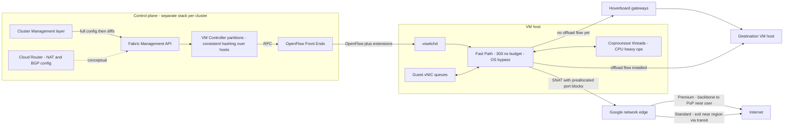

# Global VPC, Andromeda SDN, and Network Tiers

## TL;DR

A Google Cloud VPC network is one global object, while each subnet lives in one region, and every packet is virtualized by Andromeda, a host-resident software dataplane programmed by a separate control stack in each cluster.
Andromeda's Hoverboard model sends a new flow through shared gateways first and installs a direct host-to-host "offload flow" only after the flow crosses a usage threshold, which turns quadratic programming cost into demand-driven cost.
Cloud NAT is not a box in the path; it is Andromeda configuration that hands each VM preallocated blocks of NAT IP and source port pairs, so the failure mode is port exhaustion per destination 3-tuple, not gateway throughput.
The real Cloud NAT capacity formula is ports_per_VM / (connection_lifetime + TCP_TIME_WAIT) new connections per second to each unique destination, so connection reuse beats buying more NAT IPs.
Premium Tier carries internet traffic on Google's backbone to an edge close to the user, and Standard Tier hands it to the public internet close to the region; the choice sets your latency variance, which load balancers you can use, and your egress unit cost.

## Mental Model



Think of the GCP network as a global namespace with no central data path behind it.
The VPC, its routes, and its firewall policy are one global configuration, but programming that configuration is split up: each cluster's control stack turns it into flow tables on the hosts it owns.
Every packet a VM sends is handled on its own physical host, first by a busy-polling userspace Fast Path and then, if needed, by coprocessor threads on the same host.
When the host has no specific flow entry, the packet goes to a Hoverboard gateway that holds routes for every virtual network, and the controller later pushes a direct entry if the flow turns out to matter.
NAT, stateful firewalling, and routing are all features of this host dataplane, so they scale with the number of hosts, fail along with their host, and are limited by what the control plane has already allocated, not by any appliance's capacity.

## Internals

### The three-layer control plane

The Andromeda paper splits the control plane into a Cluster Management (CM) layer, a Fabric Management (FM) layer, and a Switch layer ([Dalton et al., NSDI 2018](https://www.usenix.org/conference/nsdi18/presentation/dalton)).
The CM layer provisions compute, storage, and networking on the customer's behalf, and it is not specific to networking.
The FM layer exposes a high-level API, and the CM layer drives it by sending one full update containing the complete FM configuration for a cluster and then only diffs against what it sent before ([NSDI 2018 paper](https://www.usenix.org/system/files/conference/nsdi18/nsdi18-dalton.pdf)).
FM configuration is a set of typed, named entities with parameters, such as networks, VMs, routes, and firewall rules.
Several controller types implement the FM API: VM Controllers (VMCs) program VM hosts and Hoverboards, and Load-Balancing Controllers program load balancers ([NSDI 2018 paper](https://www.usenix.org/system/files/conference/nsdi18/nsdi18-dalton.pdf)).
VMCs send OpenFlow requests over RPC to proxies called OpenFlow Front Ends (OFEs), a design the paper credits to Onix.
OFEs hold little state, so each host switch keeps one stable OFE connection even while controllers are upgraded or repartitioned.
On each host, a userspace process called vswitchd, based on a modified Open vSwitch, takes OpenFlow from the OFE and programs the datapath.
Each cluster runs multiple VMC partitions, and each partition owns a fraction of the cluster's hosts chosen by consistent hashing ([Morning Paper summary](https://blog.acolyer.org/2018/05/02/andromeda-performance-isolation-and-velocity-at-scale-in-cloud-network-virtualization/)).
The paper defines a cluster as colocated machines with uniform network connectivity that share one hardware failure domain, and it runs a separate control stack in each cluster for isolation ([NSDI 2018 paper](https://www.usenix.org/system/files/conference/nsdi18/nsdi18-dalton.pdf)).

This is the first mechanism that getting-started guides leave out.
"Global VPC" means global intent, not a global control-plane process.
The global object is decomposed by CM into per-cluster FM updates, and each cluster's VMCs converge their own hosts.
A bad VM-creation storm in one tenant's network should slow programming only inside the clusters that host it, and the paper names isolation between networks as a design goal, for example that spinning up 10k VMs should not hurt responsiveness for other networks.
The paper reports networks of more than 100,000 VMs and a median network-update latency of 184 ms ([NSDI 2018 paper](https://www.usenix.org/system/files/conference/nsdi18/nsdi18-dalton.pdf)).

### Why on-demand and preprogrammed models both fail, and what Hoverboards fix

There are two classic SDN programming models.
In the preprogrammed model, the controller pushes a full mesh of forwarding state to every host, so programming time grows as O(n x H), with n the number of VMs and H the number of hosts ([Andromeda NSDI slides](https://www.usenix.org/sites/default/files/conference/protected-files/andromeda_nsdi18_slides.pdf)).
At tens of thousands of hosts, that quadratic growth costs control-plane CPU and memory and also host dataplane memory.
In the on-demand model, a host that misses in its flow table asks the controller for the entry.
The paper names the metastable failure of the on-demand model: if the controller falls behind, every host requests on-demand programming, the extra load pushes it further behind, and the result is an outage ([NSDI 2018 paper](https://www.usenix.org/system/files/conference/nsdi18/nsdi18-dalton.pdf)).
Andromeda first used OpenFlow with the preprogrammed model only.

The Hoverboard model is a third option.
A host sends every packet it has no route for to Hoverboard gateways, which have forwarding information for all virtual networks.
The controller watches flow statistics, and when a flow exceeds a usage threshold it installs an offload flow, which is a direct host-to-host path that skips the Hoverboard ([Morning Paper summary](https://blog.acolyer.org/2018/05/02/andromeda-performance-isolation-and-velocity-at-scale-in-cloud-network-virtualization/)).
The host keeps a low-priority default route to the Hoverboards, and the more specific offload entries take precedence.
Google reported that more than 99.5% of traffic was offloaded ([NSDI slides](https://www.usenix.org/sites/default/files/conference/protected-files/andromeda_nsdi18_slides.pdf)).
The long tail of mostly idle VM pairs never costs per-host state, and the gateways absorb it.

The operational consequences matter.
A cache miss does not trigger a synchronous call to the controller, so a slow controller degrades to higher latency on gateway-routed traffic rather than lost reachability.
This is static stability by construction; see [[17-Cloud-AI-Engineering/Volume_01_Cloud_Architecture_Principles/Chapter_02_Regions_Zones_and_Static_Stability|Regions, Zones, and Static Stability]].
The first packets between a new VM pair can take a different path, through the Hoverboard, from later packets.
Microbenchmarks that time the first few RTTs between fresh VMs can therefore measure the gateway path and not the steady-state path.
Warm a flow before taking latency baselines, and treat the first-second p99 of a new connection mesh, for example at NCCL bootstrap, as a separate distribution.

### The data plane: Fast Path, coprocessors, and OS bypass

Andromeda 1.0 shipped on the Open vSwitch kernel datapath, and Andromeda 2.0 replaced it with a userspace OS-bypass dataplane, which made weekly dataplane upgrades possible ([NSDI 2018 paper](https://www.usenix.org/system/files/conference/nsdi18/nsdi18-dalton.pdf)).
The Fast Path has a per-packet CPU budget of 300 ns.
It reads and writes the VM's virtual NIC queues and the host's physical NIC queues directly through shared memory, bypassing the VMM and the host OS, to avoid thread handoffs and system calls ([NSDI 2018 paper](https://www.usenix.org/system/files/conference/nsdi18/nsdi18-dalton.pdf)).
It avoids locks and synchronization, uses hugepages, and is tuned for memory locality ([Morning Paper summary](https://blog.acolyer.org/2018/05/02/andromeda-performance-isolation-and-velocity-at-scale-in-cloud-network-virtualization/)).
Per-packet work that is CPU-heavy or has no strict latency target runs on coprocessor threads, which float per VM, so new features do not slow the Fast Path.
Google's lecture material lists operations such as longest-prefix match and NAT as coprocessor work ([Stanford CS244 2022 lecture, Google speaker](https://2022-cs244.github.io/slides/Lecture_09_2022.pdf)).
The paper notes that stateful firewalls and most middlebox functions can run in the on-host dataplane, which avoids provisioning middleboxes for active flows ([NSDI 2018 paper](https://www.usenix.org/system/files/conference/nsdi18/nsdi18-dalton.pdf)).
Against Andromeda's first production deployment, the paper reports 19x throughput, 16x CPU efficiency, 7x lower latency, and 50x larger maximum network size.

The dataplane now runs on Snap, Google's microkernel-style host networking framework.
Snap packet processing runs as pluggable "engines" that the control plane manages over RPC, and Snap lists Andromeda as one of its production users ([Marty et al., SOSP 2019 slides](https://www.sigops.org/s/conferences/sosp/2019/slides/marty.pdf)).
The trade-off is plain: Google spends host CPU cores on networking in exchange for software velocity and live-migratable state.
The paper says live migration was one of the main reasons it avoided hardware-only SR-IOV designs ([Morning Paper summary](https://blog.acolyer.org/2018/05/02/andromeda-performance-isolation-and-velocity-at-scale-in-cloud-network-virtualization/)).
That contrasts with the AWS approach, which moves the VPC dataplane onto dedicated Nitro hardware; see [[17-Cloud-AI-Engineering/Volume_02_AWS_Deep_Dive/Chapter_04_EC2_Nitro_Architecture_and_Graviton|EC2, Nitro Architecture, and Graviton]].

### Live migration and hitless upgrades: the blackouts you inherit

Andromeda supports global virtual networks and live migration across clusters, and its stated challenge is to avoid packet loss even though global routing tables cannot be updated instantly ([NSDI 2018 paper](https://www.usenix.org/system/files/conference/nsdi18/nsdi18-dalton.pdf)).
During the migration blackout, the source host enables "hairpin" flows: it forwards ingress packets meant for the departed VM on to the destination host until senders' flow tables converge.
The paper reports a migration blackout with a median of 65 ms and a 99th percentile of 388 ms.
Google's separate live-migration paper reports a fleet-wide median blackout of 50 ms as of April 2017, varying by machine shape and mainly with memory size ([Ruprecht et al., VEE 2018](https://dl.acm.org/doi/pdf/10.1145/3186411.3186415)).
Dataplane upgrades transfer firewall and VM state from the old engine to the new one in the background, then take a short blackout to switch over.
Google lecture material cites about a 200 ms median network blackout and about 1 s at p99 for this hitless upgrade ([Stanford CS244 2022 lecture](https://2022-cs244.github.io/slides/Lecture_09_2022.pdf)).
These are 2017-2022 published figures, not SLAs, and current values are not public.

Design rule for AI workloads: any timeout under about 1 s on a cross-host path, such as gRPC keepalive, NCCL or Gloo socket timeouts, or health checks with a 1-probe failure threshold, will occasionally see a blackout of this size and should not treat it as a hard failure.
See [[17-Cloud-AI-Engineering/Volume_10_AI_Infrastructure_on_Cloud/Chapter_08_Fault_Tolerance_and_Fleet_Resiliency_at_Scale|Fault Tolerance and Fleet Resiliency at Scale]].

### Global VPC: what is global and what is not

The VPC network resource, its routing table, and its firewall policy are global, and subnets are regional.
Two VMs in different regions of the same VPC reach each other on internal IPs with no peering, transit hub, or VPN, because Andromeda encapsulates and routes the traffic over Google's backbone.
Cloud Router is regional.
In regional dynamic routing mode, routes Cloud Router learns over BGP are programmed only in its own region, and in global mode they are programmed in all regions (UNVERIFIED in this revision).
Cloud NAT gateways are regional.
You can have several Public NAT gateways in one region of a VPC only if each one covers different source subnets ([Public NAT docs, as of 2026-10](https://docs.cloud.google.com/nat/docs/public-nat)).

Failure-domain reasoning splits in two.
The data plane is per-host and per-cluster, which makes it effectively zonal, so a VM's packets depend on its own host and the fabric.
The configuration domain is global: one bad firewall or route change on a global VPC reaches every region at once.
A global VPC removes the need for a transit mesh, but every region now shares one change surface.
To contain that, use separate VPCs per environment, Shared VPC host projects per cell, and hierarchical firewall policies with staged rollout; see [[17-Cloud-AI-Engineering/Volume_01_Cloud_Architecture_Principles/Chapter_03_Cell_Based_Architecture_and_Shuffle_Sharding|Cell-Based Architecture and Shuffle Sharding]].

### Cloud NAT: SNAT as preallocated state, not a gateway

Google describes Cloud NAT as a distributed, software-defined managed service with no proxy VMs or appliances.
It configures the Andromeda software behind the VPC to do source NAT for outbound traffic and destination NAT for established inbound responses ([Cloud NAT overview, as of 2026-10](https://docs.cloud.google.com/nat/docs/overview)).
Cloud Router is the control plane for NAT and holds the configuration.
Public NAT serves resources that have no external IPv4 address, and Private NAT translates between private networks, such as two VPCs or a VPC and an on-premises network, using addresses from a Private NAT subnet ([Cloud NAT overview, as of 2026-10](https://docs.cloud.google.com/nat/docs/overview)).

Port reservation is the core mechanism.
Each NAT IP offers 64,512 TCP and 64,512 UDP source ports, because ports below 1024 are not used ([Cloud NAT ports and addresses, as of 2026-10](https://docs.cloud.google.com/nat/docs/ports-and-addresses)).
The control plane reserves sets of NAT IP and source port pairs for each VM ahead of time.
The VM's host then translates on its own, with no per-connection coordination.
Under static port allocation, which is the Public NAT default, each VM gets a fixed minPortsPerVm.
Under dynamic port allocation (DPA), which is the Private NAT default, each VM gets a minimum and can grow to a maximum ([Cloud NAT ports and addresses, as of 2026-10](https://docs.cloud.google.com/nat/docs/ports-and-addresses)).
With DPA, the minimum must be a power of 2 between 32 and 32,768 ([Tune NAT configuration, as of 2026-10](https://docs.cloud.google.com/nat/docs/tune-nat-configuration)).
The GoogleCloudPlatform cluster-toolkit change that enabled DPA describes the allocation growing by doubling from 32 to 64 to 128 and up, on demand ([cluster-toolkit PR 6369](https://github.com/GoogleCloudPlatform/cluster-toolkit/pull/6369)).
That PR also says static allocation forces a 1,024-port minimum per node when NAT covers GKE alias IP ranges, which is why GKE nodes use up NAT IPs about 16 times faster than plain VMs at the default of 64.

The unit of capacity is a unique destination 3-tuple (destination IP, destination port, protocol), not the VM.
A connection is the 5-tuple formed by a NAT IP and source port plus that destination 3-tuple.
So a VM with 1,024 reserved pairs can hold 1,024 simultaneous connections to each distinct destination 3-tuple ([Cloud NAT ports and addresses, as of 2026-10](https://docs.cloud.google.com/nat/docs/ports-and-addresses)).
A closed connection's 5-tuple cannot be reused for the length of the TCP TIME_WAIT timeout ([Cloud NAT troubleshooting](https://cloud.google.com/nat/docs/troubleshooting)).
That gives the sustainable new-connection rate from one VM to one destination 3-tuple:

`max_new_conn_per_s = reserved_pairs / (mean_connection_lifetime_s + tcp_time_wait_s)`

This formula is the second mechanism a getting-started guide will not give you.
At 1,024 pairs, a 0.2 s request, and a TIME_WAIT of 120 s (the default value is UNVERIFIED), one VM can open only about 8.5 new connections per second to one partner endpoint such as `api.vendor.example:443`.
A dependency behind a single VIP turns the whole NAT IP pool into one narrow bottleneck.

Two RFC behaviors change the arithmetic.
Endpoint-independent mapping (EIM) maps one internal IP and port to the same NAT IP and port for every destination, and it is disabled by default on new gateways ([Public NAT docs, as of 2026-10](https://docs.cloud.google.com/nat/docs/public-nat)).
With EIM on, two internal flows can collide on one NAT pair toward the same destination, and the dataplane drops the packet with reason ENDPOINT_INDEPENDENCE_CONFLICT ([Cloud NAT troubleshooting](https://cloud.google.com/nat/docs/troubleshooting)).
Endpoint-dependent filtering is always on, so with EIM enabled Public NAT behaves as a Port Restricted Cone NAT under RFC 3489 (without EIM, mapping is endpoint-dependent and behaves as Symmetric NAT).
When a VM has no free pair for a destination, the packet is dropped with reason OUT_OF_RESOURCES; Cloud NAT does not queue it.

NAT rules split the pool further.
minPortsPerVm is applied separately to each rule, including the default rule, so every forwarding VM gets that many ports from each rule.
A VM that runs out of ports in one rule has new connections matching that rule dropped, even if other rules still have free ports ([Cloud NAT rules, as of 2026-10](https://docs.cloud.google.com/nat/docs/nat-rules-overview)).

### Network Service Tiers: cold potato versus hot potato

The Network Service Tiers statements in this subsection come from prior reading of the Network Service Tiers documentation and were not re-verified for this revision, so they are flagged UNVERIFIED in the report.
Premium Tier, the default, routes internet traffic cold-potato.
Inbound traffic enters Google's network at the edge point of presence nearest the client and rides Google's backbone to the region, and outbound traffic stays on the backbone until an edge near the destination.
Standard Tier routes hot-potato: traffic enters and leaves Google's network near the hosting region and crosses transit and peering ISPs for the rest of the way.
Standard Tier addresses are regional only, so global external load balancers with one anycast IP require Premium Tier.
Google's peering edge, where Premium Tier traffic enters and leaves, is the subject of the Espresso paper (SIGCOMM 2017), which Google lists alongside Andromeda as a Snap-era production system ([Snap SOSP 2019 slides](https://www.sigops.org/s/conferences/sosp/2019/slides/marty.pdf)).

The engineering trade-off is about variance more than the median.
Standard Tier can match Premium on median latency when clients sit in the same metro as the region.
Its tail latency and packet loss track public-internet congestion that you cannot see into or control.
For a token-streaming inference API, that tail shows up as stalls between tokens and as mid-stream TCP retransmits.
For bulk egress such as dataset exports or model distribution to a single partner, the cheaper tier is usually the right choice.
The next chapter covers how the GFE and Maglev terminate Premium Tier traffic: [[17-Cloud-AI-Engineering/Volume_03_GCP_Deep_Dive/Chapter_05_Cloud_Load_Balancing_GFEs_and_Maglev|Cloud Load Balancing: GFEs and Maglev]].

## Numbers to Know

| Quantity | Value | Source |
|---|---|---|
| Andromeda Fast Path per-packet CPU budget | 300 ns | (Dalton et al., NSDI 2018) |
| Largest virtual network reported | more than 100,000 VMs | (Dalton et al., NSDI 2018) |
| Control-plane network update latency | median 184 ms | (Dalton et al., NSDI 2018) |
| Traffic carried on offload flows rather than Hoverboards | more than 99.5% | (Andromeda NSDI 2018 slides) |
| Preprogrammed full-mesh programming cost | O(VMs x hosts) | (Andromeda NSDI 2018 slides) |
| Gains vs first production deployment | 19x throughput, 16x CPU efficiency, 7x latency, 50x network size | (Dalton et al., NSDI 2018) |
| Live-migration blackout | median 65 ms, p99 388 ms | (Dalton et al., NSDI 2018) |
| Fleet live-migration median blackout | 50 ms as of April 2017 | (Ruprecht et al., VEE 2018) |
| Dataplane hitless upgrade network blackout | about 200 ms median, about 1 s p99 | (Stanford CS244 2022 lecture, Google speaker) |
| Snap Pony Express throughput efficiency | about 3x vs kernel TCP | (Marty et al., SOSP 2019 slides) |
| Usable source ports per NAT IP | 64,512 TCP plus 64,512 UDP | (Google Cloud docs, as of 2026-10) |
| VMs per NAT IP at minPortsPerVm 1,024 | 63 | (Google Cloud docs, as of 2026-10) |
| Public NAT static default minPortsPerVm | 64, which gives 1,008 VMs per NAT IP | (secondary sources, as of 2026-10; primary UNVERIFIED) |
| DPA minPortsPerVm range | power of 2 from 32 to 32,768 | (Google Cloud docs, as of 2026-10) |
| DPA default minimum and growth | 32, doubling on demand | (GoogleCloudPlatform cluster-toolkit PR, as of 2026-10) |
| Default port allocation mode | static for Public NAT, dynamic for Private NAT | (Google Cloud docs, as of 2026-10) |
| Endpoint-independent mapping default | disabled at gateway creation | (Google Cloud docs, as of 2026-10) |
| Cloud NAT default timeouts | TCP established 1,200 s, TCP transitory 30 s, TCP TIME_WAIT 120 s, UDP 30 s | UNVERIFIED |
| VPC MTU | default 1,460 bytes, maximum 8,896 bytes | UNVERIFIED |
| Cloud NAT gateway price | about USD 0.0014 per VM-hour up to 32 VMs, capped near USD 0.044 per hour, plus about USD 0.045 per GiB processed | UNVERIFIED |
| Premium vs Standard internet egress per GiB | read the current Network Service Tiers pricing page | UNVERIFIED - no figure stated |
| AWS NAT Gateway connections per IP | about 55,000 simultaneous per unique destination | UNVERIFIED |

## AWS vs GCP Mechanism Parity

The AWS column comes from prior reading and was not re-verified in this revision; each row carrying an AWS-specific number or feature name appears in the UNVERIFIED report.

| Dimension | Google Cloud | AWS | Critical difference |
|---|---|---|---|
| VPC scope | One global VPC, regional subnets | Regional VPC, subnets scoped to one Availability Zone | GCP crosses regions without a transit construct, and AWS needs Transit Gateway, peering, or Cloud WAN |
| Host dataplane | Andromeda userspace Fast Path on host CPU cores, on Snap | VPC dataplane offloaded to Nitro cards | GCP spends host cores for software velocity, and AWS spends dedicated silicon for isolation |
| Programming model | Hoverboard gateways for the long tail, controller-installed offload flows for active pairs | Mapping service lookups cached on the host, per AWS public talks (UNVERIFIED detail) | Both avoid full-mesh preprogramming, and GCP documents the gateway-first path explicitly |
| Control-plane partitioning | Per-cluster control stacks, VMC partitions by consistent hashing | Cellular and zonal control planes, per Builders' Library principles | Both are cellular, and GCP's global configuration object still fans out to every region |
| NAT architecture | Distributed SNAT on each host, ports preallocated per VM | NAT Gateway as a managed Hyperplane-based service inside one AZ (UNVERIFIED) | GCP has no gateway throughput ceiling, but each VM has a port budget; AWS has a per-gateway connection and bandwidth ceiling |
| NAT failure domain | Regional config, per-host data path | Zonal gateway, so you deploy one per AZ for static stability | A cross-AZ NAT dependency on AWS is a classic zonal-failure trap, and GCP has no such hop |
| NAT port exhaustion signal | Drops with reason OUT_OF_RESOURCES or ENDPOINT_INDEPENDENCE_CONFLICT | ErrorPortAllocation CloudWatch metric (UNVERIFIED) | Same physics, a 5-tuple held in TIME_WAIT, observed differently |
| Cross-region internal routing | Native within one VPC | Inter-region peering or Transit Gateway peering | GCP has less plumbing, but changes have a larger blast radius |
| Dynamic routing | Cloud Router BGP, regional or global routing mode (UNVERIFIED) | Virtual private gateway, Transit Gateway route tables, Direct Connect gateway | GCP global mode makes on-premises routes visible in all regions |
| Internet edge tiering | Premium cold-potato vs Standard hot-potato per resource | No per-IP tier, and Global Accelerator or CloudFront give backbone ingress (UNVERIFIED) | GCP exposes backbone vs transit as a per-address billing choice |
| Live migration | Routine, with a hairpin forwarding mechanism | EC2 generally uses scheduled events and reboots rather than transparent migration (UNVERIFIED) | GCP workloads must tolerate sub-second blackouts, and AWS workloads must handle maintenance events |
| Curriculum mapping | This chapter | [[17-Cloud-AI-Engineering/Volume_02_AWS_Deep_Dive/Chapter_03_VPC_Networking_Internals\|VPC Networking Internals]] | See [[17-Cloud-AI-Engineering/Volume_04_AWS_vs_GCP_Translation/Chapter_02_Networking_and_Load_Balancing_Translation\|Networking Translation]] |

## Worked Example: Global VPC, Two Tiers, and a Sized Cloud NAT

### What the lab proves

The lab proves four things.
First, VMs in two regions on the same VPC talk over internal IPs with no peering.
Second, a VM without an external IP reaches the internet only through Cloud NAT, and you can inspect its port mapping.
Third, two external IPs in the same region, one Premium and one Standard, show different paths when traced from your laptop.
Fourth, the NAT sizing formula predicts when port exhaustion starts.

### Cost estimate (UNVERIFIED prices; check the pricing pages before running)

Four e2-micro VMs at an assumed USD 0.01 per hour each come to about USD 0.04 per hour.
One Cloud NAT gateway serving one VM comes to about USD 0.0014 per hour, plus about USD 0.045 per GiB processed.
Two static external IPv4 addresses for NAT and two ephemeral ones on the edge VMs come to about USD 0.005 per address-hour each, or USD 0.02 per hour.
A two-hour run with under 1 GiB of traffic should cost less than USD 0.25.
The budget below alerts at USD 10.

### OpenTofu / Terraform

```hcl
terraform {
  required_providers {
    google = {
      source  = "hashicorp/google"
      version = ">= 6.0"
    }
  }
}

variable "project_id" {}
variable "billing_account" {}
variable "region_a" { default = "us-central1" }
variable "region_b" { default = "europe-west4" }

provider "google" {
  project = var.project_id
}

data "google_project" "p" {}

# Budget alarm: alerts billing admins at 50, 90, 100 percent of USD 10.
resource "google_billing_budget" "lab" {
  billing_account = var.billing_account
  display_name    = "andromeda-lab-budget"
  budget_filter {
    projects = ["projects/${data.google_project.p.number}"]
  }
  amount {
    specified_amount {
      currency_code = "USD"
      units         = "10"
    }
  }
  threshold_rules { threshold_percent = 0.5 }
  threshold_rules { threshold_percent = 0.9 }
  threshold_rules { threshold_percent = 1.0 }
}

# One global VPC, custom subnets, global dynamic routing.
resource "google_compute_network" "vpc" {
  name                    = "andromeda-lab"
  auto_create_subnetworks = false
  routing_mode            = "GLOBAL"
  mtu                     = 1460
}

resource "google_compute_subnetwork" "a" {
  name                     = "lab-a"
  region                   = var.region_a
  network                  = google_compute_network.vpc.id
  ip_cidr_range            = "10.10.0.0/20"
  private_ip_google_access = true
  log_config {
    aggregation_interval = "INTERVAL_5_SEC"
    flow_sampling        = 0.5
    metadata             = "INCLUDE_ALL_METADATA"
  }
}

resource "google_compute_subnetwork" "b" {
  name                     = "lab-b"
  region                   = var.region_b
  network                  = google_compute_network.vpc.id
  ip_cidr_range            = "10.20.0.0/20"
  private_ip_google_access = true
}

# Internal ICMP and TCP between regions; SSH only via IAP TCP forwarding.
resource "google_compute_firewall" "internal" {
  name          = "lab-allow-internal"
  network       = google_compute_network.vpc.id
  source_ranges = ["10.10.0.0/20", "10.20.0.0/20"]
  allow { protocol = "icmp" }
  allow { protocol = "tcp" }
}

resource "google_compute_firewall" "iap_ssh" {
  name          = "lab-allow-iap-ssh"
  network       = google_compute_network.vpc.id
  source_ranges = ["35.235.240.0/20"]
  allow {
    protocol = "tcp"
    ports    = ["22"]
  }
}

resource "google_compute_firewall" "edge_icmp" {
  name          = "lab-allow-edge-icmp"
  network       = google_compute_network.vpc.id
  source_ranges = ["0.0.0.0/0"]
  target_tags   = ["edge"]
  allow { protocol = "icmp" }
}

# Static NAT IPs so partners can allowlist them; MANUAL_ONLY keeps them stable.
resource "google_compute_address" "nat" {
  count        = 2
  name         = "lab-nat-${count.index}"
  region       = var.region_a
  network_tier = "PREMIUM"
}

resource "google_compute_router" "a" {
  name    = "lab-router-a"
  region  = var.region_a
  network = google_compute_network.vpc.id
}

resource "google_compute_router_nat" "a" {
  name                               = "lab-nat-a"
  router                             = google_compute_router.a.name
  region                             = var.region_a
  nat_ip_allocate_option             = "MANUAL_ONLY"
  nat_ips                            = google_compute_address.nat[*].self_link
  source_subnetwork_ip_ranges_to_nat = "LIST_OF_SUBNETWORKS"
  subnetwork {
    name                    = google_compute_subnetwork.a.id
    source_ip_ranges_to_nat = ["ALL_IP_RANGES"]
  }
  enable_dynamic_port_allocation      = true
  enable_endpoint_independent_mapping = false
  min_ports_per_vm                    = 64
  max_ports_per_vm                    = 4096
  tcp_time_wait_timeout_sec           = 30
  log_config {
    enable = true
    filter = "ERRORS_ONLY"
  }
}

locals {
  image = "debian-cloud/debian-12"
}

# Private VM in region A: no access_config, so egress goes through Cloud NAT.
resource "google_compute_instance" "probe_a" {
  name         = "lab-probe-a"
  zone         = "${var.region_a}-a"
  machine_type = "e2-micro"
  boot_disk {
    initialize_params { image = local.image }
  }
  network_interface {
    subnetwork = google_compute_subnetwork.a.id
  }
}

# Private VM in region B: proves cross-region internal reachability.
resource "google_compute_instance" "probe_b" {
  name         = "lab-probe-b"
  zone         = "${var.region_b}-a"
  machine_type = "e2-micro"
  boot_disk {
    initialize_params { image = local.image }
  }
  network_interface {
    subnetwork = google_compute_subnetwork.b.id
  }
}

# Two edge VMs in the same zone, differing only in network tier.
resource "google_compute_instance" "edge" {
  for_each     = toset(["PREMIUM", "STANDARD"])
  name         = "lab-edge-${lower(each.key)}"
  zone         = "${var.region_a}-a"
  machine_type = "e2-micro"
  tags         = ["edge"]
  boot_disk {
    initialize_params { image = local.image }
  }
  network_interface {
    subnetwork = google_compute_subnetwork.a.id
    access_config {
      network_tier = each.key
    }
  }
}

output "edge_ips" {
  value = { for k, v in google_compute_instance.edge : k => v.network_interface[0].access_config[0].nat_ip }
}
```

### Run and observe

```bash
export TF_VAR_project_id="my-lab-project"
export TF_VAR_billing_account="XXXXXX-XXXXXX-XXXXXX"
gcloud services enable compute.googleapis.com billingbudgets.googleapis.com --project "$TF_VAR_project_id"
tofu init && tofu apply

# 1. Global VPC: region A to region B over internal IPs, no peering.
B_IP=$(gcloud compute instances describe lab-probe-b --zone europe-west4-a --format='value(networkInterfaces[0].networkIP)')
gcloud compute ssh lab-probe-a --zone us-central1-a --tunnel-through-iap -- "ping -c 20 $B_IP"

# 2. Cloud NAT: egress IP should be one of the two reserved NAT IPs.
gcloud compute ssh lab-probe-a --zone us-central1-a --tunnel-through-iap -- "curl -s https://ifconfig.me"
gcloud compute routers get-nat-mapping-info lab-router-a --region us-central1
gcloud compute routers get-status lab-router-a --region us-central1

# 3. Tiers: run from your laptop and compare where the path enters Google's ASN.
tofu output -json edge_ips
mtr -rwc 50 <PREMIUM_IP>
mtr -rwc 50 <STANDARD_IP>
```

The `get-nat-mapping-info` output lists the NAT IP and port ranges assigned to each VM interface, so you can see the preallocation directly.
For the tier comparison, look at which hop first resolves to Google's network and at the hop-to-hop variance after it, not at the median RTT alone.

### Capacity sizing: the port formula in code

```python
#!/usr/bin/env python3
"""Cloud NAT sizing: ports per VM and NAT IPs from per-destination new-connection rate."""
import math

PORTS_PER_NAT_IP = 64512  # Google Cloud docs, as of 2026-10


def ports_needed(new_conn_per_s: float, lifetime_s: float, time_wait_s: float, concurrent_floor: int) -> int:
    churn = new_conn_per_s * (lifetime_s + time_wait_s)
    need = max(churn, concurrent_floor)
    return 2 ** math.ceil(math.log2(max(need, 32)))


def nat_ips(nodes: int, ports_per_node: int, headroom: float = 1.3) -> int:
    return math.ceil(nodes * ports_per_node * headroom / PORTS_PER_NAT_IP)


if __name__ == "__main__":
    nodes, qps_per_node, lifetime = 400, 150, 0.2
    for label, tw, rate in [
        ("no keepalive, TIME_WAIT 120 s", 120, qps_per_node),
        ("no keepalive, TIME_WAIT 30 s", 30, qps_per_node),
        ("pooled, 64 persistent conns", 30, 0.1),
    ]:
        p = ports_needed(rate, lifetime, tw, concurrent_floor=64)
        print(f"{label:34s} ports/node={p:6d} nat_ips={nat_ips(nodes, p):4d}")
```

Step-by-step for the scenario: 400 GKE nodes, each making 150 new HTTPS connections per second to one partner VIP, with 0.2 s requests.
With TIME_WAIT at 120 s, each node needs 150 x 120.2 = 18,030 pairs, which rounds up to 32,768, so the fleet needs 400 x 32,768 x 1.3 / 64,512 = 265 NAT IPs.
With TIME_WAIT at 30 s, each node needs 4,530 pairs, which rounds up to 8,192, so the fleet needs 67 NAT IPs.
With a connection pool of 64 persistent connections per node, each node needs 64 pairs, so the fleet needs 1 NAT IP.
The fix is connection reuse.
Buying 265 NAT IPs means 265 addresses the partner has to allowlist, and every one is billed by the hour.

### Teardown

```bash
tofu destroy -auto-approve
gcloud compute addresses list --project "$TF_VAR_project_id" --filter="name~^lab-"
```

The second command should return nothing.
Reserved static IPs left behind after a partial destroy keep billing.

## Failure Modes and Pitfalls

### Port exhaustion toward a single destination

The signature is intermittent connect timeouts to one third-party API while every other destination works, and the CPU and NAT gateway dashboards look normal.
The cause is the per-3-tuple port budget combined with TIME_WAIT reuse delay, which shows up as drops with reason OUT_OF_RESOURCES ([Cloud NAT troubleshooting](https://cloud.google.com/nat/docs/troubleshooting)).
Mitigations, in order: HTTP keepalive and connection pooling, then DPA with a higher maximum, then a shorter TIME_WAIT if your traffic allows it, and only then more NAT IPs.

### Endpoint-independent mapping conflicts

Turning on EIM for STUN or TURN compatibility lowers effective capacity, because two internal flows can map to the same NAT pair, and the conflicting packets are dropped as ENDPOINT_INDEPENDENCE_CONFLICT.
The documented options are to disable EIM, which does not interrupt established connections, or to raise the minimum ports per VM ([Cloud NAT troubleshooting](https://cloud.google.com/nat/docs/troubleshooting)).

### Switching port allocation modes breaks live connections

Moving a gateway from static allocation to DPA breaks established connections if the new maximum is below the old minimum ([Cloud NAT ports and addresses, as of 2026-10](https://docs.cloud.google.com/nat/docs/ports-and-addresses)).
Google's own cluster-toolkit uses a DPA maximum of 1,024 so that migrating gateways that were already at 1,024 is non-disruptive ([cluster-toolkit PR 6369](https://github.com/GoogleCloudPlatform/cluster-toolkit/pull/6369)).
Treat NAT changes as production deploys, with a maintenance window and per-region staging.

### GKE alias ranges multiply port consumption

Under static allocation with alias IP ranges, each node is held at a 1,024-port minimum, so one NAT IP covers about 63 nodes instead of about 1,008.
A cluster that autoscales from 50 to 200 nodes can exhaust a 2-IP gateway with no change in traffic.
The node-level ip-masq-agent decides whether pod traffic is SNATed on the node first, which changes the source and therefore how NAT counts it ([Cloud NAT troubleshooting](https://cloud.google.com/nat/docs/troubleshooting)).

### Per-rule port allocation surprises

With NAT rules, each forwarding VM is allocated minPortsPerVm from every rule, and a source-based rule that has only a few IPs caps the number of forwarding VMs for the whole gateway ([Cloud NAT rules, as of 2026-10](https://docs.cloud.google.com/nat/docs/nat-rules-overview)).

### Auto-allocated NAT IPs and partner allowlists

With automatic IP allocation, Cloud NAT adds addresses as demand grows, and a partner that allowlists only your original IPs will reject traffic from the new ones.
Use MANUAL_ONLY allocation with reserved addresses for any destination that filters by source IP, and alert on port utilization before the pool runs out.

### Control-plane overload

The Andromeda paper's own warning is that an on-demand programming model tips into overload, because a controller that falls behind gets more requests the further behind it is ([NSDI 2018 paper](https://www.usenix.org/system/files/conference/nsdi18/nsdi18-dalton.pdf)).
Hoverboards remove that loop for forwarding.
Your own systems can still recreate it, for example a fleet that recreates thousands of VMs at once after a failed rollout and queues firewall, route, and NAT changes behind them.
Rate-limit mass VM churn, and stage infrastructure-as-code applies by region.

### First-packet path asymmetry

Until an offload flow is installed, packets go through Hoverboard gateways, so the first latency samples of a fresh VM mesh are not representative.
Warm flows before benchmarking or setting latency alarms.

### Live migration and upgrade blackouts

A 65 ms median and 388 ms p99 migration blackout, plus dataplane upgrade blackouts measured in hundreds of milliseconds, are normal published behavior.
Health checks with a single-probe threshold and sub-second RPC deadlines on long-lived streams will report these as false failures.
For training jobs, configure collective-communication timeouts in seconds, not milliseconds.

### MTU mismatches

A VPC MTU set above what an attached VPN or interconnect path carries, combined with ICMP filtered somewhere on that path, produces path-MTU black holes: small requests succeed and large responses hang.
Size the MTU for the most restrictive hybrid path, or clamp MSS at the boundary.
The specific MTU limits are listed as UNVERIFIED in Numbers to Know.

### Global configuration blast radius, with public incident analogues

Google's public incident report for the April 2016 Compute Engine networking outage (incident 16007) described a configuration change that withdrew Compute Engine IP blocks from Google's BGP announcements, with safeguards that failed to stop propagation (details UNVERIFIED in this revision).
Google's write-up of the 2 June 2019 disruption described a configuration change meant for a few servers in one region being applied more broadly, which cut available network capacity in several US regions (details UNVERIFIED in this revision).
The lesson for global VPC users is that a global configuration object needs the same staged, canaried rollout discipline that Google applies to its own network.
See [[17-Cloud-AI-Engineering/Volume_07_Reliability_and_SRE/Chapter_07_Anatomy_of_Major_Cloud_Outages|Anatomy of Major Cloud Outages]].

### Tier mismatches

Reserving a Standard Tier address and then trying to attach it to a global external load balancer fails, because global anycast frontends require Premium Tier (UNVERIFIED in this revision).
Changing a project's default tier does not move existing resources to the new tier.

## Security and Cost Angles

### IAM scoping

Split network administration from security administration: the network admin role manages VPCs, routers, and NAT, the security admin role manages firewalls and SSL policy, and the Shared VPC admin role attaches service projects.
See [[17-Cloud-AI-Engineering/Volume_03_GCP_Deep_Dive/Chapter_02_Cloud_IAM_Roles_Policies_and_Conditions|Cloud IAM]].
Use organization policy to prevent VMs from getting external IPs, so that egress has to go through NAT where it is logged.
Constraints such as `compute.vmExternalIpAccess`, `compute.skipDefaultNetworkCreation`, and `compute.restrictCloudNATUsage` cover this; constraint names are UNVERIFIED in this revision.
See [[17-Cloud-AI-Engineering/Volume_03_GCP_Deep_Dive/Chapter_01_Resource_Hierarchy_and_Organization_Policies|Resource Hierarchy and Organization Policies]].

### Private boundaries

Private Google Access lets subnets without external IPs reach Google APIs, such as Cloud Storage for model weights and datasets, without passing through Cloud NAT.
Pair it with a VPC Service Controls perimeter so that a stolen credential used from outside the perimeter cannot read the bucket.
See [[17-Cloud-AI-Engineering/Volume_03_GCP_Deep_Dive/Chapter_03_VPC_Service_Controls_Security_Perimeters|VPC Service Controls]].
Cloud NAT is not an inbound security control, and its endpoint-dependent filtering is a side effect of how NAT works, not a firewall policy.
Keep explicit egress firewall policies so that a compromised workload cannot reach arbitrary internet destinations just because NAT allows it.
Turn on NAT logging (ERRORS_ONLY at minimum) and VPC Flow Logs on sensitive subnets, and route both to a log sink you control; see [[17-Cloud-AI-Engineering/Volume_03_GCP_Deep_Dive/Chapter_16_Observability_Cloud_Monitoring_Logging_and_Trace|Observability]].

### Encryption

Google states that it encrypts VM-to-VM traffic that crosses physical boundaries, but that is not a substitute for application-layer TLS or mTLS when your threat model includes compromised workloads inside the VPC (UNVERIFIED scope details).
The key hierarchy for data at rest is covered in [[17-Cloud-AI-Engineering/Volume_03_GCP_Deep_Dive/Chapter_15_Security_and_Confidential_Computing_Cloud_KMS|Cloud KMS]].

### Unit-economics levers

NAT data processing is charged per GiB (rate UNVERIFIED), so pulling multi-terabyte checkpoints or container layers through NAT instead of Private Google Access or Artifact Registry is avoidable spend.
Connection pooling cuts NAT IP count, and each reserved IP is billed hourly, as the sizing example showed.
Standard Tier is a legitimate saving for bulk egress to a small number of known destinations with little latency sensitivity, such as nightly dataset syncs or partner deliveries.
Premium Tier pays for itself on interactive and streaming inference, where tail latency drives user-visible stalls.
Cross-region traffic inside a global VPC is billed as inter-region egress, even though no peering or transit resource exists to remind you of it.
See [[17-Cloud-AI-Engineering/Volume_09_FinOps_and_Cloud_Economics/Chapter_04_Network_Egress_Economics_and_Optimization|Network Egress Economics and Optimization]].

## Interview Questions and Model Answers

### Question 1 (L5 - Senior)

A GKE service calls a payments API at about 100 requests per second per node, and you see intermittent connect timeouts only to that API, while Cloud NAT's dashboard shows plenty of unused NAT IPs. What is happening?

#### Model Answer

Cloud NAT capacity is measured per unique destination 3-tuple, not per gateway, so a single payments VIP on port 443 is the bottleneck no matter how many ports other destinations have free.
Each VM, or each node with alias ranges, has a reserved set of NAT IP and port pairs, and a closed connection's 5-tuple is unusable for the TCP TIME_WAIT period.
The sustainable new-connection rate from one node to that destination is reserved_pairs / (lifetime + TIME_WAIT).
With static allocation on GKE alias ranges at 1,024 pairs and a TIME_WAIT on the order of 120 s, that is under 10 new connections per second, so at 100 per second without keepalive the node runs out within seconds.
I would confirm by looking for NAT drops with reason OUT_OF_RESOURCES and checking `get-nat-mapping-info` for the node.
The first fix is HTTP keepalive and a bounded connection pool in the client, which turns 100 new connections per second into a few dozen long-lived ones.
After that, enable DPA with a maximum sized from the formula, consider a shorter TIME_WAIT, and only then add NAT IPs, remembering that the partner may have to allowlist each new address.
I would also check whether EIM is on, because EIM collisions produce a different drop reason with the same symptom.

#### Follow-up Interviewer Question

The partner refuses to allowlist more than two IPs and does not support HTTP keepalive. What do you do?

### Question 2 (L5 - Senior)

Explain what is global and what is regional in a Google Cloud VPC, and what that means for failure domains compared with an AWS VPC.

#### Model Answer

The VPC network, its routes, and its firewall policy are global objects, while subnets, Cloud Routers, and Cloud NAT gateways are regional.
Cross-region internal traffic in one VPC needs no peering or transit, because Andromeda encapsulates it over Google's backbone.
On AWS, the VPC is regional and each subnet is in one AZ, so a multi-region design needs Transit Gateway, peering, or Cloud WAN, and each of those is a separately configured, separately failing component.
Andromeda's packet processing is per-host, programmed by per-cluster control stacks, so data-plane failures are mostly zonal.
The configuration domain is global, though, so a bad firewall or route change on a global VPC lands in every region together.
In practice I take the global VPC's simplicity for intra-environment connectivity, separate environments and cells into different VPCs or Shared VPC host projects, and stage network changes by region with dry runs.

#### Follow-up Interviewer Question

Your company wants one global Shared VPC for all 40 teams to simplify routing. What guardrails would you require before agreeing?

### Question 3 (L6 - Staff)

Walk through Andromeda's Hoverboard programming model, why Google built it, and what it costs a customer.

#### Model Answer

Preprogramming a full mesh of VM-to-host mappings costs O(VMs x hosts) in control-plane work and host memory, which does not scale to networks of 100,000-plus VMs with rapid churn.
Pure on-demand programming has a metastable failure: a controller that falls behind gets flooded with miss requests from every host and collapses, and the Andromeda paper names this outcome as an outage.
Hoverboards give each host a low-priority default route to shared gateways that know every virtual network, so a miss is forwarded, not escalated to the controller.
The controller watches flow statistics and installs direct host-to-host offload flows only for flows above a usage threshold, and Google reported more than 99.5% of traffic on offload flows.
This is a constant-work, statically stable design: controller lag means slower paths for new flows, not lost reachability.
The cost to customers is that new flows take an extra gateway hop until they are offloaded, so first-packet latency and the first few RTTs between new VM pairs differ from steady state.
That matters for benchmark methodology, for latency SLOs on short-lived connections, and for collective-communication bootstrap in large training jobs.
The gateways are also a shared tier whose capacity planning belongs to Google, so a mostly-new-flows workload, such as massive fan-out with short connections, leans on infrastructure you cannot see.
The fix on the customer side is the same as for NAT: reuse connections so that flows live long enough to be offloaded.

#### Follow-up Interviewer Question

How would you design an experiment, using only customer-visible tools, to estimate the offload threshold and the latency gap between the Hoverboard path and the offloaded path?

### Question 4 (L6 - Staff)

You are launching a global streaming LLM inference API on GCP, and finance wants Standard Tier to cut egress cost. How do you decide?

#### Model Answer

First I separate traffic classes, because the tier is chosen per resource, not per company.
Interactive token streaming is sensitive to inter-token stalls, and its egress per request is small, since a few kilobytes of text per response is tiny compared with the GPU cost.
Premium Tier keeps traffic on Google's backbone to an edge close to the user, which mostly cuts variance and loss on long routes, and it is required for a global external load balancer with one anycast IP.
Standard Tier would force regional frontends, DNS-based geographic steering, and public-internet transit with tail behavior I cannot control.
So I would quantify the actual saving as egress GiB per month times the tier price difference, and compare it to GPU spend per million tokens, which is usually orders of magnitude larger.
For bulk paths, such as dataset exports, nightly replication to a partner, or model artifact distribution, I would use Standard Tier where the destination is near the region and latency does not matter.
I would decide with data: run synthetic clients from the top client geographies against both tiers, and compare p50, p99, and loss over a week before committing.
The decision should be written down with the trade-off: Standard saves X per month, costs Y ms of p99 for users in region Z, and blocks global anycast load balancing.

#### Follow-up Interviewer Question

Most of the API's users are in a single metro next to the serving region. Does your answer change, and what new risk do you take on?

### Question 5 (L6 - Staff)

Design egress for a 2,000-node GPU training cluster on GKE that pulls datasets from Cloud Storage, Python packages from public mirrors, and model weights from a third-party hub, with partner allowlisting required for the hub.

#### Model Answer

The biggest flow, dataset reads from Cloud Storage, should never touch Cloud NAT: Private Google Access on the node subnets, plus VPC Service Controls around the buckets, removes NAT data-processing charges and NAT port pressure for that traffic.
Package installs should come from an internal mirror or Artifact Registry remote repository, which turns 2,000 nodes of internet fan-out into one cached fetch path.
The third-party hub is the only real NAT client.
I would use MANUAL_ONLY NAT IPs so the allowlist is stable, with DPA on and a maximum sized from peak concurrent downloads per node toward the hub's VIPs.
The per-node budget is concurrent streams plus churn times (lifetime + TIME_WAIT), multiplied by 2,000 nodes and divided by 64,512 per IP, plus headroom.
Static allocation with alias ranges would be bad here, because a 1,024-port floor per node means at least 32 NAT IPs before any real demand.
Better still, stage weights once into Cloud Storage through a single fetcher job, so the cluster reads from Google storage at fabric speed and the hub sees one client.
I would alert on NAT drops by reason and on port utilization, and gate cluster scale-up in CI on a NAT capacity check.
Cloud NAT is regional, so a multi-region training fleet needs a gateway per region, with each region's IPs allowlisted.

#### Follow-up Interviewer Question

During a restart storm, all 2,000 nodes re-download a 140 GB checkpoint from the hub at once. What breaks first, and how do you redesign the restart path?

### Question 6 (L7+ - Principal)

Compare the GCP and AWS philosophies for VPC data planes and NAT, and argue which failure modes each makes more likely at hyperscale.

#### Model Answer

Andromeda puts virtualization in host software: a busy-polling Fast Path with a 300 ns per-packet budget, coprocessor threads for heavy features, and weekly hitless upgrades.
Google trades host CPU and some blackout time for velocity and transparent live migration, and its NAT follows the same pattern as SNAT state on every host with ports preallocated by a regional control plane.
AWS moves the dataplane onto Nitro hardware and runs NAT as a managed service in each AZ, trading feature velocity and per-host flexibility for hardware isolation and a clearer per-gateway capacity envelope.
The GCP model removes the NAT throughput bottleneck and the cross-AZ NAT dependency, but it turns NAT into a distributed quota problem: exhaustion is per VM, per destination 3-tuple, silent at gateway level, and coupled to autoscaling through alias ranges and DPA growth.
The AWS model's typical failures are per-gateway connection ceilings toward one destination and the zonal static-stability trap, where subnets in AZ-b route through a NAT gateway in AZ-a and lose egress when AZ-a fails.
At the configuration layer, GCP's global VPC concentrates change risk, so one object can fan bad intent out to every region, and Google's own public PIRs on global network configuration show why staged rollouts matter.
AWS's regional VPCs make cross-region coupling explicit and contained, but add transit components that each have their own limits and failure modes.
As a principal, I would not pick a winner in the abstract.
I would map each workload's dominant risk, such as fan-out to a few external endpoints, zonal independence requirements, or cross-region coupling, to the model that fails in the more observable and controllable way, and set guardrails that address each model's specific weakness.

#### Follow-up Interviewer Question

If a GCP regional control-plane disruption stopped new NAT port allocations while existing mappings kept working, which of your workloads would degrade first, and how would you make them statically stable against it?

### Question 7 (L7+ - Principal)

Your inference fleet uses long-lived gRPC streams, and the SRE team reports a few hundred unexplained stream resets per day per thousand VMs on GCP. Propose a root-cause hypothesis tree and a fleet-level fix.

#### Model Answer

Hypothesis one is that platform blackouts trip aggressive client settings.
Published Andromeda figures put live-migration blackouts at a 65 ms median and 388 ms p99, and dataplane upgrade blackouts at hundreds of milliseconds up to about 1 s at the tail.
Clients with sub-second keepalive timeouts or single-failure health-check thresholds will reset streams during these windows.
I would correlate resets with host maintenance events from the metadata server and with the timing of the pause.
Hypothesis two is NAT state expiry: if the streams leave the VPC through Cloud NAT and go idle longer than the TCP established idle timeout, the mapping is removed and the next packet is dropped.
Keepalive intervals shorter than the NAT idle timeout and the load balancer timeouts fix that.
Hypothesis three is middlebox or load-balancer idle timeouts on the client path, which the next chapter covers.
Hypothesis four is real congestion or loss on Standard Tier paths, which shows up as retransmit spikes rather than clean resets.
The fleet-level fix is a platform-owned client configuration: keepalive below every idle timer on the path, RPC deadlines and health-check thresholds that tolerate about 1 s of blackout, resumable streams with idempotent continuation tokens, and graceful drains on maintenance notifications.
I would set an SLO on resets per million stream-minutes, with a breakdown by cause, so the platform can tell its own regressions from provider events.

#### Follow-up Interviewer Question

How would you prove to Google support that a reset cluster is caused by their dataplane and not your clients, using evidence you can collect from inside the VMs?

## Further Reading

- [Dalton et al., "Andromeda: Performance, Isolation, and Velocity at Scale in Cloud Network Virtualization", NSDI 2018](https://www.usenix.org/conference/nsdi18/presentation/dalton) - The primary source for the control-plane layers, Hoverboards, the Fast Path budget, and live-migration hairpinning.
- [Andromeda NSDI 2018 slides](https://www.usenix.org/sites/default/files/conference/protected-files/andromeda_nsdi18_slides.pdf) - Shows the O(n x H) programming argument and the offload percentage that the paper text only summarizes.
- [Marty et al., "Snap: a Microkernel Approach to Host Networking", SOSP 2019](https://www.sigops.org/s/conferences/sosp/2019/slides/marty.pdf) - Explains the engine and upgrade framework that Andromeda's dataplane now runs on.
- [Ruprecht et al., "VM Live Migration At Scale", VEE 2018](https://dl.acm.org/doi/pdf/10.1145/3186411.3186415) - Fleet-wide blackout distributions you should design your timeouts around.
- [Stanford CS244 2022 cloud virtual networking lecture](https://2022-cs244.github.io/slides/Lecture_09_2022.pdf) - A Google engineer's view of hitless upgrade blackouts and fast-path versus coprocessor division.
- [Cloud NAT overview](https://docs.cloud.google.com/nat/docs/overview) - The authoritative statement that Cloud NAT is Andromeda configuration and not a proxy.
- [Cloud NAT IP addresses and ports](https://docs.cloud.google.com/nat/docs/ports-and-addresses) - Defines destination 3-tuples, port reservation, EIM, and allocation-mode switching rules used in the sizing formula.
- [Cloud NAT troubleshooting](https://cloud.google.com/nat/docs/troubleshooting) - Maps each drop reason to its mechanism and remediation.
- [Cloud NAT rules](https://docs.cloud.google.com/nat/docs/nat-rules-overview) - Explains per-rule port allocation, which catches out most multi-rule designs.
- [[17-Cloud-AI-Engineering/Volume_13_Seminal_Papers_and_Case_Studies/Chapter_12_Andromeda_Network_Virtualization|Andromeda: Cloud Network Virtualization (2018 NSDI)]] - This curriculum's paper-level deep dive.
- [[17-Cloud-AI-Engineering/Volume_13_Seminal_Papers_and_Case_Studies/Chapter_13_Jupiter_Datacenter_Network|Jupiter: Multi-Terabit Datacenter Network]] - The physical fabric under Andromeda's encapsulated traffic.
- [[17-Cloud-AI-Engineering/Volume_00_Foundations_Under_the_Cloud/Chapter_02_Datacenter_Networking_Fabrics|Datacenter Networking Fabrics]] - Clos and ECMP background for reasoning about where virtual packets physically travel.
- [[17-Cloud-AI-Engineering/Volume_03_GCP_Deep_Dive/Chapter_05_Cloud_Load_Balancing_GFEs_and_Maglev|Cloud Load Balancing: GFEs and Maglev]] - The next chapter, covering how Premium Tier traffic is terminated and balanced.
