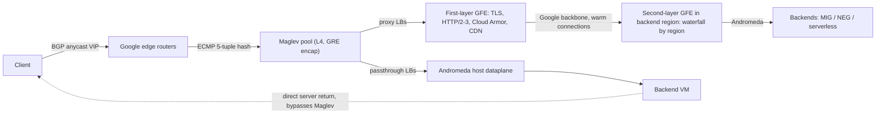

# Cloud Load Balancing: GFEs and Maglev

## TL;DR

- Google Cloud load balancing has three tiers: anycast BGP and ECMP into a fleet of stateless-by-design Maglev L4 forwarders, then a fleet of GFE or Envoy L7 proxies, and finally Andromeda delivering packets to your VMs.
- Maglev picks a backend by looking up a precomputed prime-sized table (65537 entries in the paper) built from per-backend permutations, so every Maglev in the fleet picks the same backend without talking to the others.
- A per-machine connection-tracking table protects existing flows when the backend set changes, and consistent hashing protects them when the Maglev set changes, but neither helps when both change at once.
- Cross-region steering on the global external Application Load Balancer is waterfall-by-capacity, not latency-only: second-layer GFEs fill the nearest region up to the capacity you declared (`maxRatePerInstance` x `capacityScaler`) and only then spill over, so a wrong capacity number moves traffic wrongly.
- Most production incidents come from timers and declared capacity rather than from the data plane: the GFE backend keepalive is fixed at 600 s, the passthrough conntrack idle timeout is 60 s, max-rate settings are wrong, a single zone gets hot at low request rates, and a global config push can reach every region at once.

## Mental Model



The VIP is not a box.
It is a prefix advertised over BGP from many sites, and routers spread packets over a pool of identical Maglev machines using ECMP.
Each Maglev computes the same deterministic answer for the same 5-tuple, so no shared state is needed for new flows.
For proxy load balancers the "backend" Maglev picks is a GFE, and it is the GFE, not Maglev, that terminates TCP and TLS close to the user.
A second GFE layer in the backend region then makes the capacity-aware regional choice.
For passthrough load balancers Maglev (external) or the Andromeda host dataplane (internal) delivers the original packet to the VM.
The VM replies directly, so the return path never touches the load balancer.
Keep two separate questions in mind: who terminates the connection, which decides latency, timeouts, and client IP visibility, and who decides placement, which decides failover and capacity behavior.
For the SDN substrate under all of this, see [[17-Cloud-AI-Engineering/Volume_03_GCP_Deep_Dive/Chapter_04_Global_VPC_Andromeda_SDN_and_Network_Tiers|Global VPC, Andromeda SDN, and Network Tiers]].

## Internals

### Product surface mapped to mechanism

Google Cloud ships several load balancer families, and each one is a different combination of the same three planes.

- **Global external Application Load Balancer** (`EXTERNAL_MANAGED`, Premium Tier): requests reach the GFE nearest to the client on the internet (Google Cloud docs, as of 2026-10).
- **Classic Application Load Balancer** (`EXTERNAL`): also global and also GFE-fronted, with the older feature set (Google Cloud docs, as of 2026-10).
- **Regional external Application Load Balancer**: Google describes it as a managed service built on open-source Envoy, with traffic mirroring, weighted splitting, and header transformations (Google Cloud docs, as of 2026-10).
- **Regional and cross-region internal Application Load Balancers**: also Envoy-based. The cross-region variant fails over automatically to healthy backends in other regions and returns HTTP 503 when every backend is unhealthy (Google Cloud docs, as of 2026-10).
- **Backend service-based regional external passthrough Network Load Balancer**: carries TCP, UDP, ESP, GRE, ICMP, and ICMPv6, supports IPv6, and offers connection tracking, draining, traffic steering, weighted balancing, and failover policies (Google Cloud docs, as of 2026-10).
- **Target pool-based passthrough NLB**: the legacy form, which ignores established connections when distributing load (Google Cloud docs, as of 2026-10).
- **Global external passthrough Network Load Balancer**: a newer L4 variant whose backends can span multiple regions. It supports only `PER_CONNECTION` tracking, and its `RATE` mode is measured in incoming packets per second, not requests (Google Cloud docs, as of 2026-10). Its launch stage is UNVERIFIED, so treat it as Preview until you confirm it is GA.
- **Internal passthrough Network Load Balancer**: has no proxy and no Maglev hop. It is a virtual network function of Andromeda, whose controllers program backend health into the host dataplane (third-party summary of Google's Cloud Next '18 Andromeda talk). See [[17-Cloud-AI-Engineering/Volume_13_Seminal_Papers_and_Case_Studies/Chapter_12_Andromeda_Network_Virtualization|Andromeda]].

### Control plane versus data plane

The control plane is the Compute API objects: forwarding rule, target proxy, URL map, backend service, `serviceLbPolicy`, and health check.
It also includes the config distribution system that compiles those objects into Maglev VIP tables and GFE or Envoy routing configs, and pushes them out.
The data plane is the Maglev forwarders, the GFE and Envoy proxies, Andromeda, and the health probers.
The property that matters most is static stability.
When the config pipeline is down, Maglev and the GFEs keep serving with the last config they received.
You lose the ability to change anything, but traffic keeps flowing.
The opposite failure is worse: a bad config that propagates successfully.
The GFE fleet is shared across many tenants and spans the globe, so the config pipeline is a global blast radius that you do not control.
See [[17-Cloud-AI-Engineering/Volume_01_Cloud_Architecture_Principles/Chapter_04_Control_Plane_vs_Data_Plane_Separation|Control Plane vs Data Plane Separation]].

### Maglev: the forwarder

The Maglev design comes from Eisenbud et al. at NSDI 2016 ([paper](https://research.google.com/pubs/archive/44824.pdf)).
Maglev runs as a distributed software system on ordinary Linux servers, and you change capacity by adding or removing machines.
Routers spread packets evenly across Maglev machines with ECMP, and each machine maps packets to services and spreads them across service endpoints (Eisenbud et al., NSDI 2016).
Maglev does not run a TCP/IP stack.
It only selects a backend and wraps the packet in GRE.
Bypassing the kernel raised per-machine throughput by more than 5x (Eisenbud et al., NSDI 2016).
The backend decapsulates the packet and replies straight to the client, so Maglev only ever sees ingress packets.
That asymmetry is why a small Maglev pool can front very large egress-heavy services.

The per-packet pipeline on one Maglev machine works like this.
The NIC hands packets to a steering module.
The steering module hashes the 5-tuple to pick a packet thread, so the same flow always lands on the same thread and that thread's connection-tracking table.
The thread first looks up the flow in its connection-tracking table.
If the flow is new, the thread hashes the 5-tuple into the VIP's Maglev lookup table and reads the backend from that entry.
It records the choice in the tracking table, GRE-encapsulates the packet, and transmits it.

IP fragments break naive 5-tuple hashing, because non-first fragments carry no L4 ports.
Maglev handles this in two ways.
Fragments are redirected between Maglevs using only the 3-tuple, so every fragment of a datagram reaches the same Maglev.
The GRE recursion control field ensures a fragment is redirected only once (Eisenbud et al., NSDI 2016).
Most write-ups skip this detail, but it is why passthrough UDP with large datagrams works at all.

### Maglev hashing: how the lookup table is built

Each backend `i` gets two hash-derived numbers over a prime table size `M`: `offset = h1(name_i) mod M` and `skip = h2(name_i) mod (M-1) + 1`.
Backend `i`'s preference list is the permutation `p_i[j] = (offset + j * skip) mod M`.
Because `M` is prime and `skip` lies in `[1, M-1]`, this sequence visits every slot exactly once.
To populate the table, the algorithm goes round-robin over the backends.
On each turn, a backend claims the next slot in its own preference list that is still empty.
This continues until all `M` slots are filled.
Every backend gets either `floor(M/N)` or `ceil(M/N)` slots, which is why the paper reports near-perfect balance.
The paper sizes `M` above `100 x N` so the difference in hash space between backends is at most 1% (Eisenbud et al., NSDI 2016).
At `M = 65537`, Karger and Rendezvous hashing needed 29.7% and 49.5% overprovisioning to absorb their imbalance, against Maglev's near-zero (Eisenbud et al., NSDI 2016).
The cost of Maglev's balance is disruption that is close to minimal but not minimal.
Removing one backend reshuffles some slots among the survivors, because the round-robin order changes.
Table size also matters for memory: there is one table per VIP, so `M` cannot grow without bound (Eisenbud et al., NSDI 2016).

I ran the simulator from the Worked Example (blake2b hashes, 1000 backends) to put numbers on this trade-off.

| N backends | M | max/ideal slots | Entries moved when 1 backend removed | Theoretical minimum | Modulo-N hashing |
| --- | --- | --- | --- | --- | --- |
| 10 | 65537 | 1.000 | 10.32% | 10.00% | 90.1% |
| 100 | 65537 | 1.001 | 1.55% | 1.00% | 99.0% |
| 1000 | 65537 | 1.007 | 0.68% | 0.10% | 99.9% |
| 1000 | 655373 | 1.001 | 0.43% | 0.10% | 99.9% |

With 1000 backends and the small table, Maglev moves about 7x the minimum, which is still about 150x better than modulo hashing.
That excess churn is the price of tight balance, and connection tracking exists to absorb it.
The same algorithm appears as an Envoy locality policy on Google Cloud.
For example, internal Application Load Balancers use `MAGLEV` as the implied default when you configure cookie-based affinity without setting `localityLbPolicy` (Google Cloud docs, as of 2026-10).
For the general ring-hash background, see [[08-Distinguished-Engineering/02-Distributed-Systems-Internals/Consistent-Hash-Ring|Consistent Hash Ring]].

### The two-layer defense and its gap

This mechanism rarely appears in product docs, and it explains many "random connection resets" tickets.
Two independent mechanisms protect established flows, and each covers exactly one kind of change.

| Event | Connection tracking (local to one Maglev) | Consistent hash table (same on all Maglevs) | Outcome for established flows |
| --- | --- | --- | --- |
| Backend added or removed, Maglev set stable | Entry exists on the same Maglev, so the old backend is reused | Table changed for ~0.7% of slots | Safe, unless the tracking table overflowed or the entry expired |
| Maglev added or removed, backend set stable | ECMP rehashes the flow to a different Maglev that has no entry | Every Maglev computes the same slot, so the same backend | Safe |
| Both change in the same window | No entry on the new Maglev | Slot moved | The flow lands on a new backend and gets a TCP RST |
| SYN flood fills the tracking table | Entries evicted | Falls back to the table | Safe only while the backend set is stable |

The design point is that neither mechanism has to be perfect, because they fail under uncorrelated events.
The operational consequence is that you should never let the provider's maintenance and your own backend churn coincide.
On the customer side, you can only control the second half.
Rolling deploys that churn many backends quickly widen the window in which any provider-side Maglev drain breaks flows.
Connection draining and slow, rate-limited rollouts are the mitigation.

### Connection tracking on passthrough NLBs

In February 2022 Google added a configurable connection tracking policy with two properties: tracking mode, and connection persistence on unhealthy backends (Google Cloud release notes, as of 2026-10).
On regional external passthrough NLBs the policy also includes an idle timeout of 60 seconds that you cannot change (Google Cloud docs, as of 2026-10).
You set it with `gcloud compute backend-services update ... --tracking-mode=... --connection-persistence-on-unhealthy-backends=...`.
The console cannot configure it (Google Cloud docs, as of 2026-10).
Session affinity controls which tuple is hashed: 5-tuple, 3-tuple with protocol, or 2-tuple client IP.
Tracking mode controls whether the tracking key is per connection or per session.
The relevant enum values are `PER_CONNECTION`, `PER_SESSION`, `DEFAULT_FOR_PROTOCOL`, `NEVER_PERSIST`, and `ALWAYS_PERSIST` (UNVERIFIED: enum spellings not re-checked in this session).
The 60-second idle timeout is the trap.
A UDP flow, such as game state or a VoIP stream with silence suppression, that sends nothing for 60 seconds loses its tracking entry.
Its next packet is hashed fresh.
If the backend set changed in the meantime, that packet lands on a new backend that has no session state.

### GFE: the proxy layers

For global external Application Load Balancers, Maglev's backends are first-layer GFEs at the edge.
They terminate TCP, TLS, and HTTP/2 or HTTP/3 close to the client and apply Cloud Armor and Cloud CDN.
They then forward the request over Google's backbone to second-layer GFEs in the region that will serve it.
Google's docs refer to these regional proxies as "second-layer Google Front Ends" (Google Cloud docs, as of 2026-10).
The second layer runs the capacity-aware placement algorithm.

Terminating at the edge saves real latency.
A cold HTTPS request with TLS 1.3 costs about 2 RTTs of handshake plus 1 RTT for the request, and with edge termination all of them are short client-to-edge RTTs.
The long edge-to-region leg runs over pre-established, pooled connections, so it costs about 1 RTT per request and no extra handshakes.
When traffic spills to a region 90 ms away, the client pays roughly 90 ms once, not 3 x 90 ms.
The 90 ms figure is an illustrative transatlantic RTT, not a published number.

Timers are layered and asymmetric.
The GFE's client-side HTTP keepalive defaults to 610 s and is configurable from 5 to 1200 s, while its backend-side keepalive is fixed at 600 s (Google Cloud docs, as of 2026-10).
The regional Envoy-based Application Load Balancer defaults both to 600 s (Google Cloud docs, as of 2026-10).
The backend service `timeout` is a response timeout for HTTP(S), with a default of 30 s.
For TCP and SSL proxy load balancers it behaves as an idle timeout (Google Cloud community forum answer citing docs, as of 2026-10).
For global and classic Application Load Balancers the effective maximum is 86400 s, and active WebSockets are cut at 24 h (third-party summary of Google Cloud docs, as of 2026-10).

### Cross-region traffic steering

Each backend declares a balancing mode (`RATE`, `UTILIZATION`, or `CONNECTION`) and a target, such as `maxRatePerInstance`.
`capacityScaler` multiplies that target and ranges from 0 to 1.
The default algorithm is `WATERFALL_BY_REGION`.
Under it, the proxies in the region closest to the user collectively fill backends in proportion to their configured capacity, as modified by the scalers (Google Cloud docs, as of 2026-10).
Each individual proxy prefers backends in the zone closest to it by network RTT.
At low request rates, a proxy may therefore send all of its traffic to its own zone (Google Cloud docs, as of 2026-10).
Traffic spills to the next region only when the closest region is at its configured capacity or unhealthy.
Since May 2025 you can block that spillover with traffic isolation (Google Cloud release notes, as of 2026-10).

The `serviceLbPolicy` resource adds four more controls (Google Cloud docs, as of 2026-10):

- An alternative algorithm: `SPRAY_TO_REGION` or `WATERFALL_BY_ZONE`. Cloud Service Mesh also offers `SPRAY_TO_WORLD`.
- Auto-capacity drain.
- A failover health threshold.
- Preferred backends.

In July 2026 this resource was extended to regional external and regional internal Application Load Balancers (Google Cloud release notes, as of 2026-10).
`SPRAY_TO_REGION` sends each client's requests across all MIGs and NEGs in the region.
`WATERFALL_BY_REGION` keeps MIGs evenly loaded in aggregate, but an individual client may not reach all of them (Cloud Service Mesh API reference, as of 2026-10).

Declared capacity is the input to the steering algorithm, not a measurement it takes.
If `maxRatePerInstance` is twice what an instance can actually serve, the nearest region looks "not full" while its p99 latency climbs, and the waterfall never spills.
If it is half the true value, you waste capacity and send users across oceans for no reason.
Treat the max rate as a steering target, not as admission control.
When every region is full, the load balancer still forwards traffic, and you need [[17-Cloud-AI-Engineering/Volume_07_Reliability_and_SRE/Chapter_02_Load_Shedding_Backpressure_and_Admission_Control|load shedding]] in the backend (UNVERIFIED: exact over-capacity distribution behavior not re-checked in this session).

### Failure domains

| Component | Failure domain | What a single failure takes down |
| --- | --- | --- |
| Edge site / Maglev pool | Site, withdrawn via BGP | Clients reroute to the next anycast site, and in-flight TCP to that site resets |
| One Maglev machine | Machine | ECMP rehash, with flows saved by the consistent hashing table |
| First-layer GFE | Machine or site | Client TLS sessions reset and retry against another GFE |
| Second-layer GFE | Region | Region-local placement degraded |
| Backend MIG | Zone or region | Waterfall spills over, if capacity exists elsewhere |
| GFE config pipeline | Global | Bad config can hit every tenant at once |

## Numbers to Know

| Quantity | Value | Source |
| --- | --- | --- |
| Maglev lookup table size in evaluation | 65537 (small), 655373 (large) | Eisenbud et al., NSDI 2016 |
| Table sizing rule | M > 100 x N for at most 1% imbalance | Eisenbud et al., NSDI 2016 |
| Overprovisioning needed by Karger / Rendezvous at M=65537 | 29.7% / 49.5% (10.3% / 12.3% at 655373) | Eisenbud et al., NSDI 2016 |
| Kernel-bypass throughput gain per Maglev | more than 5x | Eisenbud et al., NSDI 2016 |
| Table churn when 1 of 1000 backends is removed, M=65537 | 0.68% of slots (minimum 0.10%) | This chapter's simulation, 2026-10 |
| GFE client HTTP keepalive | 610 s default, configurable 5-1200 s | Google Cloud docs, as of 2026-10 |
| GFE backend keepalive | 600 s, fixed | Google Cloud docs, as of 2026-10 |
| Regional Envoy ALB client / backend keepalive | 600 s / 600 s defaults | Google Cloud docs, as of 2026-10 |
| Backend service timeout default | 30 s | Google Cloud community forum citing docs, as of 2026-10 |
| Max effective backend timeout, global/classic ALB | 86400 s; active WebSockets closed at 24 h | Third-party summary of Google Cloud docs, as of 2026-10 |
| Regional external passthrough NLB conntrack idle timeout | 60 s, not configurable | Google Cloud docs, as of 2026-10 |
| Compute Engine idle TCP connection timeout | 10 min | Google Cloud community forum quoting docs, as of 2026-10 |
| Global external passthrough NLB tracking modes | `PER_CONNECTION` only; `RATE` counts packets/s | Google Cloud docs, as of 2026-10 |
| Forwarding rule price | ~$0.025/h each for the first 5, ~$0.01/h each additional | Third-party pricing summaries, as of 2026-10, UNVERIFIED against the official page |
| Data processed by the load balancer | ~$0.008/GiB in typical regions | Third-party pricing summaries, as of 2026-10, UNVERIFIED |
| Envoy-based regional proxy instance | ~$0.025 per proxy-hour | Third-party summary, UNVERIFIED |
| AWS ALB / NLB hourly | ~$0.0225/h plus LCU / NLCU | UNVERIFIED |
| AWS NLB TCP idle timeout | 350 s default, configurable | UNVERIFIED |

For fleet-wide cheat sheets see [[17-Cloud-AI-Engineering/Volume_14_Staff_Plus_Interview_Arena/Chapter_06_Cloud_AI_Numbers_Every_Staff_Engineer_Must_Know|Cloud AI Numbers Every Staff Engineer Must Know]].

## AWS vs GCP Mechanism Parity

| Concern | Google Cloud | AWS | Critical difference |
| --- | --- | --- | --- |
| Global entry point | One anycast VIP advertised from Google edge sites into Maglev and first-layer GFEs | CloudFront (L7, DNS-resolved PoPs) or Global Accelerator (anycast static IPs, L4) | GCP gives one IP with global L7 policy in one object, while AWS composes CloudFront or Global Accelerator with regional ALBs |
| L4 forwarding | Maglev (external) and Andromeda host dataplane (internal), with consistent hashing and per-machine tracking | Hyperplane-based NLB, flow hash per AZ node (UNVERIFIED: internals only described in re:Invent talks) | NLB exposes a static IP per AZ, while GCP external passthrough exposes one regional IP |
| Return path | Direct server return, with the client IP preserved | NLB preserves the client IP for instance targets, and the return path transits the NLB (UNVERIFIED) | DSR makes GCP ingress cost independent of response size |
| Regional L7 | Envoy fleet in a Google-managed proxy-only subnet | ALB nodes placed in your subnets, scaled by AWS, with IPs that change behind DNS | Never pin an ALB IP; GCP regional ALB IPs are stable forwarding-rule IPs |
| Cross-region steering | Waterfall by declared capacity, `capacityScaler`, `serviceLbPolicy`, traffic isolation | Route 53 latency/weighted/failover records, Global Accelerator traffic dials and endpoint weights | GCP steers per request inside the proxy, AWS steers per DNS resolution or per Global Accelerator flow |
| Spillover trigger | Backend capacity full or unhealthy | Route 53 health check failure, or a manual Global Accelerator dial change | AWS does not spill over on "full" without your automation |
| Health checking | Centralized Google probers, one probe set per forwarding rule IP for passthrough NLBs | Each LB node probes its targets | GCP probe sources are well-known ranges, so firewalls must allow them |
| Connection tracking | Configurable mode and unhealthy persistence; 60 s idle on regional external passthrough NLB | NLB idle timeout configurable (UNVERIFIED range) | UDP sessions on GCP need sub-60-s keepalives |
| Draining | Backend service connection draining timeout | Target group deregistration delay (UNVERIFIED default 300 s) | Both only protect in-flight requests, not long-lived streams |
| Config blast radius | GFE config is global and multi-tenant | ALB and NLB config is regional; CloudFront config is global | AWS regional load balancers contain a bad config push to one region |
| Pricing shape | Forwarding-rule hours plus GiB processed | Hours plus capacity units | High-request, low-byte APIs can be cheaper on GCP and the reverse for bulk transfer, so compute both |

See [[17-Cloud-AI-Engineering/Volume_04_AWS_vs_GCP_Translation/Chapter_02_Networking_and_Load_Balancing_Translation|Networking and Load Balancing Translation]] for the broader map.

## Worked Example: Multi-Region Global ALB with Capacity-Driven Failover, plus a Maglev Simulator

### Part A - Local Maglev simulator (no cloud cost)

```python
# maglev_sim.py - Maglev table population and disruption measurement.
import hashlib

def h(s, salt):
    return int.from_bytes(hashlib.blake2b((salt + s).encode(), digest_size=8).digest(), "big")

def populate(backends, M):
    N = len(backends)
    perm = []
    for b in backends:
        off = h(b, "off") % M
        skip = h(b, "skip") % (M - 1) + 1
        perm.append((off, skip))
    nxt = [0] * N
    entry = [-1] * M
    filled = 0
    while True:
        for i in range(N):
            off, skip = perm[i]
            c = (off + nxt[i] * skip) % M
            while entry[c] >= 0:
                nxt[i] += 1
                c = (off + nxt[i] * skip) % M
            entry[c] = i
            nxt[i] += 1
            filled += 1
            if filled == M:
                return entry

def report(N, M):
    names = [f"backend-{i}" for i in range(N)]
    t1 = populate(names, M)
    counts = [0] * N
    for e in t1:
        counts[e] += 1
    ideal = M / N
    removed = names[N // 2]
    names2 = [n for n in names if n != removed]
    t2 = populate(names2, M)
    moved = sum(1 for k in range(M) if names[t1[k]] != names2[t2[k]])
    must = sum(1 for k in range(M) if names[t1[k]] == removed)
    keys = 200000
    mod_moved = sum(1 for k in range(keys)
                    if names[h(str(k), "f") % N] != names2[h(str(k), "f") % (N - 1)])
    print(f"N={N} M={M} max/ideal={max(counts)/ideal:.3f} min/ideal={min(counts)/ideal:.3f} "
          f"remove1: moved={moved/M*100:.2f}% minimal={must/M*100:.2f}% modulo_moved={mod_moved/keys*100:.1f}%")

if __name__ == "__main__":
    for N, M in [(10, 65537), (100, 65537), (1000, 65537), (1000, 655373)]:
        report(N, M)
```

Run it with `python3 maglev_sim.py`.
It takes about 6 s on one core and reproduces the table in Internals.

### Part B - Global external ALB across two regions

Cost estimate: four `e2-small` VMs at roughly $0.017/h each (UNVERIFIED list price), plus one forwarding rule at about $0.025/h (UNVERIFIED), comes to about $0.10/h.
A 3-hour lab therefore costs under $0.50, plus negligible data processing.

```bash
#!/usr/bin/env bash
set -euo pipefail
PROJECT_ID="$(gcloud config get-value project)"
BILLING_ACCOUNT="000000-000000-000000"   # replace
R1=us-central1
R2=europe-west1

# 0. Budget alarm before anything billable.
gcloud billing budgets create \
  --billing-account="$BILLING_ACCOUNT" \
  --display-name="lb-lab-budget" \
  --budget-amount=10USD \
  --threshold-rule=percent=0.5 \
  --threshold-rule=percent=0.9 \
  --filter-projects="projects/${PROJECT_ID}"

# 1. Backend image: nginx that reports its zone.
cat > startup.sh <<'EOF'
#!/bin/bash
apt-get update && apt-get install -y nginx
Z=$(curl -s -H "Metadata-Flavor: Google" http://metadata.google.internal/computeMetadata/v1/instance/zone)
echo "zone=${Z##*/} host=$(hostname)" > /var/www/html/index.html
# Keep backend keepalive above the GFE fixed 600 s backend keepalive.
sed -i 's/keepalive_timeout.*/keepalive_timeout 620s;/' /etc/nginx/nginx.conf
systemctl restart nginx
EOF

gcloud compute instance-templates create lb-lab-tpl \
  --machine-type=e2-small \
  --image-family=debian-12 --image-project=debian-cloud \
  --tags=lb-lab \
  --metadata-from-file=startup-script=startup.sh

for R in "$R1" "$R2"; do
  gcloud compute instance-groups managed create "lb-lab-mig-${R}" \
    --region="$R" --template=lb-lab-tpl --size=2
  gcloud compute instance-groups set-named-ports "lb-lab-mig-${R}" \
    --region="$R" --named-ports=http:80
done

# 2. Allow GFE and health-check source ranges only (ranges UNVERIFIED in this session).
gcloud compute firewall-rules create lb-lab-allow-gfe \
  --network=default --allow=tcp:80 \
  --source-ranges=130.211.0.0/22,35.191.0.0/16 \
  --target-tags=lb-lab

# 3. Health check, backend service, backends with declared capacity.
gcloud compute health-checks create http lb-lab-hc --port=80 --request-path=/ --global

gcloud compute backend-services create lb-lab-be \
  --load-balancing-scheme=EXTERNAL_MANAGED \
  --protocol=HTTP --port-name=http \
  --health-checks=lb-lab-hc \
  --enable-logging --logging-sample-rate=1.0 \
  --global

for R in "$R1" "$R2"; do
  gcloud compute backend-services add-backend lb-lab-be \
    --instance-group="lb-lab-mig-${R}" --instance-group-region="$R" \
    --balancing-mode=RATE --max-rate-per-instance=50 --capacity-scaler=1.0 \
    --global
done

# 4. Service LB policy: explicit waterfall plus auto-capacity drain.
gcloud network-services service-lb-policies create lb-lab-policy \
  --load-balancing-algorithm=WATERFALL_BY_REGION \
  --auto-capacity-drain \
  --location=global
gcloud compute backend-services update lb-lab-be \
  --service-lb-policy="projects/${PROJECT_ID}/locations/global/serviceLbPolicies/lb-lab-policy" \
  --global

# 5. Frontend.
gcloud compute url-maps create lb-lab-um --default-service=lb-lab-be
gcloud compute target-http-proxies create lb-lab-proxy --url-map=lb-lab-um
gcloud compute addresses create lb-lab-ip --ip-version=IPV4 --global
gcloud compute forwarding-rules create lb-lab-fr \
  --load-balancing-scheme=EXTERNAL_MANAGED --network-tier=PREMIUM \
  --address=lb-lab-ip --target-http-proxy=lb-lab-proxy --ports=80 --global

IP=$(gcloud compute addresses describe lb-lab-ip --global --format='value(address)')
echo "VIP=$IP (allow a few minutes for config propagation)"
```

Experiment 1 tests low-rate stickiness.
Run `for i in $(seq 1 50); do curl -s http://$IP/; done | sort | uniq -c` from a US client.
Expect most or all responses from one `us-central1` zone, because `WATERFALL_BY_REGION` keeps low-rate traffic in the proxy's own zone.
A low-rate canary therefore tests one zone, not the region.

Experiment 2 is a controlled drain.
Run `gcloud compute backend-services update-backend lb-lab-be --instance-group=lb-lab-mig-us-central1 --instance-group-region=us-central1 --capacity-scaler=0 --global`.
Then rerun the loop and watch responses move to `europe-west1`.
The added latency is about one backbone RTT per request, not three, because TLS and TCP still terminate at the nearby edge.

Experiment 3 tests overflow.
Use a load generator such as `hey -z 60s -q 60 -c 4 http://$IP/` with `capacity-scaler=1.0` restored, and push more than 2 x 50 RPS at the US region.
The load balancer logs then show requests served from `europe-west1` once the US region reaches its declared capacity.

Teardown, in reverse dependency order:

```bash
gcloud compute forwarding-rules delete lb-lab-fr --global -q
gcloud compute addresses delete lb-lab-ip --global -q
gcloud compute target-http-proxies delete lb-lab-proxy -q
gcloud compute url-maps delete lb-lab-um -q
gcloud compute backend-services delete lb-lab-be --global -q
gcloud network-services service-lb-policies delete lb-lab-policy --location=global -q
gcloud compute health-checks delete lb-lab-hc --global -q
for R in us-central1 europe-west1; do gcloud compute instance-groups managed delete "lb-lab-mig-${R}" --region="$R" -q; done
gcloud compute instance-templates delete lb-lab-tpl -q
gcloud compute firewall-rules delete lb-lab-allow-gfe -q
```

### Part C - Capacity and cost sizing for a production API

The inputs are:
- Global peak of 120k RPS and an average of 50k RPS.
- Traffic split of 50% Americas, 30% EMEA, and 20% APAC.
- 15 KB average request plus response.
- A backend VM that load-tests at 500 RPS at 70% CPU.

Step 1 sets declared capacity below the true knee: `maxRatePerInstance = 400`, which leaves 20% headroom for GC pauses and hot keys.

Step 2 sizes for steady state: Americas 60k / 400 = 150 VMs, EMEA 90, APAC 60, for a total of 300.

Step 3 adds the region-loss constraint.
For every region r, the sum of capacity minus c_r must be at least 120k.
The cheapest symmetric answer with three regions is 60k per region, which is 150 + 150 + 150 = 450 VMs, or 1.5x.
The alternative is to keep 300 VMs and accept degraded service after a region loss, by autoscaling the survivors and shedding low-priority traffic.
That choice belongs in the SLO doc, not in the Terraform.

Step 4 checks the spillover order.
With `WATERFALL_BY_REGION`, Americas traffic spills to the next-closest region that has capacity, which for most US clients is EMEA.
Pre-scaling EMEA rather than APAC therefore minimizes the added RTT.

Step 5 estimates data processing: 50k x 15 KB = 750 MB/s, which is about 1.84M GiB/month.
At about $0.008/GiB (UNVERIFIED) that is about $14.7k/month, before internet egress, which is billed separately and usually dominates.
Forwarding rules cost about $18/month each and are noise at this scale.

Step 6 sizes the timers: backend keepalive at 620 s or more, backend service timeout at the p99.9 of the slowest legitimate route plus margin, and client retries capped as described in [[17-Cloud-AI-Engineering/Volume_07_Reliability_and_SRE/Chapter_03_Resilient_Communication_Retries_Jitter_and_Circuit_Breakers|Retries, Jitter, and Circuit Breakers]].

## Failure Modes and Pitfalls

### Keepalive race producing sporadic 502s

The GFE keeps backend connections alive for 600 s, and you cannot change that (Google Cloud docs, as of 2026-10).
If the backend's idle timeout is shorter (nginx defaults to 75 s, Node.js to 5 s), the backend closes connections the GFE still considers reusable.
A request sent on such a connection in the instant after the FIN gets a 502.
In the load balancer logs this appears as a backend connection closed before data was sent.
The fix is a backend keepalive greater than 600 s, not more GFE retries.

### Low-RPS zone pinning

At low request rates each proxy may send everything to its own zone (Google Cloud docs, as of 2026-10).
Synthetic monitors and canaries then exercise one zone, and a broken second zone goes unnoticed until real load spills into it.
Run synthetic probes at a rate high enough to engage all zones, or use `SPRAY_TO_REGION` for low-traffic, high-criticality services.

### Wrong declared capacity

The waterfall trusts `maxRatePerInstance`.
An overstated number pins traffic to an overloaded nearby region, and an understated one sends traffic across continents and inflates inter-region cost.
Re-derive it from load tests after every major release and every instance-type change.

### Passthrough UDP session breakage

The 60 s conntrack idle timeout on regional external passthrough NLBs, combined with autoscaling, sends silent UDP sessions to new backends.
Send application keepalives every 20-30 s, or use 2-tuple client-IP affinity so that the consistent hash, rather than the tracking table, carries stickiness.
Remember that client-IP affinity concentrates carrier-grade-NAT populations onto single backends.

### Health-check-driven capacity collapse

The AWS us-east-1 event of 2025-10-19/20 ([AWS summary](https://aws.amazon.com/message/101925/)) is the public example of a health-check subsystem making things worse.
Network state for new EC2 capacity propagated late, NLB health checks failed spuriously, and healthy capacity was pulled out of service while demand rose (UNVERIFIED: details summarized from memory of the public post-event summary).
The general lesson applies equally to GCP.
A health checker must fail open when an implausible fraction of backends turns unhealthy at once, and backends should not report unhealthy because a downstream dependency is unhealthy.
See [AWS Builders' Library: Implementing health checks](https://aws.amazon.com/builders-library/implementing-health-checks/).

### Global config plane blast radius

The 2019-06-02 Google Cloud networking incident ([status report](https://status.cloud.google.com/incident/cloud-networking/19009)) shows how a configuration change scoped wider than intended can remove network control-plane capacity across several regions at once (UNVERIFIED: link and details from memory).
Several later Google Cloud incidents also involved globally replicated configuration or policy data, which every proxy consumes at once (UNVERIFIED: specific incident IDs omitted).
The customer-side mitigation is a pre-provisioned bypass path.
That can be a regional load balancer, or a second provider's CDN, reachable through a low-TTL DNS record that has been rehearsed in a game day, as covered in [[17-Cloud-AI-Engineering/Volume_07_Reliability_and_SRE/Chapter_05_Chaos_Engineering_and_Game_Days|Chaos Engineering and Game Days]].

### Simultaneous churn on both sides

A fast rolling deploy that replaces many backends inside a short window, overlapping with provider-side Maglev or GFE maintenance, breaks the two-layer defense described in Internals.
The symptom is RSTs on long-lived connections with no backend error at all.
Rate-limit deploys, set connection draining, and make long-lived clients reconnect gracefully.

### Other pitfalls

- **Forwarding-rule sprawl.** Every forwarding rule bills hourly whether or not it carries traffic. One load balancer per microservice per environment adds up, and URL-map host and path routing on a shared load balancer avoids it.
- **Steering forwarding rule mismatch.** When both parent and steering forwarding rules point to backend services, Google Cloud does not reject mismatched session affinity or tracking policies, so flows silently diverge (Google Cloud docs, as of 2026-10).
- **Firewall gaps.** Missing allow rules for GFE and probe source ranges make every backend look unhealthy. Overly broad rules let clients bypass Cloud Armor by hitting backend IPs directly.

## Security and Cost Angles

### IAM

- Separate who can change routing from who can change certificates and edge security.
- `roles/compute.loadBalancerAdmin` covers load balancer resources (UNVERIFIED: exact permission set not re-checked).
- Cloud Armor and SSL policy changes belong to a security role, not to application teams.
- Restrict which load balancer types each folder may create with the organization policy constraint `constraints/compute.restrictLoadBalancerCreationForTypes` (UNVERIFIED).
- This stops teams from exposing internal services through external passthrough load balancers that bypass Cloud Armor.
- See [[17-Cloud-AI-Engineering/Volume_03_GCP_Deep_Dive/Chapter_01_Resource_Hierarchy_and_Organization_Policies|Resource Hierarchy and Organization Policies]].

### Network boundary

- **Proxy load balancers.** Backends should accept traffic only from GFE and health-check source ranges, and should have no external IPs.
- **Passthrough load balancers.** The backend sees the real client IP, so the VPC firewall is your perimeter, and Cloud Armor's L7 policy does not apply in the same way.
- **Managed APIs behind PSC.** For data-plane APIs behind Private Service Connect, pair the load balancer design with [[17-Cloud-AI-Engineering/Volume_03_GCP_Deep_Dive/Chapter_03_VPC_Service_Controls_Security_Perimeters|VPC Service Controls]].

### Encryption

- **Edge keys.** TLS private keys for Google-managed or Certificate Manager certificates live in Google's edge, which is a trust decision you should document.
- **Backend leg.** If compliance requires end-to-end TLS, use HTTPS or HTTP/2 to the backends. Do not rely only on the platform's transport protections.
- **Key hierarchy.** For key hierarchy and CMEK questions, see [[17-Cloud-AI-Engineering/Volume_08_Security_Identity_and_the_Data_Perimeter/Chapter_04_Encryption_Key_Hierarchies_and_Envelope_Encryption|Encryption Key Hierarchies]].

### Cost levers

- **Consolidate.** Put many services behind one load balancer with URL maps to cut forwarding-rule hours.
- **Offload to the CDN.** Cacheable responses served by Cloud CDN never reach the data-processing meter (third-party summary, as of 2026-10).
- **Choose the tier.** The global external ALB requires Premium Tier (Google Cloud docs, as of 2026-10). Regional load balancers can use Standard Tier where cold-potato routing is acceptable; see [[17-Cloud-AI-Engineering/Volume_09_FinOps_and_Cloud_Economics/Chapter_04_Network_Egress_Economics_and_Optimization|Network Egress Economics]].
- **Avoid spillover.** Calibrate declared capacity so the waterfall does not create avoidable inter-region traffic.
- **Use DSR for big payloads.** Passthrough load balancers do not process response bytes, which matters for large downloads such as model artifacts.

## Interview Questions and Model Answers

### Question 1 (L5 - Senior)

Users report intermittent HTTP 502s behind a global external Application Load Balancer, mostly after quiet periods, and backend metrics show no errors. What is happening and how do you fix it?

#### Model Answer

The pattern points to a keepalive race on the GFE-to-backend leg, not a backend failure.
The GFE pools backend connections and keeps them for a fixed 600 s.
If the backend server's idle timeout is shorter, for example Node.js at 5 s or nginx at 75 s, the backend closes the connection while the GFE still has it in its pool.
The next request sent on that connection meets a FIN or RST before any bytes return, and the GFE synthesizes a 502.
The backend never logs it because it never accepted the request.
Quiet periods are exactly when connections sit idle past the backend timeout.
To confirm, check the load balancer request logs for the status details on the 502s and correlate them with connection age.
The fix is to set the backend keepalive above 600 s, for example 620 s.
Raising GFE retries is the wrong fix, because retries on non-idempotent POSTs are unsafe and only hide the cause.
For the regional Envoy-based load balancer the same reasoning applies with its 600 s defaults.

#### Follow-up Interviewer Question

Why does the asymmetric client-side default of 610 s exist, and what breaks if you lower the client keepalive to 5 s for a mobile client population?

### Question 2 (L5 - Senior)

Trace a TCP SYN from a client to a VM behind (a) a global external Application Load Balancer and (b) a regional external passthrough Network Load Balancer. Where is the connection terminated, which IP does the VM see, and what path does the response take?

#### Model Answer

In (a), the SYN reaches the nearest Google edge site because the VIP is anycast.
Routers ECMP-hash it to a Maglev, which selects a first-layer GFE and GRE-encapsulates the packet to it.
The GFE completes TCP and TLS with the client.
The GFE then evaluates Cloud Armor and CDN, and forwards the request over a pooled connection to a second-layer GFE in the chosen region, which picks the backend.
The VM sees a Google proxy source IP and the client IP in `X-Forwarded-For`, and the response returns through the GFE.
In (b), Maglev selects a backend VM directly from the consistent hash table, subject to session affinity and the tracking table.
Andromeda delivers the original packet, so the VM's own TCP stack completes the handshake and the VM sees the real client IP.
The response goes directly to the client without touching Maglev.
The trade-offs follow from this.
Option (a) gives you edge TLS, L7 policy, and cross-region failover per request.
Option (b) gives you any IP protocol, client IP preservation, no proxy timeouts, and no per-byte processing on responses, but it is regional and you own TLS and DDoS posture at the VM.

#### Follow-up Interviewer Question

With (b), what breaks if the backend VM runs strict reverse-path filtering or a host firewall that only allows the VM's own subnet?

### Question 3 (L6 - Staff)

Derive Maglev hashing and explain why Google accepted non-minimal disruption. Then tell me under exactly what conditions an established TCP flow through Maglev gets reset.

#### Model Answer

For a prime table size `M`, each backend gets `offset = h1(name) mod M` and `skip = h2(name) mod (M-1) + 1`.
Its preference list is `(offset + j*skip) mod M`, which is a full permutation because `M` is prime.
To populate, the backends take turns claiming their next unclaimed preferred slot until the table is full, so each backend gets `floor(M/N)` or `ceil(M/N)` slots.
Lookup is one hash and one array read, which fits a kernel-bypass packet thread.
Google chose balance over minimal disruption because, at `M = 65537`, Karger and Rendezvous hashing would need 29.7% and 49.5% overprovisioning.
That is fleet-scale money, whereas excess disruption is absorbed by connection tracking.
In my simulation with 1000 backends, removing one moves 0.68% of slots against a 0.10% minimum.
The table must be identical on all Maglevs, which it is, because it is a pure function of the backend list.
An established flow resets under three conditions.
The first is when ECMP moves it to a different Maglev while the backend set changed and its slot moved.
The second is when its tracking entry was evicted or expired and the slot moved.
The third is when its backend itself is removed.
Each layer covers the other's failure, so only correlated churn on both sides breaks flows.
That is why the operational control is to rate-limit backend churn and use draining, not to fear Maglev maintenance.

#### Follow-up Interviewer Question

If you weight backends by giving heavier backends more turns in the populate loop, how does that interact with disruption when weights change frequently, as with autoscaling-driven weights?

### Question 4 (L6 - Staff)

You run a global API on one global external Application Load Balancer with MIGs in us-central1, europe-west1, and asia-northeast1. During a us-central1 brownout, latency is high, but traffic does not move to Europe. Explain why and redesign.

#### Model Answer

The waterfall moves traffic when a region is full against declared capacity or unhealthy according to health checks, not when it is slow.
In a brownout, health checks against a shallow `/healthz` path still pass.
The backends are slow, so they actually serve fewer RPS than `maxRatePerInstance` and look less full.
The second-layer GFEs therefore keep sending traffic, and the region never spills.
The redesign has four parts.
First, for `RATE` mode, derive `maxRatePerInstance` from the latency knee in load tests, or use `UTILIZATION` where CPU tracks saturation.
Second, enable auto-capacity drain and a failover health threshold in the `serviceLbPolicy`, so that a region with a large unhealthy fraction gets drained automatically.
Third, make health checks reflect the instance's ability to serve, with local deep checks, while not cascading on shared dependencies.
Fourth, give operators a one-command manual lever, setting `capacityScaler` to 0 on the regional backends, and rehearse it.
On sizing, with three regions, surviving a region loss requires each region to carry `peak/2` (1.5x total), or a degradation plan.
Spillover to Europe costs US users about one transatlantic RTT per request, not per handshake, because TLS still terminates at the US edge.
Inter-region traffic also has a cost, so drain by capacity scaler rather than by deleting backends, to keep rollback instant.

#### Follow-up Interviewer Question

Auto-capacity drain and failover thresholds can themselves cascade: draining us-central1 overloads Europe, which then drains. How do you bound that?

### Question 5 (L6 - Staff)

A real-time multiplayer game uses UDP behind a regional external passthrough Network Load Balancer with an autoscaled MIG. Players get teleported to empty servers after quiet periods. Diagnose and fix without moving to a proxy.

#### Model Answer

Each game session is per-flow state living on one VM.
The tracking table on the regional external passthrough NLB has a fixed 60 s idle timeout.
A client that sends nothing for more than 60 s, for example in a lobby or while paused, loses its entry.
Its next packet is hashed from scratch.
If autoscaling changed the backend set in the meantime, the slot may now map to a different VM that has no session.
There are three fixes.
First, have the client send a small keepalive every 20-30 s, which keeps the tracking entry alive independent of the backend set.
Second, choose affinity deliberately.
5-tuple hashing breaks when a NAT rebinds the client's source port, while client-IP affinity survives rebinding but concentrates carrier-grade NAT populations.
Third, make scale-in session-aware.
Use connection draining and avoid removing VMs that hold live sessions, for example with MIG instance protection or an external matchmaker that tells the autoscaler which VMs are empty.
Also review connection persistence on unhealthy backends.
Persisting sessions on a VM that fails a health check keeps players connected through transient probe failures, but it also keeps them on a truly dead VM until they time out.

#### Follow-up Interviewer Question

The studio wants zero-downtime game server binary upgrades. What does the NLB give you and what must the matchmaking layer own?

### Question 6 (L7+ - Principal)

You are the owner of a GFE-like global, multi-tenant L7 edge. Design the configuration distribution system so that a bad push cannot take down every tenant globally, and explain what customers should still do on their side.

#### Model Answer

The data plane is already regionally redundant, so the real global single point of failure is configuration.
The design has eight parts.
1. **Separate config by blast radius.** Per-tenant routing config is high-churn and tenant-scoped. Fleet-wide settings, such as the TLS stack, parsers, and shared policy schemas, are low-churn and global. Never ship both through the same fast path.
2. **Roll out progressively across cells.** Partition proxies into cells that serve hashed subsets of tenants, as in shuffle sharding. Push to one canary cell, then one region, then waves, with automated bake time and SLO gates. See [[17-Cloud-AI-Engineering/Volume_01_Cloud_Architecture_Principles/Chapter_03_Cell_Based_Architecture_and_Shuffle_Sharding|Cell-Based Architecture]].
3. **Validate statically and semantically before the push.** Compile the config into the exact artifact the proxy loads, and replay a corpus of production requests against it offline.
4. **Make proxies fail static.** If a new config fails to parse or fails self-checks, the proxy keeps the last-known-good config and alarms, rather than crashing or loading an empty config. A null field must never crash a process that reads it.
5. **Rate-limit the pipeline itself.** No single change may touch more than a fixed fraction of tenants or regions per hour without break-glass approval.
6. **Make rollback a pointer flip** to the last-known-good config version, and exercise it continuously.
7. **Keep health checks and control plane on independent dependencies** so that the rollback path works when the thing being rolled back is broken.
8. **Customers must own a bypass.** That means a pre-provisioned regional load balancer, or a second CDN, with a stable certificate, reachable by a low-TTL DNS switch that a rehearsed runbook can execute in minutes.

The trade-off is speed.
Progressive rollout makes a legitimate emergency change, such as a WAF rule for a zero-day, take hours.
You therefore need a separately governed fast lane, with narrow scope, schema-restricted contents, and dual control.
That is the same tension seen in public incidents, where global policy or config replication outran validation.

#### Follow-up Interviewer Question

The bypass path is rarely used and silently rots. How do you keep it continuously verified without sending it real user traffic?

### Question 7 (L7+ - Principal)

Leadership asks you to pick AWS or GCP for a latency-sensitive global API with a 150 ms p99 SLO worldwide and a requirement for a single static IP that partners can allowlist. Compare the mechanisms and make a recommendation.

#### Model Answer

On GCP, one global external Application Load Balancer gives a single anycast IP.
It terminates TLS at the nearest GFE and steers per request by declared capacity across regions, all in one config object.
The cost of that convenience is a shared global configuration blast radius and coupling to Premium Tier.
On AWS, the closest equivalent to a static IP is Global Accelerator, which provides anycast static IPs, carries traffic over the AWS backbone, and fronts regional ALBs.
Cross-region policy lives in traffic dials and endpoint weights, which do not spill over automatically on "full."
Alternatively, CloudFront gives edge TLS and L7 but is not a static-IP product, so it fails the allowlist requirement.
Under AWS, regional ALB and NLB configuration is isolated per region, which is a real resilience advantage.
For the SLO, both terminate near the user, so the dominant term is edge-to-origin RTT plus backend time.
Region placement matters more than vendor choice.
The p99 is driven by spillover behavior.
GCP spills automatically when a region is full, which protects p99 during load spikes but can surprise you with cross-ocean latency.
AWS requires automation, typically health-driven dial changes, which is slower but more predictable.
If the organization already runs on one cloud, stay there.
Otherwise, I would choose GCP for operational simplicity of global L7, and mitigate the blast radius with a pre-provisioned regional bypass.
I would choose AWS when regional isolation of configuration is a hard requirement, for example in regulated environments.
Cost must be modeled per request and per byte, because the pricing units differ: GiB processed on GCP versus capacity units on AWS.

#### Follow-up Interviewer Question

Partners now require mTLS with per-partner client certificates and per-partner rate limits. How does that change the comparison?

## Further Reading

- [Eisenbud et al., "Maglev: A Fast and Reliable Software Network Load Balancer", NSDI 2016](https://research.google.com/pubs/archive/44824.pdf) - the primary source for the hashing algorithm, connection tracking, fragment handling, and kernel-bypass forwarding. Companion note: [[17-Cloud-AI-Engineering/Volume_13_Seminal_Papers_and_Case_Studies/Chapter_11_Maglev_Network_Load_Balancer|Maglev]].
- [Dalton et al., "Andromeda: Performance, Isolation, and Velocity at Scale in Cloud Network Virtualization", NSDI 2018](https://www.usenix.org/conference/nsdi18/presentation/dalton) - explains the host dataplane that implements internal passthrough load balancing and delivers every load balancer's packets.
- Yap et al., "Taking the Edge off with Espresso", SIGCOMM 2017 - Google's peering-edge architecture that decides where anycast traffic enters before Maglev sees it (link omitted, UNVERIFIED URL).
- [Google SRE Book, "Load Balancing at the Frontend"](https://sre.google/sre-book/load-balancing-frontend/) - the DNS-versus-anycast-VIP reasoning behind the GFE front door.
- [Google SRE Book, "Load Balancing in the Datacenter"](https://sre.google/sre-book/load-balancing-datacenter/) - subsetting, weighted round robin, and lame-duck states that inform how second-layer proxies choose backends.
- [Google Cloud docs, "Advanced load balancing optimizations"](https://docs.cloud.google.com/load-balancing/docs/service-lb-policy) - the authoritative description of waterfall, spray, auto-capacity drain, and failover thresholds.
- [Google Cloud docs, "Request distribution for external Application Load Balancers"](https://docs.cloud.google.com/load-balancing/docs/https/request-distribution) - the exact keepalive and timeout semantics behind most 502 investigations.
- [Google Cloud docs, "Backend service-based external passthrough NLB overview"](https://docs.cloud.google.com/load-balancing/docs/network/networklb-backend-service) - connection tracking, traffic steering, and failover for L4.
- [AWS Builders' Library, "Implementing health checks"](https://aws.amazon.com/builders-library/implementing-health-checks/) - fail-open and dependency-aware health check design that applies directly to GCP load balancer health checks.
- [AWS Builders' Library, "Workload isolation using shuffle-sharding"](https://aws.amazon.com/builders-library/workload-isolation-using-shuffle-sharding/) - the cell technique to apply to any multi-tenant edge config plane.
- Related chapters: [[17-Cloud-AI-Engineering/Volume_00_Foundations_Under_the_Cloud/Chapter_03_DNS_Anycast_and_Global_Traffic_Management|DNS, Anycast, and Global Traffic Management]], [[17-Cloud-AI-Engineering/Volume_00_Foundations_Under_the_Cloud/Chapter_04_Edge_Infrastructure_and_TLS_Termination|Edge Infrastructure and TLS Termination]], [[17-Cloud-AI-Engineering/Volume_07_Reliability_and_SRE/Chapter_07_Anatomy_of_Major_Cloud_Outages|Anatomy of Major Cloud Outages]], and next, [[17-Cloud-AI-Engineering/Volume_03_GCP_Deep_Dive/Chapter_06_Compute_Engine_and_Titanium_Architecture|Compute Engine and Titanium Architecture]].
