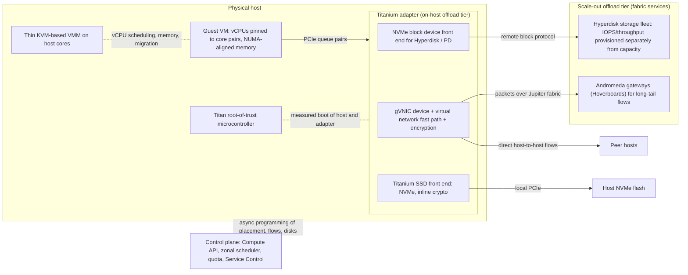

# Compute Engine and Titanium Architecture

## TL;DR

Titanium is Google Cloud's offload system: a security root of trust, a dedicated offload adapter on each host, and several tiers of scale-out offload services in the fabric. It takes virtual network, block storage and local SSD I/O off the host CPU, and it is the base of every third-generation and newer Compute Engine machine series (Google Cloud blog, as of 2026-10).
A machine series name is a contract. The family letter, the generation number, the CPU vendor suffix and the shape suffix (`-lssd`, `-standardlssd`, `-highlssd`, `-metal`) fix the core type, the NUMA isolation, the disk types you can attach, the network ceiling and the maintenance behavior.
A vCPU is normally one hardware hyperthread. Shapes smaller than a NUMA domain share last-level cache and memory bandwidth with other tenants, and the docs mark this per shape as "1 shared", "1 isolated", or "2 (full machine)" (Google Cloud docs, as of 2026-10).
Local SSD and Titanium SSD deliver raw NVMe performance at the price of host-scoped durability. Your replication supplies the durability, and the amount of data per node sets your rebuild time (MTTR).
Running VMs depend only on the data plane, which is host plus Titanium. The control plane (API, scheduler, quota) can fail globally while VMs keep serving, so design launches, autoscaling and repair as the parts that are allowed to fail.

## Mental Model



The guest sees standard PCIe devices: gVNIC for the network and NVMe for both persistent and local disks.
Whatever sits behind those queues is someone else's computer: an offload adapter running Google's network and storage data planes, and behind it fleets of fabric services that hold the expensive or rarely used state.
Host cores therefore run mostly guest vCPUs and a thin VMM, not packet processing, storage encryption or replication.
The control plane programs all of these parts asynchronously and is never on the per-packet or per-IO path.
That separation is why a running VM survives an API outage, and also why a VM you have not yet launched does not.

## Internals

### Titanium as three tiers, not one card

Google describes Titanium as purpose-built custom silicon plus multiple tiers of scale-out offloads that free the host CPU, and as the foundation of all third-generation and newer machine types (Google Cloud blog on C3 bare metal and X4, as of 2026-10).
The Titanium product page lists three named components (Google Cloud Titanium page, as of 2026-10):
- Titan security microcontrollers, which are the hardware root of trust.
- The Titanium adapter, a dedicated offload card that hardware-accelerates virtualization services.
- Titanium SSD, a custom Local SSD built on Titanium I/O offload processing for security, performance and manageability.

The same page lists C3, C3D, C4, C4A, C4D, H3, H4D, N4D, N4A, X4 and Z3 as Titanium-based, with Hyperdisk and networking built on it (Google Cloud Titanium page, as of 2026-10).
At Next 2023 Google described the C3 generation's offloads as including a custom Infrastructure Processing Unit (IPU) (Google Cloud blog, 2023-08).
The silicon in C3 is widely reported to be the Intel IPU E2000 ("Mount Evans"), co-designed with Google (UNVERIFIED).

The tiering is the part most guides leave out.
**Tier 1 (on-host)** terminates the guest-facing device queues, enforces per-VM limits, encrypts traffic and storage I/O, and runs the hot path of the virtual network.
**Tier 2 (scale-out)** puts state and work that would not fit on one card into shared fleets.
Hyperdisk's replication, durability and provisioned performance live in a storage fleet, not on the host.
Rarely used network flows go to gateway fleets.
The result is the same design move Andromeda made in software: keep the per-host component small and fast, and push the long tail to a horizontally scaled service.

### The Hoverboard mechanism, and why offload makes it cheaper

Andromeda (Dalton et al., NSDI 2018) describes a virtual network in which a new VM does not need its host programmed with routes to every other VM in the network.
By default, a host sends packets for unknown or low-volume flows to Hoverboards, which are gateway fleets that hold the full forwarding tables.
The control plane watches flow statistics and installs direct host-to-host routes only for flows that cross a usage threshold, so busy flows skip the gateway hop.
Andromeda's motivation was control-plane scaling. Programming time and per-host memory grow with the number of active heavy flows, not with network size squared.
The paper's fast path ran on host CPU cores as a busy-polling userspace data plane. Snap (Marty et al., SOSP 2019) generalizes that model into a microkernel-style host networking system with schedulable engines.
On Titanium, that busy-polling fast path is the obvious workload to move onto the adapter.
Google has not published the exact split between adapter and host, so read this as an inference from the published architecture, not a documented fact (UNVERIFIED).
In operational terms, the "host tax" that used to come out of the same cores as your vCPUs (cores reserved for networking, noise from soft interrupts, cache pollution) now lands on separate silicon.
This is where the C3-generation claims of more predictable performance come from.

Here is the failure mode that comes with it.
A flow that has not yet been promoted to a direct route takes an extra gateway hop.
That shows up as first-packet and early-flow latency outliers on short-lived connections. Long-lived pooled connections avoid it.
This is one more reason to keep connection pools warm across service tiers.
The gateway behavior is from the Andromeda paper. Whether the current production thresholds still match the paper is not public (UNVERIFIED).

### Data plane versus control plane

The data plane is the KVM-based VMM on the host, the Titanium adapter, and the fabric services behind it.
Google runs KVM with its own VMM instead of QEMU, as described in its 2017 hypervisor hardening post (UNVERIFIED for current generation).
The control plane is the Compute Engine API, the zonal schedulers that place VMs on hosts, quota and policy checks, and the systems that program flows and disk attachments.
Once a VM is placed and its devices are programmed, packets and I/Os do not touch the control plane.
This is static stability in the sense of [[17-Cloud-AI-Engineering/Volume_01_Cloud_Architecture_Principles/Chapter_02_Regions_Zones_and_Static_Stability|Regions, Zones, and Static Stability]] and [[17-Cloud-AI-Engineering/Volume_01_Cloud_Architecture_Principles/Chapter_04_Control_Plane_vs_Data_Plane_Separation|Control Plane vs Data Plane Separation]].
The engineering consequence is that every action needing a control-plane call is a dependency you have to budget for: launches, autoscaling, disk attach, reservation consumption and repair.

### Live migration: brownout, blackout, and offloaded device state

Compute Engine live-migrates most VMs off hosts that need maintenance, instead of rebooting them.
Ruprecht et al., "VM Live Migration At Scale" (VEE 2018), describe Google's production design. It is iterative pre-copy, in which memory is copied while the guest runs and dirty pages are tracked and re-sent (the "brownout"). Then comes a short pause that moves the remaining dirty state and device state (the "blackout"). Remaining pages can then be fetched on demand at the target.
The paper treats blackout length and brownout degradation as the customer-visible service-level indicators, and it puts migration in the normal maintenance pipeline rather than treating it as an emergency tool.
Offloaded I/O changes what "device state" means.
Device state for the NVMe and gVNIC queues lives partly in the source host's adapter. The VMM has to quiesce in-flight descriptors, capture adapter-side queue state, and restore it on the target host's adapter. Meanwhile the network control plane repoints the VM's flows to the new host location.
Persistent disks are remote, so only the attachment moves.
Local SSD contents have to be copied to the target host's flash, so the brownout window grows with the amount of local data (behavior documented for Local SSD, limits UNVERIFIED as of 2026-10).

Titanium's other maintenance gain is that it needs fewer events in the first place.
Google says that for X4, Titanium offloads cut the number of infrastructure maintenance events Google initiates sharply, and that the remaining events come with at least 60 days' notice and can be triggered by the customer (Google Cloud blog, as of 2026-10).
Shapes that cannot be live-migrated include most accelerator-optimized VMs with attached GPUs, which stop or terminate on host maintenance (long-standing behavior, UNVERIFIED for every 2026 shape).
The scheduling layer above them has to treat maintenance as a planned, preemptible event.

### Machine families decoded

| Family | Series (as of 2026-10) | Contract |
| --- | --- | --- |
| General purpose, Titanium | C4, C4A, C4D, N4, N4D, N4A, C3, C3D | Latest CPUs, predictable performance, NVMe and gVNIC only |
| General purpose, earlier generation | N2, N2D, N1, E2, T2D | Older hosts, attachable Local SSD on some series, custom shapes on N and E series |
| Compute-optimized | H4D, H3, C2D, C2 | Highest per-core performance and HPC networking |
| Memory-optimized | X4, M4, M4N, M3, M2, M1 | Highest memory per vCPU, up to 32 TB in one instance (X4) |
| Storage-optimized | Z3, Z4D, Z4M | Titanium SSD density, bundled into the machine type |
| Accelerator-optimized | A4X, A4, A3, A2, G4, G2 | GPUs plus RDMA-class networking, usually no live migration |

Sources: Compute Engine pricing page and machine families guide (Google Cloud docs, as of 2026-10).
The suffix letters are vendor shorthand. "D" means AMD (C4D, N4D, C2D, Z4D) and "A" on the newest series means Arm or Axion (C4A, N4A). C3A is an exception: Google announced it at Next 2023 as an Arm (Ampere) series, and it is not in the current Titanium list (UNVERIFIED as of 2026-10).
C4A is built on Google's Arm-based Axion CPU (UNVERIFIED as of 2026-10).
Z3 runs on 4th-generation Intel Xeon Scalable (Sapphire Rapids) with DDR5 and Titanium offload processors, and its shapes are tuned to the underlying NUMA layout (Google Cloud docs, as of 2026-10).
Several Titanium-generation series, including C4 and N4, support only Hyperdisk and not the older Persistent Disk types (UNVERIFIED as of 2026-10). Check this before moving any Terraform module that hard-codes `pd-ssd`.

### vCPUs, SMT, core pairs, and NUMA domains

On most x86 series, one vCPU is one hyperthread. Each standard shape gets both hyperthreads of every physical core it uses, which is why non-shared-core shapes come in even vCPU counts.
Never placing two tenants on sibling hyperthreads of one core is the structural defense against cross-hyperthread side channels such as L1TF and MDS. Google has described keeping siblings within one VM, but the current per-series policy is UNVERIFIED as of 2026-10.
Some series map a vCPU to a full physical core with SMT off. H3 is known to run with SMT disabled, and Arm series map a vCPU to a core because Arm cores have no SMT (UNVERIFIED per series as of 2026-10).

The per-shape NUMA column is the mechanism most capacity planners overlook.
For C4D, every shape from `c4d-standard-2` through `c4d-standard-96` is listed as "1 shared" NUMA domain, `c4d-standard-192` as "1 isolated", and `c4d-standard-384` as "2 (full machine)" (Google Cloud docs, as of 2026-10).
"Shared" means your VM is a guest in a NUMA domain whose memory controllers and last-level cache other tenants also use. A memory-bandwidth-heavy neighbor can therefore raise your LLC miss rate and memory latency even though no core is shared.
"Isolated" means you own the whole domain, so cache and memory-controller contention can only come from your own workload.
"Full machine" means two NUMA domains are visible to the guest. Software that ignores NUMA will then pay remote-memory latency on roughly half of its accesses unless you pin threads and memory with `numactl` or the runtime's NUMA support.
The tail-latency effect is not linear with size. Going from a 96-vCPU "shared" shape to a 192-vCPU "isolated" shape removes a whole class of noisy-neighbor variance, not just half of it.

On AMD EPYC parts, L3 cache is per core complex die (CCD), so the effective LLC a VM sees depends on how many CCDs its cores span.
Whether Compute Engine aligns sub-domain shapes to CCD boundaries is not documented (UNVERIFIED). Measure LLC behavior instead of assuming it.

The guest can override two topology controls at create time:
- `--threads-per-core=1` turns off SMT inside the VM. This halves the visible vCPUs, but you are still billed for the shape's full vCPU count (UNVERIFIED as of 2026-10).
- `--visible-core-count` hides cores from the guest, mainly for per-core software licensing, and it also does not lower the compute bill (UNVERIFIED as of 2026-10).

### Network bandwidth is a per-VM egress contract

Each shape publishes a default egress ceiling and, for larger shapes, a higher Tier_1 ceiling. For example, `c4d-standard-2` gets up to 10 Gbps by default, `c4d-standard-96` up to 67 Gbps by default or 100 Gbps with Tier_1, and `c4d-standard-192` up to 100 Gbps by default or 150 Gbps with Tier_1 (Google Cloud docs, as of 2026-10).
These ceilings are enforced on egress at the offload tier. Ingress has no equivalent published cap, so ingress limits come from elsewhere, such as the guest's ability to process packets and receive-queue spreading.
Tier_1 needs gVNIC, a supported shape and an explicit per-VM network performance setting (UNVERIFIED for 2026 flag names).
Network-optimized variants push this further. M4N is listed at up to 400 Gbps of network and 25 GiB/s and 1M IOPS of storage (Google Cloud pricing page, as of 2026-10).

### Hyperdisk: performance decoupled from capacity

Hyperdisk is built on Titanium. For Hyperdisk Extreme, Google quotes up to 500k IOPS per instance (Google Cloud block storage page, as of 2026-10).
The mechanism is that IOPS and throughput are provisioned as separate dimensions on the disk. The storage fleet enforces them, and the Titanium adapter enforces per-VM ceilings that grow with machine size.
Each I/O is therefore capped by the smaller of three things: the disk's provisioned performance, the VM's per-instance Hyperdisk limit, and the guest's ability to keep queue depth high enough.
The trap is to provision a high-IOPS disk on a small VM and get the VM ceiling instead of the disk's number (per-shape limits UNVERIFIED as of 2026-10).

### Local SSD and Titanium SSD: where raw performance comes from

Local SSD is NVMe flash attached over PCIe to the host where the VM runs.
On Titanium series, the guest's NVMe namespaces are presented through Titanium I/O offload. The offload handles encryption and management, so the drive itself is never exposed directly to tenant code (Google Cloud docs, as of 2026-10).
Z3 offers up to 36,000 GiB of Titanium SSD on VM shapes and 72,000 GiB on bare metal (Google Cloud docs, as of 2026-10).
The `-standardlssd` shapes provide 200 to 275 GiB of Titanium SSD per vCPU and the `-highlssd` shapes 375 to 438 GiB per vCPU (Google Cloud docs, as of 2026-10).

Four mechanisms decide whether you get the advertised IOPS:
- **Queue depth and parallelism.** Flash latency is roughly tens of microseconds, so one thread at queue depth 1 is latency-bound. It manages roughly 1 / latency IOPS, far below the device's parallel capacity, which needs dozens to hundreds of outstanding I/Os spread across many NVMe submission queues.
- **CPU per I/O.** Linux blk-mq maps NVMe hardware queues to vCPUs, and every completion costs interrupt and syscall CPU. Achievable IOPS scale with vCPU count, which is why Google ties Local SSD performance limits to machine size (per-shape table UNVERIFIED as of 2026-10).
- **Striping.** Each NVMe namespace has its own queues and limits. Reaching aggregate numbers takes RAID 0 (mdadm) or an application that shards across devices.
- **Flash physics.** Sustained random writes eventually trigger garbage collection and write amplification inside the drive. Burst write IOPS are therefore an upper bound, not a steady state (see [[17-Cloud-AI-Engineering/Volume_00_Foundations_Under_the_Cloud/Chapter_05_Storage_Media_and_Block_Storage_Foundations|Storage Media and Block Storage Foundations]]).

Durability works like this. Local SSD data survives live migration because it is copied. It is lost on host failure, on stop or delete unless you explicitly preserve it (UNVERIFIED preservation semantics as of 2026-10), and on Spot preemption.

### Placement rules and failure domains

A VM's failure domains, from smallest up, are its physical core pairs and NUMA domain, its host (including the Titanium adapter), its rack and power domain, its zone, and its region (see [[17-Cloud-AI-Engineering/Volume_00_Foundations_Under_the_Cloud/Chapter_06_Physical_Failure_Domains_and_Blast_Radius|Physical Failure Domains and Blast Radius]]).
Compact placement policies (`gcloud compute resource-policies create group-placement --collocation=collocated`) trade a larger shared failure domain for lower network latency between members.
Spread placement policies make the opposite trade.
Sole-tenant nodes give you the whole host for licensing or compliance, but they hand bin-packing and maintenance planning back to you.

## Numbers to Know

| Metric | Value | Source |
| --- | --- | --- |
| Titanium scope | All third-generation and newer machine types | Google Cloud blog, as of 2026-10 |
| Titanium series list | C3, C3D, C4, C4A, C4D, H3, H4D, N4D, N4A, X4, Z3 | Google Cloud Titanium page, as of 2026-10 |
| Hyperdisk Extreme per-instance IOPS | Up to 500k | Google Cloud block storage page, as of 2026-10 |
| Z3 Titanium SSD, VM shapes | Up to 36,000 GiB | Google Cloud docs, as of 2026-10 |
| Z3 Titanium SSD, bare metal | 72,000 GiB | Google Cloud docs, as of 2026-10 |
| Z3 standardlssd maximum | 176 vCPU, 1,406 GB memory, about 35 TiB Titanium SSD | Google Cloud docs, as of 2026-10 |
| Z3 highlssd maximum | 88 vCPU, 704 GB memory, about 35 TiB Titanium SSD | Google Cloud docs, as of 2026-10 |
| Z3 bare metal | 192 vCPU, 1,536 GB memory | Google Cloud docs, as of 2026-10 |
| standardlssd / highlssd density | 200-275 / 375-438 GiB per vCPU | Google Cloud docs, as of 2026-10 |
| C4D NUMA isolation | 2-96 vCPU "1 shared"; 192 "1 isolated"; 384 "2 (full machine)" | Google Cloud docs, as of 2026-10 |
| C4D egress | c4d-standard-2: up to 10 Gbps; c4d-standard-192: 100 Gbps default, 150 Gbps Tier_1 | Google Cloud docs, as of 2026-10 |
| C2D maximum | 112 vCPU, 448 GB, up to 100 Gbps Tier_1 | Google Cloud docs, as of 2026-10 |
| M4N network and storage | Up to 400 Gbps network, 25 GiB/s and 1M IOPS storage | Google Cloud pricing page, as of 2026-10 |
| X4 maximum memory | 32 TB in one instance | Google Cloud blog, as of 2026-10 |
| X4 maintenance notice | At least 60 days, customer-triggerable | Google Cloud blog, as of 2026-10 |
| H3 vs C2 | Up to 3x performance per instance, up to 2x price-performance | Google Cloud blog, 2023-08 |
| Memory-optimized single-instance SLA | 99.95% | Google Developer forum article, 2024; UNVERIFIED against SLA page |
| Attachable Local SSD disk size (N-series) | 375 GiB per disk | UNVERIFIED as of 2026-10 |
| c3-standard-8 on-demand, us-central1 | About 0.40 USD/hour | UNVERIFIED as of 2026-10 |
| Local SSD list price | About 0.08 USD per GiB-month | UNVERIFIED as of 2026-10 |
| Live migration blackout | Sub-second typical; exact percentiles not public for 2026 | UNVERIFIED |

## AWS vs GCP Mechanism Parity

| Dimension | AWS (Nitro) | Google Cloud (Titanium) | Critical difference |
| --- | --- | --- | --- |
| Offload hardware | Nitro Cards for VPC, EBS, instance storage, plus a Nitro controller | Titanium adapter (IPU-class) plus scale-out offload tiers in the fabric | Google stresses the scale-out tier as part of the offload; AWS stresses the per-host card set |
| Root of trust | Nitro Security Chip | Titan security microcontrollers | Both measure host firmware; neither is visible to tenants except through attestation products |
| Hypervisor | Nitro Hypervisor (minimal, KVM-derived) | KVM with Google's own VMM | Both keep device emulation off host cores |
| Host maintenance | Scheduled events (reboot, stop, retire); Nitro components updated live without guest reboot | Live migration by default for most non-GPU VMs; advance notice on X4-class shapes | On AWS, plan for reboot-class events; on GCP, plan for brownout and blackout, except on GPU shapes |
| Local NVMe | Instance store on Nitro SSDs; lost on stop or terminate | Local SSD / Titanium SSD; copied during live migration, lost on host failure | GCP live migration keeps local data through maintenance; AWS has no general equivalent (UNVERIFIED) |
| Network block storage | EBS gp3, io2 Block Express | Hyperdisk Balanced, Extreme, Throughput, ML | Both decouple IOPS from size; per-instance ceilings exist on both |
| Network performance | ENA, ENA Express over SRD, EFA for HPC/ML | gVNIC, Tier_1 egress, RDMA-class NICs on HPC/accelerator series | AWS SRD sprays packets across paths; GCP Andromeda promotes heavy flows to direct routes |
| CPU topology control | CPU options: CoreCount, ThreadsPerCore | `--threads-per-core`, `--visible-core-count` | On both clouds, cutting threads or cores does not cut the bill (UNVERIFIED) |
| NUMA disclosure | Not published per instance size | Per-shape "shared / isolated / full machine" column | GCP lets you choose isolation from the docs; on AWS, assume metal or the largest size for isolation |
| Custom shapes | None; fixed sizes | Custom machine types on N and E series | GCP can right-size memory; AWS rightsizes by family |
| Bare metal | `.metal` instances | C3, X4, Z3 bare-metal machine types | Similar: Nitro and Titanium still provide I/O to bare metal |
| Placement | Cluster, partition, spread placement groups | Compact and spread placement resource policies | Equivalent intent; capacity errors surface differently |
| Dedicated hardware | Dedicated Hosts | Sole-tenant nodes | Both give host-level control; GCP sole-tenant can still live-migrate within the node group (UNVERIFIED) |
| Discounts | Savings Plans, Reserved Instances | Resource-based and flexible CUDs; sustained use discounts on older series | Sustained use discounts do not apply to most Titanium series (UNVERIFIED) |

## Worked Example: Measuring Titanium NUMA Topology and Local SSD Raw Performance

### What this lab proves

You will provision one Spot `c3-standard-8-lssd` VM with bundled Titanium-generation Local SSD. On it you will:
- Read the topology the guest is shown.
- Prove that queue depth, not the device, decides IOPS at low concurrency.
- Compare Local SSD with a provisioned Hyperdisk Balanced volume.

The shape name and its bundled disk count (2 x 375 GiB on `c3-standard-8-lssd`) are UNVERIFIED as of 2026-10. If creation fails, list the shapes with `gcloud compute machine-types list --filter="name~lssd" --zones=$ZONE`.

### Cost estimate

The VM is about 0.40 USD/hour on demand plus about 0.08 USD/hour of bundled Local SSD, and Spot is typically 60-90% cheaper (all UNVERIFIED as of 2026-10).
The 100 GiB Hyperdisk Balanced volume with 10,000 provisioned IOPS and 400 MiB/s costs well under 1 USD for a one-hour lab (UNVERIFIED as of 2026-10).
Budget no more than 2 USD for a one-hour run. The budget alarm below fires at 5 USD.

### Budget alarm

```bash
export PROJECT_ID="your-project"
export BILLING_ACCOUNT="XXXXXX-XXXXXX-XXXXXX"
gcloud billing budgets create \
  --billing-account="${BILLING_ACCOUNT}" \
  --display-name="titanium-lab-budget" \
  --budget-amount=5USD \
  --filter-projects="projects/${PROJECT_ID}" \
  --threshold-rule=percent=0.5 \
  --threshold-rule=percent=1.0
```

Budgets send alerts but do not stop spending, so the teardown step below is mandatory.

### Provision

```bash
export ZONE="us-central1-a"
gcloud config set project "${PROJECT_ID}"

gcloud compute instances create titanium-lab \
  --zone="${ZONE}" \
  --machine-type=c3-standard-8-lssd \
  --provisioning-model=SPOT \
  --instance-termination-action=DELETE \
  --image-family=debian-12 --image-project=debian-cloud \
  --boot-disk-type=hyperdisk-balanced --boot-disk-size=20GB \
  --shielded-secure-boot --shielded-vtpm --shielded-integrity-monitoring \
  --no-address

gcloud compute disks create hdb-test \
  --zone="${ZONE}" --type=hyperdisk-balanced --size=100GB \
  --provisioned-iops=10000 --provisioned-throughput=400

gcloud compute instances attach-disk titanium-lab \
  --zone="${ZONE}" --disk=hdb-test --device-name=hdb-test
```

`--no-address` keeps the VM off the internet. Use `gcloud compute ssh titanium-lab --zone="${ZONE}" --tunnel-through-iap` with a firewall rule that allows IAP's range on TCP 22.

### Inspect topology inside the guest

```bash
sudo apt-get update && sudo apt-get install -y fio nvme-cli numactl mdadm
lscpu | grep -E 'Model name|Socket|Core|Thread|NUMA|L3'
numactl --hardware
cat /sys/devices/system/cpu/cpu0/topology/thread_siblings_list
sudo nvme list
ls -l /dev/disk/by-id/ | grep -E 'google-local-nvme-ssd|hdb-test'
for d in /sys/block/nvme*n1; do echo "$d queues=$(ls $d/mq | wc -l) sched=$(cat $d/queue/scheduler)"; done
```

Expect to see 2 threads per core with vCPU sibling pairs, a single NUMA node at this size, several blk-mq hardware queues per namespace, and the scheduler set to `none` on NVMe.

### Measure Local SSD: latency-bound versus parallel

```bash
L0=/dev/disk/by-id/google-local-nvme-ssd-0
L1=/dev/disk/by-id/google-local-nvme-ssd-1
sudo mdadm --create /dev/md0 --level=0 --raid-devices=2 "$L0" "$L1" --run

# Queue depth 1, single job: measures latency, not capacity.
sudo fio --name=qd1 --filename=/dev/md0 --direct=1 --ioengine=libaio \
  --rw=randread --bs=4k --iodepth=1 --numjobs=1 \
  --time_based --runtime=30 --group_reporting

# Parallel: 8 jobs x QD64 = 512 outstanding I/Os across both namespaces.
sudo fio --name=par --filename=/dev/md0 --direct=1 --ioengine=libaio \
  --rw=randread --bs=4k --iodepth=64 --numjobs=8 \
  --time_based --runtime=60 --group_reporting

# Hyperdisk Balanced at the same parallelism: expect a flat ceiling near 10,000 IOPS.
sudo fio --name=hdb --filename=/dev/disk/by-id/google-hdb-test --direct=1 \
  --ioengine=libaio --rw=randread --bs=4k --iodepth=64 --numjobs=8 \
  --time_based --runtime=60 --group_reporting
```

How to read the results:
- At QD1, IOPS is roughly the inverse of mean completion latency. If p50 is 80 microseconds, you get about 12,500 IOPS no matter how fast the device is.
- In the parallel run, Local SSD should reach roughly an order of magnitude more IOPS than QD1. CPU use in `top` shows that completions consume vCPU, and that is the reason Google scales the per-shape Local SSD limits with vCPU count.
- The Hyperdisk run should plateau at the provisioned 10,000 IOPS, with a higher and flatter latency distribution because every I/O makes a fabric round trip.

### Optional SMT experiment

Recreate the VM with `--threads-per-core=1` and repeat the parallel run.
If IOPS falls by less than half while visible vCPUs halve, the bottleneck was device parallelism, not completion CPU.

### Teardown

```bash
gcloud compute instances delete titanium-lab --zone="${ZONE}" --quiet
gcloud compute disks delete hdb-test --zone="${ZONE}" --quiet
gcloud billing budgets list --billing-account="${BILLING_ACCOUNT}" --filter="displayName=titanium-lab-budget" --format="value(name)" \
  | xargs -r -I{} gcloud billing budgets delete {} --quiet
```

Delete the instance before the disk. Detach happens on instance deletion, and Hyperdisk is not auto-deleted because it was attached as a non-boot disk.

### Capacity sizing: a wide-column store on Z3 Titanium SSD

The workload is a Cassandra-class store with 40 TiB of logical data and replication factor 3 across three zones in one region.
- Raw replicated data is 40 x 3 = 120 TiB.
- Compaction headroom: size-tiered compaction can briefly need up to 2x a table's size. Assume 50% free space on each node as a planning ratio, which gives 120 / 0.5 = 240 TiB of provisioned Titanium SSD.
- Node choice: `z3-highmem-88-highlssd` provides about 35 TiB per node (36,000 GiB) (Google Cloud docs, as of 2026-10).
- Node count: 240 / 35.16 = 6.8, rounded up to a multiple of three zones, gives 9 nodes, 3 per zone. That is about 13.3 TiB of data per node.
- Read IOPS check: 300,000 client reads per second x 1.5 SSTable touches x 3 replicas read at QUORUM (2 of 3, so x2 not x3) is about 900,000 device reads per second. That is about 100,000 per node, comfortably inside what an 88-vCPU Titanium SSD node can drive (per-shape limits UNVERIFIED as of 2026-10).
- Network check: a node rebuild streams 13.3 TiB. At a realistic 300 MB/s sustained streaming rate, limited by compaction and the application rather than the NIC, that is 13.3 x 1.0995e12 / 3e8, about 48,700 seconds or 13.5 hours.
- At line rate on a 50 Gbps share, the same transfer takes about 39 minutes. The application, not Titanium, is the MTTR bottleneck.
- Risk: during those 13.5 hours, each token range the dead node owned runs at RF 2. A second failure in the same range drops QUORUM writes for that range.
- Decision lever: the `standardlssd` shapes halve the data per vCPU and double the node count. That cuts rebuild time roughly in half in exchange for more per-node overhead and licensing cost.
- Cost formula: monthly cost = 9 x hourly price of z3-highmem-88-highlssd x 730. Take the current hourly price from the pricing page, because no Z3 price is stated here (UNVERIFIED).

## Failure Modes and Pitfalls

### Local SSD treated as durable storage

Spot preemption, host hardware failure and a stop without preservation all discard Local SSD contents.
The pattern that fails in production is a single-node database, a CI cache or a Kafka broker with RF 1 on Local SSD, whose loss "never happened" until the first host fault.
The fix is application replication across zones, plus automation that rebuilds a replacement node from peers or from object storage. Then measure that rebuild time in game days, as in [[17-Cloud-AI-Engineering/Volume_07_Reliability_and_SRE/Chapter_05_Chaos_Engineering_and_Game_Days|Chaos Engineering and Game Days]].

### NUMA "shared" noisy neighbors surfaced as p99 jitter

A latency-sensitive in-memory cache on a 32-vCPU "1 shared" shape can see p99 shifts that track nothing in its own metrics. The cause is LLC and memory-bandwidth pressure from another tenant in the same NUMA domain.
The signals are a rising LLC miss rate and rising memory stall cycles while instructions per request stay flat. Collecting them inside the guest requires a PMU-enabled shape (flags UNVERIFIED as of 2026-10).
The fix is to move to an "isolated" shape, or to scale out on more isolated nodes rather than many shared ones.

### Two NUMA domains, NUMA-oblivious software

On "2 (full machine)" shapes, a JVM or a database with default allocation interleaves memory across both domains. Every thread then pays remote-memory latency on a large share of its accesses.
The symptom is that the largest shape benchmarks worse per vCPU than half its size.
The fix is to pin with `numactl --cpunodebind --membind`, enable the runtime's NUMA-aware allocator, or run one process per domain.

### Per-VM ceilings beat per-disk provisioning

A Hyperdisk Extreme volume provisioned for very high IOPS on a small VM delivers only the VM's Hyperdisk ceiling.
Teams pay for performance they cannot use, and then misdiagnose the shortfall as a storage incident.
Size the VM and the disk together, and alert on achieved versus provisioned IOPS.

### Driver and image incompatibility on Titanium series

Titanium series present NVMe for every disk and gVNIC for networking. Images without those drivers, or with fstab entries keyed to `/dev/sd*` names, fail to boot or fail to mount after a "lift and shift" from N1.
Use `/dev/disk/by-id/google-*` symlinks or filesystem UUIDs, and test the image on the target series in CI.

### Accelerator VMs and maintenance

GPU VMs generally cannot live-migrate, so host maintenance becomes a stop or terminate event that the job scheduler has to absorb.
Training jobs without frequent checkpoints lose all work since the last checkpoint, as discussed in [[17-Cloud-AI-Engineering/Volume_10_AI_Infrastructure_on_Cloud/Chapter_08_Fault_Tolerance_and_Fleet_Resiliency_at_Scale|Fault Tolerance and Fleet Resiliency at Scale]].

### Zonal capacity exhaustion on new series

New series often have uneven zonal capacity. Instance creation then fails with `ZONE_RESOURCE_POOL_EXHAUSTED`, and autoscalers retry in a tight loop.
Use reservations for baseline capacity, spread managed instance groups across zones, and configure fallback shape lists. These are capacity mechanisms, and quota does not solve them.

### Control-plane outages while the data plane survives

On 2025-06-12, a Google Cloud global incident tied to a policy change in Service Control caused widespread API errors across products. Already-running workloads kept working far better than anything that needed control-plane calls (incident details UNVERIFIED as of 2026-10).
On 2025-10-19 and 2025-10-20, AWS us-east-1 had a DNS automation race in DynamoDB that emptied the regional endpoint record. That cascaded into EC2 launch failures, because the system managing physical host leases depended on DynamoDB, and then into delayed network-state propagation for new instances. Existing instances largely kept running ([AWS post-event summary](https://aws.amazon.com/message/101925/); details UNVERIFIED as of 2026-10).
Both incidents carry the same lesson. Capacity you already have is your only guaranteed capacity during an incident, so steady-state headroom has to cover the loss of a zone without new launches.

### Zone-level physical loss

The 2023 europe-west9 (Paris) water intrusion and fire took a zone offline for an extended period, with knock-on regional impact (details UNVERIFIED as of 2026-10).
Any Local SSD-backed system without cross-zone replicas in that zone lost its data, not just its availability.

## Security and Cost Angles

### Hardware trust chain

Titan microcontrollers provide the hardware root of trust for host and offload firmware (Google Cloud Titanium page, as of 2026-10).
Shielded VM (Secure Boot, vTPM, integrity monitoring) extends measured boot into the guest. Enforce it with the organization policy constraint `compute.requireShieldedVm`.
Confidential VM adds memory encryption with hardware attestation using AMD SEV or SEV-SNP or Intel TDX, depending on series; see [[17-Cloud-AI-Engineering/Volume_03_GCP_Deep_Dive/Chapter_15_Security_and_Confidential_Computing_Cloud_KMS|Security and Confidential Computing: Cloud KMS]] (series support matrix UNVERIFIED as of 2026-10).

### Encryption key hierarchy

Hyperdisk and Persistent Disk are encrypted at rest by default with Google-managed keys. With CMEK, a Cloud KMS key wraps the disk's data encryption key (envelope encryption), so disabling the KMS key version makes the disk unreadable at the next attach or restart. That is a powerful kill switch and also an availability risk.
Local SSD data is encrypted with keys that do not survive the VM's lifetime on that host. Erasure is therefore cryptographic, and you cannot bring your own key for it (UNVERIFIED as of 2026-10).
VM-to-VM traffic that crosses physical boundaries controlled outside Google is encrypted in transit by Google's infrastructure. Treat that as defense in depth, not as a substitute for TLS or mTLS between services.

### IAM and perimeter scoping

Grant `roles/compute.instanceAdmin.v1` only to deployment identities. Grant `roles/iam.serviceAccountUser` per service account rather than per project, because attaching a powerful service account to a VM is a privilege escalation path.
Use OS Login (`compute.requireOsLogin`) and IAP TCP forwarding instead of public IPs, and block external IPs with `compute.vmExternalIpAccess`.
For data-bearing VMs, put the Compute Engine API and the storage APIs they call inside a VPC Service Controls perimeter, as in [[17-Cloud-AI-Engineering/Volume_03_GCP_Deep_Dive/Chapter_03_VPC_Service_Controls_Security_Perimeters|VPC Service Controls: Security Perimeters]].
Disable legacy metadata endpoints and use Workload Identity for GKE nodes; see [[17-Cloud-AI-Engineering/Volume_08_Security_Identity_and_the_Data_Perimeter/Chapter_02_Workload_Identity_Federation|Workload Identity Federation]].

### Unit-economics levers

- **Shape selection.** Pick by measured cost per unit of work (requests, transactions, tokens), not by vCPU price, because a newer Titanium series often wins through higher per-core throughput and less host tax.
- **Spot.** Spot pricing for stateless and checkpointed work, with `--instance-termination-action=DELETE` and managed instance group (MIG) refill, captures the deepest discount; see [[17-Cloud-AI-Engineering/Volume_09_FinOps_and_Cloud_Economics/Chapter_03_Spot_Economics_and_Interruption_Handling|Spot Economics and Interruption Handling]].
- **Commitments.** Resource-based CUDs lock in vCPU and memory per series and region; flexible CUDs trade discount depth for mobility across series; see [[17-Cloud-AI-Engineering/Volume_09_FinOps_and_Cloud_Economics/Chapter_02_Commitment_Discounts_Savings_Plans_vs_CUDs|Commitment Discounts: Savings Plans vs CUDs]].
- **Licensing.** `--visible-core-count` can cut per-core license spend substantially, even though Compute Engine bills the full shape (UNVERIFIED billing behavior as of 2026-10).
- **Storage pools.** Hyperdisk Storage Pools thin-provision capacity and performance across many disks, so you buy the aggregate rather than the sum of peaks (UNVERIFIED feature details as of 2026-10).
- **Custom shapes.** Custom machine types on N-series remove stranded memory for memory-light workloads, a lever AWS fixed sizes do not offer.

## Interview Questions and Model Answers

### Question 1 (L5 - Senior)

Your team moved a Postgres replica from `n2-standard-16` to `c4-standard-16`. Read throughput improved, but after the move fio on the new data disk shows only a fraction of the provisioned Hyperdisk IOPS. How do you debug it?

#### Model Answer

Start by naming the three ceilings: the disk's provisioned IOPS and throughput, the VM's per-instance Hyperdisk limit for a 16-vCPU C4, and the offered load from the guest.
Check the offered load first. With `fio --iodepth=1 --numjobs=1`, IOPS is roughly 1 / latency. A network block device with a few hundred microseconds of latency cannot exceed a few thousand IOPS at QD1, whatever was provisioned.
Re-run with enough outstanding I/O (for example 8 jobs at QD32) and confirm with `iostat -x` that `aqu-sz` actually reaches that depth.
If IOPS still flattens, compare the plateau with the documented per-VM Hyperdisk ceiling for the shape. A flat line at a round number below the disk's provisioning points to the VM cap. The fix is a larger shape or splitting I/O across VMs, not more disk provisioning.
Check throughput separately. With large blocks, the MiB/s cap can bind before IOPS.
Finally, the database itself issues I/O at whatever concurrency its workers and read-ahead allow. So the right production fix may be raising `effective_io_concurrency` or adding parallel workers, not touching infrastructure.
The trade-off to state is that the cheapest fix often lives in the guest, while the most reliable fix is to size disk and VM together in the module so the mismatch cannot be deployed.

#### Follow-up Interviewer Question

How would you build an alert that separates "the disk is saturated" from "the application is not offering enough load"?

### Question 2 (L5 - Senior)

When is Local SSD the right choice over Hyperdisk Extreme, and what must be true of the application?

#### Model Answer

Local SSD wins when the workload needs millions of IOPS or tens of GB/s per node at microsecond-scale latency, and the data can be rebuilt from replicas or from upstream storage.
Typical cases are replicated wide-column stores, search indexes, shuffle and spill space, training data caches and KV-cache offload tiers.
The application must replicate across zones, because Local SSD durability ends at the host and the zone.
It also needs automated rebuild: a replacement node joins and streams its data from peers or from object storage, without a human in the loop.
The node must tolerate a full restart from empty, including warmup time, and that warmup has to fit inside the SLO's error budget.
Hyperdisk Extreme is right when one node must survive its own host failing without data loss, when you need snapshots and fast cloning, or when the data does not fit the replication model, such as a single-writer OLTP primary.
The cost comparison has to include the replication factor. Three copies of Local SSD can still be cheaper than one heavily provisioned Hyperdisk Extreme, but you also pay in operational complexity and rebuild-time risk.

#### Follow-up Interviewer Question

What happens to Local SSD data during live migration, and how does that change your maintenance alerting?

### Question 3 (L6 - Staff)

The docs say `c4d-standard-96` is "1 shared" NUMA domain and `c4d-standard-192` is "1 isolated". A team running a latency-critical feature-serving cache has 20 x 96-vCPU nodes with unexplained p99 spikes. Make the case for or against moving to 10 x 192-vCPU nodes.

#### Model Answer

"Shared" means the VM gets dedicated cores and hyperthread pairs, but its LLC and memory controllers are shared with other tenants in the same NUMA domain. A cache is dominated by memory-bandwidth-bound lookups, which is exactly the resource that sharing contends.
Before deciding, I would prove the mechanism.
If spikes line up with a rising LLC miss rate and memory stall cycles while request mix and instructions per request stay flat, the cause is outside the VM. Collecting that needs a PMU-enabled shape.
If the spikes line up instead with GC pauses, compaction or network retransmits, the move does not help.
If the cause is confirmed, the 192 isolated shape removes cross-tenant cache contention entirely. You get the same total vCPU and memory at roughly the same list price, because pricing is linear per vCPU and GB.
The trade-offs:
- Each node failure now removes 10% of capacity instead of 5%, so the per-node failure headroom (N+1 at the node level) roughly doubles in absolute terms.
- Each node's cache warmup doubles in size.
- Zonal capacity for the large shape may be scarcer, so it needs reservations.
- On a single isolated domain there is no NUMA penalty, which is not true at 384, where two domains show up and the software has to be NUMA-aware.
A middle path is to run a canary of 3 x 192 alongside the 96s behind the same load balancer for a week and compare p99 per node. That turns a debate into data.
The staff-level point is that "same vCPU count" is not "same machine". The isolation contract in the NUMA column is a product feature worth paying for in blast radius.

#### Follow-up Interviewer Question

If isolation fixes p99 but the team cannot accept 10% capacity loss per node failure, what architecture changes let them keep isolated shapes anyway?

### Question 4 (L6 - Staff)

Explain how Compute Engine live migration works and why Titanium changes both its frequency and its mechanics. Then tell me which of your workloads still cannot rely on it.

#### Model Answer

The VEE 2018 paper describes iterative pre-copy. Memory is copied to the target while the guest runs and dirtied pages are re-sent, which degrades the guest during the brownout. Then a short blackout pauses the guest to move the final dirty pages and device state, and the guest resumes on the target, where remaining pages can be pulled on demand.
The customer-visible costs are brownout throughput loss, which hits write-heavy workloads hardest because they keep dirtying pages, and blackout length, which shows up as a pause that can trip aggressive heartbeats.
Titanium cuts frequency because much of the host software that used to force maintenance (network data path, storage stack, encryption) now runs on the offload adapter and fabric tiers, where it can be updated separately. Google cites a large drop in Google-initiated maintenance for X4 and a 60-day minimum notice.
Titanium changes mechanics because device queue state lives partly on the adapter. Migration has to quiesce and transfer adapter-side NVMe and gVNIC state while the network control plane repoints flows to the new host. Local SSD contents have to be physically copied, which lengthens the brownout in proportion to local data.
The workloads that cannot rely on it:
- GPU VMs, which stop or terminate on maintenance.
- Bare metal, where there is no VMM to migrate.
- Anything whose failure detector is tighter than the blackout, such as consensus heartbeats tuned to tens of milliseconds.
For those, subscribe to maintenance notifications through the metadata server and drain proactively. Tune failure detectors to tolerate a sub-second pause, and for accelerator fleets treat maintenance as scheduled preemption with checkpoint-and-reschedule.

#### Follow-up Interviewer Question

How would you measure blackout duration from inside a guest, and what SLI would you put on it?

### Question 5 (L6 - Staff)

You must run a 20 TiB single-primary OLTP database on Compute Engine with RPO 0 within a region and RTO under 5 minutes. Choose the storage and compute shape and defend the choice.

#### Model Answer

Local SSD cannot meet RPO 0 for a single primary, because the primary's host is a single failure domain for its data. Synchronous database replication onto Local SSD is possible, but it turns a storage problem into a database-clustering problem.
I would use Hyperdisk Balanced High Availability, which replicates synchronously across two zones, or Hyperdisk Extreme with database-level synchronous replication to a standby in another zone. The choice depends on whether the IOPS need fits the HA disk type's per-disk and per-VM ceilings (UNVERIFIED limits as of 2026-10).
The compute shape has to be large enough that its per-VM Hyperdisk ceiling exceeds the database's peak IOPS with about 30% headroom, and the shape should be NUMA-isolated so buffer-pool latency is stable.
For RTO, failover means detecting the failure, force-attaching the regional disk to a pre-created standby VM in the other zone, crash recovery and DNS or VIP cutover.
The standby VM has to exist already. A failover that needs a VM launch depends on the control plane and on zonal capacity at exactly the moment those are most likely to be impaired.
Crash-recovery time scales with WAL generated since the last checkpoint, so I would tune checkpoint frequency against the 5-minute RTO.
The trade-offs: synchronous cross-zone replication adds a cross-zone round trip to every commit, and a paid idle standby roughly doubles compute cost. That is the price of RPO 0 combined with static stability.

#### Follow-up Interviewer Question

Which parts of that failover path call the control plane, and how do you keep it working during a global API incident like 2025-06-12?

### Question 6 (L7+ - Principal)

You own the compute strategy for 50,000 vCPUs on N2 across three regions. Leadership wants to move to Titanium-generation series for cost. Design the migration program.

#### Model Answer

I would frame the program around cost per unit of work, not price per vCPU. The baseline metric is requests per second per dollar at the p99 SLO, measured per service on N2.
**Phase 1 is a benchmark harness.** For the top ten services by spend, replay production traffic against candidate shapes (C4, C4D, N4, N4D, Axion-based C4A and N4A). Record throughput at the SLO, p99 under load, and CPU efficiency.
Arm candidates bring a toolchain and dependency risk (native extensions, JIT behavior), so they need a separate compatibility track and their own CI builds.
**Phase 2 is a compatibility gate.** Titanium series need NVMe and gVNIC drivers and some support only Hyperdisk, so every Terraform module, image and fstab must stop assuming `pd-*` types and `/dev/sd*` names. A policy check in CI blocks old disk types on new series.
**Phase 3 is capacity and commitments.** Moving between series strands resource-based CUDs scoped to N2, so I would time the move against commitment expiry and use flexible CUDs during the transition. I would also buy reservations in every target zone before migrating, because new-series zonal capacity is the most common blocker.
**Phase 4 is the rollout.** Use per-service MIG canaries with automated rollback on SLO burn, as in [[17-Cloud-AI-Engineering/Volume_06_Infrastructure_as_Code_and_Delivery/Chapter_06_Progressive_Delivery_and_Deployment_Pipelines|Progressive Delivery and Deployment Pipelines]]. Migrate one zone at a time so each region keeps a homogeneous N2 fallback zone until the new series has proven itself under a real maintenance cycle.
The risks I would put in front of leadership:
- **CPU monoculture.** One microcode or firmware issue then hits all zones. I would deliberately keep two CPU vendors in each region for critical tiers.
- **Shape isolation.** Small "shared" NUMA shapes may erase the per-core gains for memory-bound services.
- **Discount gap.** Sustained use discounts on N2 may vanish on the new series, so the like-for-like on-demand comparison overstates the savings.
Success means the fleet-wide cost per request falls by a measured percentage, with no rise in p99 and no Sev-1 incidents caused by the migration, and that is what I report each quarter.

#### Follow-up Interviewer Question

Six months in, a firmware defect in the new series' offload adapter causes intermittent packet loss in one region. What in your design limits the blast radius, and what would you change?

### Question 7 (L7+ - Principal)

Compare Nitro and Titanium as architectures. Where does each put its failure domains, and what does that imply for how you would run a multi-cloud AI platform?

#### Model Answer

Both clouds remove I/O virtualization from host cores and anchor host integrity in a custom root of trust. The architectural difference is where state and complexity live.
Nitro concentrates per-host function in a set of dedicated cards for VPC, EBS and instance storage, and it pairs that with SRD, a multipath transport that sprays packets across fabric paths and recovers in hardware.
Titanium explicitly pairs an on-host adapter with scale-out tiers in the fabric. The Andromeda design shows the principle: hot flows run on the host's fast path, long-tail flows go to gateway fleets, and Hyperdisk keeps durability and performance enforcement in a storage fleet.
On failure domains:
- In both clouds, a host offload card is a single point of failure for every VM on that host.
- Titanium's scale-out tiers are shared across many hosts, so a defect there has a wider but shallower blast radius: latency or availability degradation across a zone or region rather than outright host loss. Google mitigates that with cell-style deployment of those fleets (UNVERIFIED internal detail).
- Nitro's per-card design makes host loss the common case. AWS also has well-documented regional dependency chains in its control planes, as the 2025-10 us-east-1 event showed.
For an AI platform this has three consequences:
- **Treat accelerators as non-migratable on both clouds.** Build checkpoint-and-reschedule into the scheduler, not into hope.
- **Keep the data path free of launch-time dependencies.** Warm pools and reservations handle burst, because both clouds' control planes have failed regionally or globally in the last two years.
- **Benchmark the network path per cloud and do not abstract it away.** SRD's multipath behavior and Andromeda's flow promotion produce different tail-latency profiles for all-reduce and KV-cache transfer, as covered in [[17-Cloud-AI-Engineering/Volume_10_AI_Infrastructure_on_Cloud/Chapter_02_Interconnect_Technologies_NVLink_EFA_and_TPU_ICI|Interconnect Technologies: NVLink, EFA, and TPU ICI]].
The principal-level judgment is to put portability at the orchestration and data-format layer and accept a cloud-specific data plane, because the mechanisms differ too much for a lowest-common-denominator abstraction to be both safe and efficient.

#### Follow-up Interviewer Question

Which single metric would you collect on both clouds to detect an offload-tier degradation before customers notice, and why that one?

## Further Reading

- [Google Cloud Titanium overview](https://cloud.google.com/titanium) - The authoritative list of Titanium components and the machine series built on them.
- [Compute Engine C3 bare-metal and X4 GA](https://cloud.google.com/blog/products/compute/compute-engine-c3-bare-metal-and-x4-machine-types-now-ga) - States the "tiers of scale-out offloads" framing and the maintenance-reduction and notice commitments.
- [What is new in Google Cloud workload-optimized infrastructure (Next 2023)](https://cloud.google.com/blog/products/compute/whats-new-in-googles-workload-optimized-computing) - The launch context for the IPU-based third generation, H3 and Hyperdisk.
- [Machine families resource and comparison guide](https://docs.cloud.google.com/compute/docs/machine-resource) - Naming rules, the lssd shape families, and per-series capabilities.
- [General-purpose machine family](https://docs.cloud.google.com/compute/docs/general-purpose-machines) - The per-shape NUMA domain column and the egress ceilings used throughout this chapter.
- [Storage-optimized machine family](https://docs.cloud.google.com/compute/docs/storage-optimized-machines) - Z3 Titanium SSD capacities and NUMA-optimized shape design.
- [Google Cloud block storage (Hyperdisk)](https://cloud.google.com/products/block-storage) - Hyperdisk types and per-instance performance claims on Titanium.
- [Andromeda: Performance, Isolation, and Velocity at Scale in Cloud Network Virtualization (NSDI 2018)](https://www.usenix.org/conference/nsdi18/presentation/dalton) - The Hoverboard and fast-path design behind the network side of Titanium.
- Marty et al., "Snap: a Microkernel Approach to Host Networking" (SOSP 2019) - Explains the host-CPU networking tax that hardware offload removes.
- Ruprecht et al., "VM Live Migration At Scale" (VEE 2018) - Google's production live-migration design, including brownout and blackout as SLIs.
- Poutievski et al., "Jupiter Evolving" (SIGCOMM 2022) - The datacenter fabric under Titanium's scale-out tiers, including optical circuit switching.
- [AWS post-event summary, us-east-1, October 2025](https://aws.amazon.com/message/101925/) - A detailed public case study of control-plane dependency chains blocking instance launches while running instances survived.
- Previous chapter: [[17-Cloud-AI-Engineering/Volume_03_GCP_Deep_Dive/Chapter_05_Cloud_Load_Balancing_GFEs_and_Maglev|Cloud Load Balancing: GFEs and Maglev]] - How traffic reaches the VMs described here.
- Next chapter: [[17-Cloud-AI-Engineering/Volume_03_GCP_Deep_Dive/Chapter_07_GKE_Deep_Dive_Standard_vs_Autopilot|GKE Deep Dive: Standard vs Autopilot]] - How GKE schedules containers onto these machine series.
- Cross-reference: [[17-Cloud-AI-Engineering/Volume_02_AWS_Deep_Dive/Chapter_04_EC2_Nitro_Architecture_and_Graviton|EC2, Nitro Architecture, and Graviton]] - The AWS side of the offload comparison.
- Cross-reference: [[17-Cloud-AI-Engineering/Volume_13_Seminal_Papers_and_Case_Studies/Chapter_12_Andromeda_Network_Virtualization|Andromeda: Cloud Network Virtualization (2018 NSDI)]] - A full paper walkthrough.
- Cross-reference: [[17-Cloud-AI-Engineering/Volume_04_AWS_vs_GCP_Translation/Chapter_01_Compute_Translation|Compute Translation: Instances, Containers, Serverless]] - Shape-by-shape decision matrices.
