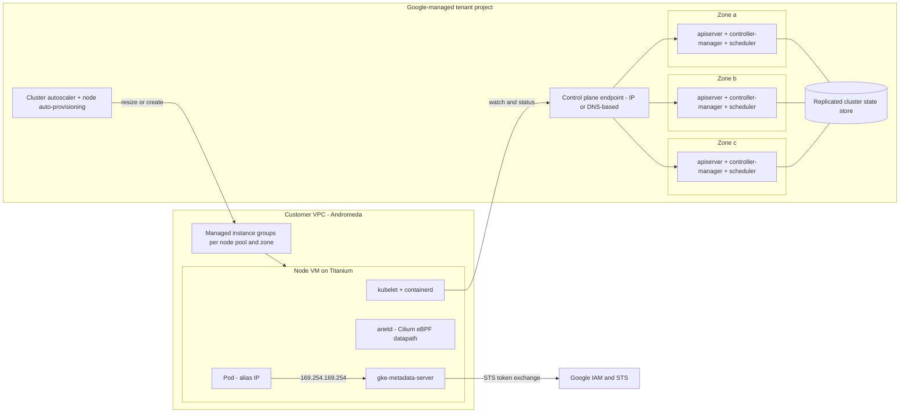

# GKE Deep Dive: Standard vs Autopilot

## TL;DR

A regional or Autopilot GKE control plane runs replicated in three zones, which is why its SLA is 99.95% while a zonal Standard control plane gets 99.5%. The data plane keeps running when the control plane is down, but nothing new gets scheduled, scaled, or re-endpointed until it comes back ([GKE SLA](https://cloud.google.com/kubernetes-engine/sla), as of 2026-10).
Autopilot is not a different Kubernetes. It is the same kube-scheduler and cluster autoscaler with node auto-provisioning, plus an admission layer that rewrites and constrains pod specs. General-purpose pods are billed on requests, so Google carries the bin-packing waste instead of you.
Dataplane V2 swaps kube-proxy's linear iptables chains for Cilium eBPF hash maps on sockets and on tc hooks. The win is service lookup that stays constant-time as the cluster grows and policy enforcement based on identities. The new risk is that eBPF map capacity and routes owned by host agents become failure points.
VPC-native pod IPs are Andromeda alias IPs drawn from a secondary range, and each node takes a block at least twice its max-pods setting. Most "the cluster will not scale past N nodes" incidents are IPAM arithmetic, not compute capacity.
Workload shielding is layered:
- Shielded Nodes prove node identity.
- Workload Identity Federation intercepts the metadata server so pods never see node credentials.
- GKE Sandbox (gVisor) reduces kernel attack surface.
- Autopilot's policy layer forbids privileged escape hatches by default.

## Mental Model



Think of GKE as a strict split.
Google runs the reconciliation brain (apiservers, controllers, the state store, and the autoscaler) in a tenant project you never see.
You own a fleet of ordinary Compute Engine VMs in your VPC that the brain drives through Managed Instance Groups.
Pods are first-class VPC citizens with routable alias IPs, so Andromeda delivers packets to them without any overlay, and Dataplane V2 handles only service translation and policy at the host edge.
Standard versus Autopilot is purely a question of who chooses node shapes and who pays for the empty space on them; the control loops are the same.
Every failure mode in this chapter is either the brain being unreachable, the brain making a bad decision (upgrades, autoscaling), or a node-local agent (eBPF datapath, metadata server) disagreeing with what the brain thinks.

## Internals

### Control plane topology and what "regional" buys you

A zonal Standard cluster runs one control plane replica in one zone.
A regional Standard cluster, and every Autopilot cluster, runs control plane replicas across three zones of the region behind a single endpoint ([GKE SLA](https://cloud.google.com/kubernetes-engine/sla), as of 2026-10).
The state store is quorum-replicated, so losing one zone costs a replica, not the cluster.
For a three-member quorum, two members must stay healthy, so the store survives the loss of any single zone and cannot survive two.
The control plane runs on Google-managed VMs, and GKE resizes it automatically as the cluster grows.
On a zonal cluster that resize, like a control plane version upgrade, means a window where the API is unreachable.
On a regional cluster, replicas are replaced one at a time, so the API stays available, although individual long-lived watches get reset and clients must re-list.
That re-list is the mechanism behind the "API server CPU spike right after an upgrade" pattern.
Every informer in every controller and DaemonSet reconnects and asks for a full list, so the control plane takes a thundering herd at exactly the moment it is down a replica.
The Kubernetes fix is API Priority and Fairness plus `resourceVersion`-aware watch caches, covered in [[17-Cloud-AI-Engineering/Volume_05_Kubernetes_and_Platform_Engineering/Chapter_01_Kubernetes_Control_Loop_Internals|Kubernetes Control Loop Internals]].

For very large clusters, Google has said it moved GKE's state storage off upstream etcd onto a Spanner-based store that speaks the etcd API, as part of its 65,000-node cluster work (UNVERIFIED; I could not re-check the launch post this batch).
The architectural reason is simple.
etcd is one Raft group where every write goes through one leader and the whole dataset lives on each member.
That caps write throughput and database size no matter how many members you add.
A store that is horizontally partitioned under the same API removes that ceiling without touching the apiserver code path; see [[17-Cloud-AI-Engineering/Volume_03_GCP_Deep_Dive/Chapter_10_Cloud_Spanner_TrueTime_and_External_Consistency|Cloud Spanner]] and [[08-Distinguished-Engineering/02-Distributed-Systems-Internals/Raft-Consensus|Raft Consensus]].
Whatever the backend, the contract you program against is the same: optimistic concurrency on `resourceVersion`, watch streams, and a per-object size limit.

### Control plane reachability

The control plane is reachable through a public IP endpoint, a private endpoint inside your VPC, or a DNS-based endpoint that terminates on Google's API front end and authorizes callers with IAM rather than source IP (UNVERIFIED for current GA scope).
Older private clusters connected the control plane to nodes through VPC Network Peering.
Newer clusters use Private Service Connect for that path (UNVERIFIED for version cutover details).
This matters in failure analysis because control-plane-to-node traffic (webhooks, `kubectl exec`, `kubectl logs`, metrics-server, aggregated APIs) flows in the reverse direction from what engineers expect.
In private clusters it needs a VPC firewall rule from the control plane range to the node port that serves the webhook.

### Node lifecycle: node pools are MIGs

A Standard node pool is a Managed Instance Group per zone.
In a regional cluster, `--num-nodes` is per zone, so `--num-nodes=1` across three zones gives you three VMs.
Node upgrades happen at node-pool granularity using one of three strategies:
- Surge upgrades create `maxSurge` new nodes and drain up to `maxUnavailable` old nodes at a time.
- Blue-green upgrades stand up a full green pool, cordon the blue pool, and soak before deleting it.
- Short-lived upgrades are used for certain node types (UNVERIFIED for current scope).
During a drain, GKE respects PodDisruptionBudgets for a bounded time (one hour is the commonly documented figure) and then evicts anyway (UNVERIFIED).
That bound is deliberate: a PDB with `maxUnavailable: 0` must not be allowed to block security patching across the fleet forever.
The Kubernetes version skew policy lets kubelets lag the apiserver by up to three minor versions (upstream Kubernetes policy since 1.28, UNVERIFIED for GKE enforcement details).
GKE auto-upgrade keeps the gap much smaller than that.

### Autopilot provisioning, step by step

What follows is the path a pod takes on Autopilot.
Getting-started guides compress it to "Google manages the nodes."
1. Admission. The pod hits the apiserver, where Autopilot's policy admission (GKE Warden) mutates and validates it.
   - It fills in default requests when none are set.
   - It rounds requests to allowed increments and enforces CPU:memory ratio bounds.
   - It maps any `cloud.google.com/compute-class` selector to a node shape family.
   - It rejects privileged containers, most `hostPath` mounts, and other node-escape primitives (exact defaults and ratios UNVERIFIED).
   The pod you `get` back is not the pod you `apply`ed, and that difference is billable.
2. Scheduling. kube-scheduler tries existing nodes.
   If nothing fits, the pod is marked `PodScheduled=False` with reason `Unschedulable`.
3. Simulation. The cluster autoscaler, running with node auto-provisioning (NAP), sees the unschedulable pod.
   It simulates candidate node shapes against the pending set, honoring zone, compute class, Spot versus on-demand, accelerator, and topology spread constraints.
   It then picks a shape, creating a new node pool or MIG if none matches.
4. VM creation. The MIG resizes, Compute Engine places and boots the VM on Titanium hosts ([[17-Cloud-AI-Engineering/Volume_03_GCP_Deep_Dive/Chapter_06_Compute_Engine_and_Titanium_Architecture|Compute Engine and Titanium]]), and kubelet registers with the apiserver.
5. Bind and pull. The scheduler binds the pod, then containerd pulls the image and starts it.
   Image streaming can shorten the pull step (feature availability UNVERIFIED for every compute class).
Steps 3 to 5 typically cost tens of seconds to a few minutes (UNVERIFIED; measure it in your own region).
That latency is the main operational difference from a pre-warmed Standard pool.
The standard mitigation is a capacity buffer: low-priority "balloon" pods that hold headroom and are preempted the moment real pods arrive (the worked example below shows it).

Billing follows the abstraction.
General-purpose pods are billed per second on their requested vCPU, memory, and ephemeral storage, so fragmentation and system DaemonSet overhead on the node are Google's problem ([GKE pricing](https://cloud.google.com/kubernetes-engine/pricing), as of 2026-10).
Hardware-specific compute classes (accelerators, specific machine series) are billed per node, because a GPU cannot be split across tenants the way a CPU slot can, so the fragmentation risk goes back to you (UNVERIFIED for current per-class billing rules).
Google has also announced a "container-optimized compute platform" for Autopilot that resizes running nodes, and a way to run Autopilot-managed compute classes inside Standard clusters (UNVERIFIED for GA status; treat both as needing confirmation before you design around them).

The name echoes Google's internal Borg vertical autoscaler, described in "Autopilot: Workload Autoscaling at Google" (EuroSys 2020).
That system sets per-task resource limits from moving windows of historical usage and cut slack substantially at Borg scale.
The GKE mode's tie to that paper is conceptual, not documented code lineage (UNVERIFIED).
The lesson carries over: per-request billing only works if requests track usage, which is why Vertical Pod Autoscaler recommendations matter more on Autopilot than on Standard.

### Networking: alias IPs, pod CIDR arithmetic, and Dataplane V2

VPC-native clusters give each node a primary IP from the subnet's primary range.
Each node also gets a contiguous pod block from a secondary range, configured as an alias IP range on the VM's NIC.
Andromeda ([[17-Cloud-AI-Engineering/Volume_13_Seminal_Papers_and_Case_Studies/Chapter_12_Andromeda_Network_Virtualization|Andromeda]]) programs those alias ranges into its virtual routing tables, so a packet to a pod IP is delivered to the right host by the VPC itself.
There is no VXLAN or Geneve encapsulation inside GKE, VPC firewall rules and flow logs see real pod IPs, and peered or interconnected networks can route to pods directly.

The detail most engineers miss is how GKE sizes the per-node block.
It allocates the smallest CIDR holding at least twice the node's max-pods value: 110 pods gets a /24, 64 gets a /25, 32 gets a /26, and 8 gets a /28 (UNVERIFIED as current doc text, but the long-standing documented rule).
The doubling exists so a terminating pod's IP is not handed to a new pod right away.
That avoids stale conntrack entries, stale endpoint caches, and stale firewall flow state pointing at the wrong workload.
The consequence is a hard node ceiling set entirely by IPAM: `max_nodes = 2^(node_block_prefix - pod_range_prefix)`.
A /20 pod range with the default 110 max-pods supports only 2^(24-20) = 16 nodes, regardless of quota or capacity.
Fixes include lowering max-pods per node pool, adding pod ranges (discontiguous multi-pod CIDR), or rebuilding with a bigger range.
Service ClusterIPs come from a separate range that never appears on any NIC.
They exist only as keys in the datapath's translation tables.

Dataplane V2 is GKE's Cilium-based eBPF datapath, run by the `anetd` DaemonSet, and it replaces kube-proxy entirely ([Dataplane V2 docs](https://cloud.google.com/kubernetes-engine/docs/concepts/dataplane-v2)).
It cannot be enabled on an existing cluster; it is chosen at cluster creation, and Autopilot clusters always use it (UNVERIFIED for any 2026 change to in-place migration).
kube-proxy's iptables mode resolves a ClusterIP in three steps:
- A packet walks the `KUBE-SERVICES` chain until it hits the rule for its service.
- It then walks a per-service chain of probabilistic `statistic --mode random` rules to pick an endpoint.
- Finally it is DNATed, with conntrack recording the translation.
The match cost grows linearly with the number of services.
Worse, every endpoint change rewrites large rule sets through `iptables-restore` under a global lock, so programming latency at tens of thousands of endpoints reaches seconds.
During that window, new connections can be sent to endpoints that no longer exist.

Cilium replaces this with two hook points ([Cilium docs](https://docs.cilium.io/)).
For pod-originated traffic to a ClusterIP, a cgroup eBPF program attached to `connect()` and `sendmsg()` rewrites the destination socket address to a backend before any packet exists.
The service is resolved once per connection, not once per packet, and there is no per-packet DNAT or reverse NAT.
For traffic arriving at the node (NodePort, external load balancer paths), tc eBPF programs on the interfaces do the lookup.
Both paths use eBPF hash maps keyed by (VIP, port, protocol), which point to a backend slot table, and Cilium can fill that table with Maglev consistent hashing so backend churn moves only a small fraction of flows ([[17-Cloud-AI-Engineering/Volume_13_Seminal_Papers_and_Case_Studies/Chapter_11_Maglev_Network_Load_Balancer|Maglev]]).
Endpoint updates become single map-element writes rather than table rewrites.

Network policy uses identities instead of IP lists.
Cilium hashes each unique set of security-relevant pod labels into a numeric security identity, stored on GKE as CRD-backed objects rather than in a separate key-value store (UNVERIFIED for current GKE storage of identities).
Each endpoint gets an eBPF policy map keyed by (peer identity, port, protocol).
Packets carry or resolve the source identity, so enforcement is one map lookup, and pod churn only updates the IP-to-identity cache, not every policy rule.
The new limits are map sizes.
- Conntrack and NAT maps have fixed maximum entries.
- Policy maps have a per-endpoint entry ceiling.
- High-cardinality labels can explode the identity count.
When a map fills, new flows drop silently rather than slowing down, which is a very different failure shape from iptables (Cilium mechanism; GKE-specific map sizes UNVERIFIED).

Container-native load balancing changes the external path too.
Google Cloud load balancers target Network Endpoint Groups whose members are pod IPs, so traffic skips the NodePort hop and the second SNAT hop that `externalTrafficPolicy: Cluster` introduces.
Pod readiness gates tie Kubernetes readiness to load balancer health ([[17-Cloud-AI-Engineering/Volume_03_GCP_Deep_Dive/Chapter_05_Cloud_Load_Balancing_GFEs_and_Maglev|Cloud Load Balancing]]).

### Workload shielding layers

Node identity: Shielded GKE Nodes run on Shielded VMs with Secure Boot, a vTPM, and integrity monitoring.
The control plane checks that a node joining the cluster is a genuine GKE VM before giving it kubelet credentials.
This closes an old attack class.
In early GKE, a pod that could reach the instance metadata server could read kubelet bootstrap material from the `kube-env` attribute, impersonate a node, and read secrets for pods scheduled anywhere (publicly demonstrated by researchers around 2018; specific write-up UNVERIFIED).

Pod identity: Workload Identity Federation for GKE runs `gke-metadata-server` as a DaemonSet in place of the VM's metadata path, and pod traffic to `169.254.169.254` is redirected to it.
The flow is:
1. The metadata server works out which pod is calling and its Kubernetes service account.
2. It obtains a projected service account token from the apiserver.
3. It exchanges that token with Google STS for a federated access token, or impersonates a mapped IAM service account.
4. It returns the token in the same format the VM metadata server would.
The principal string has the form `principal://iam.googleapis.com/projects/PROJECT_NUMBER/locations/global/workloadIdentityPools/PROJECT_ID.svc.id.goog/subject/ns/NAMESPACE/sa/KSA` (format UNVERIFIED against current docs).
That form encodes the subtle property called identity sameness.
Every cluster in a project shares the pool `PROJECT_ID.svc.id.goog`, so `ns/payments/sa/api` in a throwaway dev cluster is the same IAM principal as `ns/payments/sa/api` in production if both clusters live in the same project.
Details are in [[17-Cloud-AI-Engineering/Volume_08_Security_Identity_and_the_Data_Perimeter/Chapter_02_Workload_Identity_Federation|Workload Identity Federation]].

Kernel isolation: GKE Sandbox runs pods under gVisor (`runtimeClassName: gvisor`).
gVisor's user-space Sentry kernel intercepts application syscalls, so a container escape must first break gVisor and then the host kernel's much smaller exposed surface ([gVisor docs](https://gvisor.dev/docs/), [[17-Cloud-AI-Engineering/Volume_00_Foundations_Under_the_Cloud/Chapter_01_Hypervisors_MicroVMs_and_Sandboxing|Hypervisors, MicroVMs, and Sandboxing]]).
The cost is syscall-heavy and I/O-heavy overhead, plus some features that are incompatible.

Memory confidentiality: Confidential GKE Nodes run node VMs with hardware memory encryption (AMD SEV variants or Intel TDX depending on machine series, UNVERIFIED per series), covered in [[17-Cloud-AI-Engineering/Volume_03_GCP_Deep_Dive/Chapter_15_Security_and_Confidential_Computing_Cloud_KMS|Cloud KMS and Confidential Computing]].

Supply chain and posture: Binary Authorization admits only images with valid attestations.
Application-layer secrets encryption wraps the data keys that protect Kubernetes Secrets in the state store with a Cloud KMS key you control (envelope encryption).

Autopilot's baseline: Shielded Nodes, Workload Identity Federation, and Container-Optimized OS with containerd are always on and cannot be turned off.
Privileged pods are rejected unless a Google-published partner allowlist permits a specific workload (UNVERIFIED for allowlist mechanism naming).

## Numbers to Know

Downtime budgets are computed from the SLA percentage over a 730-hour month.

| Quantity | Value | Source and status |
|---|---|---|
| Zonal Standard control plane SLA | 99.5% monthly (about 3.65 h allowed downtime) | [GKE SLA](https://cloud.google.com/kubernetes-engine/sla) (Google Cloud docs, as of 2026-10) |
| Regional Standard control plane SLA | 99.95% monthly (about 21.9 min) | (Google Cloud docs, as of 2026-10) |
| Autopilot control plane SLA | 99.95% monthly | (Google Cloud docs, as of 2026-10) |
| Autopilot pods spread across multiple zones SLA | 99.9% monthly (about 43.8 min) | (Google Cloud docs, as of 2026-10) |
| Cluster management fee | $0.10 per cluster per hour, billed per second, every mode and topology | [GKE pricing](https://cloud.google.com/kubernetes-engine/pricing) (Google Cloud docs, as of 2026-10) |
| Free tier | $74.40 monthly credit per billing account; usable for zonal Standard or Autopilot fees only, not regional Standard | (Google Cloud docs, as of 2026-10) |
| Extended release channel | Extra management fee while the minor version is in extended support | (Google Cloud docs, as of 2026-10); amount UNVERIFIED |
| Autopilot general-purpose price, us-central1 | about $0.0445 per vCPU-hour, $0.0049225 per GiB-hour | (Google Cloud pricing as reproduced by third-party analyses, as of 2026-10) |
| Autopilot Balanced class, us-central1 | about $0.0645 per vCPU-hour, $0.0071354 per GiB-hour | (Google Cloud pricing as reproduced by third-party analyses, as of 2026-10) |
| Autopilot ephemeral storage | about $0.0001389 per GiB-hour | (third-party, as of 2026-10) UNVERIFIED against Google page |
| Max pods per node, Standard | 110 by default, configurable up to 256 | UNVERIFIED |
| Max pods per node, Autopilot | 32 by default | UNVERIFIED |
| Per-node pod CIDR | Smallest block of at least 2x max-pods (110 -> /24, 64 -> /25, 32 -> /26) | UNVERIFIED |
| Nodes per cluster | 15,000 standard limit; up to 65,000 with Google enablement | UNVERIFIED |
| Node allocatable CPU reserve | 6% of core 1, 1% of core 2, 0.5% of cores 3-4, 0.25% above 4 | UNVERIFIED |
| Node allocatable memory reserve | 25% of first 4 GiB, 20% of next 4, 10% of next 8, 6% of next 112, 2% above 128, plus 100 MiB eviction threshold | UNVERIFIED |
| PDB honored during node drain for upgrades | Up to about 1 hour, then forced eviction | UNVERIFIED |
| Spot VM discount vs on-demand | 60-91% range | UNVERIFIED |
| Kubelet version skew | Up to 3 minor versions older than apiserver (upstream policy) | UNVERIFIED |

## AWS vs GCP Mechanism Parity

| Dimension | Amazon EKS | Google GKE | Critical difference |
|---|---|---|---|
| Control plane placement | AWS-managed account, apiservers and etcd across multiple AZs | Google tenant project; zonal (1 replica) or regional/Autopilot (3 zones) | GKE offers a cheaper zonal option with a weaker SLA; EKS has no single-AZ control plane tier (UNVERIFIED for 2026) |
| Control plane fee | Per-cluster hourly fee, higher in extended support (UNVERIFIED amounts) | $0.10/h per cluster, plus Extended channel fee | Both price clusters, not nodes; cluster sprawl costs money on both |
| State store | etcd, managed by AWS (UNVERIFIED for any backend change) | etcd API, Spanner-backed at large scale (UNVERIFIED) | Determines the ceiling on cluster size and write rate |
| Hands-off node mode | EKS Auto Mode, Fargate (UNVERIFIED for Auto Mode scope) | Autopilot | Fargate gives one microVM per pod; Autopilot packs many pods per hidden VM, billed per pod |
| Node provisioner | Karpenter (open source, runs as a controller) | Cluster autoscaler + NAP, run by Google | Karpenter launches EC2 instances directly through Fleet APIs; GKE resizes MIGs ([[17-Cloud-AI-Engineering/Volume_05_Kubernetes_and_Platform_Engineering/Chapter_04_Autoscaling_at_Scale_HPA_KEDA_and_Karpenter\|Autoscaling at Scale]]) |
| Pod networking | VPC CNI gives pods ENI secondary IPs or prefixes | Alias IP ranges from a secondary range | EKS pod density depends on ENI and IP limits per instance type; GKE depends on CIDR arithmetic ([[17-Cloud-AI-Engineering/Volume_02_AWS_Deep_Dive/Chapter_07_Amazon_EKS_Control_Plane_and_Networking\|EKS]]) |
| Service datapath | kube-proxy (iptables/IPVS) by default; Cilium optional and self-managed | Dataplane V2 (managed Cilium), no kube-proxy | GKE owns the eBPF datapath lifecycle; on EKS you own Cilium upgrades |
| Network policy | VPC CNI network policy agent (eBPF) or Calico/Cilium | Built into Dataplane V2 | Both now enforce policy with eBPF; on GKE it is one supported stack |
| Pod to cloud identity | IRSA (OIDC web identity) or EKS Pod Identity agent | Workload Identity Federation for GKE via gke-metadata-server | GKE's project-wide pool creates identity sameness across clusters; EKS Pod Identity maps per cluster association |
| Kernel sandbox | Fargate (Firecracker microVM per pod) | GKE Sandbox (gVisor) | Hardware-virtualized boundary versus a user-space kernel; different overhead profiles |
| Node attestation | Nitro-based instance identity documents | Shielded VM vTPM and integrity monitoring | Both stop node impersonation; mechanisms differ ([[17-Cloud-AI-Engineering/Volume_02_AWS_Deep_Dive/Chapter_04_EC2_Nitro_Architecture_and_Graviton\|Nitro]]) |
| Upgrade model | Customer triggers control plane upgrades; managed node group rolling updates | Release channels with auto-upgrade, maintenance windows, exclusions | GKE defaults to Google-driven upgrades; EKS defaults to customer-driven |

## Worked Example: Standard vs Autopilot side by side, with headroom and IPAM sizing

### Cost estimate and guardrails

The lab runs one Autopilot cluster and one regional Standard cluster in `us-central1` for about three hours.
The Autopilot cluster fee is $0.10/h, which the free tier credit can absorb ([GKE pricing](https://cloud.google.com/kubernetes-engine/pricing), as of 2026-10).
The regional Standard cluster fee is $0.10/h and is not covered by the free tier credit (as of 2026-10).
Standard nodes are three e2-standard-4 VMs (one per zone) at an assumed $0.134/h each (UNVERIFIED list price), or about $0.40/h.
Autopilot lab pods total about 2 vCPU and 4 GiB: 2 x 0.0445 + 4 x 0.0049225 = $0.109/h.
The all-in total is about $0.71/h, or roughly $2-3 for the lab, before load balancer forwarding rules and persistent disks; the script creates neither.
A $20 budget with 50/90/100% alerts is set below.

### Provision

```bash
#!/usr/bin/env bash
# GKE Standard vs Autopilot lab. Requires gcloud, kubectl, and billing admin on the account.
set -euo pipefail

PROJECT_ID="$(gcloud config get-value project)"
REGION="us-central1"
BILLING_ACCOUNT="000000-000000-000000"   # replace

gcloud services enable container.googleapis.com billingbudgets.googleapis.com

# Budget alarm scoped to this project.
gcloud billing budgets create \
  --billing-account="${BILLING_ACCOUNT}" \
  --display-name="gke-v03-ch07-lab" \
  --budget-amount=20USD \
  --threshold-rule=percent=0.5 \
  --threshold-rule=percent=0.9 \
  --threshold-rule=percent=1.0 \
  --filter-projects="projects/${PROJECT_ID}"

# Autopilot: regional control plane, Dataplane V2, Workload Identity, Shielded Nodes are implicit.
gcloud container clusters create-auto ap-lab \
  --region="${REGION}" \
  --release-channel=regular

# Standard regional: explicit choices that Autopilot makes for you.
gcloud container clusters create std-lab \
  --region="${REGION}" \
  --release-channel=regular \
  --enable-dataplane-v2 \
  --enable-ip-alias \
  --cluster-ipv4-cidr=/17 \
  --services-ipv4-cidr=/22 \
  --max-pods-per-node=64 \
  --workload-pool="${PROJECT_ID}.svc.id.goog" \
  --workload-metadata=GKE_METADATA \
  --enable-shielded-nodes \
  --shielded-secure-boot \
  --shielded-integrity-monitoring \
  --machine-type=e2-standard-4 \
  --num-nodes=1 \
  --enable-autoscaling --min-nodes=1 --max-nodes=3
```

### Verify the datapath and identity plumbing

```bash
gcloud container clusters get-credentials std-lab --region us-central1

# Dataplane V2 runs as the anetd DaemonSet; there should be no kube-proxy pods.
kubectl -n kube-system get daemonset anetd
kubectl -n kube-system get pods -o name | grep -c kube-proxy || true   # expect 0

# Workload Identity metadata interception is a DaemonSet on every node.
kubectl -n kube-system get daemonset gke-metadata-server

# Per-node pod CIDR: with max-pods 64 each node should show a /25.
kubectl get nodes -o custom-columns=NAME:.metadata.name,PODCIDR:.spec.podCIDR
```

### Default-deny policy, enforced in eBPF

```yaml
apiVersion: networking.k8s.io/v1
kind: NetworkPolicy
metadata:
  name: default-deny-all
  namespace: default
spec:
  podSelector: {}
  policyTypes: ["Ingress", "Egress"]
---
apiVersion: networking.k8s.io/v1
kind: NetworkPolicy
metadata:
  name: allow-dns-egress
  namespace: default
spec:
  podSelector: {}
  policyTypes: ["Egress"]
  egress:
  - to:
    - namespaceSelector:
        matchLabels:
          kubernetes.io/metadata.name: kube-system
    ports:
    - {protocol: UDP, port: 53}
    - {protocol: TCP, port: 53}
```

### Autopilot headroom with balloon pods

On Autopilot you cannot pre-size a node pool, so you buy headroom by running preemptible placeholder pods at negative priority.
When a real pod arrives, the scheduler preempts a balloon within seconds instead of waiting for a VM to boot.
The evicted balloon goes Pending and triggers node provisioning in the background, which restores the buffer.

```yaml
apiVersion: scheduling.k8s.io/v1
kind: PriorityClass
metadata:
  name: balloon
value: -10
preemptionPolicy: Never
globalDefault: false
description: "Placeholder capacity; preempted by any default-priority pod."
---
apiVersion: apps/v1
kind: Deployment
metadata:
  name: balloon
  namespace: default
spec:
  replicas: 2
  selector:
    matchLabels: {app: balloon}
  template:
    metadata:
      labels: {app: balloon}
    spec:
      priorityClassName: balloon
      terminationGracePeriodSeconds: 0
      containers:
      - name: pause
        image: registry.k8s.io/pause:3.9
        resources:
          requests: {cpu: "500m", memory: "1Gi"}
```

```bash
gcloud container clusters get-credentials ap-lab --region us-central1
kubectl apply -f balloon.yaml
# Inspect what admission actually stored; compare requests with the manifest.
kubectl get pod -l app=balloon -o jsonpath='{.items[0].spec.containers[0].resources}'; echo
```

The balloons are billed at the full per-pod rate.
Two balloons at 0.5 vCPU and 1 GiB cost 2 x (0.5 x 0.0445 + 1 x 0.0049225) = $0.054/h, or about $39 per month, for roughly 1 vCPU of instant burst capacity.

### Capacity sizing: 40 replicas at 500m CPU and 2 GiB

Autopilot (general-purpose, us-central1) cost per pod-hour is 0.5 x 0.0445 + 2 x 0.0049225 = $0.032095.
Forty pods cost 40 x 0.032095 x 730 h = about $937 per month, plus the $73 cluster fee.
If a zone fails, Autopilot reschedules the lost pods into the surviving zones and you keep paying for 40 pods, assuming capacity exists there.

Standard on e2-standard-8 (8 vCPU, 32 GB, assumed $0.268/h, UNVERIFIED list price) needs an allocatable calculation first.
- CPU reserve is 0.06 + 0.01 + 0.01 + 0.01 = 0.09 vCPU, which leaves 7.91 allocatable.
- Memory reserve is 1.0 + 0.8 + 0.8 + 0.96 + 0.1 = 3.66 GiB, which leaves about 28.3 GiB, using the reservation formula from the numbers table (UNVERIFIED).
- System DaemonSets (anetd, logging and metrics agents, gke-metadata-server) take an assumed 0.4 vCPU and 0.6 GiB; measure yours with `kubectl describe node`.
- Memory then limits each node to floor((28.3 - 0.6) / 2) = 13 pods, against 15 by CPU.

Without zonal headroom, 40 / 13 needs 4 nodes, or 4 x 0.268 x 730 = $783 per month.
To survive a zone loss at full capacity, each of 2 surviving zones must hold 20 pods, which means 2 nodes per zone across 3 zones = 6 nodes, or $1,174 per month.
The crossover is the point.
Autopilot's per-unit premium is cheaper than Standard once Standard has to carry N+1 zonal headroom and bin-packing waste, and more expensive when Standard can pack tightly with no headroom or run on Spot with committed-use discounts.

### IPAM sizing for the Standard cluster

The /17 pod range holds 32,768 addresses.
With max-pods 64, each node takes a /25 (128 addresses), so the ceiling is 2^(25-17) = 256 nodes.
At the default 110 max-pods (/24) the same range would allow only 128 nodes.
The /22 services range holds 1,024 ClusterIPs.

### Teardown

```bash
gcloud container clusters delete ap-lab  --region us-central1 --quiet
gcloud container clusters delete std-lab --region us-central1 --quiet
# Catch orphans that cluster deletion does not remove.
gcloud compute forwarding-rules list
gcloud compute disks list --filter="name~^pvc-"
# Remove the budget.
gcloud billing budgets list --billing-account="000000-000000-000000"
gcloud billing budgets delete BUDGET_ID --billing-account="000000-000000-000000"
```

## Failure Modes and Pitfalls

### Pod IP exhaustion disguised as a capacity problem

Symptoms are nodes failing to be created, the autoscaler reporting scale-up failures, and pods stuck Pending while compute quota is clearly available.
The cause is the pod range arithmetic from the Internals section: the secondary range has no free per-node blocks left.
It shows up most in clusters built from a template copied from a small dev environment with a /20 or /21 pod range.
Mitigations, in order of effort:
- Add a pod range to new node pools.
- Lower max-pods on new pools; this does not change existing pools.
- Rebuild with properly sized ranges.
Prevent it with an IPAM budget in the landing-zone design ([[17-Cloud-AI-Engineering/Volume_01_Cloud_Architecture_Principles/Chapter_06_Multi_Account_and_Multi_Project_Landing_Zones|Landing Zones]]).

### Zonal control plane windows taking out the delivery plane

On a zonal cluster, control plane upgrades and automatic resizes make the API unreachable for minutes.
Running pods keep serving, but everything that writes to the API stalls:
- GitOps reconcilers ([[17-Cloud-AI-Engineering/Volume_05_Kubernetes_and_Platform_Engineering/Chapter_07_GitOps_Delivery_Argo_CD_and_Flux|Argo CD and Flux]])
- cert-manager renewals
- HPA scaling decisions
- Leader elections, which can expire and cause operator restarts once the API returns
- Endpoint updates during pod churn
Because the resize is triggered by cluster growth, it tends to arrive at exactly the moment you are scaling out.
For anything production-facing, use regional clusters.
The SLA gap is 99.5% versus 99.95% ([GKE SLA](https://cloud.google.com/kubernetes-engine/sla), as of 2026-10).

### Admission webhook deadlocks and private-cluster firewalls

A validating or mutating webhook with `failurePolicy: Fail` whose backend runs in the same cluster can block the creation of its own replacement pods after a node pool upgrade drains it.
In private clusters, the control plane reaches webhooks over the VPC.
A missing firewall rule from the control plane range to the webhook's target port produces timeouts that look like apiserver slowness.
Mitigate with:
- `namespaceSelector` exclusions for `kube-system` and the webhook's own namespace
- Short `timeoutSeconds`
- Replica spread plus a PDB for the webhook
- An explicit firewall rule

### Upgrade drains blocked by PDBs, then forced

A PDB with `maxUnavailable: 0`, or `minAvailable` equal to the replica count, blocks voluntary eviction.
GKE waits a bounded time and then evicts anyway (UNVERIFIED duration), so a team that "protected" a singleton with a strict PDB gets an uncontrolled eviction at an arbitrary time instead of a controlled one.
Use real replica headroom, set maintenance windows, and use maintenance exclusions for freeze periods.

### Autopilot surprises

Admission rewrites requests and enforces CPU:memory ratios, so a pod asking for 4 vCPU and 1 GiB is stored and billed with more memory than requested (exact ratio bounds UNVERIFIED).
Scale-up from zero headroom pays the full VM provisioning latency, so latency-sensitive services need balloon pods or a higher HPA floor.
Node shapes are chosen for you, so a single large pod can land on a dedicated VM.
On per-node-billed compute classes, that VM's idle remainder is your cost.

### Zonal stockouts

Accelerator-heavy and large-shape node pools fail to scale with resource-exhaustion errors in a single zone even when quota is fine.
Mitigations:
- Multi-zone node pools with a location policy that allows any zone
- Fallback priority lists in a ComputeClass
- Reservations for capacity you cannot afford to lose ([[17-Cloud-AI-Engineering/Volume_10_AI_Infrastructure_on_Cloud/Chapter_08_Fault_Tolerance_and_Fleet_Resiliency_at_Scale|Fleet Resiliency]])

### Host agents fighting the eBPF datapath

Datadog's March 2023 multi-region outage, on its own Cilium-based clusters rather than GKE, is the canonical case study ([Datadog postmortem](https://www.datadoghq.com/blog/2023-03-08-multiregion-infrastructure-connectivity-issue/), URL UNVERIFIED).
An automatic OS security update restarted systemd-networkd, which removed routes that Cilium had installed, and nodes across regions and clouds lost pod networking at once.
On GKE, Google owns the node OS image and `anetd`, which removes most of this class.
It comes back as soon as you install DaemonSets that modify host routing, iptables, or eBPF programs: security agents, service meshes in CNI mode, custom tuning DaemonSets.

### eBPF map exhaustion and identity explosion

Conntrack and NAT maps have fixed capacities.
High-connection-rate workloads, such as UDP-heavy DNS or short-lived HTTP without keep-alive, can fill them.
When they fill, new flows drop, while established ones are fine.
Labels with per-pod unique values (build IDs, request hashes) create one security identity per pod, which inflates policy maps and identity churn on the control plane.
Watch `anetd` metrics and keep security-relevant labels low-cardinality (Cilium mechanism; GKE-specific thresholds UNVERIFIED).

### DNS as the hidden single point

kube-dns behind a ClusterIP, combined with Linux conntrack races on parallel UDP A and AAAA lookups, produces intermittent 5-second resolution stalls.
The `ndots:5` default multiplies the lookups behind every external name.
NodeLocal DNSCache or Cloud DNS for GKE removes the conntrack hop and spreads load.
Lowering `ndots` or using fully qualified names cuts query volume.

### Metadata server startup race

Pods that fetch credentials in their first milliseconds can start before `gke-metadata-server` is ready to answer for them on a freshly scaled node.
They fail with errors that look like permissions problems.
Client libraries retry; hand-rolled curl in init scripts often does not.

### Global API dependency

The Google Cloud incident of 2025-06-12 was a bad policy change that crashed Service Control.
It caused widespread API errors across many products and regions for hours ([Google Cloud status](https://status.cloud.google.com/summary); the specific incident page is not linked because its URL is UNVERIFIED).
From the GKE architecture we can infer the effect: any workflow needing a Google API call (new tokens via STS, node creation, load balancer reconfiguration, image pulls from Artifact Registry) is exposed, while already-running pods holding cached tokens keep serving.
Design for static stability.
- Pre-pull or mirror critical images.
- Avoid putting token minting on every request path.
- Keep enough steady-state capacity that you are not autoscaling through a control-plane-wide event ([[17-Cloud-AI-Engineering/Volume_01_Cloud_Architecture_Principles/Chapter_02_Regions_Zones_and_Static_Stability|Static Stability]], [[17-Cloud-AI-Engineering/Volume_07_Reliability_and_SRE/Chapter_07_Anatomy_of_Major_Cloud_Outages|Anatomy of Major Cloud Outages]]).

### Upgrade-induced label and API removals

Reddit's 2023 Pi-Day outage happened on self-managed Kubernetes, not GKE.
A 1.23 to 1.24 upgrade removed a node label that their Calico route reflector configuration selected on ("You Broke Reddit: The Pi-Day Outage", r/RedditEng, 2023).
On GKE the equivalent risk is removed beta APIs and changed node labels hitting your own manifests and agents.
GKE's deprecation insights can pause auto-upgrades when they detect use of removed APIs (UNVERIFIED for current behavior).

## Security and Cost Angles

### IAM, RBAC, and the authorization union

GKE checks Google Cloud IAM and Kubernetes RBAC, and a request is allowed if either one allows it.
So granting `roles/container.developer` at the project level silently gives namespace-spanning write access in every cluster of that project, whatever RBAC says.
Keep project IAM at `roles/container.clusterViewer` or a custom role that only allows fetching credentials, and grant real permissions through namespaced RBAC bound to Google Groups ([[17-Cloud-AI-Engineering/Volume_03_GCP_Deep_Dive/Chapter_02_Cloud_IAM_Roles_Policies_and_Conditions|Cloud IAM]]).
Never mint service account keys for workloads; use Workload Identity Federation and grant IAM roles to the `principal://` form, with an IAM condition if you need narrower scoping.
Fight identity sameness with a separate project per environment and per trust tier, not just a separate cluster.

### Key hierarchy

Kubernetes Secrets in the state store are encrypted at rest by Google.
Application-layer secrets encryption adds an envelope.
Each secret is encrypted with a local data key, and that data key is wrapped by a Cloud KMS key encryption key in your project, so revoking or disabling the KMS key makes the secrets unreadable ([[17-Cloud-AI-Engineering/Volume_08_Security_Identity_and_the_Data_Perimeter/Chapter_04_Encryption_Key_Hierarchies_and_Envelope_Encryption|Envelope Encryption]]).
Boot and persistent disks can use customer-managed encryption keys (CMEK) through the CSI driver and node pool settings.
The same applies here: disabling the key bricks those disks, so key IAM belongs in break-glass procedures.

### Network boundaries

Treat the control plane as an API resource.
- Prefer a private endpoint or the IAM-authorized DNS endpoint over an IP allowlist on a public endpoint.
- Put `container.googleapis.com`, Artifact Registry, and Cloud Storage inside a VPC Service Controls perimeter ([[17-Cloud-AI-Engineering/Volume_03_GCP_Deep_Dive/Chapter_03_VPC_Service_Controls_Security_Perimeters|VPC Service Controls]]).
- Use Private Google Access or Private Service Connect so nodes never need a public egress path to reach Google APIs.
- Inside the cluster, run a default-deny NetworkPolicy plus FQDN-scoped egress where available (UNVERIFIED for current GA tier).
- Block pod access to the raw VM metadata path; Workload Identity's `GKE_METADATA` mode does this.

### Untrusted code

Run third-party or model-generated code in a gVisor node pool (Standard) or with `runtimeClassName: gvisor` (Autopilot support UNVERIFIED for every compute class).
Also apply a deny-all egress policy and a dedicated KSA with no IAM bindings ([[17-Cloud-AI-Engineering/Volume_12_AI_Applications_MLOps_and_Data_Platforms/Chapter_08_Cloud_Security_for_AI_Systems_Attacks_and_Defenses|Cloud Security for AI Systems]]).

### Unit economics levers

- The cluster fee is per cluster ([GKE pricing](https://cloud.google.com/kubernetes-engine/pricing), as of 2026-10). Fifty clusters cost about $3,650 per month in fees alone, which argues for fewer, multi-tenant clusters where the isolation requirements allow it ([[17-Cloud-AI-Engineering/Volume_05_Kubernetes_and_Platform_Engineering/Chapter_05_Multi_Tenancy_Isolation_and_Resource_Quotas|Multi-Tenancy]]).
- On Autopilot, your bill is your requests, so right-sizing with VPA recommendations is the main lever. An over-requested pod is pure waste, with no node packing to hide it.
- On Standard, your bill is your nodes, so bin-packing efficiency (requested versus allocatable), node shape choice, and zonal headroom policy dominate.
- Spot capacity (Spot node pools on Standard, Spot pods on Autopilot) suits stateless, checkpointable, or batch work ([[17-Cloud-AI-Engineering/Volume_09_FinOps_and_Cloud_Economics/Chapter_03_Spot_Economics_and_Interruption_Handling|Spot Economics]]).
- Committed-use discounts apply to both modes, with SKU eligibility that differs between them (UNVERIFIED specifics; see [[17-Cloud-AI-Engineering/Volume_09_FinOps_and_Cloud_Economics/Chapter_02_Commitment_Discounts_Savings_Plans_vs_CUDs|Savings Plans vs CUDs]]).
- Staying on the Extended channel past standard support costs extra (as of 2026-10). Version drift has a line-item price, not just a risk cost.
- Enable GKE cost allocation so namespace and label breakdowns flow into the BigQuery billing export ([[17-Cloud-AI-Engineering/Volume_09_FinOps_and_Cloud_Economics/Chapter_01_Cloud_Billing_Models_and_Unit_Cost_Allocation|Unit Cost Allocation]]).

## Interview Questions and Model Answers

### Question 1 (L5 - Senior)

A team runs 40 stateless replicas at 500m CPU and 2 GiB each and asks whether to use Standard or Autopilot. Walk through the decision with numbers.

#### Model Answer

I would first separate what each mode bills for.
Autopilot general-purpose bills on requested resources per second, and Standard bills for the nodes whatever their utilization.
On Autopilot in us-central1 that is about 0.5 x $0.0445 + 2 x $0.0049225 = $0.032 per pod-hour, so 40 pods is about $937 per month.
On Standard I size from allocatable, not raw capacity.
An e2-standard-8 keeps roughly 7.9 vCPU and 28 GiB after GKE's reservations, and after system DaemonSets it fits about 13 of these pods, limited by memory.
The bare minimum is 4 nodes, about $780 per month at an assumed list price, which looks cheaper.
But the team said they want to survive a zone outage at full capacity.
On a regional pool that means 20 pods per surviving zone, which is 2 nodes per zone across 3 zones, or 6 nodes at about $1,170.
At that point Autopilot is cheaper, because Google absorbs the headroom and packing waste.
The non-cost factors point the same way for a generic stateless service: no node OS patching, Shielded Nodes and Workload Identity forced on, and a 99.9% pod-level SLA when spread across zones.
I would pick Standard if they needed privileged DaemonSets, custom kernel parameters, specific node shapes for licensing, or large Spot plus CUD coverage that pushes node cost well below list.
I would also flag Autopilot's two traps: admission may rewrite requests upward to meet ratio rules, and scale-up from zero headroom waits on VM provisioning, so I would add balloon pods or a higher HPA floor.

#### Follow-up Interviewer Question

The service's real CPU usage is 120m on average with a p99 of 400m. How does that change the answer for each mode?

### Question 2 (L5 - Senior)

A Standard cluster stops scaling at 16 nodes. Quota is fine, pods are Pending, and the autoscaler reports scale-up failures. What happened, and how do you fix it without downtime?

#### Model Answer

Sixteen is a suspicious power of two, so I would check IPAM before compute.
On VPC-native clusters each node takes a pod block at least twice its max-pods value, which is a /24 at the default of 110.
A /20 pod secondary range divided into /24 blocks gives 2^(24-20) = 16 nodes, so the range is exhausted and no new node can get a block.
I would confirm by listing `spec.podCIDR` per node and comparing it with the secondary range on the subnet.
The fix that avoids downtime is to add a new pod secondary range to the subnet and create a new node pool that uses it, with a lower max-pods if the workload density allows.
For example, a /21 additional range at max-pods 32 (/26 blocks) gives 32 more nodes.
I would then cordon and drain the old pool gradually under PDBs, or leave it in place.
I would check that firewall rules, NAT configuration, and any peered networks that reference pod CIDRs are updated, because the new range is a new set of source addresses.
The durable fix is organizational: an IPAM plan per environment, with pod ranges sized for the cluster's maximum node count times its block size, plus margin.

#### Follow-up Interviewer Question

Why does GKE reserve twice the max-pods addresses per node instead of exactly max-pods, and what breaks if IPs are reused immediately?

### Question 3 (L6 - Staff)

Explain how Dataplane V2 delivers a packet from pod A to a ClusterIP service backed by pod B on another node, compare that with iptables kube-proxy at 10,000 services, and name the new failure modes you would monitor.

#### Model Answer

With Dataplane V2 the service is resolved before a packet exists.
When pod A calls `connect()` on the ClusterIP, a cgroup eBPF program installed by `anetd` looks up (VIP, port, protocol) in a service hash map.
It picks a backend slot, optionally from a Maglev table so backend churn moves few flows, and rewrites the socket's destination to pod B's IP.
The packet leaves pod A already addressed to pod B.
On egress the per-endpoint policy program checks (destination identity, port, protocol) against pod A's egress policy map.
The host then routes the packet out the NIC with pod B's alias IP as destination.
Andromeda delivers it to B's host natively, with no overlay, because the alias range is programmed into the VPC.
On ingress, B's node runs the ingress policy program keyed on A's security identity, and the packet is delivered.
There is no per-packet DNAT and no reverse NAT on the reply, because the socket was rewritten.
With iptables, every new connection walks `KUBE-SERVICES` linearly until it matches, then a chain of probabilistic rules to pick an endpoint, then DNAT with a conntrack entry.
At 10,000 services the match cost grows with rule position.
The real pain is programming: every endpoint change triggers a large `iptables-restore` under a lock, so updates lag by seconds and new connections can hit dead endpoints during rollouts.
With eBPF an endpoint change is a single map write.
The new failure modes are capacity and ownership.
- Conntrack, NAT, and policy maps have fixed sizes, and a full map drops new flows silently. I would alert on map pressure and on drop counters by reason.
- High-cardinality labels inflate identities. I would audit which labels feed identity.
- Any host agent that rewrites routes or attaches eBPF programs can break the datapath fleet-wide. Datadog's 2023 outage is the pattern, so I would control which DaemonSets may touch host networking.
- Dataplane V2 is chosen at cluster creation, so adopting it means a migration to a new cluster, not a flag flip.

#### Follow-up Interviewer Question

Socket-level load balancing resolves the backend once per connection. What does that do to load distribution for long-lived gRPC connections, and how do you fix it?

### Question 4 (L6 - Staff)

The GKE control plane for your production cluster becomes unreachable for 40 minutes. Precisely what keeps working and what degrades, and what would you have designed differently beforehand?

#### Model Answer

Running pods keep running, because kubelet and containerd do not need the apiserver to keep existing containers alive.
Kubelet keeps running liveness probes and restarting crashed containers in place.
The eBPF datapath keeps forwarding with its last-programmed service and policy maps, so existing traffic flows.
What stops:
- New scheduling and rescheduling, so a node failure during the outage is not healed.
- HPA and cluster autoscaling.
- Endpoint updates, so a pod that dies keeps receiving a share of connections until the datapath's local health handling or client retries route around it.
- Any controller or operator that writes status, including GitOps, certificate renewal, and leader election. Leases expire, so some operators crash-loop once the API returns.
- `kubectl` and CI/CD deploys.
Workload Identity becomes fragile.
Tokens already cached by `gke-metadata-server` keep working until they expire, but minting new ones needs the projected-token path through the apiserver plus Google STS.
So credential refresh during a long outage is a real risk; this is my reading of the architecture, not documented behavior.
Load balancers built on NEGs keep their last membership and health-check pods directly, so they degrade gracefully.
Beforehand, I would have:
- Used a regional cluster, so a single-zone failure or an upgrade does not take the API down.
- Kept static capacity headroom instead of relying on autoscaling during incidents.
- Kept at least two clusters per region or a second region behind global load balancing, so a cluster-scoped control plane failure is a traffic shift, not an outage.
- Mirrored critical images, and avoided designs that mint credentials on the request path.
- Treated the June 2025 Service Control incident as proof that the control plane depends on global Google APIs, and run game days that block the API endpoint ([[17-Cloud-AI-Engineering/Volume_07_Reliability_and_SRE/Chapter_05_Chaos_Engineering_and_Game_Days|Chaos Engineering]]).

#### Follow-up Interviewer Question

How would you build a synthetic test that proves your workloads survive a 60-minute control plane loss, without waiting for Google to cause one?

### Question 5 (L6 - Staff)

You find that a developer's sandbox cluster can read production Cloud Storage buckets through Workload Identity. Nobody granted the sandbox anything. Explain the mechanism and the remediation.

#### Model Answer

This is identity sameness.
Workload Identity Federation for GKE uses a single workload identity pool per project, named `PROJECT_ID.svc.id.goog`.
The IAM principal for a pod is derived only from that pool, the namespace, and the Kubernetes service account name; the cluster name is not part of it.
If the sandbox cluster sits in the production project and someone created namespace `payments` with KSA `api`, those pods are the exact same principal that production's bucket binding allows.
Mechanically, `gke-metadata-server` on the sandbox node obtains a projected KSA token from the sandbox apiserver, exchanges it with Google STS, and gets a federated token for that principal.
IAM cannot tell the two clusters apart.
Remediation, in order:
1. Contain: delete or rename the colliding namespace and KSA in the sandbox, and check Cloud Audit Logs data-access entries for what that principal touched.
2. Structural fix: move non-production clusters to separate projects, because a project is the trust boundary for the pool.
3. Defense in depth: put production buckets in a VPC Service Controls perimeter with ingress rules scoped to production networks and identities, and use IAM conditions where they fit.
4. Governance: org policy and admission rules restricting who can create clusters in production projects, plus a namespace naming policy that reserves production names.
Being in a different cluster gives you no IAM separation here; only a different project does.

#### Follow-up Interviewer Question

How does EKS Pod Identity or IRSA compare on this exact property, and what does that imply for a multi-cloud identity abstraction?

### Question 6 (L7+ - Principal)

You own a fleet of 300 GKE clusters across 12 regions running a mix of APIs, batch, and GPU inference. Define the fleet's mode strategy (Standard versus Autopilot), upgrade strategy, and blast-radius model, and defend the economics.

#### Model Answer

I would start from failure domains and work toward cost.
For the blast-radius model, a cluster is a cell in the sense of [[17-Cloud-AI-Engineering/Volume_01_Cloud_Architecture_Principles/Chapter_03_Cell_Based_Architecture_and_Shuffle_Sharding|cell-based architecture]], and every cluster's control plane is regional.
Each region has at least two clusters for tier-0 services, so a cluster-scoped failure (bad webhook, bad CRD, datapath regression, operator stampede) is a traffic shift, not an outage.
Tenancy maps to projects by trust tier, because Workload Identity sameness makes the project the IAM boundary.
For mode strategy, the default is Autopilot for stateless APIs and general services.
The per-request premium buys back the N+1 zonal headroom and packing waste we would otherwise carry, and it removes node OS patching from 300 clusters' worth of toil.
I would keep Standard where control over the node is worth it:
- GPU inference that needs specific accelerator shapes, reservations, local NVMe weight caches, and tuned drivers ([[17-Cloud-AI-Engineering/Volume_11_LLM_Serving_and_Inference_Systems_on_Cloud/Chapter_08_Cloud_GPU_Autoscaling_and_Cold_Start_Mitigation|GPU Cold-Start Mitigation]])
- Batch on Spot with aggressive bin-packing
- Anything needing privileged agents
I would revisit this as Google's Autopilot compute classes inside Standard clusters mature, because that dissolves the binary choice.
For upgrades, clusters are enrolled in release channels in waves.
- A canary ring of internal and low-tier clusters runs on Regular.
- The bulk follows, with production on Stable after a soak.
- Maintenance windows are aligned to regional low traffic, with exclusions for business freezes.
- Deprecated-API usage blocks promotion automatically.
- Node upgrades use surge for stateless pools and blue-green with soak for GPU pools, because driver and kernel regressions surface under load, not at boot.
For economics:
- Fees: 300 clusters is about $21,900 per month in management fees alone, so I would challenge sprawl. Consolidating dev and test clusters into multi-tenant clusters with namespaces and quotas likely removes a third of them.
- Compute dominates: committed-use coverage sized to the steady-state floor, Spot for interruption-tolerant batch, and VPA-driven request right-sizing measured as the ratio of requested to used.
- Extended-channel fees go on the owning team's showback, so version drift has a visible price.
- The metrics I would report to leadership are cost per thousand requests and cost per million tokens per service, not cluster count.
The trade-off I would name explicitly is that more cells mean more fees and more operational surface, while fewer cells mean larger blast radius.
I would set the cell count per region from tier-0 availability targets, not from team boundaries.

#### Follow-up Interviewer Question

A Dataplane V2 regression ships in a GKE patch release and starts dropping 0.5% of new connections on your canary ring. Walk through detection, containment across 300 clusters, and the conversation with Google.

### Question 7 (L7+ - Principal)

Design a platform on GKE for executing untrusted, LLM-generated code for thousands of tenants with sub-second start times. Defend each isolation boundary and its cost.

#### Model Answer

I would layer boundaries so that each assumes the one inside it is broken.
Kernel boundary: pods run under gVisor through `runtimeClassName: gvisor`.
The Sentry user-space kernel intercepts syscalls, so a Linux kernel exploit in tenant code hits gVisor first and then the host's much smaller exposed surface.
The cost is syscall and I/O overhead, which matters little for short CPU-bound snippets.
The alternative boundary is a microVM per sandbox, which gives hardware virtualization but slower density economics.
Identity boundary: sandbox pods use a dedicated KSA with no IAM bindings, in a project with no production resources.
Because of Workload Identity sameness, the project, not the cluster, is the identity boundary.
`GKE_METADATA` mode keeps the node credentials unreachable.
Network boundary: default-deny NetworkPolicy, enforced in eBPF by identity, with egress only to an allowlisted proxy that applies per-tenant quotas and logs requests.
That blocks credential exfiltration and SSRF against metadata and internal services.
Resource boundary: per-tenant namespaces or labels with ResourceQuota, plus per-pod CPU, memory, ephemeral storage, and PID limits so fork bombs and disk fills stay contained.
Node boundary: a dedicated sandbox node pool with taints, so tenant code never shares a kernel with platform components.
Shielded Nodes keep a compromised node from enrolling as something else.
Start time: sub-second is impossible if you wait for node provisioning, so I would keep a warm pool of pre-created, idle sandbox pods per region.
Tenants claim a pod from the pool and the controller replenishes it, which is the balloon idea turned into an allocator.
On Autopilot that pool is billed per pod; on Standard it is node cost plus packing waste.
I would choose Standard for this pool because sandbox density per node and gVisor tuning dominate the economics.
Cost model: cost per sandbox-second = (node cost per hour / pods per node / 3600) / utilization of the warm pool.
The lever that matters most is how small the warm pool can be at the p99 arrival rate, which is a queueing problem I would size with Little's Law on observed claim rates.
I would track pool-hit latency and pool exhaustion as the two SLIs.

#### Follow-up Interviewer Question

A tenant finds a gVisor escape. Given your design, what can they reach, what do they not reach, and what detection fires?

## Further Reading

- [Large-scale cluster management at Google with Borg (EuroSys 2015)](https://research.google/pubs/large-scale-cluster-management-at-google-with-borg/) - the origin of the scheduling, priority, and preemption model that GKE inherits through Kubernetes; see also [[17-Cloud-AI-Engineering/Volume_13_Seminal_Papers_and_Case_Studies/Chapter_07_Google_Borg_and_Omega|Borg and Omega]].
- [Borg, Omega, and Kubernetes (ACM Queue, 2016)](https://queue.acm.org/detail.cfm?id=2898444) - why Kubernetes chose reconciliation loops on a shared API object store, which explains every control plane failure mode in this chapter.
- [Autopilot: Workload Autoscaling at Google (EuroSys 2020)](https://dl.acm.org/doi/10.1145/3342195.3387524) - the quantitative case that historical-usage-driven requests cut slack, which is the economic premise of request-based billing.
- [Andromeda: Performance, Isolation, and Velocity at Scale in Cloud Network Virtualization (NSDI 2018)](https://www.usenix.org/conference/nsdi18/presentation/dalton) - the SDN that makes alias-IP pods routable without overlays.
- [Maglev: A Fast and Reliable Software Network Load Balancer (NSDI 2016)](https://www.usenix.org/conference/nsdi16/technical-sessions/presentation/eisenbud) - the consistent hashing scheme Cilium can use for service backend selection.
- [The eXpress Data Path (CoNEXT 2018)](https://dl.acm.org/doi/10.1145/3281411.3281443) - the peer-reviewed treatment of in-kernel programmable packet processing that underpins eBPF datapaths.
- [Cilium documentation: kube-proxy replacement and eBPF maps](https://docs.cilium.io/) - the actual map layouts, socket-LB hooks, and identity model behind Dataplane V2.
- [GKE Dataplane V2 concepts](https://cloud.google.com/kubernetes-engine/docs/concepts/dataplane-v2) - GKE-specific scope, limitations, and observability for the managed Cilium datapath.
- [GKE pricing](https://cloud.google.com/kubernetes-engine/pricing) and [GKE SLA](https://cloud.google.com/kubernetes-engine/sla) - the authoritative numbers for fees, Autopilot rates, and availability commitments; re-check them before every capacity review.
- [gVisor documentation](https://gvisor.dev/docs/) - the Sentry and Gofer architecture and its syscall-coverage trade-offs behind GKE Sandbox.
- [Datadog 2023-03-08 incident postmortem](https://www.datadoghq.com/blog/2023-03-08-multiregion-infrastructure-connectivity-issue/) - the clearest public account of a host agent breaking an eBPF/CNI datapath fleet-wide.
- Previous chapter: [[17-Cloud-AI-Engineering/Volume_03_GCP_Deep_Dive/Chapter_06_Compute_Engine_and_Titanium_Architecture|Compute Engine and Titanium Architecture]] - the VM and offload substrate under every GKE node.
- Next chapter: [[17-Cloud-AI-Engineering/Volume_03_GCP_Deep_Dive/Chapter_08_Cloud_Run_and_Serverless_Container_Execution|Cloud Run and Serverless Container Execution]] - what happens when you remove the cluster abstraction entirely.
