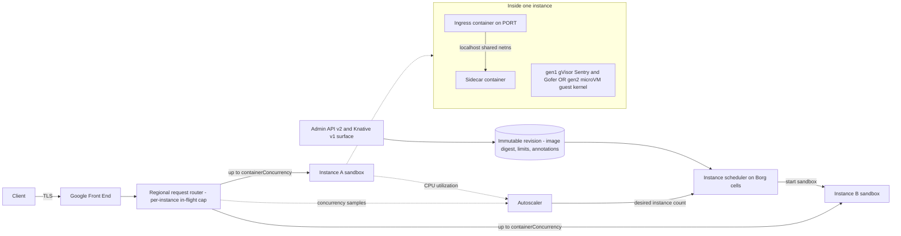

# Cloud Run and Serverless Container Execution

## TL;DR

Cloud Run runs an immutable container revision as autoscaled instances, and each instance is sandboxed either by gVisor (first generation) or by a microVM with a full Linux guest kernel (second generation).
The key difference from Lambda is that one instance serves many requests at once, so the in-flight request count that Little's law gives you (RPS x latency) is shared across instances rather than mapped to one sandbox per request.
That sharing is a cost lever and a risk at the same time: you pay for instance time instead of request time, but one OOM or crash fails every request in flight on that instance, and a slow dependency makes the platform scale out right into it.
A cold start has several phases (placement, sandbox boot, runtime init, application init, startup probe), and each phase has its own fix: execution environment choice, startup CPU boost, min instances, lazy init, and gradual traffic migration.
Sidecars share the instance's network namespace, memory volumes, and shutdown window, so container ordering, CPU allocation, and SIGTERM handling decide whether telemetry, proxies, and auth agents survive a scale-in.

## Mental Model



Start with three loops.
The data-plane loop is GFE to router to instance, and the router's main job is admission control: it never sends an instance more than `containerConcurrency` requests at once.
The control loop is the autoscaler, which reads per-instance concurrency and CPU utilization and asks the scheduler for more or fewer sandboxes.
The deployment loop turns an Admin API call into an immutable revision pinned to an image digest, and every instance of that revision is a copy of that one spec.
Most Cloud Run behavior, including the failure modes later in this chapter, comes from how these loops interact over time: the router reacts per request in microseconds, the autoscaler reacts over tens of seconds, and a cold start costs between hundreds of milliseconds and tens of seconds.

## Internals

### Control plane versus data plane

The Cloud Run Admin API comes in two versions: v2 is the native API, and v1 implements the Knative Serving resource model (`serving.knative.dev/v1` Service, Revision, Route), so a Knative YAML manifest deploys with `gcloud run services replace`.
A deploy creates a new revision, and a revision is immutable: image digest, CPU and memory limits, concurrency, timeout, environment, volumes, and annotations.
Tags such as `:latest` are resolved to a digest at deploy time, so a revision cannot drift when a tag later moves.
The data plane only needs that revision record and the instance fleet to keep serving, which means already-running revisions should ride through control-plane trouble (see [[17-Cloud-AI-Engineering/Volume_01_Cloud_Architecture_Principles/Chapter_04_Control_Plane_vs_Data_Plane_Separation|Control Plane vs Data Plane Separation]]).
Scaling up is the exception, because it depends on the autoscaler and the scheduler, so a service sitting at its warm capacity is statically stable and a service that needs new instances is not (see [[17-Cloud-AI-Engineering/Volume_01_Cloud_Architecture_Principles/Chapter_02_Regions_Zones_and_Static_Stability|Regions, Zones, and Static Stability]]).
Google has said publicly that Cloud Run runs on Borg infrastructure, so placement, bin-packing, and machine failure handling are Borg-cell concerns that the user never sees (see [[17-Cloud-AI-Engineering/Volume_13_Seminal_Papers_and_Case_Studies/Chapter_07_Google_Borg_and_Omega|Google Borg and Omega]]).

### Sandbox generation 1: gVisor as an application kernel

The first generation execution environment is based on gVisor, offers fast cold starts, and emulates most but not all operating system calls (Google Cloud docs, as of 2026-10).
gVisor splits the kernel role into a few cooperating processes.
The Sentry is a user-space kernel written in Go that implements the Linux syscall ABI, including memory management, signals, a VFS, and a full TCP/IP stack called netstack.
The Gofer is a separate process that brokers host filesystem access for the Sentry over an RPC protocol (9P originally, lisafs in current releases), so a compromised Sentry still cannot open arbitrary host files.
The Sentry also runs under its own restrictive seccomp filter, which means an attacker has to escape the Sentry first and then gets only a small host syscall surface.

The way syscalls are intercepted is called the platform, and it determines the cost of every syscall.
The ptrace platform stops the application on each syscall and switches to the Sentry, which costs several context switches per call.
The KVM platform runs the Sentry as a guest kernel and needs hardware virtualization, and inside a cloud VM that means nested virtualization.
The systrap platform installs a seccomp filter that returns `SECCOMP_RET_TRAP` for application syscalls, so the kernel delivers `SIGSYS` to a small stub inside the sandboxed process.
That stub hands syscall arguments to the Sentry through shared memory, which avoids the full ptrace stop and does not need nested virtualization.
gVisor made systrap its default platform in 2023, and how Cloud Run configures its platform internally is not public (UNVERIFIED).

The cost model follows from this structure.
Pure user-space compute such as JSON parsing or matrix arithmetic runs at near-native speed, because no syscall crosses the interception boundary.
Workloads heavy in syscalls, file metadata, and small I/O pay a per-call tax, and network traffic goes through netstack instead of the host Linux TCP stack.
The HotCloud 2019 gVisor case study measured roughly 2.2x slower simple syscalls and two orders of magnitude slower open/close on external tmpfs, on the ptrace-era implementation ([Young et al., HotCloud 2019](https://www.usenix.org/conference/hotcloud19/presentation/young)).
Treat those ratios as historical upper bounds rather than current Cloud Run figures, because systrap, lisafs, and the 2022 first-generation filesystem speedup Google announced in its release notes have all closed part of the gap (Google Cloud docs, as of 2026-10).

### Sandbox generation 2: microVM with a real Linux kernel

The second generation execution environment is a microVM with full Linux compatibility, including all syscalls, namespaces, cgroups, and network file systems, plus faster CPU and network performance, especially under packet loss (Google Cloud docs, as of 2026-10).
Inside the guest, Cloud Run runs your containers in user, network, PID, and other Linux namespaces, so a root container is not "true root" even inside its own VM (Google Cloud docs, as of 2026-10).
In the second generation environment `/sys/class/dmi/id/product_name` reads `Google Compute Engine`, which points to a Compute-Engine-lineage VMM, although Google does not document the hypervisor stack (Google Cloud docs, as of 2026-10).
Second generation has longer cold starts than first generation because a guest kernel has to boot and initialize devices before your entrypoint runs (Google Cloud docs, as of 2026-10).
The packet-loss advantage is most likely because a lossy path exercises loss recovery and congestion control, and the Linux TCP stack has had decades more tuning there than netstack, but that is an inference, not a documented mechanism.
Cloud Run jobs always use the second generation environment (Google Cloud docs, as of 2026-10).
If a service does not specify an environment, Cloud Run picks one based on the features the service uses, so you should pin it explicitly and not depend on that heuristic (Google Cloud docs, as of 2026-10).
Second generation went GA on 2022-12-06, along with NFS and Cloud Storage FUSE volume support (Google Cloud release notes, as of 2026-10).
The comparison with Firecracker is in [[17-Cloud-AI-Engineering/Volume_00_Foundations_Under_the_Cloud/Chapter_01_Hypervisors_MicroVMs_and_Sandboxing|Hypervisors, MicroVMs, and Sandboxing]].

### Concurrent request multiplexing: admission at the router, scaling at the autoscaler

`containerConcurrency` (`--concurrency`) is a hard cap on in-flight requests per instance, and the router enforces it.
It does not ask the instance whether it is busy.
Until you set a better value, the platform assumes your process can handle that many requests at once on its configured CPU and memory.
The default is 80 and the maximum is 1000 concurrent requests per instance (Google Cloud docs, UNVERIFIED as of 2026-10).

Little's law sets how many instances you need.
Average in-flight requests are `L = lambda x W`, where `lambda` is arrival rate and `W` is wall-clock latency, including time spent waiting on downstream calls.
If the autoscaler targets a fraction `u` of max concurrency, the concurrency-driven instance count is `N_conc = lambda x W / (C x u)`.
CPU drives scaling separately: `N_cpu = lambda x t_cpu / (vCPU x u_cpu)`, where `t_cpu` is CPU-seconds per request.
Cloud Run documents a target of roughly 60 percent CPU utilization and 60 percent of max concurrency, averaged over a one-minute window (Google Cloud docs, UNVERIFIED as of 2026-10).
Whichever of `N_conc` and `N_cpu` is larger sets the instance count, capped by `--max-instances`.

The deeper mechanism is that `W` is not a property of your code.
It includes downstream latency, so a slow database raises `W`, which raises `L`, which raises `N_conc`, so the autoscaler starts instances and each new instance opens new connections to the database that is already slow.
This is a positive feedback loop between router admission and autoscaling, and it is the most common Cloud Run cascading failure (see Failure Modes).
The counter-intuitive fix is to lower `containerConcurrency` and set `--max-instances` deliberately so that total load on the dependency is bounded, and then to add client-side deadlines and load shedding (see [[17-Cloud-AI-Engineering/Volume_07_Reliability_and_SRE/Chapter_02_Load_Shedding_Backpressure_and_Admission_Control|Load Shedding, Backpressure, and Admission Control]]).

When every instance is at its cap and the autoscaler has not yet produced capacity, requests wait in the router for a bounded time.
After that they fail with HTTP 429 or 500-class errors, and the exact pending window is not a documented SLA (UNVERIFIED).
On scale-in, idle instances can be kept for up to about 15 minutes to absorb the next burst, and that retention is best-effort, not guaranteed (Google Cloud docs, UNVERIFIED as of 2026-10).

### CPU allocation, billing modes, and the background-work trap

Cloud Run has two billing modes, request-based and instance-based, which were earlier called "CPU allocated only during requests" and "CPU always allocated" (Google Cloud docs, UNVERIFIED as of 2026-10).
Under request-based billing, an instance gets CPU only while at least one request is in flight, and outside that window CPU is throttled to near zero.
The throttle is most likely a cgroup CPU quota (inference), and it affects everything in the instance: background goroutines, thread pools, timers, gRPC keepalives, and sidecars.
Billable time under request-based billing is the union of intervals with at least one active request, rounded up to 100 ms, not the sum of request durations (Google Cloud docs, UNVERIFIED as of 2026-10).
Because billing counts the union of active intervals, 80 overlapping requests cost the same instance-seconds as one, which is the economic argument for concurrency.
Instance-based billing charges for the whole instance lifetime at a lower unit rate with no per-request fee, and it keeps CPU available between requests (Google Cloud pricing, UNVERIFIED as of 2026-10).

The background-work trap catches anyone who moves a service from GKE to Cloud Run.
Code that flushes batched telemetry, renews leases, refreshes OAuth tokens, or drains a Pub/Sub streaming pull on a background thread works fine under load and then stalls silently once traffic stops.
When the next request arrives, the backlog lands on the request path as a latency spike, or a lease has already expired and the work is done twice.
Any instance doing work outside requests should use instance-based billing (`--no-cpu-throttling`), or should move that work to Cloud Run jobs or a push-based trigger.

### Cold start anatomy

A cold start breaks into five phases, and each one has a different owner.
Phase 1 is placement: the scheduler picks a machine with capacity in a zone of the region, which Google owns.
Phase 2 is image availability on the host, which depends on the image Cloud Run resolved and copied at deploy time and on host-level caching; Google does not publish the internals.
Phase 3 is sandbox boot: gVisor needs only Sentry and Gofer setup, while second generation boots a guest kernel, which is why first generation documents faster cold starts.
Phase 4 is runtime init, such as JVM class loading, Python imports, or CUDA context creation, and it scales with dependency count and the CPU available.
Phase 5 is application init (connection pools, config fetches, model weight loading) and ends when the startup probe passes or the port starts listening.

Phases 4 and 5 are CPU-bound for most real services, which is why startup CPU boost (`--cpu-boost`) helps.
It temporarily raises the instance's CPU allocation during startup, so a 1-vCPU JVM service gets more cores while it JITs (Google Cloud docs, UNVERIFIED as of 2026-10).
Min instances (`--min-instances`) keeps warm capacity per revision and bills it at an idle rate, so it removes cold starts for a steady baseline and does nothing for bursts above that baseline.
Revision-scoped min instances are the source of a common surprise: a 100 percent traffic cutover to a new revision sends all traffic to instances that have to start cold, while the old revision's warm instances sit idle.
Gradual traffic migration (`gcloud run services update-traffic --to-revisions=NEW=10`) amortizes those cold starts over the rollout and also gives you a canary (see [[17-Cloud-AI-Engineering/Volume_06_Infrastructure_as_Code_and_Delivery/Chapter_06_Progressive_Delivery_and_Deployment_Pipelines|Progressive Delivery and Deployment Pipelines]]).
For comparison, AWS Lambda's on-demand container loading splits images into deduplicated, convergently encrypted chunks and loads them lazily through a tiered cache ([Brooker et al., USENIX ATC 2023](https://www.usenix.org/conference/atc23/presentation/brooker)), so image size there turns into a hit-rate problem rather than a transfer-time problem.
GPU instances add CUDA initialization and weight loading to phase 5, which dominates all the other phases (see [[17-Cloud-AI-Engineering/Volume_11_LLM_Serving_and_Inference_Systems_on_Cloud/Chapter_08_Cloud_GPU_Autoscaling_and_Cold_Start_Mitigation|Cloud GPU Autoscaling and Cold-Start Mitigation]]).

### Sidecar container lifecycles

A multi-container instance has exactly one ingress container, which receives traffic on `PORT`, and some number of sidecars, all of which share the instance's network namespace and can talk over `localhost`.
The per-instance container limit is 10 (Google Cloud docs, UNVERIFIED as of 2026-10).
Containers can share `emptyDir` volumes, and in-memory volumes count against the memory limit of the container that writes to them.
Startup order is declared with the `run.googleapis.com/container-dependencies` annotation in Knative YAML or `dependsOn` in the v2 API, and a container starts only after its dependencies report started, which means passing their startup probes.
A dependency without a startup probe counts as started as soon as its process launches, so ordering without probes guarantees only exec order, not readiness.

Shutdown is where sidecars usually go wrong.
On scale-in or revision replacement the instance receives `SIGTERM`, and processes still alive after a short grace period, documented as 10 seconds, get `SIGKILL` (Google Cloud docs, UNVERIFIED as of 2026-10).
Google recommends installing a SIGTERM handler for second generation services (Google Cloud docs, as of 2026-10).
Every container in the instance shares that one grace window, so an OpenTelemetry collector sidecar that needs 8 seconds to flush, behind an app that takes 5 seconds to drain, will lose data.
Under request-based billing a sidecar is also CPU-throttled between requests, so an exporter running on a 60-second batch timer may never flush at all.
Proxies, collectors, and auth agents run as sidecars should therefore use instance-based billing, small batch timeouts, and a flush on SIGTERM that finishes in well under the grace window.

### Failure domains

A Cloud Run service is regional, and Google spreads instances across the zones in that region; GPU services can opt out of zonal redundancy to cut cost, accepting zonal risk (Google Cloud docs, UNVERIFIED as of 2026-10).
Losing an instance takes out up to `containerConcurrency` in-flight requests, so concurrency is a blast-radius setting as well as a throughput setting.
Losing a region takes out the service, so multi-region deployments put serverless network endpoint groups behind a global external Application Load Balancer (see [[17-Cloud-AI-Engineering/Volume_03_GCP_Deep_Dive/Chapter_05_Cloud_Load_Balancing_GFEs_and_Maglev|Cloud Load Balancing: GFEs and Maglev]]).

## Numbers to Know

| Quantity | Value | Source |
|---|---|---|
| First generation sandbox | gVisor, syscall emulation, faster cold start | (Google Cloud docs, as of 2026-10) |
| Second generation sandbox | microVM, full Linux, network FS, longer cold start | (Google Cloud docs, as of 2026-10) |
| Jobs execution environment | Always second generation | (Google Cloud docs, as of 2026-10) |
| Second generation GA date | 2022-12-06 | (Google Cloud release notes, as of 2026-10) |
| Default / max concurrency per instance | 80 / 1000 | (Google Cloud docs, UNVERIFIED as of 2026-10) |
| Service request timeout | Default 300 s, max 3600 s | (Google Cloud docs, UNVERIFIED as of 2026-10) |
| Max CPU / memory per instance | 8 vCPU / 32 GiB | (Google Cloud docs, UNVERIFIED as of 2026-10) |
| Containers per instance | Up to 10, one ingress | (Google Cloud docs, UNVERIFIED as of 2026-10) |
| SIGTERM to SIGKILL grace | 10 s | (Google Cloud docs, UNVERIFIED as of 2026-10) |
| Idle instance retention | Up to about 15 min, best-effort | (Google Cloud docs, UNVERIFIED as of 2026-10) |
| Autoscaler targets | About 60 percent CPU and 60 percent of max concurrency over 1 min | (Google Cloud docs, UNVERIFIED as of 2026-10) |
| Default max instances per revision | 100 | (Google Cloud docs, UNVERIFIED as of 2026-10) |
| HTTP/1 request body limit | 32 MiB, lifted with end-to-end HTTP/2 | (Google Cloud docs, UNVERIFIED as of 2026-10) |
| Billing granularity, request-based | 100 ms over union of active intervals | (Google Cloud pricing, UNVERIFIED as of 2026-10) |
| Request-based price, Tier 1 | $0.000024 per vCPU-s, $0.0000025 per GiB-s, $0.40 per million requests | (Google Cloud pricing, UNVERIFIED as of 2026-10) |
| Instance-based price, Tier 1 | $0.000018 per vCPU-s, $0.0000020 per GiB-s, no request fee | (Google Cloud pricing, UNVERIFIED as of 2026-10) |
| Monthly free tier, request-based | 180,000 vCPU-s, 360,000 GiB-s, 2 million requests | (Google Cloud pricing, UNVERIFIED as of 2026-10) |
| GPU option | NVIDIA L4 24 GB, 1 per instance, min 4 vCPU and 16 GiB | (Google Cloud docs, UNVERIFIED as of 2026-10) |
| gVisor ptrace-era overhead | About 2.2x simple syscalls, much higher for small-file metadata | (HotCloud 2019 paper, historical) |
| Firecracker boot / overhead | Under 125 ms to user space, under 5 MiB per microVM | (NSDI 2020 paper) |
| Lambda concurrency per environment | 1 request per execution environment (default mode) | (AWS docs, UNVERIFIED as of 2026-10) |
| Lambda limits | 15 min timeout, 10,240 MB memory | (AWS docs, UNVERIFIED as of 2026-10) |
| Lambda price, x86 us-east-1 | $0.0000166667 per GB-s, $0.20 per million requests | (AWS pricing, UNVERIFIED as of 2026-10) |

## AWS vs GCP Mechanism Parity

| Dimension | Google Cloud Run | AWS Lambda | AWS ECS on Fargate | Critical difference |
|---|---|---|---|---|
| Isolation | gVisor (gen1) or microVM (gen2), plus namespaces | Firecracker microVM per execution environment | VM-isolated task boundary | Gen1 swaps syscall compatibility for start speed; Lambda and gen2 run a guest kernel |
| Unit of scale | Instance serving up to `containerConcurrency` requests | Execution environment serving one request at a time (default mode) | Task, scaled by Application Auto Scaling | Cloud Run spreads the Little's-law concurrency over instances; Lambda gives each request its own environment |
| Admission control | Router-enforced per-instance in-flight cap | Per-function reserved and account concurrency quotas | ALB or NLB with target health | Cloud Run admission is per instance; Lambda admission is per function and per account |
| Autoscaling signal | CPU and concurrency targets over about 1 min | Instant per-request provisioning up to a burst scaling rate | Target tracking on CloudWatch metrics, minutes | Lambda scales per request with no utilization target; Cloud Run lags behind steps in demand |
| Billing | Instance time (union of active intervals) or full instance lifetime | Per-request duration times configured memory | Per task vCPU and GB lifetime | I/O-heavy streaming is far cheaper when billed per instance |
| Cold start mitigation | Min instances, startup CPU boost, gen1 | Provisioned concurrency, SnapStart | Keep tasks warm | SnapStart restores a memory snapshot; Cloud Run has no documented snapshot restore (UNVERIFIED) |
| Image loading | Digest resolved and copied at deploy | Chunked, deduplicated, lazily loaded image | Image pull, optional SOCI lazy loading | Lambda's lazy loading mechanism is published ([[17-Cloud-AI-Engineering/Volume_02_AWS_Deep_Dive/Chapter_05_Serverless_Compute_and_Lambda_Internals\|Lambda Internals]]) |
| Sidecars | Up to 10 containers, dependency ordering, shared netns | Extensions API inside the environment | Multi-container task definitions with `dependsOn` | Cloud Run and ECS support real sidecar containers; Lambda extensions are processes inside the function sandbox |
| Shutdown signal | SIGTERM, then SIGKILL after about 10 s | SHUTDOWN event to extensions, short limit | SIGTERM, then SIGKILL after `stopTimeout` | Fargate lets you configure the grace period; Cloud Run's is fixed |
| Max request duration | 60 min for services | 15 min | Unbounded | Long streams fit Cloud Run or Fargate, not default Lambda |
| API surface | Knative Serving v1 compatible plus Admin API v2 | Proprietary Lambda API | ECS API | Knative compatibility makes a GKE move mostly a manifest change ([[17-Cloud-AI-Engineering/Volume_03_GCP_Deep_Dive/Chapter_07_GKE_Deep_Dive_Standard_vs_Autopilot\|GKE Deep Dive]]) |
| Private egress | Direct VPC egress or Serverless VPC Access connector | ENI-attached VPC config via Hyperplane | awsvpc ENI per task | Connector throughput is a separately scaled hop; Direct VPC egress removes it |
| Accelerators | NVIDIA L4 GPU option (UNVERIFIED as of 2026-10) | None | None on Fargate | Only Cloud Run offers scale-to-zero GPU containers among these three |

## Worked Example: Sidecar-Ordered Service, Capacity Math, and Teardown

### Lab cost estimate

The lab deploys one Cloud Run service with two containers totaling 2 vCPU and 768 MiB, request-based billing, and `minScale: 0`.
A few hundred curl requests at under 100 ms each use far less than 1,000 vCPU-seconds, which is inside the monthly free tier, so expected cost is under $0.05 (pricing UNVERIFIED as of 2026-10).
The expensive mistake is leaving min instances at 1 with instance-based billing: 2 vCPU x $0.000018 x 2,592,000 s plus 0.75 GiB x $0.000002 x 2,592,000 s comes to about $97 per month.
The budget alarm below sends an alert at 50 and 90 percent of $10 so that a mistake like that is caught.

### Service manifest

```yaml
# service.yaml - deploy with: gcloud run services replace service.yaml --region us-central1
apiVersion: serving.knative.dev/v1
kind: Service
metadata:
  name: sidecar-lab
spec:
  template:
    metadata:
      annotations:
        run.googleapis.com/execution-environment: gen2
        run.googleapis.com/startup-cpu-boost: "true"
        run.googleapis.com/container-dependencies: '{"app":["helper"]}'
        autoscaling.knative.dev/minScale: "0"
        autoscaling.knative.dev/maxScale: "3"
    spec:
      containerConcurrency: 40
      timeoutSeconds: 60
      containers:
        - name: app
          image: us-docker.pkg.dev/cloudrun/container/hello
          ports:
            - containerPort: 8080
          resources:
            limits:
              cpu: "1"
              memory: 512Mi
          startupProbe:
            tcpSocket:
              port: 8080
            periodSeconds: 2
            failureThreshold: 15
        - name: helper
          image: busybox:1.36
          command: ["sh", "-c"]
          args: ["mkdir -p /tmp/www && echo ok > /tmp/www/index.html && exec httpd -f -p 8081 -h /tmp/www"]
          resources:
            limits:
              cpu: "1"
              memory: 256Mi
          startupProbe:
            tcpSocket:
              port: 8081
            periodSeconds: 1
            failureThreshold: 10
```

The `app` container starts only after `helper` passes its TCP startup probe, so `app` can rely on `localhost:8081` existing when its own init runs.
Only `app` declares a port, which makes it the ingress container, and `helper` can be reached only from inside the instance.

### Deploy, verify, budget, teardown

```bash
#!/usr/bin/env bash
set -euo pipefail
PROJECT_ID="$(gcloud config get-value project)"
REGION="us-central1"
BILLING_ACCOUNT="XXXXXX-XXXXXX-XXXXXX"   # replace with your billing account ID

gcloud services enable run.googleapis.com billingbudgets.googleapis.com

# Budget alarm: alert at 50 and 90 percent of 10 USD for this project.
gcloud billing budgets create \
  --billing-account="${BILLING_ACCOUNT}" \
  --display-name="sidecar-lab-budget" \
  --budget-amount=10USD \
  --threshold-rule=percent=0.5 \
  --threshold-rule=percent=0.9 \
  --filter-projects="projects/${PROJECT_ID}"

gcloud run services replace service.yaml --region "${REGION}"

URL="$(gcloud run services describe sidecar-lab --region "${REGION}" --format='value(status.url)')"
TOKEN="$(gcloud auth print-identity-token)"
for i in $(seq 1 50); do
  curl -s -o /dev/null -w '%{http_code} %{time_total}\n' -H "Authorization: Bearer ${TOKEN}" "${URL}"
done

# Teardown: delete the service, then the budget.
gcloud run services delete sidecar-lab --region "${REGION}" --quiet
BUDGET_ID="$(gcloud billing budgets list --billing-account="${BUDGET_ACCOUNT:-$BILLING_ACCOUNT}" \
  --filter='displayName=sidecar-lab-budget' --format='value(name)')"
gcloud billing budgets delete "${BUDGET_ID}" --quiet
```

The first `time_total` should be noticeably larger than the rest, and that difference is your cold start measured from the client.
In Cloud Logging, the gap between the `helper` and `app` container start entries shows the ordering at work.

### Capacity sizing calculator

```python
# capacity.py - Little's law sizing for Cloud Run vs per-request billing.
# Prices are Tier 1 list prices, UNVERIFIED as of 2026-10; replace from the pricing page.
SEC_PER_MONTH = 30 * 24 * 3600
CPU_INST, MEM_INST = 0.000018, 0.0000020      # instance-based, per vCPU-s and GiB-s
CPU_REQ, MEM_REQ, REQ_FEE = 0.000024, 0.0000025, 0.40
LAMBDA_GB_S, LAMBDA_REQ = 0.0000166667, 0.20  # x86, UNVERIFIED as of 2026-10

def size(rps, wall_s, cpu_s, vcpu, concurrency, u=0.6):
    inflight = rps * wall_s
    n_conc = inflight / (concurrency * u)
    n_cpu = rps * cpu_s / (vcpu * u)
    return inflight, n_conc, n_cpu, max(n_conc, n_cpu)

def monthly_instance_based(n, vcpu, gib):
    return n * SEC_PER_MONTH * (vcpu * CPU_INST + gib * MEM_INST)

if __name__ == "__main__":
    # A: JSON API, 2000 RPS, 250 ms wall, 20 ms CPU, 2 vCPU 2 GiB, concurrency 80.
    print("A", size(2000, 0.25, 0.020, 2, 80))
    print("A with concurrency 10", size(2000, 0.25, 0.020, 2, 10))
    print("A cost instance-based 34 inst", round(monthly_instance_based(34, 2, 2)))
    # B: LLM token streaming gateway, 200 RPS, 20 s streams, 50 ms CPU, concurrency 250.
    infl, nc, ncpu, n = size(200, 20.0, 0.050, 2, 250)
    print("B", infl, nc, ncpu)
    print("B cost Cloud Run 27 inst", round(monthly_instance_based(27, 2, 2)))
    print("B cost Lambda 512 MB", round(infl * 0.5 * LAMBDA_GB_S * SEC_PER_MONTH
                                        + 200 * SEC_PER_MONTH / 1e6 * LAMBDA_REQ))
```

### Back-of-the-envelope walk-through

Scenario A is a JSON API at 2,000 RPS peak with 250 ms wall latency (mostly waiting on a downstream) and 20 ms of CPU per request, on 2-vCPU, 2-GiB instances.
In-flight requests are `2000 x 0.25 = 500`.
CPU-driven count is `2000 x 0.020 / (2 x 0.6) = 33.3`, so about 34 instances.
Concurrency-driven count at `C = 80` is `500 / (80 x 0.6) = 10.4`, so CPU decides and each instance averages about 15 requests in flight.
Lowering concurrency to 10 changes the binding constraint to `500 / (10 x 0.6) = 83` instances, which is 2.5x the fleet for the same work.
Running 34 instances around the clock on instance-based billing costs about $3,525 per month, and on request-based billing with constant load the same fleet costs about $6,744 including $2,074 in request fees.
When load is flat and high, instance-based billing wins; request-based billing wins only when instances are idle for a large share of the time.

Scenario B is an LLM token-streaming gateway at 200 RPS, where each stream stays open 20 s and uses only 50 ms of CPU.
In-flight requests are `200 x 20 = 4,000`.
At `C = 250` the concurrency-driven count is `4000 / 150 = 26.7`, about 27 instances, and the CPU-driven count is only 16.7, so concurrency decides.
Twenty-seven 2-vCPU, 2-GiB instances on instance-based billing cost about $2,800 per month.
The same workload on default-mode Lambda needs 4,000 concurrent execution environments, each billed for the full 20 s it spends waiting on tokens, which at 512 MB is about $86,500 per month.
It would also need a concurrency quota increase above the usual 1,000 default (AWS docs, UNVERIFIED as of 2026-10).
That 30x gap comes from billing per request versus per instance on a workload that is almost all waiting, and it is the central argument in [[17-Cloud-AI-Engineering/Volume_11_LLM_Serving_and_Inference_Systems_on_Cloud/Chapter_11_End_to_End_Latency_Throughput_and_Cost_Modeling|End-to-End Latency, Throughput, and Cost Modeling]].
The limit on `C = 250` is memory: 250 streams per instance at about 2 MB of buffers each is 500 MB, so 2 GiB leaves room, while `C = 1000` would risk an OOM that fails 1,000 streams at once.

## Failure Modes and Pitfalls

### Autoscaler-amplified connection storms

A database p99 regression doubles `W`, which doubles in-flight requests, and the autoscaler roughly doubles the instance count.
Every new instance warms its connection pool, so total connections can exceed Cloud SQL `max_connections`.
The database then rejects connections and slows further, and the loop continues until `--max-instances` stops it.
Bound total connections explicitly: `max_instances x pool_size_per_instance` must fit inside the database's connection budget with headroom.
Then add per-request deadlines and fast failure on pool exhaustion so that `W` stays bounded (see [[17-Cloud-AI-Engineering/Volume_07_Reliability_and_SRE/Chapter_03_Resilient_Communication_Retries_Jitter_and_Circuit_Breakers|Retries, Jitter, and Circuit Breakers]]).

### Concurrency as blast radius

If one request triggers unbounded allocation, the OOM kill takes the whole instance down with every request on it.
The writable container filesystem is in memory, so writing temp files or logs to local disk uses the same memory budget and causes the same kind of OOM.
The fix is to set `containerConcurrency` from measured peak memory per request rather than leaving the default of 80, and to stream large payloads instead of buffering them.

### Silent background starvation

Under request-based billing, telemetry exporters, token refreshers, and pull subscribers stall when traffic stops, and the platform raises no error.
The symptom is a cluster of missing spans at the end of each traffic burst, or a first request after an idle period that takes seconds longer than normal.
The fix is to use instance-based billing for any service with background work, or to move that work into the request path or into jobs.

### Revision cutover cold-start stampede

A 100 percent traffic shift lands on a revision whose min instances have just started, or on zero instances, while the old revision's warm fleet does nothing.
For JVM or Python services with heavy imports, the first minute after the shift shows high TTFB and router queueing.
Use gradual traffic migration with tagged revisions, and size min instances on the new revision before the shift.

### Sidecar shutdown data loss

All containers share one fixed SIGTERM grace window, so a slow-draining app plus a slow-flushing collector can go over it and the remainder is SIGKILLed.
The fix is short exporter batch intervals, a SIGTERM handler that flushes within about 3 seconds, and startup probes on every dependency.

### gVisor compatibility and performance cliffs

Software that relies on less common syscalls, raw sockets, or io_uring-style interfaces can fail or slow sharply under first generation, and the only clue may be a log line such as "function not implemented".
Check the gVisor syscall compatibility table, or pin `gen2` for databases, network file systems, and syscall-heavy native code.

### Regional control-plane and dependency outages

On 2025-06-12, Google Cloud had a multi-product outage when a new quota-policy code path in Service Control, the API admission system, hit a null pointer and crash-looped across regions.
The change had not been feature-flagged, and recovery in us-central1 took longer because restarting tasks overloaded a shared Spanner dependency ([Google Cloud incident report](https://status.cloud.google.com/incidents/ow5i3PPK96RduMcb1SsW)).
For Cloud Run designers, the lesson is that management APIs and anything authenticated through Google APIs share a common admission dependency, so warm capacity and static configuration are what survive.
On 2025-10-20 the AWS us-east-1 DynamoDB DNS automation race left an empty DNS record for the regional endpoint, and Lambda, which depends on DynamoDB internally, was degraded for hours ([AWS post-event summary](https://aws.amazon.com/message/101925/)).
Both incidents point to the same rule: serverless platforms inherit the availability of their internal metadata stores, so multi-region failover has to be built above the platform (see [[17-Cloud-AI-Engineering/Volume_07_Reliability_and_SRE/Chapter_07_Anatomy_of_Major_Cloud_Outages|Anatomy of Major Cloud Outages]]).

### Quota and max-instance ceilings

Regional instance and CPU quotas, along with the per-revision max instances default, cap scaling silently until a traffic spike returns 429s.
Track instance count against max instances and alert at 80 percent.

## Security and Cost Angles

### Identity and IAM

Every service runs as a service identity, and the default Compute Engine service account is usually overprivileged.
Assign a dedicated per-service account that has only the roles the service needs.
Invocation requires `roles/run.invoker` unless the service is deliberately public, and service-to-service calls should use Google-signed ID tokens with the target URL as audience.
Deployers need `roles/run.developer` plus `iam.serviceAccounts.actAs` on the runtime service account, and that actAs grant is the real privilege-escalation edge to watch (see [[17-Cloud-AI-Engineering/Volume_03_GCP_Deep_Dive/Chapter_02_Cloud_IAM_Roles_Policies_and_Conditions|Cloud IAM]]).

### Network boundaries

The ingress setting (`all`, `internal`, `internal-and-cloud-load-balancing`) limits which networks can reach the service, and IAM is a separate check that applies on top of it.
Direct VPC egress places instance traffic in your subnet under VPC firewall rules, and `--vpc-egress=all-traffic` forces internet egress through Cloud NAT so you can control it.
Cloud Run is a VPC Service Controls supported service, so a perimeter can stop a compromised instance from exfiltrating to buckets in other projects (see [[17-Cloud-AI-Engineering/Volume_03_GCP_Deep_Dive/Chapter_03_VPC_Service_Controls_Security_Perimeters|VPC Service Controls]]).

### Keys and supply chain

Mount secrets from Secret Manager pinned to versions rather than `latest`, so that a rotation is an explicit deploy.
Artifact Registry with CMEK and a Binary Authorization policy ensures that only attested digests become revisions (see [[17-Cloud-AI-Engineering/Volume_08_Security_Identity_and_the_Data_Perimeter/Chapter_05_Software_Supply_Chain_Security_SLSA_and_Sigstore|SLSA and Sigstore]]).
For untrusted, AI-generated code, the July 2026 release notes announce Cloud Run sandboxes as an isolated environment for running untrusted code; check the launch stage before relying on it (Google Cloud release notes, as of 2026-10; GA status UNVERIFIED).

### Unit-economics levers

Concurrency is the biggest cost lever, because instance-seconds are shared across all overlapping requests.
Billing mode is next: use instance-based billing for steady or streaming load and request-based billing for spiky load with long idle periods.
Min instances buys lower p99 at an idle price, so price it as an SLO purchase, not as a default.
Right-size CPU against the CPU-driven instance count, because on I/O-bound services excess vCPU buys nothing once concurrency is the binding constraint.
Committed use discounts can apply to Cloud Run spend; check current eligibility before modeling it (UNVERIFIED as of 2026-10; see [[17-Cloud-AI-Engineering/Volume_09_FinOps_and_Cloud_Economics/Chapter_02_Commitment_Discounts_Savings_Plans_vs_CUDs|Commitment Discounts]]).

## Interview Questions and Model Answers

### Question 1 (L5 - Senior)

A service handles 1,200 RPS at 400 ms p50 wall time with 30 ms CPU per request on 1-vCPU instances, and concurrency is left at the default. How many instances will Cloud Run run, and what would you change?

#### Model Answer

In-flight requests are `1200 x 0.4 = 480` by Little's law.
CPU-driven count at a roughly 60 percent target is `1200 x 0.030 / (1 x 0.6) = 60` instances.
Concurrency-driven count at `C = 80` is `480 / 48 = 10` instances, so CPU is the binding constraint and the fleet is about 60 instances averaging 8 requests in flight each.
Each instance never gets near its concurrency cap, so the default does no harm here.
The question that matters is whether 30 ms of CPU per request is real or a sign of serialization and logging overhead, because halving it halves the fleet.
I would also try 2-vCPU instances only if the runtime actually uses multiple cores, because a single-threaded Node process on 2 vCPU still saturates one core.
Last, I would set `--max-instances` from the downstream connection budget rather than from expected traffic.

#### Follow-up Interviewer Question

Downstream latency doubles to 800 ms with CPU per request unchanged; what happens to the instance count and to the database?

### Question 2 (L5 - Senior)

Walk through a Cloud Run cold start for a Spring Boot service and say which phase each mitigation addresses.

#### Model Answer

Placement and sandbox boot belong to the platform, and the only control there is the execution environment, since first generation boots faster because there is no guest kernel.
JVM class loading and JIT warm-up are CPU-bound runtime init, which startup CPU boost targets by granting extra CPU only during startup.
Application init, such as building the Spring context, connection pools, and config fetches, is under your control: lazy beans, fewer auto-configurations, and deferring non-critical clients.
A startup probe sets when the router considers the instance ready, so a probe that passes too early sends traffic to an instance that then serves slowly.
Min instances hides cold starts for a baseline but is scoped to a revision, so it does nothing for the first minute after a 100 percent cutover.
Gradual traffic migration fixes the cutover case, and only snapshot-style restore would remove JVM init entirely; that is Lambda SnapStart's approach, and I would not assume Cloud Run has an equivalent.

#### Follow-up Interviewer Question

How would you measure each phase separately in production without access to platform internals?

### Question 3 (L6 - Staff)

When would you pin first generation (gVisor) over second generation (microVM), and what evidence would you gather before choosing?

#### Model Answer

The trade-off is per-syscall cost and compatibility against cold start latency.
Interception through gVisor's Sentry taxes every syscall, and netstack replaces Linux TCP, so syscall-dense workloads and lossy long-haul networking favor second generation.
First generation fits scale-to-zero services with bursty traffic and compute-heavy request handling, where cold start is a large share of user-visible latency and the syscall mix is simple.
Before choosing, I would trace a representative load with `strace -c` or eBPF on a GKE replica to get the syscall histogram, and run the gVisor compatibility table against it.
I would also run A/B revisions with tagged URLs, comparing p50 and p99 latency, CPU-seconds per request, and cold start counts per hour.
Cost per successful request is the decision metric, because second generation's faster CPU can lower the CPU-driven instance count even with slower boots.
Anything needing NFS, Cloud Storage FUSE, or full cgroup and namespace semantics must use second generation, and jobs use it regardless.
I would pin the choice explicitly, because an unspecified environment lets the platform pick based on features, and a later feature change could silently move the service to the other sandbox.

#### Follow-up Interviewer Question

Your gen1 service's p99 doubles only for clients on a lossy mobile network; what is your hypothesis and how do you test it?

### Question 4 (L6 - Staff)

Design guardrails so a Cloud Run service cannot take down the Cloud SQL instance behind it during a latency regression.

#### Model Answer

The failure loop runs: latency rises, in-flight requests rise, the autoscaler adds instances, connections multiply, the database saturates, and latency rises again.
Guardrail one is an invariant enforced in CI: `max_instances x max_pool_size` must stay below about 80 percent of `max_connections`, minus reserved admin and replica connections.
Guardrail two sets `containerConcurrency` near `max_pool_size x k`, where `k` is the ratio of request time to time a connection is held, so requests queue at the router instead of inside the process.
Guardrail three is a pool-checkout timeout of tens of milliseconds that returns 503 with `Retry-After`, which bounds `W` and turns overload into fast, cheap failure.
Guardrail four is a connection proxy or pooler, such as a pooler sidecar or the database's managed pooling, that decouples instance count from server connection count.
Guardrail five is client retry budgets with jitter, so callers do not multiply the load.
I would test all of this with a fault-injection game day that adds 500 ms of latency on the database path and checks that the database stays healthy while the service sheds load (see [[17-Cloud-AI-Engineering/Volume_07_Reliability_and_SRE/Chapter_05_Chaos_Engineering_and_Game_Days|Chaos Engineering and Game Days]]).

#### Follow-up Interviewer Question

The product team says shedding with 503s violates their SLO; how do you reframe the error-budget conversation?

### Question 5 (L6 - Staff)

Your OpenTelemetry collector sidecar loses about 5 percent of spans, all from the last seconds before instances scale in. Explain the mechanism and fix it.

#### Model Answer

There are two mechanisms, and they compound.
First, under request-based billing the whole instance, including the sidecar, is CPU-throttled once the last request finishes, so the collector's batch timer does not run and spans pile up in memory.
Second, on scale-in every container gets SIGTERM together and has a fixed grace window of about 10 seconds before SIGKILL, so any flush still in progress is lost.
The fixes are instance-based billing for the revision so the sidecar keeps CPU, and a short batch timeout such as 1 to 2 seconds with bounded queue size.
The collector also needs a SIGTERM path that flushes within about 3 seconds, ordered so the app drains first and the collector flushes last.
Startup ordering through `container-dependencies` with a collector startup probe covers the other end, so the app never emits spans before the collector is listening.
If cost rules out instance-based billing, I would move to synchronous export through a direct exporter in the app for critical spans, accepting more request latency.

#### Follow-up Interviewer Question

How would you prove the fix worked, given that the missing data is the telemetry itself?

### Question 6 (L7+ - Principal)

You are choosing a platform for an LLM token-streaming gateway: 200 RPS, 20-second streams, under 100 ms CPU per stream, multi-region. Compare Cloud Run, default-mode Lambda, and GKE, and defend a choice.

#### Model Answer

The workload holds about 4,000 streams open at any moment and spends almost all of its time waiting, so the decision rests on billing granularity and connection density, not compute.
Default-mode Lambda gives each stream its own execution environment billed for its full wall time, which comes to roughly $86,000 per month at 512 MB under current list prices I would re-verify, plus a concurrency quota increase.
Cloud Run at `C = 250` on 2-vCPU, 2-GiB instances needs about 27 instances, roughly $2,800 per month on instance-based billing, with a 60-minute stream ceiling.
GKE could run even cheaper on committed nodes, but it adds node operations, upgrades, and autoscaler tuning, and that platform team's time costs more than the difference at this scale.
I would choose Cloud Run in two or more regions behind a global external Application Load Balancer with serverless NEGs, using instance-based billing and min instances sized to the baseline.
The risks I would name are blast radius (250 streams per OOM), a fixed SIGTERM window that cuts streams on scale-in, and router queueing during load steps.
Mitigations are memory-derived concurrency, client resume tokens so a cut stream reconnects to any instance, and min instances to absorb the autoscaler's one-minute lag.
I would revisit the decision if AWS's multi-concurrency Lambda modes change the economics or if p99 queueing on steps breaks the SLO, and I would set those as explicit decision triggers.

#### Follow-up Interviewer Question

Traffic becomes 10x spikier, with 30-second surges; which part of the design fails first and what replaces it?

### Question 7 (L7+ - Principal)

Leadership wants to run AI-agent-generated code on behalf of customers using Cloud Run. Define the isolation and data-perimeter architecture.

#### Model Answer

I would treat generated code as hostile and layer the boundaries so that defeating any single one does not breach the tenant boundary.
Layer one is the sandbox: second generation puts a hypervisor boundary around a guest kernel, and first generation puts gVisor's Sentry plus a seccomp-restricted host surface in front of the kernel; both are stronger than shared-kernel containers.
I would evaluate the newer Cloud Run sandboxes offering only after confirming its launch stage and isolation documentation.
Layer two is tenancy: one service or project per tenant tier, concurrency 1 for executions of untrusted code so that no two tenants share an instance's memory, and no shared writable volumes.
Layer three is identity: a runtime service account with zero IAM roles, so any metadata-server token the code steals grants nothing.
Layer four is network: Direct VPC egress with all traffic routed through deny-by-default firewall rules and an egress proxy allowlist, plus a VPC Service Controls perimeter around the data projects.
Layer five is resource control: short request timeouts, memory caps, and per-tenant max instances to stop crypto-mining and fork bombs from turning into a bill.
Layer six is detection: audit logs and egress flow logs fed to anomaly detection, because prevention will eventually miss something (see [[17-Cloud-AI-Engineering/Volume_12_AI_Applications_MLOps_and_Data_Platforms/Chapter_08_Cloud_Security_for_AI_Systems_Attacks_and_Defenses|Cloud Security for AI Systems]]).
The trade-off is cost and latency: concurrency 1 destroys the economics of multiplexing, so I would price executions per second and keep warm pools per tier.

#### Follow-up Interviewer Question

An attacker finds a gVisor Sentry bug; walk through exactly what they can and cannot reach in your design.

## Further Reading

- [Cloud Run execution environments](https://docs.cloud.google.com/run/docs/configuring/execution-environments) - the authoritative statement of gen1 and gen2 trade-offs and default selection behavior.
- [Cloud Run container runtime contract](https://docs.cloud.google.com/run/docs/container-contract) - defines the sandbox, namespaces, SIGTERM, filesystem, and port contract your container must honor.
- [Cloud Run release notes](https://docs.cloud.google.com/run/docs/release-notes) - the dated launch-stage record for every feature cited here.
- [gVisor architecture guide](https://gvisor.dev/docs/) - Sentry, Gofer, platform, and netstack design from the project itself.
- [gVisor systrap platform announcement](https://gvisor.dev/blog/2023/04/28/systrap-release/) - explains seccomp-trap interception and why it beats ptrace without nested virtualization.
- [Young et al., The True Cost of Containing: A gVisor Case Study, HotCloud 2019](https://www.usenix.org/conference/hotcloud19/presentation/young) - the only peer-reviewed measurement of gVisor's per-syscall costs.
- [Agache et al., Firecracker, NSDI 2020](https://www.usenix.org/conference/nsdi20/presentation/agache) - the AWS counterpart sandbox and its density and boot-time design goals.
- [Brooker et al., On-demand Container Loading in AWS Lambda, USENIX ATC 2023](https://www.usenix.org/conference/atc23/presentation/brooker) - the most detailed public account of a cold-start image-loading pipeline.
- [Shahrad et al., Serverless in the Wild, USENIX ATC 2020](https://www.usenix.org/conference/atc20/presentation/shahrad) - production invocation traces that justify keep-alive and pre-warming policies.
- [Wang et al., Peeking Behind the Curtains of Serverless Platforms, USENIX ATC 2018](https://www.usenix.org/conference/atc18/presentation/wang-liang) - black-box measurement of placement, isolation, and cold starts across providers.
- [Verma et al., Large-scale cluster management at Google with Borg, EuroSys 2015](https://research.google/pubs/large-scale-cluster-management-at-google-with-borg/) - the scheduling substrate beneath Cloud Run placement.
- [Knative Serving documentation](https://knative.dev/docs/serving/) - the resource model and autoscaling concepts the Cloud Run v1 API mirrors.
- [Dean and Barroso, The Tail at Scale, CACM 2013](https://research.google/pubs/the-tail-at-scale/) - why multiplexed instances and router queueing dominate p99.
- [Google Cloud incident report for 2025-06-12](https://status.cloud.google.com/incidents/ow5i3PPK96RduMcb1SsW) - a primary-source example of a shared admission-path failure across serverless products.
- Previous chapter: [[17-Cloud-AI-Engineering/Volume_03_GCP_Deep_Dive/Chapter_07_GKE_Deep_Dive_Standard_vs_Autopilot|GKE Deep Dive: Standard vs Autopilot]] - the managed-Kubernetes alternative when Cloud Run's fixed grace window or autoscaler lag does not fit.
- Next chapter: [[17-Cloud-AI-Engineering/Volume_03_GCP_Deep_Dive/Chapter_09_Cloud_Storage_and_Colossus_Filesystem|Cloud Storage and Colossus Filesystem]] - the storage layer behind Cloud Storage FUSE volumes and image artifacts.
