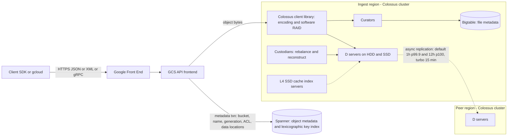

# Cloud Storage and Colossus Filesystem

## TL;DR

Cloud Storage is two systems joined by a transaction: Spanner holds the bucket and object namespace, and per-cluster Colossus file systems hold the bytes, so every guarantee you rely on belongs to one of those two layers.
Metadata and listing are strongly consistent everywhere, including dual-region buckets, but bytes move between regions asynchronously: by default 99.9% of new objects within 1 hour and 100% within 12 hours, or 100% within 15 minutes with turbo replication (Google Cloud docs, as of 2026-10).
So if a region fails, an object can still appear in listings while reads of it return a retryable 500 until its bytes exist somewhere reachable. RPO is a data-plane property, and "RTO zero" only applies to bytes that have already been replicated.
Request throughput scales by splitting a lexicographically ordered key index. A bucket starts at roughly 1,000 writes/s and 5,000 reads/s and grows over minutes, so names that sort sequentially, and any single object name written more than once per second, will hit throttling first.
Underneath, Colossus gets durability from client-side encoding spread across D servers, uses Custodians to rebuild lost data, and puts only the hottest bytes on flash through L4 and CacheSack. Your cost levers are location type, storage class, replication fees driven by write churn, operation counts, and soft-delete retention.

## Mental Model



Treat a Cloud Storage object as a row in a globally consistent Spanner index that points at byte ranges stored in one or more regional Colossus clusters.
A write is visible once the metadata commit succeeds, and the metadata commit is what gives you global read-after-write and list-after-write consistency.
Getting the bytes into a second region is a separate background job with its own queue, its own lag distribution, and its own fee.
Most surprising behaviours in Cloud Storage come from this split: one layer is strongly consistent and globally serialized, and the other is regional, eventually replicated, and governed by cost.
Google states the split directly: Spanner stores the metadata about access permissions and data location, and Colossus stores and serves the data ([Google Cloud blog, 2021-04](https://cloud.google.com/blog/products/storage-data-transfer/a-peek-behind-colossus-googles-file-system)).

## Internals

### From GFS to Colossus: why the master had to go

GFS (SOSP 2003) used one master per cell that kept the whole namespace and chunk map in RAM, 64 MB chunks, and three-way replication across chunkservers by default ([Ghemawat, Gobioff, Leung, SOSP 2003](https://static.googleusercontent.com/media/research.google.com/en//archive/gfs-sosp2003.pdf)).
That design keeps the master off the data path: clients ask the master where a chunk lives, then stream bytes directly to and from chunkservers.
What it could not survive was growth in file count, because master RAM put a hard ceiling on metadata.
Google says Colossus was built mainly to fix the metadata scaling limits GFS hit with Search workloads, and that storing file metadata in Bigtable let Colossus scale more than 100x beyond the largest GFS clusters ([Google Cloud blog, 2021-04](https://cloud.google.com/blog/products/storage-data-transfer/a-peek-behind-colossus-googles-file-system)).

Colossus has five parts, as described publicly by Google.

The client library is, in Google's words, probably the most complex part of the file system. It implements software RAID and lets each application pick an encoding.
Curators are a horizontally scalable metadata service that clients call for control operations such as file creation.
The metadata database is Bigtable. Secondary write-ups based on Google talks describe roughly one Bigtable row per file.
D file servers are network-attached disks, and data moves directly between clients and D servers with no Curator in the byte path.
Custodians are background managers that balance disk space and reconstruct lost data, the RAID-repair role.

There is an obvious recursion: Bigtable stores its SSTables on Colossus, and Colossus stores its metadata in Bigtable.
Secondary write-ups based on Google talks say the loop ends by stacking smaller Colossus instances until the remaining metadata is small enough for Chubby ([Burrows, OSDI 2006](https://research.google/pubs/the-chubby-lock-service-for-loosely-coupled-distributed-systems/)). Google has not documented this layering formally, so it is marked UNVERIFIED.
Operationally this means a Colossus cluster depends on a Bigtable that depends on a smaller Colossus, and any bootstrap or cold-start procedure has to bring the layers up from the bottom.

A single Colossus cluster scales to exabytes and tens of thousands of machines ([Google Cloud blog, 2021-04](https://cloud.google.com/blog/products/storage-data-transfer/a-peek-behind-colossus-googles-file-system)).
Google's largest file systems regularly exceed 50 TB/s of reads and 25 TB/s of writes, and the busiest single cluster serves more than 600M combined IOPS ([Google Cloud blog, 2025-03](https://cloud.google.com/blog/products/storage-data-transfer/how-colossus-optimizes-data-placement-for-performance)).

### Data plane versus control plane inside Colossus

The control plane is Curators plus Bigtable: create, open, file-to-stripe mapping, permissions, and placement decisions.
The data plane is the client library plus D servers: encoded stripes travel from the client NIC through the Jupiter fabric to D server disks (see [[17-Cloud-AI-Engineering/Volume_00_Foundations_Under_the_Cloud/Chapter_02_Datacenter_Networking_Fabrics|Datacenter Networking Fabrics]]).
D servers do very little. Google SRE material describes D as closer to a block server than a file server, providing little beyond checksums. That keeps the per-disk process simple and pushes all the smarts into the client.
Pushing encoding into the client means one hop per byte, and it means encoding policy changes ship as library releases, not storage-server upgrades.
The cost is that a client bug can write bad stripes cluster-wide, which is why end-to-end checksums carried from client to D server are mandatory and not optional.

### Erasure coding: the math that sets cost and repair load

A Reed-Solomon code RS(k, m) splits a stripe into k data fragments and adds m parity fragments. Any k of the k+m fragments rebuild the stripe, because RS is maximum distance separable.
Storage overhead is (k+m)/k: RS(6,3) costs 1.5x and survives any 3 lost fragments, while 3-way replication costs 3x and survives 2.
Repair is where it hurts. Rebuilding one lost RS(6,3) fragment means reading 6 fragments over the network, so repair traffic is about 6x the bytes lost, versus 1x for replication.
Degraded reads behave the same way: if a fragment you need is on a slow or dead D server, the client must read k other fragments and decode, which shows up as tail latency.
Ford et al. modelled Google's distributed storage and found that correlated failures, meaning many nodes lost together to rack, power, or rolling-upgrade events, dominate unavailability. Spreading fragments across failure domains therefore matters more than the choice of (k, m) ([Ford et al., OSDI 2010](https://www.usenix.org/conference/osdi10/availability-globally-distributed-storage-systems)).
A first-order durability model for independent failures says data is lost when more than m fragments of one stripe fail inside a single repair window. Loss probability per stripe therefore scales roughly as C(k+m, m+1) * p^(m+1), where p is the probability a given fragment fails within the repair window.
That is why repair throughput, meaning Custodian bandwidth and the cluster's spare network capacity, is a durability parameter and not only a performance one: halving mean time to repair cuts p and improves durability superlinearly.
Local Reconstruction Codes, used by Azure and Facebook, attack the repair amplification problem by adding local parities so a single-fragment repair reads a small local group instead of k fragments ([Huang et al., USENIX ATC 2012](https://www.usenix.org/conference/atc12/technical-sessions/presentation/huang); [Sathiamoorthy et al., VLDB 2013](https://arxiv.org/abs/1301.3791)).
Google has publicly said only that applications on Colossus "use a variety of encodings". The exact codes behind Cloud Storage objects are not documented, so any specific (k, m) for GCS is UNVERIFIED.
How GCS packs objects into Colossus files is not documented either. Packing small objects into large append-only files, the approach S3 ShardStore documents, is the standard way to make erasure coding efficient for small objects, but it is UNVERIFIED for GCS ([Bornholt et al., SOSP 2021](https://www.amazon.science/publications/using-lightweight-formal-methods-to-validate-a-key-value-storage-node-in-amazon-s3)).

### The mechanism the getting-started guides skip: flash admission in Colossus

Most Colossus bytes live on HDD. The binding constraint is disk IOPS per TB, which falls as drives get larger, not capacity.
CacheSack (USENIX ATC 2022) explains how Colossus Flash Cache decides which bytes deserve flash ([Yang et al., USENIX ATC 2022](https://www.usenix.org/conference/atc22/presentation/yang-tzu-wei)).
Cache index servers do not hold data. They keep an in-memory index of which blocks are cached on flash drives that sit on separate storage servers, and a client first sends an RPC to an index server to learn whether its read is a flash hit.
More than 60% of Colossus Flash Cache traffic is accessed only once. Admitting on first write or first read would burn flash endurance on data that never returns, so the earlier policy, LARC, admitted only on the second access.
Eviction is deliberately approximate LRU, implemented as a FIFO queue of fixed-size Colossus files (typically 1 GiB) with second-chance semantics. This avoids the random-overwrite write amplification that a true LRU would cause on flash.
CacheSack replaced the fixed rule with an admission policy optimized per workload category and became the default in May 2021.
Below flash, D servers keep a RAM buffer cache that holds recent reads and writes for a few seconds and does small prefetches, so a flash miss is not always a disk read.
The 2025 L4 work generalizes this into a distributed SSD cache and placement service. It sorts files into categories, simulates placement policies such as "on SSD for one hour", "on SSD for two hours", or "not on SSD", and picks the best one. Users who want guarantees can also use hybrid placement, which pins only one replica on SSD ([Google Cloud blog, 2025-03](https://cloud.google.com/blog/products/storage-data-transfer/how-colossus-optimizes-data-placement-for-performance)).
For a GCS user, this means first-byte latency on a cold object is bounded by HDD seek plus queueing, repeated access gets faster, and a training job reading a fresh dataset in random order sees the worst case.
It also explains why Google offers explicit SSD tiers in front of GCS, such as Rapid storage in zonal buckets and Anywhere Cache: you cannot directly control which bytes Colossus admits to flash for you. Anywhere Cache launch stage is UNVERIFIED as of 2026-10.

### Layer two: the object namespace on Spanner

Cloud Storage first kept bucket and object metadata on Megastore and later moved it to Spanner, which is what made bucket and object listing strongly consistent across all locations ([Google Cloud blog](https://cloud.google.com/blog/products/gcp/how-google-cloud-storage-offers-strongly-consistent-object-listing-thanks-to-spanner); see [[17-Cloud-AI-Engineering/Volume_03_GCP_Deep_Dive/Chapter_10_Cloud_Spanner_TrueTime_and_External_Consistency|Cloud Spanner: TrueTime and External Consistency]]).
Each bucket has an index of object keys stored in lexicographic order and updated on every write or delete ([Google Cloud docs, as of 2026-10](https://docs.cloud.google.com/storage/docs/request-rate)).
Spanner range-partitions that index into splits. When one key range becomes hot, Cloud Storage detects the contention and spreads that range across more servers, which typically takes on the order of minutes.
Sequential names, such as timestamps, zero-padded step numbers, or monotonically increasing IDs, send all inserts to the tail of one range. Splitting does not help, because the new tail split becomes hot immediately.
The documented ramp-up applies both to buckets that have not had high request rates for several days and to new ranges of object keys. A new prefix used by a large job is therefore a cold range, even inside a busy bucket.

Each object version has a generation number, and each metadata change bumps a metageneration.
Precondition parameters (ifGenerationMatch, ifMetagenerationMatch) turn writes into compare-and-swap operations against the Spanner row. ifGenerationMatch=0 means "create only if absent".
Because the precondition is checked inside the globally serialized metadata transaction, it holds across regions, even for writers on different continents writing to one dual-region bucket.
The documented limit of one write per second to a single object name, and one metadata update per second to a single object, is the visible cost of serializing updates to one key ([Google Cloud quotas, as of 2026-10](https://docs.cloud.google.com/storage/quotas)). Attributing that limit to per-row commit serialization is an engineering inference, not something Google documents.

The write path that matches the documented behaviour is: stream the bytes to Colossus, then commit a metadata row that points at them and makes the object visible atomically.
That ordering is why you never get a 404 or stale data after a successful write, even in dual-region and multi-region buckets ([Google Cloud docs, as of 2026-10](https://docs.cloud.google.com/storage/docs/consistency)). The exact internal ordering is inferred, not documented.
A failed or abandoned upload leaves orphaned bytes that only background garbage collection can see, and that never surfaces as a partially visible object.

### Bucket namespaces: flat, managed folders, and hierarchical namespace

In a flat-namespace bucket, folders are simulated: they are just object-name prefixes split on "/", and object names can be 1 to 1024 bytes of UTF-8 ([Google Cloud docs, as of 2026-10](https://docs.cloud.google.com/storage/docs/objects)).
A flat-namespace "rename" of a directory is a copy plus a delete for every object. It is O(n), not atomic, and reports partial failure as a half-moved tree.
Hierarchical namespace (HNS) makes folders real resources that can be created, listed, deleted, and renamed atomically. It must be enabled when the bucket is created and cannot be changed afterwards ([Google Cloud docs, as of 2026-10](https://docs.cloud.google.com/storage/docs/hns-overview)).
In an HNS bucket an object name has two parts, a folder segment of up to 512 bytes and a base name of up to 512 bytes ([Google Cloud quotas, as of 2026-10](https://docs.cloud.google.com/storage/quotas)).
Google introduced HNS on 2025-03-17 for AI and analytics workloads and claimed up to 20x faster checkpointing and 8x higher QPS ([InfoQ, 2025-05](https://www.infoq.com/news/2025/05/google-cloud-ai-workflow/)). Those are vendor numbers, not independent benchmarks.
The mechanism behind atomic rename is a metadata-only change to a folder node, instead of rewriting every child key. Google has not published the exact Spanner schema, so this description is an inference.
Managed folders are a separate feature: they let you attach IAM policies to a prefix, and they work in both flat and HNS buckets ([Google Cloud docs, as of 2026-10](https://cloud.google.com/storage/docs/folder-types)).

### Location types and the dual-region replication pipeline

In a regional bucket, data is redundant across zones within one region. In a dual-region bucket, newly written objects start out with exactly that regional, multi-zone protection, and asynchronous replication later copies them to the second region ([Google Cloud blog](https://cloud.google.com/blog/products/storage-data-transfer/using-dual-region-buckets-in-google-cloud-storage)).
Predefined dual-regions include asia1, eur4, eur5, eur7, eur8, and nam4. Configurable dual-regions let you choose a region pair inside a continent ([Google Cloud pricing, as of 2026-10](https://cloud.google.com/storage/pricing)).
Default replication targets 99.9% of newly written objects within one hour and 100% within 12 hours. Google notes that most objects replicate within minutes ([Google Cloud docs, as of 2026-10](https://docs.cloud.google.com/storage/docs/availability-durability)).
Turbo replication, which is available only for dual-region buckets, targets 100% of newly written objects in both regions within 15 minutes regardless of object size, and is backed by the SLA through replication time and replication volume conformance measured per bucket ([Google Cloud SLA, as of 2026-10](https://cloud.google.com/storage/sla)).
Inserts, rewrites, copies, and composes all count as "newly written objects", which makes compose-heavy pipelines replication-heavy as well.

Here is the deep consequence.
Because the namespace is global and strongly consistent, the second region knows an object exists before it has the bytes.
If the region where an object was first written becomes unavailable before replication finishes, reads of that object return a retryable 500 ([Google Cloud docs, as of 2026-10](https://docs.cloud.google.com/storage/docs/consistency)).
Google markets dual-region as an RTO of zero with no failover or failback ([Google Cloud product page, as of 2026-10](https://cloud.google.com/storage)). That holds for the namespace and for replicated bytes. Unreplicated bytes become an availability gap, not silent data loss, and once the region recovers replication catches up.
Model replication as a queue. If writes arrive at W bytes/s and replication lag is L seconds, then about W * L bytes are exposed at any moment. Turbo puts a contractual ceiling on L, and default replication gives you only a distribution.
Google does not publish how its replication scheduler prioritizes work. Any assumption that default replication is "usually fast enough" is therefore an empirical bet, not a guarantee, and should be measured continuously.

## Numbers to Know

| Quantity | Value | Source |
| --- | --- | --- |
| Initial bucket write capacity | ~1,000 object writes/s (uploads, updates, deletes) | (Google Cloud docs, as of 2026-10) |
| Initial bucket read capacity | ~5,000 object reads/s (reads, metadata reads, listing) | (Google Cloud docs, as of 2026-10) |
| Ramp-up guidance | Start at 1,000 W / 5,000 R and double every 20 minutes | (Google Cloud docs, as of 2026-10) |
| Hot-range redistribution time | On the order of minutes | (Google Cloud docs, as of 2026-10) |
| Writes to the same object name | 1 per second | (Google Cloud quotas, as of 2026-10) |
| Metadata updates to one object | 1 per second | (Google Cloud quotas, as of 2026-10) |
| Compose sources per request | 32 | (Google Cloud quotas, as of 2026-10) |
| Object name length | 1-1024 bytes flat; 512 + 512 bytes in HNS | (Google Cloud docs, as of 2026-10) |
| Default replication | 99.9% of new objects in 1 h, 100% in 12 h | (Google Cloud docs, as of 2026-10) |
| Turbo replication | 100% of new objects in 15 min, SLA-backed, dual-region only | (Google Cloud docs and SLA, as of 2026-10) |
| Annual durability design target | 99.999999999% | (Google Cloud docs, as of 2026-10) |
| SLA, Standard in multi-region or dual-region | >= 99.95% monthly uptime | (Google Cloud SLA, as of 2026-10) |
| SLA, Standard regional and Rapid zonal | 99.9% | (Google Cloud docs, as of 2026-10) |
| Minimum storage duration | Nearline 30 d, Coldline 90 d, Archive 365 d | (Google Cloud docs, as of 2026-10) |
| Standard storage price, us-central1 regional | $0.020 per GB-month | (Google Cloud pricing via nOps and CloudZero, as of 2026-10) |
| Standard storage price, dual-region | $0.022 per GB-month per regional SKU, billed against both regions | (Google Cloud pricing, as of 2026-10) |
| Standard storage price, US multi-region | $0.026 per GB-month | (nOps, as of 2026-10) |
| Inter-region replication, default, NA and EU | $0.02 per GiB written | (CloudZero summary of Google pricing, as of 2026-10) |
| Class B operations, Standard | $0.004 per 10,000 | (nOps summary of Google pricing, as of 2026-10) |
| Colossus largest file system throughput | >50 TB/s read, >25 TB/s write | (Google Cloud blog, 2025-03) |
| Colossus busiest cluster | >600M IOPS | (Google Cloud blog, 2025-03) |
| Colossus metadata scale vs GFS | >100x the largest GFS cluster | (Google Cloud blog, 2021-04) |
| Colossus Flash Cache single-access traffic | >60% | (USENIX ATC 2022) |
| GFS chunk size and replication | 64 MB, 3 replicas by default | (SOSP 2003) |
| HNS vendor claims | Up to 8x QPS, 20x faster checkpointing | (Google via InfoQ, 2025-05) |

Turbo replication per-GiB price and Class A operation price are omitted because they could not be re-verified in this pass. They appear as parameters in the cost model below.

## AWS vs GCP Mechanism Parity

| Dimension | Google Cloud Storage | Amazon S3 | Critical difference |
| --- | --- | --- | --- |
| Metadata substrate | Spanner holds the object index and ACLs, globally consistent | Regional index subsystem; the 2017 us-east-1 PIR names index and placement subsystems | GCS metadata spans regions for dual-region and multi-region; S3 metadata is per-region |
| Byte substrate | Colossus per cluster, client-side encoding, Custodian repair | ShardStore storage nodes ([[17-Cloud-AI-Engineering/Volume_13_Seminal_Papers_and_Case_Studies/Chapter_05_Amazon_S3_ShardStore_Formal_Methods\|ShardStore]]) | Both publish only partial internals; encoding parameters are undocumented on both |
| Consistency | Strong global read-after-write, metadata, delete, and list | Strong read-after-write and list since 2020-12 (UNVERIFIED in this pass) | GCS keeps strong listing across regions inside a single dual-region bucket |
| Request scaling unit | Bucket-level, lexicographic key ranges split on load, ramp doubling every 20 min | Per partitioned prefix, ~3,500 writes/s and 5,500 reads/s (UNVERIFIED in this pass) | Both punish sequential keys; GCS guidance is phrased per bucket and per new key range |
| Single-key write rate | 1 write/s per object name | No published per-key limit (UNVERIFIED) | GCS makes "status object" anti-patterns fail loudly |
| Conditional writes | ifGenerationMatch / ifMetagenerationMatch, including create-if-absent | If-None-Match and If-Match conditional writes (UNVERIFIED launch details) | GCS generation numbers double as fencing tokens |
| Geo-redundancy primitive | Dual-region or multi-region: one bucket, one namespace, async bytes | Cross-Region Replication to a second bucket, plus Multi-Region Access Points for routing | GCS replicates inside a bucket; S3 replicates between buckets with separate namespaces |
| Replication SLO | Turbo: 100% in 15 min, SLA-backed | Replication Time Control: 15-minute target, SLA-backed (UNVERIFIED percentages) | GCS failover needs no DNS or endpoint change; S3 needs MRAP or application failover |
| Behaviour of unreplicated data on region loss | Object listed, read returns retryable 500 | Object missing from the replica bucket | GCS surfaces the gap as an error; S3 surfaces it as absence |
| Directory semantics | HNS buckets with atomic folder rename, chosen at creation | S3 Express One Zone directory buckets (UNVERIFIED rename semantics) | GCS HNS is regional or multi-region capable; S3 directory buckets are zonal |
| Zonal low-latency tier | Rapid storage in zonal buckets via Rapid Bucket, 99.9% SLA | S3 Express One Zone | Both trade zone-level durability scope for latency |
| Perimeter | VPC Service Controls around storage.googleapis.com | VPC endpoint policies plus SCPs and RCPs | VPC SC is identity-plus-network at the API layer; AWS composes several policy types |

For the full translation, see [[17-Cloud-AI-Engineering/Volume_04_AWS_vs_GCP_Translation/Chapter_04_Storage_and_Database_Translation|Storage and Database Translation]] and [[17-Cloud-AI-Engineering/Volume_02_AWS_Deep_Dive/Chapter_08_S3_Deep_Dive_Consistency_and_ShardStore|S3 Deep Dive: Consistency and ShardStore]].

## Worked Example: Dual-Region Turbo Bucket, Consistency Probe, and Hotspot-Safe Naming

### Lab cost estimate

The lab writes fewer than 1 MB across about 600 objects, so storage costs fractions of a cent at $0.022 per GB-month.
Operations are about 1,200 Class A and Class B calls, which costs well under $0.05 at list prices.
Inter-region replication of under 1 MB is negligible at $0.02 per GiB, and turbo adds a per-GiB premium on the same tiny volume.
Expected total is under $0.10 if you tear down the same day. The budget below alerts at $5.

### Provision with gcloud

```bash
#!/usr/bin/env bash
set -euo pipefail

export PROJECT_ID="your-project-id"
export BILLING_ACCOUNT="000000-000000-000000"
export BUCKET="gcs-colossus-lab-${PROJECT_ID}-$(date +%s)"

gcloud config set project "${PROJECT_ID}"

# Budget alarm scoped to this project: email notifications go to billing admins by default.
gcloud billing budgets create \
  --billing-account="${BILLING_ACCOUNT}" \
  --display-name="gcs-colossus-lab" \
  --budget-amount=5USD \
  --threshold-rule=percent=0.5 \
  --threshold-rule=percent=1.0 \
  --filter-projects="projects/${PROJECT_ID}"

# Predefined dual-region nam4 (us-central1 + us-east1) with turbo replication.
# Configurable alternative: --location=US --placement=us-central1,us-east1
gcloud storage buckets create "gs://${BUCKET}" \
  --location=nam4 \
  --default-storage-class=STANDARD \
  --rpo=ASYNC_TURBO \
  --uniform-bucket-level-access \
  --public-access-prevention \
  --soft-delete-duration=0

gcloud storage buckets describe "gs://${BUCKET}" --format="default(location,rpo)"
```

### Probe consistency, compare-and-swap, and naming latency with Python

```python
# probe.py - requires: pip install google-cloud-storage
import hashlib
import os
import statistics
import time

from google.api_core.exceptions import PreconditionFailed
from google.cloud import storage

BUCKET = os.environ["BUCKET"]
client = storage.Client()
bucket = client.bucket(BUCKET)
bucket.reload()
print("location:", bucket.location, "type:", bucket.location_type, "rpo:", bucket.rpo)

# 1. Create-if-absent, then immediate read-after-write and list-after-write.
blob = bucket.blob("probe/manifest.json")
blob.upload_from_string(b'{"step": 1}', if_generation_match=0)
gen1 = blob.generation
assert bucket.blob("probe/manifest.json").download_as_bytes() == b'{"step": 1}'
listed = [b.name for b in client.list_blobs(BUCKET, prefix="probe/")]
assert "probe/manifest.json" in listed
print("read-after-write and list-after-write OK, generation:", gen1)

# 2. Compare-and-swap: the generation number acts as a fencing token.
time.sleep(1.1)  # respect the 1 write/s per object name limit
blob.upload_from_string(b'{"step": 2}', if_generation_match=gen1)
gen2 = blob.generation
try:
    time.sleep(1.1)
    blob.upload_from_string(b'{"step": 3}', if_generation_match=gen1)  # stale token
    raise SystemExit("unexpected: stale CAS succeeded")
except PreconditionFailed:
    print("stale writer fenced; winning generation:", gen2)

# 3. Sequential vs hashed key layout (latency only; 200 objects will not trigger splits).
def timed_writes(names):
    lat = []
    for n in names:
        t0 = time.perf_counter()
        bucket.blob(n).upload_from_string(b"x" * 1024)
        lat.append((time.perf_counter() - t0) * 1000)
    lat.sort()
    return statistics.median(lat), lat[int(len(lat) * 0.99) - 1]

N = 200
seq = [f"seq/2026-10-20T00:00:{i:06d}.bin" for i in range(N)]
hsh = [f"hash/{hashlib.md5(str(i).encode()).hexdigest()[:4]}/2026-10-20/{i:06d}.bin" for i in range(N)]
print("sequential p50/p99 ms: %.1f / %.1f" % timed_writes(seq))
print("hashed     p50/p99 ms: %.1f / %.1f" % timed_writes(hsh))
```

```bash
export BUCKET  # from the provisioning step
python3 probe.py
```

At 200 serial writes both layouts stay far below the initial 1,000 writes/s, so the latency numbers should look alike. What the probe checks is correctness of the consistency and CAS behaviour, not hotspotting.
To actually see a range hotspot you would need thousands of concurrent writers on sequential names, and that is not a lab you should run on a shared project.

### Teardown

```bash
gcloud storage rm --recursive "gs://${BUCKET}"
gcloud billing budgets list --billing-account="${BILLING_ACCOUNT}" --filter="displayName=gcs-colossus-lab" --format="value(name)" \
  | xargs -r -I{} gcloud billing budgets delete {} --quiet
```

### Capacity and cost sizing: a 70B-parameter training run on GCP

Step 1, checkpoint size: 70e9 parameters x (2 bytes bf16 weights + 4 bytes fp32 master + 8 bytes Adam moments) = 980 GB, so call it 1 TB per checkpoint.
Step 2, write churn: one checkpoint every 30 minutes is 48 TB/day, or about 1.44 PB/month written.
Step 3, replication fee if checkpoints go to a dual-region bucket: 1,440,000 GiB x $0.02 = about $28,800/month at default replication, before any turbo premium. That is more than the cost of storing a 1 PB dataset in the same bucket.
Step 4, storage: keeping the last 4 checkpoints (4 TB) regionally costs 4,000 GB x $0.020 = $80/month, while the same 4 TB in dual-region costs about $88/month in list storage plus the replication fee above.
Step 5, soft-delete trap: if the bucket kept a 7-day soft-delete window (the commonly cited default, UNVERIFIED for 2026-10), deleted checkpoints stay billable. 48 TB/day x 7 days = 336 TB x $0.020 = about $6,720/month for bytes you already deleted.
Step 6, request rate: 1 TB written as 64 MiB shards is about 15,000 objects. Spread over a 60-second write window that is about 250 writes/s, inside initial capacity.
The same checkpoint written as 4,096 ranks x 50 tensor files is 204,800 objects. In a 60-second window that is about 3,400 writes/s, which exceeds the initial 1,000 writes/s on a new key range for every step.
Step 7, ramp time for a read-heavy data loader: 2,048 GPUs streaming 100 KB samples at an aggregate 200 GB/s need about 2M reads/s. From 5,000 reads/s doubling every 20 minutes, that takes log2(400) = 8.6, so 9 doublings, or about 3 hours of ramp.
Switching to 256 MB WebDataset shards drops the requirement to about 780 reads/s, which needs no ramp at all ([[17-Cloud-AI-Engineering/Volume_10_AI_Infrastructure_on_Cloud/Chapter_07_High_Throughput_Data_Loaders_and_Storage_IO|High-Throughput Data Loaders and Storage I/O]]).
Decision: write checkpoints to a regional bucket (or a zonal Rapid bucket) in the training region with soft delete tuned down, use rank-hashed prefixes and a manifest commit, and copy only milestone checkpoints to a dual-region bucket ([[17-Cloud-AI-Engineering/Volume_10_AI_Infrastructure_on_Cloud/Chapter_06_High_Throughput_Checkpointing_to_Object_Storage|High-Throughput Checkpointing to Object Storage]]).

## Failure Modes and Pitfalls

### Sequential-key index hotspots

Names prefixed with timestamps or zero-padded step numbers send every insert to the tail of one lexicographic range. During redistribution, which takes minutes, latency and error rates rise ([Google Cloud docs, as of 2026-10](https://docs.cloud.google.com/storage/docs/request-rate)).
The failure feeds itself: clients that retry without jitter add load to the hot range just as it is splitting ([[17-Cloud-AI-Engineering/Volume_07_Reliability_and_SRE/Chapter_03_Resilient_Communication_Retries_Jitter_and_Circuit_Breakers|Retries, Jitter, and Circuit Breakers]]).
The fix is a short hash prefix ahead of the time component. The trade-off is that you lose time-ordered listing, so keep a manifest or an index in BigQuery or Spanner for ordered discovery.

### Single-object write rate

"latest.json" pointers, heartbeat objects, and lock objects that more than one writer updates more than once per second get throttled at the per-object-name limit.
Use generation-fenced pointers that change at most once per commit, and keep high-frequency coordination in a database instead of object storage.

### Treating dual-region as synchronous

During a regional loss, any object written in the previous RPO window is listed but unreadable and returns retryable 500s until recovery ([Google Cloud docs, as of 2026-10](https://docs.cloud.google.com/storage/docs/consistency)).
Consumers that treat 500 as permanent will drop work. Consumers that retry tightly will add load to a recovering system. And a downstream system that read the listing may commit references to bytes that cannot currently be read.
The 2023 europe-west9 (Paris) incident, a water intrusion and fire that degraded a whole region well past single-zone failure assumptions, is the reference case for why region-level loss belongs in your plan. Incident details are UNVERIFIED in this pass ([[17-Cloud-AI-Engineering/Volume_07_Reliability_and_SRE/Chapter_07_Anatomy_of_Major_Cloud_Outages|Anatomy of Major Cloud Outages]]).

### Metadata-layer blast radius

The byte layer is regional, but every request depends on the metadata path, on IAM, and on Google's API admission infrastructure. Those dependencies are shared fate that dual-region placement does not remove.
The Google Cloud incident of 2025-06-12, in which a quota-policy change crashed a globally replicated API control component, caused errors across many APIs including storage. Details are UNVERIFIED in this pass, and the lesson holds regardless: regional data redundancy does not protect against a global control-plane fault.
The AWS analogue is the 2017-02-28 S3 us-east-1 outage. A mistyped command removed more servers than intended from the index and placement subsystems, and those subsystems needed a full restart that took hours ([AWS PIR](https://aws.amazon.com/message/41926/)).
For both providers, the metadata index is the component whose cold-start time sets your worst-case RTO.

### Non-atomic directory rename in flat buckets

Hadoop- and Spark-style output committers and "write to tmp, rename to final" checkpoint protocols turn into O(n) copy and delete sequences on flat buckets. A crash mid-rename leaves a partially published directory.
Use HNS buckets for atomic folder rename, or a manifest-commit protocol in which readers trust only objects listed in a generation-fenced manifest.

### Composite object and checksum gaps

Composing up to 32 sources per request is how parallel composite uploads work. Composite objects carry a CRC32C but no whole-object MD5, so validation that relies on MD5 silently skips them (MD5 behaviour UNVERIFIED in this pass).
Compose also counts as a new write for replication, so compose-heavy pipelines pay replication fees again for bytes that were already written.

### Cold-read tail latency

Bytes that Colossus has not admitted to flash are served from HDD, so first-epoch reads of a large shuffled dataset see seek-bound tails, and later epochs can look faster for reasons outside your control.
Benchmark with the access pattern you will run in production, not a warm sequential pass.

### Early deletion and soft-delete surprises

Nearline, Coldline, and Archive have minimum durations of 30, 90, and 365 days, so lifecycle rules that move short-lived checkpoints into colder classes are charged early-deletion fees on top of storage.
Soft-delete retention bills deleted bytes for the whole retention window, which multiplies the cost of high-churn prefixes, as the sizing section showed.

## Security and Cost Angles

### IAM scoping

Use uniform bucket-level access so IAM is the only authorization path, and enforce public access prevention at bucket or organization level ([[17-Cloud-AI-Engineering/Volume_03_GCP_Deep_Dive/Chapter_02_Cloud_IAM_Roles_Policies_and_Conditions|Cloud IAM: Roles, Policies, and Conditions]]).
Grant training jobs roles/storage.objectViewer on dataset buckets. Grant checkpoint writers a create-only or object-user role scoped by a managed folder or IAM Condition on the prefix, not storage.admin.
Note that roles/storage.objectViewer includes storage.folders.list on HNS buckets ([Google Cloud docs, as of 2026-10](https://docs.cloud.google.com/storage-transfer/docs/hns)).
Prefer Workload Identity Federation over HMAC keys and service account keys. HMAC keys are long-lived bearer secrets that bypass short-lived token hygiene ([[17-Cloud-AI-Engineering/Volume_08_Security_Identity_and_the_Data_Perimeter/Chapter_02_Workload_Identity_Federation|Workload Identity Federation]]).

### Encryption hierarchy

By default Google encrypts data chunks with data encryption keys that are wrapped by key encryption keys in Google's key management infrastructure. That is envelope encryption, applied with no customer action.
With CMEK, the bucket's default key is a Cloud KMS key, and the Cloud Storage service agent needs roles/cloudkms.cryptoKeyEncrypterDecrypter on it. Disabling or destroying the key makes every object under it unreadable, which is both the crypto-shredding feature and a self-inflicted outage risk ([[17-Cloud-AI-Engineering/Volume_03_GCP_Deep_Dive/Chapter_15_Security_and_Confidential_Computing_Cloud_KMS|Security and Confidential Computing: Cloud KMS]]).
CMEK key-location compatibility rules for dual-region and multi-region buckets must be checked against the current CMEK docs before rollout (UNVERIFIED in this pass).

### Private network boundary

Put storage.googleapis.com inside a VPC Service Controls perimeter. That blocks copy-to-attacker-bucket exfiltration, which no IAM deny on your own buckets can stop, because the destination bucket belongs to the attacker ([[17-Cloud-AI-Engineering/Volume_03_GCP_Deep_Dive/Chapter_03_VPC_Service_Controls_Security_Perimeters|VPC Service Controls]]).
Combine it with Private Google Access through the restricted VIP so traffic from private subnets reaches only perimeter-supported APIs.
Use dry-run mode first. Perimeters break Storage Transfer Service, BigQuery external tables, and cross-project pipelines in ways that only show up as 403s with VPC SC violation reasons.

### Unit-economics levers

Replication fees scale with bytes written, not bytes stored, so the location decision for a prefix should follow its write churn. Keep checkpoints and scratch data regional, and put curated datasets and milestone artifacts in dual-region.
Operation charges dominate for small objects. Packing 100 KB samples into 256 MB shards cuts per-byte operation cost by orders of magnitude and avoids request-rate ramps.
Tune the soft-delete duration per bucket to match the actual restore requirement, and use lifecycle rules to delete noncurrent versions.
Weigh turbo replication's premium against expected loss: the cost of the data at risk during a region event, times the probability of that event, compared with the turbo fee on monthly written bytes ([[17-Cloud-AI-Engineering/Volume_09_FinOps_and_Cloud_Economics/Chapter_04_Network_Egress_Economics_and_Optimization|Network Egress Economics and Optimization]]).

## Interview Questions and Model Answers

### Question 1 (L5 - Senior)

A writer in us-east1 uploads an object to a nam4 dual-region bucket, and a reader in us-central1 reads it 50 ms after the writer gets 200 OK. What does the reader see, and why?

#### Model Answer

The reader sees the new object, never a 404 or stale bytes, because the upload's success means the metadata commit in the globally consistent index has already happened.
The bytes may exist only in the ingest region at that point, with multi-zone redundancy there, because cross-region replication is asynchronous.
So the read can be served by fetching bytes from the ingest region across Google's backbone. The consistency guarantee comes from metadata, not from where the bytes physically are.
If the ingest region becomes unavailable before replication completes, the object still appears in listings but reads return a retryable 500.
With default replication that exposure window is up to 1 hour for 99.9% of objects and 12 hours worst case. With turbo it is bounded at 15 minutes and backed by the SLA.
The application consequence is that consumers must treat 500 as retryable with backoff, and producers whose data must survive region loss need turbo, a dual write, or an application-level replication check.

#### Follow-up Interviewer Question

How would you detect, at the application level, that a specific object you depend on has not yet replicated, given that the API does not expose per-object replication state?

### Question 2 (L5 - Senior)

An ingestion service writes 20,000 small objects per second named "events/2026-10-20T13:45:12.123Z-uuid.json" into a fresh bucket and sees 429s and 503s for the first hour. Diagnose it and fix it.

#### Model Answer

There are two problems stacked on each other.
First, a fresh bucket starts at about 1,000 writes/s, and Google's guidance is to double every 20 minutes. Getting to 20,000 writes/s takes log2(20) = 4.3, so 5 doublings, about 100 minutes.
Second, the timestamp-first names sort sequentially, so all inserts land at the tail of one range of the lexicographic object index. Each split creates a new hot tail, and redistribution cannot catch up.
The fix is to put a high-cardinality hash, for example 2 to 4 hex characters of a hash of the UUID, before the timestamp, and to ramp traffic gradually or pre-warm with synthetic load.
The trade-off is losing time-ordered listing, so I would write a per-minute manifest or stream metadata to BigQuery for ordered discovery.
I would also batch events into larger objects. 20,000 events/s packed into 1 MB objects is a few hundred writes per second, which removes the scaling problem and cuts Class A operation cost by about the same factor.
Clients need full-jitter exponential backoff, because synchronized retries pile onto the hot range exactly while it is splitting.

#### Follow-up Interviewer Question

Downstream batch jobs list "events/" by date prefix today; how do you migrate the key layout without breaking them or double-processing data?

### Question 3 (L6 - Staff)

Design the checkpoint storage layer for a 4,096-GPU training run on GCP with roughly 1 TB checkpoints every 30 minutes, a requirement to restore within 10 minutes, and a requirement not to lose more than one day of training to a regional disaster.

#### Model Answer

I would split the requirements, because restore-latency and disaster-recovery needs pull in opposite directions on location type.
For the hot path, write every checkpoint to a regional bucket, or a zonal Rapid bucket if latency matters, in the training region. That avoids the inter-region replication fee, which at 1.44 PB/month written would be about $28,800/month at $0.02/GiB.
The object layout uses about 64 MiB shards with names prefixed by a hash of the rank, so each checkpoint is about 15,000 writes spread across many index ranges, instead of 200,000 tiny files landing on one new zero-padded step prefix.
Commit is a manifest written with ifGenerationMatch: restore code trusts only shards listed in the latest committed manifest, so a crash mid-write never produces a torn checkpoint, and this works even on a flat bucket.
On an HNS bucket I could instead write into a temporary folder and atomically rename it, which Google claims is materially faster, but the manifest protocol is portable to S3 and does not depend on that feature.
For DR, a scheduled job copies the last good checkpoint every few hours into a dual-region bucket, or a bucket in another region, so replicated bytes are about 8 TB/day instead of 48 TB/day. That gives an RPO of a few hours against a one-day budget at a sixth of the fee.
Restore bandwidth: 1 TB in 10 minutes is about 1.7 GB/s aggregate, which is trivial spread across 512 hosts. The real risk is restoring into a cold region, where the DR bucket's key ranges and the new hosts' read pattern need ramping, so restores should be drilled regularly.
I would set soft delete to a short window on the hot bucket, because a 7-day window on 48 TB/day of churn keeps about 336 TB of deleted data billable.
Failure modes I would instrument: manifest commit errors, per-shard 429s, age of the latest DR copy as an SLI, and a periodic restore test that proves the checkpoint is readable, not just present.

#### Follow-up Interviewer Question

The research team now wants to keep every checkpoint for evaluation forever; how does your layout and lifecycle design change, and what happens to the bill over a 90-day run?

### Question 4 (L6 - Staff)

Can you use Cloud Storage as a coordination primitive, for example for leader election or a commit log? Where does it break?

#### Model Answer

Yes, for low-frequency coordination, because generation preconditions are compare-and-swap operations evaluated inside the globally serialized metadata transaction.
Create-if-absent with ifGenerationMatch=0 gives a one-shot lock. Updating with ifGenerationMatch=G gives optimistic concurrency, and the generation number is a monotonically increasing fencing token that downstream writers can carry and check.
This works across regions in a dual-region bucket because the precondition is checked against one consistent index, not per region.
It breaks in four places.
First, throughput: one write per second per object name caps any single lease or log head at 1 Hz, so a commit log has to be one object per entry, discovered by listing or by a sharded pointer.
Second, time: lease expiry needs a clock, and object timestamps come from the service, not your workers. Expiry must therefore be judged against server-side time, with generous margins and fencing on every side-effecting write.
Third, latency: every CAS round-trip is a wide-area or at least cross-zone metadata transaction, so latencies of tens of milliseconds rule it out for request-path locking.
Fourth, availability: the lock is only as available as the metadata path and IAM, which are shared global dependencies.
My rule is to use object-storage CAS for coarse job-level coordination, such as checkpoint manifests and "one writer per partition per hour", and to use Spanner or etcd-like systems for anything finer.

#### Follow-up Interviewer Question

Two trainers both believe they hold the lease after a network partition; walk through exactly how the generation token prevents a corrupted checkpoint manifest, and where it fails to protect you.

### Question 5 (L6 - Staff)

Compare 3-way replication with RS(6,3) for a storage tier serving ML training data. Include durability, cost, repair load, and tail latency.

#### Model Answer

Storage cost: replication is 3.0x, and RS(6,3) is 1.5x and tolerates three lost fragments instead of two, so RS wins on both bytes and nominal fault tolerance.
Repair: losing one fragment under RS(6,3) means reading six fragments to rebuild it, so repair network traffic is about 6x the bytes lost, against 1x for replication. On a cluster with high disk churn, that repair traffic competes with foreground reads.
Durability depends on repair speed, because loss requires m+1 failures inside one repair window. If heavy repair traffic slows repair, durability gets worse, a feedback loop that pure fault-tolerance counting misses.
Ford et al. showed that correlated failures dominate, so I would first make sure fragments span racks, power domains, and upgrade domains. Only after that would I tune (k, m).
Tail latency: a healthy RS read touches k servers, so the slowest of six sets the latency. A degraded read adds decode work and more fan-out.
The standard mitigation is hedged reads: request k+1 or k+2 fragments and decode from the first k to arrive, trading roughly 15 to 30 percent extra read bandwidth for a much shorter tail.
For ML training data, which is read-heavy, mostly sequential within shards, and replaceable from upstream, I would choose RS or an LRC variant to reduce single-fragment repair fan-out, plus a flash cache with second-access admission, because more than half of cache traffic in Google's measurements is touched once.
Replication still makes sense for small, hot, latency-critical objects where decode fan-out costs more than the extra bytes.

#### Follow-up Interviewer Question

How does object size interact with erasure coding efficiency, and how would you store millions of 50 KB objects without paying a full stripe per object?

### Question 6 (L7+ - Principal)

Your company runs on both clouds. Compare GCS dual-region with turbo replication against S3 Cross-Region Replication with Replication Time Control as the DR basis for a 2 GB/s sustained write stream, and recommend one.

#### Model Answer

Start by quantifying exposure. At 2 GB/s, a 15-minute replication bound puts up to 2 x 900 = 1.8 TB at risk. With default GCS replication, the 99.9th-percentile one-hour bound puts 7.2 TB at risk, and the 12-hour ceiling up to about 86 TB.
Both turbo and RTC give a contractual 15-minute target, so the RPO math is similar. The differences are in failure semantics and RTO mechanics.
GCS dual-region uses one bucket and one namespace. Clients need no endpoint change, the namespace stays consistent across regions, and unreplicated objects show up as retryable 500s instead of disappearing. RTO for replicated data is effectively zero.
S3 CRR replicates between two buckets with separate namespaces. Failover requires Multi-Region Access Points or application-level endpoint switching, and unreplicated objects are simply missing from the replica. That is a clearer signal to code against, but it means a real failover and failback runbook.
The GCS model hides a shared dependency: one logical metadata system serves both regions. The design protects bytes against regional loss, but it does not isolate you from a global metadata or control-plane fault, and the 2025-06-12 Google Cloud API incident (details UNVERIFIED) is exactly that kind of event.
The S3 model has more independent failure domains, because the replica bucket's metadata lives in a different region, at the cost of more operational machinery.
On cost, both charge per written GiB for replication, so 5 PB/month of writes is the dominant line item on either cloud, and I would first ask whether all 2 GB/s really needs geo-redundancy.
Recommendation: for data whose consumers are on GCP, use dual-region with turbo for the business-critical subset and keep the rest regional with periodic copies. For the tier-0 subset, add an asynchronous copy to a separate GCS region or to S3, so at least one replica sits outside the shared metadata domain.
The principal-level point is that "RTO zero" is a claim about one failure class, and DR design has to list failure classes explicitly, including global control-plane failure, before choosing mechanisms ([[17-Cloud-AI-Engineering/Volume_07_Reliability_and_SRE/Chapter_04_Disaster_Recovery_Tiers_and_RTO_RPO_Engineering|Disaster Recovery Tiers and RTO/RPO Engineering]]).

#### Follow-up Interviewer Question

The CFO asks you to cut the replication bill by 60 percent without raising RPO for tier-0 data; what data classification and pipeline changes deliver that, and how do you prove RPO conformance monthly?

### Question 7 (L7+ - Principal)

Why did Google put Cloud Storage metadata in Spanner and bytes in per-cluster Colossus, instead of one system? What would you change for an AI-era storage tier?

#### Model Answer

The split matches each layer to its workload.
Metadata is small, transactional, needs strong consistency, and in dual-region and multi-region buckets must be globally ordered. Spanner's Paxos groups and external consistency deliver strong listing and generation preconditions, which Megastore could not fully provide.
Bytes are huge, append-heavy, and need cheap durable capacity close to compute. Colossus delivers that with client-side encoding, direct client-to-D-server data paths, and Custodian repair, all scoped to a cluster so that byte-path failures stay regional.
The cost of the split is a two-phase write: bytes first, then a metadata commit. That creates orphaned bytes to garbage-collect, a cross-system latency floor on small writes, and a global metadata dependency for a byte store that is otherwise regional.
It also produces the "listed but unreadable" state during regional loss, which is a correct but unusual contract for clients.
For an AI tier, the bottlenecks are request rate on small objects, first-byte latency, and metadata operations such as rename for checkpoint commit.
I would keep strong metadata but move it closer to the bytes for zonal or regional tiers, so a zonal bucket's index does not need cross-region consensus. Google's Rapid Bucket, with zonal Rapid storage and a 99.9% SLA, points in that direction.
I would make directory semantics first-class, as HNS does, so commit is an O(1) metadata transaction.
I would also expose flash admission hints, the way Colossus hybrid placement and L4 categories do internally, instead of leaving training-data placement to an admission algorithm that cannot know an epoch boundary is coming.
The trade-off I would present explicitly: localizing metadata gives up the global namespace that makes dual-region RTO-zero possible, so the product becomes a menu of failure-domain contracts, not one storage system with location options ([[17-Cloud-AI-Engineering/Volume_01_Cloud_Architecture_Principles/Chapter_04_Control_Plane_vs_Data_Plane_Separation|Control Plane vs Data Plane Separation]]).

#### Follow-up Interviewer Question

If metadata for zonal buckets is zone-local, how do you still provide cross-zone listing and IAM consistency for a training job that spans three zones?

## Further Reading

- [The Google File System, SOSP 2003](https://static.googleusercontent.com/media/research.google.com/en//archive/gfs-sosp2003.pdf) - The single-master, large-chunk, replicated baseline that every Colossus design choice reacts against.
- [Colossus under the hood, Google Cloud blog, 2021-04](https://cloud.google.com/blog/products/storage-data-transfer/a-peek-behind-colossus-googles-file-system) - Google's only official component-level description of Curators, Bigtable metadata, D servers, and Custodians.
- [How Colossus optimizes data placement for performance, Google Cloud blog, 2025-03](https://cloud.google.com/blog/products/storage-data-transfer/how-colossus-optimizes-data-placement-for-performance) - L4 SSD caching, hybrid placement, and current throughput and IOPS scale numbers.
- [CacheSack, USENIX ATC 2022](https://www.usenix.org/conference/atc22/presentation/yang-tzu-wei) - The flash admission and eviction mechanics inside Colossus, with production measurements.
- [Availability in Globally Distributed Storage Systems, OSDI 2010](https://www.usenix.org/conference/osdi10/availability-globally-distributed-storage-systems) - Google fleet data showing why correlated failures and placement dominate erasure-code choice.
- [Spanner, OSDI 2012](https://www.usenix.org/conference/osdi12/technical-sessions/presentation/corbett) - The consistency substrate under the Cloud Storage namespace and generation preconditions.
- [Bigtable, OSDI 2006](https://research.google/pubs/bigtable-a-distributed-storage-system-for-structured-data/) - The store that holds Colossus file metadata, and itself runs on Colossus.
- [How Cloud Storage offers strongly consistent listing thanks to Spanner](https://cloud.google.com/blog/products/gcp/how-google-cloud-storage-offers-strongly-consistent-object-listing-thanks-to-spanner) - The Megastore-to-Spanner migration and why listing became strongly consistent.
- [Cloud Storage consistency documentation](https://docs.cloud.google.com/storage/docs/consistency) - The authoritative contract, including the retryable 500 for unreplicated objects during regional loss.
- [Request rate and access distribution guidelines](https://docs.cloud.google.com/storage/docs/request-rate) - The lexicographic index, hotspot detection, and ramp-up rules that govern throughput.
- [Data availability and durability](https://docs.cloud.google.com/storage/docs/availability-durability) - Replication targets, turbo replication, and cross-bucket replication options.
- [Erasure Coding in Windows Azure Storage, USENIX ATC 2012](https://www.usenix.org/conference/atc12/technical-sessions/presentation/huang) - Local Reconstruction Codes and the repair-amplification argument.
- [XORing Elephants, VLDB 2013](https://arxiv.org/abs/1301.3791) - Facebook's repair-efficient codes for HDFS, the open-source parallel to Colossus encoding trade-offs.
- [ShardStore, SOSP 2021](https://www.amazon.science/publications/using-lightweight-formal-methods-to-validate-a-key-value-storage-node-in-amazon-s3) - The S3 storage-node design to contrast with D servers and Custodians.
- [AWS S3 us-east-1 PIR, 2017-02](https://aws.amazon.com/message/41926/) - The canonical case study of a metadata index restart setting an object store's worst-case RTO.
- [[17-Cloud-AI-Engineering/Volume_13_Seminal_Papers_and_Case_Studies/Chapter_09_GFS_and_Colossus|Google File System (2003 SOSP) and Colossus]] - The paper-level companion chapter in this curriculum.
- [[17-Cloud-AI-Engineering/Volume_03_GCP_Deep_Dive/Chapter_11_Cloud_Bigtable_LSM_Storage_and_Tablet_Serving|Cloud Bigtable: LSM Storage and Tablet Serving]] - How the Colossus metadata store itself works.
