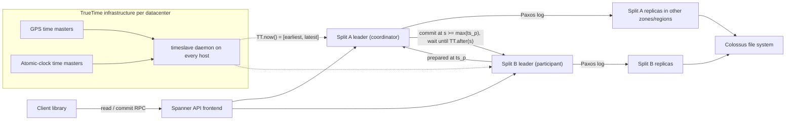

# Cloud Spanner: TrueTime and External Consistency

## TL;DR

Spanner gets serializability from strict two-phase locking with wound-wait, and it gets external consistency (linearizability for transactions) from TrueTime commit timestamps plus commit wait (Brewer, Google Research 2017).
TrueTime returns an interval [earliest, latest] rather than a single instant, and a commit cannot become visible until `TT.now().earliest` is past its timestamp, so the expected commit wait is about 2 x epsilon (OSDI 2012).
Each split is its own Paxos group with a time-leased leader, and a transaction that touches more than one group runs two-phase commit, where the coordinator is itself a Paxos-replicated leader, so the classic 2PC blocking problem becomes a leader-failover problem.
Commit wait runs at the same time as Paxos replication, so you only see it when epsilon is larger than the quorum round trip, but locks are held for the whole wait, which sets a hard throughput ceiling on any single hot row.
Reads at a past timestamp ("stale reads") can be served by any replica whose safe time has advanced past the read timestamp, without talking to the leader, which is why roughly 10-15 second staleness is the standard lever for cheap, local, lock-free reads.

## Mental Model



Think of Spanner as thousands of small, independent replicated state machines (one Paxos group per split) that never share a lock manager or a sequencer, and that agree on a global order only through physical time with a bounded error.
Each leader can hand out commit timestamps on its own, because TrueTime guarantees that any timestamp it picks after waiting out the uncertainty is in the past for every observer on the planet.
Two-phase commit is the only cross-group coordination, and it exists only to pick a single timestamp that is at least as large as every participant's prepare timestamp.
Everything else, including consistent snapshot reads across the whole database, comes for free from multi-version storage indexed by those timestamps.
The previous chapter, [[17-Cloud-AI-Engineering/Volume_03_GCP_Deep_Dive/Chapter_09_Cloud_Storage_and_Colossus_Filesystem|Cloud Storage and Colossus Filesystem]], describes the file system underneath, and the paper-level treatment lives in [[17-Cloud-AI-Engineering/Volume_13_Seminal_Papers_and_Case_Studies/Chapter_06_Google_Spanner|Google Spanner (2012 OSDI)]].

## Internals

### Topology: universe, zones, spanservers, splits

The 2012 design organizes a deployment as a universe made of zones, where a zone is the unit of administrative deployment and physical isolation, and each zone has one zonemaster plus hundreds to thousands of spanservers (Corbett et al., OSDI 2012).
A spanserver serves somewhere between 100 and 1000 tablets, each tablet is a bag of timestamped key-value mappings `(key, timestamp) -> value`, and tablet state is persisted as B-tree-like files plus a write-ahead log on Colossus (OSDI 2012).
A single Paxos state machine is layered on top of each tablet, and the set of replicas of that tablet across zones is a Paxos group (OSDI 2012).
The unit of data placement is a directory, meaning a set of contiguous keys that share a common prefix, and a background task called movedir moves directories between Paxos groups without blocking ongoing operations (OSDI 2012).
Cloud Spanner calls the user-visible equivalent a split, and it adds and moves split boundaries based on both size and load.
The split-and-move logic is the control plane, while the read and commit paths through Paxos leaders are the data plane, and a split move is just another Paxos-logged transaction, so it inherits the same consistency guarantees as user writes.
The "Spanner: Becoming a SQL System" paper (Bacon et al., SIGMOD 2017) covers the later shift from a key-value API to a full distributed SQL engine, including query routing based on key ranges and restartable distributed queries.

### Replica roles and placement

The pricing documentation spells out the replica topology: a regional node has three replicas, a dual-region node has six, a multi-region node has five or more, and an optional read-only replica counts as one (Google Cloud Spanner pricing docs, as of 2026-10).
A regional configuration places its read-write replicas in separate zones, so the Paxos majority (2 of 3) can survive the loss of a zone while staying inside one region's latency envelope.
Multi-region configurations combine read-write replicas in two regions with a witness replica in a third region, and the witness votes in Paxos but stores no full data copy and cannot serve reads (common configuration shape, UNVERIFIED for any specific named configuration).
Because the majority must include at least one replica outside the leader region, every multi-region commit pays at least one inter-region round trip, and this is the physics cost of surviving a full region failure.
The choice of default leader region decides where that round trip begins, so leader placement is the single most important latency decision in a multi-region design.
[[17-Cloud-AI-Engineering/Volume_01_Cloud_Architecture_Principles/Chapter_02_Regions_Zones_and_Static_Stability|Regions, Zones, and Static Stability]] covers the general failure-domain reasoning behind this.

### TrueTime: how the interval is built

The API has three calls: `TT.now()` returns an interval `[earliest, latest]`, `TT.after(t)` is true once t has definitely passed, and `TT.before(t)` is true when t has definitely not yet arrived (OSDI 2012).
The guarantee is that true absolute time at the moment of the call lies somewhere inside the interval, and epsilon is half the interval width.
Each datacenter runs a set of time master machines.
Most of them have GPS receivers with dedicated antennas, and the rest, called Armageddon masters, have atomic clocks, because GPS and atomic clocks fail in uncorrelated ways (antenna and receiver faults versus frequency drift) (OSDI 2012).
Masters cross-check one another's time, and a master whose local clock diverges substantially from the others evicts itself (OSDI 2012).
Every host runs a timeslave daemon that polls several masters in different datacenters and combines them with a variant of Marzullo's algorithm, which rejects liars and intersects the remaining intervals (OSDI 2012).
Between polls, the daemon widens its advertised uncertainty at a conservative worst-case drift rate of 200 microseconds per second, and with a 30-second poll interval this produces a sawtooth epsilon of roughly 1 to 7 ms, about 4 ms most of the time, in the 2012 production fleet (OSDI 2012).
The paper notes that bad CPUs were six times more likely than bad clocks in its machine statistics, which is the empirical basis for trusting hardware clocks with a bounded drift assumption (OSDI 2012).
Google's current documentation still describes managed TrueTime as multiple time servers synchronized with physical GPS receivers and atomic clocks (Google Cloud Spanner Omni docs, as of 2026-10).
Google has also shipped a software-only TrueTime for self-managed Spanner Omni deployments, with a primary time server and host clients that compute intervals from network latency and clock drift, plus explicit hardware requirements on clock rate error (Google Cloud Spanner Omni docs, as of 2026-10).
The trade-off is plain: a wider epsilon hurts latency but not correctness, while an epsilon that is wrong (true time outside the advertised interval) breaks correctness silently, so every engineering effort goes into keeping the bound honest even if that makes it wider.

### Paxos leaders, leases, and timestamp monotonicity

Spanner's Paxos uses long-lived leaders with timed leases, which default to 10 seconds, and a leader extends its lease with each successful write or by explicit renewal (OSDI 2012).
The protocol enforces a disjointness invariant: for each Paxos group, every leader's lease interval is disjoint from every other leader's lease interval, measured in TrueTime (OSDI 2012).
A leader only assigns timestamps inside its own lease, and timestamps within a group increase monotonically, even across leader changes.
Before abdicating, a leader waits until `TT.after(s_max)`, where s_max is the largest timestamp it has handed out, so a new leader can never issue a smaller timestamp (OSDI 2012).
This is the mechanism that turns a set of independent leaders into a single global timeline without a central sequencer.
Compare Raft-style leader leases in [[08-Distinguished-Engineering/02-Distributed-Systems-Internals/Raft-Consensus|Raft Consensus]], where the lease is typically justified by bounded clock drift on each node rather than by an explicit global uncertainty bound.

### Read-write transactions: single split

A read-write transaction reads by acquiring read locks at the leader of each group it touches, and the 2012 design avoids deadlock with wound-wait, so an older transaction wounds (aborts) a younger lock holder instead of waiting behind it (OSDI 2012).
Writes made through the mutation API are buffered in the client until commit, so later reads inside the same transaction do not see them, while DML statements are executed server-side and are visible to later statements in the same transaction.
For a commit that touches only one Paxos group, the leader takes write locks and picks a commit timestamp s that is no smaller than `TT.now().latest` at the moment the commit arrives, and larger than any timestamp the group has already assigned.
The leader then appends the commit record to the Paxos log.
While replication is in flight, the leader also performs commit wait: it does not let any replica apply the commit, and it does not reply to the client, until `TT.after(s)` is true (OSDI 2012).
Brewer points out that commit wait runs in parallel with the internal transaction communication and is usually short in practice (Brewer, "Spanner, TrueTime and the CAP Theorem", 2017).
Locks are released only after the commit is both replicated and past its wait, and this hold time is what sets the hot-row ceiling discussed in the worked example.

### Why commit wait gives external consistency

Let T1 commit at timestamp s1 and become visible to its client at absolute time t1.
Commit wait guarantees s1 < t1, because the reply is held until `TT.now().earliest > s1`.
Let T2 start committing at absolute time t2 > t1, meaning it began after T1 was acknowledged.
T2's leader picks s2 >= `TT.now().latest` at the moment it receives the commit, and that value is >= t2 because true time always lies inside the interval.
Chaining these gives s1 < t1 < t2 <= s2, so real-time order implies timestamp order, which is exactly the external consistency invariant Brewer states: if T2 starts to commit after T1 finishes, T2's timestamp is greater than T1's (Brewer, 2017).
Expected commit wait is about 2 x epsilon, because s is set at `latest` and the wait ends when `earliest` passes it (OSDI 2012).
With the 2012 average epsilon of about 4 ms, that is roughly 8 ms of commit wait.
In a multi-region configuration with a quorum round trip of tens of milliseconds, that 8 ms is completely hidden.
In a regional configuration with a sub-2 ms zone-to-zone quorum, it would be the dominant term, which is why shrinking epsilon matters most for regional deployments.

### Read-write transactions: two-phase commit across splits

When a transaction writes to more than one group, the client chooses a coordinator group and sends the commit to every participant leader with the coordinator's identity (OSDI 2012).
Each non-coordinator participant leader takes write locks, picks a prepare timestamp larger than any timestamp it has already assigned, logs a prepare record through its own Paxos group, and reports the prepare timestamp to the coordinator (OSDI 2012).
The coordinator leader also takes write locks but skips the prepare phase.
Once it hears from every participant, it picks s greater than or equal to every prepare timestamp, greater than `TT.now().latest` at the time the commit message arrived, and greater than any timestamp it has already assigned, and it logs the commit record through Paxos (OSDI 2012).
After commit wait, the coordinator sends s to the client and to all participants, and each participant logs the outcome through Paxos, applies it at s, and releases its locks (OSDI 2012).
Classic 2PC blocks when the coordinator crashes after the prepare phase.
Spanner shrinks that window by making the coordinator and every participant a Paxos-replicated state machine, so a crash triggers a leader failover inside the group instead of losing the decision, and the remaining blocking risk is bounded by lease expiry rather than by an operator.
The cost is latency, because a cross-split commit pays the participant Paxos write, the participant-to-coordinator hop, the coordinator Paxos write, and commit wait, roughly twice the replication work of a single-split commit.
Interleaved tables, which store child rows physically under the parent row's key prefix, exist mainly so that the common transaction touches one split and skips 2PC.

### Read-only transactions, safe time, and the hidden stall

A read-only transaction takes no locks and reads at a snapshot timestamp s_read, which defaults to `TT.now().latest` for a strong read (OSDI 2012).
Any replica can serve a read at timestamp t as long as t <= t_safe, where t_safe = min(t_safe_paxos, t_safe_TM) (OSDI 2012).
Here t_safe_paxos is the timestamp of the highest applied Paxos write, and t_safe_TM is just below the smallest prepare timestamp of any transaction that is prepared but not yet committed in that group (OSDI 2012).
The getting-started guides leave out the consequence: a 2PC participant that is prepared but waiting for its coordinator pins t_safe on every replica of that split, so strong reads and recent-timestamp reads on that split stall, even though the read itself takes no locks.
A slow or cross-region coordinator therefore shows up as read latency on a completely different, otherwise idle split.
On idle groups, the leader moves t_safe_paxos forward by promising a MinNextTS lower bound on future timestamps.
In the 2012 implementation it refreshed that promise every 8 seconds, so a healthy follower in an idle group could fall up to about 8 seconds behind and still serve reads (OSDI 2012).
That number explains why fixed-staleness reads of 10 to 15 seconds became the standard guidance: they sit comfortably above the safe-time lag, so the nearest replica can serve them without contacting the leader.
For a strong read at a follower, the replica has to learn a timestamp from the leader and then wait until its own t_safe catches up, which costs one round trip to the leader region.
For a single-split read, Spanner can pick the timestamp of the last committed write instead of `TT.now().latest` when there are no prepared transactions, which avoids waiting on the uncertainty (OSDI 2012).
Google's documentation states the operational result: multi-version concurrency control plus timestamp ordering lets clients run consistent reads across the whole database, even across regions, without blocking writes (Google Cloud Spanner TrueTime docs, as of 2026-10).

### Isolation levels and schema changes

Google's documentation says external consistency applies when the isolation level is left unspecified or set to serializable, which means the product now also offers a weaker isolation option (Google Cloud Spanner TrueTime docs, as of 2026-10).
The weaker option is believed to be repeatable read (snapshot-style), but its exact name and GA status are UNVERIFIED here, so check the release notes before you rely on it.
Schema changes are assigned a future timestamp and applied atomically across all groups at that timestamp, so in-flight reads and writes synchronize against the schema version without a global lock (OSDI 2012).

### Failure domain boundaries

Losing a replica in a regional configuration is a non-event for availability, because 2 of 3 replicas still form a quorum.
Losing the leader zone costs one lease expiry plus election, bounded by the 10-second lease design (OSDI 2012).
In a multi-region configuration, losing the default leader region forces leadership to the surviving read-write region, so p50 write latency changes shape for every client that was close to the old leader.
Losing a TrueTime master degrades nothing, because daemons poll several masters and discard outliers.
Losing time synchronization fleet-wide would widen epsilon and slow every commit, but it would not violate correctness unless the bound itself were wrong.
Brewer argues that Spanner is technically a CP system, since it chooses consistency during a partition, but that partitions are rare enough in Google's network for users to treat it as effectively CA (Brewer, 2017).

## Numbers to Know

| Quantity | Value | Source |
| --- | --- | --- |
| TrueTime epsilon (historical fleet) | sawtooth about 1-7 ms, about 4 ms typical | Corbett et al., OSDI 2012 |
| Timeslave poll interval | 30 s | OSDI 2012 |
| Assumed worst-case local drift | 200 us/s | OSDI 2012 |
| Expected commit wait | about 2 x epsilon, overlapped with Paxos | OSDI 2012; Brewer 2017 |
| Paxos leader lease default | 10 s | OSDI 2012 |
| Idle-group safe-time advance interval | 8 s (2012 implementation) | OSDI 2012 |
| Tablets per spanserver | 100-1000 | OSDI 2012 |
| Current TrueTime epsilon | sub-millisecond claims exist, not verified | UNVERIFIED |
| Compute unit | 1 node = 1000 processing units; granular instances below 1 node | Google Cloud pricing, as of 2026-10 |
| Replicas billed per node | regional 3, dual-region 6, multi-region 5+, read-only replica 1 | Google Cloud pricing, as of 2026-10 |
| Standard edition compute | from $0.030 per 100 PU per hour per replica | Google Cloud pricing, as of 2026-10 |
| Enterprise edition compute | from $0.041 per 100 PU per hour per replica | Google Cloud pricing, as of 2026-10 |
| Enterprise Plus edition compute | from $0.057 per 100 PU per hour per replica | Google Cloud pricing, as of 2026-10 |
| Edition availability | dual-region and multi-region require Enterprise Plus; read-only replicas need Enterprise or Enterprise Plus | Google Cloud pricing, as of 2026-10 |
| Implied regional Standard node-hour (us-central1) | $0.90 (3 x $0.30), $0.54 with 3-year CUD | Google Cloud CUD docs example, as of 2026-10 |
| 3-year CUD discount | 40% in Google's worked example | Google Cloud CUD docs, as of 2026-10 |
| SSD storage | from $0.10 per GB-month per replica | Google Cloud pricing, as of 2026-10 |
| HDD storage (tiered) | from $0.02 per GB-month per replica | Google Cloud pricing, as of 2026-10 |
| Backup storage, regional | from $0.10 per GB-month including all replicas | Google Cloud pricing, as of 2026-10 |
| Data Boost | from $0.00117 per serverless PU-hour | Google Cloud pricing, as of 2026-10 |
| DML mutation limit | 80,000 per DML statement; no longer cumulative per transaction for DML | Google Cloud blog, as of 2026-09 |
| Spanner queues | max 1000 active receive queries per queue with identical arguments; 2000 concurrent receive TVFs per project per region | Google Cloud docs, as of 2026-10 |
| Node quota increase response | within 48 hours via request form | Google Cloud quotas docs, as of 2026-10 |
| Storage per node | 10 TiB per node often cited | UNVERIFIED |
| Availability SLA | 99.999% multi-region, 99.99% regional often cited | UNVERIFIED |
| Speed of light in fiber | about 5 us per km one way, about 1 ms RTT per 100 km of path | physics, not volatile |

## AWS vs GCP Mechanism Parity

The closest AWS analog is Aurora DSQL, covered in [[17-Cloud-AI-Engineering/Volume_02_AWS_Deep_Dive/Chapter_12_Aurora_DSQL_Multi_Region_Active_Active_SQL|Aurora DSQL: Multi-Region Active-Active SQL]], with DynamoDB and Aurora Global Database as the non-SQL and single-writer alternatives.
All AWS-side facts in this table could not be re-verified against current AWS documentation for this edition and are marked accordingly.

| Dimension | Cloud Spanner | AWS equivalent | Critical difference |
| --- | --- | --- | --- |
| Clock source | TrueTime: GPS plus atomic-clock masters, interval API, internal only | Amazon Time Sync Service with hardware PTP clocks on supported Nitro instances, error bound exposed through the open-source ClockBound daemon (UNVERIFIED) | AWS exposes a bounded clock to customer code, while Spanner keeps TrueTime internal and exposes only commit timestamps |
| Concurrency control | Pessimistic 2PL with wound-wait for read-write; lock-free MVCC snapshot reads | Aurora DSQL uses optimistic concurrency control and checks conflicts at commit (UNVERIFIED) | Spanner queues contenders behind locks; OCC holds no locks but aborts losers, so retry behavior under contention is fundamentally different |
| Default isolation | Serializable with external consistency; a weaker level exists | Aurora DSQL offers snapshot isolation equivalent to PostgreSQL repeatable read (UNVERIFIED) | Write skew is impossible on Spanner by default and possible on snapshot isolation |
| Replication unit | One Paxos group per split, leader-based | DSQL separates query processors, adjudicators, a journal, and storage (UNVERIFIED) | Spanner co-locates the lock manager with the Paxos leader, while DSQL disaggregates the commit path |
| Cross-shard commit | 2PC with Paxos-replicated coordinator and participants | Internal to DSQL, not customer-visible (UNVERIFIED) | On Spanner, interleaving and key design decide whether you pay 2PC |
| Multi-region write quorum | Read-write replicas in two regions plus a witness region | DSQL multi-region clusters with two peer regions plus a witness region (UNVERIFIED) | Both pay at least one inter-region RTT per commit, and Spanner additionally concentrates leadership in a default leader region |
| Stale or follower reads | Exact or bounded staleness served by any replica past t_safe | Aurora Global Database replica reads are asynchronous with lag; DynamoDB eventually consistent reads | Spanner stale reads are consistent snapshots at a timestamp, not just "lagging" replicas |
| Sharding | Automatic size- and load-based splits | DynamoDB partitions by key hash with adaptive capacity; DSQL automatic (UNVERIFIED) | Spanner keeps keys in range order, so sequential keys create hotspots, while hash partitioning hides them but loses range scans |
| Capacity model | Provisioned processing units per replica, CUDs | DSQL serverless usage-based units (UNVERIFIED); DynamoDB on-demand or provisioned | Spanner charges for idle provisioned capacity, and serverless models charge per request |
| Analytics isolation | Data Boost serverless compute reading the same storage | Aurora zero-ETL integrations or replicas (UNVERIFIED) | Data Boost does not consume instance compute |

The architectural lesson: AWS reaches comparable guarantees through a different decomposition (OCC plus a disaggregated commit path), and the operational behavior under contention diverges most.
See [[17-Cloud-AI-Engineering/Volume_04_AWS_vs_GCP_Translation/Chapter_04_Storage_and_Database_Translation|Storage and Database Translation]] for the full decision matrix and [[04-System-Design/05-Data-Stores/CockroachDB-Distributed-SQL|CockroachDB Distributed SQL]] for the hybrid-logical-clock alternative that works without specialized time hardware.

## Worked Example: Observing Commit Timestamps, Stale Reads, and the Hot-Row Ceiling

### Cost estimate and guardrails

The lab uses one regional Standard edition instance with 100 processing units in `us-central1`.
Compute is 100 PU x $0.030 per 100 PU-hour per replica x 3 replicas = $0.09 per hour (Google Cloud pricing, as of 2026-10).
Storage is negligible: under 1 GB x $0.10 x 3 replicas = under $0.30 per month, prorated.
A 4-hour session costs about $0.36 plus a fraction of a cent of storage, and the minimum billing increment is UNVERIFIED, so assume at least one full hour.
If `gcloud` does not default new regional instances to Standard edition (UNVERIFIED), the Enterprise rate of $0.041 would raise the hourly cost to about $0.12.

```bash
#!/usr/bin/env bash
set -euo pipefail
export PROJECT_ID="$(gcloud config get-value project)"
export BILLING_ACCOUNT="XXXXXX-XXXXXX-XXXXXX"   # replace
export INSTANCE="tt-lab"
export DB="ttlab"

gcloud services enable spanner.googleapis.com billingbudgets.googleapis.com

# Budget alarm: alert at 50% and 100% of 5 USD for this project.
gcloud billing budgets create \
  --billing-account="${BILLING_ACCOUNT}" \
  --display-name="spanner-tt-lab" \
  --budget-amount=5USD \
  --filter-projects="projects/${PROJECT_ID}" \
  --threshold-rule=percent=0.5 \
  --threshold-rule=percent=1.0

gcloud spanner instances create "${INSTANCE}" \
  --config=regional-us-central1 \
  --processing-units=100 \
  --description="TrueTime lab"

cat > /tmp/ttlab.ddl <<'EOF'
CREATE TABLE Counters (
  k  STRING(64) NOT NULL,
  v  INT64 NOT NULL,
  ts TIMESTAMP OPTIONS (allow_commit_timestamp = true)
) PRIMARY KEY (k);
CREATE TABLE Events (
  id     STRING(36) NOT NULL,
  writer STRING(16) NOT NULL,
  ts     TIMESTAMP NOT NULL OPTIONS (allow_commit_timestamp = true)
) PRIMARY KEY (id)
EOF

gcloud spanner databases create "${DB}" --instance="${INSTANCE}" --ddl-file=/tmp/ttlab.ddl
```

### The probe script

The script runs three experiments.
First, it checks real-time ordering across two independent clients by comparing commit timestamps.
Second, it compares strong reads against 15-second stale reads.
Third, it measures read-modify-write throughput on one hot row versus 16 distinct rows.

```python
# ttlab.py - requires: pip install google-cloud-spanner
import datetime
import statistics
import time
import uuid
from concurrent.futures import ThreadPoolExecutor

from google.cloud import spanner
from google.cloud.spanner_v1 import param_types

INSTANCE, DB = "tt-lab", "ttlab"


def db_handle():
    return spanner.Client().instance(INSTANCE).database(DB)


def external_consistency_probe(rounds=200):
    # Two separate Client objects model two unrelated processes.
    a, b = db_handle(), db_handle()
    violations = 0
    for _ in range(rounds):
        with a.batch() as batch:
            batch.insert("Events", ("id", "writer", "ts"),
                         [(str(uuid.uuid4()), "A", spanner.COMMIT_TIMESTAMP)])
        t_a = batch.committed
        # B starts only after A's commit has been acknowledged.
        with b.batch() as batch2:
            batch2.insert("Events", ("id", "writer", "ts"),
                          [(str(uuid.uuid4()), "B", spanner.COMMIT_TIMESTAMP)])
        t_b = batch2.committed
        if not t_b > t_a:
            violations += 1
    print(f"external consistency: {rounds} pairs, violations={violations}")


def read_latency_probe(n=100):
    db = db_handle()
    sql = "SELECT COUNT(*) FROM Events"
    def timed(**kw):
        out = []
        for _ in range(n):
            t0 = time.perf_counter()
            with db.snapshot(**kw) as snap:
                list(snap.execute_sql(sql))
            out.append((time.perf_counter() - t0) * 1000)
        out.sort()
        return statistics.median(out), out[int(0.99 * (n - 1))]
    s50, s99 = timed()
    t50, t99 = timed(exact_staleness=datetime.timedelta(seconds=15))
    print(f"strong read p50={s50:.1f}ms p99={s99:.1f}ms")
    print(f"stale-15s read p50={t50:.1f}ms p99={t99:.1f}ms")


def increment(txn, key):
    rows = list(txn.execute_sql("SELECT v FROM Counters WHERE k = @k",
                                params={"k": key}, param_types={"k": param_types.STRING}))
    v = rows[0][0] if rows else 0
    txn.insert_or_update("Counters", ("k", "v", "ts"), [(key, v + 1, spanner.COMMIT_TIMESTAMP)])


def contention_probe(threads=16, seconds=20):
    db = db_handle()
    def worker(i, hot):
        key = "hot" if hot else f"cold-{i}"
        done, deadline = 0, time.time() + seconds
        while time.time() < deadline:
            db.run_in_transaction(increment, key)  # retries ABORTED automatically
            done += 1
        return done
    for hot in (True, False):
        with ThreadPoolExecutor(threads) as pool:
            total = sum(pool.map(lambda i: worker(i, hot), range(threads)))
        label = "1 hot row" if hot else f"{threads} distinct rows"
        print(f"{label}: {total / seconds:.0f} committed txn/s")


if __name__ == "__main__":
    external_consistency_probe()
    read_latency_probe()
    contention_probe()
```

### What to expect and why

The external consistency probe should report zero violations, because B's commit reaches its leader after A's acknowledgement, and commit wait guarantees `s_B >= TT.now().latest > s_A`.
Stale reads should show a lower p99 than strong reads, because a 15-second-old timestamp sits below t_safe on any replica, so it never waits on the safe-time mechanism or on prepared transactions.
On a 100 PU instance the absolute numbers are dominated by small-instance CPU limits, so treat the ratio, not the absolute value, as the result.
The hot-row run should plateau at a much lower rate than the distinct-row run however many threads you add, because every increment holds a lock on the same row through its read, the commit Paxos write, and commit wait.

### Back-of-the-envelope: hot-row ceiling

The serialized throughput limit for one row is about 1 / T_hold, where T_hold is the time from lock acquisition to lock release.
For a read-modify-write, T_hold is approximately: client-to-leader RTT for the read, plus client processing, plus client-to-leader RTT for the commit, plus max(quorum replication, commit wait).
Regional, client in the same region (assumed 0.5 ms RTT to the leader, 2 ms quorum, 1 ms processing, and commit wait 2 x epsilon ≈ 8 ms at historical epsilon = 4 ms): max(2 ms, 8 ms) is 8 ms, so T_hold is about 0.5 + 1 + 0.5 + 8 = 10 ms, yielding a ceiling of about 100 txn/s on that row (rising to roughly 250 txn/s on modern clusters where hardware PTP keeps epsilon under 1 ms).
Multi-region, client 60 ms RTT from the leader region, 10 ms RTT to the nearest quorum region: T_hold is about 60 + 60 + 10 = 130 ms, so the ceiling is about 7.7 txn/s on that row.
That gap of more than 30x comes from client placement relative to the leader, not from Spanner capacity, and adding nodes does nothing for it.
Fix 1: run the transaction logic in the leader region, which removes 120 ms and brings the ceiling to roughly 1 / 11 ms, about 90 txn/s.
Fix 2: shard the counter into N rows keyed `(counter_id, shard)` and pick a shard at random on write, which multiplies the ceiling by N, at the cost of reads that sum N rows.
Fix 3: write append-only ledger rows (blind inserts with no read lock) and aggregate them asynchronously, so contention becomes plain write throughput spread across splits.

### Back-of-the-envelope: fleet cost

Assume a load test showed that your workload needs 15 nodes in regional Standard edition at your chosen CPU target, and treat per-node throughput as something you measure, not a constant.
Compute: 15 nodes x $0.90 per node-hour x 730 hours = $9,855 per month on demand (Google Cloud pricing, as of 2026-10).
With a 3-year CUD at 40%: $9,855 x 0.6 = $5,913 per month (Google Cloud CUD docs, as of 2026-10).
Storage at 2 TiB (2048 GB) all-SSD: 2048 x $0.10 x 3 replicas = $614 per month.
If you tier 1.5 TiB of cold data to HDD: 512 x $0.30 + 1536 x $0.02 x 3 = $154 + $92 = $246 per month, saving about $368 per month.
Moving the same 15 nodes to a multi-region Enterprise Plus configuration with 5 billed replicas, using the regional starting rate as a lower bound: 15 x 5 x $0.57 x 730 = $31,208 per month, and actual multi-region per-replica rates vary by configuration, so check the pricing page.
The jump of more than 3x is the price of surviving a region and should be justified by an RTO and RPO requirement, as framed in [[17-Cloud-AI-Engineering/Volume_07_Reliability_and_SRE/Chapter_04_Disaster_Recovery_Tiers_and_RTO_RPO_Engineering|Disaster Recovery Tiers and RTO/RPO Engineering]].

### Teardown

```bash
gcloud spanner instances delete tt-lab --quiet
gcloud billing budgets list --billing-account="${BILLING_ACCOUNT}" --format="value(name)" \
  --filter="displayName=spanner-tt-lab" | xargs -r -I{} gcloud billing budgets delete {} --quiet
```

Deleting the instance deletes its databases, unless a database has drop protection enabled, in which case you must turn protection off first.

## Failure Modes and Pitfalls

### Monotonic-key hotspots

Spanner keeps rows in primary-key order, so a key that starts with a timestamp, an auto-incrementing integer, or a monotonically increasing ID sends all inserts to the last split.
Load-based splitting cannot fix this, because the new split at the tail immediately becomes the new hotspot.
Secondary indexes on a commit timestamp or a creation time have the same problem, because an index is a table keyed by the indexed column.
Fixes: UUIDv4 keys, a hash-prefix shard column, or bit-reversed sequences (feature availability UNVERIFIED), and keep timestamps out of the leading key position.

### Lock convoys and abort storms

Under wound-wait, a burst of contenders on one row aborts younger transactions repeatedly, and client libraries retry `ABORTED` automatically, which turns contention into extra CPU and tail latency.
`run_in_transaction` may run the transaction function several times, so any side effect inside it, such as an HTTP call, a message publish, or a counter in process memory, can happen more than once.
Keep transaction bodies pure, and use idempotency keys for external effects, as discussed in [[17-Cloud-AI-Engineering/Volume_07_Reliability_and_SRE/Chapter_03_Resilient_Communication_Retries_Jitter_and_Circuit_Breakers|Resilient Communication: Retries, Jitter, and Circuit Breakers]].

### Accidental 2PC

Transactions that touch rows in unrelated tables or across distant key ranges become multi-participant 2PC, which roughly doubles commit-path work and exposes the safe-time stall to readers on every participant split.
Interleave child tables under their parents when the access pattern is parent-scoped, and avoid global secondary indexes on write-hot columns, because each index update can land on a different split.

### Prepared-transaction read stalls

A participant that is prepared and waiting for a slow coordinator pins t_safe, so strong reads and fresh-timestamp reads on that split wait while it is stuck.
The symptom is read latency on a split that has no write load of its own.
In multi-region configurations, coordinator latency includes inter-region hops, so a single cross-region write pattern can raise read p99 for unrelated readers.

### Leader placement mismatch

If most writers live in one region but the default leader sits in another, every read-write transaction pays at least two cross-region RTTs on top of the quorum.
After a regional failover, leadership moves, and clients that were tuned for the old leader see a step change in latency that does not undo itself unless the default leader is restored.

### Mutation and transaction size limits

The DML limit is now 80,000 mutations per statement rather than per transaction, but bulk changes still need Partitioned DML or key-range pagination when a single statement goes over the limit (Google Cloud blog, as of 2026-09).
The mutation-API (non-DML) commit limits did not change in that announcement, and their current values are UNVERIFIED here.

### Stale reads beyond version retention

Reading at a timestamp older than the database's version retention period fails, and the default retention period of one hour is UNVERIFIED here.
Long-running analytical scans at a fixed timestamp should run on Data Boost or export paths instead of extending retention, because extra retention increases storage and compaction load.

### Clock assumptions outside Google's fleet

Managed Spanner relies on GPS and atomic-clock time masters, while Spanner Omni relies on a software TrueTime with published hardware requirements for clock rate error (Google Cloud Spanner Omni docs, as of 2026-10).
On self-managed hardware, a host whose oscillator drifts beyond the assumed rate breaks the interval guarantee, and the result is not an outage but silently non-linearizable transactions, which is the worst kind of failure.
Monitor the Omni time metrics as safety-critical signals, not as performance metrics.

### Strongly consistent global replication as a blast-radius amplifier

Google's post-incident report for the 2025-06-12 Service Control outage described a policy change containing blank fields that Spanner replicated globally within seconds, which triggered a null-pointer crash loop in every region (UNVERIFIED: recalled from the Google Cloud incident report, not re-checked for this edition).
The same report described the us-central1 Spanner backing store becoming overloaded as tasks restarted without randomized exponential backoff (UNVERIFIED).
The lesson is architectural: a database that replicates globally and consistently in seconds is a perfect channel for a bad config to reach every cell at once, so configuration rollouts need staged, cell-by-cell propagation and feature flags on top of the database, not instead of it.
See [[17-Cloud-AI-Engineering/Volume_07_Reliability_and_SRE/Chapter_07_Anatomy_of_Major_Cloud_Outages|Anatomy of Major Cloud Outages]] and [[17-Cloud-AI-Engineering/Volume_01_Cloud_Architecture_Principles/Chapter_03_Cell_Based_Architecture_and_Shuffle_Sharding|Cell-Based Architecture and Shuffle Sharding]].

## Security and Cost Angles

### IAM scoping

Grant applications `roles/spanner.databaseUser` or `roles/spanner.databaseReader` at the database level, not the project level, and reserve `roles/spanner.databaseAdmin` and instance-admin roles for deployment pipelines.
Fine-grained access control maps IAM principals to database roles with table- and column-level SQL privileges, which keeps a compromised reader service from touching sensitive columns.
Use Workload Identity, not service account keys, for GKE and Cloud Run callers, as described in [[17-Cloud-AI-Engineering/Volume_08_Security_Identity_and_the_Data_Perimeter/Chapter_02_Workload_Identity_Federation|Workload Identity Federation]].

### Encryption hierarchy

Data at rest is encrypted by default with Google-managed keys, and CMEK lets a Cloud KMS key wrap the data encryption keys, so disabling the key cuts off access, which is the envelope pattern from [[17-Cloud-AI-Engineering/Volume_08_Security_Identity_and_the_Data_Perimeter/Chapter_04_Encryption_Key_Hierarchies_and_Envelope_Encryption|Encryption Key Hierarchies and Envelope Encryption]].
Multi-region instances need KMS keys in each replica region (UNVERIFIED for current requirements), and destroying or disabling a key is a database-wide availability event, so key admin roles must be split from database admin roles.
Backups have their own encryption configuration, so set CMEK explicitly on backup and restore paths rather than assuming it is inherited.

### Network and data perimeter

Put `spanner.googleapis.com` inside a VPC Service Controls perimeter so that stolen credentials used from outside the perimeter cannot read data and cannot export it to an outside project, as described in [[17-Cloud-AI-Engineering/Volume_03_GCP_Deep_Dive/Chapter_03_VPC_Service_Controls_Security_Perimeters|VPC Service Controls: Security Perimeters]].
Route client traffic through Private Google Access or Private Service Connect endpoints for Google APIs so database traffic never needs an external IP.
Turn on Data Access audit logs for Spanner selectively, because they are not enabled by default for most services and can be voluminous on hot databases.

### Unit-economics levers

Right-size with processing units rather than whole nodes, because granular instances bill below one node (Google Cloud pricing, as of 2026-10).
Commit baseline capacity with 1-year or 3-year CUDs, and Google's 3-year example shows a 40% discount (Google Cloud CUD docs, as of 2026-10).
Tier cold rows to HDD storage at $0.02 versus $0.10 per GB-month per replica (Google Cloud pricing, as of 2026-10).
Serve read-heavy, staleness-tolerant traffic from read-only replicas near users, which cost one replica per node instead of a full read-write set (Google Cloud pricing, as of 2026-10).
Push analytics to Data Boost so scans do not force you to provision instance compute for peak analytical load (Google Cloud pricing, as of 2026-10).
Choose the smallest edition that meets your topology needs, because multi-region and dual-region require Enterprise Plus at nearly twice the Standard per-replica compute rate (Google Cloud pricing, as of 2026-10).
See [[17-Cloud-AI-Engineering/Volume_09_FinOps_and_Cloud_Economics/Chapter_02_Commitment_Discounts_Savings_Plans_vs_CUDs|Commitment Discounts: Savings Plans vs CUDs]] for breakeven formulas.

## Interview Questions and Model Answers

### Question 1 (L5 - Senior)

Why does Spanner need commit wait, and what would break if it skipped it?

#### Model Answer

A leader picks a commit timestamp s at least as large as `TT.now().latest`, but true time could be anywhere in the interval, so s might still be in the future relative to absolute time.
If the leader acknowledged immediately, a client could tell another client "done", and that second client's transaction could reach a different leader whose `TT.now().latest` is still below s.
The second transaction could then receive a smaller timestamp than the first, and a snapshot read between the two timestamps would show the second effect without the first, which violates external consistency.
Commit wait holds visibility and the acknowledgement until `TT.after(s)`, which makes s < absolute acknowledgement time, and any later transaction then gets a timestamp >= its own `TT.now().latest`, which is >= absolute time.
The cost is about 2 x epsilon per commit, overlapped with Paxos replication, so it is visible only when epsilon is larger than the quorum round trip, which mostly means regional configurations.
Skipping it would still give serializability, because locks provide that, but it would lose real-time ordering across clients, which is the property that makes Spanner behave like a single-machine database.

#### Follow-up Interviewer Question

If epsilon temporarily doubled across a region because of a time-master problem, which metrics would move, and would any data be wrong?

### Question 2 (L5 - Senior)

An orders table keyed by `(order_timestamp, order_id)` shows one server pegged and insert latency climbing with traffic, even after you add nodes, so walk through the diagnosis and the fix.

#### Model Answer

Spanner range-partitions by primary key, so a timestamp-leading key sends every new insert to the tail split, and the split leader's CPU and lock table become the bottleneck.
Adding nodes adds capacity in other splits, and load-based splitting just creates a new tail, so the hotspot moves but does not spread.
Confirm it with Key Visualizer or per-split CPU and lock statistics, which will show a bright band at the end of the key range.
Fix it by leading the key with a high-cardinality, uniformly distributed value such as a UUIDv4 or a hash shard, and move the timestamp into a secondary position.
If time-range queries are required, add a secondary index whose leading column is a shard number (0 to N-1) followed by the timestamp, and query all N shards in parallel.
The trade-off is a scatter-gather read path, with N times the read RPCs, in exchange for N-way write spreading.
Also check whether any secondary index leads with the timestamp, because index writes have the same tail behavior and run in the same transaction, which may also turn single-split commits into 2PC.

#### Follow-up Interviewer Question

How do you pick N, and what changes if the table is interleaved under a customer parent table?

### Question 3 (L6 - Staff)

You run a multi-region Spanner configuration for a wallet service, and one merchant's balance row is updated by thousands of buyers globally while the merchant complains that payments time out, so quantify the problem and redesign it.

#### Model Answer

Every read-modify-write on the balance row holds a lock from its read through the commit Paxos round and commit wait, so that row's throughput ceiling is about 1 / T_hold no matter how many nodes the instance has.
With buyers 60 ms RTT from the leader region and a 10 ms quorum hop, T_hold is about 130 ms, so the row serializes at under 8 commits per second, and wound-wait aborts plus automatic retries amplify the queue into timeouts.
First lever: run the debit logic in a service colocated with the default leader region, which removes two long RTTs from the lock hold and gives roughly a 10x improvement.
Second lever: change the data model from an updated balance to an append-only ledger, where each payment is a blind insert keyed by `(merchant_id, shard, payment_id)` and takes no read lock on a shared row.
The merchant balance becomes a derived value: a periodic aggregation, or a set of N sharded subtotal rows, each updated by a fraction of traffic.
Invariants such as "no negative balance" apply to the buyer side, where contention is per buyer and therefore low, while the merchant side only receives credits, which commute.
The trade-off is read complexity and eventual aggregation lag on the merchant view, which is acceptable because the merchant's balance is not the guarded invariant.
I would validate the design with a contention load test that plots committed transactions per second against concurrency, expecting a flat line for the old design and linear scaling for the ledger.

#### Follow-up Interviewer Question

The finance team insists the merchant balance must be exactly current for payouts, so how do you provide that without reintroducing the hot row?

### Question 4 (L6 - Staff)

Read p99 on a mostly idle reference-data table spikes whenever a nightly cross-region batch job writes to a different set of tables, and no locks are involved in the reads, so explain the mechanism.

#### Model Answer

Spanner serves a read at timestamp t only when t <= t_safe, and t_safe is the minimum of the Paxos safe time and just below the earliest prepare timestamp of any prepared-but-uncommitted transaction in that group.
If the batch job's transactions also touch even one row in a split that holds reference data, for example through an index update or a foreign key check, that split becomes a 2PC participant.
While the participant waits in the prepared state for a coordinator that may be in another region, t_safe on that split is pinned, so strong reads and any read at a timestamp newer than the prepare wait.
The reads take no locks, but they still wait on safe time, which is why lock-wait metrics look clean.
Fixes: move reference-data reads to bounded or exact staleness of 10 to 15 seconds, which sits below the pinned safe time.
Also restructure the batch so its transactions stay single-split or within one interleaved hierarchy, and make each transaction small so the prepare window is short.
Finally, place the batch's compute in the leader region so the coordinator round trips are short.
I would confirm the diagnosis by correlating read latency with the batch's commit latency and participant count from transaction statistics.

#### Follow-up Interviewer Question

Why can a follower replica in an idle Paxos group still serve a read 10 seconds in the past, but not a strong read, without contacting the leader?

### Question 5 (L6 - Staff)

Compare Cloud Spanner and Aurora DSQL for a global ticketing system with heavy contention on popular events.

#### Model Answer

Spanner uses pessimistic locking with wound-wait for read-write transactions, so contenders queue on the row lock and older transactions win, which gives predictable progress but caps per-row throughput at 1 / T_hold.
Aurora DSQL uses optimistic concurrency (UNVERIFIED for its exact internals), so transactions run without locks and conflicting ones abort at commit, which hurts most under exactly this kind of contention, because abort rate grows with concurrency and every retry repeats the full round trip.
Spanner's default isolation is serializable with external consistency, while DSQL's is snapshot isolation (UNVERIFIED), so on DSQL a "seats remaining >= 1" check across two rows can suffer write skew unless you materialize the conflict on a single row.
Both pay at least one inter-region RTT per multi-region commit, so the physics is the same, and the difference is who waits and who retries.
For popular events I would avoid row contention on either platform by pre-partitioning inventory into seat blocks or tokens, so each purchase claims a distinct row, which makes contention a key-distribution problem instead of a lock or abort problem.
I would choose based on ecosystem fit and the contention profile after that redesign: Spanner if I need serializable cross-row invariants and range scans, and DSQL if the team is PostgreSQL-native and the redesigned workload rarely conflicts.

#### Follow-up Interviewer Question

How would you measure the abort-versus-wait trade-off empirically before committing to either platform?

### Question 6 (L7+ - Principal)

A team proposes building externally consistent transactions on EC2 using AWS's bounded clock and ClockBound, in the style of TrueTime, so evaluate the design and its failure modes.

#### Model Answer

The core requirement is an interval clock whose bound is never wrong, because commit wait converts a correct bound into linearizability and an incorrect bound into silent anomalies.
A bounded clock on EC2 (UNVERIFIED for current accuracy figures) can provide an earliest and latest reading, so the algorithm is the same: assign s = latest, wait until earliest > s, then release locks and acknowledge.
Commit latency adds about 2 x epsilon, so a microsecond-class bound makes commit wait negligible, but the design has to handle the degraded case where the bound widens, for example when the reference clock is lost and the daemon falls back to drift-based widening.
In that case latency rises smoothly, which is acceptable, and the system must refuse to commit, rather than guess, if the clock reports itself unsynchronized.
The real risks are the trust boundary and the drift assumption: who guarantees the drift rate, how a misbehaving host is detected, and whether a VM pause or live migration can freeze the guest's view of time while true time keeps moving.
Google's own software TrueTime for Spanner Omni publishes hardware requirements on clock rate error, which shows that even the originator treats the drift bound as a hardware qualification problem (Google Cloud Spanner Omni docs, as of 2026-10).
The alternative is hybrid logical clocks as in CockroachDB, which tolerate bad clocks for serializability but give up strict real-time ordering across unrelated keys unless you add uncertainty restarts and a maximum-offset assumption that is again a drift bound.
My recommendation: buy rather than build, using Aurora DSQL or Spanner, unless the team can run continuous clock-bound auditing, such as cross-host interval intersection checks, and has a reason the managed services do not meet.

#### Follow-up Interviewer Question

Design the monitoring that would detect a violated clock bound before it produces an observable anomaly, and say what the system should do automatically when it fires.

### Question 7 (L7+ - Principal)

Brewer argues Spanner is "effectively CA", so defend or attack that claim for a platform team deciding whether to put every service's state in a single multi-region Spanner instance.

#### Model Answer

Brewer's claim is that Spanner is formally CP, since it picks consistency during partitions, but that Google's private network and redundancy make partitions rare enough for users to treat availability as practically unaffected (Brewer, 2017).
That claim is about the infrastructure's failure rate, not about blast radius, and a platform team has to reason about both.
A single shared instance concentrates correlated risk: schema mistakes, hot keys from one tenant, quota and CPU exhaustion, CMEK key incidents, and bad configuration replicated globally in seconds all become shared fate.
The 2025-06-12 Google Cloud incident (UNVERIFIED details) is a concrete example of a strongly consistent, globally replicated store distributing a bad policy everywhere at once, so consistency was working exactly as designed and was the propagation channel.
I would accept Spanner's CP behavior for each service's data but reject a single shared instance, and instead deploy instances per domain or per cell, with staged config rollouts and per-instance CMEK keys.
Leader regions should match each domain's writer locality.
The cost is more instances to run and some cross-instance consistency that has to move to sagas or outbox patterns, which I would accept for the containment.
The decision rule: share infrastructure for efficiency only where failures are independent, and treat a globally consistent store as a shared failure domain for everything it holds.

#### Follow-up Interviewer Question

Which cross-domain invariants would genuinely require a single Spanner database, and how would you keep that set small over time?

### Question 8 (L7+ - Principal)

Your regional Spanner deployment shows commit p50 well above the zone-to-zone RTT, and the team suspects commit wait, so how do you prove or refute that, and what can you change?

#### Model Answer

Commit wait is about 2 x epsilon and runs in parallel with the Paxos quorum write, so it shows up in latency only when it exceeds the quorum time, which is most likely in a regional configuration with sub-2 ms zone RTTs.
Break the commit latency down using transaction and lock statistics: compare single-split commits that only write against read-modify-write transactions, and compare single-split against multi-split commits.
If single-split blind writes are close to the zone RTT and the excess appears only with reads or multiple splits, the cause is lock-hold time or 2PC, not commit wait.
If even single-split blind writes show a stable floor above the quorum RTT, commit wait or server CPU is the floor, so check CPU utilization, because a saturated leader queues work in front of everything.
You cannot tune epsilon as a customer, so the controllable levers are fewer splits per transaction through interleaving and key design, fewer round trips through batched DML or mutations, lower CPU through more processing units, and shorter lock holds through moving the client next to the leader.
For read-heavy paths, stale reads remove the leader and safe-time dependency entirely.
The principal-level point is to stop treating "Spanner is slow" as one number, and to break latency into replication, commit wait, lock hold, 2PC fan-out, and CPU queueing, since each one has different owners and fixes.

#### Follow-up Interviewer Question

How would you build a continuous synthetic probe that tracks the commit-wait floor over time as an SLO input?

## Further Reading

- [Spanner: Google's Globally-Distributed Database (Corbett et al., OSDI 2012)](https://www.usenix.org/system/files/conference/osdi12/osdi12-final-16.pdf) - the primary source for TrueTime, commit wait, leader leases, 2PC over Paxos, and safe-time reads.
- [Spanner, TrueTime and the CAP Theorem (Brewer, 2017)](https://research.google.com/pubs/archive/45855.pdf) - separates where serializability comes from (locks) and where external consistency comes from (TrueTime), and explains the effectively-CA argument.
- [Spanner: Becoming a SQL System (Bacon et al., SIGMOD 2017)](https://doi.org/10.1145/3035918.3056103) - how the key-value core grew a distributed SQL engine with range-based query routing.
- [Spanner: TrueTime and external consistency (Google Cloud docs)](https://docs.cloud.google.com/spanner/docs/true-time-external-consistency) - the current product statement of the guarantees and how isolation level affects them.
- [Spanner Omni: TrueTime and external consistency (Google Cloud docs)](https://docs.cloud.google.com/spanner-omni/true-time-external-consistency) - how Google implements TrueTime without GPS and atomic hardware, and the clock requirements that implies.
- [Spanner pricing](https://cloud.google.com/spanner/pricing) - editions, per-replica billing, storage tiers, and Data Boost, which you need for any capacity defense.
- [Spanner committed use discounts](https://docs.cloud.google.com/spanner/docs/cuds) - worked CUD math to reuse in FinOps reviews.
- [Spanner removes cumulative DML mutation limits (Google Cloud blog)](https://cloud.google.com/blog/products/databases/spanner-removes-dml-mutation-limits/) - the 2026 change from per-transaction to per-statement DML limits.
- [AWS ClockBound](https://github.com/aws/clock-bound) - the AWS-side bounded-clock daemon to study when weighing a TrueTime-style design on EC2.
- Liskov, "Practical Uses of Synchronized Clocks in Distributed Systems" (PODC 1991) - the intellectual ancestor of commit wait, cited by Brewer.
- Kulkarni et al., "Logical Physical Clocks" (OPODIS 2014) - the hybrid logical clock design that clock-hardware-free systems use instead of TrueTime.
- Next chapter: [[17-Cloud-AI-Engineering/Volume_03_GCP_Deep_Dive/Chapter_11_Cloud_Bigtable_LSM_Storage_and_Tablet_Serving|Cloud Bigtable: LSM Storage and Tablet Serving]] - the single-row-transaction ancestor whose tablet model Spanner generalized.
- Interview application: [[17-Cloud-AI-Engineering/Volume_14_Staff_Plus_Interview_Arena/Chapter_05_Design_Multi_Region_Active_Active_API|System Design: Multi-Region Active-Active API on AWS and GCP]] - where Spanner leader placement and quorum physics get defended end to end.
