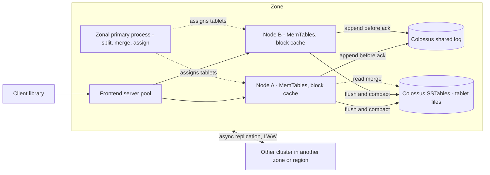

# Cloud Bigtable: LSM Storage and Tablet Serving

## TL;DR

- A Bigtable table is a sparse, persistent, lexicographically sorted map of (row key, column family:qualifier, timestamp) -> bytes. It is range-partitioned into tablets, and each tablet is served by exactly one node at a time.
- Nodes hold no data. Every acknowledged write first goes to a shared log on Colossus and then into an in-memory MemTable. MemTables flush to immutable SSTables on Colossus, so moving a tablet or recovering a node is a metadata operation rather than a data copy.
- Every read is a merge over the MemTable and all live SSTables for the tablet. Compaction keeps that merge cheap, removes tombstones and enforces garbage-collection policy, but it runs lazily in the background, and GC is not a read-time filter.
- Tablets split and merge only at row-key boundaries. A monotonically increasing key prefix, or one hot row, is capped at the throughput of a single node, and adding nodes does not fix it.
- A Bigtable cluster lives in one zone and is strongly consistent within that zone. Multi-cluster replication is asynchronous and resolves conflicts with last-write-wins. It buys availability and workload isolation, not cross-cluster linearizability.

## Mental Model



Think of a Bigtable node as a stateless LSM engine process that leases ownership of key ranges.
The durable state is two kinds of Colossus files: the log, which holds recent mutations, and the SSTables, which hold everything older.
The zonal primary process works like a placement solver.
It watches per-tablet load and size, cuts hot or large tablets in half at a row boundary, merges cold neighbours, and hands out ownership.
Because ownership is only a pointer, the system rebalances in seconds to minutes instead of hours.
The price is that every throughput property becomes a property of how your row keys spread across tablets.
The schema is the sharding function.

## Internals

### Lineage and data model

Cloud Bigtable is the external productization of the system described in [Chang et al., "Bigtable: A Distributed Storage System for Structured Data", OSDI 2006](https://www.usenix.org/legacy/event/osdi06/tech/chang/chang.pdf).
The paper's term "tablet server" corresponds to what Cloud Bigtable calls a node (Google Cloud docs, as of 2026-10).
The storage engine is a log-structured merge design in the tradition of [O'Neil et al., "The Log-Structured Merge-Tree", Acta Informatica 1996](https://www.cs.umb.edu/~poneil/lsmtree.pdf).
Mutations accumulate in memory and are written out as sorted immutable runs, which background compaction merges.
The data model is a sparse map: an absent column costs nothing, and a table can have millions of columns as long as no single row exceeds the 256 MB hard limit (Google Cloud docs, as of 2026-10).
Atomicity covers one row only.
Every mutation to a single row key is atomic, and there are no multi-row transactions.
Conditional single-row operations (CheckAndMutate and ReadModifyWrite) are the only read-modify-write primitives.
They are forbidden under multi-cluster routing, because they would conflict across clusters (Google Cloud docs, as of 2026-10).
Column families group columns for administrative purposes and for GC policy.
Family names travel with every request, which is why the docs ask for short names (Google Cloud docs, as of 2026-10).
The paper also describes locality groups: column families stored together in separate SSTables so that scans can skip unrelated families.
Cloud Bigtable does not expose locality groups as a configuration knob, so treat the concept as background rather than an API.

### Control plane versus data plane

The data plane is frontend servers plus nodes.
All client requests enter through a frontend server pool, which forwards each request to the node that currently owns the tablet covering the key (Google Cloud docs, as of 2026-10).
This differs from HBase, where thick clients cache region locations and talk to region servers directly.
In Bigtable a stale location becomes a frontend-side reroute, not a client-visible error storm.
The control plane in each zone is a primary process that balances workload and data volume within the cluster.
It splits busier or larger tablets in half, merges less-accessed or smaller tablets, and moves tablets between nodes (Google Cloud docs, as of 2026-10).
In the 2006 design, the master relies on Chubby, a Paxos-replicated lock service, for several things:
- master election;
- tablet-server liveness, because each tablet server holds an exclusive lock on a file in a servers directory;
- the root of the tablet location hierarchy.
That hierarchy has three levels: a Chubby file points to the root tablet, the root tablet indexes METADATA tablets, and METADATA tablets index user tablets.
Each METADATA row is roughly 1 KB.
With 128 MB METADATA tablets, the hierarchy addresses 2^34 tablets (Chang et al., OSDI 2006).
The operational point is that the location map is itself a Bigtable table, so the system bootstraps on its own data structure and uses a small consensus service only as the root of trust.

### Write path: log, MemTable, minor compaction

The sequence for a write is:
1. The client sends a mutation.
2. The frontend routes it to the owning node.
3. The node appends the mutation to the commit log.
4. The node inserts it into the tablet's MemTable, a sorted in-memory buffer.
5. The node acknowledges.
In Cloud Bigtable, all writes are stored in Colossus's shared log as soon as Bigtable acknowledges them (Google Cloud docs, as of 2026-10).
The acknowledgement is therefore durable before any SSTable exists.
The paper explains why the log is shared rather than per tablet.
One log per tablet would mean many concurrent files and many disk seeks on the underlying filesystem.
So each tablet server writes one commit log that mixes mutations from all of its tablets, and group commit amortizes the write cost.
The paper also describes two log-writing threads that switch when the filesystem shows a latency spike, so tail latency of the log write does not become tail latency of the database (Chang et al., OSDI 2006).
When a MemTable reaches a size threshold, the node freezes it, opens a new MemTable, and writes the frozen one to Colossus as an SSTable.
The paper calls this a minor compaction.
It does two things: it bounds memory, and it bounds how much log must be replayed if the node dies.
This write path explains the HDD numbers in the table below.
On HDD storage, writes cost about the same as on SSD (up to 10,000 rows/s per node versus 14,000 on SSD), while point reads collapse to about 500 rows/s per node (Google Cloud docs, as of 2026-10).
Writes are sequential appends to the log and the SSTables.
Reads need random block fetches from SSTables.

### Read path and read amplification

An SSTable is an immutable, sorted, persistent key-value file.
It is made of blocks, 64 KB by default in the paper, with a block index loaded into memory when the SSTable is opened.
A lookup therefore costs one index binary search plus at most one block fetch per SSTable (Chang et al., OSDI 2006).
A read for a row has to build a merged view over the MemTable plus every SSTable whose key range covers the row, because any of them may hold a newer cell version or a deletion marker.
The paper adds Bloom filters so a read can skip SSTables that cannot contain the requested row and column pair.
It also adds two caches: a scan cache for key-value pairs and a block cache for SSTable blocks.
The cost to remember is read amplification.
Its worst case is the number of SSTables that overlap a key, and it grows during write bursts until compaction catches up.
This is the mechanism behind a pattern many teams see.
After a heavy bulk load, p99 read latency on the same tablets rises for a while and then recovers with no change to node count.
Compaction debt is paid down in the background, and the reader pays until it is.

### Compactions, tombstones, and garbage collection

The paper describes three compaction types:
- minor compaction, which turns a MemTable into an SSTable;
- merging compaction, which folds a few SSTables and the MemTable into one new SSTable;
- major compaction, which rewrites all SSTables of a tablet into exactly one.
Only a major compaction can drop deletion markers together with the data they suppress (Chang et al., OSDI 2006).
A delete therefore writes data first.
It appends a tombstone, and space is reclaimed only when a later compaction covers both the tombstone and the shadowed cells.
GC policies (max versions, max age, and unions or intersections of the two) are enforced the same lazy way, during compaction.
Cells that already violate the policy can still be returned until compaction removes them.
So a read that depends on the policy, such as "latest version only", must also apply a read filter, for example a cells-per-column limit.
For mass deletion of a key prefix, use the admin DropRowRange operation rather than millions of per-row deletes.
Per-row deletes create a dense band of tombstones that later scans must step over.
On replicated instances, changing a GC policy has extra restrictions, which the replication docs call out (Google Cloud docs, as of 2026-10).

### Tablet split mechanics: the protocol the docs do not show you

Split and merge are cheap because SSTables are immutable.
In the paper, the two child tablets of a split share the parent's SSTables, so no data is rewritten at split time.
Later compactions in each child gradually produce SSTables that cover only the child's range (Chang et al., OSDI 2006).
The split is committed in a specific order:
1. The tablet server that owns the tablet decides to split.
2. It commits the split by writing the new tablet's entry into the METADATA table.
3. It notifies the master.
If the notification is lost, the master finds the split the next time it asks a server to load the old tablet.
The server sees that the METADATA entry covers only part of the requested range and tells the master.
In other words, the METADATA write is the linearization point, and the master's view is repaired lazily (Chang et al., OSDI 2006).
Moving a tablet uses a two-step flush that keeps the unavailability window small:
1. The source server runs a minor compaction while it is still serving, which shrinks the log that would need replaying.
2. It stops serving the tablet and runs a second, usually tiny, minor compaction to flush whatever arrived in between.
3. The destination loads the tablet with no log recovery at all (Chang et al., OSDI 2006).
Cloud Bigtable adds disaggregation on top of this.
Tablets sit on Colossus in the same zone as the nodes, and a node holds only pointers.
Rebalancing therefore updates pointers, node failure loses no data, and recovery migrates only metadata (Google Cloud docs, as of 2026-10).
After a resize, balancing under load typically takes a few minutes (Google Cloud docs, as of 2026-10).
The hard constraint is that split points are row keys.
The splitter can cut between two rows but never inside one.
One hot row, or a 256 MB row, is a single-node problem regardless of cluster size.

### Crash recovery

When a node dies, the primary reassigns its tablets.
Each new owner must rebuild the MemTable state that was never flushed, by replaying the tail of the log written since the last minor compaction.
Because the paper's log mixes all tablets of a server, a naive recovery would make each of N new owners read the whole log.
That costs N times the log volume.
The paper's fix:
1. Sort the log by (table, row name, log sequence number).
2. Do the sort in parallel over 64 MB log segments.
3. Let each new owner read only the contiguous run for its tablets (Chang et al., OSDI 2006).
The internal layout of Cloud Bigtable's Colossus shared log is not publicly documented, so read the paper's mechanism as lineage rather than as the current implementation.
The design lever is still the same today: the MemTable flush threshold trades write amplification against recovery time.

### Colossus as the substrate

Colossus succeeded GFS as Google's cluster filesystem.
GFS had a single master as its metadata bottleneck.
Colossus keeps metadata in a scalable database: Curators store file metadata in Bigtable, and D file servers hold the data ([Google Cloud blog, "A peek behind Colossus"](https://cloud.google.com/blog/products/storage-data-transfer/a-peek-behind-colossus-googles-file-system)).
The recursion is deliberate.
Bigtable stores its SSTables on Colossus, and Colossus stores its metadata in a Bigtable, which in turn sits on a smaller Colossus anchored in Chubby.
For a Bigtable user, Colossus durability and erasure coding sit below the database.
Bigtable does not replicate tablets inside a cluster, because the filesystem already provides durability.
Replicas exist only across clusters.
See [[17-Cloud-AI-Engineering/Volume_03_GCP_Deep_Dive/Chapter_09_Cloud_Storage_and_Colossus_Filesystem|Cloud Storage and Colossus]] and [[17-Cloud-AI-Engineering/Volume_13_Seminal_Papers_and_Case_Studies/Chapter_09_GFS_and_Colossus|GFS and Colossus]].

### Replication topology and consistency

An instance contains one or more clusters.
Each cluster is a set of nodes in one zone with its own tablets on that zone's storage (Google Cloud docs, as of 2026-10).
Replication between clusters is asynchronous and eventually consistent by default (Google Cloud docs, as of 2026-10).
A cell is identified by (row key, family, qualifier, timestamp).
If two clusters write the same cell, replication keeps a single value using last-write-wins ([Bigtable replication GA announcement](https://groups.google.com/g/google-cloud-bigtable-discuss/c/C_VjBZd4CBI)).
Routing is a client-side contract expressed as an app profile:
- Single-cluster routing gives read-your-writes for that workload (Google Cloud docs, as of 2026-10).
- Multi-cluster routing sends each request to the nearest available cluster and fails over automatically. How fast failover happens depends on the request deadline (Google Cloud docs, as of 2026-10).
- Row-affinity ("sticky") routing raises the read-your-writes rate under multi-cluster routing for single-row workloads (Google Cloud docs, as of 2026-10).
The precise consequence: under multi-cluster routing, a write acknowledged by cluster A but not yet replicated is invisible to a reader that failed over to cluster B.
If cluster B also accepts a conflicting write, one of the two is silently discarded by timestamp.
Compare this with Spanner's TrueTime-based external consistency in [[17-Cloud-AI-Engineering/Volume_03_GCP_Deep_Dive/Chapter_10_Cloud_Spanner_TrueTime_and_External_Consistency|Cloud Spanner]].

### Failure domains

| Failure | Blast radius | Mechanism | Recovery |
| --- | --- | --- | --- |
| Single node | Tablets owned by that node | Ownership lease lost, primary reassigns | Metadata move plus log-tail replay, no data loss |
| Hot tablet | Requests in one key range | Load concentrated on one node | Automatic split if the range has more than one row, otherwise schema change |
| Zone | Entire cluster in that zone | Nodes and tablet storage are zonal | Only multi-cluster routing to another cluster masks it |
| Region | All clusters in that region | Correlated zonal loss | Cross-region cluster plus multi-cluster routing, with possible loss of unreplicated writes |
| Lock or metadata service | Potentially whole cell | Bootstrap dependency | The paper measured Chubby-caused unavailability at 0.0047% of server hours averaged over 14 clusters (Chang et al., OSDI 2006) |

### Editions and storage tiers in 2026

The Bigtable editions feature reached GA on 2026-04-22 with two tiers, Enterprise and Enterprise Plus (Google Cloud release notes, as of 2026-10).
Instances created before editions launched are classified as Enterprise automatically (Google Cloud docs, as of 2026-10).
Enterprise Plus adds:
- an in-memory tier for sub-millisecond point reads, which is in Preview and available only on SSD clusters;
- tiered storage up to 64 TB per node instead of 32 TB, also in Preview;
- Data Boost reads from tiered storage and HDD clusters, which is GA (Google Cloud docs and release notes, as of 2026-10).
Do not design a production SLO around the in-memory tier or tiered storage while they remain Preview.

## Numbers to Know

| Quantity | Value | Source |
| --- | --- | --- |
| SSD node throughput, 1 KB rows | up to 17,000 reads/s or 14,000 writes/s or 220 MBps scan | (Google Cloud docs, as of 2026-10) |
| HDD node throughput | up to 500 reads/s or 10,000 writes/s or 180 MBps scan | (Google Cloud docs, as of 2026-10) |
| Infrequent access tier throughput | up to 100 reads/s or 10,000 writes/s or 36 MBps scan | (Google Cloud docs, as of 2026-10) |
| In-memory tier (Preview, Enterprise Plus) | 40,000 rows/s per increment, up to 120,000 reads/s per node, 8 GB per node | (Google Cloud docs, as of 2026-10) |
| Linear scaling example | 10 SSD nodes ~ 140,000 rows/s read-only or write-only | (Google Cloud docs, as of 2026-10) |
| Storage per node, SSD | 5 TB (TiB) | (Google Cloud docs, as of 2026-10) |
| Storage per node, HDD | 16 TB | (Google Cloud docs, as of 2026-10) |
| Storage per node, SSD with tiered storage | 32 TB Enterprise, 64 TB Enterprise Plus, max 5 TB of it SSD | (Google Cloud docs, as of 2026-10) |
| Recommended storage headroom | use about 70% of the per-node limit | (Google Cloud docs, as of 2026-10) |
| Autoscaling default storage target | 50%, i.e. 2.5 TB SSD and 8 TB HDD per node | (Google Cloud docs, as of 2026-10) |
| Autoscaling max/min ratio | max nodes no more than 10x min nodes, hard limit | (Google Cloud docs, as of 2026-10) |
| Row key | 4 KB hard | (Google Cloud docs, as of 2026-10) |
| Cell value | 10 MB recommended, 100 MB hard | (Google Cloud docs, as of 2026-10) |
| Row | 100 MB recommended, 256 MB hard | (Google Cloud docs, as of 2026-10) |
| Single mutation | 200 MB hard | (Google Cloud docs, as of 2026-10) |
| Column qualifier | 16 KB recommended | (Google Cloud docs, as of 2026-10) |
| Column families per table | about 100 recommended | (Google Cloud docs, as of 2026-10) |
| Tables per instance | 1,000 | (Google Cloud docs, as of 2026-10) |
| Rebalance after resize | typically a few minutes under load | (Google Cloud docs, as of 2026-10) |
| Node price, us-central1 | from $0.65/node-hour Enterprise, $0.85/node-hour Enterprise Plus | (Google Cloud pricing, as of 2026-10) |
| Storage price | from $0.17/GB-month SSD, $0.026/GB-month HDD and infrequent access, billed per replica | (Google Cloud pricing, as of 2026-10) |
| In-memory tier price | from $0.20 per 40,000 rows/s capacity increment | (Google Cloud pricing, as of 2026-10) |
| Enterprise Plus backup retention | up to 365 days | (Google Cloud release notes, as of 2026-10) |
| Paper: default tablet size | ~100-200 MB | (Chang et al., OSDI 2006) |
| Paper: SSTable block size | 64 KB default, configurable | (Chang et al., OSDI 2006) |
| Paper: METADATA addressing | 128 MB METADATA tablets address 2^34 tablets | (Chang et al., OSDI 2006) |
| DynamoDB item size | 400 KB | (AWS docs, UNVERIFIED as of 2026-10) |
| DynamoDB per-partition ceiling | 3,000 RCU and 1,000 WCU | (AWS docs, UNVERIFIED as of 2026-10) |

The read, write, and scan figures in each throughput row are alternatives, not additive.
A node doing 7,000 writes/s has roughly half its write budget left, not 17,000 reads/s of read budget.

## AWS vs GCP Mechanism Parity

| Dimension | Cloud Bigtable | Amazon DynamoDB | HBase on Amazon EMR with S3 storage |
| --- | --- | --- | --- |
| Partitioning | Range-partitioned by full lexicographic row key into tablets | Hash of partition key, sort key ordered within a partition ([DeCandia et al. lineage](https://www.allthingsdistributed.com/files/amazon-dynamo-sosp2007.pdf), [Elhemali et al., ATC 2022](https://www.usenix.org/conference/atc22/presentation/elhemali)) | Range-partitioned into regions, same LSM lineage as Bigtable |
| Storage engine | LSM: shared log plus MemTable plus SSTables on Colossus | Per the 2022 paper, storage nodes keep B-tree and write-ahead log replicas | LSM: HFiles on S3, WAL on HDFS or configured storage |
| Compute and storage coupling | Fully disaggregated, nodes hold pointers only | Storage replicas own local data in each AZ | Region servers stateless over S3 files, WAL placement matters |
| Intra-cluster replication | None at database layer, filesystem provides durability | Multi-Paxos replication group of three across AZs per partition (ATC 2022) | Delegated to S3 for HFiles |
| Failure domain of one replica set | One zone per cluster | One region, spans three AZs | One EMR cluster, typically one AZ |
| Split trigger | Primary process splits by load or size, merges cold ranges | Split for size and split for consumption (ATC 2022) | Region split policy by size, manual or balancer |
| Split granularity floor | One row key | One partition key value (item collections) | One row key |
| Single-cluster consistency | Strong per row | Eventually consistent reads by default, strongly consistent reads optional from the leader | Strong per row |
| Cross-replica consistency | Async multi-cluster, LWW per cell | Global tables multi-active with LWW; a multi-Region strong consistency mode exists (status UNVERIFIED as of 2026-10) | Async HBase replication |
| Transactions | Single-row CheckAndMutate and ReadModifyWrite, not under multi-cluster routing | Multi-item TransactWriteItems and TransactGetItems | Single-row |
| Capacity unit | Nodes, which pay for CPU; storage billed separately | RCU/WCU provisioned or on-demand per request | EC2 instance-hours plus S3 |
| Hotspot tooling | Key Visualizer, hot tablets listing | CloudWatch Contributor Insights | HBase UI and region metrics |
| Analytics isolation | Separate cluster via app profile, or Data Boost serverless reads | Export to S3 | Separate read-replica cluster |

The structural difference that matters in design reviews is the zone.
A DynamoDB table is regional and survives an AZ loss by construction.
A single-cluster Bigtable instance is zonal and does not.
Bigtable needs a second cluster plus a multi-cluster app profile to reach the same failure tolerance, and that choice gives up conditional single-row writes.
The second structural difference is the shape of the partition function.
Bigtable's range partitioning makes prefix scans and time-range scans cheap and makes hotspots easy to create.
DynamoDB's hash partitioning makes hotspots harder to create and makes cross-partition range scans impossible without a GSI.
Deeper translation lives in [[17-Cloud-AI-Engineering/Volume_04_AWS_vs_GCP_Translation/Chapter_04_Storage_and_Database_Translation|Storage and Database Translation]] and [[17-Cloud-AI-Engineering/Volume_02_AWS_Deep_Dive/Chapter_10_Amazon_DynamoDB_Architecture_and_Partitioning|DynamoDB Architecture and Partitioning]].

## Worked Example: Pre-split time-series table, entity-salted keys, and observing tablet boundaries

### What the lab demonstrates

You create a one-node SSD cluster and a table pre-split on eight salt buckets.
You write telemetry with a row key of the form `salt#device#reverse_timestamp` and read "latest N points for a device" as one contiguous prefix scan.
You then call SampleRowKeys, which reports approximate key boundaries the service uses to parallelize scans.
The salt is derived from the device id, not chosen at random.
That spreads writes across buckets while keeping every device's history contiguous.

### Cost estimate and budget guardrail

A one-node SSD Enterprise cluster in us-central1 lists from $0.65/node-hour (Google Cloud pricing, as of 2026-10).
A two-hour lab costs about 2 x $0.65 = $1.30 in node time.
Storage is a few MB at $0.17/GB-month, which rounds to less than $0.01.
The hard requirement is teardown, because an idle one-node cluster still costs about $0.65 x 730 = $475/month.

```bash
export PROJECT_ID="your-project"
export BILLING_ACCOUNT="000000-000000-000000"
export BT_INSTANCE="lsm-lab"
export BT_CLUSTER="lsm-lab-c1"
export ZONE="us-central1-b"

gcloud services enable bigtable.googleapis.com bigtableadmin.googleapis.com billingbudgets.googleapis.com --project="$PROJECT_ID"

gcloud billing budgets create \
  --billing-account="$BILLING_ACCOUNT" \
  --display-name="bigtable-lsm-lab" \
  --budget-amount=20USD \
  --filter-projects="projects/$PROJECT_ID" \
  --threshold-rule=percent=0.5 \
  --threshold-rule=percent=0.9

gcloud bigtable instances create "$BT_INSTANCE" \
  --project="$PROJECT_ID" \
  --display-name="lsm-lab" \
  --cluster-config=id="$BT_CLUSTER",zone="$ZONE",nodes=1

pip install google-cloud-bigtable
```

A budget sends alerts but does not stop spend.
The teardown command at the end of this section is the actual control.

### Lab code

```python
# lab_bigtable_lsm.py - ASCII only
import hashlib
import os
import statistics
import time

from google.cloud import bigtable
from google.cloud.bigtable import column_family
from google.cloud.bigtable.row_set import RowSet

PROJECT = os.environ["PROJECT_ID"]
INSTANCE = os.environ.get("BT_INSTANCE", "lsm-lab")
TABLE = "telemetry"
BUCKETS = 8
MAX_TS = 2**63 - 1  # 19 decimal digits


def salt(device_id: str) -> int:
    # Deterministic salt from the entity: spreads devices, keeps one device contiguous.
    return int(hashlib.md5(device_id.encode()).hexdigest(), 16) % BUCKETS


def row_key(device_id: str, ts_ms: int) -> bytes:
    # Reverse timestamp so the newest point sorts first within a device prefix.
    return f"{salt(device_id):02d}#{device_id}#{MAX_TS - ts_ms:019d}".encode()


def device_prefix(device_id: str) -> bytes:
    return f"{salt(device_id):02d}#{device_id}#".encode()


def main() -> None:
    client = bigtable.Client(project=PROJECT, admin=True)
    table = client.instance(INSTANCE).table(TABLE)

    if not table.exists():
        # Pre-split at bucket boundaries "01".."07" so a cold table starts with 8 tablets.
        splits = [f"{b:02d}".encode() for b in range(1, BUCKETS)]
        table.create(
            initial_split_keys=splits,
            column_families={"m": column_family.MaxVersionsGCRule(1)},
        )

    now = int(time.time() * 1000)
    batch, written = [], 0
    for d in range(200):
        dev = f"dev-{d:05d}"
        for i in range(50):
            r = table.direct_row(row_key(dev, now - i * 1000))
            r.set_cell("m", b"temp", str(20 + (d + i) % 10).encode())
            batch.append(r)
        if len(batch) >= 1000:
            statuses = table.mutate_rows(batch)
            failed = [s for s in statuses if s.code != 0]
            if failed:
                raise RuntimeError(f"{len(failed)} mutations failed, first: {failed[0]}")
            written += len(batch)
            batch = []
    if batch:
        table.mutate_rows(batch)
        written += len(batch)
    print(f"wrote {written} rows")

    # Latest 5 points for one device: one contiguous prefix range on one tablet.
    lat = []
    for d in range(0, 200, 2):
        dev = f"dev-{d:05d}"
        rs = RowSet()
        rs.add_row_range_with_prefix(device_prefix(dev))
        t0 = time.perf_counter()
        rows = list(table.read_rows(row_set=rs, limit=5))
        lat.append((time.perf_counter() - t0) * 1000)
        assert len(rows) == 5
    lat.sort()
    print(f"prefix-read p50={statistics.median(lat):.2f} ms p99~={lat[int(len(lat) * 0.99) - 1]:.2f} ms")

    # Approximate boundaries reported by the service; connectors use these to fan out scans.
    for s in table.sample_row_keys():
        print("sample_row_key", s.row_key[:24], "offset_bytes", s.offset_bytes)


if __name__ == "__main__":
    main()
```

Run it with `PROJECT_ID=$PROJECT_ID python lab_bigtable_lsm.py`.
Expected behavior is that SampleRowKeys returns boundaries at or near the pre-split keys.
This tiny dataset will not trigger load-based splits.
A table that was not pre-split and holds little data may start on very few tablets, which is why load tests against cold, empty tables under-report capacity.
To inspect hotspots on a real workload, use Key Visualizer in the console, or `gcloud bigtable hot-tablets list "$BT_CLUSTER" --instance="$BT_INSTANCE"`.

### Teardown

```bash
gcloud bigtable instances delete "$BT_INSTANCE" --project="$PROJECT_ID" --quiet
gcloud bigtable instances list --project="$PROJECT_ID"
```

### Capacity sizing: replicated telemetry store

The workload:
- peak 200,000 writes/s and 50,000 point or short-prefix reads/s of about 1 KB rows;
- 40 TiB of physical data;
- two clusters in two regions with multi-cluster routing.
Step 1 is a per-node budget model.
Treat the per-node figures as alternative budgets and blend them linearly: required node-equivalents = writes/14,000 + reads/17,000 (Google Cloud docs, as of 2026-10).
The linear blend is a planning approximation, not a documented formula.
Step 2 is writes per cluster.
Replicated writes must be applied by every cluster, so each cluster carries all 200,000 writes/s: 200,000 / 14,000 = 14.3 node-equivalents.
Step 3 is reads per cluster.
In steady state, reads split by proximity at 25,000 per cluster, which is 1.5 node-equivalents.
On failover, one cluster takes all 50,000, which is 2.9 node-equivalents.
Step 4 is the failover ceiling.
Size so that the failover state stays at or below 70% CPU: (14.3 + 2.9) / 0.70 = 24.6, rounded to 25 nodes per cluster.
Steady-state CPU is then (14.3 + 1.5) / 25 = 63%.
Step 5 is the storage floor.
40 TiB / (5 TiB x 0.70) = 11.4, rounded to 12 nodes per cluster, so CPU dominates and storage does not bind.
Step 6 is the price.
Nodes: 2 x 25 x $0.65 x 730 = $23,725/month (Google Cloud pricing, as of 2026-10).
Storage: 40,960 GB x $0.17 x 2 replicas = $13,926/month.
The subtotal is about $37,650/month, plus cross-region replication network charges at the published network rate, which this chapter does not state (UNVERIFIED).
Step 7 is a sanity check against HDD.
50,000 reads/s / 500 reads/s per node = 100 nodes for reads alone, so HDD fails on CPU long before storage savings matter.
Step 8 is the hidden assumption.
The 14,000 writes/s figure holds only if the row keys spread writes across at least 25 nodes' worth of tablets.
A timestamp-leading key caps the cluster at about one node's write rate, which is 14,000 writes/s, whatever you pay for the other 24.

## Failure Modes and Pitfalls

### Monotonic key prefix: the moving hotspot

Keys that begin with a timestamp or sequence number send every insert to the last tablet in the key space.
The splitter does cut that tablet, but the new right-hand half immediately becomes the new hot tail.
Throughput converges to one node's write rate, and Key Visualizer shows a single bright diagonal line.
The fixes are field promotion, which puts the entity id before time, or a deterministic salt derived from the entity, as in the lab.
Salting costs something.
A query across all entities for one time window becomes a scatter-gather of N prefix scans, so N should be close to the number of nodes you expect to need, not 1,000.

### Unsplittable hot row

Global counters, a "config" row, and a celebrity user's row cannot be split, because split points are row keys.
The ceiling is one node's CPU for that row, and ReadModifyWrite contention adds latency on top.
Mitigations: shard the counter into K rows (`counter#00`..`counter#K-1`) and sum on read, or aggregate in a stream processor and write periodically.
The Enterprise Plus in-memory tier (Preview) improves read hotspot resistance but does nothing for write hotspots (Google Cloud docs, as of 2026-10).

### Fat rows and unbounded versions

Wide rows that grow by appending a new qualifier per event drift toward the 100 MB recommended and 256 MB hard row limits.
They also make every whole-row read pay for the entire row (Google Cloud docs, as of 2026-10).
Columns without a GC policy accumulate versions, which inflates storage and read amplification.
Because GC runs during compaction, old versions remain visible until compacted, so correctness must come from read filters, not from the policy.

### Mass deletes and tombstone scans

Deleting a large key range row by row writes a band of tombstones that scans must step over until a major compaction covers them.
Scan latency degrades in exactly the range the team believes is empty.
Use DropRowRange for prefix deletes, and prefer time-to-live by GC policy over explicit deletes for expiring data.

### Cold-start benchmarking and autoscaling lag

A freshly created, unsplit table may begin with very few tablets, and load-based splits take minutes to converge.
A five-minute load test against an empty table therefore measures the splitter, not the cluster.
Autoscaling reacts to sustained CPU and storage signals, and after nodes are added, rebalancing takes a few more minutes (Google Cloud docs, as of 2026-10).
Spikes shorter than that window must be absorbed by headroom.
Because max nodes cannot exceed 10x min nodes, a cluster with min=1 cannot autoscale beyond 10 nodes during an incident (Google Cloud docs, as of 2026-10).

### Batch scans on the serving cluster

A full-table scan from a batch job competes for the same node CPU and block cache as user-facing point reads.
Two isolation options exist:
- a second cluster with a single-cluster-routing app profile for the batch traffic (Google Cloud docs, as of 2026-10);
- Data Boost, which serves reads on serverless compute instead of cluster nodes.
Running both workloads through one multi-cluster profile defeats both isolation mechanisms.

### Failover inconsistency and silent overwrite

Under multi-cluster routing, a client that times out against cluster A retries in cluster B.
Any write that A acknowledged but had not yet replicated is not visible there.
If the application does read-then-write in B, last-write-wins will keep one of the conflicting cells and discard the other with no error (Google Cloud docs, as of 2026-10).
This is how "counter decreased" and "lost cart item" bugs reach production.
Retries amplify it: aggressive client deadlines cause faster failover, which causes more cross-cluster divergence windows (see [[17-Cloud-AI-Engineering/Volume_07_Reliability_and_SRE/Chapter_03_Resilient_Communication_Retries_Jitter_and_Circuit_Breakers|Retries, Jitter, and Circuit Breakers]]).

### Zonal single-cluster instance

Because nodes and tablet storage are in one zone, a single-cluster instance shares fate with that zone.
Teams that migrated from DynamoDB often assume a regional default that does not exist.

### Lessons from public post-incident reviews

The Bigtable paper's lessons section lists the failures that actually hit large distributed stores in production:
- memory and network corruption;
- large clock skew;
- hung machines;
- extended and asymmetric network partitions;
- bugs in dependencies such as Chubby;
- overflow of filesystem quotas;
- planned and unplanned hardware maintenance.
Its conclusion is that a design must tolerate these, not just fail-stop crashes (Chang et al., OSDI 2006).
Public Google Cloud PIRs specific to Bigtable's storage engine are rare, so the clearest public analogue is on the AWS side.
The [DynamoDB us-east-1 disruption of 2015-09-20](https://aws.amazon.com/message/5467D2/) was a metadata-plane failure.
Storage servers' membership requests timed out against an overloaded metadata service, and retries kept it saturated.
That is the same class of risk as Bigtable's METADATA and lock-service dependency.
The [DynamoDB us-east-1 event of 2025-10-20](https://aws.amazon.com/message/101925/) showed a different class: a race in automated DNS endpoint management for the regional endpoint took down a healthy data plane.
That dependency sits above the storage engine, in the same place as Bigtable's frontend and routing layer.
The common lesson is that LSM storage engines rarely cause the outage.
The metadata, routing, and bootstrap layers above them do, which is why [[17-Cloud-AI-Engineering/Volume_01_Cloud_Architecture_Principles/Chapter_04_Control_Plane_vs_Data_Plane_Separation|Control Plane vs Data Plane Separation]] and [[17-Cloud-AI-Engineering/Volume_07_Reliability_and_SRE/Chapter_07_Anatomy_of_Major_Cloud_Outages|Anatomy of Major Cloud Outages]] matter here.

## Security and Cost Angles

### IAM scoping

Use predefined roles at the narrowest resource that supports them:
- `roles/bigtable.reader` for read-only data access;
- `roles/bigtable.user` for read and write data access;
- `roles/bigtable.viewer` for metadata-only visibility;
- `roles/bigtable.admin` reserved for the platform team.
Grant data roles to workload identities on specific tables rather than at project level.
Pin app profile usage per workload so that a compromised batch identity cannot silently use the serving profile.
Service account key governance and federation patterns are in [[17-Cloud-AI-Engineering/Volume_08_Security_Identity_and_the_Data_Perimeter/Chapter_02_Workload_Identity_Federation|Workload Identity Federation]].

### Encryption hierarchy

Data at rest is encrypted by default with Google-managed keys.
With CMEK, a Cloud KMS key encrypts the data encryption keys protecting the tablet files, which is envelope encryption.
Disabling or destroying the key version makes the data unreadable, and that is both the compliance feature and a production outage vector.
Each cluster's key must live in a KMS location compatible with that cluster's region (UNVERIFIED as of 2026-10).
Key rotation, separation of duties, and the KMS availability dependency are covered in [[17-Cloud-AI-Engineering/Volume_03_GCP_Deep_Dive/Chapter_15_Security_and_Confidential_Computing_Cloud_KMS|Cloud KMS]] and [[17-Cloud-AI-Engineering/Volume_08_Security_Identity_and_the_Data_Perimeter/Chapter_04_Encryption_Key_Hierarchies_and_Envelope_Encryption|Envelope Encryption]].

### Network perimeter

Bigtable is reached through Google APIs, not through a VPC-attached IP.
The network controls are therefore:
- Private Google Access or Private Service Connect for googleapis from private subnets;
- a VPC Service Controls perimeter around the project, which stops a valid credential from exporting data to a project outside the perimeter.
Run perimeters in dry-run mode first, because Dataflow, Data Boost, and BigQuery external-table access to Bigtable all cross service boundaries (see [[17-Cloud-AI-Engineering/Volume_03_GCP_Deep_Dive/Chapter_03_VPC_Service_Controls_Security_Perimeters|VPC Service Controls]]).
Turn on Data Access audit logs deliberately, because their volume and cost scale with request rate.

### Unit-economics levers

- Nodes are paid for CPU. Fix hotspots before adding nodes, because a hotspot leaves paid nodes idle.
- Storage is billed per replica at physical size (Google Cloud pricing, as of 2026-10), so every added cluster multiplies storage cost.
- Short family names and qualifiers, client-side compression of large values, and strict GC policies reduce both stored bytes and per-request CPU.
- HDD and infrequent access storage cost $0.026/GB-month versus $0.17 for SSD (Google Cloud pricing, as of 2026-10). They only make sense for scan-dominant or write-dominant data with rare point reads, given the 500 and 100 reads/s per node ceilings.
- Committed use discounts apply to node spend for one or three years (Google Cloud docs, as of 2026-10). Exact discount percentages are UNVERIFIED here; see [[17-Cloud-AI-Engineering/Volume_09_FinOps_and_Cloud_Economics/Chapter_02_Commitment_Discounts_Savings_Plans_vs_CUDs|Commitment Discounts]].
- Data Boost turns a scheduled analytics scan from always-on cluster capacity into per-use serverless spend, which usually beats keeping a second cluster sized for nightly scans.

## Interview Questions and Model Answers

### Question 1 (L5 - Senior)

Design the row key for a fleet-telemetry table that receives 300,000 writes/s from 2 million devices. The table must answer "last hour for device X" and "all devices in region R between T1 and T2".

#### Model Answer

Start from the access patterns, because the row key is both the index and the sharding function.
The primary pattern is a per-device recent-history scan, so the device id must come before time.
Then a device's points are contiguous and served by one or two tablets.
Within a device, use a reverse timestamp so "latest first" is a forward scan with a limit.
At 300,000 writes/s and about 14,000 writes/s per SSD node, I need roughly 22 nodes' worth of tablets before headroom.
That only works if writes spread across the key space.
Two million device ids spread naturally as long as they are not sequential.
If they are sequential, I prefix a deterministic salt computed from a hash of the device id.
A random salt would break the per-device scan.
The regional time-window query is a different access pattern.
I would not put region first in the primary key: there may be only tens of regions, so each region range becomes a hotspot under 300,000 writes/s.
Instead I would write a second table keyed `region#time_bucket#salt#device` with a coarse bucket such as one minute.
Alternatively I would send that analytic query through Data Boost or BigQuery.
I keep row size bounded by one row per point, or one row per device-minute with columns per second, so rows never approach the 100 MB recommendation.
I attach a max-age GC policy for retention.

#### Follow-up Interviewer Question

You picked one row per device-minute with 60 columns. What changes in write amplification and read latency compared with one row per point, and when would you switch back?

### Question 2 (L5 - Senior)

Why does an HDD Bigtable cluster sustain nearly SSD-level write throughput but about 3% of SSD point-read throughput?

#### Model Answer

The asymmetry comes from the LSM write path.
A write is appended to the Colossus shared log and inserted into the in-memory MemTable before it is acknowledged.
The media only sees sequential log appends and later sequential SSTable flushes and compactions.
Those are bandwidth-friendly on spinning disks, so writes reach 10,000 rows/s per HDD node against 14,000 on SSD.
A point read has to consult the MemTable plus every SSTable that may contain the key.
Each SSTable whose Bloom filter and block index do not rule the key out costs a random block fetch.
On HDD, a random fetch costs a seek, which is why point reads drop to about 500 rows/s per node against 17,000 on SSD.
Scans recover most of the bandwidth (180 versus 220 MBps), because a scan is mostly sequential block reads once positioned.
The design consequence is that HDD suits write-heavy, scan-heavy archival tables, and is a poor choice for anything with a point-read SLO.

#### Follow-up Interviewer Question

Right after a large bulk import, p99 point-read latency on SSD doubles for an hour and then recovers with no change in node count. Explain the mechanism.

### Question 3 (L6 - Staff)

A 30-node cluster shows 25% average CPU but one node at 95%, and write latency p99 is breaching SLO. Walk through diagnosis and remediation, including what not to do.

#### Model Answer

Average CPU is the wrong signal here: Bigtable throughput is bounded by the hottest tablet's node, not by the mean.
First I would open Key Visualizer to tell the hotspot shapes apart:
- A single bright horizontal band is one hot key range or row.
- A diagonal stripe moving through the key space is a monotonic prefix.
- A broad warm area is legitimate skew.
Then I would list hot tablets for the cluster to get the exact key ranges and confirm they are on the saturated node.
If the hot range spans many rows, the primary process should split it and move a child within minutes.
If the hotspot persists, either the load moves faster than splits converge, which is the monotonic-prefix case, or the range is effectively one row.
For a monotonic prefix, the fix is schema: field promotion or entity-derived salting, with a dual-write migration to a new table, because existing keys cannot be rewritten in place.
For a single row, the fix is application-level sharding of that row into K rows and summing on read.
What not to do: adding nodes.
A hot row cannot be split, and a moving tail hotspot follows whatever node owns the tail, so 60 nodes would show 12% average CPU with the same breach at double the cost.
I would also check for a batch job on the same app profile scanning that range, which is fixed by routing it to another cluster or Data Boost.

#### Follow-up Interviewer Question

The hot row is a rate-limit counter updated with ReadModifyWrite at 20,000 increments per second, and product insists on exact limits. What are your options, and what does each give up?

### Question 4 (L6 - Staff)

Your team runs a two-region Bigtable instance with multi-cluster routing for 99.99%-class availability. A bug report says user balances occasionally go backwards after regional blips. Explain the mechanism and redesign.

#### Model Answer

Under multi-cluster routing, replication between clusters is asynchronous, and conflicts on the same cell are resolved by last-write-wins.
During a blip the client's request deadline expires against region A and the request fails over to region B.
Any write A acknowledged but had not yet replicated is not yet visible in B.
The application reads the stale balance in B, computes a new value, and writes it.
When replication catches up, one of the two cells wins by timestamp and the other increment disappears.
That is a lost update, not a database bug.
Bigtable also forbids CheckAndMutate and ReadModifyWrite under multi-cluster routing, precisely because they cannot be made safe there.
I would offer three redesigns:
1. Make the write path append-only: each transaction is a new cell or row keyed by a transaction id, and the balance is derived by summing. LWW then never discards data, because no two writers touch the same cell.
2. Route balance-mutating traffic through a single-cluster app profile to get read-your-writes and conditional mutations, and accept that the region holding that cluster is a write-availability dependency.
3. If the requirement is genuinely strongly consistent multi-region read-modify-write, move that entity to Spanner and keep Bigtable for the high-volume telemetry around it.
I would state the trade explicitly: option 1 keeps availability and costs read-time aggregation, and option 2 keeps simplicity and costs regional write availability.

#### Follow-up Interviewer Question

With the append-only design, how do you bound read cost for a user with ten million transactions without reintroducing the lost-update problem in your compaction or rollup job?

### Question 5 (L6 - Staff)

Size a Bigtable deployment for 200,000 writes/s and 50,000 reads/s of 1 KB rows, 40 TiB of data, and two regions that must survive the loss of either.

#### Model Answer

I treat the published per-node figures as alternative budgets and blend them linearly: node-equivalents = writes/14,000 + reads/17,000.
Each cluster applies every replicated write, so each needs 200,000/14,000 = 14.3 node-equivalents for writes.
Reads split about 25,000 per cluster in steady state, which is 1.5, and on regional failover one cluster takes all 50,000, which is 2.9.
I size for the failover state at or below 70% CPU: 17.2/0.7 = 24.6, so 25 nodes per cluster, running about 63% in steady state.
Storage needs 40 TiB / 3.5 TiB = 12 nodes, so CPU binds.
Cost at list price: 50 nodes x $0.65 x 730 = $23,725/month for nodes, plus $13,926/month for two SSD replicas of 40 TiB, before cross-region replication network charges.
I would call out three assumptions that can break the number:
- 1 KB rows: double the row size and per-node row throughput drops.
- Uniform key spread: a hotspot caps the whole thing at one node's rate.
- Warm tables: load tests must run on pre-split or data-loaded tables for long enough for splits to converge.
I would set autoscaling min at the steady-state need rather than 1, because max cannot exceed 10x min.
I would buy CUDs only for the floor.

#### Follow-up Interviewer Question

Finance asks to cut cost 40% by moving cold data older than 30 days to cheaper storage. What do HDD, tiered storage, and Data Boost each offer, and which of them would you refuse to put under an SLO today?

### Question 6 (L7+ - Principal)

Explain why Bigtable's disaggregation of compute from Colossus storage changes the failure model of an LSM database compared with Cassandra or self-hosted HBase on local disks. Then tell me where the new risks are.

#### Model Answer

In a shared-nothing LSM such as Cassandra, a node owns its SSTables on local disks.
Node failure means re-streaming replicas, which takes hours of data movement under load, and durability comes from database-level replication factor and repair.
In Bigtable, nodes own only leases and pointers.
SSTables and the shared log live on Colossus, which provides durability below the database.
So a node failure costs a metadata reassignment plus replay of the unflushed log tail, with no data copy and no data loss.
The same property makes load balancing cheap: a split shares the parent's immutable SSTables, and a move does a pre-flush, a final short flush, and a pointer handoff.
The primary process can therefore treat placement as a continuous optimization rather than an expensive event.
The new risks come from concentration of dependencies:
- The filesystem tier and its metadata service are shared fate for every tablet in the zone. That is why a cluster is a zonal failure domain and why durability does not equal availability.
- Recovery time is bounded by log-replay volume, which is governed by MemTable flush thresholds. Write-heavy workloads trade write amplification against MTTR.
- The location and metadata path becomes the critical dependency. The paper's own measurements put Chubby-induced unavailability at 0.0047% of server hours, and public outages on the AWS side came from metadata and DNS endpoint layers rather than storage engines.
- Rebalancing is fast enough that operators stop thinking about placement, so schema-induced hotspots are the dominant remaining failure. No placement algorithm can split a single row.
As a platform owner, I would put guardrails at the schema-review layer: key-design reviews, Key Visualizer checks in launch criteria, and hot-row detection in CI load tests.
I would put none at the node-count layer.

#### Follow-up Interviewer Question

If you were designing the next version, would you move the commit log out of the shared filesystem into a dedicated replicated log service? What would that buy for p99 write latency and for zonal failure, and what would it cost?

### Question 7 (L7+ - Principal)

An ML platform needs a feature store: 5 million online feature reads/s at single-digit-millisecond p99, 1 million feature writes/s from streaming jobs, point-in-time-correct training extracts, and deployment on both AWS and GCP. Where does Bigtable fit, where does DynamoDB fit, and what do you standardize?

#### Model Answer

On GCP, Bigtable fits the online store because the access pattern is entity-keyed point reads plus append-heavy streaming writes.
Range partitioning lets me key `entity#feature_group` with reverse-timestamped cells.
"Latest value" is then a one-row read, and a short version history supports point-in-time lookups with a max-versions or max-age GC policy.
Sizing is CPU-driven.
At about 17,000 reads/s per SSD node, 5 million reads/s is about 294 node-equivalents before writes and headroom.
That forces a conversation about the Enterprise Plus in-memory tier, which offers up to 120,000 reads/s per node.
It is Preview today, so I would not bind an SLO to it, and I would size the SSD baseline to meet the SLO alone.
On AWS, DynamoDB fits the same role with hash partitioning, which resists hotspots better but has a per-partition throughput ceiling and a 400 KB item limit.
Wide feature vectors and version history need explicit item design there.
Its regional, three-AZ default also removes the zonal single-cluster risk Bigtable has.
Training extracts should not run against either online store's serving capacity.
On GCP I would use Data Boost or a BigQuery offline store fed by the same stream.
On AWS I would use table export to S3 or an offline Iceberg table.
Point-in-time correctness should come from the offline store's event-time join, not from scanning online-store versions.
What I standardize across clouds is the contract, not the engine:
- the entity key encoding, including deterministic salting rules;
- feature timestamps as event time;
- idempotent writes keyed by event id, so that LWW and retries are harmless;
- one SLO definition and one hot-key detection pipeline.
I would explicitly not attempt synchronous cross-cloud replication of the online store.
Each cloud serves its local models from its local store, fed by a shared upstream stream, which keeps cross-cloud consensus latency and egress off the read path.

#### Follow-up Interviewer Question

A single viral entity drives 400,000 reads/s for its features during a launch. Walk through what happens in Bigtable and in DynamoDB, and what you would build to survive it on both.

## Further Reading

- [Chang et al., "Bigtable: A Distributed Storage System for Structured Data", OSDI 2006](https://www.usenix.org/legacy/event/osdi06/tech/chang/chang.pdf) - the primary source for tablets, the METADATA hierarchy, compaction types, split commit, and log recovery mechanics.
- [Burrows, "The Chubby Lock Service for Loosely-Coupled Distributed Systems", OSDI 2006](https://www.usenix.org/legacy/event/osdi06/tech/burrows/burrows.pdf) - explains the lock service that anchors master election and tablet ownership.
- [O'Neil et al., "The Log-Structured Merge-Tree", Acta Informatica 1996](https://www.cs.umb.edu/~poneil/lsmtree.pdf) - the theoretical basis for the write-optimized storage engine.
- [Google Cloud blog, "A peek behind Colossus, Google's file system"](https://cloud.google.com/blog/products/storage-data-transfer/a-peek-behind-colossus-googles-file-system) - how the storage substrate under Bigtable is built, including its recursive use of Bigtable for metadata.
- [Bigtable overview](https://cloud.google.com/bigtable/docs/overview) - the official statement of node, tablet, and Colossus separation and of load balancing.
- [Understand Bigtable performance](https://cloud.google.com/bigtable/docs/performance) - per-node throughput by storage tier and capacity planning guidance.
- [Bigtable schema design best practices](https://cloud.google.com/bigtable/docs/schema-design) - row key, row size, and column family guidance that encodes the split constraints.
- [Bigtable quotas and limits](https://cloud.google.com/bigtable/quotas) - hard and recommended limits and per-node storage ceilings by edition.
- [Bigtable replication overview](https://cloud.google.com/bigtable/docs/replication-overview) and [routing options](https://cloud.google.com/bigtable/docs/routing) - consistency semantics, app profiles, and row-affinity routing.
- [Bigtable editions overview](https://cloud.google.com/bigtable/docs/editions-overview) - the current Enterprise versus Enterprise Plus feature split, with GA and Preview markers.
- [Elhemali et al., "Amazon DynamoDB: A Scalable, Predictably Performant, and Fully Managed NoSQL Database Service", USENIX ATC 2022](https://www.usenix.org/conference/atc22/presentation/elhemali) - the AWS counterpart's partitioning, Multi-Paxos replication, and split-for-heat design, for parity analysis.
- [AWS PIR, DynamoDB us-east-1, 2015-09-20](https://aws.amazon.com/message/5467D2/) - a canonical metadata-plane cascading failure in a partitioned key-value store.
- Related chapters: [[17-Cloud-AI-Engineering/Volume_13_Seminal_Papers_and_Case_Studies/Chapter_08_Google_Bigtable|Google Bigtable (2006 OSDI)]], [[17-Cloud-AI-Engineering/Volume_03_GCP_Deep_Dive/Chapter_12_AlloyDB_for_PostgreSQL_Disaggregated_Architecture|AlloyDB disaggregated architecture]], and [[04-System-Design/05-Data-Stores/Apache-Cassandra|Apache Cassandra]] for the shared-nothing LSM contrast.
