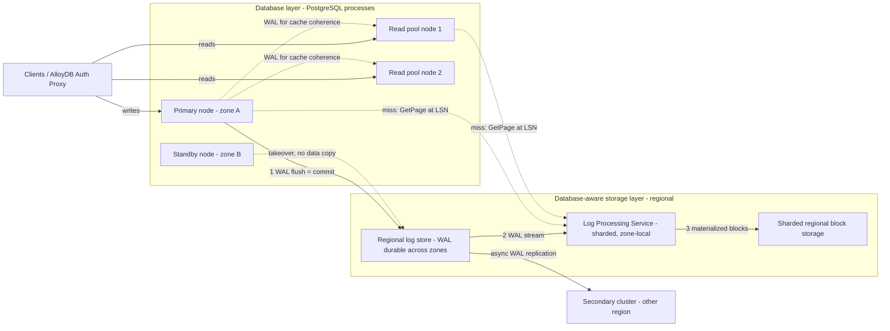

# AlloyDB for PostgreSQL: Disaggregated Architecture

## TL;DR

AlloyDB runs the PostgreSQL engine on compute nodes, and in steady state the primary's only durable write is the write-ahead log (WAL); a regional log store makes each commit durable across zones before the client gets an acknowledgement.
A sharded Log Processing Service (LPS) replays WAL into database blocks inside the storage layer, so data pages are built by storage and never flushed by the database.
Blocks are served by version (a page "at an LSN", where LSN is the log sequence number), so the primary, its standby, and every read pool node share one physical copy of the data; this removes checkpoint write storms, full-page writes, and per-replica storage copies, but it does not give read-your-writes on replicas.
The columnar engine is an in-memory, vectorized, column-major copy of chosen columns that is kept consistent with the row store; it takes memory from the buffer cache in exchange for scan speed, and it loses its advantage on tables with heavy updates.
Disaggregation does not remove the single-writer ceiling, MVCC bloat, vacuum debt, or transaction ID wraparound; it moves durability into a regional storage service, so a secondary cluster in another region is the only protection against losing a region.

## Mental Model



Think of AlloyDB as PostgreSQL whose buffer manager talks to a remote, versioned page service instead of a local file system.
In stock PostgreSQL, WAL is the recovery record and data files hold the truth.
In AlloyDB, WAL is the truth.
Everything below the buffer cache is a function that maps (block id, LSN) to a page image, and the storage layer computes that function by replaying WAL.
Compute nodes are therefore close to stateless caches over a shared log.
That is why failover, read scaling, and backups need no data copy.
It is also why the hard problems move to two places: how quickly the LPS keeps up with WAL, and how a lagging reader gets a page that is consistent with its own replay position.

## Internals

### What stock PostgreSQL does, and what AlloyDB removes

Stock PostgreSQL has three I/O streams.
The first is WAL appends from backends through `XLogInsert` and the WAL writer.
The second is dirty-page writeback from the background writer and the checkpointer.
The third is full-page images written into WAL on the first change to each page after a checkpoint (`full_page_writes`), which protects against torn pages.
Streaming replicas re-run all three streams on their own disks, so N replicas mean N copies of storage and N rounds of write amplification (see [[04-System-Design/05-Data-Stores/PostgreSQL-Architecture|PostgreSQL Architecture]]).
Google's published description of AlloyDB storage says the primary sends only WAL to storage, and the storage layer builds the blocks.
Once the database no longer writes data pages, checkpoints stop being write storms, and torn-page protection becomes the storage layer's problem rather than WAL's.
The exact behaviour of `full_page_writes` and checkpoints inside AlloyDB is not documented in detail and is inferred here from that design (UNVERIFIED).

### Storage layer decomposition

Google's description of the storage layer has three components.
The first is a low-latency regional log storage service that persists WAL synchronously across zones.
The second is the Log Processing Service (LPS), a fleet of servers that consume WAL, apply records to blocks, and serve block reads.
The third is a sharded, regional block store, built on Google's distributed storage stack, that holds materialized blocks (Google Cloud blog, 2022; implementation details UNVERIFIED as of 2026-10).
The block space is split into shards, and each shard is assigned to an LPS instance.
Shards can be moved between LPS instances and LPS capacity can grow, so replay throughput scales with WAL volume instead of being stuck on a single replay process, which is the bottleneck of a stock PostgreSQL standby.
Google describes LPS instances running near the compute nodes so that page reads stay low latency inside a zone (Google Cloud blog, 2022; placement details UNVERIFIED as of 2026-10).
The colocated GFS-lineage storage underneath is covered in [[17-Cloud-AI-Engineering/Volume_03_GCP_Deep_Dive/Chapter_09_Cloud_Storage_and_Colossus_Filesystem|Cloud Storage and Colossus Filesystem]].

### Write path, step by step

1. A backend changes a buffer in `shared_buffers` and builds a WAL record that carries the new LSN.
2. At commit, the backend asks for WAL to be flushed up to its commit record.
3. The flush goes to the regional log store, which acknowledges only after the record is durable in more than one zone.
4. PostgreSQL returns COMMIT to the client.
5. The LPS shards that own the touched blocks consume the WAL asynchronously and apply the records to their block images.
6. The LPS writes the new block versions to the block store.

The commit critical path is a single network round trip to a multi-zone log service.
It is not a quorum write to six storage nodes as in Aurora, and it is not a local fsync followed by a streaming send as in stock PostgreSQL.
The replication factor and zone count of the log store are not published (UNVERIFIED as of 2026-10).

### The mechanism getting-started guides skip: GetPage at LSN

The key interface between compute and storage is a versioned page read, which the Socrates paper calls `GetPage@LSN` ([Antonopoulos et al., SIGMOD 2019](https://dl.acm.org/doi/10.1145/3299869.3314047)).
AlloyDB's internal RPC names are not public.
The constraints below follow from the architecture, and the same constraints appear in the Aurora, Socrates, and Neon designs.

Constraint 1 is evict-then-read safety on the primary.
The primary may evict a dirty buffer without writing it, because the WAL for that change is already durable in the log store.
If a backend immediately reads that block again, storage must return a version at least as new as the evicted buffer's page LSN.
If the owning LPS shard has not yet applied WAL that far, it must either wait for replay to catch up or replay the missing records on demand before it answers.
So a primary's cache-miss latency is limited by LPS replay lag on the hot shards, not only by media latency.

Constraint 2 is snapshot consistency on read replicas.
A read pool node has replayed WAL up to some LSN, call it `L_r`.
If it asks for a block and gets a version newer than `L_r`, its in-memory structures disagree with each other.
For example, a B-tree page can reflect a split that the node's cached parent page does not yet know about.
MVCC visibility rules cannot repair this, because the problem is physical page structure, not tuple visibility.
So the storage layer must serve block versions "as of" an LSN that can be older than its own apply point.
That means it keeps a retention window of older block versions or of WAL.
Aurora states this explicitly as the Protection Group Minimum Read Point LSN, below which storage may garbage-collect versions ([Verbitski et al., SIGMOD 2017](https://dl.acm.org/doi/10.1145/3035918.3056101)).
The operational consequence is that a replica lagging past that window cannot be served consistently and has to be rebuilt or restarted.
This is why replica lag in disaggregated databases is a correctness boundary as well as a freshness metric.

Constraint 3 is that the LPS is the only writer of blocks.
Since compute never writes pages, there is no write-write race between the database and storage on a block.
Every block image is a deterministic function of (previous image, WAL records).
This is what allows the storage layer to take backups, clones, and point-in-time restores as storage-side operations without involving the primary.

### Read pools and WAL-driven cache coherence

A read pool instance is a load-balanced set of nodes that serve reads from the shared storage.
Each node keeps its own buffer cache and must keep it coherent with the primary's writes.
The standard technique, documented for Aurora replicas, is to apply incoming WAL records only to pages already in the replica's buffer cache, and to drop records for uncached pages, because those pages will be fetched at the correct LSN from storage on the next miss ([Verbitski et al., SIGMOD 2017](https://dl.acm.org/doi/10.1145/3035918.3056101)).
Google describes AlloyDB read pool nodes as receiving WAL from the primary to keep their caches up to date, which matches this pattern (Google Cloud blog, 2022; exact apply policy UNVERIFIED as of 2026-10).
The result is that replica replay cost scales with the overlap between the WAL stream and the replica's cached working set, not with the full WAL rate.
Replicas still run PostgreSQL hot-standby logic, so the usual standby query conflicts apply, for example a query that needs row versions the primary's vacuum has removed.
Lag is asynchronous and the docs give no bound on it, so applications that need read-your-writes must route those reads to the primary or wait for an LSN (pattern shown in the Worked Example).

### High availability and failover

A highly available primary instance has an active node and a standby node in different zones of the region, and both sit on the same regional storage (Google Cloud docs, UNVERIFIED as of 2026-10).
Failover does not copy data, because durable state lives in the log store and the block store.
The new primary needs only a short redo of WAL that the LPS has not yet applied, rather than a replay since the last checkpoint.
That is why AlloyDB can offer a 99.99% SLA for HA instances that includes maintenance (Google Cloud SLA page, UNVERIFIED as of 2026-10).
Basic (single-zone) primary instances also exist for development, and they give up zonal failover for roughly half the compute cost (Google Cloud docs, UNVERIFIED as of 2026-10).
After failover the new primary's buffer cache is cold, so the p99 latency hit shows up seconds to minutes later, as miss traffic to the LPS, not during the failover window itself.

### Cross-region replication

A secondary cluster in another region receives WAL asynchronously from the primary cluster and keeps its own regional storage layer (Google Cloud docs, UNVERIFIED as of 2026-10).
A secondary can be promoted when the primary region is lost, and a planned switchover is also supported, which reverses the roles (Google Cloud docs; switchover GA status UNVERIFIED as of 2026-10).
Because replication is asynchronous, RPO is bounded by the cross-region lag at the moment of failure, and that lag rises with WAL rate and inter-region bandwidth.
Promotion is an operator or automation decision, not an automatic quorum decision.
That is deliberate, because automatic cross-region promotion during a partition risks split brain (see [[17-Cloud-AI-Engineering/Volume_07_Reliability_and_SRE/Chapter_04_Disaster_Recovery_Tiers_and_RTO_RPO_Engineering|Disaster Recovery Tiers and RTO/RPO Engineering]]).

### Columnar engine and vectorized execution

The columnar engine keeps a column-major, compressed, in-memory copy of chosen tables or columns inside the instance's memory, in a pool separate from `shared_buffers` and sized by a database flag (Google Cloud docs; flag names in the Worked Example UNVERIFIED as of 2026-10).
The design follows the dual-format approach described for Oracle Database In-Memory ([Lahiri et al., ICDE 2015](https://doi.org/10.1109/ICDE.2015.7113373)): the row store stays authoritative, and the column store is a derived, rebuildable accelerator.
Scans over columnar data run vectorized.
Operators process batches of column values with SIMD instructions, which removes per-tuple interpretation overhead, the MonetDB/X100 insight ([Boncz et al., CIDR 2005](https://www.cidrdb.org/cidr2005/papers/P19.pdf)).
Per-unit min and max metadata lets scans skip whole units, which is the same zone-map pruning that BigQuery's Capacitor uses ([[17-Cloud-AI-Engineering/Volume_03_GCP_Deep_Dive/Chapter_13_BigQuery_Dremel_Capacitor_and_Slot_Orchestration|BigQuery: Dremel, Capacitor, and Slot Orchestration]]).

The column store must stay transactionally consistent with the row store.
The general mechanism is to build each columnar unit as of a snapshot, mark rows changed after that snapshot as invalid in that unit, and at query time combine valid columnar rows with the current versions of invalid rows read from the row store.
A background process rebuilds a unit when its invalid fraction passes a threshold.
Google describes AlloyDB's column store as transactionally consistent and automatically refreshed; the exact invalidation data structure and thresholds are not public (UNVERIFIED as of 2026-10).
This gives the column store a predictable failure curve.
Append-mostly fact tables stay mostly valid and get the full speedup.
Hot OLTP tables with many updates stay mostly invalid and fall back to row-store reads, plus extra merge work.

Auto-columnarization picks columns from observed query patterns, and you can also add relations manually through SQL functions (Google Cloud docs, UNVERIFIED as of 2026-10).
Google's marketing claims analytical queries up to 100x faster than standard PostgreSQL (vendor claim, not independently verified; UNVERIFIED as of 2026-10).
The columnar engine can run on read pool nodes independently of the primary.
That is the production pattern: an analytics read pool with a large column store, isolated from the OLTP primary's buffer cache.

### Cache hierarchy

Reads flow through up to four tiers: the node's `shared_buffers`, an optional node-local SSD cache tier on supported machine families, the LPS block cache, and finally the regional block store (Google Cloud docs for the local SSD "ultra-fast cache" tier; machine-family availability UNVERIFIED as of 2026-10).
Each tier has a different failure behaviour.
`shared_buffers` and the local SSD cache die with the node.
The LPS cache survives compute failover but not LPS shard moves.
The block store is the durable floor.
Capacity planning has to treat the latency step between tiers as a cliff, not a slope: a working set that fits in tier 1 at 2 a.m. may spill into tier 3 during a 9 a.m. batch.

### Vector search

AlloyDB supports `pgvector` and adds a ScaNN-based index type through Google's extension.
ScaNN comes from Google Research's anisotropic vector quantization work ([Guo et al., ICML 2020](https://arxiv.org/abs/1908.10396)).
Its GA status, index parameters, and the vendor's performance claims against HNSW should be checked against current docs (UNVERIFIED as of 2026-10).
Index-structure trade-offs are covered in [[17-Cloud-AI-Engineering/Volume_12_AI_Applications_MLOps_and_Data_Platforms/Chapter_01_Vector_Databases_and_Similarity_Search_on_Cloud|Vector Databases and Similarity Search on Cloud]].

### What disaggregation does not fix

There is still exactly one writer, so WAL insertion lock contention, `ProcArray` contention, and lock-manager hot spots bound write throughput on the primary's vCPU count.
MVCC still produces dead tuples, autovacuum still has to keep up, and transaction ID wraparound still forces emergency vacuum or refusal of writes if it is ignored.
Process-per-connection still makes connection storms a memory problem.
Logical replication slots still retain WAL.
AlloyDB Omni, the downloadable edition, runs the same engine on local storage without the LPS-based disaggregated storage layer (Google Cloud docs, UNVERIFIED as of 2026-10).
That makes it a useful control experiment for telling engine wins apart from storage wins.

### Lineage

| System | Durability unit | Page materialization | Replica model |
| --- | --- | --- | --- |
| Aurora (SIGMOD 2017) | 4-of-6 quorum across 3 AZs on 10 GB protection groups | Storage nodes apply redo per segment | Up to 15 replicas share storage, apply redo to cached pages |
| Socrates (SIGMOD 2019) | XLOG landing zone | Page servers apply log, XStore holds the durable copy | Secondaries fetch GetPage@LSN |
| Taurus (SIGMOD 2020) | Log stores | Page stores replay log | Read replicas share page stores |
| Neon (open source) | Paxos safekeepers | Pageserver, layered files on object storage | Read-only computes at an LSN |
| AlloyDB | Regional log store | Sharded LPS onto regional block storage | Read pool nodes over shared storage |

AlloyDB's split into a log tier, a replay tier, and a block tier is closest to Socrates, while its single-region durability model is closest to Aurora.
For Aurora's quorum design in depth, see [[17-Cloud-AI-Engineering/Volume_02_AWS_Deep_Dive/Chapter_11_Amazon_Aurora_Log_Is_The_Database|Amazon Aurora: Log-Is-The-Database]] and [[17-Cloud-AI-Engineering/Volume_13_Seminal_Papers_and_Case_Studies/Chapter_02_Amazon_Aurora|Amazon Aurora (2017 SIGMOD)]].

## Numbers to Know

Every volatile figure below could not be re-checked against primary sources for this revision and carries an UNVERIFIED tag.
Treat them as the last known values to confirm before you use them in a design review.

| Quantity | Value | Source and date |
| --- | --- | --- |
| AlloyDB vCPU price, us-central1 | about $0.06608 per vCPU-hour | Google Cloud AlloyDB pricing, UNVERIFIED as of 2026-10 |
| AlloyDB memory price, us-central1 | about $0.0112 per GB-hour | Google Cloud AlloyDB pricing, UNVERIFIED as of 2026-10 |
| AlloyDB storage price, us-central1 | about $0.30 per GB-month, billed on used bytes | Google Cloud AlloyDB pricing, UNVERIFIED as of 2026-10 |
| AlloyDB I/O charges | none billed separately | Google Cloud AlloyDB pricing, UNVERIFIED as of 2026-10 |
| HA primary billing | active node plus standby node, about 2x compute | Google Cloud AlloyDB pricing, UNVERIFIED as of 2026-10 |
| N2 machine shapes | 2 to 64 vCPU at 8 GB per vCPU, top 128-vCPU shape at 864 GB | Google Cloud AlloyDB docs, UNVERIFIED as of 2026-10 |
| Max cluster storage | 128 TiB | Google Cloud AlloyDB quotas, UNVERIFIED as of 2026-10 |
| Read pool size | up to 20 nodes per read pool instance | Google Cloud AlloyDB quotas, UNVERIFIED as of 2026-10 |
| Availability SLA, HA instance | 99.99% including maintenance | Google Cloud AlloyDB SLA, UNVERIFIED as of 2026-10 |
| Continuous backup / PITR window | default 14 days, configurable up to 35 days | Google Cloud AlloyDB docs, UNVERIFIED as of 2026-10 |
| Committed use discounts | about 25% (1 year), about 52% (3 years) on compute | Google Cloud AlloyDB pricing, UNVERIFIED as of 2026-10 |
| Columnar speedup claim | up to 100x vs standard PostgreSQL on analytical queries | Google marketing, vendor claim, UNVERIFIED as of 2026-10 |
| Aurora storage replication | 6 copies across 3 AZs, write quorum 4, read quorum 3, 10 GB segments | Verbitski et al., SIGMOD 2017 (stable, design paper) |
| Aurora replicas | up to 15 per cluster, lag typically under 100 ms | AWS Aurora docs, UNVERIFIED as of 2026-10 |
| Aurora max storage | 128 TiB, larger on newer engine versions | AWS Aurora docs, UNVERIFIED as of 2026-10 |
| Aurora Global Database lag | typically under 1 second | AWS Aurora docs, UNVERIFIED as of 2026-10 |
| Aurora Standard I/O price, us-east-1 | about $0.20 per million requests, storage about $0.10 per GB-month | AWS Aurora pricing, UNVERIFIED as of 2026-10 |

## AWS vs GCP Mechanism Parity

| Dimension | Google AlloyDB for PostgreSQL | Amazon Aurora PostgreSQL | Critical difference |
| --- | --- | --- | --- |
| Commit durability | WAL flush to a regional log service, durable across zones | 4-of-6 quorum write of redo to storage nodes in 3 AZs | Aurora's durability math is published; AlloyDB's log replication factor is not |
| Page materialization | Sharded LPS replays WAL into blocks | Each 10 GB segment replica applies redo itself | AlloyDB centralizes replay per shard; Aurora replays redundantly on six copies |
| Database page writes | None; database writes WAL only | None; database writes redo only | Same core idea ("log is the database") |
| Read replicas | Read pool instances, load-balanced nodes, shared storage | Up to 15 Aurora Replicas with reader endpoint | AlloyDB pools hide individual nodes behind one IP; Aurora exposes instance endpoints |
| Replica coherence | WAL stream keeps cached pages fresh | Redo stream applied to cached pages only | Both are asynchronous; neither gives read-your-writes by default |
| HA failover | Standby node in another zone on shared storage | Promote a replica (by failover tier priority) | AlloyDB HA standby is billed and dedicated; Aurora reuses readers as failover targets |
| Cross-region | Secondary cluster, async WAL, promote or switchover | Aurora Global Database, async storage-level replication, managed failover and switchover | Aurora replicates at the storage layer; AlloyDB replicates WAL to a separate regional storage stack |
| Analytics | In-memory columnar engine with vectorized execution, runs on read pools | No in-engine column store; zero-ETL to Redshift | AlloyDB keeps HTAP in one engine; Aurora sends analytics to another service |
| Local cache tier | Ultra-fast cache on local SSD (selected machine families) | Optimized Reads tiered cache on NVMe instance types | Both put a local NVMe tier between RAM and remote storage |
| I/O pricing | No separate I/O charge | Standard bills per I/O; I/O-Optimized raises storage and compute price instead | Write-heavy Aurora Standard workloads can be dominated by I/O cost |
| Vector search | pgvector plus ScaNN-based index | pgvector (HNSW, IVFFlat) | ScaNN is AlloyDB-only |
| Serverless compute | Not equivalent to Aurora Serverless v2 (UNVERIFIED as of 2026-10) | Aurora Serverless v2 in ACU increments | Aurora scales compute in place at fine granularity |
| Horizontal write scaling | Single primary | Aurora Limitless Database (sharded) | AlloyDB needs application-level sharding for more than one writer |
| Network attachment | Private Services Access peering, Private Service Connect, optional public IP | Instances in customer VPC subnets | PSA consumes peered IP ranges, so plan CIDRs up front |
| Portability | AlloyDB Omni runs the engine anywhere, without the disaggregated storage | No self-hosted edition | Omni allows hybrid deployments but is not the same storage system |

## Worked Example: Provision, Measure Read Pool Lag, and Size an HTAP Cluster

### Lab cost estimate

The lab uses a ZONAL (basic) 4 vCPU primary, a 1-node 4 vCPU read pool, an e2-small client VM, and Cloud NAT.
Compute: 2 nodes x (4 x $0.06608 + 32 x $0.0112) = 2 x $0.623 = about $1.25 per hour (prices UNVERIFIED as of 2026-10).
Storage for a pgbench scale-50 database (under 1 GB) is negligible over three hours.
The client VM and NAT add a few cents per hour (UNVERIFIED as of 2026-10).
A three-hour session costs about $4, and the budget below alerts at $10 and $18 of a $20 cap.

### Terraform / OpenTofu

```hcl
# main.tf - AlloyDB lab: PSA networking, cluster, primary, read pool, client VM, budget.
terraform {
  required_providers {
    google = {
      source  = "hashicorp/google"
      version = ">= 6.0"
    }
  }
}

variable "project_id" { type = string }
variable "billing_account" { type = string }
variable "region" {
  type    = string
  default = "us-central1"
}
variable "db_password" {
  type      = string
  sensitive = true
}

provider "google" {
  project = var.project_id
  region  = var.region
}

data "google_project" "this" {}

resource "google_project_service" "apis" {
  for_each = toset([
    "alloydb.googleapis.com",
    "servicenetworking.googleapis.com",
    "compute.googleapis.com",
    "billingbudgets.googleapis.com",
  ])
  service            = each.key
  disable_on_destroy = false
}

resource "google_compute_network" "vpc" {
  name                    = "alloydb-lab-vpc"
  auto_create_subnetworks = false
  depends_on              = [google_project_service.apis]
}

resource "google_compute_subnetwork" "subnet" {
  name                     = "alloydb-lab-subnet"
  ip_cidr_range            = "10.10.0.0/24"
  region                   = var.region
  network                  = google_compute_network.vpc.id
  private_ip_google_access = true
}

# Private Services Access: AlloyDB instances get IPs from this peered range.
resource "google_compute_global_address" "psa_range" {
  name          = "alloydb-psa-range"
  purpose       = "VPC_PEERING"
  address_type  = "INTERNAL"
  prefix_length = 20
  network       = google_compute_network.vpc.id
}

resource "google_service_networking_connection" "psa" {
  network                 = google_compute_network.vpc.id
  service                 = "servicenetworking.googleapis.com"
  reserved_peering_ranges = [google_compute_global_address.psa_range.name]
}

resource "google_alloydb_cluster" "lab" {
  cluster_id      = "alloydb-lab"
  location        = var.region
  deletion_policy = "FORCE"

  network_config {
    network = google_compute_network.vpc.id
  }

  initial_user {
    user     = "postgres"
    password = var.db_password
  }

  depends_on = [google_service_networking_connection.psa]
}

resource "google_alloydb_instance" "primary" {
  cluster           = google_alloydb_cluster.lab.name
  instance_id       = "primary"
  instance_type     = "PRIMARY"
  availability_type = "ZONAL"

  machine_config {
    cpu_count = 4
  }
}

resource "google_alloydb_instance" "readpool" {
  cluster       = google_alloydb_cluster.lab.name
  instance_id   = "readpool"
  instance_type = "READ_POOL"

  read_pool_config {
    node_count = 1
  }

  machine_config {
    cpu_count = 4
  }

  # Columnar engine on the read pool only, isolated from the primary buffer cache.
  # Flag name per AlloyDB docs; verify before apply (UNVERIFIED as of 2026-10).
  database_flags = {
    "google_columnar_engine.enabled" = "on"
  }

  depends_on = [google_alloydb_instance.primary]
}

# Client VM without external IP; SSH through IAP, packages through Cloud NAT.
resource "google_compute_router" "router" {
  name    = "alloydb-lab-router"
  region  = var.region
  network = google_compute_network.vpc.id
}

resource "google_compute_router_nat" "nat" {
  name                               = "alloydb-lab-nat"
  router                             = google_compute_router.router.name
  region                             = var.region
  nat_ip_allocate_option             = "AUTO_ONLY"
  source_subnetwork_ip_ranges_to_nat = "ALL_SUBNETWORKS_ALL_IP_RANGES"
}

resource "google_compute_firewall" "iap_ssh" {
  name          = "alloydb-lab-iap-ssh"
  network       = google_compute_network.vpc.id
  source_ranges = ["35.235.240.0/20"]
  allow {
    protocol = "tcp"
    ports    = ["22"]
  }
}

resource "google_compute_instance" "client" {
  name         = "alloydb-lab-client"
  machine_type = "e2-small"
  zone         = "${var.region}-a"

  boot_disk {
    initialize_params {
      image = "debian-cloud/debian-12"
    }
  }

  network_interface {
    subnetwork = google_compute_subnetwork.subnet.id
  }

  metadata_startup_script = "apt-get update && apt-get install -y postgresql-client postgresql-contrib python3-psycopg"
}

resource "google_billing_budget" "lab" {
  billing_account = var.billing_account
  display_name    = "alloydb-lab-budget"

  budget_filter {
    projects = ["projects/${data.google_project.this.number}"]
  }

  amount {
    specified_amount {
      currency_code = "USD"
      units         = "20"
    }
  }

  threshold_rules { threshold_percent = 0.5 }
  threshold_rules { threshold_percent = 0.9 }
  threshold_rules {
    threshold_percent = 1.0
    spend_basis       = "FORECASTED_SPEND"
  }
}

output "primary_ip" { value = google_alloydb_instance.primary.ip_address }
output "readpool_ip" { value = google_alloydb_instance.readpool.ip_address }
```

Apply it and connect:

```bash
tofu init
tofu apply -var project_id=MY_PROJECT -var billing_account=XXXXXX-XXXXXX-XXXXXX -var db_password='S3cure-lab-pw'
gcloud compute ssh alloydb-lab-client --zone us-central1-a --tunnel-through-iap
# On the client VM:
export PGPASSWORD='S3cure-lab-pw'
pgbench -h PRIMARY_IP -U postgres -i -s 50 postgres
```

### Experiment 1: measure read pool visibility lag under write load

This script writes a token on the primary and measures how long the token takes to become visible on the read pool.
That is the number that matters for read-your-writes, and it is more honest than the replay-timestamp metric.

```python
# lag_probe.py - run on the client VM while pgbench writes on the primary.
import os, time, uuid, statistics
import psycopg

PRI = os.environ["PRIMARY_IP"]
RP = os.environ["READPOOL_IP"]
PW = os.environ["PGPASSWORD"]
dsn = "host={} dbname=postgres user=postgres password=" + PW

with psycopg.connect(dsn.format(PRI), autocommit=True) as p:
    p.execute("CREATE TABLE IF NOT EXISTS lag_probe (id text PRIMARY KEY, ts timestamptz DEFAULT now())")

samples = []
with psycopg.connect(dsn.format(PRI), autocommit=True) as p, \
     psycopg.connect(dsn.format(RP), autocommit=True) as r:
    for _ in range(200):
        token = str(uuid.uuid4())
        t0 = time.perf_counter()
        p.execute("INSERT INTO lag_probe (id) VALUES (%s)", (token,))
        t_commit = time.perf_counter()
        while r.execute("SELECT 1 FROM lag_probe WHERE id = %s", (token,)).fetchone() is None:
            time.sleep(0.001)
        samples.append((time.perf_counter() - t_commit) * 1000.0)
        time.sleep(0.05)

samples.sort()
print("visibility lag ms p50=%.1f p99=%.1f max=%.1f" % (
    statistics.median(samples), samples[int(len(samples) * 0.99) - 1], samples[-1]))

with psycopg.connect(dsn.format(RP), autocommit=True) as r:
    print(r.execute("SELECT pg_is_in_recovery(), pg_last_wal_replay_lsn(), now() - pg_last_xact_replay_timestamp()").fetchone())
```

```bash
# Terminal 1: write load on primary.
pgbench -h PRIMARY_IP -U postgres -c 16 -j 4 -T 300 -N postgres
# Terminal 2: measure.
PRIMARY_IP=... READPOOL_IP=... python3 lag_probe.py
```

Expect p50 in the low milliseconds when idle, and watch p99 and max grow as `-c` rises.
The growth shows WAL rate and replay pressure, not a storage copy.

### Experiment 2: columnar engine on the read pool

```sql
-- Connect to READPOOL_IP. Function and view names per AlloyDB docs (UNVERIFIED as of 2026-10).
SELECT google_columnar_engine_add('pgbench_accounts');
EXPLAIN (ANALYZE, BUFFERS) SELECT bid, sum(abalance), count(*) FROM pgbench_accounts GROUP BY bid;
-- Look for a columnar custom scan node and compare runtime against
SET google_columnar_engine.enable_columnar_scan = off;  -- UNVERIFIED flag name
EXPLAIN (ANALYZE, BUFFERS) SELECT bid, sum(abalance), count(*) FROM pgbench_accounts GROUP BY bid;
```

Then rerun pgbench with heavy updates (`-c 32`, without `-N`) against the primary, and repeat the columnar query.
If the column store follows the invalidation mechanism described in Internals, the speedup should shrink as `pgbench_accounts` churns.

### Teardown

```bash
tofu destroy -var project_id=MY_PROJECT -var billing_account=XXXXXX-XXXXXX-XXXXXX -var db_password='S3cure-lab-pw' -auto-approve
gcloud alloydb clusters list --region=us-central1
gcloud alloydb backups list --region=us-central1   # delete any leftover on-demand backups
```

### Capacity sizing: HTAP order platform

Requirements: 15,000 write TPS at peak, 60,000 read QPS of indexed lookups, 1.8 TB of live data, a 350 GB hot working set, and dashboards that aggregate a 200M-row orders table every 30 seconds.

Step 1 is the WAL rate.
At an assumed 2 KB of WAL per transaction, 15,000 TPS is 30 MB/s of WAL, or about 2.6 TB per day.
This is the one number every downstream component must absorb: log store ingest, LPS replay, read pool coherence, and cross-region egress.

Step 2 is the primary shape.
The 350 GB hot set must fit in RAM after the OS, connection memory, and any columnar pool are taken out.
A 64 vCPU / 512 GB node with roughly 350 to 380 GB of effective buffer cache is the smallest safe shape, and only if columnar stays off on the primary.
Write CPU must be load-tested, because single-writer contention, not storage, is the ceiling.

Step 3 is the OLTP read pool.
At a benchmarked assumption of 1,500 indexed lookups per second per vCPU, 60,000 QPS needs 40 vCPU.
Three 16 vCPU nodes would run at 83%, so N+1 gives four nodes.

Step 4 is the analytics read pool.
Six 8-byte columns over 200M rows are 9.6 GB raw, and at 3x to 5x compression that is 2 to 3 GB of columnar memory.
One dedicated 16 vCPU / 128 GB node in a separate read pool instance keeps dashboard scans away from OLTP caches.

Step 5 is cost per month (730 hours, us-central1 list prices, UNVERIFIED as of 2026-10).

| Line item | Calculation | Monthly |
| --- | --- | --- |
| HA primary 64 vCPU / 512 GB | 2 x (64 x 0.06608 + 512 x 0.0112) x 730 | $14,546.74 |
| Read pools, 5 x 16 vCPU / 128 GB | 5 x (16 x 0.06608 + 128 x 0.0112) x 730 | $9,091.71 |
| Storage 2,048 GB | 2,048 x $0.30 | $614.40 |
| Total on-demand | | $24,252.85 |
| With 1-year CUD (about 25% off compute) | 23,638.45 x 0.75 + 614.40 | about $18,343 |
| With 3-year CUD (about 52% off compute) | 23,638.45 x 0.48 + 614.40 | about $11,961 |
| Optional DR secondary: 1 x 64 vCPU node, storage, WAL egress | 7,273.37 + 614.40 + 77,760 GB x $0.02 | about $9,443 |

The DR line exposes a hidden cost: 30 MB/s of WAL is about 77.8 TB per month of inter-region traffic, which at an assumed $0.02/GB is roughly $1,555 per month on its own (UNVERIFIED as of 2026-10; see [[17-Cloud-AI-Engineering/Volume_09_FinOps_and_Cloud_Economics/Chapter_04_Network_Egress_Economics_and_Optimization|Network Egress Economics and Optimization]]).
Cutting WAL volume, for example with fewer indexes, HOT-friendly fill factors, and no needless full-row updates, lowers egress cost and replica lag at the same time.

## Failure Modes and Pitfalls

### Read-your-writes violations through the read pool

Applications that send a write to the primary and an immediate read to the read pool will see stale data whenever lag exceeds the user's think time.
This shows up as missing cart items, duplicate submissions, and retry storms.
The fix is session-level routing, so that a session reads from the primary for N seconds after it writes.
An alternative is LSN fencing: capture `pg_current_wal_lsn()` after the write and route reads only to replicas whose `pg_last_wal_replay_lsn()` has reached it.

### Hot-standby query cancellation

Long analytics queries on read pool nodes can conflict with WAL replay, for example when the primary's vacuum removes tuples that a replica snapshot still needs.
PostgreSQL then cancels the query or delays replay, depending on standby settings.
Delaying replay raises lag for every query on that node, so mixing dashboards and OLTP lookups on one read pool couples their failure modes.
Separate read pool instances by workload class.

### Cold cache after failover or resize

Failover moves service to a node with a cold buffer cache.
p99 latency then rises as miss traffic hits the LPS, and the effect peaks minutes after the failover, by which time the on-call engineer has already marked the incident resolved.
Changing machine shape restarts the instance (exact downtime behaviour UNVERIFIED as of 2026-10), with the same cold-cache tail.
Schedule resizes off-peak and alert on read latency for 30 minutes after any topology event.

### LPS replay lag on hot shards

A write-heavy workload concentrated on a few blocks, such as a monotonically increasing primary key index or a queue table, focuses replay on a few LPS shards.
By the evict-then-read constraint, primary cache misses on those blocks wait for replay.
The symptom is primary read latency that tracks write rate even though CPU is idle.
Mitigations are a larger buffer cache so hot pages are never evicted, and schema changes that spread inserts.

### Columnar memory theft and churn

Enabling the column store on the primary takes memory that would otherwise hold the OLTP working set, which can turn a cache-resident workload into an LPS-bound one.
On high-update tables the column store is mostly invalid, so you pay rebuild CPU and memory with little benefit.
Columnarize append-mostly tables on a dedicated read pool, and track the columnar memory and invalidation views after every schema or traffic change.

### Single-writer and PostgreSQL-native limits

Disaggregated storage does not stop transaction ID wraparound.
A neglected autovacuum on a large table still ends in emergency anti-wraparound vacuum or write refusal.
Bloat is billed as storage, because pricing is per used byte, so dead tuples cost money directly.
Abandoned logical replication slots retain WAL without limit.
Connection storms cost about 10 MB or more per backend, so use AlloyDB's managed connection pooling where available (GA status UNVERIFIED as of 2026-10) or PgBouncer.

### Control-plane dependencies in the connection path

The AlloyDB Auth Proxy and language connectors fetch short-lived client certificates and instance metadata from the AlloyDB Admin API.
If the Admin API or the shared API front door is unavailable, existing connections keep working, but new connections fail once cached certificates expire.
Google Cloud's June 12, 2025 incident, in which a Service Control crash loop triggered by a malformed policy update broke API serving across many products, is the canonical example of this kind of control-plane dependency ([Google Cloud Service Health](https://status.cloud.google.com/)).
Keep a direct private-IP TLS path with database-native authentication as a break-glass route, and test it in game days (see [[17-Cloud-AI-Engineering/Volume_01_Cloud_Architecture_Principles/Chapter_04_Control_Plane_vs_Data_Plane_Separation|Control Plane vs Data Plane Separation]]).

### Regional storage is a regional failure domain

Regional storage survives the loss of a zone, but not events that affect several zones.
The April 2023 water intrusion and fire at a europe-west9 (Paris) data center made one zone unavailable for an extended period and degraded the wider region ([Google Cloud Service Health](https://status.cloud.google.com/)).
AWS's October 2025 us-east-1 event, caused by a race condition in DynamoDB's DNS automation, showed how one regional dependency spreads to many services ([AWS Post-Event Summaries](https://aws.amazon.com/premiumsupport/technology/pes/)).
If the business RTO assumes the region survives, write that assumption down and get a signature on it.
Otherwise run a cross-region secondary and practice promotion (see [[17-Cloud-AI-Engineering/Volume_07_Reliability_and_SRE/Chapter_07_Anatomy_of_Major_Cloud_Outages|Anatomy of Major Cloud Outages]]).

### PSA IP exhaustion and peering limits

Private Services Access allocates instance IPs from a peered range shared with other Google-managed services.
An undersized range blocks new read pool nodes or clusters at the worst possible moment.
Allocate at least a /20 per VPC, or use Private Service Connect, which avoids peering and the problem of overlapping address space across projects.

## Security and Cost Angles

### IAM scoping

Split administrative and data-plane identities.
`roles/alloydb.admin` manages clusters, and it should be held only by the IaC pipeline's service account.
`roles/alloydb.client` lets a principal use the Auth Proxy or connectors to reach instances.
`roles/alloydb.databaseUser` with IAM database authentication lets workloads log in with short-lived OAuth tokens instead of static passwords (role names per Google Cloud docs, UNVERIFIED as of 2026-10).
Map GKE workloads to service accounts through Workload Identity Federation for GKE, so no key files exist (see [[17-Cloud-AI-Engineering/Volume_08_Security_Identity_and_the_Data_Perimeter/Chapter_02_Workload_Identity_Federation|Workload Identity Federation]]).
Database-level privileges (GRANT) are a second, independent authorization layer, and least privilege must hold in both layers.

### Encryption key hierarchy

Data is encrypted at rest by default with Google-managed keys.
Customer-managed encryption keys (CMEK) in Cloud KMS wrap the cluster's data encryption keys, and backups can use a separate key.
CMEK has to be chosen when the cluster is created and cannot be added later in place (Google Cloud docs, UNVERIFIED as of 2026-10).
Disabling or destroying the KMS key version makes the cluster and its backups unreadable.
That is a deliberate crypto-shredding lever and an accidental outage risk, so protect key destruction with separate approvers (see [[17-Cloud-AI-Engineering/Volume_03_GCP_Deep_Dive/Chapter_15_Security_and_Confidential_Computing_Cloud_KMS|Security and Confidential Computing: Cloud KMS]]).
In transit, the Auth Proxy uses mTLS with ephemeral certificates, and direct connections should enforce TLS through the instance's SSL mode settings.

### Network perimeter

Prefer private IP through PSA or PSC.
Leave public IP disabled unless a documented use case requires it, and then restrict it with authorized networks and the Auth Proxy.
Put `alloydb.googleapis.com` inside a VPC Service Controls perimeter so a stolen admin credential cannot export backups or clone clusters into a project outside the perimeter (see [[17-Cloud-AI-Engineering/Volume_03_GCP_Deep_Dive/Chapter_03_VPC_Service_Controls_Security_Perimeters|VPC Service Controls: Security Perimeters]]).
AlloyDB AI features that call Vertex AI model endpoints from SQL create database-to-API egress, and that egress must be allowed explicitly in the perimeter.

### Unit-economics levers

There is no I/O charge, so the levers are compute shape, node count, HA choices, storage bytes, and cross-region egress.
Commit baseline compute with CUDs, and keep burst read capacity on demand (see [[17-Cloud-AI-Engineering/Volume_09_FinOps_and_Cloud_Economics/Chapter_02_Commitment_Discounts_Savings_Plans_vs_CUDs|Commitment Discounts: Savings Plans vs CUDs]]).
Use basic (zonal) primaries for non-production, since HA doubles primary compute.
Scale read pool nodes on a schedule for diurnal traffic, and remember that new nodes start with cold caches.
Tune vacuum aggressively, because dead tuples are billed bytes.
Compare against Aurora with the workload's real I/O profile: write-heavy workloads on Aurora Standard pay per I/O, which can make AlloyDB cheaper even with a higher per-vCPU price, while read-mostly cache-resident workloads often favour whichever engine has the cheaper compute shape.
Replace a separate analytics replica-plus-ETL pipeline with a columnar read pool only when the dashboard queries really fit in columnar memory; otherwise exporting to BigQuery is cheaper per scanned byte.

## Interview Questions and Model Answers

### Question 1 (L5 - Senior)

Walk me through what happens between a client issuing COMMIT on AlloyDB and a later read of the same row from a read pool node.

#### Model Answer

The backend has already changed the page in its buffer and written WAL records into the WAL buffers.
On COMMIT, the backend flushes WAL up to its commit record to the regional log store, which acknowledges once the record is durable in more than one zone, and only then does PostgreSQL return success.
No data page is written by the database, either now or at the next checkpoint.
Asynchronously, the LPS shard that owns the block applies the WAL record and persists a new block version.
In parallel, the WAL stream reaches read pool nodes.
A node that holds the page in cache applies the record to its cached copy.
A node that does not hold it simply skips the record.
When a read pool query touches the row, the node either finds the updated page in cache, if its replay has passed the commit LSN, or misses and fetches the block from the LPS at its own replay LSN.
If its replay LSN is still below the commit LSN, the row is not visible yet, and that is the replica lag window.
The key point is that durability is decided by the log store, visibility on a replica is decided by that replica's replay position, and the two are only loosely connected.

#### Follow-up Interviewer Question

Why can't the read pool node just fetch the newest version of the block from the LPS and skip WAL replay entirely?

### Question 2 (L5 - Senior)

The product team says "AlloyDB has no I/O charges and storage is shared, so we can turn on 20 read nodes and stop worrying about the primary." What do you push back on?

#### Model Answer

Read nodes scale reads, not writes.
Every write still goes through a single primary's WAL insertion path, lock manager, and vacuum.
More read nodes also do not reduce replica lag, which is driven by primary WAL rate and per-node replay of cached pages.
Twenty nodes each have their own cache, so a cache-unfriendly query pattern produces twenty times the miss traffic to the LPS, and the LPS layer becomes the shared bottleneck.
Read pool nodes are billed full price per vCPU and GB, so 20 x 16 vCPU nodes cost about $36k per month at list (UNVERIFIED as of 2026-10), roughly 2.5 times the HA primary in my sizing example.
New nodes start cold, so scaling out at peak gives a delayed, latency-spiky benefit.
I would size read pools from measured per-vCPU QPS with N+1 headroom, separate workloads into distinct read pool instances, and keep read-your-writes paths on the primary.

#### Follow-up Interviewer Question

How would you autoscale read pool node count without causing cold-cache p99 spikes?

### Question 3 (L6 - Staff)

Compare the durability and failure-domain model of AlloyDB storage with Aurora's 4-of-6 quorum, and tell me which one you trust more for zone-plus-one failures.

#### Model Answer

Aurora's model is published in detail.
There are six copies in three AZs, writes need 4 of 6, reads need 3 of 6, and 10 GB segments keep repair time short enough that a second failure during repair is unlikely.
Aurora explicitly survives the loss of an AZ plus one more node for reads, and the loss of an AZ for writes.
AlloyDB's model is architecturally different.
Commits are durable once they land in a regional log service replicated across zones, and blocks are materialized by a sharded LPS into regional block storage that inherits Google's storage-layer replication.
Google has not published the replica counts and quorum sizes for the log tier, so I cannot reproduce Aurora's "AZ+1" argument for AlloyDB from public material.
My trust is therefore based on SLA and operating history, not on a proof I can check.
What I can reason about is that both systems are regional failure domains, both commit paths are synchronous across zones, and both replicate asynchronously across regions.
For a zone-plus-one event, both should keep committed data, but availability depends on unpublished internals in AlloyDB's case and on segment repair speed in Aurora's.
The staff-level move is to say the known and the unknown plainly, to not choose between them on durability folklore, and to design the RPO argument around the cross-region tier, where both systems are asynchronous and measurable.

#### Follow-up Interviewer Question

If you had to measure AlloyDB's effective cross-zone commit cost empirically, what experiment would you run and what would you control for?

### Question 4 (L6 - Staff)

You enable the columnar engine and the nightly reporting job gets 40x faster, but three weeks later it is only 2x faster and primary p99 has grown 30%. Diagnose it.

#### Model Answer

Two separate mechanisms are probably involved.
First, the speedup decayed because the column store went stale against the row store.
If the reporting table has started taking updates, for example a backfill or status changes on orders, more rows are marked invalid in their columnar units.
Those rows are read from the row store and merged at query time, so scans fall back toward row-store speed while still paying merge overhead.
I would check the invalid fraction in the columnar views and the refresh activity.
Second, the p99 regression on the primary suggests the column store was enabled on the primary and its memory pool, perhaps grown by auto-columnarization, has squeezed `shared_buffers` below the OLTP working set.
More misses then go to the LPS, and on write-hot blocks those misses can wait for replay.
I would confirm with a falling buffer hit ratio and rising storage read latency on the primary.
The fix is to move columnar to a dedicated analytics read pool, cap its memory explicitly, columnarize only append-mostly tables or partitions, and route the report there.
If the hot table really is high-churn, the right answer may be CDC to BigQuery instead of HTAP in one engine.

#### Follow-up Interviewer Question

How would you decide, with numbers, between keeping HTAP in AlloyDB and streaming to BigQuery through Datastream?

### Question 5 (L6 - Staff)

Design read-your-writes semantics for a checkout service on AlloyDB without sending all reads to the primary.

#### Model Answer

Capture the commit LSN on the write path with `pg_current_wal_lsn()` after commit, or with the session's last WAL position, and return it to the client as a session token, for example a cookie or header.
On a read, the router compares the token LSN with each candidate replica's replay LSN, which it learns from a periodic probe of `pg_last_wal_replay_lsn()` every 50 to 100 ms per node.
It routes to a replica that has caught up, and falls back to the primary if none has within a short deadline.
Because read pool nodes sit behind one load-balanced address, the router needs node-level visibility, or it can do a check-and-retry: run the read with a guard query comparing replay LSN to the token, and retry elsewhere or on the primary if the guard fails.
The trade-offs are an extra round trip on the guard path, primary load amplification when lag spikes (cap it with a primary read budget and shed non-critical reads), and token staleness across failover, because LSNs keep advancing on the promoted node so old tokens stay safe.
This turns lag from a correctness bug into a latency and cost knob with explicit limits.

#### Follow-up Interviewer Question

What happens to your scheme during a cross-region switchover, and does LSN comparison remain valid across clusters?

### Question 6 (L7+ - Principal)

The CFO wants the trading-adjacent ledger moved from Aurora PostgreSQL to AlloyDB "for cost," and the CTO wants an RPO of zero across regions. Respond to both.

#### Model Answer

First, RPO zero across regions is not available from either engine's native cross-region feature.
AlloyDB secondary clusters and Aurora Global Database both replicate asynchronously, so there is always a lag-sized window of committed transactions that a regional disaster can lose.
Getting cross-region RPO zero needs synchronous cross-region commit, which means a database built for it, such as Spanner (see [[17-Cloud-AI-Engineering/Volume_03_GCP_Deep_Dive/Chapter_10_Cloud_Spanner_TrueTime_and_External_Consistency|Cloud Spanner: TrueTime and External Consistency]]), or Aurora DSQL on AWS, each with a commit latency floor set by inter-region round trips.
Another option is an application-level dual-write with reconciliation, which I would not put on a ledger.
I would offer the CTO a tiered answer: in-region RPO zero is available today on both engines, cross-region RPO is a measured lag number with an SLO and alerting, and truly zero RPO is a separate re-platforming decision with a latency price we can quantify.
Second, on cost, I would model the actual workload rather than list prices.
The inputs are I/O counts per transaction on Aurora Standard against I/O-Optimized, HA topology (AlloyDB bills a dedicated standby, while Aurora can fail over to a reader we already pay for), read node counts, storage bytes including bloat, CUD coverage, and cross-region WAL egress.
A write-heavy ledger on Aurora Standard may well save money on AlloyDB.
On Aurora I/O-Optimized with readers that double as failover targets, the gap can close or reverse.
Third, migration risk usually outweighs a 20% saving.
Extension parity, behaviour differences in replica lag and failover, connection-path changes, and the operational retraining all need a phased plan with logical replication cutover and rollback.
My recommendation would be a costed decision document with both topologies, a two-week shadow benchmark on production-shaped traffic, and an explicit RPO statement signed by the business owner.

#### Follow-up Interviewer Question

Which three measurements from the shadow benchmark would most likely change your recommendation, and in which direction?

### Question 7 (L7+ - Principal)

A Google Cloud API-layer incident breaks control planes globally for three hours. Your AlloyDB data plane is healthy, but half your services cannot connect. Explain why, and redesign so this cannot recur.

#### Model Answer

The services that failed were connecting through the Auth Proxy or language connectors, which depend on the AlloyDB Admin API for ephemeral certificates and metadata, and some may also use IAM database authentication tokens minted by Google identity services.
Existing connections survived, but connection churn from pod restarts, autoscaling, or pool recycling needed new certificates or tokens that could not be issued.
So a control-plane outage became a data-plane outage.
That breaks static stability, because the system needed a control-plane call to keep doing what it was already doing (see [[17-Cloud-AI-Engineering/Volume_01_Cloud_Architecture_Principles/Chapter_02_Regions_Zones_and_Static_Stability|Regions, Zones, and Static Stability]]).
The redesign has four parts.
Keep long-lived connection pools (PgBouncer or managed pooling) between apps and the database, so app restarts do not mean database reconnects.
Provision a break-glass authentication path that uses private IP, server-verified TLS, and database-native credentials held in Secret Manager with a local cache, activated by a feature flag.
Run a game day that blackholes the Admin API and token endpoints and checks that a cold-restarted service can still connect.
Alert on certificate and token refresh failures before expiry, not on connection failures afterwards.
The trade-off is a second credential class to rotate and audit, which I would accept for tier-0 services and decline for tier-2.

#### Follow-up Interviewer Question

How do you keep the break-glass path from turning into the everyday path, and how do you audit its use?

### Question 8 (L6 - Staff)

After a planned failover, CPU and replication look normal, yet checkout p99 rises from 12 ms to 180 ms for about 20 minutes. Explain the mechanism and the mitigation.

#### Model Answer

The new primary has a cold `shared_buffers`, and the local SSD cache tier is also cold if it is in use.
Every first touch of a hot page becomes a remote GetPage from the LPS, and some of those pages sit on write-hot shards whose replay is just behind the newest WAL, so the reads wait for replay.
The latency recovers gradually as the working set reloads, which matches a 20-minute tail on a few hundred GB of hot data being pulled at the rate traffic touches it.
CPU looks normal because the backends are waiting on I/O, not computing.
Mitigations are to fail over in a low-traffic window, pre-warm by running working-set queries or `pg_prewarm` where supported (UNVERIFIED on AlloyDB as of 2026-10) against the new primary before shifting traffic, keep request deadlines and retry budgets so slow misses do not turn into a retry storm, and make the post-failover p99 window part of the SLO error-budget forecast for maintenance.
At staff level, I would also put "time to warm cache" into the RTO definition, because the database being reachable is not the same as the service being within SLO.

#### Follow-up Interviewer Question

How would you tell a cold-cache tail apart from an LPS-side degradation using only metrics you can get from the database and Cloud Monitoring?

## Further Reading

- [Verbitski et al., "Amazon Aurora: Design Considerations for High Throughput Cloud-Native Relational Databases", SIGMOD 2017](https://dl.acm.org/doi/10.1145/3035918.3056101) - the founding "log is the database" paper and the source of the minimum-read-point-LSN idea that every disaggregated design must reimplement.
- [Verbitski et al., "Amazon Aurora: On Avoiding Distributed Consensus for I/Os, Commits, and Membership Changes", SIGMOD 2018](https://dl.acm.org/doi/10.1145/3183713.3196937) - explains how a single writer plus LSN bookkeeping avoids consensus on the commit path, which applies directly to AlloyDB's single primary.
- [Antonopoulos et al., "Socrates: The New SQL Server in the Cloud", SIGMOD 2019](https://dl.acm.org/doi/10.1145/3299869.3314047) - defines GetPage@LSN and the log, page server, and durable store split that is closest to AlloyDB's storage decomposition.
- [Depoutovitch et al., "Taurus Database: How to be Fast, Available, and Frugal in the Cloud", SIGMOD 2020](https://dl.acm.org/doi/10.1145/3318464.3386129) - a third independent design of log stores and page stores, useful for separating essential mechanisms from vendor choices.
- [Lahiri et al., "Oracle Database In-Memory: A Dual Format In-Memory Database", ICDE 2015](https://doi.org/10.1109/ICDE.2015.7113373) - the clearest published account of keeping an in-memory column store transactionally consistent with an authoritative row store.
- [Boncz, Zukowski, Nes, "MonetDB/X100: Hyper-Pipelining Query Execution", CIDR 2005](https://www.cidrdb.org/cidr2005/papers/P19.pdf) - the origin of vectorized execution, which explains where columnar-engine speedups come from.
- [Guo et al., "Accelerating Large-Scale Inference with Anisotropic Vector Quantization", ICML 2020](https://arxiv.org/abs/1908.10396) - the ScaNN algorithm behind AlloyDB's vector index.
- [Neon architecture overview](https://neon.tech/docs/introduction/architecture-overview) - an open-source PostgreSQL with safekeepers and a pageserver, the best way to read real code for the mechanisms AlloyDB keeps closed.
- [Google Cloud, "A peek behind Colossus, Google's file system"](https://cloud.google.com/blog/products/storage-data-transfer/a-peek-behind-colossus-googles-file-system) - background on the storage substrate beneath Google's regional storage services.
- [AlloyDB for PostgreSQL documentation](https://cloud.google.com/alloydb/docs) - the authoritative source for current limits, flags, GA status, and the architecture overview, including the 2022 "under the hood" storage and columnar engine posts linked from it.
- [AlloyDB pricing](https://cloud.google.com/alloydb/pricing) - check every price in this chapter here before use.
- [[17-Cloud-AI-Engineering/Volume_03_GCP_Deep_Dive/Chapter_11_Cloud_Bigtable_LSM_Storage_and_Tablet_Serving|Previous: Cloud Bigtable: LSM Storage and Tablet Serving]] - contrasts tablet-based serving on shared storage with AlloyDB's page-versioned serving.
- [[17-Cloud-AI-Engineering/Volume_03_GCP_Deep_Dive/Chapter_13_BigQuery_Dremel_Capacitor_and_Slot_Orchestration|Next: BigQuery: Dremel, Capacitor, and Slot Orchestration]] - the analytics destination when HTAP inside AlloyDB stops paying off.
- [[17-Cloud-AI-Engineering/Volume_04_AWS_vs_GCP_Translation/Chapter_04_Storage_and_Database_Translation|Storage and Database Translation]] - the decision matrix for Aurora versus AlloyDB versus Spanner.
