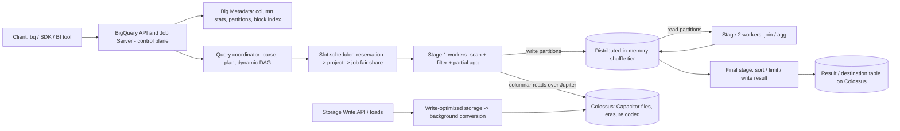

# BigQuery: Dremel, Capacitor, and Slot Orchestration

## TL;DR

BigQuery is Dremel run as a multi-tenant service on Borg, Colossus, and Jupiter: stateless compute workers ("slots") read columnar Capacitor files from Colossus and exchange intermediate data through a separate in-memory shuffle tier.
Shuffle is a separate tier, and that one decision is what makes the rest possible: dynamic query plans, fine-grained preemption, fair scheduling across tenants, and recovery from worker loss without rerunning the whole query.
On-demand billing charges for bytes scanned ($6.25 per TiB, first 1 TiB per month free) and runs each project on a shared pool of roughly 2,000 slots, while Editions bill slot-hours ($0.04 / $0.06 / $0.10 for Standard / Enterprise / Enterprise Plus pay-as-you-go in US) (Google Cloud pricing, as of 2026-10).
Pick the model with one measured number, compute intensity in slot-hours per TiB, compared against the breakeven of $6.25 divided by the slot-hour price: about 156 for Standard, 104 for Enterprise, and 62.5 for Enterprise Plus.
The scheduler shares slots evenly across projects first and across jobs second, and autoscaling grows in 50-slot steps with a 60-second scale-down window unless fluid scaling is enabled; most "BigQuery is slow" or "BigQuery is expensive" incidents come from misreading those two rules.

## Mental Model



Treat a BigQuery query as a DAG of stages whose only durable boundary between stages is the shuffle tier, not the workers.
Workers hold no state that outlives a unit of work: they pull column blocks from Colossus across the datacenter fabric, write their output partitions into remote memory, and are free again.
Because intermediate state lives outside the workers, the scheduler can move slots between queries every few seconds, the coordinator can change the shape of the plan halfway through, and a lost worker costs one work unit, not the query.
Storage, shuffle, and compute scale independently and fail independently, which is why there is no cluster to size, only a slot budget to allocate.

## Internals

### Lineage: from a fixed serving tree to a dynamic DAG

The original Dremel paper ([Melnik et al., VLDB 2010](http://www.vldb.org/pvldb/vldb2010/papers/R29.pdf)) made two contributions that still underpin BigQuery.
The first is nested columnar representation: each leaf field of a protocol-buffer schema is stored as its own column, plus two small integers per value, the repetition level and the definition level, which together let the reader rebuild arbitrary nesting without storing the record structure.
The second is a multi-level serving tree: a root server rewrites the query into partial aggregations, intermediate servers merge partial results, and leaf servers scan tablets in parallel.
That tree is very good at scan-filter-aggregate but has no general way to repartition data, so large joins and high-cardinality GROUP BY are awkward.
The retrospective ([Melnik et al., "Dremel: A Decade of Interactive SQL Analysis at Web Scale", PVLDB 13(12), 2020](https://www.vldb.org/pvldb/vol13/p3461-melnik.pdf)) describes how the tree was replaced with a general DAG of stages connected by a disaggregated shuffle, and how storage, memory, and compute were separated.
For the paper itself, see [[17-Cloud-AI-Engineering/Volume_13_Seminal_Papers_and_Case_Studies/Chapter_10_Dremel_Interactive_Analysis|Dremel (2010 VLDB)]].

### Storage layer: Colossus, Capacitor, and Big Metadata

Table data lives in Colossus, the successor to GFS that uses distributed metadata and Reed-Solomon erasure coding, covered in [[17-Cloud-AI-Engineering/Volume_03_GCP_Deep_Dive/Chapter_09_Cloud_Storage_and_Colossus_Filesystem|Cloud Storage and Colossus]].
Each table is a set of immutable Capacitor files, and a DML statement or a background compaction writes new files and swaps the metadata pointers atomically instead of editing files in place.
Capacitor replaced the earlier ColumnIO format, and Google's engineering blog post on it ([Inside Capacitor, 2016](https://cloud.google.com/blog/products/bigquery/inside-capacitor-bigquerys-next-generation-columnar-storage-format)) describes three mechanisms you will not find in a getting-started guide.

Mechanism 1 is evaluation on compressed data.
Columns are dictionary-encoded and run-length-encoded, and a predicate such as `country = 'PL'` is evaluated once per dictionary entry and once per run, not once per row.
A filter over a 1-billion-row column with 200 distinct values and long runs touches a few thousand runs, not a billion values.

Mechanism 2 is row reordering.
Run-length encoding works best when equal values sit next to each other, but the order of rows in a table carries no meaning.
Capacitor therefore reorders the rows inside a file to lengthen runs across several columns at once.
Finding the best order is NP-complete, so the writer uses a heuristic informed by column statistics.
This is why the same data can compress very differently depending on its cardinality profile, and why clustering, which sorts data by up to four columns, makes both pruning and compression better.

Mechanism 3 is embedded statistics.
Every file and block carries min/max values and other statistics that the reader uses to skip whole blocks before decompressing them.

Metadata at BigQuery scale is a big-data problem in its own right.
[Edara and Pasumansky, "Big Metadata: When Metadata is Big Data", PVLDB 14(12), 2021](https://www.vldb.org/pvldb/vol14/p3083-edara.pdf) describes storing per-block, per-column statistics in a columnar form and having Dremel process them with the same distributed execution it uses for data.
The consequence is that partition pruning and block pruning for a predicate on a clustered column are themselves a distributed query over metadata, so pruning works for tables with millions of files without a single metadata server becoming the bottleneck.

### Ingestion: write-optimized to read-optimized

Streaming rows from the Storage Write API do not go straight into Capacitor, because writing a columnar file per small append would produce millions of tiny files.
[Vortex (Edara et al., SIGMOD 2024 industry track)](https://dl.acm.org/doi/10.1145/3626246.3653396) describes BigQuery's stream-oriented storage engine: appends land in a write-optimized, log-like representation that queries can read immediately, and background processes convert it into read-optimized Capacitor files.
This is a classic LSM-style trade: freshness is immediate, but recently streamed data is scanned less efficiently until conversion finishes.
The same pattern appears in Bigtable's MemTable-to-SSTable flush, covered in [[17-Cloud-AI-Engineering/Volume_03_GCP_Deep_Dive/Chapter_11_Cloud_Bigtable_LSM_Storage_and_Tablet_Serving|Cloud Bigtable]].

### Execution: workers, stages, and the in-memory shuffle

A query is compiled into stages, and each stage is cut into many work units, for example "scan these 40 Capacitor blocks, apply the filter, partially aggregate, and hash-partition the output into 10,000 buckets".
A slot is the scheduling unit that runs one work unit at a time; the documentation describes a slot as a virtual CPU used to execute SQL (Google Cloud docs, as of 2026-10).
Workers write their output partitions to the shuffle tier, a distributed transient store held mostly in RAM on separate machines, and the next stage's workers read the partitions they own.
The Decade paper reports that moving shuffle out of the workers cut shuffle latency by an order of magnitude, made order-of-magnitude larger shuffles possible, and lowered the service's resource cost by more than 20% (Melnik et al., PVLDB 2020).

The mechanism that matters operationally is what the shuffle does as a checkpoint.
In Spark, shuffle files live on the executors' local disks, so losing an executor means recomputing the map tasks that produced them.
In Trino-style pipelined engines without spooling, losing a worker usually fails the whole query.
In BigQuery, a stage's output is already safe in the shuffle tier when the stage finishes, so a lost or preempted worker costs one work unit and nothing upstream is recomputed.
For the same reason a slot can be taken from query A and given to query B at a work-unit boundary without killing anything, which is the primitive that fair scheduling depends on.

### Dynamic query execution

The coordinator does not lock in a plan before execution.
Because stage outputs land in shuffle, it can inspect real cardinalities and sizes after a stage completes and then change the plan for later stages.
The Decade paper gives examples: picking the number of partitions for the next stage from the data actually produced, and switching a join from hash-partitioned to broadcast when one side turns out to be small.
This is why BigQuery's "Execution details" view shows the number of work units per stage varying from run to run, and why the scheduler documentation refers to a query's "dynamic DAG" changing its slot demand while the query runs (Google Cloud docs, as of 2026-10).
The trade-off is lower predictability: two runs of the same query can get different plans and different slot-time, which makes per-query cost estimates on capacity billing noisy.

### Control plane versus data plane

The control plane is the Jobs API, the Reservations API, IAM, metadata, and the scheduler's allocation state.
The data plane is workers, shuffle, and Colossus reads.
Reservations are regional (or multi-regional) resources owned by an administration project; an assignment binds a project, folder, or organization to a reservation for a job type such as QUERY.
A query runs where its data lives, and joins across locations fail, so the location is a hard partition boundary for both data and compute.
If the control plane is unavailable, queries already running keep executing on their allocated slots, but new jobs cannot be admitted, which is the read-only degradation pattern described in [[17-Cloud-AI-Engineering/Volume_01_Cloud_Architecture_Principles/Chapter_04_Control_Plane_vs_Data_Plane_Separation|Control Plane vs Data Plane Separation]].

### Slot orchestration: the scheduling hierarchy

Within one reservation, BigQuery uses fair scheduling: slots are split evenly across projects that have running queries, then evenly across jobs within each project, and fairness is eventual, so a job can get a disproportionate share for short periods (Google Cloud docs, as of 2026-10).
When a query finishes, its slots become available to other queries immediately.
Baseline slots are always held by the reservation and billed continuously.
Autoscaled slots are added only after the baseline and any available idle slots are in use, are rounded up to the next 50-slot increment, are billed per second with a one-minute minimum, and are kept for a 60-second scale-down window that restarts at each new peak (Google Cloud docs, as of 2026-10).
Fluid scaling is a GA opt-in at the reservation level that switches autoscaled capacity to per-second billing with no minimum duration (Google Cloud docs and release notes, as of 2026-10).
Autoscaling is not reserved capacity: the documentation warns that capacity constraints during periods of high demand can delay scale-up (Google Cloud docs, as of 2026-10).
Idle slots, meaning unused baseline or committed capacity, can be lent to other reservations, but only to reservations created in the same administration project (Google Cloud docs, as of 2026-10).
With reservation fairness enabled, idle slots are split evenly across reservations in that admin project, regardless of how many projects each reservation contains, and reservation predictability, which requires fairness, sets an absolute ceiling on the slots a reservation can consume (Google Cloud docs, as of 2026-10).
Per-assignee project caps (`scheduling_policy_max_slots`, minimum 100 and only approximately enforced, and `scheduling_policy_concurrency`, applied only at admission) let you stop one project from taking over a shared reservation (Google Cloud docs, as of 2026-10; GA status UNVERIFIED).

The weighting rule to remember is that fair share is per project, not per query.
A project with one running query gets the same share as a project with 100 running queries, so splitting or merging projects changes performance even when nothing else changes.

## Numbers to Know

| Quantity | Value | Source |
|---|---|---|
| On-demand compute price | $6.25 per TiB scanned, first 1 TiB per month free | (Google Cloud pricing, as of 2026-10) |
| On-demand concurrency | Up to about 2,000 concurrent slots shared by all queries in a project, with transient burst | (Google Cloud pricing and slots docs, as of 2026-10) |
| Editions pay-as-you-go, US | Standard $0.04, Enterprise $0.06, Enterprise Plus $0.10 per slot-hour | (Google Cloud pricing, as of 2026-10) |
| Commitments | 1-year and 3-year commitments for Enterprise and Enterprise Plus | (Google Cloud pricing, as of 2026-10) |
| Autoscale granularity | Rounded up to the next 50 slots | (Google Cloud docs, as of 2026-10) |
| Autoscale billing | Per second, 1-minute minimum, 60-second scale-down window; fluid scaling removes the minimum | (Google Cloud docs, as of 2026-10) |
| Project cap minimum | `scheduling_policy_max_slots` must be at least 100 | (Google Cloud docs, as of 2026-10) |
| Free tier storage | 10 GiB per month | (Google Cloud pricing, as of 2026-10) |
| Flat-rate and Flex Slots | Retired 2023-07-05, replaced by Editions | (DoiT analysis, as of 2026-10) |
| Breakeven intensity | 156.25 / 104.2 / 62.5 slot-hours per TiB (Standard / Enterprise / Enterprise Plus) | Derived: $6.25 divided by slot-hour price |
| Logical storage | Active about $0.02, long-term about $0.01 per GiB-month, US | UNVERIFIED |
| Physical storage | Active about $0.04, long-term about $0.02 per GiB-month, US | UNVERIFIED |
| Long-term storage trigger | 90 consecutive days without modification | UNVERIFIED |
| Query execution time limit | 6 hours | UNVERIFIED |
| On-demand minimum billing | 10 MB per table referenced | UNVERIFIED |
| Clustering columns | Up to 4 | UNVERIFIED |
| Full SELECT * over 1 PiB, on-demand | 1,024 TiB x $6.25 = $6,400 | Derived |

## AWS vs GCP Mechanism Parity

| Dimension | Google BigQuery | Amazon Redshift (RA3 / Serverless) | Amazon Athena |
|---|---|---|---|
| Lineage | Dremel (VLDB 2010, 2020) | ParAccel-derived MPP, re-architected ([SIGMOD 2022](https://www.amazon.science/publications/amazon-redshift-re-invented)) | Presto / Trino |
| Storage | Capacitor on Colossus, managed by the service | Redshift Managed Storage on S3 with local SSD cache | Your S3 objects (Parquet, ORC, Iceberg) |
| Columnar tricks | Dictionary + RLE, evaluation on compressed data, row reordering, Big Metadata pruning | Per-column compression encodings, zone maps over 1 MB blocks (UNVERIFIED block size) | Parquet / ORC footers and row-group stats, partition projection |
| Shuffle | Disaggregated in-memory shuffle tier; acts as a stage checkpoint | Data redistribution between compute-node slices over the network; no separate shuffle tier | Pipelined worker-to-worker exchange |
| Worker loss | Retry one work unit | Query fails or retries, depending on case (UNVERIFIED detail) | Query typically fails and is retried by the client (UNVERIFIED for current engine) |
| Unit of capacity | Slot (virtual CPU), shared across tenants | Node (provisioned) or RPU (Serverless) | DPU (provisioned capacity) or per-TB scanned |
| Elasticity | Slot reallocation every few seconds; autoscale in 50-slot steps | Concurrency scaling clusters; Serverless RPU scaling | Fully serverless per query |
| Multi-tenant scheduling | Fair share reservation -> project -> job, idle slot lending | WLM queues, query priorities, short query acceleration | Workgroups with per-query data limits |
| Scan pricing | $6.25 per TiB (as of 2026-10) | Spectrum about $5 per TB (UNVERIFIED) | About $5 per TB (UNVERIFIED) |
| Capacity pricing | $0.04 to $0.10 per slot-hour (as of 2026-10) | Serverless about $0.375 per RPU-hour (UNVERIFIED) | Provisioned about $0.30 per DPU-hour (UNVERIFIED) |
| Perimeter | VPC Service Controls around the API | VPC placement, security groups, PrivateLink | VPC endpoints, S3 bucket policies |
| Translation notes | [[17-Cloud-AI-Engineering/Volume_04_AWS_vs_GCP_Translation/Chapter_05_Messaging_Streaming_and_Analytics_Translation\|Analytics Translation]] | [[17-Cloud-AI-Engineering/Volume_04_AWS_vs_GCP_Translation/Chapter_04_Storage_and_Database_Translation\|Storage Translation]] | [[17-Cloud-AI-Engineering/Volume_08_Security_Identity_and_the_Data_Perimeter/Chapter_06_Constructing_an_Impenetrable_Data_Perimeter\|Data Perimeter]] |

The critical difference is where intermediate state lives.
Redshift keeps a fixed binding between data slices and compute nodes, so it can be very fast when the distribution key is chosen well, but it pays redistribution costs and is less elastic.
Athena separates storage from compute, but its shuffle stays in the workers, so a long query is only as reliable as its least reliable worker.
BigQuery separates all three, which buys preemption and elasticity at the cost of an extra network hop for every shuffled byte.

## Worked Example: Measure Compute Intensity, Then Size a Reservation

### Step 1 - Measure your workload (Python, no billable resources beyond the queries)

```python
# measure_intensity.py - requires: pip install google-cloud-bigquery
# Usage: python measure_intensity.py <project_id> <region e.g. us>
import sys
from google.cloud import bigquery

project, region = sys.argv[1], sys.argv[2]
client = bigquery.Client(project=project)

# 1. Dry run: bytes that WOULD be billed on-demand, no cost incurred.
sql = """
SELECT title, SUM(num_characters) AS chars
FROM `bigquery-public-data.samples.wikipedia`
WHERE wp_namespace = 0
GROUP BY title
ORDER BY chars DESC
LIMIT 10
"""
dry = client.query(sql, job_config=bigquery.QueryJobConfig(dry_run=True, use_query_cache=False))
print(f"dry run bytes processed: {dry.total_bytes_processed / 2**30:.2f} GiB")

# 2. Real run with a hard ceiling on billed bytes (fails instead of overspending).
cfg = bigquery.QueryJobConfig(maximum_bytes_billed=50 * 2**30, use_query_cache=False)
job = client.query(sql, job_config=cfg)
job.result()
tib = (job.total_bytes_billed or 0) / 2**40
slot_hours = (job.slot_millis or 0) / 1000 / 3600
print(f"billed TiB={tib:.4f} slot_hours={slot_hours:.4f} "
      f"intensity={slot_hours / tib if tib else float('nan'):.1f} slot-h/TiB")

# 3. Fleet view: last 30 days of query jobs in this project.
fleet_sql = f"""
SELECT
  SUM(total_bytes_billed) / POW(1024, 4)       AS tib_billed,
  SUM(total_slot_ms) / 1000 / 3600             AS slot_hours,
  SUM(total_slot_ms) / (1000 * 3600 * 24 * 30) AS avg_slots,
  APPROX_QUANTILES(total_slot_ms / NULLIF(TIMESTAMP_DIFF(end_time, start_time, MILLISECOND), 0), 100)[OFFSET(99)]
                                               AS p99_job_parallelism
FROM `region-{region}`.INFORMATION_SCHEMA.JOBS_BY_PROJECT
WHERE creation_time > TIMESTAMP_SUB(CURRENT_TIMESTAMP(), INTERVAL 30 DAY)
  AND job_type = 'QUERY' AND state = 'DONE'
"""
row = list(client.query(fleet_sql).result())[0]
tib_b, sh = row.tib_billed or 0, row.slot_hours or 0
print(f"30d: TiB={tib_b:.2f} slot_hours={sh:.1f} avg_slots={row.avg_slots or 0:.1f} "
      f"p99_parallelism={row.p99_job_parallelism or 0:.0f}")
for name, price in [("standard", 0.04), ("enterprise", 0.06), ("enterprise_plus", 0.10)]:
    print(f"{name:16s} ideal autoscale cost=${sh * price:,.2f}  "
          f"on-demand=${max(tib_b - 1, 0) * 6.25:,.2f}  breakeven={6.25 / price:.1f} slot-h/TiB")
```

### Step 2 - Back-of-the-envelope sizing

Suppose the 30-day fleet query returns 400 TiB billed and 20,000 slot-hours.
Compute intensity is 20,000 / 400 = 50 slot-hours per TiB, below the Enterprise breakeven of 104.2, so capacity billing should be cheaper.
On-demand cost is (400 - 1) x $6.25 = $2,493.75 per month.
Ideal Enterprise autoscale cost is 20,000 x $0.06 = $1,200 per month, assuming every slot-second is billed only while used.
In practice, 50-slot rounding and the 60-second minimum add overhead; as a planning assumption (not a published figure), add 30% for short bursty queries without fluid scaling: about $1,560.
Average demand is 20,000 / 730 hours = 27.4 slots.
The trap: a 300-slot baseline costs 300 x 730 x $0.06 = $13,140 per month whether or not it is used, about 5x the on-demand bill.
So set the baseline at or below the trough of real demand, often zero, and let autoscaling plus fluid scaling cover the peaks.

Now size the maximum for latency, not cost.
At 09:00, 40 dashboard queries arrive together, each needing about 300 slot-seconds of work, with a 3-second target.
Each query needs 300 / 3 = 100 slots, so peak demand is 4,000 slots.
With a reservation maximum of 1,000, fair share gives each query about 25 slots and latency is about 300 / 25 = 12 seconds.
Total slot-seconds stay roughly the same whatever the maximum is, so with per-second billing, raising the maximum mostly buys latency rather than spend.
The caveats are that parallel efficiency falls as slots per query grow, rounding overhead grows with burst size, and autoscaled capacity is best-effort.
If the 3-second target is a hard SLO, give dashboards their own reservation with a modest baseline and leave ETL in another, so ETL cannot dilute the dashboards' fair share.

### Step 3 - Provision the reservation (OpenTofu / Terraform)

```hcl
# main.tf - Enterprise autoscaling reservation with zero baseline, plus a budget alert.
# Estimated lab cost: under $1 for a handful of test queries (100 slots x $0.06/h x ~5 min = $0.50).
terraform {
  required_providers {
    google = { source = "hashicorp/google", version = ">= 6.0" }
  }
}

variable "admin_project"   { type = string }   # owns the reservation
variable "query_project"   { type = string }   # project whose QUERY jobs use the reservation
variable "billing_account" { type = string }   # e.g. 000000-000000-000000

provider "google" { project = var.admin_project }

resource "google_bigquery_reservation" "lab" {
  name              = "lab-enterprise"
  location          = "US"            # must match dataset location (public datasets are US)
  edition           = "ENTERPRISE"
  slot_capacity     = 0               # baseline: billed 24x7, keep at zero for the lab
  ignore_idle_slots = false
  autoscale {
    max_slots = 100                   # autoscale ceiling above baseline
  }
}

resource "google_bigquery_reservation_assignment" "lab" {
  assignee    = "projects/${var.query_project}"
  job_type    = "QUERY"
  reservation = google_bigquery_reservation.lab.id
}

data "google_project" "query" { project_id = var.query_project }

resource "google_billing_budget" "bq_lab" {
  billing_account = var.billing_account
  display_name    = "bq-reservation-lab"
  budget_filter {
    projects = ["projects/${data.google_project.query.number}",
                "projects/${var.admin_project}"]
  }
  amount {
    specified_amount {
      currency_code = "USD"
      units         = "10"
    }
  }
  threshold_rules { threshold_percent = 0.5 }
  threshold_rules { threshold_percent = 0.9 }
  threshold_rules { threshold_percent = 1.0 }
}
```

To turn on fluid scaling or reservation predictability, use the `bq mk` / `bq update` flags shown in the docs (`--max_slots`, `--scaling_mode`) or the console, because Terraform provider support for those fields was not verified for this chapter.

```bash
tofu init && tofu apply \
  -var admin_project=my-admin -var query_project=my-analytics -var billing_account=000000-000000-000000
python measure_intensity.py my-analytics us     # now billed as slot-seconds, not bytes
# Inspect reservation behavior per second:
bq query --use_legacy_sql=false --project_id=my-admin \
 'SELECT period_start, reservation_id, slots_assigned, autoscale.current_slots
  FROM `region-us`.INFORMATION_SCHEMA.RESERVATIONS_TIMELINE
  WHERE period_start > TIMESTAMP_SUB(CURRENT_TIMESTAMP(), INTERVAL 1 HOUR) ORDER BY 1'
```

Budget alerts only send notifications and do not cap spend; the hard guardrails are `maximum_bytes_billed` per job on on-demand and the reservation's `max_slots` on capacity billing.

### Teardown

```bash
tofu destroy -var admin_project=my-admin -var query_project=my-analytics -var billing_account=000000-000000-000000
# Verify nothing remains (assignment is deleted before reservation by dependency order):
bq ls --reservation_assignment --project_id=my-admin --location=US
bq ls --reservation --project_id=my-admin --location=US
```

Deleting the assignment moves `my-analytics` back to on-demand billing immediately, so check that no scheduled queries in that project depended on capacity pricing.

## Failure Modes and Pitfalls

### The LIMIT illusion and runaway on-demand scans

`SELECT * ... LIMIT 10` is billed for every byte in every referenced column, because column pruning comes from the projection and the predicates, not from LIMIT.
A full scan of a 1 PiB table costs $6,400 on-demand; the guards are `maximum_bytes_billed` on every programmatic job, per-user and per-project custom daily query-usage quotas, and `require_partition_filter` on large partitioned tables.

### Fair-share dilution

Because shares are per project, an ETL project running 200 concurrent queries and a dashboard project running 5 split a reservation 50/50, but each dashboard query gets 1/5 of half while each ETL query gets 1/200 of half.
Teams often "fix" a slow pipeline by splitting it across 10 projects; under fair scheduling that grabs 10 shares and starves everyone else.
Use separate reservations, project caps, or reservation predictability, not project sprawl.

### Autoscale is not capacity

Zero-baseline reservations depend on the autoscaler acquiring slots, and the documentation states that scale-up can be delayed under high demand (Google Cloud docs, as of 2026-10).
On the first business day of a month or quarter, region-wide demand peaks line up, and that is exactly when a zero-baseline reservation for financial close is most likely to wait.
Critical windows need baseline or committed slots, sized against the RESERVATIONS_TIMELINE history.

### Idle-slot fragmentation across admin projects

Idle slots are shared only inside one administration project (Google Cloud docs, as of 2026-10).
Organizations that let each business unit create its own admin project strand idle capacity: one unit's unused commitment cannot absorb another unit's burst, and both pay autoscale prices.
Centralize commitments and reservations in a single admin project per region, as part of the landing-zone design in [[17-Cloud-AI-Engineering/Volume_01_Cloud_Architecture_Principles/Chapter_06_Multi_Account_and_Multi_Project_Landing_Zones|Landing Zones]].

### Shuffle skew and final-stage bottlenecks

The shuffle tier spreads partitions, but it cannot split a single hot key: a join on `customer_id` where one ID owns 30% of the rows sends 30% of the work to one partition, and the stage runs as slow as that one work unit.
The symptom in Execution details is a large gap between average and maximum compute time in one stage, or "Resources exceeded" errors.
Fixes are salting the hot key, pre-aggregating before the join, or filtering the skewed value into its own branch.
A global `ORDER BY` without `LIMIT` over a huge result funnels into a final merge with limited parallelism, which is the same structural limit the 2010 serving tree had at its root.

### Location and DML concurrency

Joins across dataset locations fail, so a multi-region analytics layer needs explicit replication (dataset replicas or scheduled copies), not federation at query time.
Mutating DML against one table is serialized and queued, so high-frequency MERGE micro-batches from many writers turn into a queue; batch them, or use the Storage Write API for appends.

### Platform-level incidents

On 2025-06-12, a Service Control policy change containing blank fields hit a code path that had no error handling and was not behind a feature flag, and the result was API failures across many Google Cloud products, BigQuery among them, for several hours ([Google Cloud incident report](https://status.cloud.google.com/incidents/ow5i3PPK96RduMcb1SsW)).
The lesson for BigQuery consumers is that every query is authorized through shared control-plane dependencies, so a "serverless" warehouse still has a shared-fate control plane.
Orchestrators should treat job-insertion failures as retryable with jittered backoff, as covered in [[17-Cloud-AI-Engineering/Volume_07_Reliability_and_SRE/Chapter_03_Resilient_Communication_Retries_Jitter_and_Circuit_Breakers|Retries and Jitter]], and see [[17-Cloud-AI-Engineering/Volume_07_Reliability_and_SRE/Chapter_07_Anatomy_of_Major_Cloud_Outages|Anatomy of Major Cloud Outages]] for the full dissection.

### Storage-billing surprises

Any modification to a partition resets its long-term storage clock (UNVERIFIED 90-day threshold), so a careless backfill that rewrites old partitions doubles their storage price.
Under physical-bytes billing, time travel and fail-safe bytes are billed too (UNVERIFIED), so high-churn tables can cost more on physical billing despite better compression.

## Security and Cost Angles

### IAM scoping

Separate "can run jobs" from "can read data": grant `roles/bigquery.jobUser` on the compute project and `roles/bigquery.dataViewer` on specific datasets in the data project, so the bill lands on the job project and data access stays narrow.
Reservation administration (`roles/bigquery.resourceAdmin` or narrower custom roles on the admin project) controls who can reassign capacity between teams, so treat it as financially privileged.
Fine-grained controls are column-level security through policy tags, dynamic data masking, row-level access policies (`CREATE ROW ACCESS POLICY`), and authorized views or authorized datasets for cross-team sharing without granting access to base tables.
IAM evaluation semantics are covered in [[17-Cloud-AI-Engineering/Volume_03_GCP_Deep_Dive/Chapter_02_Cloud_IAM_Roles_Policies_and_Conditions|Cloud IAM]].

### Encryption hierarchy

Data is encrypted at rest by default with Google-managed keys.
With CMEK, a Cloud KMS key set as a dataset default or table key wraps the table's data encryption keys, which is envelope encryption as described in [[17-Cloud-AI-Engineering/Volume_08_Security_Identity_and_the_Data_Perimeter/Chapter_04_Encryption_Key_Hierarchies_and_Envelope_Encryption|Envelope Encryption]].
Disabling or destroying the KMS key version makes the dependent tables unreadable, which gives you crypto-shredding but also an outage mode if key rotation or IAM on the key is misconfigured.
For per-row deletion guarantees, the SQL AEAD functions support per-subject keysets, so deleting one subject's key renders that subject's ciphertext unrecoverable.

### Perimeter

BigQuery is a VPC Service Controls-supported service, and a perimeter around data projects blocks exfiltration paths such as `bq cp` or `EXPORT DATA` into a project outside the perimeter, even with valid credentials.
Cross-perimeter patterns, such as a BI SaaS reading data, need explicit ingress rules, and dry-run mode should run for weeks before enforcement; see [[17-Cloud-AI-Engineering/Volume_03_GCP_Deep_Dive/Chapter_03_VPC_Service_Controls_Security_Perimeters|VPC Service Controls]].

### Unit-economics levers

The first lever is the billing model chosen from measured slot-hours per TiB, re-evaluated quarterly per workload, not per organization.
The second is bytes avoided: partitioning, clustering on high-selectivity filter columns, and materialized views for repeated aggregates reduce on-demand cost directly and slot-time indirectly.
The third is baseline discipline: baseline and commitments should cover the measured floor of demand, with autoscaling and fluid scaling covering the rest; commitment math is covered in [[17-Cloud-AI-Engineering/Volume_09_FinOps_and_Cloud_Economics/Chapter_02_Commitment_Discounts_Savings_Plans_vs_CUDs|Savings Plans vs CUDs]].
The fourth is attribution: reservation labels and `INFORMATION_SCHEMA.JOBS` slot-ms per project or label give showback at query granularity, as described in [[17-Cloud-AI-Engineering/Volume_09_FinOps_and_Cloud_Economics/Chapter_01_Cloud_Billing_Models_and_Unit_Cost_Allocation|Unit Cost Allocation]].

## Interview Questions and Model Answers

### Question 1 (L5 - Senior)

An analyst ran `SELECT * FROM events LIMIT 100` on a 50 TiB table and was billed for 50 TiB, then added `WHERE event_date = '2026-10-01'` and was still billed for 50 TiB.
Explain both results and fix them.

#### Model Answer

Capacitor stores each column separately, so on-demand billing counts the bytes of every column the query references, across every block the planner cannot prune.
LIMIT stops output, not scanning, because the scan stage's work units are already scheduled in parallel and the planner cannot know which blocks hold the first 100 rows, so the projection of all columns sets the cost.
The WHERE clause did not help because the table is either not partitioned on `event_date`, or the filter does not reach the partitioning column directly; for example, a filter through a function or on a string column that differs from the partition column defeats pruning.
The fix is to partition on `event_date`, cluster on the next most selective filter columns, set `require_partition_filter`, project only the needed columns, and enforce `maximum_bytes_billed` in client libraries.
To verify, a dry run should show bytes processed falling from 50 TiB to roughly one day's share of the referenced columns.
For data exploration, a table preview reads rows without a query charge, and `TABLESAMPLE SYSTEM` reads a sample of blocks rather than the whole table.

#### Follow-up Interviewer Question

The table is now clustered by `user_id`, but a dry run of `WHERE user_id = 42` still shows the full partition size; why might the actual billed bytes be lower than the dry-run estimate?

### Question 2 (L5 - Senior)

Your company spends $40,000 per month on on-demand BigQuery.
Finance wants to move to Editions; how do you decide, and what can go wrong?

#### Model Answer

$40,000 at $6.25 per TiB is about 6,400 TiB scanned per month.
I would pull 30 to 90 days of `INFORMATION_SCHEMA.JOBS` and compute total slot-hours, slot-hours per TiB per project, and the per-minute slot demand curve.
If the fleet-wide intensity is 40 slot-hours per TiB, that is 256,000 slot-hours, which costs $15,360 per month at Enterprise pay-as-you-go if utilization were perfect, so moving clearly wins.
If intensity is 150, Enterprise would cost $57,600, and on-demand is the better deal for those workloads.
Real fleets are mixed: scan-heavy reporting has low intensity and belongs on Editions, while compute-heavy feature engineering with UDFs and big joins may stay on on-demand, so I would assign per project rather than flipping the whole organization.
Risks are baselines sized to the peak instead of the floor, 50-slot rounding and the 60-second minimum inflating bursty workloads (fluid scaling addresses this), losing the roughly 2,000-slot on-demand burst for projects whose new reservation maximum is lower, and Standard edition missing features some teams depend on.
I would migrate one project at a time with a reservation maximum set as a cost ceiling, compare a week of actual spend with the model, and only then buy commitments for the measured floor.

#### Follow-up Interviewer Question

After migration, one team's queries got faster and another team's got slower at the same cost; explain the mechanism.

### Question 3 (L6 - Staff)

Dashboards on a shared 2,000-slot Enterprise reservation hit p99 latency of 45 seconds every weekday at 09:00, against a 5-second SLO; the rest of the day is fine.
Walk through the diagnosis and the fix, and explain why "buy more slots" may not work.

#### Model Answer

First I would confirm it is slot contention and not something else.
In `INFORMATION_SCHEMA.JOBS_TIMELINE` for 08:45 to 09:30, I would look for dashboard jobs whose period slot-ms is far below their usual parallelism while total reservation usage sits at the ceiling.
I would also check the BI tool's cache-hit rate, because a cache-busting deploy produces the same symptom.
The usual cause is fair scheduling working exactly as designed: at 09:00, ETL in 3 projects and dashboards in 1 project share the reservation, so dashboards get one quarter of the slots, and inside the dashboard project 60 concurrent queries each get one sixtieth of that.
At 500 slots shared 60 ways, a query that needs 400 slot-seconds gets about 8 slots and takes about 48 seconds, which matches the observed p99.
Buying more slots on the shared reservation dilutes in the same proportions, and autoscaled slots are not guaranteed at the moment of a regional peak, so it costs money without restoring isolation.
The fix is structural: move dashboards to their own reservation with a baseline sized to the 09:00 demand (60 queries x 400 slot-seconds / 5 seconds = 4,800 slot-seconds per second, so about 4,800 slots, or less if BI Engine and materialized views cut the work per query).
Keep idle-slot sharing enabled so dashboard baseline is lent to ETL for the other 23 hours, cap ETL with reservation predictability, and move ETL start times off the hour.
Then I would attack demand: pre-aggregated materialized views, clustering on dashboard filter columns, and a result cache in the BI layer often cut slot-seconds per query by 5x to 10x, which is far cheaper than slots.
Finally, I would add an SLO with burn-rate alerting on dashboard job latency, as in [[17-Cloud-AI-Engineering/Volume_07_Reliability_and_SRE/Chapter_01_SLIs_SLOs_and_Error_Budget_Engineering|SLOs and Error Budgets]], so a regression shows up before users report it.

#### Follow-up Interviewer Question

A dashboard reservation with a 4,800-slot baseline is idle 22 hours a day; how do you defend that cost to finance, and what alternative design would you evaluate?

### Question 4 (L6 - Staff)

Why did Google move BigQuery's shuffle out of the workers into a separate in-memory tier, and what would break if you removed it?

#### Model Answer

With shuffle in the workers, as in classic MapReduce or Spark, intermediate data lives on the producer's local disk, which ties that data to the producer's lifetime.
That forces three costs: losing a producer means recomputing its upstream tasks, the scheduler cannot take a producer away until consumers have read its output, and stage parallelism has to be fixed early because repartitioning means rereading local files.
Disaggregated shuffle makes each stage boundary a durable checkpoint held in a fault-tolerant memory tier.
That enables preemption at work-unit granularity, which is what fair scheduling and idle-slot lending rely on.
It enables dynamic query execution, because the coordinator sees real stage-output statistics before planning the next stage and can change partition counts or switch to a broadcast join.
It enables cheap recovery, because a lost worker means rerunning one work unit.
The Decade paper reports an order-of-magnitude lower shuffle latency, order-of-magnitude larger shuffles, and more than 20% lower resource cost after the change.
Costs: every shuffled byte crosses the network twice, so the design depends on Jupiter-class bisection bandwidth, and the shuffle tier becomes a shared resource with its own capacity limits and noisy-neighbor dynamics.
Remove it and BigQuery turns into a pipelined MPP engine: faster for small queries with no stage materialization, but long queries fail on any worker loss, and fine-grained multi-tenant slot reallocation stops working.

#### Follow-up Interviewer Question

Trino added fault-tolerant execution with exchange spooling to object storage; compare its latency and cost profile with BigQuery's memory-first shuffle.

### Question 5 (L6 - Staff)

You own BigQuery governance for an organization with 300 projects across 12 business units, and spend is growing 15% a month without explanation.
Design the control system.

#### Model Answer

I would separate visibility, guardrails, and allocation.
For visibility, an organization-level view over `INFORMATION_SCHEMA.JOBS_BY_ORGANIZATION` gives slot-ms and bytes billed per project, user, label, and query hash, which surfaces the top 20 query fingerprints, since in practice a small number of recurring queries usually drive most spend.
Combine that with the billing export in BigQuery for showback per business unit, as in [[17-Cloud-AI-Engineering/Volume_09_FinOps_and_Cloud_Economics/Chapter_06_FinOps_Organizational_Practices_and_Automation|FinOps Practices]].
Guardrails differ by billing model: on-demand projects get per-user and per-project daily query-usage custom quotas plus `maximum_bytes_billed` enforced in shared client libraries, while capacity projects are bounded by reservation maximums and reservation predictability.
For allocation, all reservations go in one admin project per region so idle slots flow across units, with a reservation per workload class (interactive, batch, ML feature engineering) instead of per business unit, and project caps stop one project from taking over a class.
Commitments cover only the organization-wide floor of demand.
Policy as code checks Terraform for large baselines, `ignore_idle_slots = true`, and missing `require_partition_filter` on tables above a size threshold.
The failure mode to watch is that hard caps turn cost incidents into availability incidents, so caps need alerting at 80% and a documented break-glass path.

#### Follow-up Interviewer Question

A business unit insists on its own admin project for "chargeback clarity"; what does that cost the organization, and how do you give them clarity without it?

### Question 6 (L7+ - Principal)

You are designing a multi-tenant SaaS analytics product on BigQuery for 3,000 customers, ranging from 10 GB to 200 TB each, with per-tenant SLOs and per-tenant cost attribution.
Choose the isolation model and defend it.

#### Model Answer

There are three axes: data isolation, compute isolation, and cost attribution, and they do not have to use the same boundary.
For data, I would use dataset-per-tenant inside a small number of shared projects for the long tail, and project-per-tenant only for the largest or regulated tenants who need CMEK with their own key or their own VPC-SC perimeter.
Row-level security on shared tables is cheaper to operate, but a single policy bug is a cross-tenant breach, and clustering on tenant_id cannot fully stop one large tenant's data from widening another tenant's scans.
For compute, fair scheduling works per project, so the project is the real compute-isolation unit.
Putting 3,000 tenants in 3,000 projects in one reservation would give each tenant with a running query an equal share regardless of plan tier, which is wrong for a tiered SLO.
So I would use cells: groups of about 50 to 200 tenants per project, with a reservation per service tier (premium tenants on a baseline-backed reservation, standard tenants on autoscale-only), project caps so one tenant's runaway query cannot drain a cell, and per-query `maximum_bytes_billed` or slot caps derived from the tenant's plan.
The largest tenants get dedicated projects in the premium reservation.
This is the cell pattern from [[17-Cloud-AI-Engineering/Volume_01_Cloud_Architecture_Principles/Chapter_03_Cell_Based_Architecture_and_Shuffle_Sharding|Cell-Based Architecture]] mapped onto BigQuery's scheduling hierarchy.
For cost, every job carries a tenant label, and slot-ms from `INFORMATION_SCHEMA.JOBS` multiplied by the blended slot-second price gives per-tenant COGS, with idle baseline allocated by tier as overhead.
For latency, all tenant queries go through a query gateway that adds tenant predicates, rewrites to materialized aggregates where possible, and does admission control with per-tenant concurrency tokens, because BigQuery's own queueing has no notion of tenant priority.
Risks I would accept: about 2x the operational surface of a single-project design, plus quota fan-out across projects.
Risks I would not accept: tenant isolation that depends only on a WHERE clause written by application code.

#### Follow-up Interviewer Question

One premium tenant's nightly 200 TB rebuild causes p99 regressions for other premium tenants in the same reservation despite project caps; what mechanisms explain that, and what would you change?

### Question 7 (L7+ - Principal)

The CTO asks whether to standardize the company's analytics on BigQuery or on Redshift plus Athena, given that 70% of the operational workloads run on AWS.
Frame the decision.

#### Model Answer

I would frame it as data gravity and egress, then workload shape, then operating model, and only then price lists.
Data gravity: if 70% of event data is produced in AWS, replicating it to GCP costs internet or interconnect egress per byte, plus a freshness lag, every month for as long as the system runs, and that often outweighs any engine-level price difference; see [[17-Cloud-AI-Engineering/Volume_09_FinOps_and_Cloud_Economics/Chapter_04_Network_Egress_Economics_and_Optimization|Egress Economics]].
Workload shape: BigQuery's disaggregated shuffle and second-level slot reallocation favor spiky, high-concurrency, ad hoc workloads with very large joins, while provisioned Redshift with good distribution keys favors steady, predictable dashboards with co-located joins, and Athena favors infrequent scans of open-format lakes.
Operating model: BigQuery removes cluster sizing, vacuum, and distribution-key design, but adds reservation and fair-share design.
Redshift Serverless narrows that gap, but its RPU scaling is coarser than slot reallocation (UNVERIFIED as a measured comparison).
Lock-in: open table formats (Iceberg) with BigLake on GCP or Athena and Redshift Spectrum on AWS reduce engine lock-in and make the choice reversible.
My recommendation would be to keep the system of record and the lake in the cloud where data is produced, choose the engine per workload class, and require a two-week benchmark of the top 50 real query fingerprints on both engines, measured in cost per query and p95 latency, before committing.
Multi-cloud is justified only if the data does not have to move, as discussed in [[17-Cloud-AI-Engineering/Volume_04_AWS_vs_GCP_Translation/Chapter_07_Multi_Cloud_and_Hybrid_Architecture_Reality|Multi-Cloud Reality]].

#### Follow-up Interviewer Question

The benchmark shows BigQuery 35% cheaper per query but egress adds $60,000 per month; what architectural options change that equation?

## Further Reading

- [Melnik et al., "Dremel: Interactive Analysis of Web-Scale Datasets", VLDB 2010](http://www.vldb.org/pvldb/vldb2010/papers/R29.pdf) - The origin of nested columnar encoding with repetition and definition levels, and of the serving-tree execution model.
- [Melnik et al., "Dremel: A Decade of Interactive SQL Analysis at Web Scale", PVLDB 2020](https://www.vldb.org/pvldb/vol13/p3461-melnik.pdf) - The authoritative account of disaggregated storage and shuffle, serverless scheduling, and dynamic query execution in BigQuery.
- [Edara and Pasumansky, "Big Metadata: When Metadata is Big Data", PVLDB 2021](https://www.vldb.org/pvldb/vol14/p3083-edara.pdf) - Explains how block-level column statistics are stored and queried at scale to drive pruning.
- [Edara et al., "Vortex: A Stream-oriented Storage Engine For Big Data Analytics", SIGMOD 2024](https://dl.acm.org/doi/10.1145/3626246.3653396) - The ingestion path behind the Storage Write API and the conversion from write-optimized to read-optimized storage.
- [Inside Capacitor, BigQuery's next-generation columnar storage format](https://cloud.google.com/blog/products/bigquery/inside-capacitor-bigquerys-next-generation-columnar-storage-format) - First-party description of evaluation on compressed data and row reordering.
- [BigQuery docs: Understand slots](https://docs.cloud.google.com/bigquery/docs/slots) - Canonical rules for fair scheduling, autoscaling granularity, scale-down windows, and fluid scaling.
- [BigQuery docs: Understand reservations](https://docs.cloud.google.com/bigquery/docs/reservations-workload-management) - Reservation fairness, predictability, project caps, and idle-slot sharing boundaries.
- [BigQuery pricing](https://cloud.google.com/bigquery/pricing) - Current on-demand, Editions, commitment, and storage prices by region.
- [Armenatzoglou et al., "Amazon Redshift Re-invented", SIGMOD 2022](https://www.amazon.science/publications/amazon-redshift-re-invented) - The AWS counterpart architecture, needed for an honest parity discussion.
- [[17-Cloud-AI-Engineering/Volume_13_Seminal_Papers_and_Case_Studies/Chapter_09_GFS_and_Colossus|GFS and Colossus]] - The storage substrate under Capacitor files.
- [[17-Cloud-AI-Engineering/Volume_13_Seminal_Papers_and_Case_Studies/Chapter_07_Google_Borg_and_Omega|Borg and Omega]] - The cluster manager that runs Dremel workers and shapes slot preemption.
- [[17-Cloud-AI-Engineering/Volume_03_GCP_Deep_Dive/Chapter_12_AlloyDB_for_PostgreSQL_Disaggregated_Architecture|Previous: AlloyDB Disaggregated Architecture]] - Compare disaggregation for OLTP with disaggregation for OLAP.
- [[17-Cloud-AI-Engineering/Volume_03_GCP_Deep_Dive/Chapter_14_Messaging_and_Streaming_Cloud_Pub_Sub_and_Dataflow|Next: Cloud Pub/Sub and Dataflow]] - The streaming pipelines that feed BigQuery through the Storage Write API.
