# Messaging and Streaming: Cloud Pub/Sub and Dataflow

## TL;DR

Pub/Sub has no partitions: any forwarder can serve any topic, so you scale by adding servers, not by resharding, and the price is that the service has to track ack state per message instead of a single offset per partition.
A publish is acknowledged only after the message is written to at least half of N storage clusters (N odd), so publish latency is a quorum latency and one slow cluster does not stall publishers (Google Cloud docs, as of 2026-10).
Subscriber correctness depends on lease management: the client library keeps renewing ack deadlines (10 to 600 s per renewal), and once a lease lapses the message can be redelivered to any stream, so lease expiry storms are the main cause of duplicate-delivery cascades.
Dataflow turns Pub/Sub's per-message at-least-once delivery into exactly-once processing inside the pipeline: it deduplicates record IDs and commits state, timers, and outputs together per work item, which comes from the MillWheel "strong productions" design.
The watermark is a heuristic estimated from the Pub/Sub backlog, triggers decide when panes are emitted, and allowed lateness decides when window state is garbage-collected, so every lateness setting trades correctness against memory and cost.

## Mental Model

```mermaid
flowchart LR
  R["Routers - control plane"] -.->|"assign forwarder by network distance"| P["Publisher client - batching"]
  R -.->|"assign forwarder"| SUB["Subscriber client - leaser + flow control"]
  P -->|"Publish RPC"| PF["Publishing forwarder - nearest allowed region"]
  PF -->|"write to N clusters"| ST[("Message storage - N odd clusters")]
  ST -->|"quorum reached"| PF
  PF -->|"ack + message ID"| P
  ST --> SF["Subscribing forwarder"]
  SF -->|"StreamingPull - messages + ack deadline"| SUB
  SUB -->|"ack / modack"| SF
  SF -->|"StreamingPull"| DFS["Dataflow source - dedup + watermark estimate"]
  DFS --> SE["Streaming Engine - shuffle, per-key state, timers"]
  SE --> WT["Window + trigger - emits panes"]
  WT --> SK["Sink - BigQuery, Bigtable, Pub/Sub"]
```



Pub/Sub is a two-plane system.
Routers only decide which forwarder a client talks to, and after that assignment, messages move entirely between forwarders and storage clusters, with no router on the path.
A topic is a logical name spread across many forwarders and storage clusters, not a set of numbered partitions, so the subscriber fleet can grow or shrink without any rebalancing protocol.
Dataflow is just another subscriber, but a special one.
It acknowledges Pub/Sub messages once it has made them durable in its own state, and from then on correctness is the pipeline's job: dedup, keyed state, event-time watermarks, and triggers.
The decoupling has a cost: Pub/Sub's backlog can look healthy while the pipeline is stalled, because the backlog moved from Pub/Sub into Dataflow state.

## Internals

### Control plane versus data plane

Pub/Sub's data plane servers are called forwarders and its control plane servers are called routers.
When a client is connected to its assigned forwarders, it needs no information from the routers as long as those forwarders stay reachable (Google Cloud docs, as of 2026-10).
That is static stability in the sense of [[17-Cloud-AI-Engineering/Volume_01_Cloud_Architecture_Principles/Chapter_04_Control_Plane_vs_Data_Plane_Separation|Control Plane vs Data Plane Separation]]: a router brownout blocks new connections and reassignments but not publishes or deliveries on streams that already exist.
Any forwarder can serve clients for any topic or subscription, and the router picks data centers by shortest network distance, then spreads load across the forwarders in that data center (Google Cloud docs, as of 2026-10).
Load balancing sends publisher traffic to the nearest data center where storage is allowed by the resource location restriction policy (Google Cloud docs, as of 2026-10).
Each message is stored in a single region, but one topic can hold messages stored in many regions (Google Cloud docs, as of 2026-10).
This "global topic, regional message" design is the source of most cross-region surprises: it affects ordering scope, residency, latency, and network cost.

### Life of a publish: quorum durability

The publishing forwarder writes the message to N storage clusters, with N odd, and treats it as persisted once at least N/2 clusters have it (Google Cloud docs, as of 2026-10).
Only after the message is persisted does the forwarder acknowledge the publisher, and that acknowledgment is a promise to deliver to every subscription attached at that time (Google Cloud docs, as of 2026-10).
With N odd, "at least N/2" in practice means a strict majority, for example 2 of 3, though the public doc does not say how clusters map to zones.
This has two consequences.
First, publish p99 is set by the k-th fastest cluster write, not the slowest, which makes the write path tolerant of tail latency in the same way hedged quorum reads are.
Second, a message that has been acknowledged survives the loss of a minority of clusters, so the durability unit is a cluster quorum inside one region, not a single disk or a single zone.
The publisher client adds its own pipeline on top: it batches messages by count, bytes, and latency into one Publish RPC, retries with backoff, and gets back a message ID per message.
A publisher retry after a lost publish ack creates a duplicate with a new message ID, which Pub/Sub cannot detect.
That is why Dataflow offers a custom ID attribute for deduplication across publisher retries.

### Partitionless scaling and what it costs

In Kafka or Kinesis, a topic or stream is an ordered log split into partitions or shards, and each consumer group keeps one offset per partition.
Consumer parallelism is capped by the partition count, and adding partitions means a resharding operation that remaps keys (see [[04-System-Design/06-Messaging-and-Streaming/Apache-Kafka|Apache Kafka]]).
Pub/Sub removes the partition from the user-visible model.
Publishing forwarders take whatever traffic arrives, and subscribing forwarders pull from the publish sources for a topic.
A subscribing forwarder does not need to know about every publish source for a topic (Google Cloud docs, as of 2026-10).
What the getting-started guide leaves out is where the bookkeeping goes.
A partitioned log stores O(partitions) consumer state: one integer offset each, and acknowledgment is cumulative.
Pub/Sub stores per-message delivery state for every outstanding message in every subscription, because acknowledgments are individual and can arrive out of order.
That per-message state is what makes three things possible: unlimited consumer parallelism, out-of-order acks, and per-message redelivery and dead-lettering.
It is also why the oldest-unacked-message age is the key subscription health metric.
One stuck message pins the retention window for its subscription, while a million acknowledged messages after it cost nothing.
Replay follows from the same design: there are no offsets, so replay is a seek to a timestamp or to a snapshot of ack state, not a rewind of an integer.

### Ordering keys reintroduce affinity

Ordering keys are how you get per-entity ordering on a partitionless service.
Messages with the same ordering key, published in the same region, are delivered in publish order (Google Cloud docs, UNVERIFIED as of 2026-10).
Per-key ordering forces per-key serialization on both sides.
On the publish side, the client has at most one batch in flight per key.
On the delivery side, the service delivers a key's messages in order and redelivers later messages if an earlier one is nacked or its lease lapses.
The throughput ceiling per ordering key is commonly documented as 1 MBps (Google Cloud docs, UNVERIFIED as of 2026-10).
If a publish fails for an ordering key, the client library pauses that key until the application calls `resume_publish`, which turns a transient error into a per-key stall if nobody handles it.
Design rule: choose the ordering key as the smallest entity whose order matters, such as a single account, and never a tenant or region.

### Subscriber lease management: the mechanism behind duplicate storms

When Pub/Sub delivers a message on a StreamingPull stream, the message is leased to that stream for the ack deadline.
The subscription's ack deadline must be between 10 and 600 seconds (Google Cloud docs, as of 2026-10).
A single ModifyAckDeadline request can set any deadline from 0 to 600 seconds, and 0 means nack and immediate redelivery eligibility (Google Cloud docs, as of 2026-10).
The StreamingPull stream deadline must be at least 10 seconds and at most 600 seconds (Google Cloud docs, as of 2026-10).
The high-level client libraries run a leaser loop on top of these primitives.
For every message received and not yet acked, the leaser sends modacks before the current deadline expires, until the application acks, nacks, or reaches the maximum lease duration.
The deadline each modack asks for is adaptive: the library tracks a histogram of the application's receive-to-ack latency and uses roughly its 99th percentile, clamped to the 10 to 600 s range (Google Cloud client library behavior, UNVERIFIED as of 2026-10).
The default maximum total lease extension is 60 minutes, after which the library stops renewing and the message becomes eligible for redelivery (Google Cloud client library behavior, UNVERIFIED as of 2026-10).
Flow control (`max_messages`, `max_bytes`) caps the number of outstanding leased messages.
The client also sends these limits to the server in the StreamingPull request, but the server-side limit is best-effort, so the library can still receive messages beyond the limit and hold them in a local buffer.
Here is the failure physics.
Leases are kept alive by a background thread or task that needs CPU and network.
If a subscriber has a long GC pause, CPU starvation from a noisy neighbor, an event-loop block, or a saturated egress path, its modacks go out late, the leases lapse, and the service redelivers those messages to other streams.
Those other streams now do duplicate work, their own latency rises, their p99 histograms grow, and they request longer deadlines and hold more outstanding work, which is positive feedback.
This is the queue version of a retry storm, and the damping levers are the same as in [[17-Cloud-AI-Engineering/Volume_07_Reliability_and_SRE/Chapter_03_Resilient_Communication_Retries_Jitter_and_Circuit_Breakers|Resilient Communication: Retries, Jitter, and Circuit Breakers]]: bound concurrency, size flow control to real processing capacity, and make processing idempotent.

### Exactly-once delivery is a lease contract, not end-to-end exactly-once

With exactly-once delivery enabled on a pull subscription, Pub/Sub promises not to redeliver a message after a successful ack, and not to redeliver it while its ack deadline is still valid (Google Cloud docs, UNVERIFIED as of 2026-10).
The guarantee is regional, and it applies to pull and StreamingPull subscribers, not push (Google Cloud docs, UNVERIFIED as of 2026-10).
The operational change is that an ack becomes a confirmed RPC whose result the application has to check: if the lease has already expired, the ack fails, and the application has to assume someone else will process the message.
Exactly-once delivery only covers Pub/Sub's own boundary.
A subscriber that writes to a database and then crashes before acking will still write twice unless the write is idempotent or happens in the same transaction as a dedup record.
The cost is higher ack latency and lower per-subscription throughput than at-least-once mode, because each ack has to be durably reconciled.

### Push, export subscriptions, and dead letters

Push subscriptions invert the lease: Pub/Sub sends HTTPS requests and treats a success status code as the ack.
Pub/Sub adjusts its own push concurrency based on the endpoint's success rate, so an endpoint that fails intermittently gets throttled, not flooded (Google Cloud docs, UNVERIFIED as of 2026-10).
BigQuery and Cloud Storage subscriptions are managed writers that remove a Dataflow job entirely for plain ingestion (Google Cloud docs, UNVERIFIED as of 2026-10).
Dead-letter topics forward a message after a configurable number of delivery attempts, commonly documented as 5 to 100 (Google Cloud docs, UNVERIFIED as of 2026-10).
Dead-lettering only works if the Pub/Sub service agent can publish to the dead-letter topic and subscribe to the source subscription, and that IAM pair is the most common misconfiguration.

### Dataflow streaming execution model

Dataflow runs Apache Beam pipelines.
The service optimizes the graph by fusing consecutive element-wise steps into stages and inserting a shuffle at every GroupByKey or stateful boundary.
In streaming, work is organized by key: each key range belongs to one worker at a time, and processing for a single key is serialized.
Autoscaling and rebalancing move key ranges between workers.
There are no partitions to reassign, which mirrors Pub/Sub's partitionless design.
Streaming Engine moves shuffle, per-key state, and timers out of worker VMs into a Google-managed backend, so workers hold little durable state and can be added or removed faster than in the older VM-resident model (Google Cloud docs, UNVERIFIED as of 2026-10).
Exactly-once processing in Dataflow is a descendant of MillWheel (Akidau et al., VLDB 2013).
Each record carries a unique ID.
The receiving stage checks it against a per-key record of already-processed IDs, with Bloom filters keeping the common "not seen" path off storage, and the state mutations, timer updates, and produced records for a work item are committed atomically before anything is acknowledged upstream.
MillWheel calls checkpointing outputs before sending them "strong productions".
Strong productions are what make non-deterministic user code safe under retry, because a retried work item replays the committed output instead of recomputing different output.
For a deeper paper reading, see [[17-Cloud-AI-Engineering/Volume_13_Seminal_Papers_and_Case_Studies/Chapter_14_MillWheel_and_Dataflow_Model|MillWheel and The Dataflow Model]].

### The Pub/Sub source: acks, dedup, and watermark estimation

The Dataflow Pub/Sub source acknowledges messages to Pub/Sub only after the first fused stage has committed them durably in Dataflow (Google Cloud docs, UNVERIFIED as of 2026-10).
Dataflow deduplicates Pub/Sub redeliveries by Pub/Sub message ID, and it can deduplicate publisher-side retries if you supply a unique ID attribute (`id_label` in the Python SDK) (Google Cloud docs, UNVERIFIED as of 2026-10).
Watermark estimation is the part the getting-started guide leaves out.
If elements are timestamped by publish time, the source can get its watermark from the oldest unacknowledged publish time in the subscription backlog, together with messages that have been pulled but not yet committed.
If you set a custom `timestamp_attribute`, publish time no longer bounds event time, so Dataflow creates an extra tracking subscription on the same topic and uses it to inspect event timestamps in the backlog (Google Cloud docs, UNVERIFIED as of 2026-10).
The tracking subscription has three operational effects.
It needs permission to create subscriptions on the topic.
It roughly doubles delivery throughput billing for that source, because the tracking subscription also receives the messages.
And deleting it by hand breaks the watermark.
The estimate is a heuristic.
A publisher that sends an event-time-old message after the watermark has passed that time produces late data by definition, and Pub/Sub cannot prevent that.

### Watermark propagation inside the pipeline

MillWheel defines the low watermark of a computation A as the minimum of the timestamp of the oldest pending work in A and the low watermarks of all computations upstream of A (MillWheel, VLDB 2013).
Dataflow applies the same recurrence: a stage's output watermark is held back by its input watermark, its oldest unprocessed element, and its oldest pending timer.
The consequence for operations is that one stuck element anywhere upstream holds back every window downstream, across every key.
Dataflow streaming retries a failing work item indefinitely, unlike batch, which gives up after a bounded number of attempts (Google Cloud docs, UNVERIFIED as of 2026-10).
So a poison message that throws in a DoFn freezes the watermark, event-time windows never fire on time, and data freshness grows without bound, even though Pub/Sub's backlog may look empty because the message was already acknowledged into Dataflow.

### Windows, triggers, accumulation, and allowed lateness

The Dataflow Model (Akidau et al., VLDB 2015) breaks streaming semantics into four questions.
What is computed (transforms)?
Where in event time (windowing)?
When in processing time results are emitted (triggers, driven by watermarks and processing time)?
How refinements relate to each other (accumulation mode)?
Windowing assigns each element to one or more windows: fixed, sliding, or session.
Session windows merge as new elements extend them, and the paper implements this with an AssignWindows step followed by a MergeWindows step inside GroupByKeyAndWindow.
The default trigger fires once when the watermark passes the end of the window.
Composite triggers add early panes on a processing-time delay or element count, and late panes for each late element.
DISCARDING mode emits only the delta since the last pane, while ACCUMULATING mode emits the running total, so downstream sinks have to either sum deltas or overwrite totals, and mixing the two corrupts results.
The paper also proposed an accumulating-and-retracting mode, which Beam has not shipped as a general feature (UNVERIFIED as of 2026-10).
Allowed lateness is a garbage-collection horizon.
Window state is kept until the watermark passes the end of the window plus allowed lateness, and after that, late elements for that window are dropped and counted, not processed.
That makes allowed lateness a memory knob: open windows per key are approximately 1 + allowed_lateness / window_size for fixed windows.

### Failure-domain boundaries

Pub/Sub messages live in one region, so a regional storage loss affects only messages stored in that region, while publishers are routed to another allowed region where they publish new messages.
A message storage policy limits which regions can persist messages, which enforces residency but also reduces the set of failover targets, and with a single allowed region, that region becomes a hard dependency.
A Dataflow job is a regional resource whose workers run in zones of that region, so Dataflow has no built-in multi-region failover.
Regional resilience means a second job in another region on its own subscription, plus an idempotent sink that tolerates both jobs writing.
Snapshots and seek give you replay after a bad deploy, as long as message retention covers the recovery window.

## Numbers to Know

| Quantity | Value | Source |
|---|---|---|
| Subscription ack deadline | 10 to 600 s | (Google Cloud Pub/Sub RPC reference, as of 2026-10) |
| ModifyAckDeadline per request | 0 to 600 s; 0 = immediate nack | (Google Cloud Pub/Sub RPC reference, as of 2026-10) |
| StreamingPull stream ack deadline | 10 to 600 s | (Google Cloud Pub/Sub RPC reference, as of 2026-10) |
| Publish durability rule | written to N clusters, N odd, persisted at >= N/2 | (Google Cloud Pub/Sub architecture doc, as of 2026-10) |
| Message storage scope | each message stored in one region; topic spans many | (Google Cloud Pub/Sub architecture doc, as of 2026-10) |
| Max message size | 10 MB | (Google Cloud docs, UNVERIFIED as of 2026-10) |
| Max publish request | 10 MB or 1,000 messages | (Google Cloud docs, UNVERIFIED as of 2026-10) |
| Subscription retention of unacked messages | 10 min to 7 days, default 7 days | (Google Cloud docs, UNVERIFIED as of 2026-10) |
| Topic retention | up to 31 days | (Google Cloud docs, UNVERIFIED as of 2026-10) |
| Default subscription expiration on inactivity | 31 days | (Google Cloud docs, UNVERIFIED as of 2026-10) |
| Throughput per ordering key | 1 MBps | (Google Cloud docs, UNVERIFIED as of 2026-10) |
| Dead-letter max delivery attempts | 5 to 100 | (Google Cloud docs, UNVERIFIED as of 2026-10) |
| Client library default max lease extension | 60 min | (Google Cloud client docs, UNVERIFIED as of 2026-10) |
| Throughput price | USD 40 per TiB, first 10 GiB per month free | (Google Cloud pricing, UNVERIFIED as of 2026-10) |
| Minimum billable size per publish or pull request | 1,000 bytes | (Google Cloud pricing, UNVERIFIED as of 2026-10) |
| Pub/Sub Lite | deprecated; turndown 2026-03-18 | (Google Cloud docs, UNVERIFIED as of 2026-10) |
| Dataflow streaming retry of failing work items | indefinite | (Google Cloud docs, UNVERIFIED as of 2026-10) |
| Kinesis Data Streams shard write | 1 MB/s or 1,000 records/s | (AWS docs, UNVERIFIED as of 2026-10) |
| Kinesis Data Streams shard read, shared | 2 MB/s per shard | (AWS docs, UNVERIFIED as of 2026-10) |
| SQS visibility timeout | 0 s to 12 h, default 30 s | (AWS docs, UNVERIFIED as of 2026-10) |
| SQS retention | 1 min to 14 days, default 4 days | (AWS docs, UNVERIFIED as of 2026-10) |

Treat every UNVERIFIED row as a value to re-check against the live quotas and pricing pages before you use it in a design review.

## AWS vs GCP Mechanism Parity

| Dimension | Google Cloud | AWS | Critical difference |
|---|---|---|---|
| Fan-out pub/sub | Pub/Sub topic with N subscriptions | SNS topic fanning out to SQS queues | Pub/Sub keeps per-subscription ack state natively; on AWS each queue is a separate resource with its own policy and DLQ |
| Ordered partitioned log | none user-visible; ordering keys give per-key order | Kinesis Data Streams shards, MSK partitions | Kinesis and MSK cap consumer parallelism by shard or partition count; Pub/Sub caps it per ordering key only |
| Consumer progress state | per-message ack/lease, server-side | Kinesis: per-shard sequence checkpoint (KCL lease table in DynamoDB); SQS: per-message visibility | KCL leases a shard to a worker; Pub/Sub leases a message to a stream |
| Lease primitive | ack deadline + modack, 10 to 600 s per renewal | SQS visibility timeout + ChangeMessageVisibility | same mechanism with different bounds; both redeliver on expiry |
| Durability on ack | quorum of N odd clusters in one region | SQS and Kinesis replicate across AZs before ack (AWS docs, UNVERIFIED as of 2026-10) | Pub/Sub states cluster quorum; AWS states multi-AZ replication |
| Replay | seek to timestamp or snapshot | Kinesis: iterator at sequence or timestamp; SQS: none | SQS has no replay after delete; design archival separately |
| Exactly-once | Pub/Sub exactly-once delivery (regional, pull); Dataflow exactly-once processing | SQS FIFO dedup window; Flink checkpoints with transactional sinks | Dataflow commits per work item; Flink uses asynchronous barrier snapshots |
| Stream processor | Dataflow (Beam), Streaming Engine | Amazon Managed Service for Apache Flink | Dataflow rebalances by key range; Flink rescales by key groups at a savepoint or restart |
| Watermark source | estimated from Pub/Sub backlog by the service | user-defined watermark strategy per source in Flink | on AWS an idle shard can hold the watermark unless idleness is configured |
| Global versus regional | global topic name, regional message storage | regional streams and queues | cross-region on AWS requires explicit replication or routing |
| Residency control | message storage policy on the topic | region choice per resource | Pub/Sub can silently persist in another allowed region during failover |

Deeper AWS mechanics are in [[17-Cloud-AI-Engineering/Volume_02_AWS_Deep_Dive/Chapter_13_Messaging_and_Streaming_SQS_SNS_EventBridge_and_MSK|Messaging and Streaming: SQS, SNS, EventBridge, and MSK]], and service selection is in [[17-Cloud-AI-Engineering/Volume_04_AWS_vs_GCP_Translation/Chapter_05_Messaging_Streaming_and_Analytics_Translation|Messaging, Streaming, and Analytics Translation]].

## Worked Example: Leases, Dead Letters, and Late Data on Pub/Sub plus Dataflow

### What you build

A topic with a 1-day retention window, pinned to one region.
A pull subscription for a hand-written subscriber, with exactly-once delivery, a retry policy, and a dead-letter topic.
A second subscription for a Dataflow streaming job that computes per-key 60 s event-time sums, with early, on-time, and late panes.
A billing budget with alert thresholds.

### Cost estimate for the lab

Pub/Sub at lab volumes (a few thousand messages) stays inside the monthly free throughput tier (Google Cloud pricing, UNVERIFIED as of 2026-10).
The Dataflow job is the real cost: one small streaming worker plus Streaming Engine usage, on the order of tens of US cents per hour (UNVERIFIED as of 2026-10).
Budget USD 10 for a two-hour session, and tear down the job as soon as you are done, because a streaming job bills by the hour whether or not data is flowing.

### Terraform / OpenTofu

```hcl
terraform {
  required_providers {
    google = { source = "hashicorp/google", version = ">= 5.0" }
  }
}

variable "project_id" { type = string }
variable "region" {
  type    = string
  default = "us-central1"
}
variable "billing_account" { type = string }

provider "google" {
  project               = var.project_id
  region                = var.region
  user_project_override = true
  billing_project       = var.project_id
}

data "google_project" "this" {}

locals {
  pubsub_sa = "serviceAccount:service-${data.google_project.this.number}@gcp-sa-pubsub.iam.gserviceaccount.com"
}

resource "google_project_service" "apis" {
  for_each = toset([
    "pubsub.googleapis.com",
    "dataflow.googleapis.com",
    "billingbudgets.googleapis.com",
  ])
  service            = each.key
  disable_on_destroy = false
}

resource "google_pubsub_topic" "events" {
  name                       = "events"
  message_retention_duration = "86400s"
  message_storage_policy {
    allowed_persistence_regions = [var.region]
  }
  depends_on = [google_project_service.apis]
}

resource "google_pubsub_topic" "events_dlq" {
  name       = "events-dlq"
  depends_on = [google_project_service.apis]
}

resource "google_pubsub_topic" "aggregates" {
  name       = "aggregates"
  depends_on = [google_project_service.apis]
}

resource "google_pubsub_subscription" "worker" {
  name                         = "events-worker"
  topic                        = google_pubsub_topic.events.id
  ack_deadline_seconds         = 30
  enable_exactly_once_delivery = true
  message_retention_duration   = "86400s"

  retry_policy {
    minimum_backoff = "5s"
    maximum_backoff = "120s"
  }

  dead_letter_policy {
    dead_letter_topic     = google_pubsub_topic.events_dlq.id
    max_delivery_attempts = 5
  }

  expiration_policy {
    ttl = ""
  }
}

resource "google_pubsub_subscription" "dlq_inspect" {
  name  = "events-dlq-inspect"
  topic = google_pubsub_topic.events_dlq.id
}

resource "google_pubsub_subscription" "dataflow" {
  name                 = "events-dataflow"
  topic                = google_pubsub_topic.events.id
  ack_deadline_seconds = 60
  expiration_policy {
    ttl = ""
  }
}

resource "google_pubsub_topic_iam_member" "dlq_publisher" {
  topic  = google_pubsub_topic.events_dlq.id
  role   = "roles/pubsub.publisher"
  member = local.pubsub_sa
}

resource "google_pubsub_subscription_iam_member" "dlq_source_subscriber" {
  subscription = google_pubsub_subscription.worker.id
  role         = "roles/pubsub.subscriber"
  member       = local.pubsub_sa
}

resource "google_service_account" "df" {
  account_id   = "df-events"
  display_name = "Dataflow worker for events lab"
}

resource "google_project_iam_member" "df_worker" {
  project = var.project_id
  role    = "roles/dataflow.worker"
  member  = "serviceAccount:${google_service_account.df.email}"
}

# Lab shortcut: timestamp_attribute makes Dataflow create a tracking subscription,
# which needs subscription-create rights on the project. Scope this down in production.
resource "google_project_iam_member" "df_pubsub_editor" {
  project = var.project_id
  role    = "roles/pubsub.editor"
  member  = "serviceAccount:${google_service_account.df.email}"
}

resource "google_storage_bucket" "df_temp" {
  name                        = "${var.project_id}-df-temp"
  location                    = var.region
  force_destroy               = true
  uniform_bucket_level_access = true
}

resource "google_storage_bucket_iam_member" "df_temp_rw" {
  bucket = google_storage_bucket.df_temp.name
  role   = "roles/storage.objectAdmin"
  member = "serviceAccount:${google_service_account.df.email}"
}

resource "google_billing_budget" "lab" {
  billing_account = var.billing_account
  display_name    = "pubsub-dataflow-lab"
  budget_filter {
    projects = ["projects/${data.google_project.this.number}"]
  }
  amount {
    specified_amount {
      currency_code = "USD"
      units         = "10"
    }
  }
  threshold_rules { threshold_percent = 0.5 }
  threshold_rules { threshold_percent = 0.9 }
  threshold_rules { threshold_percent = 1.0 }
  depends_on = [google_project_service.apis]
}

output "df_sa" { value = google_service_account.df.email }
output "temp_bucket" { value = google_storage_bucket.df_temp.name }
```

Apply it with `tofu init && tofu apply -var project_id=PROJECT -var billing_account=XXXXXX-XXXXXX-XXXXXX`.
A budget only alerts.
It does not stop spend, so the teardown section below is mandatory.

### Publisher with batching and deliberate late data

```python
# publisher.py - pip install google-cloud-pubsub
import random, sys, time
from google.cloud import pubsub_v1

project = sys.argv[1]
batch = pubsub_v1.types.BatchSettings(max_messages=100, max_bytes=1_000_000, max_latency=0.01)
pub = pubsub_v1.PublisherClient(batch_settings=batch)
topic = pub.topic_path(project, "events")

futures = []
for i in range(3000):
    now_ms = int(time.time() * 1000)
    r = random.random()
    if r < 0.05:
        event_ms = now_ms - 180_000      # 3 min late: inside allowed lateness -> LATE pane
    elif r < 0.07:
        event_ms = now_ms - 900_000      # 15 min late: beyond allowed lateness -> dropped
    else:
        event_ms = now_ms
    key = f"k{i % 10}"
    data = f"{key},1".encode()
    poison = "true" if i % 500 == 499 else "false"
    futures.append(pub.publish(topic, data, event_ts=str(event_ms), key=key, poison=poison))
    time.sleep(0.02)

for f in futures:
    f.result()
print("published", len(futures))
```

### Subscriber with flow control, lease bounds, and checked acks

```python
# subscriber.py - exercises leases, exactly-once ack results, and dead-lettering
import sys
from concurrent.futures import TimeoutError
from google.cloud import pubsub_v1
from google.cloud.pubsub_v1.subscriber import exceptions as sub_exc

project = sys.argv[1]
sub = pubsub_v1.SubscriberClient()
path = sub.subscription_path(project, "events-worker")

flow = pubsub_v1.types.FlowControl(
    max_messages=200,          # bound outstanding leases to real processing capacity
    max_bytes=20 * 1024 * 1024,
    max_lease_duration=600,    # stop extending after 10 min; message is then redelivered
)

def callback(msg):
    if msg.attributes.get("poison") == "true":
        msg.nack()             # after 5 attempts the service moves it to events-dlq
        return
    # ... idempotent side effect keyed by msg.message_id goes here ...
    try:
        msg.ack_with_response().result()
    except sub_exc.AcknowledgeError as e:
        # lease already expired or ack ID invalid: another stream may process this message
        print("ack failed", msg.message_id, e.error_code)

future = sub.subscribe(path, callback=callback, flow_control=flow)
try:
    future.result(timeout=120)
except TimeoutError:
    future.cancel()
    future.result()
```

### Dataflow pipeline: event-time windows with early, on-time, and late panes

```python
# pipeline.py - pip install "apache-beam[gcp]"
import json
import apache_beam as beam
from apache_beam.options.pipeline_options import PipelineOptions
from apache_beam.transforms import trigger, window

TIMING = {0: "EARLY", 1: "ON_TIME", 2: "LATE", 3: "UNKNOWN"}

class Format(beam.DoFn):
    def process(self, kv, win=beam.DoFn.WindowParam, pane=beam.DoFn.PaneInfoParam):
        key, total = kv
        yield json.dumps({
            "key": key, "sum": total,
            "window_end": win.end.to_utc_datetime().isoformat(),
            "pane": TIMING.get(pane.timing, "UNKNOWN"), "pane_index": pane.index,
        }).encode()

def parse(b):
    key, val = b.decode().split(",")
    return key, int(val)

def run(argv=None):
    opts = PipelineOptions(argv, streaming=True, save_main_session=True)
    project = opts.get_all_options()["project"]
    with beam.Pipeline(options=opts) as p:
        (p
         | "Read" >> beam.io.ReadFromPubSub(
               subscription=f"projects/{project}/subscriptions/events-dataflow",
               timestamp_attribute="event_ts")
         | "Parse" >> beam.Map(parse)
         | "Window" >> beam.WindowInto(
               window.FixedWindows(60),
               trigger=trigger.AfterWatermark(
                   early=trigger.AfterProcessingTime(10),
                   late=trigger.AfterCount(1)),
               accumulation_mode=trigger.AccumulationMode.ACCUMULATING,
               allowed_lateness=600)
         | "Sum" >> beam.CombinePerKey(sum).with_hot_key_fanout(4)
         | "Format" >> beam.ParDo(Format())
         | "Write" >> beam.io.WriteToPubSub(topic=f"projects/{project}/topics/aggregates"))

if __name__ == "__main__":
    run()
```

```bash
PROJECT=my-project; REGION=us-central1
SA=$(tofu output -raw df_sa); BUCKET=$(tofu output -raw temp_bucket)
python pipeline.py --runner=DataflowRunner --project="$PROJECT" --region="$REGION" \
  --temp_location="gs://$BUCKET/tmp" --service_account_email="$SA" \
  --enable_streaming_engine --max_num_workers=1 --job_name=events-agg
python publisher.py "$PROJECT"
python subscriber.py "$PROJECT"
gcloud pubsub subscriptions pull events-dlq-inspect --auto-ack --limit=10
```

What to observe:
Each window first emits EARLY panes every 10 s, then one ON_TIME pane when the watermark passes the window end, then LATE panes for the 3-minute-late events.
The 15-minute-late events never show up, because they arrive after the watermark has passed window end plus 600 s and are dropped as late.
Poison messages from the worker subscription land in the dead-letter topic after five attempts.
If you delete the two IAM bindings for the Pub/Sub service agent, they redeliver forever instead.

### Teardown

```bash
JOB_ID=$(gcloud dataflow jobs list --region="$REGION" --status=active \
  --filter="name=events-agg" --format="value(id)")
gcloud dataflow jobs drain "$JOB_ID" --region="$REGION"
# wait until the job state is Drained, then:
tofu destroy -var project_id="$PROJECT" -var billing_account=XXXXXX-XXXXXX-XXXXXX
gcloud pubsub subscriptions list --format="value(name)" | grep -i events || echo "clean"
```

Drain first: it stops reading and flushes open windows, while cancel throws away in-flight state.
Check for leftover tracking subscriptions that Dataflow created on the topic, and delete them if `tofu destroy` did not remove the topic.

### Production capacity and cost sizing

Assume a workload of 50,000 events/s at 1.5 KB average, three subscriptions (a Dataflow aggregator, a BigQuery archive subscription, and a fraud service), and 30-day months of 2.592e6 s.
Publish bytes: 50,000 x 1,500 B = 75 MB/s.
Monthly publish: 75e6 x 2.592e6 = 1.944e14 B = 176.8 TiB.
Delivery: 3 subscriptions x 176.8 TiB = 530.4 TiB.
Billable throughput: 707.2 TiB, which is about USD 28,289 per month at USD 40/TiB (price UNVERIFIED as of 2026-10).
If the Dataflow source uses a custom timestamp attribute, the tracking subscription adds roughly another 176.8 TiB of delivery, about USD 7,072 per month.
Batching lever: for 200-byte messages published one per request, the 1,000-byte minimum bills 117.9 TiB per month of publish instead of 23.6 TiB with batching, about USD 4,715 versus USD 943 per month on the publish side alone (minimum UNVERIFIED as of 2026-10).
Ordering check: if the busiest entity emits 400 KB/s, it fits under the per-key ceiling of about 1 MBps; a tenant-level key at 20 MB/s would not.
Dataflow compute: measure per-vCPU throughput in a load test, never assume it.
For illustration, take a measured 5,000 events/s per vCPU, so steady state needs 10 vCPU.
Backlog drain: after a 30-minute sink outage, the backlog is 50,000 x 1,800 = 90M events.
With 20 vCPU (100,000 events/s), drain time = 90M / (100,000 - 50,000) = 1,800 s, so `max_num_workers` has to permit 2x steady state if you want a one-to-one recovery-to-outage ratio.
State sizing: 2M active keys, 60 s windows, and 600 s allowed lateness keep about 11 open windows per key.
At a 64-byte accumulator, that is 2e6 x 11 x 64 = 1.41 GB of window state, and it grows linearly with allowed lateness.

## Failure Modes and Pitfalls

### Lease expiry storm

Trigger: a subscriber deploy adds a slow downstream call, or GC pauses stretch, so receive-to-ack latency passes the leaser's renewal cadence.
Mechanism: leases lapse, messages are redelivered to other streams, and those streams slow down and lapse in turn, as described in Internals.
Signals: rising expired-ack-deadline counts, a duplicate rate visible in idempotency-store hits, and outstanding messages rising while ack throughput stays flat.
Fix: cap `max_messages` at what the process can finish within the p99 deadline, keep the lease thread off the processing thread pool, and shed load by nacking with backoff instead of hoarding leases.
This is the queue version of the insurmountable backlog described in the AWS Builders' Library, where the system spends its capacity on work that no longer counts.

### Silent dead-letter failure

If the Pub/Sub service agent lacks publisher rights on the dead-letter topic or subscriber rights on the source subscription, forwarding fails and poison messages keep getting redelivered.
Make both IAM bindings part of the same module as the subscription, as in the lab, so neither can exist without the other.

### Subscription expiration deletes your backlog

A subscription with no activity expires by default after a period commonly documented as 31 days, and with it goes all of its unacked messages (UNVERIFIED as of 2026-10).
DR standby subscriptions and seasonal consumers are exactly the ones that go idle, so set `expiration_policy { ttl = "" }` on anything you would miss.

### Ordering key stall

A publish error on an ordering key pauses that key in the client library until `resume_publish` is called.
A nack or lease lapse on an ordered subscription redelivers the failed message and the messages after it for that key, so one poison message can block a key indefinitely.
Ordered subscriptions need a dead-letter policy even more than unordered ones.

### Stuck watermark from a poison element in Dataflow

Streaming retries failing work items indefinitely (UNVERIFIED as of 2026-10), so an exception in a DoFn freezes the watermark for every downstream window.
Pub/Sub backlog metrics may look normal because the source already acknowledged the message into Dataflow state.
Alert on Dataflow data freshness and system lag, not only on Pub/Sub `oldest_unacked_message_age`.
Wrap user code in a try/except that routes failures to a side output, a dead-letter pattern inside the pipeline.

### Hot keys

Per-key serialization means one key's throughput is capped by one worker thread.
Combiners can pre-aggregate with `with_hot_key_fanout`, but non-associative stateful DoFns cannot, and they need a salted key design with a second-level merge.

### Incompatible in-place update

Updating a streaming job in place requires a compatible graph, with transform names that line up or are explicitly mapped.
Renaming a stateful step without a mapping either fails the update or orphans its state.
The fallback, drain and relaunch, closes windows early and emits incomplete aggregates unless the sink can tolerate restatement.

### Dropped late data that no one counts

Elements that arrive after window end plus allowed lateness are dropped and counted, not stored anywhere.
If the business needs every event, also send the raw stream to an archive (for example a BigQuery subscription) and reconcile in batch.

### Seek blast radius

Seeking a subscription to a past timestamp redelivers every message after that point to every consumer on that subscription.
That is a planned duplicate storm, and it is only safe against idempotent consumers with capacity sized for the drain.

### Public incident patterns

The AWS Kinesis us-east-1 event of 2020-11-25 is the canonical cascading-failure case study for streaming front ends.
Adding front-end capacity pushed each server past an operating-system thread limit, because servers kept threads per peer.
Shard-map construction failed, recovery was slow because servers could only be restarted gradually, and dependent services such as Cognito and CloudWatch degraded ([AWS PIR](https://aws.amazon.com/message/11201/)).
The lesson for Pub/Sub users: keep publisher-side buffering and fallback paths, because the messaging service is a shared dependency for many teams at once.
The Google Cloud incident of 2025-06-12 began with a crash loop in Service Control, caused by a globally replicated policy change with unexpected blank fields, and it broke API request processing for many products across regions ([Google Cloud status history](https://status.cloud.google.com/); the exact list of affected Pub/Sub operations is UNVERIFIED).
The lesson: the API admission and authorization path is a dependency of every publish.
Clients therefore need bounded local buffers, jittered retries, and an explicit drop policy, so an upstream outage does not become memory exhaustion in your own fleet.
More dissections are in [[17-Cloud-AI-Engineering/Volume_07_Reliability_and_SRE/Chapter_07_Anatomy_of_Major_Cloud_Outages|Anatomy of Major Cloud Outages]].

## Security and Cost Angles

### IAM scoping

Grant `roles/pubsub.publisher` on individual topics and `roles/pubsub.subscriber` on individual subscriptions, never at the project level, because both roles at the project level let a principal read or inject into every stream.
The Pub/Sub service agent needs topic- and subscription-scoped grants for dead-lettering, and `roles/cloudkms.cryptoKeyEncrypterDecrypter` on the key when the topic uses CMEK.
The Dataflow worker service account needs `roles/dataflow.worker`, read and write on its temp bucket, and the narrowest Pub/Sub rights possible.
With a custom timestamp attribute, it also needs permission to create the tracking subscription, which is the main reason Dataflow service accounts end up over-privileged.
Use Workload Identity Federation instead of service account keys for out-of-cloud publishers (see [[17-Cloud-AI-Engineering/Volume_08_Security_Identity_and_the_Data_Perimeter/Chapter_02_Workload_Identity_Federation|Workload Identity Federation]]).

### Encryption hierarchy

Pub/Sub encrypts messages at rest by default.
With CMEK, Pub/Sub uses envelope encryption: per-topic data encryption keys are wrapped by your Cloud KMS key (Google Cloud docs, UNVERIFIED as of 2026-10).
Revoking or disabling the KMS key makes publishes and deliveries for that topic fail, so treat a key policy change like a production deploy.
Key hierarchy mechanics continue in [[17-Cloud-AI-Engineering/Volume_03_GCP_Deep_Dive/Chapter_15_Security_and_Confidential_Computing_Cloud_KMS|Security and Confidential Computing: Cloud KMS]].

### Network and data perimeter

Both Pub/Sub and Dataflow can be placed inside a VPC Service Controls perimeter, which blocks a stolen credential from subscribing from outside it (see [[17-Cloud-AI-Engineering/Volume_03_GCP_Deep_Dive/Chapter_03_VPC_Service_Controls_Security_Perimeters|VPC Service Controls: Security Perimeters]]).
Run Dataflow workers without public IPs, using Private Google Access, so the data path to Pub/Sub, Cloud Storage, and BigQuery stays on Google's network.
Push subscriptions should send OIDC tokens and the endpoint should verify the audience claim, otherwise anyone who learns the URL can forge deliveries.
Topic schemas (Avro or Protocol Buffers) reject malformed publishes at the edge, which is both a security and a reliability control.
A message storage policy is a residency control, but it narrows the failover set.

### Unit-economics levers

Batch on the publisher to amortize the per-request billing minimum.
The worked example shows a 5x difference for small messages.
Every subscription is billed delivery throughput, so remove dead subscriptions and avoid the extra tracking subscription when publish time is an acceptable event-time proxy.
Replace a Dataflow job that only lands rows with a BigQuery subscription, which removes worker-hours entirely for schema-mapped ingestion.
Keep subscribers in the same region as the publishers that feed them, because cross-region delivery adds latency and inter-region network charges (see [[17-Cloud-AI-Engineering/Volume_09_FinOps_and_Cloud_Economics/Chapter_04_Network_Egress_Economics_and_Optimization|Network Egress Economics and Optimization]]).
In Dataflow, allowed lateness and window count drive state size, and state size drives Streaming Engine cost and worker memory, so size lateness from the measured event-time delay distribution.
At-least-once streaming mode exists for pipelines whose sinks are already idempotent, and it lowers per-element cost (Google Cloud docs, UNVERIFIED as of 2026-10).

## Interview Questions and Model Answers

### Question 1 (L5 - Senior)

A consumer team reports "Pub/Sub is delivering duplicates even though we ack everything." Walk through the possible causes and the fix.

#### Model Answer

Start with the contract: by default Pub/Sub is at-least-once.
An ack is a best-effort RPC, and redelivery happens whenever the service has not recorded an ack before the lease expires.
Cause one is lease expiry: processing takes longer than the leaser can cover, either because flow control lets in more messages than the process can finish, or because the leaser thread is starved by GC or CPU contention.
That shows up as expired-ack-deadline metrics and as duplicates bunched around latency spikes.
Cause two is lost acks: the ack was sent but not recorded, which is rare but allowed under at-least-once.
Cause three is publisher retries: a publish ack was lost, the client retried, and the result is two messages with different message IDs, which no subscriber-side Pub/Sub feature can collapse.
Cause four is operational: someone seeked the subscription, or two subscriptions are feeding the same sink.
Fixes, in order: size `max_messages` so that p99 processing time times outstanding messages fits within throughput capacity; make the side effect idempotent, keyed by a business ID rather than the message ID if publisher retries are possible; and, if the remaining duplicate rate still matters, enable exactly-once delivery and check ack results.
Make clear that exactly-once delivery stops at Pub/Sub's boundary, so the database write still needs idempotency.

#### Follow-up Interviewer Question

With exactly-once delivery enabled, your ack returns a failure for an invalid ack ID: what should the handler do, and what does that say about the side effect it already performed?

### Question 2 (L5 - Senior)

Explain the difference between the watermark, a trigger, and allowed lateness, using one element that arrives 4 minutes late into a 1-minute fixed window with 10 minutes of allowed lateness.

#### Model Answer

The watermark is the system's estimate that it has seen all input with event time below some value.
When it passes the window end, the default on-time pane fires.
A trigger decides when panes are emitted relative to that watermark and processing time, for example early panes every 10 seconds and a late pane per late element.
Allowed lateness decides how long the window's state is kept after the watermark passes the window end.
The 4-minute-late element arrives after the on-time pane, so it is late, but it falls inside the 10-minute horizon, so the window state still exists.
The element is added and, with an `AfterCount(1)` late trigger, a LATE pane fires.
In ACCUMULATING mode that pane carries the corrected total, so the sink overwrites.
In DISCARDING mode it carries only the delta, so the sink must add.
If the same element arrived 11 minutes late, the window would already have been garbage-collected and the element would be dropped and counted, not processed.
The cost of a longer lateness horizon is state: open windows per key grow as lateness / window size.

#### Follow-up Interviewer Question

Your sink is a key-value store that only supports overwrites, and the business wants early results: which accumulation mode do you choose, and what failure appears if someone later changes it?

### Question 3 (L6 - Staff)

Pub/Sub is "partitionless." Explain what that buys and what it costs, compared with Kafka or Kinesis, and how you would deliver per-account ordering at 500 MB/s aggregate.

#### Model Answer

In a partitioned log, a consumer group's state is one offset per partition, and acks are cumulative.
That is very cheap server-side state and gives you strong ordering, but consumer parallelism is capped by partition count, and growth requires resharding, which remaps keys and breaks per-key ordering during the transition.
Pub/Sub assigns clients to any forwarder and tracks ack state per message per subscription.
That buys unlimited consumer fan-in, independent acks, per-message redelivery and dead-lettering, and no resharding events.
The cost is more server-side state per outstanding message, no offset-based replay (seek by time or snapshot instead), and no ordering unless you ask for it.
Ordering keys put affinity back only where it is requested: messages for a key are serialized at the publisher with one batch in flight, and delivered in order with redelivery of later messages on failure.
Each key has a throughput ceiling of about 1 MBps (verify current limit).
For 500 MB/s with per-account ordering, the key has to be the account, not the tenant.
Check the per-key rate distribution: if the top account exceeds the per-key ceiling, split its stream into sub-entities whose order is independent, or accept ordering only within a sub-entity.
Publish from the same region as the key's producers, because ordering only holds within a publish region.
Size the subscribers so that per-key serialization latency, not aggregate throughput, is what you plan around.
Route ordered subscriptions through a dead-letter policy, because a poison message otherwise blocks its key indefinitely.
I would load-test the key-rate distribution before committing, because the tail account usually breaks the design, not the aggregate.

#### Follow-up Interviewer Question

A producer fleet fails over from us-central1 to us-east1 mid-stream for some accounts: what ordering guarantee survives, and how do consumers detect and repair reordering?

### Question 4 (L6 - Staff)

A Dataflow streaming job's data freshness has grown from 30 seconds to 45 minutes, while the Pub/Sub subscription's unacked count and oldest-unacked age look normal. Diagnose it.

#### Model Answer

The mismatch is the clue.
The Dataflow source acknowledges messages once the first fused stage has committed them, so the backlog has moved from Pub/Sub into Dataflow, and the bottleneck is downstream of the source stage.
Data freshness is driven by the watermark, and the watermark at a stage is held by the oldest pending element or timer in that stage or anything upstream.
First suspect: a poison element throwing in a DoFn.
Streaming retries indefinitely, so the job logs will show repeated exceptions on the same work item, and the watermark is pinned at that element's timestamp.
Second suspect: a hot key, where one worker shows high CPU and the hot-key log message, and system lag concentrates on one stage while the others are idle.
Third suspect: a sink that is throttling or failing, such as BigQuery quota or a Bigtable hotspot, which shows as rising work-item latency on the write stage.
Fourth suspect: a stage that cannot scale out because key parallelism is low, for example a global combine.
Fixes are, in order: route exceptions to a dead-letter side output and redeploy with an in-place update; add hot-key fanout or salting; batch writes and back off on sink errors.
Alerting fix: page on Dataflow data freshness and system lag per stage, with Pub/Sub backlog as a secondary signal, because Pub/Sub cannot see this failure.

#### Follow-up Interviewer Question

How would you ship the dead-letter fix without losing the 45 minutes of in-flight window state, and what would make an in-place update impossible?

### Question 5 (L6 - Staff)

Define precisely what "exactly-once" means from a producer, through Pub/Sub and Dataflow, into BigQuery and into an external payment API.

#### Model Answer

There are four boundaries, each with its own guarantee.
Producer to Pub/Sub is at-least-once: a lost publish ack triggers a retry with a new message ID, so producers have to stamp a stable business ID attribute.
Pub/Sub to Dataflow is at-least-once delivery.
Dataflow deduplicates redeliveries by message ID, and deduplicates publisher retries via the custom ID attribute.
Inside Dataflow, processing is effectively exactly-once: record IDs are deduplicated at each shuffle boundary, and each work item's state mutations, timers, and outputs are committed atomically, with outputs checkpointed before they are sent downstream, so retries replay committed results.
Dataflow to BigQuery can be exactly-once if the sink path is transactional or deduplicated.
The Storage Write API offers exactly-once with stream offsets, and Beam's BigQuery IO exposes an exactly-once mode and an at-least-once mode that trade cost for duplicates (exact mode names: verify against current Beam docs).
Dataflow to an external payment API cannot be exactly-once from Dataflow's side, because a retried bundle can re-issue the HTTP call after a crash before commit.
The only correct design is an idempotency key derived from the business ID, enforced by the payment API, or a transactional outbox.
So the honest statement is: end-to-end exactly-once is a property of idempotent effects plus deduplicated transport, not a checkbox on any single service.

#### Follow-up Interviewer Question

Where exactly does the dedup state for the custom ID attribute live, for how long, and what happens to duplicates that arrive after that horizon?

### Question 6 (L7+ - Principal)

Design regional resilience for a 1 GB/s event pipeline on Pub/Sub plus Dataflow that feeds fraud scoring with a 60-second freshness SLO, under EU data residency.

#### Model Answer

First separate the failure domains.
Pub/Sub messages live in one region, and the topic's storage policy controls which regions may persist them.
Under EU residency, I would set allowed regions to two EU regions, so publishers fail over between them automatically while data stays in the EU.
I would accept that with a single allowed region, that region becomes a hard dependency.
A Dataflow job is regional, so I run two jobs, one per EU region, each on its own subscription, because sharing one subscription would split traffic between the jobs and break per-key aggregation.
Running both hot doubles Dataflow cost and delivery throughput.
A cheaper warm-standby variant keeps the second job running at minimum workers and relies on subscription retention to catch up, and the drain math sets its maximum workers.
At 1 GB/s, a 10-minute regional loss leaves 600 GB of backlog, so to recover within 10 minutes, the standby needs 2x steady-state capacity.
The fraud sink has to be idempotent across both jobs, keyed by event ID plus window, so that an active-active overlap produces upserts, not double counting.
Freshness SLO design: page on per-stage data freshness, add an in-pipeline dead-letter path so poison elements cannot pin the watermark, and size allowed lateness from the measured event-time delay distribution, because lateness drives state size and therefore failover warm-up time.
Cost check at 1 GB/s: about 2.4 PiB per month of publish, plus about 2.4 PiB of delivery per subscription.
Two subscriptions put the throughput bill alone in the hundreds of thousands of dollars per month at list price, so I would push producers toward compression and batching.
I would also challenge whether the archive path needs Dataflow at all, or whether a BigQuery subscription can do it.
Finally, I would document the control-plane dependencies, such as API admission and IAM, and require bounded producer-side buffers with a drop-or-spill policy, because a control-plane incident affects both regions at the same time.

#### Follow-up Interviewer Question

The EU regulator now requires that no single message is ever persisted outside one named region: how does your design and its availability SLO change, and what do you tell the business?

### Question 7 (L7+ - Principal)

The company is choosing between Kinesis Data Streams plus Managed Service for Apache Flink and Pub/Sub plus Dataflow for a new 300 MB/s clickstream. Make the decision framework explicit.

#### Model Answer

Compare mechanisms before prices.
Kinesis exposes shards: per-shard write and read limits make capacity planning explicit and give per-shard ordering for free.
The costs are resharding operations and consumer parallelism tied to shard count.
Pub/Sub hides partitions, so no resharding is ever needed, but ordering is opt-in per key with a per-key ceiling, and the bill scales with subscriptions times bytes.
Consumer state differs: the KCL leases shards to workers through a DynamoDB lease table with checkpoints, while Pub/Sub leases individual messages.
That makes Kinesis consumers cheaper per message but coarser in failure: one slow record stalls its shard.
On the processor side, Flink uses asynchronous barrier snapshots and two-phase-commit sinks, with user-defined watermark strategies and explicit idleness handling for quiet shards.
Dataflow uses per-work-item atomic commits, service-estimated watermarks from the Pub/Sub backlog, and key-range rebalancing without restart.
Operationally, Flink rescaling generally restores from a snapshot, while Dataflow rebalances live, which matters for diurnal traffic.
Economics: model the publish rate times the number of consumers on Pub/Sub, against shard-hours plus enhanced fan-out on Kinesis, at the actual message-size distribution, because per-request minimums and record aggregation change the answer.
The tie-breakers are usually not the stream itself.
They are where the sinks live, cross-cloud egress if producers sit in the other cloud, team expertise in Beam versus Flink, and whether the downstream analytics is BigQuery or Redshift and S3.
I would prototype both on a one-hour replay of real traffic, and decide on measured p99 freshness, cost per million events, and recovery time after a forced worker loss.

#### Follow-up Interviewer Question

Which single metric would you choose to compare "recovery time after worker loss" across the two stacks, and how do you make the measurement fair given their different checkpoint models?

## Further Reading

- [Architectural overview of Pub/Sub](https://docs.cloud.google.com/pubsub/architecture) - the official description of forwarders, routers, regional storage, and quorum-persisted publishes, which this chapter's internals build on.
- [MillWheel: Fault-Tolerant Stream Processing at Internet Scale (VLDB 2013)](https://www.vldb.org/pvldb/vol6/p1033-akidau.pdf) - the low-watermark recurrence, strong productions, and per-key exactly-once machinery that Dataflow inherited.
- [The Dataflow Model (VLDB 2015)](https://www.vldb.org/pvldb/vol8/p1792-Akidau.pdf) - the What/Where/When/How framework, merging windows, triggers, and accumulation modes behind Beam.
- [Streaming 101](https://www.oreilly.com/radar/the-world-beyond-batch-streaming-101/) and [Streaming 102](https://www.oreilly.com/radar/the-world-beyond-batch-streaming-102/) - the most readable explanation of event time versus processing time, watermarks, and panes, by the paper's lead author.
- [Lightweight Asynchronous Snapshots for Distributed Dataflows](https://arxiv.org/abs/1506.08603) - the Flink checkpoint algorithm, the right counterpoint to Dataflow's per-work-item commits when comparing AWS and GCP.
- [Pub/Sub lease management](https://docs.cloud.google.com/pubsub/docs/lease-management) - the client-side leaser and flow-control knobs behind lease expiry storms.
- [Pub/Sub exactly-once delivery](https://docs.cloud.google.com/pubsub/docs/exactly-once-delivery) - the exact scope of the guarantee and the ack-result handling it requires.
- [Streaming with Pub/Sub in Dataflow](https://docs.cloud.google.com/dataflow/docs/concepts/streaming-with-cloud-pubsub) - source acknowledgment, deduplication, and tracking-subscription watermark behavior.
- [Avoiding insurmountable queue backlogs (AWS Builders' Library)](https://aws.amazon.com/builders-library/avoiding-insurmountable-queue-backlogs/) - the backlog-drain and load-shedding reasoning applied here to lease storms and catch-up sizing.
- [Summary of the Amazon Kinesis Event in us-east-1 (2020-11-25)](https://aws.amazon.com/message/11201/) - a primary-source cascading-failure analysis of a streaming front end.
- Previous chapter: [[17-Cloud-AI-Engineering/Volume_03_GCP_Deep_Dive/Chapter_13_BigQuery_Dremel_Capacitor_and_Slot_Orchestration|BigQuery: Dremel, Capacitor, and Slot Orchestration]] - the main sink for these pipelines, and where slot economics meet streaming ingestion.
- Next chapter: [[17-Cloud-AI-Engineering/Volume_03_GCP_Deep_Dive/Chapter_15_Security_and_Confidential_Computing_Cloud_KMS|Security and Confidential Computing: Cloud KMS]] - the key hierarchy behind CMEK topics and Dataflow state.
