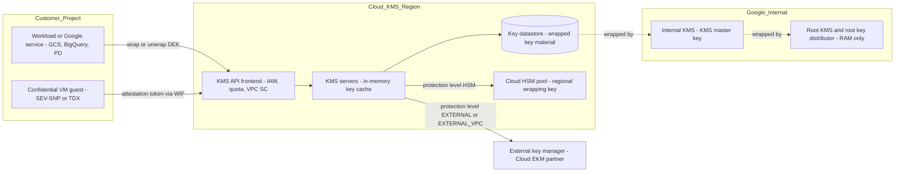

# Security and Confidential Computing: Cloud KMS

## TL;DR

Cloud KMS is a regional, multi-tenant key-wrapping service: the object hierarchy is project > location > KeyRing > CryptoKey > CryptoKeyVersion, key rings and keys can never be deleted, and you can only destroy key versions, after a scheduled-destruction window.
CMEK does not put your bulk data through Cloud KMS. A Google service encrypts data with its own data encryption keys (DEKs) and calls your key only to wrap and unwrap those DEKs, so your key is the root of a chain whose lower links you never see.
Cloud KMS has no `GenerateDataKey` call, unlike AWS. You generate DEKs on the client (with Tink or your own AEAD code) and wrap them with `Encrypt`. Your DEK cache policy therefore sets your quota use, your bill, and how quickly revocation takes effect.
Confidential VM moves the trust boundary from "Google's hypervisor and operators" to "the CPU vendor's silicon and firmware". SEV encrypts memory, SEV-SNP adds integrity with a Reverse Map Table, and TDX adds a CPU-signed TDX module plus integrity-protected memory. None of these is worth anything unless a relying party verifies attestation before it releases secrets.
The two production failure classes to remember: an accidental or slow-to-propagate key revocation turns into data unavailability or permanent crypto-shredding, and per-request KMS calls with no DEK cache exhaust regional quota and cost money in linear proportion to traffic.

## Mental Model



Think of Cloud KMS as a narrow, heavily guarded doorway that only ever handles small secrets: DEKs of a few dozen bytes, never your terabytes.
Bulk data stays in the storage or compute service and is encrypted by DEKs that service holds locally.
The doorway decides, per request, whether the caller's identity, network origin, and quota allow it to unwrap one DEK, and that decision is what makes revocation, audit, and crypto-shredding possible.
Behind the doorway, your key material is itself wrapped by Google-internal keys, ending at a root key that exists only in RAM and in physical safes. Your key is therefore a wrapping layer on a hierarchy you do not control, not a standalone root of trust.
Confidential VM attacks a different gap: while a workload runs, its DEKs and plaintext sit in DRAM, so the memory controller encrypts that DRAM with a per-VM key that the hypervisor cannot read.
Attestation connects the two halves. A Confidential VM proves its measured state to an identity layer, and only then does the KMS doorway open for it.

## Internals

### Resource model and immutability

A KeyRing is a grouping of CryptoKeys bound to one location, such as `us-central1`, a dual-region, a multi-region such as `us` or `europe`, or `global`. You cannot change that location after creation.
A CryptoKey is a named logical key with a purpose (`ENCRYPT_DECRYPT`, `ASYMMETRIC_SIGN`, `ASYMMETRIC_DECRYPT`, `MAC`, and others), a primary version for symmetric encryption, an optional rotation schedule, and a protection level fixed by its version template.
A CryptoKeyVersion holds the actual key material and moves through the states `PENDING_GENERATION`, `ENABLED`, `DISABLED`, `DESTROY_SCHEDULED`, and `DESTROYED`, plus import-related states for imported keys.
Key rings and keys cannot be deleted, and their names are permanent within a project and location. Google does this on purpose so that a ciphertext's key reference can never be re-pointed at a different key with the same name.
The operational effect is that you cannot "clean up" a key ring, you cannot reuse a name after a mistake, and IaC tooling must handle keys whose destroy step only removes state.
Symmetric ciphertext produced by Cloud KMS embeds an identifier for the version that produced it. `Decrypt` therefore takes the CryptoKey name, not a version name, and routes to the correct version automatically.
That embedding is why rotation is cheap: a new primary version takes over for new encryptions, while every older version must stay `ENABLED` for as long as any ciphertext references it.

### Protection levels as distinct data planes

Cloud KMS exposes five protection levels: `SOFTWARE`, `HSM` (multi-tenant), `HSM_SINGLE_TENANT`, `EXTERNAL`, and `EXTERNAL_VPC` (Encryption Consulting summary of Google docs, as of 2026-10).
Software keys run on FIPS 140-3 Level 1 validated BoringCrypto primitives, and Cloud HSM keys are generated and used in FIPS 140-2 Level 3 validated HSMs (Google Cloud KMS docs and Encryption Consulting summary, as of 2026-10).
The API is the same at every level, but each level is a different data plane with different latency, quota, and failure characteristics.
For `SOFTWARE`, the KMS server unwraps the key material in memory and performs AES-256-GCM itself, so the main costs are an RPC hop and an IAM check.
For `HSM`, the cryptographic operation is forwarded to an HSM partition, which is a separate device pool with its own capacity ceiling and a separate quota class (Google Cloud docs, UNVERIFIED as of 2026-10).
For `EXTERNAL` and `EXTERNAL_VPC`, Cloud KMS holds only a reference (a key URI) and forwards a wrap or unwrap request to a partner key manager. The partner either runs outside Google over the internet or is reached over a VPC network, so the availability of your data now depends on a third party's SLO, your network path, and your own operations team.

### The mechanism most guides skip: Cloud HSM keys are not "inside one HSM"

The usual mental picture is a key that lives in a single HSM, which would make that HSM a single point of failure and capacity.
According to Google's Cloud KMS deep-dive whitepaper, Cloud HSM key material is generated inside an HSM, wrapped by a wrapping key that the HSMs in that location share, and stored outside the HSM in the Cloud KMS datastore. When the key is used, the wrapped blob is loaded into any HSM in the pool (Google Cloud KMS deep dive, UNVERIFIED as of 2026-10).
This design is what lets Cloud HSM scale horizontally and survive the loss of individual HSM devices, and it explains why HSM keys inherit the regional and multi-regional location semantics of software keys.
The security claim therefore shifts from "the key never leaves the HSM" to "the key never leaves an HSM boundary in plaintext". The FIPS 140-2 Level 3 boundary covers the wrapping key and every plaintext use.
Cloud HSM can return attestation statements for a key version. These are signed by the HSM manufacturer's certificate chain and by Google's, and an auditor can check them to confirm the key was generated inside the HSM and marked non-extractable (Google Cloud docs, UNVERIFIED as of 2026-10).
The trade-off is that a shared pool behaves like any multi-tenant fleet. A noisy neighbor or a regional HSM capacity event surfaces as `RESOURCE_EXHAUSTED` or elevated latency on HSM-protected keys while software keys in the same region stay healthy. `HSM_SINGLE_TENANT` exists to buy dedicated partitions when that coupling is unacceptable.

### The key-wrapping chain under every CMEK

Google's default encryption-at-rest design splits data into chunks. Each chunk is encrypted with its own DEK using AES-256, and DEKs are wrapped by key encryption keys (KEKs) held in Google's internal KMS, which is a different system from customer-facing Cloud KMS ([Google default encryption at rest](https://cloud.google.com/docs/security/encryption/default-encryption)).
Internal KMS keys are in turn wrapped by a Root KMS master key. That key is held in RAM by a dedicated root key distributor running on a small set of machines, and it is backed up in physical safes.
CMEK inserts your Cloud KMS key into this chain. Depending on the service, either your key wraps the service's per-resource key directly, or it wraps an intermediate key that wraps the per-chunk DEKs.
Two consequences follow, and both matter for audits and incident response.
First, the bulk data path never calls Cloud KMS, so CMEK adds almost no throughput cost to reads and writes. It does add latency and a hard dependency at the moments a service has to unwrap its intermediate key, such as an object read after a cache miss, a database open, or a disk attach.
Second, every CMEK service caches unwrapped intermediate keys for a service-specific interval. "Disable the key" therefore does not mean "data becomes unreadable now". It means "data becomes unreadable once every cache that holds the unwrapped key has expired or been invalidated".

### Request path, consistency, and integrity

A Cloud KMS request is served by a regional frontend, which evaluates IAM on the key resource (inheriting from the key ring, project, folder, and organization), enforces VPC Service Controls, and charges quota before any cryptographic work happens.
Key metadata and wrapped key material live in a replicated datastore. The deep-dive whitepaper describes metadata changes such as enabling, disabling, and rotating as strongly consistent operations whose effect on serving caches propagates within a bounded delay, not instantly (Google Cloud KMS deep dive, UNVERIFIED as of 2026-10).
That replicated datastore is where Spanner-style synchronous replication ([Corbett et al., OSDI 2012](https://www.usenix.org/conference/osdi12/technical-sessions/presentation/corbett)) earns its place: a multi-regional key location must not let two regions disagree on whether a version is destroyed.
The API carries optional CRC32C checksums in both directions: `plaintext_crc32c` and `additional_authenticated_data_crc32c` on requests, and `verified_plaintext_crc32c` and `ciphertext_crc32c` on responses.
The checksums let a client detect bit flips introduced anywhere between its own memory and the KMS server's memory. This defends against hardware-level silent corruption, which has been observed in hyperscale fleets, not against an attacker.
Clients that skip these checks can silently wrap a corrupted DEK. The failure then shows up months later as an undecryptable record, long after the faulty NIC or DIMM has been swapped.

### Confidential VM: three memory protection mechanisms

AMD SEV (Secure Encrypted Virtualization) gives each VM an Address Space Identifier (ASID). The AMD Secure Processor generates a per-ASID key, and the memory controller encrypts every cache line written to DRAM with AES-128, using a physical-address-based tweak ([AMD SEV-SNP whitepaper](https://www.amd.com/system/files/TechDocs/SEV-SNP-strengthening-vm-isolation-with-integrity-protection-and-more.pdf)).
The guest marks private pages with the C-bit in its own page table entries. The hypervisor never holds the key, so a DRAM dump or a hypervisor read of guest memory returns ciphertext.
Plain SEV leaves register state exposed on VM exits, and it gives no integrity protection: a malicious hypervisor can remap, replay, or alias encrypted pages to corrupt the guest without ever decrypting anything.
SEV-ES encrypts the saved register state (the VMSA) on exit. SEV-SNP adds a Reverse Map Table (RMP), a system-wide table recording which guest owns each physical page and at which guest physical address. The CPU checks the RMP on hypervisor writes and on nested page-table walks.
The guest accepts each page into its private space with the `PVALIDATE` instruction, so the hypervisor cannot silently swap in a different page later. SNP also adds attestation reports signed by a chip-unique key (VCEK) and stamped with the firmware TCB version.
Intel TDX puts a signed TDX module in a new CPU mode called SEAM, between the hypervisor (VMM) and the guest. The VMM must ask the TDX module to manage Secure EPT tables and TD state through `SEAMCALL`, and it never touches them directly ([Cheng et al., Intel TDX Demystified, arXiv 2303.15540](https://arxiv.org/abs/2303.15540)).
TDX memory is encrypted with AES-XTS-128 through MKTME, using a private host key ID per trust domain, and can carry a per-cache-line MAC for cryptographic integrity. Attestation uses a `TDREPORT` that a quoting service converts into a remotely verifiable quote.
On Google Cloud you select these mechanisms with `confidentialInstanceType` values `SEV`, `SEV_SNP`, and `TDX` on supported machine series. The documented mapping is SEV on N2D and C2D, SEV-SNP on N2D, and TDX on C3 (Google Cloud docs, UNVERIFIED as of 2026-10).

### The second mechanism most guides skip: bounce buffers and the I/O tax

Devices cannot DMA into memory encrypted with a key they do not have. A confidential guest therefore keeps a pool of shared, unencrypted pages (swiotlb bounce buffers) and copies every virtio or gVNIC packet and every block I/O buffer between private and shared memory.
The CPU cost of confidential computing is mostly this extra copy plus the page-state conversions, not the inline AES in the memory controller. That is why CPU-bound benchmarks show small overheads while small-packet network workloads and high-IOPS storage show larger ones.
The shared pages are also the attack surface. Every byte the guest reads from a bounce buffer was written by the untrusted host, so guest drivers must validate device-provided data as hostile input, which classic virtio drivers were never designed to do.
Confidential GPUs extend the same pattern across PCIe. In NVIDIA H100 confidential computing mode, CPU-GPU transfers go through encrypted staging buffers, which costs PCIe bandwidth and latency, worst for many small transfers (NVIDIA docs, UNVERIFIED as of 2026-10).

### Attestation and the measured launch

At launch, the AMD Secure Processor or the TDX module measures the initial guest image, which on Google Cloud is the Google-built UEFI firmware. That measurement ends up in the signed attestation report.
A relying party has to compare the measurement against a known-good value. Google publishes signed launch endorsements for its Confidential VM firmware so that customers can do this comparison without reproducing the build (Google Cloud docs, UNVERIFIED as of 2026-10).
Everything after firmware, including the kernel, initrd, and command line, is measured into the vTPM by measured boot. A complete verification chain therefore needs both the hardware report and the vTPM event log.
Confidential Space packages this chain. A hardened image measures the container image digest, the Google attestation service checks the hardware and vTPM evidence and issues an OIDC token with claims such as the image digest and debug status, and a Workload Identity Federation provider accepts the token only when attribute conditions match. The resulting federated identity is the only principal granted `cloudkms.cryptoKeyVersions.useToDecrypt` on the key that protects the secret.
This is the confidential computing analogue of AWS KMS condition keys for Nitro Enclave attestation, discussed in [[17-Cloud-AI-Engineering/Volume_02_AWS_Deep_Dive/Chapter_15_Security_and_Cryptography_KMS_and_Nitro_Enclaves|Security and Cryptography: KMS and Nitro Enclaves]].

### Failure domains

A Cloud KMS key in `us-central1` fails with that region. A key in the `us` multi-region survives a regional outage, but you pay for that with cross-region commit latency on metadata writes. Data-plane encrypt and decrypt calls are served from the nearest healthy region (Google Cloud docs, UNVERIFIED as of 2026-10).
CMEK forces co-location rules. For example, a Cloud Storage bucket in the `US` multi-region needs a key in the `us` location, and a regional resource generally needs a key in the same region. Your key placement therefore inherits your data placement, and your data's failure domain now includes the key's failure domain.
External keys add a failure domain Google does not operate. If the partner endpoint is unreachable, every CMEK resource wrapped by that key goes unavailable once service caches expire, whatever Google's own health.
For the physical meaning of zones and regions, see [[17-Cloud-AI-Engineering/Volume_00_Foundations_Under_the_Cloud/Chapter_06_Physical_Failure_Domains_and_Blast_Radius|Physical Failure Domains and Blast Radius]] and [[17-Cloud-AI-Engineering/Volume_01_Cloud_Architecture_Principles/Chapter_02_Regions_Zones_and_Static_Stability|Regions, Zones, and Static Stability]].

## Numbers to Know

| Quantity | Value | Source and date |
| --- | --- | --- |
| Cloud KMS software key version | $0.06 per active version per month | (Google Cloud pricing page, as of 2026-10) |
| Cloud KMS key use operations (encrypt/decrypt) | $0.03 per 10,000 operations | (Google Cloud pricing page, as of 2026-10) |
| Cloud KMS key admin operations | Free | (Google Cloud pricing page, as of 2026-10) |
| Cloud HSM key version, AES-256 or RSA-2048 | $1.00 per version per month | (Google Cloud pricing page, as of 2026-10) |
| Cloud HSM key version, EC P-256 or P-384 | $2.50 per month for versions 0-2,000, $1.00 per month above 2,000 | (Google Cloud pricing page, as of 2026-10) |
| Protection levels | 5: SOFTWARE, HSM, HSM_SINGLE_TENANT, EXTERNAL, EXTERNAL_VPC | (Encryption Consulting summary of Google docs, as of 2026-10) |
| Software key validation | FIPS 140-3 Level 1 (BoringCrypto) | (Google Cloud KMS docs, as of 2026-10) |
| Cloud HSM validation | FIPS 140-2 Level 3 | (Encryption Consulting summary of Google docs, as of 2026-10) |
| CMEK-integrated services | 40+ | (Google Cloud KMS docs, as of 2026-10) |
| Max plaintext per Cloud KMS `Encrypt` | 64 KiB | UNVERIFIED (Google Cloud docs, as of 2026-10) |
| Default scheduled-destruction window | 30 days, configurable from 24 hours to 120 days | UNVERIFIED (Google Cloud docs, as of 2026-10) |
| Default cryptographic request quota | 60,000 per minute per project per region (software keys) | UNVERIFIED (Google Cloud docs, as of 2026-10) |
| HSM and EKM request quotas | Separate and lower than software quota | UNVERIFIED (Google Cloud docs, as of 2026-10) |
| AES-GCM safe message count per key, random 96-bit nonce | About 2^32 messages | (NIST SP 800-38D guidance; stable) |
| AWS KMS key | $1 per key per month plus $0.03 per 10,000 requests | (AWS Security Blog, as of 2026-10) |
| AWS CloudHSM | About $1.60 per HSM-hour in us-east-1 | (AWS Security Blog, as of 2026-10) |
| Max plaintext per AWS KMS `Encrypt` | 4,096 bytes | UNVERIFIED (AWS docs, as of 2026-10) |
| AWS KMS key deletion waiting period | 7-30 days, default 30 | UNVERIFIED (AWS docs, as of 2026-10) |
| SEV and SEV-SNP memory cipher | AES-128 with address tweak, in memory controller | (AMD SEV-SNP whitepaper, 2020; stable) |
| TDX memory cipher | AES-XTS-128 via MKTME, optional per-line MAC | (Intel TDX Demystified, 2023; stable) |
| Confidential VM machine series | SEV: N2D, C2D; SEV-SNP: N2D; TDX: C3 | UNVERIFIED (Google Cloud docs, as of 2026-10) |
| Confidential VM live migration | SEV on N2D supports it; SEV-SNP and TDX require on-host-maintenance TERMINATE | UNVERIFIED (Google Cloud docs, as of 2026-10) |

## AWS vs GCP Mechanism Parity

| Dimension | AWS | Google Cloud | Critical difference |
| --- | --- | --- | --- |
| Key container | KMS key (regional, identified by key ID and ARN) | project / location / KeyRing / CryptoKey / CryptoKeyVersion | GCP exposes versions as first-class resources you can disable or destroy individually, while AWS hides backing keys behind the key ID |
| Deletion | `ScheduleKeyDeletion` with 7-30 day window | Destroy versions only, with a configurable scheduled-destruction window; keys and rings are never deleted | GCP names are permanent, so IaC "destroy" leaves tombstones |
| Data key generation | `GenerateDataKey` returns plaintext DEK plus wrapped DEK | No equivalent; generate the DEK locally and call `Encrypt`, or use `GenerateRandomBytes` with an HSM protection level | Porting AWS envelope code to GCP needs a client-side DEK source |
| Max direct plaintext | 4 KB (UNVERIFIED) | 64 KiB (UNVERIFIED) | Neither is meant for bulk data |
| Context binding | Encryption context (logged in CloudTrail) | Additional authenticated data (AAD) | AWS can write IAM conditions on encryption context; GCP AAD is purely cryptographic binding |
| Authorization model | Key policy (mandatory resource policy) + IAM + grants | IAM allow/deny on the resource hierarchy, inherited from the key ring and above | AWS key policy can lock out even account admins; GCP inheritance means a folder-level grant reaches every key below it |
| Service integration identity | Service principals via key policy and grants | Per-service service agents, e.g. `service-PROJECT_NUMBER@gs-project-accounts.iam.gserviceaccount.com` | Forgetting the GCP service agent binding is the top CMEK setup failure |
| HSM backing | All AWS KMS keys in AWS-operated HSMs (FIPS 140-3 Level 3, UNVERIFIED as of 2026-10) | SOFTWARE by default; HSM is an explicit, priced protection level | GCP lets you trade assurance for cost per key |
| Dedicated HSM | CloudHSM cluster, optionally as a KMS custom key store | HSM_SINGLE_TENANT protection level (GA status UNVERIFIED as of 2026-10) | CloudHSM is a cluster you operate; GCP keeps the KMS API surface |
| External keys | External Key Store (XKS) proxy | Cloud EKM over internet or VPC | GCP pairs EKM with Key Access Justifications, so each request carries a reason the external manager can veto |
| Multi-region keys | Multi-Region keys: independent replicas sharing key material, each with its own ARN | Multi-regional locations (`us`, `europe`, `asia`) and `global`: one logical key | AWS replicas can diverge in policy; GCP has one policy and one state |
| Org guardrails | SCPs and RCPs with `kms:*` condition keys | Org policies `gcp.restrictNonCmekServices`, `gcp.restrictCmekCryptoKeyProjects` | GCP can mandate CMEK per service across an organization |
| Network perimeter | VPC endpoint policies, `aws:SourceVpce` conditions | VPC Service Controls perimeter including `cloudkms.googleapis.com` | VPC SC also blocks cross-perimeter use of keys by Google services |
| Integrity of API payloads | No CRC fields in the KMS API | CRC32C fields on request and response | GCP lets clients detect in-flight corruption |
| Baseline confidential posture | Nitro System design: no operator access to instance memory | Titanium offload plus default encryption | AWS treats operator isolation as a default property; GCP sells hardware TEEs as an opt-in instance property |
| Hardware TEE VMs | AMD SEV-SNP on selected M6a, C6a, R6a (UNVERIFIED as of 2026-10) | SEV, SEV-SNP, TDX Confidential VM; Confidential GKE Nodes | GCP offers both CPU vendors' TEEs |
| Attestation-gated key release | KMS condition keys on Nitro Enclave attestation document PCRs | Confidential Space OIDC token, WIF attribute conditions, KMS IAM | AWS checks attestation inside KMS; GCP converts attestation into a federated identity first |

Translation details for the rest of the stack are in [[17-Cloud-AI-Engineering/Volume_04_AWS_vs_GCP_Translation/Chapter_03_Identity_Security_and_Governance_Translation|Identity, Security, and Governance Translation]].

## Worked Example: CMEK bucket, SEV-SNP Confidential VM with CMEK boot disk, and quota-safe envelope encryption

### What gets built

One key ring with random suffix, because rings cannot be deleted and names cannot be reused.
Three keys: `app-envelope` (SOFTWARE, for the Python client), `gcs-cmek` (HSM, for a bucket), and `disk-cmek` (SOFTWARE, for a boot disk).
A Cloud Storage bucket with a default CMEK.
An N2D SEV-SNP Confidential VM with no external IP and a CMEK-encrypted boot disk.
A billing budget with alert thresholds.

### Cost estimate (lab running for 2 hours)

The HSM key version costs $1.00 per month, and the two software versions cost $0.06 each per month. Treat these as up to $1.12 for the month the lab exists, since whether partial months are prorated is UNVERIFIED as of 2026-10.
An n2d-standard-2 with the Confidential VM surcharge costs on the order of $0.10 per hour on demand in us-central1 (UNVERIFIED as of 2026-10), so 2 hours costs about $0.20.
A 20 GB pd-balanced boot disk is cents for 2 hours.
Key use operations in this lab number in the hundreds, which costs well under $0.01.
The expected total is under $2. The budget below alerts at $5.

### Terraform / OpenTofu

```hcl
terraform {
  required_version = ">= 1.6"
  required_providers {
    google = { source = "hashicorp/google", version = ">= 6.0" }
    random = { source = "hashicorp/random", version = ">= 3.5" }
  }
}

variable "project_id"      { type = string }
variable "billing_account" { type = string } # format: XXXXXX-XXXXXX-XXXXXX
variable "region"          { default = "us-central1" }
variable "zone"            { default = "us-central1-a" }

provider "google" {
  project               = var.project_id
  region                = var.region
  user_project_override = true
  billing_project       = var.project_id
}

data "google_project" "this" {}

resource "google_project_service" "apis" {
  for_each = toset([
    "cloudkms.googleapis.com",
    "compute.googleapis.com",
    "storage.googleapis.com",
    "billingbudgets.googleapis.com",
  ])
  service            = each.value
  disable_on_destroy = false
}

resource "random_id" "suffix" { byte_length = 3 }

# Key rings are permanent; the suffix makes the lab re-runnable.
resource "google_kms_key_ring" "lab" {
  name       = "ch15-lab-${random_id.suffix.hex}"
  location   = var.region
  depends_on = [google_project_service.apis]
}

resource "google_kms_crypto_key" "app" {
  name                       = "app-envelope"
  key_ring                   = google_kms_key_ring.lab.id
  purpose                    = "ENCRYPT_DECRYPT"
  rotation_period            = "7776000s" # 90 days
  destroy_scheduled_duration = "86400s"   # 24h so lab teardown is quick
  version_template {
    algorithm        = "GOOGLE_SYMMETRIC_ENCRYPTION"
    protection_level = "SOFTWARE"
  }
}

resource "google_kms_crypto_key" "gcs" {
  name                       = "gcs-cmek"
  key_ring                   = google_kms_key_ring.lab.id
  purpose                    = "ENCRYPT_DECRYPT"
  rotation_period            = "7776000s"
  destroy_scheduled_duration = "86400s"
  version_template {
    algorithm        = "GOOGLE_SYMMETRIC_ENCRYPTION"
    protection_level = "HSM"
  }
}

resource "google_kms_crypto_key" "disk" {
  name                       = "disk-cmek"
  key_ring                   = google_kms_key_ring.lab.id
  purpose                    = "ENCRYPT_DECRYPT"
  destroy_scheduled_duration = "86400s"
  version_template {
    algorithm        = "GOOGLE_SYMMETRIC_ENCRYPTION"
    protection_level = "SOFTWARE"
  }
}

# Service agents must be able to wrap/unwrap with the keys.
data "google_storage_project_service_account" "gcs" {}

resource "google_kms_crypto_key_iam_member" "gcs_agent" {
  crypto_key_id = google_kms_crypto_key.gcs.id
  role          = "roles/cloudkms.cryptoKeyEncrypterDecrypter"
  member        = "serviceAccount:${data.google_storage_project_service_account.gcs.email_address}"
}

resource "google_kms_crypto_key_iam_member" "compute_agent" {
  crypto_key_id = google_kms_crypto_key.disk.id
  role          = "roles/cloudkms.cryptoKeyEncrypterDecrypter"
  member        = "serviceAccount:service-${data.google_project.this.number}@compute-system.iam.gserviceaccount.com"
}

resource "google_storage_bucket" "cmek" {
  name                        = "${var.project_id}-ch15-${random_id.suffix.hex}"
  location                    = upper(var.region) # must match key location
  uniform_bucket_level_access = true
  public_access_prevention    = "enforced"
  force_destroy               = true
  encryption { default_kms_key_name = google_kms_crypto_key.gcs.id }
  depends_on = [google_kms_crypto_key_iam_member.gcs_agent]
}

resource "google_compute_network" "lab" {
  name                    = "ch15-lab-${random_id.suffix.hex}"
  auto_create_subnetworks = false
  depends_on              = [google_project_service.apis]
}

resource "google_compute_subnetwork" "lab" {
  name                     = "ch15-lab"
  network                  = google_compute_network.lab.id
  region                   = var.region
  ip_cidr_range            = "10.15.0.0/24"
  private_ip_google_access = true
}

resource "google_compute_instance" "cvm" {
  name             = "ch15-cvm"
  zone             = var.zone
  machine_type     = "n2d-standard-2"
  min_cpu_platform = "AMD Milan"

  confidential_instance_config {
    confidential_instance_type = "SEV_SNP"
  }

  scheduling {
    on_host_maintenance = "TERMINATE" # SNP guests are not live-migrated
    automatic_restart   = true
  }

  shielded_instance_config {
    enable_secure_boot          = true
    enable_vtpm                 = true
    enable_integrity_monitoring = true
  }

  boot_disk {
    kms_key_self_link = google_kms_crypto_key.disk.id
    initialize_params {
      image = "ubuntu-os-cloud/ubuntu-2404-lts-amd64"
      size  = 20
      type  = "pd-balanced"
    }
  }

  network_interface {
    subnetwork = google_compute_subnetwork.lab.id
    # no access_config block: no external IP
  }

  depends_on = [google_kms_crypto_key_iam_member.compute_agent]
}

resource "google_billing_budget" "lab" {
  billing_account = var.billing_account
  display_name    = "ch15-kms-cvm-lab"
  budget_filter { projects = ["projects/${data.google_project.this.number}"] }
  amount {
    specified_amount {
      currency_code = "USD"
      units         = "5"
    }
  }
  threshold_rules { threshold_percent = 0.5 }
  threshold_rules { threshold_percent = 0.9 }
  threshold_rules { threshold_percent = 1.0 }
  depends_on = [google_project_service.apis]
}

output "app_key"  { value = google_kms_crypto_key.app.id }
output "bucket"   { value = google_storage_bucket.cmek.name }
```

Apply and verify:

```bash
tofu init
tofu apply -var project_id=MY_PROJECT -var billing_account=XXXXXX-XXXXXX-XXXXXX

# Prove the guest kernel sees SNP without SSH: read the serial console.
gcloud compute instances get-serial-port-output ch15-cvm --zone us-central1-a \
  | grep -i "Memory Encryption Features active"

# Prove the bucket default key and the per-object key version used.
BUCKET=$(tofu output -raw bucket)
echo hello > /tmp/h.txt
gcloud storage cp /tmp/h.txt "gs://${BUCKET}/h.txt"
gcloud storage objects describe "gs://${BUCKET}/h.txt" --format="value(kms_key)"
```

The `kms_key` value on the object includes the specific `cryptoKeyVersions/N`, which is how you discover objects still pinned to old versions after rotation.

### Python: envelope encryption with CRC32C verification and a bounded DEK cache

```python
#!/usr/bin/env python3
"""Envelope encryption over Cloud KMS.

pip install google-cloud-kms google-crc32c cryptography
Usage: python envelope.py KEY_NAME TENANT_ID INPUT_FILE
KEY_NAME = projects/P/locations/L/keyRings/R/cryptoKeys/app-envelope
"""
import os
import struct
import sys
import time

import google_crc32c
from cryptography.hazmat.primitives.ciphers.aead import AESGCM
from google.cloud import kms

MAX_MSGS_PER_DEK = 2**30  # stay well under the ~2**32 random-nonce bound
DEK_TTL_S = 300           # bounds revocation lag for this client to 5 minutes


def crc32c(data: bytes) -> int:
    return int(google_crc32c.value(data))


class EnvelopeCipher:
    def __init__(self, key_name: str):
        self.key_name = key_name
        self.client = kms.KeyManagementServiceClient()
        self.enc_cache = {}  # tenant -> (dek, wrapped, expiry, count)
        self.dec_cache = {}  # wrapped -> (dek, expiry)
        self.kms_calls = 0

    def _wrap(self, dek: bytes, aad: bytes) -> bytes:
        resp = self.client.encrypt(request={
            "name": self.key_name,
            "plaintext": dek,
            "plaintext_crc32c": crc32c(dek),
            "additional_authenticated_data": aad,
            "additional_authenticated_data_crc32c": crc32c(aad),
        })
        self.kms_calls += 1
        if not resp.verified_plaintext_crc32c:
            raise RuntimeError("KMS did not verify plaintext CRC32C")
        if not resp.verified_additional_authenticated_data_crc32c:
            raise RuntimeError("KMS did not verify AAD CRC32C")
        if resp.ciphertext_crc32c != crc32c(resp.ciphertext):
            raise RuntimeError("wrapped DEK corrupted in transit")
        return resp.ciphertext

    def _unwrap(self, wrapped: bytes, aad: bytes) -> bytes:
        hit = self.dec_cache.get(wrapped)
        if hit and hit[1] > time.monotonic():
            return hit[0]
        resp = self.client.decrypt(request={
            "name": self.key_name,
            "ciphertext": wrapped,
            "ciphertext_crc32c": crc32c(wrapped),
            "additional_authenticated_data": aad,
            "additional_authenticated_data_crc32c": crc32c(aad),
        })
        self.kms_calls += 1
        if resp.plaintext_crc32c != crc32c(resp.plaintext):
            raise RuntimeError("unwrapped DEK corrupted in transit")
        self.dec_cache[wrapped] = (resp.plaintext, time.monotonic() + DEK_TTL_S)
        return resp.plaintext

    def encrypt(self, tenant: str, data: bytes) -> bytes:
        aad = f"tenant={tenant}".encode()
        now = time.monotonic()
        entry = self.enc_cache.get(tenant)
        if entry is None or entry[2] <= now or entry[3] >= MAX_MSGS_PER_DEK:
            dek = AESGCM.generate_key(bit_length=256)
            entry = (dek, self._wrap(dek, aad), now + DEK_TTL_S, 0)
        dek, wrapped, expiry, count = entry
        self.enc_cache[tenant] = (dek, wrapped, expiry, count + 1)
        nonce = os.urandom(12)
        ct = AESGCM(dek).encrypt(nonce, data, aad)
        return struct.pack(">BH", 1, len(wrapped)) + wrapped + nonce + ct

    def decrypt(self, tenant: str, blob: bytes) -> bytes:
        aad = f"tenant={tenant}".encode()
        version, wlen = struct.unpack(">BH", blob[:3])
        if version != 1:
            raise ValueError("unknown envelope version")
        wrapped = blob[3:3 + wlen]
        nonce = blob[3 + wlen:15 + wlen]
        ct = blob[15 + wlen:]
        return AESGCM(self._unwrap(wrapped, aad)).decrypt(nonce, ct, aad)


if __name__ == "__main__":
    key_name, tenant, path = sys.argv[1], sys.argv[2], sys.argv[3]
    cipher = EnvelopeCipher(key_name)
    payload = open(path, "rb").read()
    blobs = [cipher.encrypt(tenant, payload) for _ in range(1000)]
    assert all(cipher.decrypt(tenant, b) == payload for b in blobs)
    print(f"1000 encrypt + 1000 decrypt round trips, KMS calls: {cipher.kms_calls}")
```

A correct run reports 2 KMS calls for 2,000 cryptographic operations: one wrap and one unwrap.
The AAD binds every DEK to its tenant, so a ciphertext copied into another tenant's row fails authentication, not decrypts silently.
`DEK_TTL_S` is a security parameter, not just a performance knob: it is the worst-case time this client keeps decrypting after the key is disabled.

### Capacity and cost sizing: the per-request KMS antipattern

Scenario: a document service reads 20,000 encrypted records per second at peak and calls `Decrypt` once per record.
Step 1, quota: 20,000 per second x 60 = 1,200,000 requests per minute. That is 20x the 60,000-per-minute default regional software-key quota (UNVERIFIED as of 2026-10), so the service would be throttled at about 5 percent of peak.
Step 2, cost at sustained peak: 20,000 x 2,592,000 seconds in 30 days = 51.84 billion operations. Divided by 10,000 and multiplied by $0.03, that is $155,520 per month (pricing as of 2026-10).
Step 3, redesign: one DEK per tenant per hour, unwrapped DEKs cached for 300 seconds per serving instance, 1,000 tenants, 50 instances.
Step 4, redesigned call rate: in the worst case every instance sees every tenant, so 1,000 x 50 unwraps every 300 s = 166.7 per second, or 10,000 per minute. That is 17 percent of quota, with headroom for a cold-start storm.
Step 5, redesigned cost: 166.7 x 2,592,000 = 432 million operations, which is $1,296 per month, a 120x reduction.
Step 6, the cold-start storm: if all 50 instances restart together, they issue up to 50,000 unwraps within seconds. Spread warm-up across instances with jitter, or route tenants to instances with consistent hashing so each instance holds about 1,000 / 50 x replication-factor tenants instead of all 1,000.
Step 7, key inventory cost: 1,000 tenants x 1 software key x about 5 retained versions after a year of 90-day rotation = 5,000 versions x $0.06 = $300 per month. The same layout on HSM costs 5,000 x $1.00 = $5,000 per month.

### Teardown

```bash
tofu destroy -var project_id=MY_PROJECT -var billing_account=XXXXXX-XXXXXX-XXXXXX

# Keys and key rings remain as permanent tombstones; confirm versions are scheduled for destruction.
for k in app-envelope gcs-cmek disk-cmek; do
  gcloud kms keys versions list --key "$k" --keyring "ch15-lab-SUFFIX" \
    --location us-central1 --format="table(name,state,destroyTime)"
done
```

Terraform destroy of a `google_kms_crypto_key` schedules all of its versions for destruction and removes the key from state. Destroying the key ring only removes it from state.
Whether `DESTROY_SCHEDULED` versions keep accruing version charges is UNVERIFIED as of 2026-10. The 24-hour `destroy_scheduled_duration` in this lab keeps that exposure to one day.

## Failure Modes and Pitfalls

### Accidental crypto-shredding

Destroying a key version is irreversible once the scheduled window passes. The only exception is imported keys, where you still hold the original material and can import it again.
The realistic trigger is automation, not malice: a cleanup script that "destroys unused key versions" because no recent `Decrypt` showed up in a 30-day log window, while a yearly compliance archive still references them.
Mitigations: keep `cloudkms.cryptoKeyVersions.destroy` out of broad admin roles in practice by using custom roles. Enforce a minimum destruction window through an organization policy (constraint name `constraints/cloudkms.minimumDestroyScheduledDuration`, UNVERIFIED as of 2026-10). Alert on every `DestroyCryptoKeyVersion` admin audit log entry.
Disable a version first and wait for a full business cycle before destroying it. A disabled version can be re-enabled, and the gap gives an inventory of breakage before it becomes permanent.

### Rotation misunderstood as re-encryption

Rotating a CryptoKey creates a new primary version. It does not re-encrypt any existing ciphertext, CMEK resource, or wrapped DEK.
Teams that rotate and then disable the old version "to complete rotation" break every read of data still pinned to it.
For Cloud Storage, objects keep the version they were written with until they are rewritten. A real rotation therefore needs a rewrite job, plus a query over object `kms_key` metadata to prove nothing references the old version before you disable it.

### Revocation propagation lag

Disabling a key is not an instantaneous kill switch. Each CMEK service caches unwrapped intermediate keys and polls key state on its own schedule, and a running Compute Engine VM with an attached CMEK disk can keep running after the key is disabled (Google Cloud docs, UNVERIFIED as of 2026-10).
Compute Engine offers a key revocation action that stops a VM when its key becomes unavailable (flag and GA status UNVERIFIED as of 2026-10). Without it, a revoked-key VM keeps serving plaintext until its next restart.
An incident runbook that says "disable the key to contain an exfiltration" must list, per service, how long revocation takes to land, and must pair key disablement with IAM and network containment.

### Quota exhaustion and retry amplification

Per-request KMS calls in a hot path, as sized above, hit `RESOURCE_EXHAUSTED` at peak.
Clients that retry immediately multiply load on an already throttled quota bucket, and every throttled request becomes a user-facing error because the DEK is on the critical path.
Use capped exponential backoff with full jitter ([[17-Cloud-AI-Engineering/Volume_07_Reliability_and_SRE/Chapter_03_Resilient_Communication_Retries_Jitter_and_Circuit_Breakers|Resilient Communication: Retries, Jitter, and Circuit Breakers]]). Also give the DEK cache a stale-while-revalidate window, so an unwrap failure extends a cached DEK's life by a bounded grace period and does not fail the read. That grace period is itself a revocation-lag decision you must document.
CMEK calls made by Google services on your behalf count against your project and are billed as key use operations (Google Cloud pricing, UNVERIFIED as of 2026-10). A BigQuery or Dataflow job reading many CMEK-protected resources can therefore consume quota that your own application was counting on.

### CMEK setup failures

The most common CMEK provisioning error is the service agent missing `roles/cloudkms.cryptoKeyEncrypterDecrypter`. The service agent only exists after the service API is first used, so a cold project can fail on apply ordering.
The second is location mismatch: a regional key cannot protect a multi-regional bucket. Because rings and keys are immutable, the fix is a new key, not an edit.
The third is a CMEK key in a different project from the resource without `gcp.restrictCmekCryptoKeyProjects` allowing that project. The resulting create-time error reads like a permissions problem.

### External key manager in the hot path

With `EXTERNAL` or `EXTERNAL_VPC`, every cache-miss unwrap is a call to a third-party system. Its latency adds to tail latency, and its outage becomes your outage once caches drain.
This setup has more ways to fail than either cloud alone: partner software bugs, certificate expiry on the EKM endpoint, firewall changes on the VPC path, and Key Access Justifications policies that deny a justification code you did not anticipate, such as Google-initiated maintenance access during an incident.
Treat the EKM as a tier-0 dependency, with its own multi-region deployment, error budget, and game days ([[17-Cloud-AI-Engineering/Volume_07_Reliability_and_SRE/Chapter_05_Chaos_Engineering_and_Game_Days|Chaos Engineering and Game Days]]).

### Global control-plane coupling

On 2025-06-12, Google Cloud had a multi-hour global incident. A Service Control policy change containing unexpected blank fields replicated globally and crash-looped API serving across many products, and us-central1 recovery took longer because of overload on a backing datastore during restart (Google Cloud incident report, details UNVERIFIED as of 2026-10).
The lesson for KMS architecture: Cloud KMS sits behind the same API admission machinery as every other Google API. A failure there turns CMEK data into unavailable data even when the key datastore and HSMs are healthy.
The static-stability answer is to keep unwrapped DEKs alive through such windows with bounded grace periods. This is the same trade of revocation latency for availability described in [[17-Cloud-AI-Engineering/Volume_01_Cloud_Architecture_Principles/Chapter_04_Control_Plane_vs_Data_Plane_Separation|Control Plane vs Data Plane Separation]].
More outage analysis is in [[17-Cloud-AI-Engineering/Volume_07_Reliability_and_SRE/Chapter_07_Anatomy_of_Major_Cloud_Outages|Anatomy of Major Cloud Outages]].

### Confidential VM operational pitfalls

SEV-SNP and TDX guests are terminated, not live-migrated, during host maintenance (UNVERIFIED as of 2026-10). A fleet that was stable on standard VMs starts seeing maintenance-driven restarts and must handle maintenance notifications and spread replicas across zones.
Zonal capacity for specific confidential machine series is narrower than for general-purpose series, so stockouts happen more often during regional demand spikes.
Not every OS image supports every TEE type. A guest without SNP-aware kernel support either fails to boot or boots without the expected protections, and the serial-console check in the worked example belongs in your image CI.
The I/O tax from bounce buffers is real on small-packet and high-IOPS workloads. Benchmark your actual service, because CPU microbenchmarks do not reflect it.
The biggest pitfall is not verifying attestation. A Confidential VM that never presents evidence to a relying party protects against a DRAM dump but not against a compromised boot chain, and auditors increasingly ask to see the verification step.

### Hardware TEE vulnerabilities

TEEs are vendor firmware and silicon, and they get patched like any other software.
CacheWarp (USENIX Security 2024) showed that a malicious hypervisor could selectively revert guest cache-line writes on SEV-ES and SEV-SNP by abusing the `INVD` instruction ([cachewarpattack.com](https://cachewarpattack.com/)).
BadRAM (IEEE S&P 2025) showed that tampering with a DIMM's SPD chip creates memory aliases that defeat SEV-SNP's integrity guarantees, and AMD fixed it with firmware TCB updates ([badram.eu](https://badram.eu/)).
In 2025, Google researchers disclosed a weakness in AMD microcode signature verification (CVE-2024-56161) that allowed loading malicious microcode, which compromises SEV-SNP guests on unpatched hosts (AMD and Google security advisories, UNVERIFIED as of 2026-10).
The engineering response is to make the reported TCB version (SNP) or the TDX module version part of your attestation policy. That way, a guest on an unpatched host is refused secrets, not trusted by default.

## Security and Cost Angles

### IAM scoping

Split key administration from key use. `roles/cloudkms.admin` manages keys without being able to use them, and `roles/cloudkms.cryptoKeyEncrypterDecrypter`, `roles/cloudkms.cryptoKeyEncrypter`, and `roles/cloudkms.cryptoKeyDecrypter` grant use without management.
Grant use at the CryptoKey level, not the key ring or project, because hierarchy inheritance means a project-level grant silently covers every future key in that project.
Put keys in dedicated key projects under a security folder, so that application project owners cannot grant themselves key access and key IAM changes go through a separate review path. Cloud KMS Autokey automates this layout by creating per-resource keys in a designated key project (Google Cloud docs, as of 2026-10; GA status UNVERIFIED).
Use IAM deny policies to forbid `cloudkms.cryptoKeyVersions.destroy` for every principal except a break-glass group, as covered in [[17-Cloud-AI-Engineering/Volume_03_GCP_Deep_Dive/Chapter_02_Cloud_IAM_Roles_Policies_and_Conditions|Cloud IAM: Roles, Policies, and Conditions]].

### Key hierarchy design

Use one key per data classification per environment per region as the default granularity. Go to one key per tenant only when you need crypto-shredding per tenant or per-tenant revocation, because per-tenant keys multiply version cost, quota consumption, and IAM surface.
A cheaper crypto-shredding design keeps one KMS key per region and one DEK per tenant, wrapped by that key and stored in a database. Shredding a tenant then means deleting the tenant's wrapped DEK and every backup of it, a data-lifecycle problem in exchange for a much smaller key inventory.
The general theory is in [[17-Cloud-AI-Engineering/Volume_08_Security_Identity_and_the_Data_Perimeter/Chapter_04_Encryption_Key_Hierarchies_and_Envelope_Encryption|Encryption Key Hierarchies and Envelope Encryption]].

### Network and data perimeter

Put `cloudkms.googleapis.com` inside the same VPC Service Controls perimeter as the data services that use it. Otherwise a stolen credential can call `Decrypt` from outside the perimeter on a wrapped DEK it has exfiltrated.
VPC SC also stops a Google service in one perimeter from using a key in another without an explicit ingress or egress rule, which is the control that prevents cross-tenant key reuse in shared-services designs ([[17-Cloud-AI-Engineering/Volume_03_GCP_Deep_Dive/Chapter_03_VPC_Service_Controls_Security_Perimeters|VPC Service Controls: Security Perimeters]]).
Enforce CMEK with `constraints/gcp.restrictNonCmekServices`, and restrict which projects may supply keys with `constraints/gcp.restrictCmekCryptoKeyProjects`.
Enforce confidential computing for sensitive folders with `constraints/compute.restrictNonConfidentialComputing` (UNVERIFIED as of 2026-10).

### Audit

Admin operations on keys are recorded in Admin Activity audit logs by default.
Key use operations (`Encrypt`, `Decrypt`) are Data Access audit logs, which are off by default for Cloud KMS. You must enable them explicitly and budget for the log volume, which scales with your KMS call rate.
DEK caching therefore lowers both the KMS bill and the audit log bill, and it also lowers audit granularity: you see one unwrap per cache window, not one log line per record read.

### Unit economics levers

DEK caching is the largest lever: a 100x or greater cut in operations cost, at the price of a bounded revocation lag.
Choose SOFTWARE over HSM unless a compliance regime requires FIPS 140-2 Level 3. HSM key versions cost 16.7x to 41.7x the software version price (pricing as of 2026-10).
Retire old key versions by rewriting data forward and then disabling and destroying old versions. Every retained version is billed monthly.
Autokey's per-resource keys improve isolation and inflate key counts, so model the version count before enabling it across a fleet of thousands of resources.
For Confidential VM, the surcharge is per vCPU and per GB of memory (rates UNVERIFIED as of 2026-10), and the hidden cost is the I/O overhead. Right-size on measured throughput, not on vCPU parity with the non-confidential fleet.
For the broader cost discipline, see [[17-Cloud-AI-Engineering/Volume_09_FinOps_and_Cloud_Economics/Chapter_01_Cloud_Billing_Models_and_Unit_Cost_Allocation|Cloud Billing Models and Unit Cost Allocation]].

## Interview Questions and Model Answers

### Question 1 (L5 - Senior)

A Cloud Storage bucket uses a CMEK.
Walk through what actually happens on an object write and a later read, and what happens when the key's primary version is rotated and then the old version is disabled.

#### Model Answer

On write, Cloud Storage encrypts the object data with service-held key material in the normal Google encryption-at-rest path, and uses my Cloud KMS key to wrap the key material that protects the object. The object data itself never goes to Cloud KMS.
The call to Cloud KMS is made by the Cloud Storage service agent for my project, so the agent must hold `cryptoKeyEncrypterDecrypter` on the key or the write fails.
The object records the exact CryptoKeyVersion used, which I can see in the object's `kms_key` metadata.
On read, Cloud Storage needs the unwrapped key, so it either uses a cached copy or calls `Decrypt` on my key, which routes to the version embedded in the wrapped blob.
When I rotate, the new version becomes primary for new writes only. Existing objects stay pinned to the old version, because rotation does not re-encrypt anything.
If I then disable the old version, reads of every object written before rotation start failing once Cloud Storage's cached key state expires, while new objects keep working. That is a partial outage, which is harder to spot than a total one.
The correct sequence is: rotate, rewrite objects so they pick up the new primary, query metadata to prove no object references the old version, disable the old version, wait a business cycle, and only then schedule destruction.
I would also check key location compatibility up front, because a bucket in the `US` multi-region needs a key in `us`, and keys cannot be moved.

#### Follow-up Interviewer Question

You have 4 billion objects pinned to the old version; how do you plan the rewrite job's KMS quota consumption and cost?

### Question 2 (L5 - Senior)

Your team ported an AWS service that calls `GenerateDataKey` per record to Google Cloud and is getting `RESOURCE_EXHAUSTED` from Cloud KMS at peak.
Explain why, and redesign it.

#### Model Answer

Cloud KMS has no `GenerateDataKey`, so the port probably generates a DEK locally and calls `Encrypt` per record to wrap it, plus `Decrypt` per record on reads. That puts one KMS call on every record's critical path.
At 20,000 records per second that is 1.2 million requests per minute, about 20x a 60,000-per-minute regional default, and at sustained peak it costs about $155,000 per month at $0.03 per 10,000 operations.
The redesign reuses each DEK for many records. I would generate one DEK per tenant per time window, wrap it once with AAD bound to the tenant ID, and store the wrapped DEK in each record header.
On the read side, I would cache unwrapped DEKs keyed by the wrapped blob, with a TTL that is explicitly my revocation-lag budget, for example 300 seconds.
AES-GCM with random 96-bit nonces is safe up to about 2^32 messages per key, so I would cap messages per DEK well below that and rotate on count as well as on time.
I would turn on the CRC32C request and response fields so in-transit corruption of a wrapped DEK is caught at write time, not months later.
To survive cold-start storms I would route tenants to instances with consistent hashing and add jitter to warm-up, so a fleet restart does not produce tens of thousands of unwraps in one second.
With 1,000 tenants, 50 instances, and a 300-second TTL, the worst-case rate is about 167 calls per second, roughly 10,000 per minute and about $1,300 per month.

#### Follow-up Interviewer Question

Security says a 300-second revocation lag is unacceptable for one regulated tenant; how do you give that tenant faster revocation without dropping the cache for everyone?

### Question 3 (L6 - Staff)

Design the key hierarchy for a multi-tenant SaaS on Google Cloud with 20,000 tenants across three regions. Enterprise tenants demand provable crypto-shredding on contract exit, and some demand control of their own keys.

#### Model Answer

I would define three tiers by contract, because no single key granularity is right for 20,000 tenants.
Standard tenants get per-tenant DEKs wrapped by one SOFTWARE key per region per data class in a dedicated key project. The KMS inventory stays at tens of keys, and crypto-shredding means destroying the tenant's wrapped DEK records.
The weakness of that tier is backups. Shredding is only provable if every backup of the wrapped-DEK table also expires, so the wrapped DEKs live in a small, separately backed-up table with a short retention, not inside the bulk data backups.
Enterprise tenants get a dedicated CryptoKey per tenant per region. Shredding is then destroying that key's versions, which the auditor can verify from audit logs and key version state with no reasoning about our backups. The cost is about $0.06 per version per month on software or $1.00 on HSM, plus more IAM bindings and per-key quota planning.
Hold-your-own-key tenants get `EXTERNAL_VPC` keys pointing at their own key manager, with Key Access Justifications policies we agree contractually. We make explicit that their EKM availability caps the availability of their data, and our SLA for them excludes EKM-side failures.
All three tiers sit behind the same envelope library, so the application only sees "tenant key handle" and the tier is configuration, not code.
Key projects sit in a security folder with deny policies on version destruction except for a break-glass group, a minimum destruction window enforced by organization policy, and a disable-first workflow.
VPC Service Controls enclose KMS with the data services, so a wrapped DEK exfiltrated from the database cannot be unwrapped from outside the perimeter.
For three regions I would use regional keys and accept that each region's data depends on its region's KMS. A multi-regional key would couple failure domains and conflict with data residency promises to European tenants.
At 20,000 tenants with perhaps 500 enterprise tenants at 5 retained versions each, the dedicated-key tier costs about 2,500 versions x $0.06 = $150 per month on software, so cost is not the constraint. Quota and operational blast radius are.

#### Follow-up Interviewer Question

An enterprise tenant's EKM returns errors for 40 minutes during your peak; walk me through what your users see minute by minute and what you changed afterward.

### Question 4 (L6 - Staff)

Compare SEV, SEV-SNP, and TDX on Google Cloud in terms of what a fully compromised hypervisor can and cannot do, and tell me when Confidential VM is the wrong tool.

#### Model Answer

With plain SEV, the hypervisor cannot read guest memory because each VM's pages are AES-encrypted by the memory controller under a key only the AMD Secure Processor holds. It can still see register state on exits without SEV-ES, and it can remap, replay, or alias encrypted pages, because SEV has no integrity.
SEV-SNP closes the integrity gap with the Reverse Map Table. Every physical page has a recorded owner and guest address, the guest accepts pages with `PVALIDATE`, and the CPU blocks hypervisor writes to guest-owned pages and inconsistent remaps.
TDX gets comparable properties another way. A signed TDX module running in SEAM mode owns the Secure EPT and TD state, the hypervisor must ask it for every change, and memory is encrypted with a per-TD key with optional per-line MAC.
In all three, the hypervisor keeps control of scheduling, interrupts, and every byte of I/O, so it can deny service, observe I/O timing and sizes, and feed malicious data through bounce buffers. Side channels and fault-injection research such as CacheWarp and BadRAM show the guarantees also depend on firmware TCB versions.
The value comes from attestation: SNP and TDX produce hardware-signed reports that a relying party can verify, including launch measurement and TCB version, before releasing keys.
Confidential VM is the wrong tool when the threat is my own application or my own admins with SSH access, because the TEE protects the guest from the host, not from itself.
It is also wrong when the workload is I/O bound and the threat model does not include the cloud operator, because I pay the bounce-buffer tax for nothing. And it is wrong when the service needs live migration to meet availability targets on a TEE type that does not support it.
It is the right tool for multi-party computation, regulated workloads where an auditor wants an operator-exclusion argument backed by hardware, and attestation-gated release of high-value secrets such as model weights.

#### Follow-up Interviewer Question

Your attestation policy pins the SNP launch measurement; Google rolls out new guest firmware; what breaks, and how do you design the policy so that updates do not cause an outage?

### Question 5 (L6 - Staff)

A regulator requires keys held outside Google, and the business requires a 99.99 percent availability SLO for the data plane.
Is this possible with Cloud EKM, and how?

#### Model Answer

It is possible only if the external key path is engineered to an availability well above 99.99 percent and the data plane is decoupled from per-request key calls. A serial dependency multiplies availabilities, so a 99.99 service with a 99.95 EKM cannot hit 99.99.
The first lever is call frequency: Google CMEK services and my own envelope code both cache unwrapped keys, so the EKM is on the path only at cache misses. The relevant metric becomes the probability of an EKM outage longer than the cache TTL, not raw EKM uptime.
The second lever is EKM topology. I would run the partner key manager active-active in at least two locations close to the Google regions in use, reached over `EXTERNAL_VPC` through redundant interconnect paths, with health-checked failover inside the partner layer, because Cloud KMS sees one key URI.
The third lever is the Key Access Justifications policy. I would agree in advance which justification codes are allowed during an incident, because a policy that blocks Google-initiated access can stretch an outage if Google support needs to act.
The fourth lever is operations: certificate expiry monitoring on the EKM endpoint, change freezes on the EKM aligned with our error budget, and quarterly game days that black-hole the EKM to measure real cache-drain behavior per service.
I would be explicit that serving through an EKM outage longer than the cache TTL is impossible by design, because the regulator's requirement is precisely that the external party can make the data unavailable. The SLO document must say so.
If the business cannot accept that, the honest answer is to separate data classes: only the regulated class goes through EKM, and everything else uses Cloud KMS keys with Google's regional availability.

#### Follow-up Interviewer Question

How would you measure, per CMEK-integrated service, the actual time from EKM unavailability to user-visible failure, without causing a production outage?

### Question 6 (L7+ - Principal)

You must serve a proprietary LLM on Google Cloud GPUs so that neither Google operators nor your own infrastructure engineers can extract the weights or read user prompts.
Design the system and state what you cannot guarantee.

#### Model Answer

I would encrypt the weights at rest with a DEK wrapped by a Cloud KMS key whose only decrypt grant goes to a Workload Identity Federation principal. That principal is reachable only with an attestation token from a confidential workload running an exact container image digest.
The serving node is a Confidential VM with TDX or SNP plus a GPU in confidential computing mode. The CPU TEE protects host memory, and the GPU CC mode protects GPU memory and encrypts CPU-GPU transfers through staging buffers. I would check the GA status and machine availability of confidential GPU shapes in my target regions before committing, because that product line has moved through preview stages.
Boot runs a measured, minimal image in the Confidential Space style: the attestation service verifies hardware evidence, vTPM measurements, image digest, and debug-disabled status, and issues an OIDC token. WIF attribute conditions require production image digests, debug off, and a minimum TCB or firmware version.
On successful unwrap, weights are decrypted inside the TEE, loaded to GPU memory over the encrypted path, and never written to disk unencrypted. Swap is off and core dumps are disabled.
To exclude my own engineers, nobody gets SSH into the TEE image and the image contains no shell. Changing the policy that admits new image digests takes two-person approval in a separate security project with deny policies, and every change is logged and alerted, because the person who can add a digest to the WIF condition can extract the weights.
Prompts are TLS-terminated inside the TEE, not at a load balancer, so the frontend proxy sees only ciphertext. That breaks L7 load balancing features, so routing has to use connection-level metadata or a client-side encrypted envelope.
The supply chain matters as much as the TEE: images are built reproducibly, signed, and recorded in a transparency log, so the digest in the policy maps to reviewed source ([[17-Cloud-AI-Engineering/Volume_08_Security_Identity_and_the_Data_Perimeter/Chapter_05_Software_Supply_Chain_Security_SLSA_and_Sigstore|Software Supply Chain Security: SLSA and Sigstore]]).
What I cannot guarantee: protection against CPU or GPU vendor firmware flaws, which history says will keep appearing; protection against side channels from token timing and output length; and availability, since the operator can always deny service. I also cannot keep secrets from a compromised build pipeline that produces an approved digest.
The cost case must include the confidential surcharge and the measured throughput loss from encrypted transfers. Decode-heavy serving with large batches amortizes transfer overhead better than many small prefill requests, and I would size the fleet on measured tokens per second per dollar in CC mode, not on non-CC benchmarks.

#### Follow-up Interviewer Question

A firmware vulnerability is announced that affects your GPU's CC mode, the patch takes 3 weeks to reach your capacity reservation, and you cannot stop serving; what do you do with the attestation policy and the key?

### Question 7 (L7+ - Principal)

You are asked to mandate CMEK across an organization of 2,000 projects running BigQuery, Cloud Storage, Persistent Disk, and Spanner, without causing an outage, and to define how a key-related incident is contained.
How do you roll it out and what is the blast radius model?

#### Model Answer

I would start with inventory and dry-run, not enforcement. Asset Inventory gives every resource's current encryption configuration, and `gcp.restrictNonCmekServices` applied first in dry-run mode, where the platform supports it, shows which create calls would be denied.
Key topology follows data topology: one key project per environment per region-or-multiregion in a security folder, keys per data class, IAM on keys only for service agents and specific workloads, and `gcp.restrictCmekCryptoKeyProjects` so CMEK can only come from sanctioned key projects. Autokey is an option where per-resource keys are acceptable and the version count is modeled.
The rollout runs in rings, from sandbox folders to non-critical production to critical production, with the organization policy attached at the folder level per ring. Policy enforcement applies only to new resources, so I would run a separate migration program for existing ones.
Migration differs by service. Cloud Storage objects are rewritten. BigQuery tables are copied or have their encryption updated. Persistent Disks are snapshotted and recreated, which costs downtime per VM. Spanner databases are typically restored from a backup into a CMEK database, which costs a planned cutover. Each needs its own runbook and change window.
The quota model has to be computed before enforcement, because thousands of resources whose services now call Cloud KMS on cache misses draw on per-project-per-region quotas that may sit in a handful of shared key projects. I would pre-request quota increases for the key projects and alert on 50 percent quota use.
The blast radius model has three layers. A single key version disabled affects data pinned to that version. A key disabled affects every resource using that key, which is why keys are per data class and not per region. A key project losing IAM, or a regional KMS outage, affects every resource in the region whose service caches have expired.
Containment for a suspected compromise is IAM revocation and VPC SC tightening first, because they take effect at the API frontend. Key disablement comes second, as a deliberate, service-by-service step with known propagation times. It must never be a reflex, because disablement can cause a bigger outage than the exfiltration.
For accidental damage, the defense is the disable-first workflow, a minimum destruction window via organization policy, deny policies on destroy, and alerting on every admin audit log entry for key state changes, so that the 30-day window is actually used.
I would publish the whole thing as a reliability document with an SLO for the key projects themselves, because centralizing keys centralizes failure. Security, SRE, and FinOps leadership have to see that trade-off explicitly and sign it.

#### Follow-up Interviewer Question

An attacker gains `roles/cloudkms.admin` in a key project and schedules every key version for destruction on a Friday night; what detects it, who acts, and what is the recovery path for each of the four services?

## Further Reading

- [Cloud KMS overview (Google Cloud docs)](https://docs.cloud.google.com/kms/docs/key-management-service): the current list of protection levels, CMEK integrations, and Autokey positioning, so check volatile facts here first.
- [Cloud Key Management pricing](https://cloud.google.com/security/products/security-key-management): the authoritative per-version and per-operation prices used in every cost model in this chapter.
- [Cloud KMS deep dive whitepaper](https://cloud.google.com/docs/security/key-management-deep-dive): Google's own description of the datastore, key wrapping chain, Cloud HSM wrapping-key design, and serving architecture.
- [Default encryption at rest (Google Cloud)](https://cloud.google.com/docs/security/encryption/default-encryption): the DEK, KEK, internal KMS, and root KMS chain that CMEK plugs into.
- [Confidential VM overview (Google Cloud docs)](https://cloud.google.com/confidential-computing/confidential-vm/docs/confidential-vm-overview): supported machine series, TEE types, and limitations such as live migration, which change across releases.
- [AMD SEV-SNP whitepaper (2020)](https://www.amd.com/system/files/TechDocs/SEV-SNP-strengthening-vm-isolation-with-integrity-protection-and-more.pdf): the primary description of the Reverse Map Table, PVALIDATE, and the SNP threat model.
- [Intel TDX Demystified (Cheng et al., arXiv 2303.15540)](https://arxiv.org/abs/2303.15540): the clearest peer-reviewed-track description of SEAM, the TDX module, Secure EPT, and TD attestation.
- [Spanner (Corbett et al., OSDI 2012)](https://www.usenix.org/conference/osdi12/technical-sessions/presentation/corbett): the consistency model behind globally replicated metadata of the kind key state requires.
- [CacheWarp (USENIX Security 2024)](https://cachewarpattack.com/): a concrete demonstration that TEE integrity depends on firmware TCB, and why attestation must check TCB versions.
- [BadRAM (IEEE S&P 2025)](https://badram.eu/): physical-layer aliasing against SEV-SNP, required reading for anyone writing an operator-exclusion argument.
- [AWS KMS cryptographic details](https://docs.aws.amazon.com/kms/latest/cryptographic-details/intro.html): the AWS counterpart architecture, useful for parity reasoning and migrations.
- [The Security Design of the AWS Nitro System](https://docs.aws.amazon.com/whitepapers/latest/security-design-of-aws-nitro-system/security-design-of-aws-nitro-system.html): AWS's alternative operator-isolation model, which contrasts with opt-in hardware TEEs.
- [AWS KMS or AWS CloudHSM (AWS Security Blog)](https://aws.amazon.com/blogs/security/aws-kms-or-aws-cloudhsm-choose-the-right-key-management-solution/): current AWS pricing and decision criteria for managed versus dedicated HSM keys.
- Previous chapter: [[17-Cloud-AI-Engineering/Volume_03_GCP_Deep_Dive/Chapter_14_Messaging_and_Streaming_Cloud_Pub_Sub_and_Dataflow|Messaging and Streaming: Cloud Pub/Sub and Dataflow]].
- Next chapter: [[17-Cloud-AI-Engineering/Volume_03_GCP_Deep_Dive/Chapter_16_Observability_Cloud_Monitoring_Logging_and_Trace|Observability: Cloud Monitoring, Logging, and Trace]].
- Related: [[17-Cloud-AI-Engineering/Volume_08_Security_Identity_and_the_Data_Perimeter/Chapter_02_Workload_Identity_Federation|Workload Identity Federation]] for the token exchange behind attestation-gated key release, and [[17-Cloud-AI-Engineering/Volume_12_AI_Applications_MLOps_and_Data_Platforms/Chapter_08_Cloud_Security_for_AI_Systems_Attacks_and_Defenses|Cloud Security for AI Systems: Attacks and Defenses]] for AI-specific threat models.
