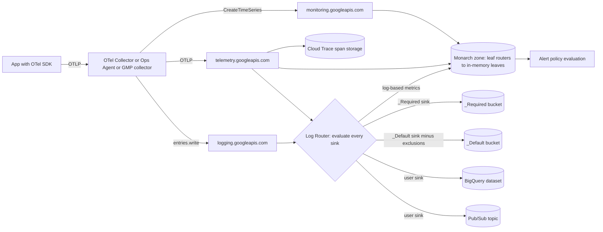

# Observability: Cloud Monitoring, Logging, and Trace

## TL;DR

- Cloud Monitoring runs on Monarch, an in-memory time-series database split into regions; it caps each time series at one point every 5 seconds and each write request at 200 time series, so you size the metric pipeline by number of series and write interval, not by raw event count (Google Cloud docs, as of 2026-10).
- Cloud Logging is a router first and a store second: the Log Router checks every incoming LogEntry against every sink on its own, so an exclusion on `_Default` cuts your storage bill but does not stop other sinks from exporting the same entry.
- A BigQuery log sink locks each table's schema to the first entry it receives, and later type changes get diverted into an error table, so routed logs are a schema-on-first-write contract that you have to govern.
- Cloud Trace charges $0.20 per million spans after 2.5 million free per billing account, so the sampling policy decides the cost; tail sampling in an OpenTelemetry Collector only works if every span of a trace reaches the same collector replica (Google Cloud pricing, as of 2026-10).
- The Telemetry API (`telemetry.googleapis.com`) accepts OTLP for traces, metrics, and logs, which lets you move the vendor boundary out of application code and into the Collector; AWS reaches the same place through ADOT and CloudWatch/X-Ray (Google Cloud docs, as of 2026-10).

## Mental Model



Think of Google Cloud Observability as three ingestion planes that share one collection tier and one identity model.
Metrics are pushed into Monarch, which keeps recent data in memory, shards it by monitored-resource ("target") key, and serves alerting from those in-memory leaves.
Logs pass through a stateless fan-out router.
That router copies each entry to zero or more destinations, and each destination has its own quota, schema, and billing.
Traces are spans stitched together by a propagated context header, and the sampling decision made at the first hop sets both visibility and cost.
The OpenTelemetry Collector is the deliberate seam between the two.
Applications speak OTLP to the Collector, and only the Collector knows whether the backend is Monarch, Cloud Trace, CloudWatch, or X-Ray.

## Internals

### Metrics data plane: Monarch

Monarch is described in [Adams et al., "Monarch: Google's Planet-Scale In-Memory Time Series Database", PVLDB 13(12):3181-3194, 2020](https://www.vldb.org/pvldb/vol13/p3181-adams.pdf).
The paper describes Monarch as a globally distributed, multi-tenant, in-memory time-series database.
It ingests terabytes of time-series data into memory every second and serves millions of queries.
It is built from regions ("zones"), with global query and configuration planes that join them into one system.
Managed Service for Prometheus says outright that it stores data in Cloud Monitoring storage, and Monarch is the backing store behind Cloud Monitoring.

**Data model.**
A time series is identified by a *target* plus a *metric*.
The target is a schema of key columns that name the monitored entity, for example a task identified by job, cluster, and task number.
The metric is a schema of key columns plus a typed value column (Monarch paper, 2020).
Cloud Monitoring exposes this as `MonitoredResource` (the target) plus `Metric` labels.
That is why `resource.type` and `resource.labels` are mandatory on every write: they are the sharding key, not decoration.

**Ingestion path.**
Clients send writes to a nearby ingestion router.
The router picks a zone from the target's location field.
A per-zone leaf router then forwards the write to the leaves that own the lexicographic *target range* containing that target.
A range assigner balances those ranges across leaves, and each range is held by several leaf replicas for availability.
Leaves keep data in memory and write recovery logs asynchronously, so losing a leaf costs a re-read of the logs, not lost acknowledged data.
This explains a limit that confuses many engineers.
Cloud Monitoring accepts only one point each 5 seconds per time series, while writes to *different* series have no such rate limit (Google Cloud docs, as of 2026-10).
The per-series limit protects the in-memory append path of one leaf replica set, while the aggregate rate scales out across target ranges.

**Collection aggregation (the mechanism getting-started guides skip).**
Monarch can aggregate at ingestion time.
For cumulative metrics, the leaf turns each incoming point into a delta against the previous point from the same series.
It adds that delta into an output bucket keyed by the *reduced* label set, for example "all tasks in job X" instead of "task 1234 of job X".
The leaf drops deltas that arrive after an admission window closes, so the bucket can be finalized and made visible for alerting.
The paper presents this as the way to store per-job aggregates without ever materializing millions of per-task series.
The trade-off is that late or out-of-order writes are silently excluded from the aggregate.
Two operational rules follow from this.
First, cumulative metrics need a stable `start_time`, because the start time is how the backend tells a counter reset (process restart) apart from a negative delta.
Second, a client that buffers points for minutes and flushes them late is not "delayed"; to the aggregate those points never happened.

**Query and index.**
Queries enter at a root Mixer, fan out to zone Mixers, and then to leaves.
Each zone also runs Index Servers that hold a *Field Hints Index*: short excerpts (trigram-like fingerprints) of field values, mapped to the leaves that might contain matching series.
Mixers use this index to skip leaves that cannot match a filter, which keeps fanout bounded as the fleet grows (Monarch paper, 2020).
Monarch chooses availability over consistency: a zone outage produces partial results instead of a failed query.
That is the right default for dashboards and a dangerous one for "absence of data" alerts, as covered in Failure Modes.

**Scale snapshot.**
The paper reports close to 950 billion stored time series using roughly 750 TB of memory, measured in 2019 (Monarch paper, 2020; figure not re-read this session, UNVERIFIED).

**Managed Service for Prometheus (GMP).**
GMP runs managed collectors on GKE nodes (or self-deployed Prometheus binaries), converts Prometheus samples to Monarch writes, and serves PromQL through a global query frontend.
It is billed per sample, not per byte (Google Cloud pricing, as of 2026-10).
Because Monarch is global, one PromQL query can span clusters and regions without a Thanos or Cortex layer.
The cost of that convenience is a fixed per-sample price you cannot reduce by running your own storage.

### Logs data plane: the Log Router

Every LogEntry that reaches a project, folder, organization, or billing account is evaluated by the Log Router.
The router does not move entries one sink after another.
It evaluates every sink's inclusion filter and exclusion filters on its own and copies the entry to every sink that matches.
Two system sinks exist per project: `_Required`, which captures Admin Activity, System Event, and Access Transparency audit logs and cannot be changed, and `_Default`, which captures everything else.
`_Required` retains for 400 days and `_Default` for 30 days by default (configurable) (UNVERIFIED this session).
Sinks are capped at 200 per project, and the same cap applies separately at folder, organization, and billing account level rather than being shared down the hierarchy (Google Cloud docs, as of 2026-10).
A LogEntry is capped at about 256 KiB of internal size, and audit log entries at 512 KiB; neither limit can be raised (Google Cloud docs, as of 2026-10).

**Aggregated sinks.**
A sink on a folder or organization with `includeChildren=true` receives entries from every descendant project.
This is the standard way to centralize audit logs into a security project.
With the *intercepting* option, an aggregated sink also stops matched entries from reaching child-project sinks other than `_Required` (intercepting sink GA status UNVERIFIED this session).

**Destinations and their failure semantics.**
Each destination enforces its own quota, and when a quota runs out the sink stops routing to that destination (Google Cloud docs, as of 2026-10).
Pub/Sub sinks are limited to 60 GB/min, and overflow produces a sink error log with `topic_over_quota` (Google Cloud docs, as of 2026-10).
BigQuery sinks are limited by the destination table's streaming insert quota, and exhaustion produces `table_resource_exhausted` (Google Cloud docs, as of 2026-10).
Sink errors are themselves written as log entries under `logging.googleapis.com/sink_error` with an `error_code` label.
This gives you a native alerting signal, and almost nobody wires it up.

**BigQuery routing: schema-on-first-write.**
Logging batches entries to BigQuery.
The first entry received for a table fixes the column types, and BigQuery builds the table's columns from that entry's fields (Google Cloud docs, as of 2026-10).
A later entry causes a schema mismatch if it changes a field's type (the documented example is `jsonPayload.user_id` going from string to array) or if adding a new field would exceed BigQuery's column limit.
On a mismatch, BigQuery creates an error table in the same dataset to hold the error information (Google Cloud docs, as of 2026-10).
Columns routed from Logging are limited to 13 levels of nesting (Google Cloud docs, as of 2026-10).
The consequence is that `jsonPayload` is a schema owned by whoever first emitted it.
A careless deploy that changes a field type does not break the build; it quietly splits your audit or analytics data into an error table.
With `--use-partitioned-tables`, each log goes into one time-partitioned table instead of daily `_YYYYMMDD` shards.
Partitioned tables are cheaper to query and easier to protect with partition-expiration policies.
The alternative to sink export is Log Analytics: you upgrade a log bucket and optionally create a linked BigQuery dataset that reads the bucket in place, which avoids duplicate storage at the cost of a read-only, Logging-defined schema (pricing and feature boundaries UNVERIFIED this session).

### Trace data plane: context propagation

Cloud Trace descends from Dapper ([Sigelman et al., "Dapper, a Large-Scale Distributed Systems Tracing Infrastructure", Google Technical Report, 2010](https://research.google/pubs/dapper-a-large-scale-distributed-systems-tracing-infrastructure/)).
Dapper established three ideas that still govern the cost model: ubiquitous low-overhead instrumentation in shared RPC libraries, out-of-band asynchronous span collection, and aggressive head sampling (the first production version sampled about 1 in 1024 traces).
A trace is a tree of spans that share a 128-bit trace ID, and each span names its parent span ID.
The tree only exists if every hop propagates context.

**Two header formats, one footgun.**
Google infrastructure historically used `X-Cloud-Trace-Context: TRACE_ID/SPAN_ID;o=OPTIONS`.
In that header, TRACE_ID is 32 hex characters, SPAN_ID is an unsigned 64-bit *decimal* integer, and `o=1` means sampled.
The W3C `traceparent` header is `00-<32 hex trace id>-<16 hex parent id>-<2 hex flags>` ([W3C Trace Context](https://www.w3.org/TR/trace-context/)).
A hand-written translator that copies the span ID across without converting decimal to hex produces parent IDs that point at nothing.
The trace then splits into orphan fragments that look like a sampling problem (header format details not re-verified this session, UNVERIFIED).
The fix is never to hand-roll it: configure the OpenTelemetry composite propagator with W3C `tracecontext` plus the Google Cloud propagator (`opentelemetry-propagator-gcp` in Python) at the ingress boundary, and emit only W3C internally.

**Asynchronous hops.**
HTTP and gRPC propagate context in headers.
Pub/Sub, Cloud Tasks, and batch jobs only propagate it if you put it into message attributes and extract it on the consumer side.
For fan-in consumers that batch many messages, the correct model is span *links*, not parent-child, because one consumer span has many causal parents.

**Sampling and cost.**
The span ingestion price is linear in spans.
A head-based sampler decides at the root and propagates the decision in the flags byte, so downstream services stay consistent at no coordination cost.
Its weakness is that it is blind to errors and latency that happen later in the request.
Tail-based sampling in the Collector buffers whole traces and decides after the fact, which costs Collector memory.
It also forces the trace-ID-affinity routing described in the Worked Example.

### OpenTelemetry exporters and the Telemetry API

The Telemetry API implements OTLP and is meant for applications instrumented with OpenTelemetry SDKs or any OpenTelemetry Collector.
It exposes `v1.traces`, `v1.metrics`, and `v1.logs` surfaces (Google Cloud docs, as of 2026-10).
Google recommends exporting OTLP to a Collector, which then sends to the Telemetry API, and configuring only the root URL in the exporter (Google Cloud docs, as of 2026-10).
The Google-Built OpenTelemetry Collector is Google's build of upstream components on a secure supply chain.
It adds Google Cloud resource metadata so that application telemetry can be correlated with infrastructure telemetry (Google Cloud docs, as of 2026-10).
The Ops Agent can also be switched to send logs, metrics, and traces through the Telemetry API instead of the proprietary Monitoring, Logging, and Trace APIs (Google Cloud docs, as of 2026-10).
Per-signal GA versus Preview status of the Telemetry API changes often, so confirm it on the overview page before relying on it in production (UNVERIFIED this session).
Older exporters still exist: `googlecloud` and `googlemanagedprometheus` in collector-contrib, and per-language `opentelemetry-exporter-gcp-trace` and `opentelemetry-exporter-gcp-monitoring`.
These write to the proprietary APIs and remain valid where OTLP is not yet supported for a signal.

### Control plane versus data plane

The control plane covers metric descriptors, alert policies, uptime checks, sinks, log buckets, exclusions, and log-based metric definitions.
It changes rarely and is propagated asynchronously.
For example, a new sink is not effective instantly, and entries written in the first moments after creation may not be routed (propagation delay UNVERIFIED this session).
The data plane covers point writes, log writes, and span writes, and it must keep running while the control plane is impaired.
This is the static-stability discipline from [[17-Cloud-AI-Engineering/Volume_01_Cloud_Architecture_Principles/Chapter_04_Control_Plane_vs_Data_Plane_Separation|Control Plane vs Data Plane Separation]].
In practice: create descriptors, sinks, and alert policies through IaC ahead of time, never lazily on the hot path.
A service that auto-creates its metric descriptor at startup takes a control-plane dependency during scale-out, exactly when the control plane is most likely to be busy.

## Numbers to Know

| Quantity | Value | Source |
| --- | --- | --- |
| Max write rate to one time series | 1 point each 5 seconds | (Google Cloud docs, as of 2026-10) |
| Time series per `CreateTimeSeries` request | 200 (one point per series per request) | (Google Cloud docs, as of 2026-10) |
| Custom metric descriptors per project | 10,000 | (Google Cloud docs, as of 2026-10) |
| Workload, Prometheus, external metric descriptors per project | 25,000 | (Google Cloud docs, as of 2026-10) |
| Labels per custom metric descriptor / per Prometheus descriptor | 30 / 200 | (Google Cloud docs, as of 2026-10) |
| Label value length | 1,024 chars | (Google Cloud docs, as of 2026-10) |
| Histogram buckets per custom distribution | 200 | (Google Cloud docs, as of 2026-10) |
| Active custom-metric series per monitored resource | 200,000 | (Google Cloud docs, as of 2026-10) |
| Monitoring ingestion (byte-billed) | $0.2580/MiB to 100,000 MiB; $0.1510/MiB to 250,000 MiB; $0.0610/MiB above; first 150 MiB per billing account free | (Google Cloud pricing, as of 2026-10) |
| GMP ingestion (sample-billed) | $0.060/M samples to 50B; $0.048/M to 250B; $0.036/M to 500B; $0.024/M above | (Google Cloud pricing, as of 2026-10) |
| Monitoring API reads | $0.50 per million time series returned; first 1M free; writes free; effective 2025-10-02 | (Google Cloud pricing, as of 2026-10) |
| Bytes billed per scalar point | 8 bytes (distributions more) | UNVERIFIED |
| LogEntry max size / audit entry max size | ~256 KiB / 512 KiB | (Google Cloud docs, as of 2026-10) |
| Labels per LogEntry; label key; label value | 64; 512 B; 64 KiB | (Google Cloud docs, as of 2026-10) |
| Sinks per project (also separately per folder, org, billing account) | 200 | (Google Cloud docs, as of 2026-10) |
| Pub/Sub sink export rate | 60 GB/min, overflow logs `topic_over_quota` | (Google Cloud docs, as of 2026-10) |
| BigQuery sink rate | per-table streaming insert quota, overflow logs `table_resource_exhausted` | (Google Cloud docs, as of 2026-10) |
| Max nested depth of a routed BigQuery column | 13 levels | (Google Cloud docs, as of 2026-10) |
| Logging ingestion price | $0.50/GiB; first 50 GiB per project per month free; 30 days storage included | (Google Cloud pricing as summarized by third parties, as of 2026-10) |
| Logging retention beyond default | $0.01/GiB/month | UNVERIFIED |
| `_Required` / `_Default` retention | 400 days fixed / 30 days default | UNVERIFIED |
| Cloud Trace ingestion | $0.20 per million spans; first 2.5M spans per billing account free | (Google Cloud pricing, as of 2026-10) |
| Dapper original sampling rate | ~1/1024 | (Dapper tech report, 2010) |
| Monarch scale snapshot | ~950B series, ~750 TB RAM (2019) | UNVERIFIED |

## AWS vs GCP Mechanism Parity

| Concern | Google Cloud | AWS | Critical difference |
| --- | --- | --- | --- |
| Metric store | Monarch, published architecture (VLDB 2020), global query plane | CloudWatch Metrics, no peer-reviewed architecture paper | GCP lets one query span regions; CloudWatch is regional, and cross-account views go through Observability Access Manager |
| Metric write unit | `CreateTimeSeries`, 200 series per call, 1 point per 5 s per series | `PutMetricData`, standard and 1-second high-resolution metrics | CloudWatch bills per metric per month plus API calls (UNVERIFIED pricing); GCP bills bytes or samples and writes are free |
| Prometheus | Managed Service for Prometheus on Monarch, billed per sample | Amazon Managed Service for Prometheus, Cortex-derived, billed per sample plus storage and query (UNVERIFIED) | GMP has no separate per-workspace storage bill |
| Structured metric from logs | Log-based metrics (counter or distribution) | CloudWatch metric filters and Embedded Metric Format | EMF turns one log write into a metric without a filter, see [[17-Cloud-AI-Engineering/Volume_02_AWS_Deep_Dive/Chapter_14_Observability_CloudWatch_Metrics_Logs_and_X_Ray\|CloudWatch chapter]] |
| Log routing | Log Router, up to 200 sinks per resource, filters checked independently, aggregated org sinks | Log groups with subscription filters (small fixed number per log group, UNVERIFIED), Firehose, centralized via cross-account destinations | GCP fan-out happens at the router; AWS fan-out happens per log group |
| Log analytics | BigQuery sink or Log Analytics linked dataset | CloudWatch Logs Insights, or Firehose to S3 plus Athena | BigQuery sink schema is frozen by the first entry; Athena on S3 is schema-on-read |
| Trace backend | Cloud Trace, $0.20 per million spans | X-Ray, priced per trace recorded and scanned (UNVERIFIED); CloudWatch Transaction Search stores spans as logs (UNVERIFIED) | Span pricing versus trace pricing changes which sampling strategy is optimal |
| Native trace header | `X-Cloud-Trace-Context` (decimal span ID) and W3C `traceparent` | `X-Amzn-Trace-Id: Root=1-<epoch hex>-<96-bit hex>;Parent=...;Sampled=1` | X-Ray trace IDs embed a timestamp; converting to W3C requires the X-Ray ID generator in OTel |
| OTel distribution | Google-Built OpenTelemetry Collector, Telemetry API (OTLP) | AWS Distro for OpenTelemetry (ADOT) | GCP accepts native OTLP at a Google endpoint; check current AWS OTLP endpoint support per signal (UNVERIFIED) |
| Host agent | Ops Agent (Fluent Bit for logs, OTel Collector for metrics) | CloudWatch agent | Both run with instance identity; neither should hold static keys |
| Perimeter | VPC Service Controls around `logging`, `monitoring`, `cloudtrace` APIs | VPC interface endpoints plus endpoint policies | VPC-SC blocks API-level data exfiltration; endpoint policies constrain only traffic that goes through the endpoint |

## Worked Example: Route GPU-fleet logs to BigQuery, emit rate-safe custom metrics, and export OTLP traces

### Cost estimate for the lab

The lab writes about 400 series x 1 point per 10 s x 600 s = 24,000 points.
At 8 bytes per point (UNVERIFIED) that is about 0.2 MB, far below the 150 MiB free monthly allotment, so it costs $0.
It writes a few hundred log entries (well under 1 MiB), far below the 50 GiB per-project free tier, so it costs $0.
BigQuery storage and query for a few KB is effectively $0, under the BigQuery free tier (UNVERIFIED this session).
Expected total: under $1, with a budget alarm at $10 as a guardrail.

### Step 0: budget alarm and environment

```bash
#!/usr/bin/env bash
set -euo pipefail
export PROJECT_ID="your-lab-project"
export BILLING_ACCOUNT="000000-000000-000000"
export DATASET="obs_lab"
export SINK="obs-lab-bq"
gcloud config set project "$PROJECT_ID"
gcloud services enable logging.googleapis.com monitoring.googleapis.com \
  cloudtrace.googleapis.com telemetry.googleapis.com bigquery.googleapis.com \
  billingbudgets.googleapis.com
gcloud billing budgets create \
  --billing-account="$BILLING_ACCOUNT" \
  --display-name="obs-lab-guardrail" \
  --budget-amount=10USD \
  --threshold-rule=percent=0.5 \
  --threshold-rule=percent=0.9 \
  --threshold-rule=percent=1.0
```

### Step 1: BigQuery sink with partitioned tables and a deliberate schema mismatch

```bash
#!/usr/bin/env bash
set -euo pipefail
bq --location=US mk --dataset "${PROJECT_ID}:${DATASET}"
gcloud logging sinks create "$SINK" \
  "bigquery.googleapis.com/projects/${PROJECT_ID}/datasets/${DATASET}" \
  --log-filter='logName="projects/'"${PROJECT_ID}"'/logs/obs-lab"' \
  --use-partitioned-tables
WRITER=$(gcloud logging sinks describe "$SINK" --format='value(writerIdentity)')
# Lab shortcut: project-level grant. In production grant at dataset level only.
gcloud projects add-iam-policy-binding "$PROJECT_ID" \
  --member="$WRITER" --role="roles/bigquery.dataEditor" --condition=None
sleep 120  # allow sink configuration to propagate before writing
for i in $(seq 1 20); do
  gcloud logging write obs-lab \
    "{\"node\":\"gpu-node-$i\",\"user_id\":\"u$i\",\"xid\":0,\"hbm_used_gib\":61.5}" \
    --payload-type=json --severity=INFO
done
# Same field, new type: string -> array. This triggers the documented schema mismatch.
gcloud logging write obs-lab '{"node":"gpu-node-99","user_id":["a","b"]}' \
  --payload-type=json --severity=WARNING
sleep 180
bq ls "${PROJECT_ID}:${DATASET}"   # expect obs_lab plus an error table for the mismatch
bq query --use_legacy_sql=false \
  "SELECT timestamp, jsonPayload.node, jsonPayload.user_id
   FROM \`${PROJECT_ID}.${DATASET}.obs_lab\`
   WHERE DATE(timestamp) = CURRENT_DATE() LIMIT 25"
```

After the run, notice that the array-typed entry is missing from `obs_lab`; this is the mechanism described in Internals, now visible in your own dataset.

### Step 2: cut `_Default` storage without touching the sink

```bash
gcloud logging sinks update _Default \
  --add-exclusion=name=obs-lab-drop-info,filter='logName="projects/'"${PROJECT_ID}"'/logs/obs-lab" AND severity<=INFO'
```

The BigQuery sink keeps receiving INFO entries, because the exclusion belongs to `_Default` alone.

### Step 3: rate-safe custom metric writer (Python, `google-cloud-monitoring`)

```python
#!/usr/bin/env python3
"""Write simulated per-GPU HBM gauges within Cloud Monitoring write limits.

Limits honored: 200 series per CreateTimeSeries call, >= 5 s between points per series.
"""
import os
import random
import time

from google.api import label_pb2, metric_pb2
from google.cloud import monitoring_v3

PROJECT = os.environ["PROJECT_ID"]
METRIC = "custom.googleapis.com/obs_lab/gpu_hbm_used_bytes"
NODES, GPUS_PER_NODE = 50, 8
BATCH = 200
INTERVAL_S = 10
ROUNDS = int(os.environ.get("ROUNDS", "60"))

client = monitoring_v3.MetricServiceClient()
project_name = f"projects/{PROJECT}"


def ensure_descriptor() -> None:
    d = metric_pb2.MetricDescriptor()
    d.type = METRIC
    d.metric_kind = metric_pb2.MetricDescriptor.MetricKind.GAUGE
    d.value_type = metric_pb2.MetricDescriptor.ValueType.INT64
    d.unit = "By"
    d.description = "Lab: simulated HBM bytes in use per GPU."
    for key in ("node", "gpu"):
        d.labels.append(label_pb2.LabelDescriptor(
            key=key, value_type=label_pb2.LabelDescriptor.ValueType.STRING))
    client.create_metric_descriptor(name=project_name, metric_descriptor=d)


def make_series(node: str, gpu: int, value: int, now: float) -> monitoring_v3.TimeSeries:
    s = monitoring_v3.TimeSeries()
    s.metric.type = METRIC
    s.metric.labels["node"] = node
    s.metric.labels["gpu"] = str(gpu)
    s.resource.type = "global"
    s.resource.labels["project_id"] = PROJECT
    secs = int(now)
    interval = monitoring_v3.TimeInterval(
        {"end_time": {"seconds": secs, "nanos": int((now - secs) * 1e9)}})
    s.points = [monitoring_v3.Point({"interval": interval, "value": {"int64_value": value}})]
    return s


def main() -> None:
    ensure_descriptor()  # control-plane call done once, never on the hot path in production
    for _ in range(ROUNDS):
        started = time.time()
        series = [make_series(f"gpu-node-{n}", g, random.randint(40, 80) * 2**30, started)
                  for n in range(NODES) for g in range(GPUS_PER_NODE)]
        for i in range(0, len(series), BATCH):
            client.create_time_series(name=project_name, time_series=series[i:i + BATCH])
        time.sleep(max(0.0, INTERVAL_S - (time.time() - started)))


if __name__ == "__main__":
    main()
```

Run it with `pip install google-cloud-monitoring && PROJECT_ID=$PROJECT_ID python3 write_metrics.py`.
A useful exercise: drop `INTERVAL_S` to 2 and watch `create_time_series` return `INVALID_ARGUMENT` errors about writing points too frequently.
Those errors are the per-series limit, not a project quota.

### Step 4: OTel Collector exporting traces over OTLP to the Telemetry API with tail sampling

```yaml
extensions:
  googleclientauth:
receivers:
  otlp:
    protocols:
      grpc:
      http:
processors:
  resourcedetection:
    detectors: [gcp]
  resource:
    attributes:
      - key: gcp.project_id
        value: ${env:PROJECT_ID}
        action: insert
  tail_sampling:
    decision_wait: 10s
    num_traces: 100000
    policies:
      - name: keep-errors
        type: status_code
        status_code: {status_codes: [ERROR]}
      - name: keep-slow
        type: latency
        latency: {threshold_ms: 2000}
      - name: baseline
        type: probabilistic
        probabilistic: {sampling_percentage: 1}
  batch:
exporters:
  otlphttp:
    encoding: proto
    endpoint: https://telemetry.googleapis.com
    auth:
      authenticator: googleclientauth
service:
  extensions: [googleclientauth]
  pipelines:
    traces:
      receivers: [otlp]
      processors: [resourcedetection, resource, tail_sampling, batch]
      exporters: [otlphttp]
```

With more than one Collector replica, put a first tier that uses the `loadbalancing` exporter keyed on `traceID` in front of this tier.
Without it, spans of one trace land on different replicas, and each replica makes its own incomplete sampling decision.

### Capacity and cost sizing: a 2,000-node GPU training fleet

Assumptions: 2,000 nodes, 500 Prometheus series per node (DCGM exporter plus node exporter), 2 GiB/day of logs per node, and an inference tier at 5,000 RPS with 8 spans per request.
A 30-day month has 2,592,000 seconds.

1. Metrics through GMP at a 30 s scrape interval: 2,000 x 500 x 2,592,000 / 30 = 86.4B samples per month.
2. GMP cost: the first 50B at $0.060/M is $3,000, and the next 36.4B at $0.048/M is $1,747.20, so the total is $4,747.20 per month (Google Cloud pricing, as of 2026-10).
3. At a 15 s interval, samples double to 172.8B and cost rises to $8,894.40; at 60 s, samples fall to 43.2B and cost falls to $2,592.00.
   Scrape interval is the strongest single lever on metrics cost.
4. The same 1M series written as byte-billed custom metrics at 60 s would be 1M x 43,200 x 8 B, about 330 GiB, so stay on GMP for Prometheus-shaped data (8 B/point UNVERIFIED).
5. Logs: 2,000 x 2 GiB x 30 = 120,000 GiB, so (120,000 - 50) x $0.50 = $59,975 per month in a single project.
6. An exclusion that drops 70 percent of the volume (INFO and DEBUG from training loops) brings this to (36,000 - 50) x $0.50 = $17,975.
   Route the excluded volume to a Cloud Storage sink if compliance needs it.
7. Traces: 5,000 x 8 x 2,592,000 = 103.68B spans, so about $20,735 per month unsampled; at a 1 percent baseline it is about $207 plus the error and slow traces that tail sampling keeps.
8. The conclusion is that logs, not metrics or traces, dominate observability spend in an AI fleet.
   Spend your design effort on log severity discipline and exclusion policy first, as covered in [[17-Cloud-AI-Engineering/Volume_09_FinOps_and_Cloud_Economics/Chapter_01_Cloud_Billing_Models_and_Unit_Cost_Allocation|Cloud Billing Models and Unit Cost Allocation]].

### Teardown

```bash
#!/usr/bin/env bash
set -euo pipefail
gcloud logging sinks delete "$SINK" --quiet
gcloud logging sinks update _Default --remove-exclusions=obs-lab-drop-info
bq rm -r -f -d "${PROJECT_ID}:${DATASET}"
WRITER_SA=$(echo "$WRITER" | sed 's/^serviceAccount://')
gcloud projects remove-iam-policy-binding "$PROJECT_ID" \
  --member="serviceAccount:${WRITER_SA}" --role="roles/bigquery.dataEditor" --condition=None || true
python3 -c "from google.cloud import monitoring_v3 as m; import os; \
m.MetricServiceClient().delete_metric_descriptor(name='projects/'+os.environ['PROJECT_ID']+'/metricDescriptors/custom.googleapis.com/obs_lab/gpu_hbm_used_bytes')"
# Delete the budget after confirming spend: gcloud billing budgets list --billing-account="$BILLING_ACCOUNT"
```

## Failure Modes and Pitfalls

**Observability shares fate with the outage.**
In the [AWS Kinesis event of November 25, 2020](https://aws.amazon.com/message/11201/), CloudWatch depended on Kinesis for metrics and logs.
Metric delays then degraded systems that consumed those metrics, including autoscaling and alarm-driven automation.
In the [AWS us-east-1 event of December 7, 2021](https://aws.amazon.com/message/12721/), congestion on the internal network impaired the monitoring data operators needed to diagnose the congestion itself.
Google's June 12, 2025 incident was triggered by a Service Control change that crashed on a policy with blank fields.
It shows that the shared API-admission layer in front of every Google API, including Monitoring and Logging writes, is a common dependency ([Google Cloud incident report](https://status.cloud.google.com/incidents/ow5i3PPK96RduMcb1SsW), URL not re-verified this session).
Mitigation: keep an out-of-band meta-monitor, such as uptime checks from another provider or a dead-man's-switch heartbeat whose *absence* pages someone through a separate path.
See [[17-Cloud-AI-Engineering/Volume_07_Reliability_and_SRE/Chapter_07_Anatomy_of_Major_Cloud_Outages|Anatomy of Major Cloud Outages]].

**Absence alerts on a partial-result store.**
Monarch returns partial results instead of failing when a zone is unhealthy.
A "metric absent for 5 minutes" policy can fire for every target in an affected zone, and a threshold policy can quietly evaluate on incomplete data.
Pair absence alerts with a zone-health signal, and prefer SLO burn-rate alerts that need sustained evidence across multiple windows ([[17-Cloud-AI-Engineering/Volume_07_Reliability_and_SRE/Chapter_01_SLIs_SLOs_and_Error_Budget_Engineering|SLIs, SLOs, and Error Budget Engineering]]).

**Ingestion delay mistaken for an outage.**
Many built-in Google Cloud metrics are documented with a 60 s sampling period followed by a visibility delay of up to a few minutes (exact per-metric delay UNVERIFIED this session).
An alert with a 1-minute alignment window and no retest duration flaps on that delay.
Size `duration` and alignment to be at least the documented visibility delay of the metric.

**Cardinality explosion.**
Putting request IDs, user IDs, or pod UIDs into metric labels creates unbounded series.
You hit the 200,000 active series per monitored resource ceiling for custom metrics, and on GMP the bill grows linearly with samples (Google Cloud docs, as of 2026-10).
Labels must be bounded enums; unbounded identifiers belong in logs or span attributes.

**Write-rate violations from naive exporters.**
Two exporter replicas writing the same series (same resource and labels) collide on the one-point-per-5-seconds limit.
This shows up as intermittent `INVALID_ARGUMENT` errors and gaps in the data.
The cause is usually a Deployment scaled to 2 that both scrape the same target, or a missing unique label such as `instance_id`.

**Counter resets and start times.**
A cumulative metric written without a stable `start_time`, or with a start time that moves on every write, makes the backend misread restarts and produces negative or spiky rates.
In GPU training, process restarts after each checkpoint resume are routine, so this bug is endemic in fleets that hand-roll exporters.

**Silent schema split in BigQuery sinks.**
A field type change produces an error table, not a failed write, and dashboards built on the main table under-count with no warning (Google Cloud docs, as of 2026-10).
Alert on the existence and growth of mismatch tables, and on `sink_error` log entries.

**Sink quota exhaustion stops routing.**
When a Pub/Sub topic or a BigQuery table hits its quota, the sink stops routing and emits `topic_over_quota` or `table_resource_exhausted` (Google Cloud docs, as of 2026-10).
A log-volume burst during an incident can therefore blind the SIEM at the moment it matters most.
Use partitioned tables, split hot logs into separate sinks, and alert on `sink_error`.

**Exclusions that remove what metrics need.**
Teams exclude verbose logs from `_Default` and assume log-based metrics are unaffected, or the reverse.
Test the documented interaction between exclusions and user-defined log-based metrics before you rely on either (behavior UNVERIFIED this session).

**Broken traces at async boundaries.**
Pub/Sub, Cloud Tasks, and batch hand-offs drop context unless it is injected into message attributes.
Decimal-to-hex errors when translating between `X-Cloud-Trace-Context` and `traceparent` produce orphan spans.

**Tail sampling without affinity.**
Spreading spans across Collector replicas without trace-ID-keyed load balancing produces fragmentary traces and a sampling rate that does not match the configured policy.

**Data Access audit logs as a cost bomb.**
Turning on Data Access audit logs org-wide for high-QPS services such as Cloud Storage can multiply log ingestion several times over.
Enable them per service and per project, deliberately.

## Security and Cost Angles

**IAM scoping.**
Writers need only `roles/monitoring.metricWriter`, `roles/logging.logWriter`, and `roles/cloudtrace.agent`.
The Telemetry API may need dedicated telemetry writer roles (role names UNVERIFIED this session).
Collectors should authenticate through GKE Workload Identity Federation or the instance service account, never through exported keys ([[17-Cloud-AI-Engineering/Volume_08_Security_Identity_and_the_Data_Perimeter/Chapter_02_Workload_Identity_Federation|Workload Identity Federation]]).
Each sink gets a writer identity, a Google-managed service account.
Grant it the narrowest destination role: `roles/bigquery.dataEditor` on the dataset, `roles/pubsub.publisher` on the topic, or `roles/storage.objectCreator` on the bucket.
Readers of logs are separated by log views on buckets, and `roles/logging.privateLogViewer` is needed for Data Access logs.
Treat it as a privileged role, because Data Access logs contain request payload metadata.

**Encryption hierarchy.**
Log buckets support CMEK, and you can set org-level default CMEK settings for the Log Router.
That puts log data under the key hierarchy described in [[17-Cloud-AI-Engineering/Volume_03_GCP_Deep_Dive/Chapter_15_Security_and_Confidential_Computing_Cloud_KMS|Security and Confidential Computing: Cloud KMS]].
The operational trade-off: if the KMS key is disabled or the Logging service agent loses `cloudkms.cryptoKeyEncrypterDecrypter`, writes to that bucket fail.
You have then turned a key-management mistake into an observability outage.
BigQuery destinations carry their own CMEK configuration, separate from the log bucket.

**Perimeters.**
Put `logging.googleapis.com`, `monitoring.googleapis.com`, and `cloudtrace.googleapis.com` inside VPC Service Controls perimeters, together with the BigQuery and Pub/Sub sink destinations.
A sink whose destination sits outside the perimeter needs an explicit egress rule; without one, the sink fails as the perimeter intends ([[17-Cloud-AI-Engineering/Volume_03_GCP_Deep_Dive/Chapter_03_VPC_Service_Controls_Security_Perimeters|VPC Service Controls]]).
Collectors without external IPs reach the APIs through Private Google Access or Private Service Connect for Google APIs.

**Data minimization.**
Prompts and completions from LLM services must not land in `jsonPayload` or span attributes by default.
Redact in the Collector with an attributes or transform processor before export, because once data is in a log bucket, retention and access controls are the only remaining defense.

**Unit-economics levers, in order of impact for AI fleets:**
1. Log severity discipline plus `_Default` exclusions, with excluded-but-required logs sent to Cloud Storage.
2. Scrape interval and metric allow-lists on GMP; per-sample pricing is linear in both.
3. Tail sampling with a small probabilistic baseline for traces.
4. Byte-billed custom metrics only for low-cardinality business signals.
5. Partition expiration on BigQuery sink tables.
6. Monitoring API read charges since 2025-10-02: $0.50 per million series returned beyond the first million.
   This penalizes Grafana dashboards that auto-refresh wide queries, so lengthen refresh intervals and pre-aggregate (Google Cloud pricing, as of 2026-10).

## Interview Questions and Model Answers

### Question 1 (L5 - Senior)

You must publish per-GPU utilization and HBM usage from 4,000 GPUs to Cloud Monitoring.
Design the metric schema and the write path, and explain which limits shape the design.

#### Model Answer

Start from the data model.
The monitored resource should identify the host (`gce_instance` or `k8s_node`), and metric labels should be a small bounded set: `gpu_index` (0-7) and possibly `model`.
Never include job IDs or pod UIDs, because those make cardinality unbounded.
Utilization is a GAUGE of type DOUBLE; for cumulative quantities such as ECC errors or NVLink bytes, use CUMULATIVE INT64 with a stable process `start_time`, so restarts are detected as resets and not as negative deltas.
The 4,000 GPUs times 2 metrics is 8,000 series.
The per-series limit of one point each 5 seconds sets the finest resolution you can use; I would pick 10 to 30 seconds.
The 200-series-per-request limit means an exporter that writes for a whole node only ever sends one request per interval, so request count is never a concern.
I would use DCGM exporter plus GMP rather than byte-billed custom metrics, because the data is Prometheus-shaped and is billed per sample.
At 30 s that is 8,000 x 86,400 = about 0.7B samples per month, roughly $41.
The main correctness risk is duplicate writers producing the same series.
I would make sure each node has exactly one collector and that every series carries a unique resource identity.

#### Follow-up Interviewer Question

The training team wants a per-job utilization rollup across 512 GPUs, and jobs come and go hourly.
Where do you compute it, and what happens to late points?

### Question 2 (L5 - Senior)

Security wants all Admin Activity and Data Access audit logs from 300 projects in one BigQuery dataset, retained for 3 years.
Walk through the design.

#### Model Answer

Create one aggregated sink at the organization (or the relevant folder) with `includeChildren`.
Filter on `logName:"cloudaudit.googleapis.com"` and point it at a BigQuery dataset in a dedicated security project, with `--use-partitioned-tables` so each audit log type is a single time-partitioned table.
Grant the sink's writer identity `roles/bigquery.dataEditor` on that dataset only.
Set a partition expiration of about 1,095 days and protect the dataset with CMEK and an org policy that blocks deletion by non-security principals.
Use a single sink, not 300 project sinks, because of the 200-sinks-per-resource limit, and because one sink lets drift detection reason about a single resource.
Two failure modes matter.
First, the table schema is fixed by the first entry, and audit `protoPayload` shapes differ by service, so watch for mismatch error tables.
Second, the BigQuery sink is bound by the table streaming quota, so a burst of Data Access logs can produce `table_resource_exhausted` and stop routing.
I would alert on `sink_error` entries in the security project.
I would also keep a Cloud Storage sink for the same filter as an immutable, cheap second copy with a retention lock, because BigQuery is the query surface, not the system of record.

#### Follow-up Interviewer Question

A team in one child project creates its own sink exporting the same audit logs to an external bucket.
How do you stop that without breaking their other routing?

### Question 3 (L6 - Staff)

Your AI platform's observability bill is $90k per month, and leadership wants it cut by 60 percent without losing incident-response capability.
How do you approach it?

#### Model Answer

First, attribute the bill before changing anything.
Break ingestion down by log name and severity from Logging's usage metrics, by GMP metric name and namespace from Monitoring's own ingestion metrics, and by service for spans.
In GPU fleets, logs typically dominate.
For example, 2,000 nodes at 2 GiB/day is about $60k per month at $0.50/GiB.
The levers, in order:
(1) Severity policy plus `_Default` exclusions for INFO and DEBUG from training loops, with a Cloud Storage sink for anything compliance needs, because exclusions affect only that bucket's ingestion and not other sinks.
A 70 percent reduction moves $60k to about $18k.
(2) Raise the GMP scrape interval from 15 to 30 s for non-SLO metrics and allow-list DCGM fields.
Samples, and therefore cost, halve with the interval.
(3) Tail sampling for traces with error and latency policies plus a 1 percent baseline, which turns a five-figure span bill into a few hundred dollars.
It needs trace-ID-affine load balancing across Collector replicas.
(4) Cut dashboard read volume now that Monitoring reads are billed per series returned.
The guardrail on all of this is to define, with the on-call team, the signals needed for the top ten incident types, and to verify in a game day that those signals survive the cuts.
Cost reduction that breaks diagnosis is just deferred outage cost.
I would put the changes behind flags in the Collector config and roll them out progressively, with an ingestion-volume SLO per team.

#### Follow-up Interviewer Question

Six weeks later an incident takes three extra hours because the needed DEBUG log was excluded.
How do you redesign so you can raise verbosity on demand without paying for it all the time?

### Question 4 (L6 - Staff)

Traces from your inference gateway show the GFE span and the gateway span, but the model-server spans appear as separate root traces about 30 percent of the time.
Diagnose it.

#### Model Answer

Thirty percent orphaning is a propagation fault, not a sampling fault.
Sampling would drop whole traces consistently, not cut them in the middle.
I would check three mechanisms.
First, header format mismatch.
The edge may inject `X-Cloud-Trace-Context`, whose span ID is decimal, while the services use W3C `traceparent` with hex IDs.
If any hop translates by hand or runs a propagator that reads only one format, the parent ID refers to a span that does not exist.
The fix is a composite propagator (W3C plus Google Cloud) at ingress and only W3C internally.
Second, async hops.
If 30 percent of requests take a queue path, such as Pub/Sub for long generations, context is lost unless it is injected into message attributes and extracted on consume.
For batched consumers, use span links.
Third, Collector topology.
If tail sampling runs across replicas without trace-ID routing, different replicas keep different fragments of the same trace, which matches a fractional orphan rate.
To tell them apart, group orphans by the attributes of their first span (route, transport, Collector pod).
If they cluster by transport it is async propagation; if they cluster by Collector replica it is affinity; if they cluster by language runtime it is the propagator configuration.

#### Follow-up Interviewer Question

The model server batches 64 requests into one forward pass.
How do you represent that in traces so that per-request latency attribution is still correct?

### Question 5 (L6 - Staff)

How do you make alerting for a multi-region inference service resilient to an impairment of Cloud Monitoring itself?

#### Model Answer

Monarch is regionalized, with leaves and evaluation in zones and a global query plane, and it favors availability by returning partial results.
That limits the blast radius but does not remove the shared dependency.
The shared API admission layer and the Monitoring API frontends are common-mode failure points, as the June 2025 Google Cloud incident showed.
I would layer it.
(1) Primary alerting stays in Cloud Monitoring, using multi-window burn-rate SLO policies, because they tolerate short data gaps better than single-threshold alerts.
(2) Absence alerts are combined with a zone-health signal, so a partial-result zone does not page every service owner.
(3) An independent meta-monitor sits outside Google Cloud: external synthetic probes of the public inference endpoint, plus a heartbeat (dead-man's switch) that Cloud Monitoring sends every minute to a third-party pager, so that *silence* pages.
(4) Each serving cell keeps local static stability: autoscaling and admission control use in-process signals (queue depth, KV-cache occupancy) and do not need metrics to round-trip through Monitoring.
That way an observability outage never becomes a capacity outage, which was the lesson of the AWS Kinesis event, where metric delays degraded autoscaling.
The trade-off is the cost and complexity of a second paging path, which I justify by measuring time to detect in game days with Monitoring blackholed.

#### Follow-up Interviewer Question

The external probe and Cloud Monitoring disagree during an incident.
Which wins for automated rollback decisions, and why?

### Question 6 (L7+ - Principal)

Design an org-wide observability architecture for a company running training on GCP TPUs and GPUs and inference on both AWS and GCP.
It must meet data-residency requirements (EU data stays in the EU), CMEK, and a single on-call experience.

#### Model Answer

The principle: make OpenTelemetry the contract and each cloud's native backend the regional store, and do not centralize raw telemetry across clouds or jurisdictions.
Applications emit OTLP only.
A per-cluster Collector tier, the Google-Built Collector on GCP and ADOT on AWS, does resource detection, redaction (prompts and PII stripped before export), tail sampling with trace-ID affinity, and routing.
On GCP, EU workloads export to the Telemetry API and Monitoring in EU-located projects.
Logs land in EU-region log buckets with CMEK, and org-level default storage location and CMEK settings ensure new projects inherit compliance.
Aggregated sinks route audit logs to an EU security project, inside a VPC-SC perimeter that includes Logging, Monitoring, Trace, BigQuery, and Pub/Sub.
On AWS, the equivalent is regional CloudWatch and X-Ray in EU regions, with cross-account observability links rather than copies.
The unified on-call experience comes from federation at query time, not replication.
Use a Grafana layer that queries GMP's PromQL endpoint and Amazon Managed Prometheus, and SLOs defined once in a declarative spec and compiled into each backend's alert policies.
Then paging does not depend on cross-cloud data movement, which would also add egress cost and residency risk ([[17-Cloud-AI-Engineering/Volume_04_AWS_vs_GCP_Translation/Chapter_07_Multi_Cloud_and_Hybrid_Architecture_Reality|Multi-Cloud and Hybrid Architecture Reality]]).
Trace IDs must survive cross-cloud calls, so standardize on W3C context and configure X-Ray-compatible ID generation in the AWS SDKs, so that the same trace ID is valid in both backends.
Key risks:
- CMEK key disablement becomes an observability outage, so key-access alerts go through the out-of-band path.
- BigQuery sink schemas drift, so field types are governed through a logging schema registry enforced in CI.
- Cost is dominated by logs, so every team has an ingestion budget, enforced through exclusions owned by the platform team.
I would accept that cross-cloud trace search is slower (two queries joined by trace ID) in exchange for residency compliance and independent failure domains.

#### Follow-up Interviewer Question

A regulator asks you to prove that no EU prompt text ever reached a US log bucket in the last year.
What evidence does your design produce, and where is it weakest?

### Question 7 (L7+ - Principal)

Monarch chose availability over consistency and in-memory storage over a durable database dependency.
Argue whether that is right for an alerting backend, and what it implies for how you write alert policies.

#### Model Answer

For a monitoring system, the dominant requirement is to work while the things it monitors are failing.
Monarch's design follows from that.
Keeping recent data in memory in regional leaves, with asynchronous recovery logs, avoids a hard dependency on the storage systems it must watch, and regionalization keeps a regional disaster from blinding other regions.
Choosing availability means a query during a partition returns what it can, which keeps dashboards and most threshold alerts useful.
The cost is semantic.
"No data" is ambiguous (the service is down, or a zone of the monitoring system is down), and ingestion-time aggregation with admission windows drops late points, so aggregates are lower bounds during disruption.
This shapes policy writing.
Prefer alerts on presence of bad signals, such as error ratio and latency burn rate, over alerts on absence of good signals.
Require multi-window confirmation, so a transient partial result does not page.
Gate absence alerts on an independent liveness signal.
Never let control loops such as autoscaling depend solely on aggregated metrics with admission windows.
A consistent, durable design (say, metrics in a Spanner-like store) would give exact answers, but it adds commit latency and a dependency that fails in correlated ways, which is the wrong trade-off for the last line of defense.
I would keep Monarch's model and add an out-of-band, low-fidelity heartbeat path for the "is anything alive" question.

#### Follow-up Interviewer Question

Your SLO compliance report for a quarter is computed from Monarch aggregates that include two zone-partial incidents.
How do you make the SLO number defensible to an enterprise customer with financial credits at stake?

## Further Reading

- [Monarch: Google's Planet-Scale In-Memory Time Series Database (PVLDB 2020)](https://www.vldb.org/pvldb/vol13/p3181-adams.pdf) - the primary source on Cloud Monitoring's storage engine: target-range sharding, collection aggregation, the Field Hints Index, and the availability-first design.
- [Dapper, a Large-Scale Distributed Systems Tracing Infrastructure (Google, 2010)](https://research.google/pubs/dapper-a-large-scale-distributed-systems-tracing-infrastructure/) - where trace trees, out-of-band span collection, and sampling economics come from.
- [Google SRE Book: Monitoring Distributed Systems](https://sre.google/sre-book/monitoring-distributed-systems/) - the four golden signals and why paging should be symptom-based.
- [Google SRE Workbook: Alerting on SLOs](https://sre.google/workbook/alerting-on-slos/) - the derivation of multi-window, multi-burn-rate alerting that tolerates partial data.
- [W3C Trace Context](https://www.w3.org/TR/trace-context/) - the normative `traceparent` and `tracestate` formats that every cross-cloud propagation design must follow.
- [Cloud Monitoring quotas and limits](https://docs.cloud.google.com/monitoring/quotas) - the write-rate, batch-size, and cardinality limits that set exporter design.
- [Cloud Logging quotas and limits](https://docs.cloud.google.com/logging/quotas) - entry sizes, sink counts, and the non-hierarchical limit semantics.
- [View logs routed to BigQuery](https://docs.cloud.google.com/logging/docs/export/bigquery) - the authoritative description of schema-on-first-write and mismatch handling.
- [Troubleshoot routing and storing logs](https://docs.cloud.google.com/logging/docs/export/troubleshoot) - sink error codes and destination quota behavior to alert on.
- [Telemetry (OTLP) API overview](https://docs.cloud.google.com/stackdriver/docs/reference/telemetry/overview) - the OTLP ingestion endpoint and recommended Collector topology.
- [Google-Built OpenTelemetry Collector](https://docs.cloud.google.com/stackdriver/docs/instrumentation/google-built-otel) - the supported Collector distribution and its resource metadata behavior.
- [Google Cloud Observability pricing](https://cloud.google.com/products/observability/pricing) - current tiered prices for bytes, samples, spans, and API reads.
- [AWS Builders' Library: Instrumenting distributed systems for operational visibility](https://aws.amazon.com/builders-library/instrumenting-distributed-systems-for-operational-visibility/) - Amazon's instrumentation doctrine, the AWS counterpart for parity reasoning.
- [[17-Cloud-AI-Engineering/Volume_02_AWS_Deep_Dive/Chapter_14_Observability_CloudWatch_Metrics_Logs_and_X_Ray|Observability: CloudWatch, Metrics, Logs, and X-Ray]] - the AWS-side mechanics this chapter maps against.
- [[17-Cloud-AI-Engineering/Volume_03_GCP_Deep_Dive/Chapter_13_BigQuery_Dremel_Capacitor_and_Slot_Orchestration|BigQuery: Dremel, Capacitor, and Slot Orchestration]] - what happens to routed logs once they are in BigQuery and how query cost behaves.
- [[17-Cloud-AI-Engineering/Volume_10_AI_Infrastructure_on_Cloud/Chapter_08_Fault_Tolerance_and_Fleet_Resiliency_at_Scale|Fault Tolerance and Fleet Resiliency at Scale]] - how GPU and TPU fleet signals from this chapter drive node evacuation and straggler detection.
