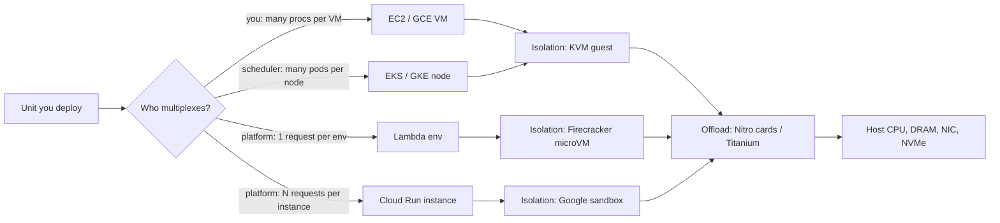

# Compute Translation: Instances, Containers, Serverless

## TL;DR

- Every compute product on both clouds is a choice about who owns three things: the isolation boundary (VM, microVM, gVisor-style sandbox, pod), the multiplexing policy (how many requests share one unit of capacity), and the offload hardware (Nitro or Titanium) that decides how much host CPU the guest actually gets.
- EC2 and GCE are structurally the same product: KVM-derived guests on hosts whose network, block storage, and control functions run on custom offload silicon. The practical differences are shape flexibility (GCE custom machine types vs EC2 fixed sizes), maintenance semantics (GCE live migration vs EC2 live update plus scheduled retirement), and per-VM network and disk ceilings that are set per series.
- Lambda and Cloud Run are not equivalent products. Lambda runs exactly one in-flight request per execution environment. Cloud Run multiplexes up to a configured concurrency (default 80, ceiling 1000) onto one container instance. For I/O-bound services this alone produces a 5x to 10x cost gap, and for CPU-bound services the gap closes or reverses.
- EKS and GKE both run upstream Kubernetes, but pod networking, node autoscaling, identity, and load balancer integration are different mechanisms. Migration cost lives in those four seams, not in the manifests.
- Scale-out is a control-plane operation on every platform. Lambda adds at most 1,000 execution environments per function every 10 seconds, Cloud Run queues and then returns 429 when max instances is reached, and EC2 or GCE launches fail when the regional launch path degrades. Static stability means the recovery path must not require a launch.

## Mental Model



Read the diagram left to right as a question you must answer before choosing a product: what unit am I deploying, who decides how many concurrent units of work share a CPU, what stops a neighbor from reading my memory, and how much of the host does the offload hardware give back to me.
The AWS and GCP products in each row are mechanically close at the bottom (isolation and offload) and diverge in the middle (multiplexing).
Most migration surprises come from assuming the middle layer is the same: a Lambda function ported to Cloud Run without raising concurrency pays for 80 idle slots, and a Cloud Run service ported to Lambda pays 50x more per unit of work if it was I/O-bound.

## Internals

### Offload architecture: Nitro versus Titanium

Both clouds moved the virtual switch, virtual block device, and host control functions off the main CPU so the guest can use nearly all cores and so the hypervisor can shrink to a thin scheduler and memory manager.
See [[17-Cloud-AI-Engineering/Volume_02_AWS_Deep_Dive/Chapter_04_EC2_Nitro_Architecture_and_Graviton|EC2, Nitro Architecture, and Graviton]] and [[17-Cloud-AI-Engineering/Volume_03_GCP_Deep_Dive/Chapter_06_Compute_Engine_and_Titanium_Architecture|Compute Engine and Titanium Architecture]] for the full treatment; this section covers only what changes a translation decision.

Nitro has three components: purpose-built Nitro Cards, the Nitro Security Chip, and the Nitro Hypervisor (AWS Nitro security whitepaper, as of 2026-10: [PDF](https://docs.aws.amazon.com/pdfs/whitepapers/latest/security-design-of-aws-nitro-system/security-design-of-aws-nitro-system.pdf)).
The cards terminate VPC networking (ENI attachment, security group enforcement, flow logs, routing, encapsulation), present EBS and instance-store volumes to the guest as NVMe devices, and run the control interface to the host.
The hypervisor no longer hosts device models, which is why it can be small enough to apply in place.
The design is per-host: each server carries its own cards, and the card bounds per-instance network and EBS bandwidth.

Google describes Titanium as a system of purpose-built silicon and multiple tiers of scale-out offloads (Google Cloud Next 2024 coverage, [SiliconANGLE](https://siliconangle.com/2024/04/09/next-24-google-cloud-debuts-new-vm-families-general-purpose-specialized-workloads/), as of 2026-10).
The distinguishing word is tiers: a host-attached adapter handles the latency-critical path, and a second tier of offload runs on separate scale-out infrastructure, so network and storage processing capacity is not capped by what fits on one host card.
Titanium also fronts local flash as Titanium SSD, and C4N pairs two Titanium-offloaded NICs with Emerald Rapids Xeons to deliver high network and block throughput without the per-VM Tier_1 networking add-on (GCE docs, as of 2026-10: [C4N](https://docs.cloud.google.com/compute/docs/network-optimized-machines)).

Translation consequences:

- Network ceilings are set per series on both clouds, so compare the specific series, not the cloud. A C4A bare metal instance offers up to 50 Gbps standard and up to 100 Gbps with per-VM Tier_1 networking (GCE docs, as of 2026-10: [bare metal](https://docs.cloud.google.com/compute/docs/instances/bare-metal-instances)).
- Titanium has a documented "controlled maintenance experience" positioning for C4 (SiliconANGLE, as of 2026-10), which matters because maintenance semantics, not peak bandwidth, is where the two clouds behave most differently (see below).
- On Nitro, the guest sees ENA and NVMe PCIe functions; on GCE the guest sees gVNIC (or virtio-net) and NVMe or virtio-scsi, depending on series. Driver and image compatibility is a real migration checklist item: an AMI without the ENA driver will not boot networked on Nitro, and a GCE image must declare guest OS features such as GVNIC support for the series that requires it.

### What a vCPU is, and what shapes exist

EC2 names encode family, generation, processor vendor, and attributes: for example a letter for the family, a digit for the generation, then `g` for Graviton, `i` for Intel, `a` for AMD, and suffixes such as `d` (local NVMe), `n` (network-enhanced), or `e` (extra memory or storage).
The latest generation of each family changes continuously; verify current generations in the EC2 instance type page before pinning a Terraform default (UNVERIFIED for any specific generation as of 2026-10).
GCE names encode series and generation (for example C4, N4, C4A, C4D, C4N, Z4D) followed by a shape (`standard`, `highmem`, `highcpu`) and a vCPU count; the C4A series is Google's Arm-based Axion line, and Z4D pairs AMD EPYC Turin with Titanium for storage-heavy low-core-count workloads (GCE release notes, as of 2026-10: [release notes](https://docs.cloud.google.com/compute/docs/release-notes)).

Two semantic differences bite during sizing:

- On x86 on both clouds, a vCPU is a hardware thread (SMT sibling), not a core. On Graviton and on Axion, a vCPU maps to a physical core with no SMT. Moving a 16 vCPU x86 service to a 16 vCPU Arm instance changes the amount of physical core by 2x, which is why Arm migrations often show better per-vCPU throughput than the vendor ratio suggests (vCPU-to-core mapping is documented by both vendors; exact current statement UNVERIFIED as of 2026-10).
- EC2 sells fixed sizes per family (for example 2, 4, 8, 16 vCPU at a fixed memory ratio), while the GCE general-purpose families that support custom machine types let you pick vCPU and memory independently within ratio bounds. EC2 compensates with attribute-based instance type selection in EC2 Fleet and Auto Scaling, which lets the fleet pick any instance type satisfying vCPU and memory ranges. Which GCE series support custom shapes changes by generation (UNVERIFIED as of 2026-10).

### Maintenance, failure, and preemption

GCE's long-standing differentiator is live migration: the host's VMM copies guest memory to another host while the guest runs, with a short blackout at cutover, so host maintenance rarely terminates a guest.
Some series, notably accelerator-attached ones, have different maintenance policies (terminate or restart rather than migrate), so check `onHostMaintenance` behavior per series (UNVERIFIED per-series matrix as of 2026-10).
EC2 historically does not live-migrate guests between hosts; instead Nitro lets AWS update the hypervisor and cards in place without moving the guest, and host failures surface as scheduled events or instance retirement (AWS re:Invent Nitro talks; current absence of general live migration UNVERIFIED as of 2026-10).
The design implication is that EC2 workloads must treat a host-level retire event as an ordinary failure (health checks, Auto Scaling replacement), whereas GCE workloads on migratable series can often ignore host maintenance but still need to survive the migration blackout and clock jump.

Spot and preemptible capacity differ in warning time: EC2 Spot gives a two-minute interruption notice and GCE Spot VMs give a 30-second signal, per this curriculum's spot economics chapter (see [[17-Cloud-AI-Engineering/Volume_09_FinOps_and_Cloud_Economics/Chapter_03_Spot_Economics_and_Interruption_Handling|Spot Economics and Interruption Handling]]; official docs re-verification UNVERIFIED as of 2026-10).
A checkpointing interval design that is safe at 120 seconds is not automatically safe at 30 seconds.

### Lambda internals: one request, one environment, one microVM

Lambda runs each execution environment inside a Firecracker microVM, a KVM-based VMM written in Rust with a minimal device model (Agache et al., "Firecracker: Lightweight Virtualization for Serverless Applications", NSDI 2020; [paper](https://www.usenix.org/conference/nsdi20/presentation/agache)).
The paper reports sub-125 ms boot to user space and about 5 MiB of VMM memory overhead per microVM, which is what makes thousands of single-purpose guests per host economical.
An execution environment is never shared across functions or accounts, so the isolation boundary is the hypervisor, not a container namespace.

The invoke path, at the level the paper documents, is: a frontend authenticates and throttles the request, a placement and worker-manager tier finds an idle warm environment for that function version or asks a worker host to create one, and the worker's local manager boots a microVM and starts the runtime.
Inside the guest, the language runtime pulls work by long-polling the Runtime API (`/runtime/invocation/next`), executes the handler, and posts the result, which is why a handler is a loop body and not a server.
Because exactly one invocation is in flight per environment, Lambda concurrency equals arrival rate times duration (Little's law), and every concurrent request beyond the warm pool pays an INIT phase on a fresh environment.

The mechanism a getting-started guide omits is how large container images start quickly.
Lambda does not pull an image to the worker before running it: it flattens the image into a filesystem, splits it into fixed-size chunks, deduplicates chunks across customers using a convergent-encryption variant so identical chunks need not be shared in plaintext, and serves reads lazily through a tiered cache (worker-local, then an AZ-level cache, then the object store) (Brooker et al., "On-demand Container Loading in AWS Lambda", USENIX ATC 2023; [paper](https://www.usenix.org/conference/atc23/presentation/brooker)).
Consequences you can use: only blocks actually touched during init count against cold start, so a 10 GB image that touches 200 MB at startup behaves like a 200 MB image; common base layers are hot in caches across the fleet, so images built on popular bases cold-start faster than fully bespoke layers; and reordering imports so that rarely used libraries load lazily directly reduces the touched set (chunk size and cache tier names from the paper as recalled; exact values UNVERIFIED as of 2026-10).

Per-function scale-out is rate-limited: each function can add 1,000 execution environments every 10 seconds (AWS Lambda quotas, as of 2026-10: [docs](https://docs.aws.amazon.com/lambda/latest/dg/gettingstarted-limits.html)).
Reaching 10,000 concurrent environments from zero therefore takes about 100 seconds regardless of account quota, because the quota is a ceiling and the scale rate is a slope.
Limits are per function, so traffic that must ramp faster than the slope allows can be split across functions, buffered behind a queue, or covered by provisioned concurrency.

AWS has also introduced a mode that runs Lambda functions on EC2 capacity you select with multi-concurrency per environment, which moves Lambda toward the Cloud Run model; treat its GA status and pricing as UNVERIFIED as of 2026-10.

### Cloud Run internals: multiplexing, queueing, and CPU gating

A Cloud Run revision is a container image plus a concurrency setting.
Each instance serves up to the configured maximum concurrent requests; the default is 80 and the maximum is 1000 (Cloud Run docs, as of 2026-10: [concurrency](https://docs.cloud.google.com/run/docs/about-concurrency); [community FAQ](https://github.com/ahmetb/cloud-run-faq/blob/master/README.md)).
Setting concurrency to 1 reproduces the Lambda model, and the docs recommend leaving the default unless the code cannot process parallel requests.

Requests arrive via Google's front end layer, and the platform buffers a request while a new instance starts.
When every instance is at its concurrency limit and max instances is reached, requests queue for a bounded time and then fail with 429 (community analysis, as of 2026-10: [OneUptime](https://oneuptime.com/blog/post/2026-02-17-how-to-limit-cloud-run-autoscaling-max-instances-to-control-costs-during-traffic-spikes/view); exact queue window UNVERIFIED).
Max instances is therefore both a cost cap and a hard availability ceiling, and it must be sized with the same formula as Lambda concurrency divided by per-instance concurrency: `max_instances = peak_rps * avg_duration / concurrency`, with 2x to 3x headroom.

Under request-based billing, CPU is allocated only while the instance is handling a request, and is throttled to near zero outside requests (community FAQ, as of 2026-10).
Background threads, async flushes of telemetry after the response returns, and in-process cache refreshers all stall between requests.
This is the single most common Cloud Run production bug for engineers coming from EC2 or Lambda (where a frozen environment has the same effect after the handler returns, but the failure is more widely known).
Instance-based billing (CPU always allocated) removes the throttle at a different price point.

Cloud Run has two execution environments: a first generation that uses a gVisor-based sandbox with syscall interception, and a second generation with full Linux kernel compatibility and better sustained CPU and network performance at the cost of slower cold starts (Cloud Run docs; which sandbox technology backs the second generation is UNVERIFIED as of 2026-10).
Cloud Run functions (formerly Cloud Functions 2nd gen) is built on Cloud Run, so the nearest GCP analogue to a Lambda function is a Cloud Run function with concurrency set to 1, while the nearest analogue to Lambda with a web adapter is a Cloud Run service (rename lineage UNVERIFIED as of 2026-10).

### Mechanism deep dive: who owns multiplexing

Both platforms obey Little's law: in-flight requests `L = lambda * W`, where `lambda` is arrival rate and `W` is average duration.
The platforms differ in what happens to `L`.

- Lambda: capacity units = `L`. Each unit holds a full memory allocation and one vCPU share, and you pay GB-seconds for `W` on every request.
- Cloud Run: capacity units = `ceil(L / (concurrency * target_utilization))`. Memory and CPU are shared across all requests on the instance, and under request-based billing the instance is billed while at least one request is in flight, so overlapping requests are billed once (billing rule UNVERIFIED as of 2026-10).

For a service with `lambda = 200` RPS and `W = 0.25` s, `L = 50`.
Lambda needs 50 environments.
Cloud Run at concurrency 80 and a 60% utilization target needs `ceil(50 / 48) = 2` instances.
The ratio of billed capacity is therefore 25:1 in instance-equivalents, partially offset by Lambda's per-request pricing granularity and Cloud Run's request fee.
The worked example below turns this into dollars and shows the CPU-bound case where the advantage disappears, because a request that burns CPU for its entire duration cannot share a vCPU with 79 neighbors.

The same math explains the failure modes: raising Cloud Run concurrency beyond what the runtime can interleave creates head-of-line blocking (a single-threaded event loop stalls all 80 slots on one CPU-heavy request), and lowering Lambda memory to save money lowers the CPU share proportionally, so duration rises and the saving is partly or wholly cancelled (one vCPU is reached at 1,769 MB and a function at 10,240 MB has 6 vCPUs, Lambda docs, as of 2026-10: [config](https://docs.aws.amazon.com/lambda/latest/dg/troubleshooting-configuration.html)).

### Container orchestration planes

Both managed Kubernetes services run an upstream-conformant control plane and expose node pools; the seams are networking, autoscaling, and identity.
See [[17-Cloud-AI-Engineering/Volume_02_AWS_Deep_Dive/Chapter_07_Amazon_EKS_Control_Plane_and_Networking|Amazon EKS: Control Plane and Networking]] and [[17-Cloud-AI-Engineering/Volume_03_GCP_Deep_Dive/Chapter_07_GKE_Deep_Dive_Standard_vs_Autopilot|GKE Deep Dive: Standard vs Autopilot]].

- Pod addressing. The AWS VPC CNI gives each pod a real VPC IP drawn from secondary IPs or prefixes on the node's ENIs, so the pod density limit is `ENIs * (IPs_per_ENI - 1) + 2` per instance type unless prefix delegation is enabled. GKE VPC-native clusters allocate pod IPs from alias IP ranges, with a per-node pod CIDR sized from the max-pods-per-node setting (110 by default on Standard). The failure modes differ: EKS exhausts subnet IPs and ENI attach limits, GKE exhausts the secondary range for pods. (Formula and defaults are stable documented behavior; current numeric defaults UNVERIFIED as of 2026-10.)
- Node autoscaling. Karpenter on EKS calls EC2 fleet APIs directly with a flexible set of instance types per pending-pod batch instead of scaling a fixed Auto Scaling group. GKE scales node pools with the cluster autoscaler and node auto-provisioning or custom compute classes. See [[17-Cloud-AI-Engineering/Volume_05_Kubernetes_and_Platform_Engineering/Chapter_04_Autoscaling_at_Scale_HPA_KEDA_and_Karpenter|Autoscaling at Scale: HPA, KEDA, and Karpenter]].
- Fully managed nodes. EKS Auto Mode and GKE Autopilot both remove node management; Autopilot bills on pod resource requests rather than node capacity, so request inflation is a direct cost, while on Standard-style node billing request inflation causes bin-packing waste instead (pricing models UNVERIFIED as of 2026-10).
- Per-pod microVMs. ECS and EKS on Fargate run each task or pod in its own microVM (Firecracker-based per AWS public statements), trading DaemonSets, privileged containers, and GPUs for per-pod isolation; GKE offers sandboxed pods via GKE Sandbox, which uses gVisor on a shared node (capability list UNVERIFIED as of 2026-10).
- ECS has no GCP equivalent. It is an AWS-proprietary scheduler with a simpler model and tight Fargate integration; the GCP counterpart for "simple containers without Kubernetes" is Cloud Run.

### Per-instance I/O ceilings that do not appear in instance listings

Both clouds advertise network bandwidth as "up to N Gbps" for smaller shapes.
On EC2, the "up to" figure is a burst backed by a credit-like baseline, and a single flow is capped well below the instance aggregate unless placed in a cluster placement group or using ENA Express (exact baseline and per-flow numbers UNVERIFIED as of 2026-10).
On GCE, egress bandwidth scales with vCPU count by series and rises with Tier_1 networking, and C4N is designed to deliver high bandwidth without Tier_1 (GCE docs, as of 2026-10).
Block storage has the same pattern: EC2 has per-instance EBS bandwidth and IOPS ceilings that cap the sum over attached volumes, and GCE Hyperdisk has per-VM and per-disk limits.
A service that is 100% saturating one 16 TB EBS volume at its provisioned IOPS may still be capped by the instance, which is why the right sizing question is "which instance-level limit hits first".

## Numbers to Know

| Quantity | Value | Source |
|---|---|---|
| Lambda memory range | 128 MB to 10,240 MB in 1 MB steps | AWS Lambda quotas, as of 2026-10 |
| Lambda max timeout | 900 seconds | AWS Lambda docs, as of 2026-10 |
| Lambda CPU allocation | 1 vCPU at 1,769 MB, 6 vCPUs at 10,240 MB | AWS Lambda docs, as of 2026-10 |
| Lambda per-function scale-out rate | 1,000 execution environments per 10 seconds | AWS Lambda quotas, as of 2026-10 |
| Lambda payload | 6 MB sync, 200 MB streamed response, 1 MB async | AWS Lambda quotas, as of 2026-10 |
| Lambda account concurrency default | 1,000, raisable on request | third-party summary (middleware.io), as of 2026-10; new accounts may start lower, check `get-account-settings` |
| Cloud Run concurrency | default 80, max 1000 per instance | Google Cloud docs and community FAQ, as of 2026-10 |
| Cloud Run request timeout | default 300 s, max 3600 s | community guide, as of 2026-10; verify in quotas page |
| Cloud Run max instance size | 8 vCPU and 32 GiB | UNVERIFIED as of 2026-10 |
| C4A bare metal network | up to 50 Gbps standard, up to 100 Gbps with Tier_1 | Google Cloud docs, as of 2026-10 |
| C4N Titanium SSD | 375 GiB to 12,000 GiB, GA 2026-10-12 | Compute Engine release notes, as of 2026-10 |
| C4A price-performance claim | up to 65 percent better than comparable x86 | Google launch blog, vendor claim, as of 2026-10 |
| Firecracker boot and overhead | under 125 ms, about 5 MiB per microVM | NSDI 2020 paper |
| EC2 Spot warning / GCE Spot warning | 2 minutes / 30 seconds | curriculum spot chapter, official re-check UNVERIFIED as of 2026-10 |
| Lambda price | about 0.0000166667 USD per GB-s x86 and 0.20 USD per million requests | UNVERIFIED as of 2026-10; placeholder in model |
| Cloud Run price (request-based) | about 0.000024 USD per vCPU-s, 0.0000025 USD per GiB-s, 0.40 USD per million requests | UNVERIFIED as of 2026-10; placeholder in model |
| Managed Kubernetes control plane fee | about 0.10 USD per cluster-hour on both | UNVERIFIED as of 2026-10 |

Treat every UNVERIFIED price as an input to be refreshed from the pricing page, not as a fact; the model in the worked example exposes them as constants for that reason.

## AWS vs GCP Mechanism Parity

| Dimension | AWS | GCP | Critical difference |
|---|---|---|---|
| Offload hardware | Nitro Cards, Nitro Security Chip, Nitro Hypervisor | Titanium, with scale-out offload tiers | Nitro bounds I/O per host card; Titanium adds a second tier off-host |
| Guest hypervisor | KVM-based Nitro Hypervisor, device models moved to cards | KVM-based with Google's VMM | Both small; image drivers (ENA vs gVNIC) differ |
| vCPU on x86 | hardware thread | hardware thread | Arm (Graviton, Axion) vCPU is a full core on both |
| Shape flexibility | fixed sizes per family, attribute-based fleet selection | custom machine types on supporting series | GCE lets you buy exact vCPU and GiB; EC2 relies on fleet diversification |
| Bare metal | `.metal` instance sizes | bare metal instances, for example C4A | Both bypass the hypervisor; both keep Nitro or Titanium offload |
| Host maintenance | in-place live update, scheduled events, retirement | live migration on most series, terminate or restart on others | EC2 apps must tolerate retire; GCE apps must tolerate migration blackout |
| Spot warning | 2 minutes | 30 seconds | Checkpoint cadence must be sized for the cloud |
| Burstable | T family credits | shared-core and E2 families | Credit accounting differs; unlimited mode is an AWS billing construct |
| Container scheduler | ECS, EKS | GKE | No GCP equivalent for ECS; closest is Cloud Run |
| Managed node mode | EKS Auto Mode, Fargate | GKE Autopilot | Autopilot bills per pod request; Fargate bills per task size |
| Node autoscaler | Karpenter, Cluster Autoscaler on ASG | cluster autoscaler, node auto-provisioning, compute classes | Karpenter issues direct fleet calls; GKE scales node pools |
| Pod networking | VPC CNI, pods get ENI IPs | VPC-native alias IPs | Failure mode is subnet or ENI exhaustion vs pod range exhaustion |
| Function runtime | Lambda | Cloud Run functions (on Cloud Run) | Lambda is single-request-per-environment |
| Serverless container | Fargate (not scale-to-zero), App Runner (check status) | Cloud Run | Cloud Run is the only scale-to-zero multi-request container service of the three; App Runner status UNVERIFIED |
| Request concurrency per unit | 1 | default 80, max 1000 | Primary cost driver for I/O-bound services |
| Scale-out rate | 1,000 environments per function per 10 s | instance-based autoscaler, request buffering | Lambda scale rate is a published hard slope |
| Max sync duration | 15 minutes | up to 60 minutes request timeout | Cloud Run fits longer streaming; Lambda needs async or step orchestration |
| Isolation boundary | Firecracker microVM per environment | Google sandbox per instance, gVisor in gen 1 | Lambda isolation is VM-grade by design |
| Auth to invoke | IAM SigV4, function URL auth types | IAM `roles/run.invoker`, ID tokens | Both default to private |
| GPU | EC2 only, no Lambda GPUs | GCE and GKE, plus Cloud Run GPU (GA status UNVERIFIED as of 2026-10) | Inference scale-to-zero on GPU is a GCP-only option today (UNVERIFIED) |

### Architectural fit matrix

| Workload | Best fit on AWS | Best fit on GCP | Why |
|---|---|---|---|
| Spiky low-volume HTTP API, scale to zero | Lambda | Cloud Run | Both bill per use; Lambda wins on ecosystem triggers, Cloud Run on container portability |
| Steady 100+ RPS I/O-bound API | ECS on Fargate or EKS, or Lambda with provisioned concurrency if bursty | Cloud Run with min instances | Multiplexing amortizes memory across requests |
| CPU-bound per-request work (image resize, small inference) | Lambda or Fargate | Cloud Run with concurrency near vCPU count | Multiplexing gains vanish, per-ms billing at 100 percent utilization is competitive |
| Event fan-out from queue or stream | Lambda with SQS or Kinesis event source mappings | Cloud Run with Pub/Sub push, or Dataflow | Native event source mapping is a Lambda advantage |
| Jobs longer than 15 minutes | Fargate task, AWS Batch, EC2 | Cloud Run jobs, GKE Jobs, Batch | Lambda hard timeout is 900 s |
| WebSocket or long streaming | ALB + ECS, API Gateway WebSocket | Cloud Run with timeout up to 60 min | Lambda needs a gateway for persistent connections |
| GPU inference | EC2, EKS, SageMaker | GKE, GCE, Cloud Run GPU | No Lambda GPU |
| Stateful or kernel-sensitive (databases, custom drivers) | EC2 | GCE | Need full kernel and local NVMe |
| Multi-tenant SaaS with hard isolation | Lambda or Fargate per tenant | Cloud Run per tenant or GKE Sandbox | microVM boundary vs gVisor |
| Platform team standard paved road | EKS plus Karpenter | GKE | Portability of the Kubernetes API |

## Worked Example: A Concurrency and Cost Model, Then a Two-Cloud Lab

### Part 1: Back-of-the-envelope capacity and cost (no cloud resources)

Workload: 200 RPS average, 250 ms average duration, I/O-bound (it waits on a downstream call), 30-day month.

1. In-flight requests by Little's law: `L = 200 * 0.25 = 50`.
2. Lambda at 1 GB: 50 concurrent environments. Monthly requests: `200 * 2,592,000 = 518.4M`. GB-seconds: `518.4M * 0.25 * 1 = 129.6M`. Compute: `129.6M * 0.0000166667 = 2,160 USD`. Requests: `518.4 * 0.20 = 104 USD`. Total about 2,264 USD.
3. Cloud Run at 1 vCPU, 1 GiB, concurrency 80, target utilization 60 percent: `ceil(50 / 48) = 2` instances, billed essentially continuously. vCPU: `2 * 2.592M s * 0.000024 = 124 USD`. Memory: `2 * 2.592M * 0.0000025 = 13 USD`. Requests: `518.4 * 0.40 = 207 USD`. Total about 345 USD.
4. CPU-bound variant at 0.1 vCPU-seconds of pure CPU per request: Lambda at 1,769 MB costs about 1,632 USD; Cloud Run needs `200 * 0.1 / 0.6 = 33` vCPUs, or 17 instances of 2 vCPU, costing about 2,543 USD. Multiplexing no longer helps, and the 60 percent utilization target costs more than Lambda's per-ms billing.
5. Scale-out check for Lambda: a burst from 0 to 10,000 environments takes about 100 seconds at 1,000 per 10 seconds, so a spike faster than that returns throttles unless buffered.

The prices are placeholders marked UNVERIFIED; the structure of the result (roughly 6x for I/O-bound, reversal for CPU-bound) is robust to modest price changes, but re-run the script with current prices before using the dollar values.

```python
# model.py
import math

PRICE_LAMBDA_GB_S = 0.0000166667      # UNVERIFIED, refresh from pricing page
PRICE_LAMBDA_REQ_M = 0.20             # UNVERIFIED
PRICE_RUN_VCPU_S = 0.000024           # UNVERIFIED
PRICE_RUN_GIB_S = 0.0000025           # UNVERIFIED
PRICE_RUN_REQ_M = 0.40                # UNVERIFIED
SECONDS_PER_MONTH = 30 * 24 * 3600

def lambda_model(rps, dur_s, mem_gb):
    concurrency = rps * dur_s
    reqs = rps * SECONDS_PER_MONTH
    gb_s = reqs * dur_s * mem_gb
    return concurrency, gb_s * PRICE_LAMBDA_GB_S + reqs / 1e6 * PRICE_LAMBDA_REQ_M

def run_model(rps, dur_s, vcpu, gib, conc, target_util=0.6, min_instances=0):
    inflight = rps * dur_s
    instances = max(math.ceil(inflight / (conc * target_util)), min_instances, 1)
    reqs = rps * SECONDS_PER_MONTH
    inst_s = instances * SECONDS_PER_MONTH
    cost = (inst_s * vcpu * PRICE_RUN_VCPU_S + inst_s * gib * PRICE_RUN_GIB_S
            + reqs / 1e6 * PRICE_RUN_REQ_M)
    return inflight, instances, cost

if __name__ == "__main__":
    rps, dur = 200, 0.25
    c, lc = lambda_model(rps, dur, 1.0)
    print(f"Lambda 1 GB: concurrency={c:.0f} monthly=${lc:,.0f}")
    inflight, n, rc = run_model(rps, dur, 1, 1, 80)
    print(f"Run conc=80: inflight={inflight:.0f} instances={n} monthly=${rc:,.0f}")
    cpu_s = 0.1
    _, lcb = lambda_model(rps, cpu_s, 1.769)
    n_cb = math.ceil(rps * cpu_s / 0.6 / 2)
    inst_s = n_cb * SECONDS_PER_MONTH
    rcb = (inst_s * 2 * PRICE_RUN_VCPU_S + inst_s * 2 * PRICE_RUN_GIB_S
           + rps * SECONDS_PER_MONTH / 1e6 * PRICE_RUN_REQ_M)
    print(f"CPU-bound: Lambda=${lcb:,.0f} Run({n_cb} x 2 vCPU)=${rcb:,.0f}")
    for target in (1000, 5000, 10000):
        print(f"Lambda scale-out to {target} environments: about {math.ceil(target/1000)*10} s")
```

Expected output with the placeholder prices:

```text
Lambda 1 GB: concurrency=50 monthly=$2,264
Run conc=80: inflight=50 instances=2 monthly=$345
CPU-bound: Lambda=$1,632 Run(17 x 2 vCPU)=$2,543
Lambda scale-out to 1000 environments: about 10 s
Lambda scale-out to 5000 environments: about 50 s
Lambda scale-out to 10000 environments: about 100 s
```

### Part 2: Lab - the same 200 ms handler on Lambda and Cloud Run

Cost estimate: the load test sends 2,000 requests to each service at 200 ms each, which is far inside typical free tiers; expected spend is under 1 USD including container build storage (free-tier coverage UNVERIFIED as of 2026-10).
Budget alarms are set at 10 USD with an 80 percent threshold; budgets alert but do not stop spend.

Budget alarms:

```bash
# AWS: budget.json and notifications.json
cat > budget.json <<'EOF'
{"BudgetName":"ct-lab","BudgetLimit":{"Amount":"10","Unit":"USD"},"TimeUnit":"MONTHLY","BudgetType":"COST"}
EOF
cat > notifications.json <<'EOF'
[{"Notification":{"NotificationType":"ACTUAL","ComparisonOperator":"GREATER_THAN","Threshold":80,"ThresholdType":"PERCENTAGE"},
  "Subscribers":[{"SubscriptionType":"EMAIL","Address":"you@example.com"}]}]
EOF
ACCT=$(aws sts get-caller-identity --query Account --output text)
aws budgets create-budget --account-id "$ACCT" --budget file://budget.json \
  --notifications-with-subscribers file://notifications.json

# GCP
gcloud billing budgets create --billing-account=BILLING_ACCOUNT_ID \
  --display-name=ct-lab --budget-amount=10USD \
  --threshold-rule=percent=0.8 --threshold-rule=percent=1.0
```

Lambda side:

```bash
cat > handler.py <<'EOF'
import time
def handler(event, context):
    time.sleep(0.2)
    return {"ok": True}
EOF
zip fn.zip handler.py
cat > trust.json <<'EOF'
{"Version":"2012-10-17","Statement":[{"Effect":"Allow","Principal":{"Service":"lambda.amazonaws.com"},"Action":"sts:AssumeRole"}]}
EOF
aws iam create-role --role-name ct-demo-role --assume-role-policy-document file://trust.json
aws iam attach-role-policy --role-name ct-demo-role \
  --policy-arn arn:aws:iam::aws:policy/service-role/AWSLambdaBasicExecutionRole
sleep 10   # IAM propagation
aws lambda create-function --function-name ct-demo --runtime python3.13 \
  --handler handler.handler --zip-file fileb://fn.zip --memory-size 1024 --timeout 10 \
  --architectures arm64 --role "arn:aws:iam::${ACCT}:role/ct-demo-role"
aws lambda get-account-settings   # check ConcurrentExecutions; new accounts may be low
```

Cloud Run side:

```bash
mkdir run-demo && cd run-demo
cat > main.py <<'EOF'
import os, time
from http.server import BaseHTTPRequestHandler, ThreadingHTTPServer
class H(BaseHTTPRequestHandler):
    def do_GET(self):
        time.sleep(0.2)
        self.send_response(200); self.end_headers(); self.wfile.write(b"ok")
    def log_message(self, *a): pass
ThreadingHTTPServer(("0.0.0.0", int(os.environ.get("PORT", "8080"))), H).serve_forever()
EOF
cat > Dockerfile <<'EOF'
FROM python:3.12-slim
COPY main.py /main.py
CMD ["python", "/main.py"]
EOF
gcloud run deploy ct-demo --source . --region us-central1 \
  --concurrency 80 --cpu 1 --memory 512Mi --min-instances 0 --max-instances 5 \
  --timeout 30 --no-allow-unauthenticated
gcloud run services describe ct-demo --region us-central1 --format='value(status.url)'
```

Run the load test (50 parallel workers, 2,000 requests each, using the Cloud Run URL printed above).
If `get-account-settings` shows a concurrency limit below 50, lower `WORKERS` to match or the Lambda run will show throttling instead of latency.

```python
# loadtest.py
import subprocess, sys, time, urllib.request
from concurrent.futures import ThreadPoolExecutor
import boto3

N, WORKERS = 2000, 50
lam = boto3.client("lambda")

def call_lambda(_):
    t = time.perf_counter()
    lam.invoke(FunctionName="ct-demo", Payload=b"{}")
    return time.perf_counter() - t

def call_run(_, url, token):
    t = time.perf_counter()
    req = urllib.request.Request(url, headers={"Authorization": "Bearer " + token})
    urllib.request.urlopen(req, timeout=30).read()
    return time.perf_counter() - t

def pct(xs, p):
    xs = sorted(xs)
    return xs[min(len(xs) - 1, int(len(xs) * p))] * 1000

def run(name, fn):
    t0 = time.perf_counter()
    with ThreadPoolExecutor(WORKERS) as ex:
        lat = list(ex.map(fn, range(N)))
    dt = time.perf_counter() - t0
    print(f"{name}: rps={N/dt:.0f} p50={pct(lat,.5):.0f}ms p99={pct(lat,.99):.0f}ms max={max(lat)*1000:.0f}ms")

if __name__ == "__main__":
    url = sys.argv[1]
    token = subprocess.check_output(["gcloud", "auth", "print-identity-token"], text=True).strip()
    run("lambda", call_lambda)
    run("cloudrun", lambda i: call_run(i, url, token))
```

What to observe: CloudWatch `ConcurrentExecutions` for `ct-demo` should peak near 50 and the first 50 requests carry a cold start in the p99 and max; Cloud Run instance count in Cloud Monitoring should settle at 1 or 2 instances for the same 50 in-flight requests.
The p99 on both is dominated by cold starts at this sample size, so compare steady state by discarding the first second.

Teardown:

```bash
aws lambda delete-function --function-name ct-demo
aws logs delete-log-group --log-group-name /aws/lambda/ct-demo
aws iam detach-role-policy --role-name ct-demo-role \
  --policy-arn arn:aws:iam::aws:policy/service-role/AWSLambdaBasicExecutionRole
aws iam delete-role --role-name ct-demo-role
aws budgets delete-budget --account-id "$ACCT" --budget-name ct-lab

gcloud run services delete ct-demo --region us-central1 --quiet
gcloud artifacts repositories delete cloud-run-source-deploy --location us-central1 --quiet
gcloud billing budgets list --billing-account=BILLING_ACCOUNT_ID   # then delete by ID
gcloud billing budgets delete BUDGET_ID --billing-account=BILLING_ACCOUNT_ID
```

## Failure Modes and Pitfalls

### Lambda

- Throttling from the scale slope, not the quota. A function that jumps from 50 to 5,000 concurrent requests hits the 1,000-per-10-seconds slope and returns throttles even if the account quota is 10,000 (AWS Lambda quotas, as of 2026-10). Mitigations: provisioned concurrency for known peaks, SQS or Kinesis buffering for async work, splitting hot paths into separate functions (the slope is per function), and client retries with full jitter.
- Account-level noisy neighbor. All functions in an account and region share the account concurrency pool, so one runaway function can starve the others. Reserved concurrency on critical functions guarantees capacity and also caps the function, which doubles as a blast-radius control for the runaway one.
- Memory as the CPU knob. Dropping memory to save cost reduces the vCPU share and raises duration; sweep memory empirically because the cost curve is often flat or U-shaped.
- Cold start misattribution. INIT time scales with the bytes touched, not the image size (ATC 2023 mechanism), and recent billing changes may charge for INIT on on-demand functions, so cold starts are both a latency and a cost line (billing change UNVERIFIED as of 2026-10).

### Cloud Run

- CPU throttled outside requests. Work started in a request handler and continued after the response is sent can stall to near zero progress; this includes batched metrics flushes and async queue publishes (community FAQ, as of 2026-10). Fix with instance-based billing, flushing before returning, or moving the work to a Cloud Run job.
- Concurrency set above what the runtime can interleave. A synchronous framework with a single worker and concurrency 80 queues 79 requests behind the first, so p99 climbs even while CPU is idle. Set concurrency to the number of in-flight requests the process can actually overlap, and prove it with a load test.
- Max instances as an availability ceiling. A traffic spike that exceeds `max_instances * concurrency` queues and then returns 429 (OneUptime analysis, as of 2026-10). Size max instances from the formula above, then alarm at 70 percent of the ceiling.
- Cold start on large images or heavy init. Mitigate with minimum instances (billed at an idle rate, UNVERIFIED), startup CPU boost, and a smaller touched set at startup.

### EC2 and GCE

- Per-instance I/O ceilings hit before per-volume ceilings. Aggregate EBS bandwidth on a small instance can cap a high-IOPS volume, and a burstable "up to" network figure collapses to baseline under sustained load (mechanism documented; exact numbers UNVERIFIED as of 2026-10).
- Image and driver mismatch across clouds: an image without the ENA driver on Nitro, or without gVNIC support on a Titanium series, will not become reachable.
- Capacity is a first-class failure mode: GPU and large-memory shapes are frequently unavailable on demand in a given zone, so a launch-time failure (InsufficientInstanceCapacity on AWS, a resource-exhausted style error on GCP) must be handled with fallbacks across types and zones, or avoided with capacity reservations.
- Maintenance semantics: a service built on GCE live migration assumptions can miss that some series terminate instead of migrating; a service built on EC2 assumptions of host stability can miss that retirement events are routine.

### Kubernetes

- IP exhaustion: EKS subnets or ENI attach limits and GKE pod secondary ranges; both fail as pods stuck in ContainerCreating or Pending, usually during a scale-out when you need them most.
- Scale-up depends on the cloud control plane: Karpenter or the cluster autoscaler must call compute APIs, so when those APIs are impaired the cluster cannot add nodes even though the Kubernetes API is healthy.

### Public post-incident analyses to study

- AWS us-east-1, October 2025: AWS's post-event summary describes a DNS-related failure in DynamoDB endpoint management that cascaded into EC2 instance launch problems (a lease-management subsystem for physical hosts could not renew leases), then network configuration propagation delays and load balancer health check effects. The lesson for compute is that launching new capacity is a dependent operation: services that needed to scale out during the event could not, while services with pre-provisioned capacity kept running. Primary source: [AWS post-event summary](https://aws.amazon.com/message/101925/) (details recalled, not re-read this session; UNVERIFIED as of 2026-10).
- Google Cloud, June 2025: Google's incident report describes an invalid quota policy data propagating globally and crashing Service Control in many regions, which degraded many Google Cloud APIs including serverless products (summary recalled, not re-read this session; UNVERIFIED as of 2026-10). The lesson is that serverless platforms share global control components with everything else, so "managed" does not mean independent. See [[17-Cloud-AI-Engineering/Volume_07_Reliability_and_SRE/Chapter_07_Anatomy_of_Major_Cloud_Outages|Anatomy of Major Cloud Outages]].

## Security and Cost Angles

### Identity and boundaries

- VM identity: EC2 uses an instance profile and the instance metadata service; enforce IMDSv2 and a hop limit of 1 so containers on the host cannot reach node credentials by default. GCE attaches a service account served by the metadata server, and the equivalent control is to avoid the default Compute Engine service account and its broad default scopes.
- Pod identity: IRSA or EKS Pod Identity on AWS and Workload Identity Federation for GKE on GCP exchange a projected Kubernetes service account token for cloud credentials without static keys. See [[17-Cloud-AI-Engineering/Volume_08_Security_Identity_and_the_Data_Perimeter/Chapter_02_Workload_Identity_Federation|Workload Identity Federation]].
- Serverless identity: a Lambda execution role and a Cloud Run service identity are per-resource roles; scope them to the exact buckets, queues, and secrets and not to a shared "app" role.
- Invocation auth: deploy Cloud Run with `--no-allow-unauthenticated` and grant `roles/run.invoker` to named principals; put Lambda behind IAM-authenticated function URLs or an API gateway with an authorizer.
- Isolation tiers: Lambda and Fargate give a microVM boundary per environment or task; Cloud Run gives a Google sandbox per instance, and all requests on one instance share a process, so a multi-tenant service that multiplexes tenants on one Cloud Run instance has no tenant isolation beyond application code.
- Confidential computing: Nitro Enclaves and confidential VM options on both clouds protect memory from the operator and host; see the KMS and confidential computing chapters for the key hierarchy and attestation flow.
- Private paths: use VPC endpoints for AWS APIs and Private Google Access or VPC Service Controls for Google APIs; see [[17-Cloud-AI-Engineering/Volume_08_Security_Identity_and_the_Data_Perimeter/Chapter_06_Constructing_an_Impenetrable_Data_Perimeter|Constructing an Impenetrable Data Perimeter]].

### Unit economics levers

- Match billing granularity to utilization: serverless per-request or per-instance billing wins at low or spiky utilization; committed VM capacity wins at sustained utilization. A break-even utilization is `committed_cost_per_hour / serverless_cost_per_hour_at_full_busy`; compute it with current prices rather than rules of thumb.
- Multiplexing is the biggest lever on Cloud Run and the cheapest to test: measure how many concurrent requests one vCPU can interleave without p99 regression.
- Lambda memory tuning, Arm architectures (Graviton for EC2 and Lambda, Axion on GCE), and Spot or Spot VMs for interruptible work are the next levers; see [[17-Cloud-AI-Engineering/Volume_09_FinOps_and_Cloud_Economics/Chapter_02_Commitment_Discounts_Savings_Plans_vs_CUDs|Commitment Discounts: Savings Plans vs CUDs]].
- Autopilot-style billing makes resource requests a cost line, so right-size requests from observed usage, while node-based billing makes bin-packing efficiency the lever.
- Data transfer across zones and clouds frequently dominates compute for chatty microservices; see [[17-Cloud-AI-Engineering/Volume_09_FinOps_and_Cloud_Economics/Chapter_04_Network_Egress_Economics_and_Optimization|Network Egress Economics and Optimization]].
- Accelerator capacity changes the economics entirely; see [[17-Cloud-AI-Engineering/Volume_09_FinOps_and_Cloud_Economics/Chapter_05_GPU_and_TPU_Unit_Economics|GPU and TPU Unit Economics]].

## Interview Questions and Model Answers

### Question 1 (L5 - Senior)

A team runs an I/O-bound HTTP API at 200 RPS average with 250 ms average latency. They ask whether to run it on Lambda or Cloud Run. How do you decide?

#### Model Answer

Start with Little's law, because it converts the question into capacity: in-flight requests are 200 times 0.25, which is 50.
Lambda handles one request per execution environment, so it needs 50 concurrent environments and bills GB-seconds for 250 ms on every request.
Cloud Run multiplexes up to a configured concurrency, default 80, so 50 in-flight requests fit in one or two instances at a 60 percent utilization target, and overlapping requests share a single billed instance-second.
Using placeholder prices that I would refresh before presenting, that is roughly 2,300 USD per month on Lambda at 1 GB versus roughly 350 USD on Cloud Run, a gap of about 6x, which comes almost entirely from multiplexing and not from a difference in unit price.
That conclusion depends on the service being I/O-bound; if each request burns 100 ms of real CPU, the gap disappears because a vCPU cannot be shared across 80 CPU-bound requests, and Lambda's per-ms billing at near 100 percent utilization can be cheaper.
Secondary factors: Lambda has native event source integrations and a published burst slope of 1,000 environments per 10 seconds; Cloud Run has a container-native model, request queueing while instances start, and a ceiling of `max_instances * concurrency` before 429s.
My recommendation would be Cloud Run (or a Fargate service on AWS) for the steady I/O-bound API, and Lambda for the spiky and event-driven parts around it.

#### Follow-up Interviewer Question

Traffic doubles in 5 seconds during a promotion. Walk me through what happens on each platform and what you would change.

### Question 2 (L5 - Senior)

You are migrating a 16 vCPU, 64 GiB service from EC2 to GCE. What do you check beyond picking the closest machine type?

#### Model Answer

First, the vCPU definition: on x86 on both clouds a vCPU is a hardware thread, so 16 vCPU is eight cores either way, but if I move to Arm (Graviton on AWS or Axion on GCE C4A) a vCPU is a full core, so the same vCPU count is twice the physical cores and I should retest rather than assume a 1:1 mapping.
Second, shape: EC2 has fixed sizes per family, while GCE supports custom machine types on supporting series, so I can match 16 vCPU and 64 GiB exactly and avoid paying for the next size up.
Third, I/O ceilings: check the series' network bandwidth and Hyperdisk per-VM limits, not just the vCPU count; for example C4A bare metal offers up to 50 Gbps standard and 100 Gbps with Tier_1 networking, so a throughput-sensitive service must pick the series and tier deliberately.
Fourth, maintenance semantics: GCE live migration means host maintenance usually does not kill the guest, but the application has to tolerate a short blackout and a clock jump, whereas on EC2 the equivalent event is a retirement that must be handled by replacement.
Fifth, the image and driver chain (ENA vs gVNIC, NVMe vs virtio), the metadata and identity mechanism, and the load balancer that fronts it.

#### Follow-up Interviewer Question

The service uses local NVMe for a cache and sustained 800k IOPS on EC2. How do you validate the GCE equivalent before cutover?

### Question 3 (L6 - Staff)

A Lambda-fronted service returns throttling errors during a traffic spike, even though the account concurrency quota is 10,000 and observed peak is 4,000. What is happening and how do you fix it?

#### Model Answer

The quota is a ceiling and the scale rate is a slope.
Lambda adds at most 1,000 execution environments per function every 10 seconds (AWS Lambda quotas, as of 2026-10), so if arrival rate times duration jumps from 200 to 4,000 concurrent in a few seconds, the first 10-second window supplies only 1,000 environments and the rest of the demand is throttled with 429 until the next windows catch up.
Reaching 4,000 from a cold start takes about 40 seconds on the slope, which is exactly the window in which clients see errors.
I would first confirm by plotting `ConcurrentExecutions` and `Throttles` for the function and checking whether `ConcurrentExecutions` rises in 1,000-step increments.
Fixes in increasing order of cost: make clients retry with full jitter and a bounded budget so the spike spreads over the ramp; put a queue between producer and function for async paths so the queue absorbs the slope; use provisioned concurrency for the known peak (it pre-initializes environments and costs idle time, so it should be scheduled with Application Auto Scaling around known events); and if one function is the hot path, shard traffic across several functions or aliases since the rate is per function.
SnapStart-style restore can shorten each environment's init, which helps latency but does not change the environment-per-window slope.
The structural alternative is to move the path to a multiplexed platform, where one cold instance absorbs 80 requests and the slope is effectively 80x higher in request terms; the trade-off is that Cloud Run (or ECS) then needs `max_instances` sized deliberately and a minimum instance count to avoid cold starts.

#### Follow-up Interviewer Question

How does the same spike behave on Cloud Run with concurrency 80, min instances 2, and max instances 20?

### Question 4 (L6 - Staff)

Explain how Nitro and Titanium differ architecturally and how that shows up as an operational difference for a customer running a network- and storage-heavy database fleet.

#### Model Answer

Both are offload architectures: network virtualization, block storage virtualization, and host control run on dedicated silicon, so the host CPU serves the guest and the hypervisor stays small.
Nitro does it with cards on each host (VPC networking, EBS and instance-store NVMe, a security chip, and a minimal KVM-based hypervisor), so a host's I/O capacity is bounded by its own cards and each instance type publishes explicit bandwidth and EBS limits.
Titanium is described by Google as a system of custom silicon with multiple tiers of scale-out offload, which means part of the data path can run on infrastructure that is not bounded by what fits on the host; products like C4N expose that as high network and storage throughput without a separate per-VM networking tier (GCE docs, as of 2026-10).
Operationally, the first difference is where the bottleneck appears: on EC2 it is the instance-level EBS and network limit that caps the sum of your volumes; on GCE it is the per-series, per-VM limit and the disk type's limit, and I need to read both.
The second is maintenance: Nitro allows in-place updates but does not generally move guests, so a database fleet must treat host retirement as routine and rely on replication; GCE live migration can hide host events but introduces a blackout and clock discontinuity that a consensus-based database (Raft or Paxos) can interpret as a leader pause and trigger an election, so I would measure blackout against election timeouts.
The third is noisy-neighbor exposure: both aim to remove I/O contention from the CPU, but shared fabrics and shared storage back ends still produce tail latency, so I would test p99 write latency under neighbor load rather than trust the architecture.
I would choose the series by testing the database's own workload for sustained throughput, not by published peak.

#### Follow-up Interviewer Question

You observe periodic 400 ms pauses on a Raft leader on GCE. List the hypotheses in order and what evidence distinguishes them.

### Question 5 (L6 - Staff)

Your company runs 60 services on EKS and wants a second deployment on GKE. What breaks, and how do you sequence the work?

#### Model Answer

The manifests port easily; the seams do not.
Identity: IRSA or EKS Pod Identity becomes Workload Identity Federation for GKE, so every IAM role mapping and the trust policy must be re-expressed as IAM bindings on Kubernetes service accounts, and any SDK code using static keys has to be removed first.
Networking: the VPC CNI gives pods VPC IPs, so security groups for pods and network policies may be encoded in AWS constructs that have no equivalent; GKE uses VPC-native alias IPs and Dataplane V2 policies, and the pod CIDR and max pods per node must be sized at cluster creation.
Load balancing: the AWS Load Balancer Controller and ALB or NLB annotations map to GKE Gateway or Ingress and Google's global load balancers, which are anycast and global by default, so health checks, timeouts, and header behavior need retesting; the next chapter covers this seam.
Storage: EBS CSI volumes are zonal and so are Persistent Disk and Hyperdisk, and regional options differ, so stateful sets need explicit data migration, not a re-apply.
Autoscaling: Karpenter NodePools and EC2NodeClasses translate to node pools, node auto-provisioning, or compute classes, and the consolidation and Spot behavior differs, so cost and disruption budgets change.
Operations: upgrade channels, release cadence, and add-on lifecycle differ.
I would sequence by risk: stateless, identity-light services first behind weighted DNS or a global load balancer; then stateful services with replicated data; and keep a per-service rollback until two weeks of SLO-clean traffic, with cross-cloud egress cost measured from the first canary.

#### Follow-up Interviewer Question

Half the services call an AWS-only managed database. How does that change your plan and what are you measuring?

### Question 6 (L7+ - Principal)

Define a compute platform strategy for 400 services across AWS and GCP. Where do you standardize, where do you allow variance, and how do you defend the unit economics?

#### Model Answer

I would standardize the packaging and contract, not the runtime.
The container image and an OCI-based build pipeline, an OpenTelemetry telemetry contract, and workload identity federation are the portable layer; they are cheap to hold constant across clouds and expensive to retrofit.
On top of that I would offer three paved roads with explicit entry criteria: a scale-to-zero multiplexed container service (Cloud Run or its AWS-side equivalent, which today is more fragmented) for stateless request-driven services; Kubernetes (EKS or GKE) for services needing sidecars, GPUs, custom networking, or long-running work; and function-per-event (Lambda or Cloud Run functions) for event handlers where the native event source is the value.
VMs are allowed for kernel-sensitive or licensed workloads behind a review.
The economics are defended with a utilization-based rule: for each service measure average and p95 utilization of the allocated unit, compute break-even versus a committed alternative, and move services across roads when they cross the line; I would not hold a hard rule like "serverless is expensive" because for I/O-bound spiky services multiplexed serverless is several times cheaper than per-request function billing and often cheaper than idle VMs.
I would put the dominant risks into governance: shared control-plane dependencies (a launch-path outage affects all scale-out regardless of product), quota management as a platform service, and egress between clouds, which can exceed compute cost for chatty services, so the default is to keep a service's dependencies in the same cloud and region.
The exit-cost argument is that portability is bought at the image and identity layers; do not pay for it with lowest-common-denominator event sourcing.

#### Follow-up Interviewer Question

The CFO asks you to cut compute spend 25 percent this year without hurting reliability. Which three levers do you pull first and which metrics prove it is safe?

### Question 7 (L7+ - Principal)

Design the compute layer of a tier-1 service so that a regional control-plane degradation (instance launches failing or slow) does not cause customer-visible impact. Use public incident history to justify your design.

#### Model Answer

The principle is static stability: the data plane must continue to serve at full required capacity without calling the control plane, and recovery must not depend on launching new capacity.
Public incident analyses support this: in the October 2025 AWS us-east-1 event, EC2 launch and network configuration dependencies degraded as a downstream effect of a DNS fault in a dependency, so workloads relying on scale-out lost the ability to grow while pre-provisioned workloads kept serving (UNVERIFIED details as of 2026-10); Google's June 2025 incident showed that global control components can degrade serverless products at the same time as everything else.
Design: compute steady-state capacity for loss of one zone with no launches; with three zones that means running at about 66 percent of per-zone capacity so the surviving two zones can absorb the full load, which implies roughly 50 percent over-provisioning; hold On-Demand Capacity Reservations or GCE reservations for the baseline so a launch in the recovery path is not even needed for replacement; use minimum instances on Cloud Run and provisioned concurrency on Lambda for the critical path so scale-out is not on the request path; disable autoscalers' scale-in during an incident so they do not remove capacity they cannot re-add; keep cross-region failover warm at a defined fraction (for example 30 to 50 percent of peak) and pre-provision the rest as reservations, with DNS or global load balancer failover that does not depend on the impaired control plane (health-check driven data plane routing such as Route 53 and Cloud DNS record sets or anycast load balancers).
The costs are explicit: static stability buys availability by spending on idle capacity, so tier it: critical-path services get N+1 zone headroom, others tolerate degraded scale-out.
I would also test it: a game day that blocks the launch API with an IAM deny, and verifies that no service needed a launch to stay within SLO.

#### Follow-up Interviewer Question

Your service is a Kubernetes cluster with Karpenter. How do you make it statically stable when Karpenter's launches are exactly what fails?

## Further Reading

- [AWS Nitro System security whitepaper](https://docs.aws.amazon.com/pdfs/whitepapers/latest/security-design-of-aws-nitro-system/security-design-of-aws-nitro-system.pdf) - primary description of Nitro Cards, the Security Chip, and the hypervisor boundary, essential for understanding what offload actually protects.
- [Firecracker: Lightweight Virtualization for Serverless Applications (NSDI 2020)](https://www.usenix.org/conference/nsdi20/presentation/agache) - the isolation and density argument behind Lambda and Fargate.
- [On-demand Container Loading in AWS Lambda (USENIX ATC 2023)](https://www.usenix.org/conference/atc23/presentation/brooker) - explains block-level lazy loading, deduplication, and tiered caching that determine cold-start cost.
- [AWS Lambda quotas](https://docs.aws.amazon.com/lambda/latest/dg/gettingstarted-limits.html) - authoritative source for scale rate, memory, timeout, and payload limits.
- [Cloud Run concurrency documentation](https://docs.cloud.google.com/run/docs/about-concurrency) - the official statement of the multiplexing model.
- [Compute Engine release notes](https://docs.cloud.google.com/compute/docs/release-notes) - the only reliable way to track new Titanium-based series and GA dates.
- [C4N network-optimized machine family](https://docs.cloud.google.com/compute/docs/network-optimized-machines) - concrete example of Titanium dual-NIC offload translated into per-VM limits.
- [Borg, Omega, and Kubernetes (ACM Queue 2016)](https://queue.acm.org/detail.cfm?id=2898444) - the lineage that explains why GKE and Cloud Run share scheduling ideas (link recalled, UNVERIFIED as of 2026-10).
- [[17-Cloud-AI-Engineering/Volume_00_Foundations_Under_the_Cloud/Chapter_01_Hypervisors_MicroVMs_and_Sandboxing|Hypervisors, MicroVMs, and Sandboxing]] - the isolation primitives behind every product in this chapter.
- [[17-Cloud-AI-Engineering/Volume_02_AWS_Deep_Dive/Chapter_05_Serverless_Compute_and_Lambda_Internals|Serverless Compute and Lambda Internals]] - deeper Lambda placement, SnapStart, and cold start mechanics.
- [[17-Cloud-AI-Engineering/Volume_03_GCP_Deep_Dive/Chapter_08_Cloud_Run_and_Serverless_Container_Execution|Cloud Run and Serverless Container Execution]] - deeper Cloud Run sandboxing and sidecar lifecycles.
- [[17-Cloud-AI-Engineering/Volume_04_AWS_vs_GCP_Translation/Chapter_02_Networking_and_Load_Balancing_Translation|Networking and Load Balancing Translation]] - the next chapter, covering the network seam that dominates migrations between these platforms.
- [[17-Cloud-AI-Engineering/Volume_01_Cloud_Architecture_Principles/Chapter_02_Regions_Zones_and_Static_Stability|Regions, Zones, and Static Stability]] - the principle behind the capacity design in Question 7.
