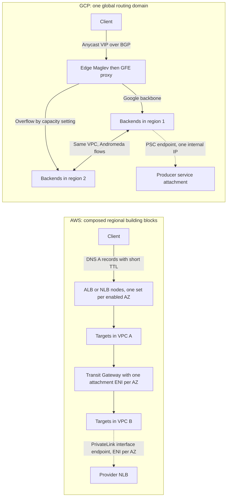

# Networking and Load Balancing Translation

## TL;DR

- AWS builds networks from regional VPCs with AZ-scoped subnets and composes reach with peering, Transit Gateway (TGW) and PrivateLink. GCP gives you one global routing domain with regional subnets, so cross-region reachability is the default and isolation moves to firewall policy and project boundaries.
- A Transit Gateway is a regional router with hard per-attachment bandwidth and packets-per-second ceilings, a per-GB processing fee, and AZ-affinity behavior that breaks stateful appliances unless appliance mode is on. A GCP VPC has no hub to size, but Andromeda programs flows on demand, which has its own cold-flow and scale behavior.
- ALB and NLB are regional fleets of nodes in your AZs, fronted by DNS, so failover and scale-out are bounded by DNS TTLs, client re-resolution and node warm-up. GCP's global external Application LB is an anycast VIP in front of GFE proxies, and its passthrough Network LB is Maglev, so spillover and failover are routing and capacity-setting decisions instead of DNS decisions.
- PrivateLink puts one ENI per AZ in the consumer subnet, so it costs per AZ-hour and you must align AZ IDs. Private Service Connect (PSC) puts one internal IP in the consumer VPC and uses a NAT subnet on the producer side, so its failure mode is NAT subnet exhaustion.
- LLM streaming exposes the sharpest differences: silent gaps hit ALB idle timeouts and GCP backend-service timeouts, large payloads hit PMTUD black holes on TGW peering attachments, and the choice between DNS-based and anycast front doors sets your regional failover time.

## Mental Model



On AWS the network is a set of regional objects, and you assemble reachability by attaching them to routers you size, pay for per GB, and monitor.
The front door is a set of per-AZ nodes that clients find through DNS, so every failover or scale event is mediated by name resolution and client behavior.
On GCP the network object is already global, and the front door is an address that many edge sites announce at once, so clients are steered by BGP and capacity settings instead of by DNS answers.
Both clouds publish services one-way through private endpoints, but AWS materializes the endpoint as an interface per AZ while GCP materializes it as a single address that Andromeda resolves into whichever zone the producer lives in.
The practical consequence is that AWS asks you to engineer failure domains and transit capacity explicitly, and GCP asks you to engineer policy scope and global-configuration blast radius explicitly.

## Internals

This chapter assumes you have read [[17-Cloud-AI-Engineering/Volume_02_AWS_Deep_Dive/Chapter_03_VPC_Networking_Internals|VPC Networking Internals]] and [[17-Cloud-AI-Engineering/Volume_03_GCP_Deep_Dive/Chapter_04_Global_VPC_Andromeda_SDN_and_Network_Tiers|Global VPC, Andromeda SDN, and Network Tiers]].
It does not repeat them.
It concentrates on the places where the two designs translate badly and on mechanisms that getting-started guides skip.

### Scope of the network object and its control-plane consequence

An AWS VPC is a regional object, a subnet is pinned to one AZ, and route tables bind to subnets.
Security groups attach to ENIs and are enforced on the Nitro card, so enforcement is local to the host and keeps per-flow state.
That state is bounded per instance type.
ENA exposes counters such as `conntrack_allowance_exceeded` through `ethtool -S` when the tracked-connection allowance is hit (UNVERIFIED, recalled from AWS docs).
A security-group rule that allows all traffic from 0.0.0.0/0 is not tracked, which is why tightening a rule can suddenly make a busy gateway hit its tracking limit.
Tracked flows also expire on an idle timer that is much longer than most application keepalives (UNVERIFIED), so a gateway holding many long-lived idle streams holds state for a long time.

A GCP VPC is a global object, a subnet is regional, and firewall rules and routes are VPC-scoped.
Every host runs a software virtual switch that is programmed by the Andromeda control plane (see [[17-Cloud-AI-Engineering/Volume_13_Seminal_Papers_and_Case_Studies/Chapter_12_Andromeda_Network_Virtualization|Andromeda: Cloud Network Virtualization]]).
The scaling problem a global VPC creates is that VM-to-VM flow state grows with the square of the VM count.
Preprogramming every host with a route to every peer VM does not scale.
The Andromeda paper (NSDI 2018) describes the answer as the "Hoverboard" model.
By default a host sends traffic for unknown destinations to a pool of dedicated gateways that hold the full VM-to-host mapping.
The host's vswitch counts bytes per destination, and only flows that cross a usage threshold get a direct host-to-host route programmed.
The paper's observation is that most VM pairs exchange little traffic, so programming only the hot flows keeps per-host state and control-plane update rate bounded.

Three practical consequences follow that you will not find in the product docs:

- The first packets of a new, heavy flow can take a detour through a gateway before the direct path is installed, so a cold GPU-to-GPU or gateway-to-backend flow can show different latency from a warm one.
- Control-plane load scales with flow churn and not with VM count alone, so a workload that opens huge numbers of short-lived distinct destinations stresses the programming path differently from one with a few stable heavy peers.
- Documented per-network scale ceilings exist (for example a maximum number of VM instances per VPC network, UNVERIFIED), so "global" does not mean unbounded.

### Transit Gateway internals and the AZ-affinity trap

A TGW is a regional virtual router.
Each VPC attachment creates ENIs in the one subnet per AZ that you nominate, and those ENIs are the TGW's data-plane presence inside your VPC.
Each attachment is associated with exactly one TGW route table but can propagate its prefixes into many, so segmentation is done with route-table association and propagation instead of with security groups.
A documented limitation is that security-group referencing does not work across a TGW (AWS docs, as of 2026-10), so rules that referenced peer security groups under VPC peering must be rewritten as CIDR rules.

By documented behavior, a TGW keeps traffic in the AZ where it entered whenever the destination VPC has an attachment ENI in that AZ.
If the destination has no attachment in that AZ, the TGW picks another AZ (UNVERIFIED on the exact selection rule).
That is good for cost and latency, but it breaks stateful inspection.
A firewall appliance fleet in a shared-services VPC sees the forward path in one AZ and the return path in another, and drops the return packets because it has no flow state.
Appliance mode on the attachment makes the TGW pick the AZ by flow hash and then pin both directions of the flow to it (see the [AWS TGW appliance scenario docs](https://docs.aws.amazon.com/vpc/latest/tgw/transit-gateway-appliance-scenario.html)).
The trade-off is that you lose AZ-local routing for that attachment, so you pay inter-AZ data charges and extra latency on a share of flows.

The ceilings are explicit and sizable but real (AWS docs, as of 2026-10):

- A VPC attachment supports up to 100 Gbps in each direction per AZ and up to 7,500,000 packets per second per AZ.
- A TGW holds up to 10,000 routes across all route tables, and the default is 20 route tables and 5 TGWs per account per Region.
- A static route for a given prefix can point at only one attachment, so you cannot build static ECMP across attachments.
- Connect (GRE) peers are capped at 5 Gbps each, with up to four peers and 20 Gbps total per Connect attachment.

The packets-per-second ceiling is the one people forget.
At 100 Gbps the TGW stops being bandwidth-bound only if the average packet is about 1,667 bytes or larger (12.5 GB/s divided by 7.5 Mpps).
Normal 1,500-byte-MTU traffic at 1,400 bytes average hits the packet limit near 84 Gbps.

MTU is the second hidden mechanism.
A TGW supports an MTU of 8,500 bytes between VPCs, Direct Connect, Connect and peering attachments (AWS docs, as of 2026-10).
Instances inside a VPC commonly run at 9,001 bytes.
The TGW does generate ICMP "fragmentation needed" and "packet too big" messages for traffic entering on VPC and Connect attachments, but it does not support Path MTU Discovery on Site-to-Site VPN, Direct Connect or peering attachments (AWS docs, as of 2026-10).
So a 9,001-byte host sending across an inter-region TGW peering will silently black-hole every packet between 8,501 and 9,001 bytes, because the ICMP feedback never arrives.
Small requests succeed and large payloads hang, which is exactly the signature of a big prompt or a batch embedding upload.

### Load balancer data planes: DNS-fronted node fleets vs anycast proxies

An ALB or NLB provisions load balancer nodes in each AZ you enable and publishes their addresses in DNS.
ALB node IPs rotate as the fleet scales, and clients must re-resolve.
An NLB gives each AZ a stable address, which can be an Elastic IP.
An NLB routes each TCP connection by a flow hash over protocol, addresses, ports and the TCP sequence number, and pins the connection to one target for its life (UNVERIFIED, recalled from AWS docs).
Cross-zone load balancing is always on for ALB and off by default for NLB.
Cross-zone traffic through an NLB incurs inter-AZ data charges, while ALB cross-zone traffic does not (UNVERIFIED).

AWS has described a distributed flow-tracking substrate, internally called Hyperplane, behind NAT Gateway, NLB and PrivateLink (UNVERIFIED on exact membership and design details).
The design philosophy is explicit flow state, replicated so that a node failure does not drop connections.
This buys exact stickiness for the connection lifetime, and it costs state and hard limits such as the NAT Gateway cap on simultaneous connections to a single destination (UNVERIFIED).

Because the entry point is DNS, every AWS failover path is a DNS or client-behavior path.
Route 53 Application Recovery Controller zonal shift removes an AZ's addresses from the load balancer's DNS answers (UNVERIFIED on exact GA scope).
Clients that hold keepalive connections, or that cache answers beyond the TTL, keep sending to the impaired AZ.
See [[17-Cloud-AI-Engineering/Volume_01_Cloud_Architecture_Principles/Chapter_02_Regions_Zones_and_Static_Stability|Regions, Zones, and Static Stability]] for why that makes pre-provisioned capacity in surviving AZs mandatory.

GCP's global external Application Load Balancer works differently.
In Premium Tier the VIP is an anycast address that many Google edge sites announce over BGP.
A client's packets arrive at a nearby edge, where Maglev machines spread them across GFE proxies and the GFE terminates TCP, TLS or QUIC close to the user (see [[17-Cloud-AI-Engineering/Volume_03_GCP_Deep_Dive/Chapter_05_Cloud_Load_Balancing_GFEs_and_Maglev|Cloud Load Balancing: GFEs and Maglev]] and Google's infrastructure security design overview).
The GFE then chooses a backend and forwards over Google's backbone.
Because there is no DNS answer to go stale, failover is a routing and health-check event, and capacity spillover is controlled by balancing mode and per-backend capacity settings.
If you do not set realistic max-rate or utilization targets for GPU backends, the LB has no signal that a replica is saturated, and it keeps sending to the nearest region until health checks fail.
Newer load reporting mechanisms exist for custom metrics, but their GA status must be checked before you depend on them (UNVERIFIED).

The passthrough Network Load Balancer is the Maglev data plane almost directly.
The Maglev paper (NSDI 2016) describes the pieces: upstream routers use ECMP to spread packets for a VIP across Maglev machines, each machine steers packets by 5-tuple hash to per-core queues in a kernel-bypass datapath, and each core consults a connection-tracking table.
On a miss it consults a consistent-hash lookup table, then GRE-encapsulates the packet to the chosen backend, which replies directly to the client (direct server return).
The lookup table has a prime size M, with 65,537 for small deployments and 655,373 for large ones (Maglev paper, NSDI 2016, recalled and not re-opened this revision).
The table is filled by letting each backend take turns claiming the next free slot in its own pseudo-random permutation of the table.

This design deserves attention because it explains a behavior that explicit-state designs do not have.
ECMP at the upstream router can reshuffle which Maglev machine receives a flow whenever the set of Maglev machines changes.
The new machine has no connection-table entry for the flow.
The consistent-hash table, which every machine builds identically from the same backend set, sends the packet to the same backend with high probability, so the connection survives.
Connection tracking is therefore a performance and stickiness optimization, and consistent hashing is the safety net.
The failure case is two simultaneous changes: a Maglev membership change plus a backend-set change.
Flows whose table entry moved are then misdirected and reset.
The worked example below measures how small that fraction is.

The internal passthrough Network Load Balancer is implemented in the Andromeda virtual network on the client's host, with no middle proxy (UNVERIFIED, recalled from Google Cloud docs).
That is a structural difference from an AWS internal NLB, which is a set of per-AZ nodes that traffic must traverse.
See also [[08-Distinguished-Engineering/02-Distributed-Systems-Internals/Consistent-Hash-Ring|Consistent Hash Ring]] and [[17-Cloud-AI-Engineering/Volume_13_Seminal_Papers_and_Case_Studies/Chapter_11_Maglev_Network_Load_Balancer|Maglev: Fast and Reliable Network Load Balancer]].

### PrivateLink and Private Service Connect

**PrivateLink.**
The provider fronts its service with an NLB or a Gateway Load Balancer and publishes it as an endpoint service with an allow-list of principals and an optional manual-acceptance step.
Each consumer creates an interface endpoint, which materializes as one ENI per chosen subnet, and each ENI takes a private IP from the consumer's CIDR.
Consumer DNS resolves the service name, either through a private hosted zone the endpoint creates or through per-AZ DNS names, to those ENI addresses.
The consumer's CIDR and the provider's CIDR never need to be coordinated, because the service is reached by endpoint and not by route.
The provider sees connections from the NLB's addresses and not from the consumer, so identifying the consumer requires enabling proxy protocol v2 on the target group, which carries the endpoint ID (UNVERIFIED).
The endpoint service must be offered in the same AZ IDs the consumer picks.
AZ names such as us-east-1a map to different physical zones in different accounts, so provider-consumer alignment must be done with AZ IDs such as use1-az1.
Cross-region interface endpoints exist for some services (UNVERIFIED on GA scope and pricing).

**Private Service Connect.**
The producer exposes a service attachment backed by an internal load balancer.
It names one or more NAT subnets with purpose PRIVATE_SERVICE_CONNECT, plus a connection preference of automatic acceptance by project or explicit acceptance (UNVERIFIED on exact flag names).
The consumer creates a forwarding rule that targets the service attachment and gets one internal IP in its own subnet, regardless of how many zones the producer spans.
Andromeda translates the consumer IP to a source-NATed flow toward the producer, using addresses from the producer's NAT subnet, so the producer sees NAT-subnet addresses and not consumer addresses.
The producer can recover the consumer's identity through the PSC connection ID carried in the PROXY protocol (UNVERIFIED).
Because the NAT subnet is a finite pool of source address and port combinations, the NAT subnet size is the scaling limit of a PSC producer, and exhaustion refuses new consumer connections.

PSC also publishes Google APIs as an endpoint IP in your VPC, which replaces Private Google Access for shops that want a consumer-owned address, and it supports consumer-side load balancer backends that point at producer attachments.

## Numbers to Know

Every row shows its source and date.
Rows marked UNVERIFIED could not be re-checked against primary documentation during this revision and must be confirmed before use in a design review.

| Quantity | Value | Source |
| --- | --- | --- |
| TGW bandwidth per VPC attachment per AZ | Up to 100 Gbps each direction | AWS docs, as of 2026-10 |
| TGW packets per second per VPC attachment per AZ | Up to 7,500,000 | AWS docs, as of 2026-10 |
| TGW total routes across all route tables | 10,000 | AWS docs, as of 2026-10 |
| TGW route tables per TGW; TGWs per account per Region | 20; 5 (both adjustable) | AWS docs, as of 2026-10 |
| TGW MTU for VPC, Direct Connect, Connect and peering attachments | 8,500 bytes | AWS docs, as of 2026-10 |
| TGW Connect: per peer, per attachment | 5 Gbps per GRE peer; 4 peers; 20 Gbps total | AWS docs, as of 2026-10 |
| TGW PMTUD support | VPC and Connect attachments only; not VPN, Direct Connect or peering | AWS docs, as of 2026-10 |
| TGW attachment price | $0.05 per attachment-hour (about $36.50 per month) | AWS pricing, as reported by secondary summaries, as of 2026-10; UNVERIFIED against the pricing page |
| TGW data processing price | $0.02 per GB | AWS pricing, as reported by secondary summaries, as of 2026-10; UNVERIFIED against the pricing page |
| Break-even average packet size for 100 Gbps at 7.5 Mpps | about 1,667 bytes (derived) | Derived from the two TGW limits above |
| Default VPCs per Region; subnets per VPC | 5; 200 | UNVERIFIED, recalled from AWS docs |
| Routes per VPC route table (default) | 50 | UNVERIFIED, recalled from AWS docs |
| Security group rules per group per direction (default) | 60 | UNVERIFIED, recalled from AWS docs |
| ALB default idle timeout | 60 seconds | UNVERIFIED, recalled from AWS docs |
| NLB TCP idle timeout | 350 seconds | UNVERIFIED, recalled from AWS docs |
| Single-flow bandwidth outside a cluster placement group | 5 Gbps | UNVERIFIED, recalled from AWS docs |
| NAT Gateway simultaneous connections to one destination | 55,000 | UNVERIFIED, recalled from AWS docs |
| Interface endpoint price | $0.01 per AZ-hour plus $0.01 per GB | UNVERIFIED, recalled from AWS pricing |
| GCP default VPC MTU; configurable range | 1,460; 1,300 to 8,896 | UNVERIFIED, recalled from Google Cloud docs |
| GCP VPC network peering limit per network | 25 | UNVERIFIED, recalled from Google Cloud docs |
| GCP backend service default timeout (external Application LB) | 30 seconds | UNVERIFIED, recalled from Google Cloud docs |
| Cloud NAT usable ports per NAT IP; default minimum ports per VM | 64,512; 64 | UNVERIFIED, recalled from Google Cloud docs |
| Google health check source ranges | 130.211.0.0/22 and 35.191.0.0/16 | UNVERIFIED, recalled from Google Cloud docs |
| Maglev lookup table size M (prime) | 65,537 small; 655,373 large | Maglev paper, NSDI 2016; recalled, not re-opened this revision |
| Maglev simulation, 100 backends, M=65,537, one backend removed | 1.001% of entries orphaned; 0.596% of surviving entries remapped; naive hash-mod-N remaps 99.0% | Simulation in the worked example below, run 2026-10 |

## AWS vs GCP Mechanism Parity

| Concern | AWS mechanism | GCP mechanism | Critical difference |
| --- | --- | --- | --- |
| Network scope | Regional VPC, AZ-scoped subnets | Global VPC, regional subnets | GCP reachability across regions is the default, so segmentation must come from firewall policy and project scope. AWS reachability must be constructed. |
| Programming model | Nitro-card local state, route tables and security groups per ENI | Andromeda vswitch on each host with on-demand (Hoverboard) flow programming | GCP trades per-flow state size for control-plane programming dynamics and a cold-flow detour. |
| Firewalling | Stateful security groups on ENIs, stateless NACLs on subnets | Stateful VPC firewall rules and hierarchical or network firewall policies, targeted by tag or service account | AWS security groups can reference other groups (not across a TGW). GCP targets use tags or service accounts and policies inherit through the org hierarchy. |
| Many-to-many connectivity | VPC peering (non-transitive) or TGW hub with route-table segmentation | One VPC, VPC peering (non-transitive), or Network Connectivity Center hub (check GA status of VPC spokes) | TGW charges per attachment-hour and per GB. A single GCP VPC has no hub fee, but you give up per-VPC isolation boundaries. |
| Shared network ownership | Subnet sharing through Resource Access Manager | Shared VPC with a host project and service projects | Both let central teams own the network and app teams own workloads. GCP grants at subnet level through IAM. |
| Cross-region private path | TGW inter-region peering, 8,500 MTU, no PMTUD | Same VPC routes over Google's backbone | AWS cross-region traffic is explicit and metered. GCP's is implicit and priced per egress category. |
| Global L7 front door | CloudFront or Global Accelerator in front of regional ALBs | Global external Application LB on an anycast VIP | On GCP the LB itself is global. On AWS you compose a global layer over regional LBs. |
| Regional L7 | ALB, DNS-fronted nodes, cross-zone always on | Regional external or internal Application LB on Envoy in proxy-only subnets | GCP regional proxies live in subnets you must size. ALB nodes live in your subnets and consume IPs. |
| L4 | NLB, flow-hash pinning, cross-zone off by default, optional security groups | External passthrough NLB on Maglev with DSR, internal passthrough NLB in Andromeda | GCP passthrough preserves destination VIP and uses no proxy. AWS NLB routes through per-AZ nodes. |
| Load balancer failover | DNS plus zonal shift, bounded by TTL and client re-resolution | BGP anycast plus health checks and capacity settings | Failover time floors on AWS are set by client DNS behavior. On GCP they are set by health-check intervals. |
| Appliance insertion | Gateway Load Balancer with GENEVE, TGW appliance mode | Internal passthrough LB as next hop, packet mirroring | Both need symmetric flows. AWS makes it a TGW attachment property. |
| Private service publication | PrivateLink: one ENI per AZ per consumer, provider NLB or GWLB | PSC: one consumer IP, producer service attachment with NAT subnet | AWS cost scales with AZ count. PSC scale is bounded by producer NAT subnet size. |
| Private access to first-party APIs | Gateway endpoints for S3 and DynamoDB, interface endpoints for others | Private Google Access, or PSC endpoints for Google APIs | Gateway endpoints are a route-table entry with no hourly charge. PSC API endpoints are IP addresses you own. |
| NAT egress | NAT Gateway per AZ | Cloud NAT per router and region, with per-VM port allocation | Cloud NAT port starvation shows as dropped connections for fan-out clients. NAT Gateway limits are per destination. |
| MTU | 9,001 in VPC, 8,500 through TGW, 1,500 over internet and VPN | Per-network setting, 1,460 default, up to 8,896 | MTU mismatch across the boundary is the usual cause of large-payload-only failures. |
| Hybrid | Direct Connect with DX gateway, TGW or VGW | Cloud Interconnect with Cloud Router and BGP | Both are BGP-based. Cloud Router makes custom route advertisement a per-VPC global or regional setting. |
| High-bandwidth AI fabric | EFA with SRD, cluster placement groups | Multi-NIC GPU VMs and RDMA-capable fabrics | Covered in [[17-Cloud-AI-Engineering/Volume_10_AI_Infrastructure_on_Cloud/Chapter_02_Interconnect_Technologies_NVLink_EFA_and_TPU_ICI\|Interconnect Technologies]]. Not routed through the load balancers or TGW discussed here. |

## Worked Example: Hub-and-Spoke Reachability, Global VPC Reachability, and a Maglev Table Simulation

### Step 1: Back-of-the-envelope capacity and cost

Scenario: 40 team VPCs call a shared inference gateway VPC over TGW, with 25 TB per month of cross-VPC traffic and a peak of 60 Gbps through the busiest AZ attachment.

1. Attachment fees are 40 spokes at $0.05 per hour for 730 hours, which is $1,460 per month.
2. Data processing is 25 TB, which is 25,600 GB, at $0.02 per GB, which is $512 per month.
3. The TGW total is about $1,972 per month (secondary-source prices, as of 2026-10, confirm on the AWS pricing page). A hub VPC with its own attachment adds $36.50 per month.
4. Bandwidth headroom is 60 Gbps against the 100 Gbps per-AZ attachment ceiling, so utilization is 60 percent.
5. The packet-rate check is 60 Gbps at an average of 1,400 bytes per packet, which is 60e9 / 8 / 1,400 or about 5.4 Mpps. That is 71 percent of the 7.5 Mpps ceiling, and it is the binding limit for small-packet traffic.
6. Adding a failover margin so that a lost AZ can be absorbed by the remaining two, plan the gateway-side attachment for peak load of the busiest AZ at no more than about 50 percent of the ceilings.
7. The break-even for the PrivateLink alternative is 50 consumer VPCs across three AZs at $0.01 per AZ-hour, which is $1,095 per month before the $0.01 per GB data fee (UNVERIFIED prices). PrivateLink wins when consumers are many, CIDRs overlap, and traffic is one-directional. TGW wins when traffic is many-to-many.

### Step 2: AWS lab, TGW hub with two spokes

Cost estimate: two attachments at $0.05 per hour is $0.10 per hour, so a two-hour lab is about $0.20 plus negligible data charges.
VPCs, subnets and route tables are free.
The budget below alerts at 80 percent of $5 and does not cap spend.

```hcl
terraform {
  required_version = ">= 1.6"
  required_providers {
    aws = {
      source  = "hashicorp/aws"
      version = "~> 5.0"
    }
  }
}

variable "region" {
  type    = string
  default = "us-east-1"
}

variable "alert_email" {
  type = string
}

provider "aws" {
  region = var.region
}

data "aws_availability_zones" "az" {
  state = "available"
}

locals {
  vpcs = {
    a = "10.10.0.0/16"
    b = "10.20.0.0/16"
  }
}

resource "aws_vpc" "v" {
  for_each   = local.vpcs
  cidr_block = each.value
  tags       = { Name = "tgw-lab-${each.key}" }
}

resource "aws_subnet" "s" {
  for_each          = local.vpcs
  vpc_id            = aws_vpc.v[each.key].id
  cidr_block        = cidrsubnet(each.value, 8, 1)
  availability_zone = data.aws_availability_zones.az.names[0]
}

resource "aws_ec2_transit_gateway" "tgw" {
  description                     = "tgw-lab"
  default_route_table_association = "enable"
  default_route_table_propagation = "enable"
}

resource "aws_ec2_transit_gateway_vpc_attachment" "a" {
  for_each           = local.vpcs
  transit_gateway_id = aws_ec2_transit_gateway.tgw.id
  vpc_id             = aws_vpc.v[each.key].id
  subnet_ids         = [aws_subnet.s[each.key].id]
}

resource "aws_route_table" "spoke" {
  for_each = local.vpcs
  vpc_id   = aws_vpc.v[each.key].id
  route {
    cidr_block         = "10.0.0.0/8"
    transit_gateway_id = aws_ec2_transit_gateway.tgw.id
  }
  depends_on = [aws_ec2_transit_gateway_vpc_attachment.a]
}

resource "aws_route_table_association" "spoke" {
  for_each       = local.vpcs
  subnet_id      = aws_subnet.s[each.key].id
  route_table_id = aws_route_table.spoke[each.key].id
}

resource "aws_budgets_budget" "lab" {
  name         = "tgw-lab"
  budget_type  = "COST"
  limit_amount = "5"
  limit_unit   = "USD"
  time_unit    = "MONTHLY"
  notification {
    comparison_operator        = "GREATER_THAN"
    threshold                  = 80
    threshold_type             = "PERCENTAGE"
    notification_type          = "ACTUAL"
    subscriber_email_addresses = [var.alert_email]
  }
}

output "tgw_route_table" {
  value = aws_ec2_transit_gateway.tgw.association_default_route_table_id
}
```

Verify that both spokes propagated into the hub route table:

```bash
terraform init && terraform apply -var alert_email=you@example.com
aws ec2 search-transit-gateway-routes \
  --transit-gateway-route-table-id "$(terraform output -raw tgw_route_table)" \
  --filters Name=state,Values=active \
  --query 'Routes[].[DestinationCidrBlock,Type,State]' --output text
```

Teardown (attachment deletion can take several minutes):

```bash
terraform destroy -auto-approve -var alert_email=you@example.com
```

### Step 3: GCP lab, one VPC, two regions, no hub

Cost estimate: the VPC, subnets and firewall rules are free.
Two e2-micro VMs run roughly a cent or less per hour each (UNVERIFIED), so a two-hour lab is a few cents.
IAP tunnels carry no extra charge for this use.

```bash
export PROJECT="$(gcloud config get-value project)"
export BILLING="XXXXXX-XXXXXX-XXXXXX"

gcloud billing budgets create --billing-account="$BILLING" \
  --display-name=net-lab --budget-amount=5USD \
  --filter-projects="projects/$PROJECT" \
  --threshold-rule=percent=0.8 --threshold-rule=percent=1.0

gcloud compute networks create lab-vpc --subnet-mode=custom
gcloud compute networks subnets create lab-us --network=lab-vpc \
  --region=us-central1 --range=10.10.0.0/24
gcloud compute networks subnets create lab-eu --network=lab-vpc \
  --region=europe-west4 --range=10.20.0.0/24
gcloud compute firewall-rules create lab-internal --network=lab-vpc \
  --allow=icmp,tcp:22 --source-ranges=10.0.0.0/8
gcloud compute firewall-rules create lab-iap --network=lab-vpc \
  --allow=tcp:22 --source-ranges=35.235.240.0/20

gcloud compute instances create lab-us-vm --zone=us-central1-a \
  --machine-type=e2-micro --subnet=lab-us --no-address \
  --image-family=debian-12 --image-project=debian-cloud
gcloud compute instances create lab-eu-vm --zone=europe-west4-a \
  --machine-type=e2-micro --subnet=lab-eu --no-address \
  --image-family=debian-12 --image-project=debian-cloud

EU_IP="$(gcloud compute instances describe lab-eu-vm --zone=europe-west4-a \
  --format='get(networkInterfaces[0].networkIP)')"
gcloud compute ssh lab-us-vm --zone=us-central1-a --tunnel-through-iap \
  --command "ping -c 5 $EU_IP"
```

The ping succeeds with no peering, hub, route or attachment, which is the practical meaning of a global VPC.
The budget alert does not cap spend.

Teardown:

```bash
gcloud compute instances delete lab-us-vm --zone=us-central1-a --quiet
gcloud compute instances delete lab-eu-vm --zone=europe-west4-a --quiet
gcloud compute firewall-rules delete lab-internal lab-iap --quiet
gcloud compute networks subnets delete lab-us --region=us-central1 --quiet
gcloud compute networks subnets delete lab-eu --region=europe-west4 --quiet
gcloud compute networks delete lab-vpc --quiet
```

### Step 4: Maglev table simulation

This runs offline with no cloud resources.
It implements the Maglev table-population algorithm and measures disruption when one of 100 backends is removed, against naive hash-mod-N.

```python
import hashlib, random

M = 65537  # prime lookup table size (Maglev paper: 65537 small, 655373 large)

def h(s, salt):
    return int.from_bytes(hashlib.sha256((salt + s).encode()).digest()[:8], "big")

def build_table(backends, m=M):
    n = len(backends)
    offset = [h(b, "o") % m for b in backends]
    skip = [h(b, "s") % (m - 1) + 1 for b in backends]
    nxt = [0] * n
    table = [-1] * m
    filled = 0
    while True:
        for i in range(n):
            c = (offset[i] + nxt[i] * skip[i]) % m
            while table[c] >= 0:
                nxt[i] += 1
                c = (offset[i] + nxt[i] * skip[i]) % m
            table[c] = i
            nxt[i] += 1
            filled += 1
            if filled == m:
                return [backends[x] for x in table]

def modhash_assign(backends, keys):
    return [backends[h(k, "k") % len(backends)] for k in keys]

def main():
    random.seed(7)
    n = 100
    backends = [f"be-{i:03d}" for i in range(n)]
    t1 = build_table(backends)
    counts = {}
    for b in t1:
        counts[b] = counts.get(b, 0) + 1
    print("entries per backend: min=%d max=%d ideal=%.1f"
          % (min(counts.values()), max(counts.values()), M / n))
    gone = backends[17]
    t2 = build_table([b for b in backends if b != gone])
    survivors = [i for i in range(M) if t1[i] != gone]
    moved = sum(1 for i in survivors if t1[i] != t2[i])
    print("entries owned by removed backend: %.3f%%" % (100 * (M - len(survivors)) / M))
    print("extra entries remapped among survivors: %.3f%%" % (100 * moved / len(survivors)))
    keys = [f"flow-{i}" for i in range(200000)]
    a = modhash_assign(backends, keys)
    b = modhash_assign([x for x in backends if x != gone], keys)
    surv = [(x, y) for x, y in zip(a, b) if x != gone]
    mv = sum(1 for x, y in surv if x != y)
    print("naive hash mod N: %.1f%% of surviving flows remapped" % (100 * mv / len(surv)))

main()
```

Output from the run for this chapter (2026-10):

- Entries per backend: min 655, max 656, ideal 655.4, so the table is balanced to within one entry.
- The removed backend owned 1.001 percent of entries, which is the unavoidable minimum.
- Extra remapped entries among survivors: 0.596 percent, which is the disruption overhead of Maglev hashing relative to the theoretical minimum.
- Naive hash-mod-N remapped 99.0 percent of surviving flows.

Reading the result: if an ECMP reshuffle forces a Maglev machine to rely on the hash table alone for existing flows, and one backend drains at the same moment, about 0.6 percent of surviving flows land on a different backend and reset.
Flows protected by an existing connection-table entry on their Maglev machine are unaffected.
Without consistent hashing the same event would reset almost every flow that missed the table.

## Failure Modes and Pitfalls

### Asymmetric routing through a shared firewall VPC

Symptom: a stateful firewall fleet behind TGW drops return packets, and connections hang after the SYN-ACK.
Mechanism: the TGW keeps traffic in the entry AZ when it can, so forward and return paths use different appliance instances.
Fix: enable appliance mode on the inspection VPC attachment and accept the inter-AZ charges and the loss of AZ-local routing for that path.

### PMTUD black hole over TGW peering

Symptom: small requests succeed, large prompts or batch uploads hang, and a packet capture shows no ICMP "packet too big" replies.
Mechanism: hosts use 9,001-byte frames, the TGW MTU is 8,500, and peering, VPN and Direct Connect attachments do not provide PMTUD (AWS docs, as of 2026-10).
Fix: set the MTU on cross-region paths explicitly (or clamp TCP MSS), and test with `ping -M do -s` at the boundary sizes.
GCP has the same class of failure when a network configured for a large MTU talks to hosts or peers at 1,460.

### Idle timeouts versus silent LLM streams

Symptom: streamed completions die with a gateway error after exactly 60 seconds on an ALB, or after exactly the backend-service timeout on GCP.
Mechanism: reasoning-style generation can produce no bytes for tens of seconds, so the LB's idle timer fires even though the backend is healthy.
On GCP the backend-service timeout for HTTP traffic is a response timeout, not only an idle timer, so a long completion can be cut off while still producing tokens (UNVERIFIED on exact semantics and the 30-second default).
Fix: raise the timeouts to exceed your worst-case generation, send periodic SSE comment frames as keepalives, and load-test with a backend that sleeps.
The sizing script in this chapter's lab flags any stream where the maximum silent gap exceeds half the idle timeout.
See [[17-Cloud-AI-Engineering/Volume_07_Reliability_and_SRE/Chapter_03_Resilient_Communication_Retries_Jitter_and_Circuit_Breakers|Resilient Communication]] for retry policy on top of these cut-offs.

### Cold load balancer on launch day

Symptom: a traffic step from near zero to a large rate yields 503s at an ALB while backends are idle.
Mechanism: the node fleet scales in response to observed load and cannot jump instantly.
Fix: run synthetic ramp tests before launches, and use the capacity-reservation feature for ALBs if you can predict the step (UNVERIFIED on feature name and GA status).
GCP's global external LB has no per-customer node fleet to warm, but its backends still need capacity and autoscaling headroom (see [[17-Cloud-AI-Engineering/Volume_11_LLM_Serving_and_Inference_Systems_on_Cloud/Chapter_08_Cloud_GPU_Autoscaling_and_Cold_Start_Mitigation|Cloud GPU Autoscaling and Cold-Start Mitigation]]).

### Connection-tracking and NAT exhaustion for fan-out gateways

Symptom: an LLM gateway that fans out to many model endpoints sees random connection resets while CPU is idle.
On AWS, check ENA counters for exceeded connection-tracking allowance and NAT Gateway port allocation errors.
On GCP, check Cloud NAT logs for allocation failures, because the default minimum ports per VM is small relative to a gateway's concurrent connections (UNVERIFIED).
Fix: use gateway or PSC endpoints to bypass NAT for first-party APIs, raise minimum ports per VM, and reuse connections.

### Health-check firewall omissions on GCP

Symptom: a new backend service shows every backend unhealthy.
Mechanism: VPC firewalls deny ingress by default, and Google's health-check probes come from published ranges that you must allow explicitly (UNVERIFIED on the range values, listed above).

### PSC NAT subnet and PrivateLink AZ mismatches

Symptom on PSC: new consumers fail to connect while existing ones work, because the producer's NAT subnet is exhausted.
Symptom on PrivateLink: a consumer cannot create an endpoint in an AZ because the provider is not offered there, often because AZ names were compared instead of AZ IDs.

### Public incidents that shape the design

- AWS us-east-1, December 7, 2021: the public post-event summary describes an automated scaling activity of an internal service that produced a surge of connections and congestion between the internal network and the main AWS network. Client retries amplified the congestion and impaired monitoring and operations tooling.
- AWS us-east-1, October 19 to 20, 2025: the public post-event summary describes a DNS-management race condition that emptied a regional DynamoDB endpoint record. Recovery then involved EC2 launch workflows, and NLB health checks flapped because network state had not propagated to newly provisioned nodes (UNVERIFIED on specifics, recalled).
- Google Cloud, June 2, 2019 networking incident: a configuration change meant for a small set of servers in one region was applied across a larger set in several neighboring regions, and network capacity dropped (UNVERIFIED on specifics, recalled).
- Google Cloud, June 12, 2025: a global replication of malformed policy data crashed a core API-serving component in many regions (UNVERIFIED on specifics, recalled).

The shared lesson is that the dependable boundary on AWS is the Region, and on GCP the globally replicated control-plane config is the exposed surface.
See [[17-Cloud-AI-Engineering/Volume_07_Reliability_and_SRE/Chapter_07_Anatomy_of_Major_Cloud_Outages|Anatomy of Major Cloud Outages]] and [[17-Cloud-AI-Engineering/Volume_01_Cloud_Architecture_Principles/Chapter_04_Control_Plane_vs_Data_Plane_Separation|Control Plane vs Data Plane Separation]].

## Security and Cost Angles

### Identity and policy scoping

- On AWS, restrict who can create TGW attachments, VPC peering and internet gateways with SCPs, and scope endpoint policies with `aws:PrincipalOrgID` so an interface endpoint to a model API cannot be used to reach another organization's resources.
- Set PrivateLink endpoint-service allow-lists to explicit principals, and require acceptance for untrusted tenants.
- On GCP, grant `compute.networkUser` per subnet in Shared VPC and not at the host project, and use organization policy constraints such as `constraints/compute.restrictVpcPeering` and `constraints/compute.vmExternalIpAccess` to prevent ad-hoc paths out of the perimeter.
- Combine with VPC Service Controls so that PSC endpoints for Google APIs cannot be used to exfiltrate to buckets outside the perimeter (see [[17-Cloud-AI-Engineering/Volume_03_GCP_Deep_Dive/Chapter_03_VPC_Service_Controls_Security_Perimeters|VPC Service Controls]] and [[17-Cloud-AI-Engineering/Volume_08_Security_Identity_and_the_Data_Perimeter/Chapter_06_Constructing_an_Impenetrable_Data_Perimeter|Constructing an Impenetrable Data Perimeter]]).

### Encryption boundaries

- Do not treat a private endpoint as an encryption boundary. Terminate TLS at the LB only where the LB sits inside your trust boundary, and re-encrypt to the backend or use passthrough NLB with mTLS in the workload when the threat model requires it.
- Keep certificate private keys in ACM or Certificate Manager and not on gateway hosts.
- Prompt and completion payloads are sensitive data, so access logs on ALB and GCP LBs should exclude bodies and redact headers.

### Unit economics levers

- TGW is a per-GB tax of $0.02 on top of attachment hours. Hot pairs of VPCs with steady heavy traffic can use direct peering (no processing fee, but no transitivity and a peering limit) while the long tail stays on TGW.
- Same-region cross-AZ traffic is charged per GB in each direction on AWS, so NLB cross-zone and gateway fan-out to targets in other AZs have a real monthly cost (UNVERIFIED on exact rates). Prefer AZ-local routing and enable cross-zone only when target distribution is uneven.
- Use gateway endpoints for S3 and DynamoDB, which carry no hourly charge, instead of sending model-artifact and dataset traffic through a NAT Gateway that bills per GB processed.
- Interface endpoint cost scales with AZ count, so a consumer VPC that needs an endpoint in only two AZs should pay for two.
- GCP Premium Tier carries traffic on Google's backbone to the edge nearest the user, and Standard Tier uses the public internet for more of the path at lower price (UNVERIFIED on current prices). Use Standard only for traffic that is latency-insensitive.
- Cross-region and internet egress rules dominate model replication and multi-region serving costs (see [[17-Cloud-AI-Engineering/Volume_09_FinOps_and_Cloud_Economics/Chapter_04_Network_Egress_Economics_and_Optimization|Network Egress Economics and Optimization]]).

## Interview Questions and Model Answers

### Question 1 (L5 - Senior)

Your team moves an inference gateway from AWS to GCP.
The GCP network engineer says "the VPC is global, so we only need one".
What changes in how you segment prod, staging and per-team workloads, and what do you lose?

#### Model Answer

The VPC being global changes the unit of isolation, not the need for it.
On AWS a separate VPC per environment is a hard boundary by default, since nothing is reachable until you add peering, TGW or an endpoint.
On GCP everything in a VPC can reach everything else once the firewall allows it, across regions, so the boundary has to be built from firewall rules and policy.
I would give prod and non-prod separate VPC networks, each in its own host project under Shared VPC, and attach service projects per team, so IAM on subnets decides who can place workloads where.
Inside a VPC I would use hierarchical or network firewall policies targeting service accounts or secure tags and not network tags, because tags can be set by anyone with instance-edit rights.
I would add an implicit-deny posture with explicit allows between tiers, and VPC Service Controls for the data APIs.
What I lose is the cheap, strong default of "no route means no reach" and the natural quota partitioning of multiple VPCs.
What I gain is no hub to size or pay per GB, and trivially simple cross-region private connectivity.
I would also check documented per-network scale ceilings before putting a very large fleet into one VPC.

#### Follow-up Interviewer Question

Two teams need to share one model-serving service but must not be able to reach each other's other workloads, and both have overlapping RFC1918 ranges because one came from an acquisition.
How do you connect them on GCP, and how would the answer differ on AWS?

### Question 2 (L5 - Senior)

You front a streaming LLM API with a load balancer.
Compare ALB with NLB on AWS for this, and name the failure you will hit first.

#### Model Answer

ALB terminates HTTP, understands HTTP/2 and gRPC, supports WebSockets, and gives per-request routing, authentication hooks and WAF integration.
It is the right default for a public JSON or SSE API where I want path-based routing by model, header-based canarying and WAF.
NLB is L4 and passes TCP through with a static address per AZ, so I choose it for gRPC streaming where I want end-to-end mTLS in my own workload, for very long-lived connections, and when I need static IPs for customer allow-lists.
NLB also uses security groups now (UNVERIFIED on date), which changes the old pattern of opening targets to the whole VPC CIDR.
The first failure I would expect is the idle timeout.
ALB defaults to 60 seconds, and a reasoning model that goes quiet for 90 seconds appears to the ALB as a dead connection (UNVERIFIED on default).
The mitigations are raising the idle timeout, emitting SSE keepalive comments, and testing with a sleeping backend.
The second is the cross-zone choice, which on NLB adds inter-AZ data charges and on ALB is always on.

#### Follow-up Interviewer Question

The customer wants the source IP of each request for rate limiting, and you chose ALB.
Walk me through exactly how the client IP reaches your application and what happens if your app trusts the wrong hop.

### Question 3 (L6 - Staff)

You must connect 60 VPCs that call a shared inference platform and also need cross-team service-to-service calls.
Compare peering, TGW and PrivateLink on cost, limits and failure behavior, and pick.

#### Model Answer

I split the traffic into two classes.
Many-to-many east-west traffic among teams argues for TGW, because peering is non-transitive and a full mesh of 60 VPCs needs 1,770 peerings, far beyond the default per-VPC peering limit (UNVERIFIED on that limit).
TGW costs $0.05 per attachment-hour and $0.02 per GB (secondary-source prices, as of 2026-10), so 60 attachments are $2,190 per month before data, and 50 TB per month of traffic adds $1,024.
Its ceilings are 100 Gbps and 7.5 Mpps per attachment per AZ and 10,000 routes per TGW (AWS docs, as of 2026-10), and the packet limit binds first for small-packet traffic.
For the inference platform itself I would use PrivateLink, because it is one-directional, tolerates overlapping CIDRs, removes the route-table blast radius, and lets the provider control who connects.
Interface endpoints cost per AZ-hour times three AZs per consumer, so 60 consumers are about $1,300 per month before data (UNVERIFIED prices).
It also avoids sending LLM payloads through a shared router where a route leak can expose the platform to all spokes.
Failure behavior differs.
A bad TGW route-table change is a regional, many-tenant event.
A PrivateLink failure is per-endpoint and per-AZ.
I would segment TGW with route tables per environment, use appliance mode only for the inspection path, and keep peering as an optimization for the two or three hottest VPC pairs to avoid the per-GB fee.

#### Follow-up Interviewer Question

Finance tells you the TGW data-processing line is now your third-largest network cost.
What do you measure first, and what are three concrete changes you would evaluate?

### Question 4 (L6 - Staff)

Explain what happens to established connections when a backend is removed from a GCP passthrough Network Load Balancer versus an AWS NLB, and why consistent hashing matters if the LB keeps connection state anyway.

#### Model Answer

In a Maglev-style design the upstream router sprays packets across Maglev machines with ECMP, and each machine keeps a per-core connection table that maps a flow to a backend.
A table hit pins the flow to its backend regardless of later changes.
A miss falls through to the consistent-hash lookup table, which every machine builds identically from the same backend set.
The reason the hash matters is that connection tables are local and lossy.
When the set of Maglev machines changes, ECMP rehashes flows onto machines that have never seen them, and when tables overflow or entries age out the same thing happens.
The consistent hash makes that miss path land on the same backend almost always.
In my simulation with a table size of 65,537 and 100 backends, removing one backend orphans 1.0 percent of the entries, which is unavoidable, and perturbs another 0.6 percent of surviving entries.
Hash-mod-N would remap about 99 percent.
So the flows at risk are those that miss the table and coincide with a backend-set change, a small fraction.
An explicit-state design such as the one AWS has described for NLB keeps the flow in a replicated table, so a node failure should not move it, and the cost is bounded state and hard limits.
For a drained backend both systems keep existing connections to that backend until they end, if you use connection draining, and send new flows elsewhere.
For a failed backend both reset connections, since the backend is gone.

#### Follow-up Interviewer Question

Two events coincide: a Maglev machine is replaced and an autoscaler adds 20 backends.
Estimate the fraction of long-lived connections that reset, and tell me which knobs you would use to reduce it.

### Question 5 (L6 - Staff)

Users of an inference API report that prompts above roughly 8 KB hang, but only for callers in a second region reached through a TGW peering.
Walk me through the diagnosis.

#### Model Answer

Small requests work and large ones hang, which points to MTU and not to routing, security groups or the application.
The sizes of a TCP request that exceed one segment are the first to hit a path MTU smaller than the sender's.
Instances in a VPC commonly use 9,001-byte MTU, and a TGW supports 8,500 bytes for peering attachments (AWS docs, as of 2026-10).
The TGW generates "fragmentation needed" for traffic entering on VPC attachments, but it does not support PMTUD on peering, VPN or Direct Connect attachments (AWS docs, as of 2026-10), so the sender never learns to shrink.
I would confirm with `ping -M do -s` at 8,472 and 8,973 bytes of payload (8,500 and 9,001 minus 28 bytes of headers), check that the failure begins exactly above 8,500 on the wire, and look for retransmissions with no ICMP in a capture.
The fix is to clamp the MSS on the sending hosts or lower the interface MTU on the cross-region path, and to add a canary that sends maximum-size probes through every attachment type.
Longer term I would standardize the MTU for all workloads that cross TGW at or below 8,500.

#### Follow-up Interviewer Question

You fixed it with a lower MTU on those hosts, and now a GPU training job that also crosses this path loses throughput.
How do you decide where that traffic should run instead?

### Question 6 (L7+ - Principal)

Design the front door for a global inference service on both clouds with a four-minute regional failover target and no cold-start 5xx on regional spillover.
Compare the failure physics of each cloud.

#### Model Answer

The core difference is the failover signal.
On AWS the global layer is something I compose: CloudFront or Global Accelerator in front of regional ALBs, or Route 53 latency and health-based records in front of regional endpoints.
With DNS-based steering, effective failover is health-check detection time plus record TTL plus the share of clients that cache or hold keepalive connections beyond the TTL, so long-lived streaming clients are the tail.
Global Accelerator moves steering to anycast and avoids DNS caching, at the price of another hop and another service in the failure path (UNVERIFIED on its failure properties).
On GCP the global external Application LB is natively anycast with health-checked backends per region, so failover is health-check interval times unhealthy threshold, and spillover is governed by balancing mode and capacity settings.
The trap there is that spillover works only if the surviving region already has capacity and the LB knows its limit, so I set max-rate or utilization targets from load-tested numbers for GPU replicas and pre-provision N+1 regions to avoid overflowing into a cold fleet.
Static stability is the shared principle: the surviving region must already hold the failed region's load, because scaling GPUs takes minutes (see [[17-Cloud-AI-Engineering/Volume_01_Cloud_Architecture_Principles/Chapter_02_Regions_Zones_and_Static_Stability|Regions, Zones, and Static Stability]]).
KV-cache and session affinity do not move, so a failover costs a prefill recompute for every in-flight conversation.
I would put that in the capacity plan as a prefill burst of the full in-flight token count.
The control-plane risk differs too: a global LB configuration is one object replicated everywhere, so I would stage config changes through a canary project and treat a global push as a change with a global blast radius (see [[17-Cloud-AI-Engineering/Volume_07_Reliability_and_SRE/Chapter_02_Load_Shedding_Backpressure_and_Admission_Control|Load Shedding, Backpressure, and Admission Control]]).

#### Follow-up Interviewer Question

Your GCP global LB configuration push is itself the thing that fails and takes out all regions at once.
What architecture would you adopt so that a single bad config cannot do that, on either cloud?

### Question 7 (L7+ - Principal)

You run a model-hosting SaaS that must serve 5,000 enterprise customers privately from both clouds.
Design the private connectivity and name the scaling cliffs.

#### Model Answer

I would publish on PrivateLink on AWS and PSC on GCP, because both avoid CIDR coordination with customers and give one-way reachability.
On AWS each customer creates an interface endpoint to my endpoint service on an NLB, and my scaling concerns are the quotas on endpoint connections per service and per NLB, the per-AZ fan-out, and AZ-ID alignment, since a customer picking an AZ I do not cover cannot connect.
Provider-side identification of tenants needs proxy protocol v2 carrying the endpoint ID, and I would map endpoint IDs to tenants in my control plane (UNVERIFIED on exact fields).
On GCP each customer creates a PSC forwarding rule to my service attachment, and my cliff is the NAT subnet.
Every customer connection consumes source address and port space from it, so I size NAT subnets for peak concurrent connections with headroom and shard customers across multiple service attachments, each behind its own internal load balancer.
That sharding also gives blast-radius control: a noisy tenant exhausts one shard's NAT space and not all customers, and I can use shuffle sharding to assign each customer to a small subset of shards (see [[17-Cloud-AI-Engineering/Volume_01_Cloud_Architecture_Principles/Chapter_03_Cell_Based_Architecture_and_Shuffle_Sharding|Cell-Based Architecture and Shuffle Sharding]]).
On both clouds I would use manual acceptance, an allow-list, per-tenant rate limits at the first L7 hop behind the L4 endpoint, and cell-based deployment so a bad deploy affects one cell.
For observability I need tenant identity at L7 (mTLS or API key) because L3 identity is NAT-collapsed.
Cost is a pass-through decision: per-AZ endpoint-hours on AWS are charged to the consumer, and I should document that so customers choose two AZs and not three.

#### Follow-up Interviewer Question

A customer on GCP complains that their connections intermittently fail while your dashboards show healthy backends.
What do you check first at the PSC layer, and how would you have detected it before the customer did?

## Further Reading

- [AWS Transit Gateway quotas](https://docs.aws.amazon.com/vpc/latest/tgw/transit-gateway-quotas.html) - The authoritative bandwidth, packet-rate, route and MTU limits used in this chapter, including the PMTUD support matrix.
- [AWS Transit Gateway appliance mode scenario](https://docs.aws.amazon.com/vpc/latest/tgw/transit-gateway-appliance-scenario.html) - The official explanation of why stateful inspection needs flow-pinned AZ selection.
- [AWS PrivateLink documentation](https://docs.aws.amazon.com/vpc/latest/privatelink/what-is-privatelink.html) - Endpoint service, interface endpoint, acceptance and proxy protocol behavior.
- [Google Cloud Private Service Connect documentation](https://cloud.google.com/vpc/docs/private-service-connect) - Service attachments, NAT subnets, connection preferences and PSC endpoints for Google APIs.
- [Maglev: A Fast and Reliable Software Network Load Balancer (NSDI 2016)](https://research.google/pubs/maglev-a-fast-and-reliable-software-network-load-balancer/) - The consistent-hash table, connection tracking and ECMP design behind Google's L4 load balancing.
- [Andromeda: Performance, Isolation, and Velocity at Scale in Cloud Network Virtualization (NSDI 2018)](https://www.usenix.org/conference/nsdi18/presentation/dalton) - The Hoverboard model and the control-plane scaling argument for a global VPC.
- [Jupiter Rising (SIGCOMM 2015)](https://research.google/pubs/jupiter-rising-a-decade-of-clos-topologies-and-centralized-control-in-googles-datacenter-network/) - The physical fabric underneath Andromeda and the source of GCP's uniform intra-region bandwidth.
- [Google SRE Book: Load Balancing in the Datacenter](https://sre.google/sre-book/load-balancing-datacenter/) - Backend selection, health and subsetting trade-offs that explain the capacity-setting behavior of GCP's LBs.
- [AWS Builders' Library: Static stability using Availability Zones](https://aws.amazon.com/builders-library/static-stability-using-availability-zones/) - The design rule that makes DNS-fronted failover safe.
- [AWS post-event summary, December 7, 2021 (us-east-1)](https://aws.amazon.com/message/12721/) - A public analysis of internal network congestion and retry amplification.
- [AWS post-event summary, October 2025 (us-east-1)](https://aws.amazon.com/message/101925/) - A public analysis of a DNS automation race and its NLB health-check consequences (URL recalled, UNVERIFIED).
- [[17-Cloud-AI-Engineering/Volume_03_GCP_Deep_Dive/Chapter_05_Cloud_Load_Balancing_GFEs_and_Maglev|Cloud Load Balancing: GFEs and Maglev]] - This curriculum's deep dive on the GCP front door.
- [[17-Cloud-AI-Engineering/Volume_04_AWS_vs_GCP_Translation/Chapter_03_Identity_Security_and_Governance_Translation|Identity, Security, and Governance Translation]] - The next chapter, covering how the policy layers for these networks translate.
