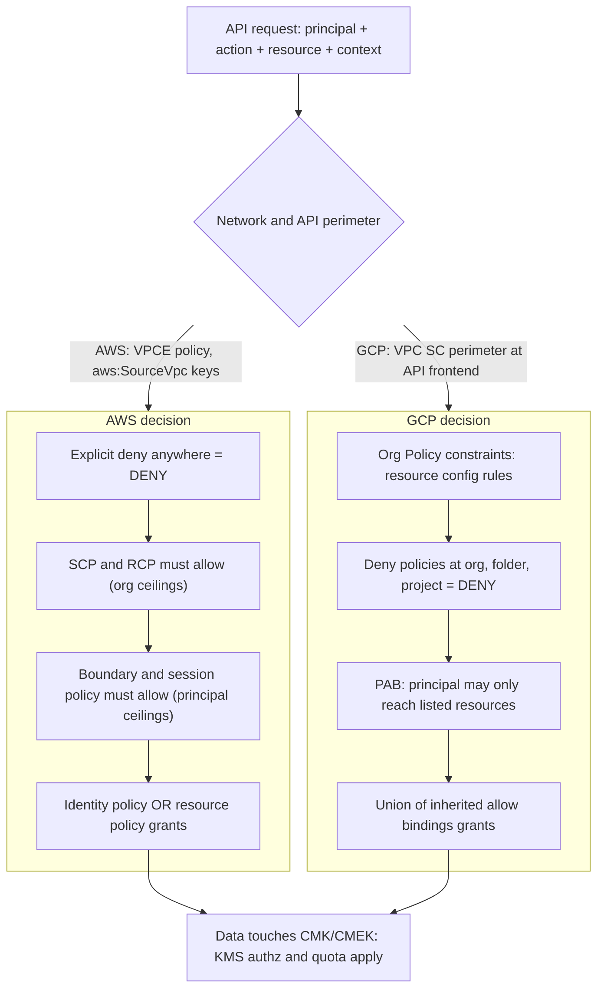

# Identity, Security, and Governance Translation

## TL;DR

1. AWS authorization is a conjunction of ceilings (SCP, RCP, permission boundary, session policy) intersected with a union of grants (identity and resource policies).
GCP authorization is a union of inherited allow bindings, filtered by deny policies and Principal Access Boundaries (PAB), plus a separate Organization Policy plane that constrains resource configuration rather than principals.
2. An SCP gates the caller's account only, so inbound cross-account calls to your resources escape it, and this is why RCPs exist.
GCP deny policies attach to the target's hierarchy and PAB attaches to the principal, so each cloud closes the same exfiltration hole from a different side.
3. An AWS endpoint policy and the `aws:SourceVpc` keys only exist on requests that traverse a VPC endpoint.
VPC Service Controls (VPC SC) is evaluated at the Google API front end against the project identity of both source and target, whatever network path the request took.
The two are not substitutes and their failure modes differ.
4. AWS KMS authorizes through the key policy, and IAM policies only count if the key policy delegates to them.
Cloud KMS authorizes through IAM alone, with inheritance down the project, location, key ring, key, and version tree.
Both use envelope encryption and both put a regional KMS call in the data path of every encrypted read, so KMS throughput and availability are capacity planning inputs, not security afterthoughts.
5. Governance planes are global blast radii.
Policy changes must ship with dry-run, staged rollout, and a break-glass path that does not depend on the plane being changed.
Most numeric limits in this chapter are marked UNVERIFIED because the live-documentation pass was not completed; see the batch report.

## Mental Model



Think of both clouds as the same pipeline with different placement of the filters.
The request first meets a network or API perimeter, then a stack of ceilings that can only remove permission, and finally a set of grants that can only add permission.
AWS places the org-level ceilings on the caller's account (SCP) and on the resource's account (RCP), and keeps grants on identities and resources.
GCP places deny on the hierarchy of the resource, keeps allow as an inherited union, and adds PAB as a principal-side ceiling.
The final hop, encrypted data, introduces a second authorization decision (the key's) and a second capacity budget (KMS requests per second), and that hop is where most AI data-plane incidents surface.
See [[17-Cloud-AI-Engineering/Volume_02_AWS_Deep_Dive/Chapter_01_IAM_Policy_Evaluation_Engine|IAM Policy Evaluation Engine]] and [[17-Cloud-AI-Engineering/Volume_03_GCP_Deep_Dive/Chapter_02_Cloud_IAM_Roles_Policies_and_Conditions|Cloud IAM: Roles, Policies, and Conditions]] for the single-cloud details this chapter translates.

## Internals

### Authorization as set algebra

For a same-account AWS request the effective decision can be written as: no explicit deny in any applicable policy, AND SCP allows, AND RCP allows, AND (for role sessions with them) boundary allows AND session policy allows, AND (identity policy allows OR resource policy allows).
For a cross-account request both the caller's account and the resource's account must independently allow, so it is an AND over two such expressions (AWS IAM docs, policy evaluation logic: [link](https://docs.aws.amazon.com/IAM/latest/UserGuide/reference_policies_evaluation-logic.html)).
Evaluation is not an ordered pipeline in the sense of short-circuit semantics visible to you.
The engine computes the same answer regardless of the order in which policy types are consulted, and the ordering you see in diagrams is a teaching device.
AWS verifies this algebra with automated reasoning: Zelkova translates policies into SMT formulas, which is the engine behind IAM Access Analyzer and S3 Block Public Access analysis (Backes et al., "Semantic-based Automated Reasoning for AWS Access Policies using SMT", FMCAD 2018).

GCP's algebra is different in shape.
Allow policies are attached at organization, folder, project, or resource nodes, and the effective allow set for a resource is the union of bindings along the path from the resource to the root.
There is no way to remove a role granted at a parent by editing a child allow policy.
Removal requires a deny policy, which is also inherited down the hierarchy and cannot be overridden by any allow.
Deny rules support exception principals and CEL conditions, typically on resource tags.
PAB policies are the third filter, bound to sets of principals, and enumerate the resources (by org, folder, or project) those principals are eligible to access (Google Cloud IAM docs, deny and PAB overviews: [deny](https://cloud.google.com/iam/docs/deny-overview)).
Treat PAB GA status as UNVERIFIED for 2026-10 and check release notes before depending on it.

The practical translation rule is the following.
An SCP deny-list statement maps to a GCP organization-level deny policy.
An SCP allow-list (removing `FullAWSAccess` and enumerating services) has no exact analog: the closest constructs are PAB (limits which resources) plus deny (limits which permissions), and neither enumerates "only these services".
A resource-side guardrail (RCP) maps to deny policies on the resource hierarchy.
Configuration invariants (no public buckets, no SA keys, region pinning) map to Organization Policy constraints on GCP and, on AWS, to a mix of SCP deny, declarative policies, and AWS Config rules.
Declarative policies are a newer AWS Organizations policy type that enforces service-level baseline configuration; their GA status and service coverage are UNVERIFIED as of 2026-10.

### The asymmetry nobody mentions: whose authority applies to an inbound call

An SCP is evaluated against the principal's own account and OU path.
If a principal in account B (outside your organization) calls `s3:GetObject` on your bucket, your SCPs are not consulted, because the principal is not in your organization.
Your bucket policy and any IAM controls in B are what decide.
The AWS answer was Resource Control Policies, which apply to resources in member accounts regardless of who calls (AWS Organizations docs, RCPs: [link](https://docs.aws.amazon.com/organizations/latest/userguide/orgs_manage_policies_rcps.html)).
RCPs support a limited list of services (S3, STS, KMS, SQS, and Secrets Manager at launch; the current list is UNVERIFIED as of 2026-10), do not grant anything, and do not apply to the management account's resources, so any resource type outside the list still relies on resource policies.
GCP never had this gap in the same form, because deny and allow policies are attached to the target's hierarchy, and the caller's home organization never had a vote in the first place.
Its equivalent gap runs the other way: a caller in your org can reach a resource in someone else's project unless PAB, VPC SC egress rules, or Org Policy (for example domain-restricted sharing and CMEK project restrictions) stop it.
A data-exfiltration review therefore has two directions in both clouds, and you must name which control closes which.

### Service identity and the confused deputy

AWS service-to-service access uses either the caller's credentials (forward access sessions, as with S3 calling KMS with your identity for SSE-KMS) or a service principal or service-linked role acting on your behalf.
The service principal case is exposed to confused-deputy attacks, mitigated with `aws:SourceArn` and `aws:SourceAccount` conditions in the resource policy or trust policy.
GCP uses per-project, Google-managed service agents that live in Google's tenant but receive IAM roles inside your project.
You grant the agent `roles/cloudkms.cryptoKeyEncrypterDecrypter` on a key, and the agent acts for the project it belongs to, so the project number in the agent's email is the scoping mechanism.
The AWS pass-role primitive, `iam:PassRole`, has a direct GCP analog in `iam.serviceAccounts.actAs`.
Both are the privilege-escalation edge for any managed compute that runs as a role or service account, including SageMaker, Vertex AI, Cloud Run, Lambda, and GKE.

### Perimeters: endpoint policy versus VPC SC

An AWS gateway endpoint (S3, DynamoDB) is a route-table entry pointing the service prefix list at the endpoint, with an optional endpoint policy.
An interface endpoint (PrivateLink) is an ENI per chosen subnet with a private IP, and a private DNS name that overrides the public service name inside the VPC.
Endpoint policies never grant; they intersect with identity and resource policies.
The default endpoint policy allows everything, so adding an endpoint without tightening its policy adds a network path but no control.
Conditions such as `aws:SourceVpc` and `aws:SourceVpce` are populated only when a request traverses the endpoint, so a resource policy that says "deny unless `aws:SourceVpce` equals X" must also carve out requests made by AWS services on your behalf (using `aws:ViaAWSService` or `aws:PrincipalIsAWSService`) or it breaks features such as CloudFormation, Athena, or Bedrock batch jobs that call S3 from AWS-owned networks (AWS whitepaper, Building a Data Perimeter on AWS: [link](https://docs.aws.amazon.com/whitepapers/latest/building-a-data-perimeter-on-aws/building-a-data-perimeter-on-aws.html)).
A negated operator such as `StringNotEquals` on `aws:SourceVpce` is true when the key is absent, so the Deny fires for those service calls, and `StringNotEqualsIfExists` is also true when the key is absent, so the suffix does not exempt them.
The exemption is a separate AND clause: `BoolIfExists` requires `aws:PrincipalIsAWSService` and `aws:ViaAWSService` to be false, and a plain `Bool` on that clause is false when the key is missing, which skips the Deny for anonymous callers.

VPC SC works at a different layer.
A service perimeter lists projects (and, in newer configurations, VPC networks) and a set of restricted services.
When a Google API request arrives at the front end, the perimeter check compares the project that owns the target resource, the project from which the request originates (when determinable), the caller identity, and the access-level attributes (IP range, device policy, region) from Access Context Manager.
The decision is made on those attributes, not on whether the packet traversed a private path.
That is why it blocks a stolen service account key used from a laptop on the public internet, and why it blocks `gcloud storage cp` from an in-perimeter bucket to a bucket in an out-of-perimeter project: the copy request's target project differs from the source's, and the egress rule set decides.
Ingress and egress rules replaced most uses of legacy bridge perimeters.
Dry-run mode logs would-be violations to Cloud Audit Logs with a unique violation ID, so you can measure the blast radius before enforcing.
Private access to Google APIs uses the restricted virtual IP range 199.36.153.4/30 via `restricted.googleapis.com`, which exposes only VPC SC-supported APIs, or Private Service Connect endpoints for Google APIs (UNVERIFIED for the PSC bundle names).
Things neither control covers: a compromised principal writing to an in-perimeter resource it is allowed to write to, DNS tunnelling, and any service that is not on the supported list for the perimeter or endpoint policy.

### Key hierarchies

AWS KMS keys are regional.
A KMS key is a logical object; its key material lives in FIPS-validated HSMs, and the symmetric `Encrypt` call is limited to 4,096 bytes, so workloads use `GenerateDataKey` to get a plaintext DEK plus a ciphertext copy wrapped under the KMS key (AWS KMS Cryptographic Details whitepaper: [link](https://docs.aws.amazon.com/kms/latest/cryptographic-details/intro.html)).
The returned ciphertext blob embeds the identifier of the key and backing key version, which is why `Decrypt` of a symmetric blob does not need a `KeyId` argument and why automatic rotation, which adds new backing key material under the same key ARN, never invalidates older ciphertexts.
Authorization is rooted in the key policy.
A statement that delegates to the account root principal is what turns on IAM policies for that key; without it, an IAM `kms:Decrypt` allow does nothing.
Cross-account use needs the key policy (or a grant) in the key's account and an identity policy in the caller's account.
Grants are the mechanism AWS services use to get scoped, revocable, programmatically created permissions (EBS and RDS create grants on your behalf), and they are eventually consistent, with grant tokens as the escape hatch for use-immediately.
Encryption context is additional authenticated data bound to the ciphertext and logged in CloudTrail, which makes it both an integrity control and an authorization condition key (`kms:EncryptionContext:*`).

Cloud KMS is a resource tree: project, location, key ring, crypto key, crypto key version.
Key rings and keys cannot be deleted; only versions are destroyed, after a scheduled-destruction window.
Authorization is IAM only, with no key policy object, and roles can be granted at any node and inherited downward.
Protection levels are SOFTWARE, HSM, and EXTERNAL (EKM, optionally over VPC).
A key's location must match the location of the resource it protects for CMEK in most services, which is a constraint that surprises multi-region designs.
Google's own at-rest design wraps per-chunk data keys with key-encryption keys held in Keystore, and CMEK inserts a customer-controlled KEK layer into that chain (Google Cloud, "Encryption at rest in Google Cloud" whitepaper).
Cloud KMS Autokey provisions keys and key handles on demand per resource type and location in a dedicated key project; AWS has no equivalent automatic per-resource key provisioning (Autokey GA status as of 2026-10 is UNVERIFIED).

### Control plane versus data plane of identity

AWS IAM control-plane operations (create role, attach policy) are served from us-east-1, while authentication and authorization decisions are served by regional data planes that hold replicated state (AWS whitepaper, Fault Isolation Boundaries: [link](https://docs.aws.amazon.com/whitepapers/latest/aws-fault-isolation-boundaries/abstract-and-introduction.html)).
The consequence is that a running workload keeps authorizing during a us-east-1 control-plane event, but your break-glass automation that edits policies does not.
Design runbooks so that emergency access uses pre-created roles (assume only, no edits), not "create a role" flows.
GCP IAM changes are eventually consistent, with documented propagation delays measured in minutes (the commonly cited bound is about seven minutes, UNVERIFIED), and VPC SC perimeter changes can take up to roughly half an hour to take full effect (UNVERIFIED).
Both clouds therefore need "change, wait, verify with real traffic" in the pipeline, not "change, assert immediately".
For the decision engine's global consistency problem, the closest public design reference is Google's Zanzibar paper (Pang et al., USENIX ATC 2019), which introduces consistency tokens so that an authorization check is evaluated at least as fresh as a prior write; AWS's open-source Cedar language (Cutler et al., OOPSLA 2024) is the reference for analyzable policy languages.
Neither paper is a description of IAM's internals, so treat them as design vocabulary rather than architecture claims.

## Numbers to Know

Every row below is marked UNVERIFIED because the live-documentation verification pass could not be completed for this revision (the search tool quota was exhausted).
Treat each as a recalled value to re-check against the cited primary source before using it in a design review.
The date tag records the intended verification date, not a completed check.

| Quantity | AWS | GCP | Source and status |
|---|---|---|---|
| Hierarchy nesting | OU nesting up to 5 levels below root | Folder nesting up to 10 levels | AWS Organizations quotas, Resource Manager docs; UNVERIFIED (as of 2026-10) |
| Ceiling policy document size | SCP 5,120 characters | Org Policy has no character ceiling; constraint count per policy is bounded | AWS Organizations quotas; UNVERIFIED (as of 2026-10) |
| Direct ceiling attachments per target | 5 SCPs per root, OU, or account | One policy per constraint per node | AWS Organizations quotas; UNVERIFIED (as of 2026-10) |
| Identity policy sizes | Managed 6,144 chars, role inline aggregate 10,240 chars, trust policy 2,048 chars default | Allow policy about 1,500 principals per policy, group principals counted separately | IAM quotas and GCP IAM quotas; UNVERIFIED (as of 2026-10) |
| Resource policy sizes | KMS key policy 32 KiB, S3 bucket policy 20 KB, VPC endpoint policy 20,480 chars | IAM policy on the resource, same size class as above | Service docs; UNVERIFIED (as of 2026-10) |
| Direct symmetric encrypt payload | 4,096 bytes | 64 KiB | KMS docs on both clouds; UNVERIFIED (as of 2026-10) |
| Symmetric KMS request quota | Shared per account per Region across all keys, region-dependent (5,500 to 30,000 requests per second) | Per project per location per minute, protection-level dependent | AWS KMS quotas, Cloud KMS quotas; UNVERIFIED (as of 2026-10) |
| Key deletion window | 7 to 30 days pending deletion, default 30 | Version destroy-scheduled duration default 30 days, configurable at key creation (minimum 24 hours) | KMS docs on both clouds; UNVERIFIED (as of 2026-10) |
| Automatic rotation | Configurable period from 90 to 2,560 days for symmetric keys | Schedule via `rotation_period`, creates new primary version | KMS docs on both clouds; UNVERIFIED (as of 2026-10) |
| KMS key price | 1 USD per key per month, 0.03 USD per 10,000 requests | About 0.06 USD per software key version per month, 0.03 USD per 10,000 operations | AWS KMS pricing, Cloud KMS pricing; UNVERIFIED (as of 2026-10) |
| Interface endpoint price | About 0.01 USD per endpoint-AZ-hour plus about 0.01 USD per GB processed (us-east-1) | PSC endpoint for Google APIs has a different price structure | AWS PrivateLink pricing, GCP PSC pricing; UNVERIFIED (as of 2026-10) |
| IAM change propagation | Eventually consistent, typically seconds | Eventually consistent, documented up to minutes (about 7) | IAM docs; UNVERIFIED (as of 2026-10) |
| Perimeter change propagation | Endpoint policy changes take effect after propagation, typically seconds to minutes | VPC SC changes can take up to about 30 minutes | VPC SC docs; UNVERIFIED (as of 2026-10) |
| Restricted API VIP | not applicable | 199.36.153.4/30 for `restricted.googleapis.com` | VPC SC docs; UNVERIFIED (as of 2026-10) |
| S3 Bucket Key effect | Claimed reduction of SSE-KMS request cost by up to 99 percent | Not applicable | S3 docs; UNVERIFIED (as of 2026-10) |

## AWS vs GCP Mechanism Parity

| Concern | AWS mechanism | GCP mechanism | Critical difference |
|---|---|---|---|
| Isolation boundary | Account | Project | AWS roles and users are account-scoped principals; GCP service accounts live in a project but are globally addressable principals, so cross-project grants are one binding instead of trust plus identity policy. |
| Org ceiling on principals | SCP (deny-list or allow-list) | Deny policy at org or folder, PAB | No GCP allow-list analog; SCPs also skip the management account and service-linked roles, while deny policies do not carve out the org admin automatically. |
| Org ceiling on resources | RCP (limited service list) | Deny policy on resource hierarchy, Org Policy | GCP resource-side controls are native; AWS needs RCP plus resource policies and has coverage gaps by service. |
| Config invariants | Declarative policies, SCP deny on API actions, Config rules | Org Policy managed and custom constraints (CEL), with dry-run | Org Policy is evaluated by the service on resource create or update with inherited merge semantics (`inheritFromParent`, reset); SCP only sees API actions and cannot inspect arbitrary fields unless the condition key exists. |
| Grant model | Identity policy or resource policy (union), cross-account needs both sides | Union of inherited allow bindings, roles bound at nodes | GCP cannot subtract at a child; AWS can attach a deny anywhere. |
| Explicit deny | In any policy type | Dedicated deny policies only | GCP allow policies have no deny effect, so tooling that audits "allow statements" misses deny policies. |
| Condition language | JSON condition operators with global and service keys, ABAC via tags | CEL conditions on bindings, resource tags in conditions | Not every GCP service supports conditional bindings; AWS key availability varies by service and action instead. |
| Impersonation | `sts:AssumeRole` with trust policy, `iam:PassRole` for services | Token Creator on a service account, `iam.serviceAccounts.actAs` for services | Both are the escalation edge; GCP impersonation chains (delegates) can be audited via Policy Analyzer, AWS role chains by Access Analyzer and CloudTrail. |
| Workload identity | IRSA, EKS Pod Identity, IAM Roles Anywhere | GKE Workload Identity, Workload Identity Federation | Both exchange OIDC or platform tokens for short-lived credentials; see [[17-Cloud-AI-Engineering/Volume_08_Security_Identity_and_the_Data_Perimeter/Chapter_02_Workload_Identity_Federation\|Workload Identity Federation]]. |
| Service-owned identities | Service-linked roles, service principals | Service agents in your project | Service agents appear in your IAM and need explicit key grants; service principals are scoped via `aws:SourceArn`. |
| Network-path control | Gateway and interface endpoints, endpoint policy, `aws:SourceVpce` | Private Google Access, PSC for Google APIs, restricted VIP | Path-based on AWS, attribute-based on GCP. |
| API perimeter | Data perimeter pattern: SCP, RCP, endpoint policy combined | VPC SC service perimeter with ingress and egress rules, dry-run | VPC SC is one managed product with a dry-run; the AWS perimeter is a composition you assemble and test yourself. |
| Perimeter staging | No native dry-run for SCP; use Access Analyzer, CloudTrail, simulator | VPC SC and Org Policy dry-run | Biggest rollout-safety gap on AWS. |
| KMS authorization root | Key policy (plus IAM if delegated, plus grants) | IAM only, inherited | AWS can produce a key nobody in IAM can administer; GCP keys inherit grants that may be broader than intended. |
| KMS scope | Regional, multi-Region keys replicate material to chosen regions | Regional, multi-region and global locations managed by Google | AWS multi-Region keys are independent keys with their own policy; GCP multi-region location is a single resource whose replication you do not control. |
| Protection levels | Standard HSM-backed, CloudHSM custom key store, external key store (XKS) | SOFTWARE, HSM, EXTERNAL and EXTERNAL_VPC via EKM | Both externalize; the external manager's availability becomes a hard dependency of reads. |
| Rotation | Automatic key material rotation under same ARN | New primary version, old versions stay enabled for decrypt | Neither re-encrypts existing data; service-managed layers (S3, GCS) re-wrap on their own schedule or not at all. |
| Auto-provisioning | None native | Autokey | GCP reduces key sprawl policy gaps by design. |
| Audit | CloudTrail logs KMS calls with encryption context | Cloud Audit Logs; Admin Activity on by default, Data Access logs for KMS crypto calls must be enabled | A GCP perimeter or KMS investigation can be blind if Data Access logs were never turned on (UNVERIFIED default per service). |

## Worked Example: A Dual-Cloud Encrypted Bucket With Guardrails

This lab provisions one CMK-encrypted bucket on each cloud, a key policy or IAM deny that blocks foreign principals or service account key creation, and budget alarms.
It then runs a capacity script that shows why KMS request rate, not bandwidth, is the first limit you hit on a many-reader AI data path.

### Assumptions

1. A sandbox AWS account with credentials in the environment, and a GCP project inside an organization (Org Policy requires an organization-parented project, UNVERIFIED).
2. Terraform 1.6 or later (or OpenTofu).
3. The operator's GCP identity is passed as `break_glass_email` so the deny policy does not lock out your own teardown.

### Terraform

```hcl
terraform {
  required_version = ">= 1.6"
  required_providers {
    aws    = { source = "hashicorp/aws", version = "~> 5.80" }
    google = { source = "hashicorp/google", version = "~> 6.0" }
  }
}

variable "gcp_project" {
  type = string
}

variable "gcp_region" {
  type    = string
  default = "us-central1"
}

variable "aws_region" {
  type    = string
  default = "us-east-1"
}

variable "alert_email" {
  type = string
}

variable "break_glass_email" {
  type = string
}

variable "billing_account" {
  type = string
}

provider "aws" {
  region = var.aws_region
}

provider "google" {
  project               = var.gcp_project
  region                = var.gcp_region
  user_project_override = true
  billing_project       = var.gcp_project
}

data "aws_caller_identity" "me" {}

# ---------- AWS: key policy as root of trust, plus bucket key ----------
resource "aws_kms_key" "data" {
  description             = "ch17-v04-lab"
  enable_key_rotation     = true
  rotation_period_in_days = 365
  deletion_window_in_days = 7

  policy = jsonencode({
    Version = "2012-10-17"
    Statement = [
      {
        Sid       = "EnableIamPolicies"
        Effect    = "Allow"
        Principal = { AWS = "arn:aws:iam::${data.aws_caller_identity.me.account_id}:root" }
        Action    = "kms:*"
        Resource  = "*"
      },
      {
        Sid       = "DenyForeignAccountPrincipals"
        Effect    = "Deny"
        Principal = { AWS = "*" }
        Action    = ["kms:Decrypt", "kms:Encrypt", "kms:GenerateDataKey*", "kms:ReEncrypt*"]
        Resource  = "*"
        Condition = {
          StringNotEquals = { "aws:PrincipalAccount" = data.aws_caller_identity.me.account_id }
          BoolIfExists    = { "aws:PrincipalIsAWSService" = "false" }
        }
      }
    ]
  })
}

resource "aws_s3_bucket" "lab" {
  bucket_prefix = "ch17v04-lab-"
  force_destroy = true
}

resource "aws_s3_bucket_public_access_block" "lab" {
  bucket                  = aws_s3_bucket.lab.id
  block_public_acls       = true
  block_public_policy     = true
  ignore_public_acls      = true
  restrict_public_buckets = true
}

resource "aws_s3_bucket_server_side_encryption_configuration" "lab" {
  bucket = aws_s3_bucket.lab.id
  rule {
    apply_server_side_encryption_by_default {
      sse_algorithm     = "aws:kms"
      kms_master_key_id = aws_kms_key.data.arn
    }
    bucket_key_enabled = true
  }
}

resource "aws_budgets_budget" "lab" {
  name         = "ch17v04-lab"
  budget_type  = "COST"
  limit_amount = "10"
  limit_unit   = "USD"
  time_unit    = "MONTHLY"

  notification {
    comparison_operator        = "GREATER_THAN"
    threshold                  = 80
    threshold_type             = "PERCENTAGE"
    notification_type          = "ACTUAL"
    subscriber_email_addresses = [var.alert_email]
  }
}

# ---------- GCP: IAM-only key authz, CMEK bucket, deny policy, org policy ----------
resource "google_kms_key_ring" "lab" {
  name     = "ch17v04-lab-ring"
  location = var.gcp_region
}

resource "google_kms_crypto_key" "data" {
  name                       = "data"
  key_ring                   = google_kms_key_ring.lab.id
  purpose                    = "ENCRYPT_DECRYPT"
  rotation_period            = "7776000s"
  destroy_scheduled_duration = "86400s"

  version_template {
    algorithm        = "GOOGLE_SYMMETRIC_ENCRYPTION"
    protection_level = "SOFTWARE"
  }
}

data "google_storage_project_service_account" "gcs" {}

resource "google_kms_crypto_key_iam_member" "gcs_agent" {
  crypto_key_id = google_kms_crypto_key.data.id
  role          = "roles/cloudkms.cryptoKeyEncrypterDecrypter"
  member        = "serviceAccount:${data.google_storage_project_service_account.gcs.email_address}"
}

resource "google_storage_bucket" "lab" {
  name                        = "${var.gcp_project}-ch17v04-lab"
  location                    = var.gcp_region
  force_destroy               = true
  uniform_bucket_level_access = true
  public_access_prevention    = "enforced"

  encryption {
    default_kms_key_name = google_kms_crypto_key.data.id
  }

  depends_on = [google_kms_crypto_key_iam_member.gcs_agent]
}

resource "google_iam_deny_policy" "no_sa_keys" {
  parent       = urlencode("cloudresourcemanager.googleapis.com/projects/${var.gcp_project}")
  name         = "ch17v04-no-sa-keys"
  display_name = "Deny service account key creation"

  rules {
    description = "Only the break-glass identity may mint SA keys"
    deny_rule {
      denied_principals    = ["principalSet://goog/public:all"]
      exception_principals = ["principal://goog/subject/${var.break_glass_email}"]
      denied_permissions   = ["iam.googleapis.com/serviceAccountKeys.create"]
    }
  }
}

resource "google_org_policy_policy" "no_sa_keys" {
  name   = "projects/${var.gcp_project}/policies/iam.disableServiceAccountKeyCreation"
  parent = "projects/${var.gcp_project}"

  spec {
    rules {
      enforce = "TRUE"
    }
  }
}

resource "google_billing_budget" "lab" {
  billing_account = var.billing_account
  display_name    = "ch17v04-lab"

  amount {
    specified_amount {
      currency_code = "USD"
      units         = "10"
    }
  }

  threshold_rules {
    threshold_percent = 0.8
  }
}
```

The two guardrails on the GCP side are deliberately redundant: the Organization Policy constraint blocks the configuration action at the service, and the deny policy blocks the permission at IAM.
Compare their error messages when you run `gcloud iam service-accounts keys create` against a lab service account; the constraint violation and the permission denial come from different planes, which is the point of the exercise.

### Capacity and cost script

```python
#!/usr/bin/env python3
"""KMS request-rate and cost sizing for an encrypted object-store read path."""
import argparse

P = argparse.ArgumentParser()
P.add_argument("--readers", type=int, default=4096, help="concurrent reader processes")
P.add_argument("--objects_per_s_per_reader", type=float, default=5.0)
P.add_argument("--bucket_key_reduction", type=float, default=0.99,
               help="fraction of KMS calls removed by bucket-level keys (vendor claim)")
P.add_argument("--kms_quota_rps", type=float, default=10000.0,
               help="shared symmetric quota for your region; read it from Service Quotas")
P.add_argument("--usd_per_10k_requests", type=float, default=0.03)
args = P.parse_args()

SECS_MONTH = 30 * 86400
rps = args.readers * args.objects_per_s_per_reader
rps_bk = rps * (1.0 - args.bucket_key_reduction)

def monthly_cost(r):
    return r * SECS_MONTH / 10000.0 * args.usd_per_10k_requests

print(f"offered KMS rps, per-object data keys : {rps:,.0f}")
print(f"  vs quota {args.kms_quota_rps:,.0f} rps -> utilization {rps / args.kms_quota_rps:.1%}")
print(f"  monthly request cost                 : ${monthly_cost(rps):,.0f}")
print(f"offered KMS rps, with bucket keys     : {rps_bk:,.0f}")
print(f"  monthly request cost                 : ${monthly_cost(rps_bk):,.0f}")
if rps > args.kms_quota_rps:
    print("THROTTLING EXPECTED: cache data keys, enable bucket keys, or shard across accounts/regions")
```

Step-by-step back-of-envelope for the defaults:

1. 4,096 readers at 5 objects per second each offer 20,480 KMS decrypts per second if every object read triggers a KMS call.
2. Against an assumed shared quota of 10,000 requests per second, that is 205 percent utilization, so the data loader is throttled, not storage-bound.
3. Monthly request cost at 0.03 USD per 10,000 requests is 20,480 x 2,592,000 / 10,000 x 0.03, about 159,000 USD (prices UNVERIFIED as of 2026-10).
4. With bucket-level keys removing 99 percent of calls the offered load is about 205 requests per second and the monthly cost falls to about 1,600 USD.
5. The lab itself costs a few cents: one KMS key at 1 USD per month prorated, one software key version on GCP, empty buckets, and two budgets at 10 USD.

### Cost estimate, alarm, teardown

Expected lab cost for a day: under 1 USD on each cloud (UNVERIFIED prices).
Budget alarms are the two budget resources above, set to alert at 80 percent of 10 USD.

Teardown:

```bash
terraform destroy -auto-approve \
  -var gcp_project=PROJECT -var alert_email=you@example.com \
  -var break_glass_email=you@example.com -var billing_account=XXXXXX-XXXXXX-XXXXXX
aws kms describe-key --key-id alias/ch17-v04-lab --query KeyMetadata.KeyState 2>/dev/null || true
gcloud kms keys versions list --key data --keyring ch17v04-lab-ring --location us-central1 --project PROJECT
```

The AWS key will show `PendingDeletion` for 7 days, and the GCP key ring remains forever (key rings cannot be deleted), but with all versions in `DESTROY_SCHEDULED` or `DESTROYED` state it accrues no charge.
If you find a version still `ENABLED`, destroy it with `gcloud kms keys versions destroy`.

## Failure Modes and Pitfalls

### Authorization

1. **Cross-account SSE-KMS with the AWS-managed key.**
The `aws/s3` managed key has a key policy you cannot edit, so a bucket encrypted with it can never be read by another account, and the failure surfaces as `AccessDenied` on `GetObject` with a bucket policy that looks correct.
Use a customer-managed key whose key policy names the other account, and give the caller an identity policy for `kms:Decrypt`.
The GCP analog is a CMEK key in a project whose IAM does not include the other project's service agent or workload identity.
2. **SCP "works in the console but not in the pipeline".**
SCPs do not apply to the management account and do not apply to service-linked roles, so a guardrail tested from the management account proves nothing.
3. **GCP inherited grants that cannot be removed.**
A `roles/editor` binding at a folder cannot be subtracted by editing a project policy.
Teams discover this during an incident and add deny policies under pressure, which is the worst moment to ship a new global-ish control.
4. **Privilege escalation through pass-role and actAs.**
A principal that can launch managed compute with a more privileged role or service account has that role's power.
Scope `iam:PassRole` with `iam:PassedToService` and role-path conditions, and scope `actAs` to specific service accounts instead of project-wide.
Default compute service accounts historically carried broad roles; the Org Policy `iam.automaticIamGrantsForDefaultServiceAccounts` exists to stop that auto-grant.
5. **Public PIR: Capital One, 2019.**
An SSRF flaw in a web application firewall let an attacker reach the instance metadata service and fetch role credentials, and the role had broad S3 access (public reporting and the DOJ complaint).
The mechanisms that would have limited it are IMDSv2 enforcement, least-privilege roles, and a perimeter that rejects use of those credentials from outside the VPC, which is exactly what VPC endpoint conditions and, on GCP, VPC SC access levels are for.

### Perimeters

1. **Naive `aws:SourceVpce` deny.**
A resource policy that denies everything not coming through your endpoint also denies AWS services acting for you, because their requests carry no VPC keys.
Symptoms are broken CloudFormation stacks, Athena queries, or Bedrock and SageMaker jobs that read training data.
Carve out with `aws:PrincipalIsAWSService` or `aws:ViaAWSService` and test in a staging account.
2. **VPC SC enforcement without dry-run.**
Enforcing a perimeter around a project that hosts Vertex AI pipelines, BigQuery, and GCS typically breaks cross-project reads (for example public model weights or container images) and managed services' own egress.
Run dry-run, read the violation log by unique ID, write ingress and egress rules, then enforce.
3. **Perimeter changes lag.**
Changes propagate with delay, so "I fixed the rule, it still fails" is expected for a period that can be tens of minutes (UNVERIFIED).
4. **Interface endpoint cost and quotas.**
Each interface endpoint is billed per AZ-hour and per GB, and each endpoint consumes IPs in each subnet, so a per-service, per-AZ, per-VPC fan-out in a hub-and-spoke network gets expensive; centralize in a shared-services VPC where the resolver strategy allows it.

### KMS

1. **KMS as a hidden SLO.**
SSE-KMS makes each uncached object read a KMS dependency in the same Region.
Throttling shows up as 503 Slow Down or `ThrottlingException` on the data path, not on the control plane, and the shared per-account-per-Region quota means one noisy workload throttles every other workload in the account.
Mitigations are bucket-level keys on S3, data-key caching (AWS Encryption SDK caching and hierarchical keyrings), splitting accounts by workload, and quota increases requested before launch.
2. **Disabling or scheduling deletion of a key is an outage, not a cleanup.**
Volumes, buckets, and datasets protected by that key become unreadable once cached keys expire, typically on the next attach, restart, or cache miss, so the failure is delayed and hard to correlate.
Use alarms on `DisableKey` and `ScheduleKeyDeletion` events, a long deletion window, and deny policies for those actions outside break-glass roles.
3. **External key managers on the read path.**
XKS and EKM give you cryptographic custody, and they put your key manager's availability and latency into every encrypted read.
Plan for the failure of the external service and the failure of the network path to it as data-unavailability events.
4. **Region-locked keys and DR.**
A regional key is a regional failure domain; a DR region needs a multi-Region key on AWS or a key replicated by import or re-wrapping on GCP.
Test the restore with the DR region's keys, not just the data copy.

### Governance plane incidents

1. **Google Cloud, 2025-06-12.**
A policy change replicated globally within seconds and triggered a crash in the Service Control component that checks quota and policy, because of unexpected blank fields and a missing feature flag; many Google Cloud APIs returned errors until recovery, and a herd effect lengthened recovery in some regions (Google Cloud incident report; details UNVERIFIED as of 2026-10).
Lesson for platform designers: policy data is code, and it needs staged rollout, a flag, and fail-open or fail-static behavior in the consumer.
2. **Google, 2020-12-14.**
An automated quota reduction on the user ID service's storage left authentication systems unable to serve, causing a global outage of services that depend on Google sign-in (Google public incident write-up; duration and mechanism details UNVERIFIED as of 2026-10).
Identity services are the deepest dependency in the graph, so their quota and capacity automations need the strictest guardrails.
3. **Your own org-wide policy.**
An SCP or deny policy attached at the root takes effect across every account or project within propagation time and has no staged rollout in the product.
Build rollout rings yourself: sandbox OU, canary OU with real workloads, then production OUs, with an automated rollback that edits the policy from a role excluded from the policy itself.

## Security and Cost Angles

### IAM scoping

1. Use a small number of org-level deny statements for invariants (leave organization, disable logging, create access keys, destroy keys) and push everything else to workload-account IAM, because the 5,120-character SCP size limit (UNVERIFIED) and the lack of staging punish large ceiling policies.
2. On GCP prefer deny policies for the same invariants, Org Policy for configuration, and PAB for service accounts used by CI so a leaked CI credential cannot reach production projects.
3. Use short-lived credentials everywhere: role sessions, workload identity federation, and impersonation instead of exported keys.
4. Prefer attribute-based conditions (`aws:PrincipalOrgID`, `aws:ResourceOrgID`, resource tags) to long enumerations of account IDs.

### Key hierarchy and envelope encryption

1. One key per data classification and region, not one per object or per team, and wrap per-object DEKs under it; on S3 turn on bucket-level keys to bound KMS request cost.
2. Use separate key administrators and key users, and on AWS never make the root-delegation statement the only way to administer a key if you also want protection from IAM mistakes; pair it with an explicit deny on destructive actions.
3. Use `kms:ViaService`, `kms:CallerAccount`, and `kms:EncryptionContext` conditions on AWS so a key can only be used through S3 or EBS in your account.
4. On GCP use key-level IAM, CMEK Org Policy constraints (`constraints/gcp.restrictNonCmekServices` and `constraints/gcp.restrictCmekCryptoKeyProjects`) to force CMEK and keep keys in dedicated key projects, and consider Autokey for new resource types.
5. Enable Data Access audit logs for Cloud KMS if you need per-decrypt attribution; CloudTrail covers KMS by default.

### Private boundaries

1. AWS: gateway endpoints for S3 and DynamoDB are free, and interface endpoints are billed per AZ-hour and per GB (UNVERIFIED), so use the gateway where it exists and restrict its policy to your organization with `aws:PrincipalOrgID` and `aws:ResourceOrgID`.
2. GCP: put AI data projects (GCS, BigQuery, Vertex AI) in one perimeter, restrict private access to the restricted VIP, and express cross-project exceptions as narrowly scoped ingress and egress rules.
3. For both clouds, block the exfiltration paths that sit outside the perimeter: public buckets, public IPs on training nodes, unreviewed egress, and model-registry exports.

### Unit economics

1. KMS request spend scales with read rate, not data volume; model it per million reads before choosing per-object encryption keys (see the script above).
2. Key count is cheap (about 1 USD per month per AWS key, UNVERIFIED) compared with a quota incident, so split by workload to isolate throttling.
3. Interface endpoints per AZ multiply quickly; the savings from avoiding NAT gateway processing on heavy S3 or ECR traffic usually exceeds endpoint cost, but check by multiplying GB by the per-GB rates for each path.
4. Governance work saves the most money when it prevents key sprawl, orphaned service account keys, and unused cross-project grants; use IAM Access Analyzer unused-access findings on AWS and IAM Recommender on GCP to prune.

## Interview Questions and Model Answers

### Question 1 (L5 - Senior)

You have an SCP that denies `ec2:RunInstances` outside two regions. How do you reproduce that control on GCP, and what do you lose?

#### Model Answer

The faithful translation is a mix of constraints and deny, not a single policy.
For "resources only in these regions" the right primitive is the Organization Policy constraint `constraints/gcp.resourceLocations`, set at the org or folder, because it is evaluated by the service at resource create time and covers many services uniformly, where the SCP matches one API action at a time.
If I also need to prevent a specific action (for instance, only the platform team may create Compute instances), that is an IAM deny policy at the folder with exception principals.
What I lose is the allow-list option.
An SCP can remove `FullAWSAccess` and permit only an enumerated set of services; GCP has no ceiling that says "only these services", so I would reproduce it with an Org Policy `serviceuser`-style restriction on enabled APIs (the "restrict service usage" constraint, whose current name I would verify) plus PAB to narrow which resources principals can reach.
What I gain is dry-run for Org Policy and a uniform view of constraint violations.
The residual risk is that Org Policy constrains configuration while deny constrains permissions, so I test both: attempt creation as a principal with Editor on the project and confirm the failure comes from the expected plane.

#### Follow-up Interviewer Question

An engineer says they set the constraint at the org, but a team in a child folder still created a resource in a disallowed region.
What are the three most likely causes?

### Question 2 (L5 - Senior)

A Lambda role has `kms:Decrypt` in its identity policy but gets AccessDenied on a customer-managed key in the same account.
Walk through the debug.

#### Model Answer

First, check the key policy.
KMS is unusual in that IAM policies only grant access if the key policy delegates to IAM, normally via a statement that names the account root principal.
If that statement was removed (or the key was created through an API with a custom policy), the identity policy is inert.
Second, check for explicit denies in the key policy conditions, such as `kms:ViaService` or `kms:CallerAccount` mismatches, which commonly break when the caller is a different service than expected.
Third, check encryption context conditions: if the policy requires a context key-value and the caller omits it, the call is denied.
Fourth, check SCPs and permission boundaries on the role, since those still intersect.
Fifth, check whether the key is disabled or pending deletion, which returns a different error (`KMSInvalidStateException`) and sometimes gets conflated with permission failures.
The CloudTrail event shows the error code and the encryption context, which usually settles it in one look.
The GCP counterpart is simpler because there is no key policy: check IAM on the key, key ring, and project for the service agent or principal, and check that the key location matches the resource location.

#### Follow-up Interviewer Question

How would you change the key policy so that a compromised admin role cannot disable the key, without locking yourself out of rotation or emergency actions?

### Question 3 (L6 - Staff)

Design the AWS and GCP controls that stop a training cluster's credentials from being used to copy a proprietary dataset to an outside account or project.
What does each control actually stop, and what does it not?

#### Model Answer

Start from the exfiltration paths.
Path one is stolen credentials used from outside the network, path two is a legitimate in-network principal copying data to an external destination, path three is a service acting on the principal's behalf, and path four is anything outside the control surface (DNS, public IPs, compromised in-perimeter writers).
On GCP, VPC SC addresses paths one through three directly.
The perimeter check is made at the API front end using the project identity of source and target plus access-level attributes, so credentials used from the internet are rejected, and a `gcloud storage cp` to a bucket in an outside project is a request whose target is outside the perimeter and hits the egress rules.
It does not stop an in-perimeter principal with write access from placing data into an in-perimeter bucket that is later shared by some other mechanism, and it does not stop non-API channels.
On AWS the equivalent is a composition.
An endpoint policy on the S3 gateway endpoint restricts the destination buckets to my organization (`aws:ResourceOrgID`) and the callers to my principals (`aws:PrincipalOrgID`), which stops in-VPC copies to external buckets.
An SCP denies actions that did not come from my VPCs, which addresses stolen credentials.
A negated operator on `aws:SourceVpc` or `aws:SourceVpce` is true when the key is absent, so that Deny also hits managed services unless a separate AND clause carves out calls where `aws:PrincipalIsAWSService` or `aws:ViaAWSService` is true.
An RCP at the organization applies the same conditions to my S3 buckets and KMS keys regardless of who calls, which closes the inbound cross-account gap that SCPs cannot.
I would prove the controls by running the exfiltration attempts as a red-team test in a staging organization and confirming each fails with an error from the intended layer.
What neither cloud stops is covert channels, and what both leave open is KMS: a key policy that allows a foreign account to decrypt turns a copy of the ciphertext into a readable asset, so I add key policy conditions as a third layer.

#### Follow-up Interviewer Question

Your SageMaker or Vertex AI managed training job needs to read a public dataset hosted outside your perimeter.
How do you allow it without weakening the control for everything else?

### Question 4 (L6 - Staff)

Explain why a naive "deny unless `aws:SourceVpce`" bucket policy broke Athena and CloudFormation, and how you would fix it without opening the bucket.

#### Model Answer

The condition keys `aws:SourceVpc` and `aws:SourceVpce` are set by the network path of the request.
When Athena or CloudFormation reads S3 on my behalf, the request originates from the AWS service's own network using forward access session credentials, so those keys are absent.
A plain `StringNotEquals` on `aws:SourceVpce` is true when the key is absent, so the Deny fires, and `StringNotEqualsIfExists` is also true when the key is absent, so swapping in `IfExists` still denies the service call.
The exemption is a separate AND, not the operator suffix: principal is not an AWS service (`BoolIfExists aws:PrincipalIsAWSService false`), the request is not made via a service on my behalf (`BoolIfExists aws:ViaAWSService false`), and the source VPC endpoint is not in the allowed list.
The request is denied only when all of these hold.
Then I test in four ways: from inside the VPC through the endpoint, from outside the VPC with valid credentials, through Athena, and through CloudFormation, and verify that only the second is blocked.
I record the test as a regression test in CI against a staging account, because the semantics are subtle enough that edits regress easily.
GCP's VPC SC avoids this class of bug because it is attribute-based at the API front end, but it has its own: managed services that call across projects need explicit ingress and egress rules.

#### Follow-up Interviewer Question

How would you find which of your 200 existing bucket policies contain this antipattern, and how would you remediate them without an outage?

### Question 5 (L6 - Staff)

A 4,096-reader data loader starts throttling after you turn on SSE-KMS.
Storage bandwidth is fine.
Diagnose, size, and fix it on AWS, then say what changes on GCP.

#### Model Answer

The symptom pattern is throttling errors on the data path with low storage utilization, which points to KMS.
The mechanism is that each uncached object read triggers a `Decrypt` (or `GenerateDataKey` on writes) against the account's shared per-Region symmetric request quota.
Sizing: readers times objects per second per reader equals offered KMS rate, so 4,096 readers at 5 objects per second is 20,480 per second against a quota that, depending on Region, is in the range of 5,500 to 30,000 (UNVERIFIED), so I am near or over the limit before any other workload in the account is counted.
Fixes in order of leverage: enable S3 Bucket Keys, which let S3 derive object keys from a bucket-level key and cut KMS requests by a large factor (vendor claim up to 99 percent), which also cuts request cost from roughly 159,000 to 1,600 USD per month at these rates; pack small objects into shards (WebDataset-style) so reads per second drop by 100 to 1,000 times; cache data keys with the AWS Encryption SDK for client-side encryption; isolate the training account so no other workload shares the quota; and file a quota increase early.
Bucket Keys change the encryption context seen in CloudTrail from object ARN to bucket ARN, so any key policy condition on object ARN needs updating.
On GCP the same design question exists in a different form: GCS wraps object-level data keys with the CMEK, and Cloud KMS quotas are per project per location per minute, so the unit and the scope differ.
I would put the key in a dedicated key project, check that project's quota, and verify whether GCS's own key caching already shields the key from per-object calls for my access pattern (UNVERIFIED, so I would measure with Cloud Monitoring KMS metrics before and after).

#### Follow-up Interviewer Question

You must keep per-object keys for compliance and cannot use Bucket Keys.
What architecture changes the request rate without changing the cryptographic guarantee?

### Question 6 (L6 - Staff)

Compare AWS KMS key policy plus grants with Cloud KMS IAM inheritance as authorization models.
Which is safer, and for what failure?

#### Model Answer

AWS KMS has a closed model: the key policy is the only root, and nothing outside it can administer the key.
That protects against account-wide IAM sprawl, because an over-broad `kms:*` in a developer role does nothing if the key policy does not delegate, and it enables cross-account sharing without the other account's admins having any say.
Its failure mode is the lockout and the confusion: a key policy that omits root delegation orphans the key, and debugging requires reading two documents.
Grants add a third mechanism, created programmatically by services, eventually consistent, and visible only via `ListGrants`, which is where unexplained access often hides.
Cloud KMS has an open model: IAM at any node, inherited, one language for everything.
That is easier to audit with Policy Analyzer and consistent with the rest of GCP, and the failure mode is inheritance: a role granted at the project or folder level silently applies to every key beneath it, so a developer with `cloudkms.admin` at project level controls every key in the project.
The mitigation is to put keys in dedicated key projects with no workload principals, grant only at key level, and use deny policies on destructive permissions.
For separation of duties, on AWS I enforce through key policy statements plus SCP deny; on GCP through a key project and deny policies.
I would call AWS safer against accidental over-grant and GCP safer against operator error that locks out a key, and neither safe against a compromised org admin, so both need audit alarms on policy changes.

#### Follow-up Interviewer Question

An auditor asks for a list of all principals who can decrypt a given dataset.
How do you produce it in each cloud, and where is the answer incomplete?

### Question 7 (L7+ - Principal)

You own the org-wide guardrail rollout for 800 AWS accounts and 600 GCP projects.
Design the change-management system, given that neither SCPs nor GCP deny policies have a native staged rollout.
Use the 2025 Google Service Control incident as a reference.

#### Model Answer

Governance policy is a global configuration push, so I treat it like a production deploy of a control plane.
The principles from the June 2025 incident are that configuration data needs the same staging, feature flag, and fail-safe consumer behavior as code, and that a global control with no canary converts a bad edit into a global outage.
My system has five parts.
First, policy as code in a repository with schema validation, a policy linter, and automated reasoning checks (Access Analyzer policy validation, Policy Simulator, OPA unit tests) that reject policies that deny the break-glass roles.
Second, rollout rings implemented by me: sandbox OU or folder, a canary ring with real but low-risk workloads, then regions or business-unit rings, each with a soak time greater than the propagation delay (minutes for GCP IAM and tens of minutes for VPC SC, UNVERIFIED) and an SLO-based health gate that watches AccessDenied rates, deploy failure rates, and org-level support tickets.
Third, dry-run where it exists: Org Policy dry-run and VPC SC dry-run on GCP, and on AWS CloudTrail-driven simulation ("what would have been denied") using Access Analyzer policy generation and a log query over the last 30 days, since SCPs have no dry-run.
Fourth, rollback that does not depend on the plane being changed: a pipeline role excluded from the policy by condition, a pre-created break-glass role with out-of-band credentials, and runbooks that do not require IAM control-plane writes in us-east-1 during an AWS regional event.
Fifth, change velocity limits: policies attached at the root change at most weekly, anything else goes through OU-level attachment.
The cost is slower guardrail delivery, which I accept because the blast radius of a root-level error is the whole company.

#### Follow-up Interviewer Question

A critical security fix must go to all accounts within an hour.
Which of the five parts do you keep, which do you compress, and what do you document as accepted risk?

### Question 8 (L7+ - Principal)

Leadership wants "customer-held keys" so no cloud operator can read training data, on both clouds.
Lay out the options, the availability cost, and what you would recommend for a 10 PB training corpus with a 50 GB per second read path.

#### Model Answer

There are four tiers.
Tier one is customer-managed keys in the provider's KMS (AWS CMK, Cloud KMS software or HSM), which gives key lifecycle control and audit but not exclusion of the provider from the trust base.
Tier two is bring-your-own key material imported into the provider's KMS, which gives you a copy and an escrow story but the provider still holds usable material.
Tier three is an external key manager (AWS XKS, Cloud EKM), where the provider calls your key manager on every wrap and unwrap, so you can revoke access instantly and, with Key Access Justifications on GCP, see a reason code per call.
Tier four is client-side encryption where the provider never sees plaintext or keys, using libraries such as the AWS Encryption SDK or Tink.
The cost is availability and latency: with tier three your external manager's availability, network path, and capacity are on the read path of every encrypted object that is not cached, so the data plane inherits its SLO.
At 50 GB per second with 8 MB objects, the object rate is about 6,250 per second, which is within what a well-run external key manager can serve, but the cumulative request cost and the failure semantics, in which a key manager brownout stalls the whole training run, are what matter.
I would recommend tier one with HSM protection, strict key policy or IAM separation, perimeter controls, and data-key caching for the training corpus, and reserve tier three for the small set of datasets with a legal need to be revocable, because a training job that stalls on an external dependency for hours burns accelerator-hours that cost far more than the keys.
For checkpoints that must survive provider-side compromise, tier four with a hierarchical keyring (cached branch keys) gives revocation at the cost of an operational burden I would only accept for a narrow class.
The decision is an availability and cost trade against a threat model; I would write the threat model first and let it select the tier.

#### Follow-up Interviewer Question

Your external key manager has a 20-minute outage during a week-long training run.
What should the training job's checkpoint and key-cache design have done so the outage costs minutes, not hours?

## Further Reading

1. [AWS IAM policy evaluation logic](https://docs.aws.amazon.com/IAM/latest/UserGuide/reference_policies_evaluation-logic.html) - the authoritative statement of the AWS decision algebra, including the same-account and cross-account cases.
2. [AWS Organizations: Resource control policies](https://docs.aws.amazon.com/organizations/latest/userguide/orgs_manage_policies_rcps.html) - the resource-side ceiling, with the current service list and exclusions.
3. [Building a Data Perimeter on AWS](https://docs.aws.amazon.com/whitepapers/latest/building-a-data-perimeter-on-aws/building-a-data-perimeter-on-aws.html) - the reference composition of SCP, RCP, and endpoint policy, including the service-on-behalf carve-outs.
4. [AWS Fault Isolation Boundaries whitepaper](https://docs.aws.amazon.com/whitepapers/latest/aws-fault-isolation-boundaries/abstract-and-introduction.html) - the control plane and data plane split of global services such as IAM, essential for break-glass design.
5. [AWS KMS Cryptographic Details](https://docs.aws.amazon.com/kms/latest/cryptographic-details/intro.html) - the internal key hierarchy, HSM design, and ciphertext format behind the behaviors discussed above.
6. [Google Cloud IAM deny policies overview](https://cloud.google.com/iam/docs/deny-overview) - how deny, allow, and inheritance interact on GCP.
7. [Google Cloud Organization Policy overview](https://cloud.google.com/resource-manager/docs/organization-policy/overview) - constraint types, inheritance and merge semantics, and dry-run.
8. [VPC Service Controls overview](https://cloud.google.com/vpc-service-controls/docs/overview) - perimeter semantics, ingress and egress rules, and dry-run mode.
9. [Cloud KMS resource hierarchy](https://cloud.google.com/kms/docs/resource-hierarchy) - the key ring and version model, location rules, and destroy semantics.
10. Backes et al., "Semantic-based Automated Reasoning for AWS Access Policies using SMT" (FMCAD 2018) - how Zelkova verifies policy properties, and why IAM policies are tractable to analyze.
11. Pang et al., "Zanzibar: Google's Consistent, Global Authorization System" (USENIX ATC 2019) - the consistency-token approach to authorization freshness, the best vocabulary for IAM propagation trade-offs.
12. Cutler et al., "Cedar: A New Language for Expressive, Fast, Safe, and Analyzable Authorization" (OOPSLA 2024) - the design of an analyzable policy language, useful for judging policy-as-code tooling.
13. Google Cloud incident report for 2025-06-12 (Service Control) - a public post-incident review of a global policy-data rollout failure, on the Google Cloud status page.
14. Related chapters: [[17-Cloud-AI-Engineering/Volume_08_Security_Identity_and_the_Data_Perimeter/Chapter_06_Constructing_an_Impenetrable_Data_Perimeter|Constructing an Impenetrable Data Perimeter]], [[17-Cloud-AI-Engineering/Volume_08_Security_Identity_and_the_Data_Perimeter/Chapter_04_Encryption_Key_Hierarchies_and_Envelope_Encryption|Encryption Key Hierarchies and Envelope Encryption]], and [[17-Cloud-AI-Engineering/Volume_04_AWS_vs_GCP_Translation/Chapter_02_Networking_and_Load_Balancing_Translation|Networking and Load Balancing Translation]] for the network layer that precedes this chapter's controls.
