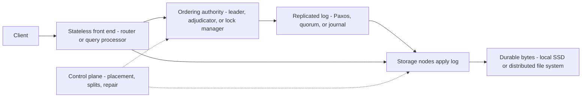

# Storage and Database Translation

## TL;DR

- Every service in this chapter is a decoupled system with one ordering authority and one durable byte store, and translation errors come from mismatching the semantics of the ordering authority, not the byte store: per-object write rate on GCS, hash vs range partitioning on DynamoDB vs Bigtable, OCC vs lock-based commit on DSQL vs Spanner.
- Object storage is the easy translation (both are strongly consistent, flat namespaces, 11-nines durability targets), but the cost and failure model differ: S3 scales per partitioned key prefix and meters requests, while GCS caps sustained mutations to a single object name and offers hierarchical-namespace buckets with atomic folder rename.
- Block storage differs in failure domain: an EBS volume lives in one AZ and cross-AZ durability is your job, while GCP offers synchronously replicated two-zone disks (regional Persistent Disk, Hyperdisk Balanced High Availability) as a first-class volume type; in both clouds the VM's per-instance disk cap, not the volume, is usually the real ceiling.
- DynamoDB is per-request-priced, hash-partitioned, Paxos-replicated storage with item-level and (bounded) cross-item transactions, and Bigtable is per-node-priced, range-partitioned, compute/storage-separated tablet serving with single-row atomicity only; they are not drop-in equivalents, and the sustained-throughput cost curves cross at high utilization.
- DSQL (time-based MVCC reads, optimistic commit-time adjudication, snapshot isolation) and Spanner (TrueTime, pessimistic locks, 2PC over Paxos groups, strict serializability) both claim active-active multi-region SQL, but they fail differently under contention: Spanner queues, DSQL aborts and expects the client to retry.

## Mental Model



Every service in this chapter can be read off this one picture by answering three questions: who orders writes, where are the durable bytes, and what is the failure domain of each hop.
S3 and GCS push ordering into a metadata tier and bytes into erasure-coded storage nodes.
EBS and Persistent Disk push ordering into a replication protocol between a small number of storage servers and expose a block device through a hardware offload card.
DynamoDB couples ordering and bytes inside a partition (a Paxos group with local storage), while Bigtable separates them (tablet server orders and caches, the distributed file system holds bytes).
Aurora, AlloyDB, and DSQL turn the log into the unit of replication so the database engine becomes stateless compute.
Spanner keeps ordering inside Paxos groups and adds a global clock to order across groups.
Translation work is mapping the ordering authority of one cloud to the nearest equivalent in the other, then listing what behavior you lose or gain when the mapping is imperfect.

## Internals

This chapter assumes the per-service internals from [[17-Cloud-AI-Engineering/Volume_02_AWS_Deep_Dive/Chapter_08_S3_Deep_Dive_Consistency_and_ShardStore|S3 Deep Dive]], [[17-Cloud-AI-Engineering/Volume_02_AWS_Deep_Dive/Chapter_09_Elastic_Block_Store_and_Network_Storage|EBS and Network Storage]], [[17-Cloud-AI-Engineering/Volume_02_AWS_Deep_Dive/Chapter_10_Amazon_DynamoDB_Architecture_and_Partitioning|DynamoDB]], [[17-Cloud-AI-Engineering/Volume_02_AWS_Deep_Dive/Chapter_11_Amazon_Aurora_Log_Is_The_Database|Aurora]], [[17-Cloud-AI-Engineering/Volume_02_AWS_Deep_Dive/Chapter_12_Aurora_DSQL_Multi_Region_Active_Active_SQL|Aurora DSQL]], and the GCP counterparts [[17-Cloud-AI-Engineering/Volume_03_GCP_Deep_Dive/Chapter_09_Cloud_Storage_and_Colossus_Filesystem|Cloud Storage and Colossus]], [[17-Cloud-AI-Engineering/Volume_03_GCP_Deep_Dive/Chapter_10_Cloud_Spanner_TrueTime_and_External_Consistency|Spanner]], [[17-Cloud-AI-Engineering/Volume_03_GCP_Deep_Dive/Chapter_11_Cloud_Bigtable_LSM_Storage_and_Tablet_Serving|Bigtable]], and [[17-Cloud-AI-Engineering/Volume_03_GCP_Deep_Dive/Chapter_12_AlloyDB_for_PostgreSQL_Disaggregated_Architecture|AlloyDB]].
This section covers only the mechanisms that decide translation outcomes, including several that do not appear in getting-started guides.

### Object storage: where the semantics actually diverge

Both services have offered strong read-after-write and list-after-write consistency for years.
S3 moved to strong consistency in December 2020 by adding a witness-style component that lets the metadata cache know whether its view is current, so reads do not return stale index entries (AWS Builders' Library and re:Invent material, recalled, UNVERIFIED).
GCS metadata has been described publicly as living in Spanner with data in Colossus, which is why its consistency was never relaxed (Google Cloud talks, recalled, UNVERIFIED).
The consequence is that metadata operations in GCS inherit Spanner-style per-key serialization, and this surfaces as the documented limit of roughly one mutation per second to the same object name (GCS docs, recalled, UNVERIFIED).
The mechanism behind that limit is inferred, not documented, so treat the explanation as a model and the limit as the contract.
S3 has no per-object mutation limit of the same kind, but it has a per-partitioned-prefix request budget: 3,500 write-class and 5,500 read-class requests per second per prefix (AWS docs, recalled, UNVERIFIED).
S3 partitions the keyspace by observed load and splits hot ranges automatically, and a sudden spike on a cold prefix returns HTTP 503 SlowDown until the split completes.
GCS buckets start with a baseline request rate and autoscale, and a sudden spike returns HTTP 429 or 503 until capacity catches up (GCS docs, recalled, UNVERIFIED).
In both clouds the practical rule is the same: ramp load rather than step it, and spread keys across the lexicographic range rather than writing sequential names.

Conditional writes are where application semantics move.
S3 added `If-None-Match` for PutObject in August 2024 and `If-Match` in November 2024 (AWS announcements, recalled, UNVERIFIED).
GCS has had generation-match and metageneration-match preconditions (`ifGenerationMatch`, `ifGenerationMatch=0` for create-if-absent) for far longer.
Code that uses S3 as a lock or leader-election substrate translates directly onto GCS generation preconditions, and the reverse translation is only safe if the target region's S3 implementation supports the conditional header you rely on.

Namespace semantics also differ.
Both are flat key-value stores, so "rename a directory" in a flat bucket is copy-then-delete per object and is not atomic.
GCS offers hierarchical-namespace buckets that provide real folders and atomic folder rename, aimed at analytics and AI workloads (Google Cloud docs, recalled, UNVERIFIED as GA).
S3 offers directory buckets in the S3 Express One Zone class, which use a hierarchical-style namespace within a single AZ, and a different request authentication model (CreateSession) to cut per-request overhead (AWS docs, recalled, UNVERIFIED).
Checkpoint-heavy training is the main reason either feature matters, and it is covered in [[17-Cloud-AI-Engineering/Volume_10_AI_Infrastructure_on_Cloud/Chapter_06_High_Throughput_Checkpointing_to_Object_Storage|High-Throughput Checkpointing to Object Storage]].

### Block storage: failure domain and the lazy-load trap

An EBS volume is replicated within one AZ and attached through a Nitro card that presents it as NVMe.
The control plane for volume placement and replica membership is Physalia, a Paxos-based system whose cells are deliberately placed near the volumes they describe so that a network partition affects only the volumes on the isolated side ([Physalia, NSDI 2020](https://www.usenix.org/conference/nsdi20/presentation/brooker)).
The motivating failure was the April 2011 EBS event, in which a network change pushed replication traffic onto a low-capacity path, many replicas lost their mirrors at once, and the resulting re-mirroring storm saturated the control plane ([AWS PIR](https://aws.amazon.com/message/680342/), recalled, UNVERIFIED URL).
GCP exposes a different primitive: regional Persistent Disk and Hyperdisk Balanced High Availability synchronously replicate a volume across two zones in one region (Google Cloud docs, recalled, UNVERIFIED).
There is no one-click AWS equivalent for a synchronously mirrored block device across AZs, so the AWS answer is database-level replication (Multi-AZ RDS, Aurora, or application-level) or a shared file system.

The mechanism most migrations trip over is lazy loading of snapshot-restored volumes.
Both clouds store snapshots in object storage, and a volume created from a snapshot is usable immediately while blocks are fetched on first touch.
The first read of each block pays an object-store round trip, so a freshly restored database sees latency that is one to two orders of magnitude worse than steady state, and a full table scan on restore benchmarks the snapshot tier rather than the volume type.
AWS offers Fast Snapshot Restore and a provisioned volume initialization rate to bound this, at a per-AZ-hour or per-rate charge (AWS docs, recalled, UNVERIFIED).
GCP offers instant snapshots that are zonal and local to the disk, which avoids the object-store hop for same-zone restores (Google Cloud docs, recalled, UNVERIFIED).
Any DR runbook that says "restore from snapshot and cut over" must include a pre-warm step and a measured time-to-steady-state.

The second mechanism is that the VM, not the volume, is the bottleneck.
EBS bandwidth and IOPS are capped per instance type, and GCE disk performance is capped per machine type and vCPU count, so provisioning 64,000 IOPS on a volume attached to an instance that supports 20,000 IOPS buys nothing.
Translation of a storage tier therefore starts from the instance cap on each side, not the volume spec.

### DynamoDB and Bigtable: hash partitions against range tablets

The DynamoDB architecture is described in [the USENIX ATC 2022 paper](https://www.usenix.org/conference/atc22/presentation/elhemali).
Requests hit stateless request routers that resolve the partition from a cached partition map, then go to the partition's leader replica.
Each partition is a multi-Paxos group of storage replicas in three AZs, and a replica group can include log-only replicas that hold the write-ahead log without the B-tree, which speeds up recovery of availability after a failure.
A write is acknowledged after a quorum of the log is durable, and strongly consistent reads go to the leader while eventually consistent reads may go to any replica at half the read-unit cost.
Capacity is enforced twice: a token bucket at each partition (with burst credit that accumulates for a bounded window, documented as up to 300 seconds of unused capacity) and a global admission control service that distributes table-level tokens to routers.
The partition is the unit of data movement, because the data lives on the storage node's local SSD, so splitting or moving a hot partition copies bytes.

Bigtable is range-partitioned by row key into tablets, and tablet servers hold memtables and serve SSTables that live in the distributed file system ([Bigtable, OSDI 2006](https://research.google/pubs/bigtable-a-distributed-storage-system-for-structured-data/)).
Because durable state is in Colossus and not on the tablet server, rebalancing or recovering a tablet means reassigning it to another server and replaying a short tail of the commit log, not copying data.
That is why adding Bigtable nodes rebalances load in minutes without a data copy, while the equivalent DynamoDB operation (partition split) is hidden from you but bounded by data movement.
The cost is the data model: Bigtable gives atomic single-row mutations only, no secondary indexes, no cross-row transactions, and sorted-by-key scans.
DynamoDB gives hash-distributed keys with sorted order only within a partition key, global and local secondary indexes, and transactions over up to 100 items (AWS docs, recalled, UNVERIFIED).

Hot-spot behavior is the practical difference.
A monotonically increasing Bigtable row key (timestamp prefix) concentrates all writes on the last tablet, and the only fix is key design (salt, reverse timestamp, or field promotion).
A DynamoDB table with a monotonically increasing sort key under a well-distributed partition key is fine, but a single hot partition key is throttled at the partition limit of roughly 1,000 WCU and 3,000 RCU regardless of table capacity (AWS docs, recalled, UNVERIFIED), and adaptive capacity and split-for-heat can only help to the extent the heat is not a single item.
A GSI adds a second place to be hot: when a GSI cannot keep up it back-pressures writes to the base table.

### Aurora and AlloyDB: the log is the replication unit

Aurora's design ([SIGMOD 2017](https://dl.acm.org/doi/10.1145/3035918.3056101)) ships only redo log records from the engine to a storage fleet that materializes pages.
Data is divided into 10 GiB protection groups, each with six copies across three AZs, with a write quorum of 4 and a read quorum of 3.
The quorum arithmetic is the part to be able to derive: with V=6, Vw=4 and Vr=3, Vw > V/2 prevents conflicting writes and Vr + Vw > V guarantees a read quorum sees the latest write.
Losing an AZ removes two copies and leaves four, so writes continue.
Losing an AZ plus one more copy (the "AZ+1" case) leaves three, so reads and repair continue but writes block until a copy is rebuilt.
Because a segment is only 10 GiB, repair over a 10 Gbps path takes on the order of 10 seconds, which shrinks the window in which a second failure can hurt (Aurora paper).
Commit is tracked by the engine as the volume durable LSN and per-segment completion LSNs, and the engine does not wait on a synchronous multi-node round trip per page write, which is the architectural reason Aurora cuts write amplification relative to mirrored MySQL.

AlloyDB follows the same disaggregation thesis with a Postgres-derived engine, a regional log storage layer that takes WAL writes, a log processing service that replays WAL into blocks, and a block store that serves reads (Google Cloud engineering blog, recalled, UNVERIFIED).
Read pool instances attach to the same storage layer, and a columnar engine keeps a vectorized in-memory copy of selected columns for analytical scans, with automatic column selection (Google Cloud docs, recalled, UNVERIFIED).
Google has not published a segment and quorum design at the level of detail of the Aurora paper, so the equivalent of the "AZ+1" analysis is not derivable from public sources, and an interview answer should say so rather than assume a 4-of-6 quorum.
Aurora's published billing separates per-I/O charges (Standard) from a higher flat price (I/O-Optimized), whereas AlloyDB prices vCPU, memory, and storage without per-I/O charges (vendor pricing pages, recalled, UNVERIFIED).

### DSQL and Spanner: two ways to avoid a global lock manager

Spanner ([OSDI 2012](https://www.usenix.org/conference/osdi12/technical-sessions/presentation/corbett)) keeps data in splits, each replicated by a Paxos group with a leader.
Read-write transactions take pessimistic locks at the leaders, and a transaction touching multiple splits runs two-phase commit with one participant group acting as coordinator, where both prepare and commit records are themselves Paxos-replicated.
TrueTime returns an interval `[earliest, latest]` rather than a point.
A leader picks the commit timestamp `s` at least as large as `TT.now().latest`, then performs commit wait until `TT.after(s)` is true before releasing locks and acknowledging, which guarantees that any transaction that starts after the commit is acknowledged gets a later timestamp.
This yields external consistency (strict serializability), and the paper reports average clock uncertainty of roughly 4 ms with a sawtooth between about 1 and 7 ms, so commit wait adds a few milliseconds that overlap with Paxos replication.
Read-only transactions and stale reads take no locks and read at a timestamp, which is what makes Spanner read scaling cheap.

Aurora DSQL takes a different route.
The AWS paper abstract describes a disaggregated design with stateless query processors in Firecracker microVMs, multiversion concurrency control using precision timestamps for coordination-free reads, and optimistic concurrency control for writes with coordination deferred to commit time through distributed adjudicators and the Journal replication system ([Aurora DSQL paper, arXiv](https://arxiv.org/html/2607.13276v2), as of 2026-10).
The mechanism, as recalled from AWS engineering posts and not re-verified here, is:

- A transaction picks a start timestamp from a precision clock, and reads from storage nodes at that snapshot with no cross-node coordination, which is why a read-only transaction never takes a lock or talks to a coordinator.
- Writes are buffered in the query processor, so a long interactive transaction costs memory in the processor, not locks in the database.
- At COMMIT, the write set goes to adjudicators that own key ranges, and each adjudicator checks that no committed write to those keys has a timestamp later than the transaction's start timestamp; conflict means abort.
- Durability is a Journal write that is replicated across AZs (single-region) or across regions (multi-region), and storage nodes tail the Journal to apply committed changes.
- There is no commit wait of the Spanner kind, because ordering is established by adjudicators and by the bounded clock error of the time source, not by waiting out an uncertainty interval before every acknowledgment.

The isolation level follows from this design: snapshot isolation, which PostgreSQL calls REPEATABLE READ, and not serializable (AWS docs, recalled, UNVERIFIED).
Snapshot isolation permits write skew, where two transactions read overlapping data and write disjoint rows, so DSQL applications that need serializable invariants must promote reads into the write set with `SELECT ... FOR UPDATE` or materialize the invariant in a single row (AWS docs, recalled, UNVERIFIED).
The failure surface is also different.
Spanner contention appears as lock wait latency and deadlock-avoidance aborts, and DSQL contention appears as SQLSTATE 40001 serialization failures at COMMIT, so the client retry loop is part of the correctness contract (see the simulator below).

## Numbers to Know

Rows tagged with a source and `as of 2026-10` were fetched during authoring on 2026-10-21.
Rows tagged UNVERIFIED were recalled from vendor documentation and could not be re-fetched in this session, so re-check them against the current pricing and quota pages before quoting them.
All prices are USD, us-east-1 or us-central1 list prices, and exclude taxes, discounts, and committed use.

### Object storage

| Item | Value | Source |
| --- | --- | --- |
| S3 Standard storage, first 50 TB | $0.023 per GB-month | (AWS pricing, recalled, UNVERIFIED) |
| S3 PUT/COPY/POST/LIST, GET | $0.005 and $0.0004 per 1,000 requests | (AWS pricing, recalled, UNVERIFIED) |
| S3 request rate per partitioned prefix | 3,500 write-class, 5,500 read-class per second | (AWS docs, recalled, UNVERIFIED) |
| S3 Express One Zone | single-AZ directory buckets, single-digit ms first-byte target, price reduced in 2025 | (AWS docs, recalled, UNVERIFIED) |
| GCS Standard regional storage | $0.020 per GB-month | (Google Cloud pricing, recalled, UNVERIFIED) |
| GCS Class A and Class B operations | $0.005 and $0.0004 per 1,000 operations | (Google Cloud pricing, recalled, UNVERIFIED) |
| GCS same-object mutation rate | about 1 write per second per object name | (Google Cloud docs, recalled, UNVERIFIED) |
| Maximum object size | 5 TiB historically on both; S3 announced an increase in late 2025 | (vendor docs, recalled, UNVERIFIED) |
| Cross-region replication RPO target | S3 RTC: 99.99% of objects in 15 minutes; GCS dual-region turbo replication: 15 minute RPO | (vendor docs, recalled, UNVERIFIED) |
| Internet egress, first tier | about $0.09 per GB on AWS, about $0.12 per GB on GCP Premium tier | (vendor pricing, recalled, UNVERIFIED) |

### Block storage

| Item | Value | Source |
| --- | --- | --- |
| EBS gp3 baseline and ceiling | 3,000 IOPS and 125 MiB/s included, up to 16,000 IOPS and 1,000 MiB/s | (AWS docs, recalled, UNVERIFIED) |
| EBS gp3 price | $0.08 per GB-month, $0.005 per provisioned IOPS-month above 3,000, $0.04 per MiB/s-month above 125 | (AWS pricing, recalled, UNVERIFIED) |
| EBS io2 Block Express | up to 256,000 IOPS, 4,000 MiB/s, 64 TiB, sub-millisecond latency | (AWS docs, recalled, UNVERIFIED) |
| EBS io1/io2 Multi-Attach | up to 16 Nitro instances in one AZ | (AWS docs, recalled, UNVERIFIED) |
| Hyperdisk Balanced | up to about 160,000 IOPS and 2,400 MiB/s per volume | (Google Cloud docs, recalled, UNVERIFIED) |
| Hyperdisk Extreme | up to about 350,000 IOPS | (Google Cloud docs, recalled, UNVERIFIED) |
| Regional Persistent Disk / Hyperdisk HA | synchronous replication across two zones | (Google Cloud docs, recalled, UNVERIFIED) |
| Volume modification cooldown (EBS) | about 6 hours between modifications of the same volume | (AWS docs, recalled, UNVERIFIED) |

### Key-value and wide-column

| Item | Value | Source |
| --- | --- | --- |
| DynamoDB item size | 400 KB | (AWS docs, recalled, UNVERIFIED) |
| DynamoDB per-partition limits | about 1,000 WCU and 3,000 RCU | (AWS docs, recalled, UNVERIFIED) |
| DynamoDB transaction size | up to 100 items, 4 MB; transactional ops cost 2x | (AWS docs, recalled, UNVERIFIED) |
| DynamoDB on-demand price | about $0.625 per million write request units and $0.125 per million read request units after the late-2024 price cut | (AWS pricing, recalled, UNVERIFIED) |
| DynamoDB provisioned price | about $0.00065 per WCU-hour and $0.00013 per RCU-hour | (AWS pricing, recalled, UNVERIFIED) |
| DynamoDB global tables | MREC (last-writer-wins) and MRSC (strongly consistent, 2025) modes | (AWS docs, recalled, UNVERIFIED) |
| Bigtable node price | about $0.65 per node-hour | (Google Cloud pricing, recalled, UNVERIFIED) |
| Bigtable planning throughput | on the order of 10,000 simple ops per second per SSD node; docs publish higher peaks | (Google Cloud docs, recalled, UNVERIFIED) |
| Bigtable replication | asynchronous multi-cluster, eventually consistent; single-cluster routing gives read-your-writes | (Google Cloud docs, recalled, UNVERIFIED) |

### Relational and distributed SQL

| Item | Value | Source |
| --- | --- | --- |
| Aurora storage | 6 copies across 3 AZs, 4/6 write quorum, 3/6 read quorum, 10 GiB protection groups, up to 128 TiB | (Aurora SIGMOD 2017; AWS docs, recalled, UNVERIFIED for 128 TiB) |
| Aurora Standard vs I/O-Optimized | per-I/O charge vs flat higher storage and instance price; I/O-Optimized wins when I/O exceeds about 25% of spend | (AWS docs, recalled, UNVERIFIED) |
| AlloyDB availability SLA | 99.99% including maintenance | (Google Cloud docs, recalled, UNVERIFIED) |
| DSQL DPU price | $8.00 per million DPU | ([AWS database blog](https://aws.amazon.com/blogs/database/monitor-amazon-aurora-dsql-costs-with-the-aurora-dsql-console-and-cloudwatch-alarms/), as of 2026-10; [pricing summary](https://securityboulevard.com/2026/06/amazon-aurora-dsql-pricing-the-complete-2026-guide/), as of 2026-06) |
| DSQL storage price | $0.33 per GB-month, one logical copy per region | ([pricing summary](https://securityboulevard.com/2026/06/amazon-aurora-dsql-pricing-the-complete-2026-guide/), as of 2026-06) |
| DSQL multi-region write cost | replicated writes incur DPU charges equal to the originating writes, shown as MultiRegionWriteDPU, with no separate transfer charge | (AWS database blog, as of 2026-10) |
| DSQL transaction limits | 10 MiB modified data, 3,000 rows modified, 5 minutes | ([AWS quotas page](https://awslabs.github.io/aurora-dsql-starter-kit/quotas-and-limits.html), as of 2026-10; [DEV track summary](https://dev.to/aws/dev-track-spotlight-build-modern-applications-with-amazon-aurora-dsql-dev308-4g5o), as of 2026-10) |
| DSQL connection limits | 10,000 connections per cluster, 100 new connections per second, 1,000 burst, 60 minute maximum duration | (AWS quotas page, as of 2026-10) |
| DSQL row and key limits | row 2 MiB, column 1 MiB, primary key or index key 1 KiB, 255 columns, 8 key columns | (AWS quotas page, as of 2026-10) |
| DSQL storage per cluster | 10 TiB default, up to 256 TiB with approved increase | (AWS quotas page, as of 2026-10) |
| DSQL availability SLA | 99.99% single-region, 99.999% multi-region | (AWS docs, recalled, UNVERIFIED) |
| Spanner availability SLA | 99.99% regional, 99.999% multi-region | (Google Cloud SLA, recalled, UNVERIFIED) |
| Spanner clock uncertainty | average about 4 ms, sawtooth 1 to 7 ms in the paper's deployment | (Spanner OSDI 2012) |
| Spanner pricing | per node or per 100 processing units, varies by edition and region | (Google Cloud pricing, UNVERIFIED - not quoted) |

## AWS vs GCP Mechanism Parity

| Dimension | AWS | GCP | Translation note |
| --- | --- | --- | --- |
| Object consistency | Strong read-after-write and list since Dec 2020 | Strong for object and list operations | Equivalent for application logic |
| Hot-object behavior | No per-object mutation cap, per-prefix request budget | About one mutation per second per object name | Pattern "append by overwriting one key" breaks on GCS; use unique keys or compose |
| Scale-out on spike | Prefix partition splits, 503 SlowDown | Bucket autoscaling, 429 or 503 | Ramp both; pre-split by key design |
| Conditional write | If-None-Match, If-Match on PUT | ifGenerationMatch, ifMetagenerationMatch | Generation numbers are the longer-standing primitive |
| Directory semantics | Flat keys; Express One Zone directory buckets | Flat buckets plus hierarchical-namespace buckets with atomic folder rename | Rename-heavy jobs (Spark committers) behave differently |
| Block volume failure domain | Replicated within one AZ | Zonal, or synchronous two-zone regional/HA disks | AWS needs DB-level cross-AZ replication |
| Block provisioning model | Provision IOPS and throughput on gp3, io2 | Provision IOPS and throughput on Hyperdisk | Both capped by VM type |
| Snapshot restore | Lazy load from S3; FSR or init rate to pre-warm | Snapshots in Cloud Storage; instant snapshots zonal | Both need pre-warm in DR runbooks |
| KV partitioning | Hash of partition key, Paxos group per partition, data on local SSD | Row-key range tablets, data in Colossus | Hash gives spread, range gives scans; different hot-key failure |
| KV transactions | Up to 100 items | Single-row atomic only | Cross-row invariants must move to Spanner or app logic |
| KV multi-region | Global tables, MREC last-writer-wins or MRSC | Bigtable multi-cluster async replication, app profiles | Conflict resolution differs; Bigtable is last-write by timestamp per cell |
| Pricing shape | Per request (on-demand) or per capacity unit | Per node-hour plus storage | Cost crosses over at high sustained utilization |
| Relational log design | Redo-log shipping, 4/6 quorum storage fleet | WAL to regional log layer, log processing service, block store | Aurora quorum math is public; AlloyDB's is not |
| Replica reads | Up to 15 Aurora replicas share storage | Read pool instances share storage | Replica lag is bounded by log apply, both sub-second typical |
| Distributed SQL concurrency | Snapshot isolation, OCC, adjudicators | Strict serializability, pessimistic locks, 2PC over Paxos | Abort-and-retry vs queue-and-wait |
| Time source | Precision clock (Amazon Time Sync), no commit wait | TrueTime interval, commit wait | Clock-bound correctness vs clock-bound latency |
| Multi-region topology | Linked regional clusters plus witness region | Multi-region configs with read-write, read-only, and witness replicas | Both pay a cross-region quorum round trip per write commit |
| Auth to database | IAM-signed token as password for DSQL | IAM database roles and IAM authentication | Short-lived tokens; pooler must refresh |
| Private access | S3 and DynamoDB gateway endpoints, interface endpoints | Private Google Access, Private Service Connect, VPC Service Controls | See [[17-Cloud-AI-Engineering/Volume_04_AWS_vs_GCP_Translation/Chapter_03_Identity_Security_and_Governance_Translation\|Identity, Security, and Governance Translation]] |

## Worked Example: Hot-Row Contention, Cost Model, and a DSQL Retry Harness

This lab has three artifacts.
The first is a stdlib Python model that shows how a lock queue (Spanner-style) and an optimistic commit (DSQL-style) behave on one hot row as offered load approaches the contention ceiling.
The second is a cost and capacity model that makes the unit economics of each storage choice explicit.
The third is a minimal Terraform stack and retry harness to confirm the OCC behavior on a real DSQL cluster.
The simulator and cost model were executed in the authoring sandbox, and the Terraform and harness were not, because the sandbox has no cloud access (listed in the UNVERIFIED block).

### Step 1 - Contention model

The model fixes the transaction window `d` (time from snapshot or lock acquisition to commit, including client round trips) at 20 ms, so the ceiling for any single hot row is `1/d = 50` commits per second.
The lock model is an M/D/1 queue: arrivals wait for the row lock and hold it for `d`.
The OCC model lets every attempt run for `d`, aborts at commit if another commit landed on the row since the attempt began, and retries with capped exponential backoff and full jitter, giving up after 10 attempts.

```python
"""Hot-row contention model: lock queue (Spanner-style pessimistic) vs OCC (DSQL-style).
Illustrative model only, not a benchmark of either service."""
import heapq, random, statistics

def run_lock(lam, d, horizon, seed=1):
    rnd = random.Random(seed)
    t, free_at, lat = 0.0, 0.0, []
    while t < horizon:
        t += rnd.expovariate(lam)
        start = max(t, free_at)
        free_at = start + d
        lat.append(free_at - t)
    return len(lat) / horizon, lat

def run_occ(lam, d, horizon, seed=1, base=0.005, cap=0.2, max_attempts=10):
    rnd = random.Random(seed)
    ev, t, n = [], 0.0, 0
    while t < horizon:
        t += rnd.expovariate(lam)
        n += 1
        heapq.heappush(ev, (t + d, n, t, t, 1))   # (end, id, arrival, attempt_start, attempt_no)
    last_commit, lat, failed, attempts = -1.0, [], 0, 0
    while ev:
        end, i, arr, st, k = heapq.heappop(ev)
        attempts += 1
        if last_commit > st:
            if k >= max_attempts:
                failed += 1
                continue
            back = rnd.uniform(0, min(cap, base * 2 ** k))
            heapq.heappush(ev, (end + back + d, i, arr, end + back, k + 1))
        else:
            last_commit = end
            lat.append(end - arr)
    return len(lat) / horizon, lat, failed, attempts / max(1, n)

def p(x, q):
    x = sorted(x); return x[min(len(x) - 1, int(q * len(x)))] * 1000

if __name__ == "__main__":
    d, H = 0.020, 600.0
    print("txn window d = %.0f ms, ceiling 1/d = %.0f commits/s per hot row" % (d * 1000, 1 / d))
    for lam in (5, 10, 20, 30, 40, 60):
        g1, l1 = run_lock(lam, d, H)
        g2, l2, f, a = run_occ(lam, d, H)
        n = max(1, int(lam * H))
        print("%6d | lock %6.1f %8.0f %8.0f | occ %6.1f %8.0f %8.0f %5.1f%% %5.2f" % (
            lam, g1, p(l1, .5), p(l1, .99), g2, p(l2, .5) if l2 else 0,
            p(l2, .99) if l2 else 0, 100.0 * f / n, a))
```

Output from the authoring sandbox (600 simulated seconds per row, goodput in commits per second, latencies in ms):

| Offered load per second | Lock goodput | Lock p50 | Lock p99 | OCC goodput | OCC p50 | OCC p99 | OCC give-up | OCC attempts per txn |
| --- | --- | --- | --- | --- | --- | --- | --- | --- |
| 5 | 5.0 | 20 | 40 | 5.0 | 20 | 75 | 0.0% | 1.12 |
| 10 | 10.0 | 20 | 51 | 10.0 | 20 | 110 | 0.0% | 1.27 |
| 20 | 20.0 | 20 | 75 | 20.0 | 20 | 345 | 0.0% | 1.75 |
| 30 | 30.0 | 28 | 114 | 29.6 | 43 | 662 | 1.2% | 2.63 |
| 40 | 40.0 | 45 | 230 | 37.3 | 72 | 808 | 6.8% | 3.95 |
| 60 | 59.8 | 59,598 | 115,844 | 43.7 | 120 | 889 | 26.8% | 6.00 |

Reading the table, which is the part to internalize:

- Below saturation the lock queue wins on tail latency, because it never wastes work: at 20 per second the OCC p99 is 4.6x the lock p99 and each transaction runs 1.75 attempts on average.
- Above the ceiling (60 offered against a ceiling of 50) the lock queue has no admission control, so wait time grows without bound and p99 reaches minutes, while OCC converts the excess into bounded retries and explicit failures, at the price of burning compute on attempts that abort.
- The right production reading is that neither design removes the hot-row ceiling of `1/d`, and the fix for both is to shrink `d` (fewer round trips inside the transaction) or shard the row (counter striping), not to pick the "better" database.
- A retry storm is the OCC-specific hazard: if clients retry without jitter, attempts per transaction rise and the effective ceiling falls, so jitter and a retry budget are mandatory.

### Step 2 - Cost and capacity model

```python
"""Back-of-envelope cost and capacity model. Prices are inputs, not facts: re-verify before use.
Sources: DSQL rates from AWS blog/pricing as of 2026-10; all others recalled, UNVERIFIED."""
GB_TB = 1000.0

P = dict(
    s3_std_gb_mo=0.023, s3_put_per_k=0.005, s3_get_per_k=0.0004,
    gcs_std_gb_mo=0.020, gcs_classA_per_k=0.005, gcs_classB_per_k=0.0004,
    gp3_gb_mo=0.08, gp3_iops_mo=0.005, gp3_mibps_mo=0.04,
    aws_egress_gb=0.09,
    dsql_per_mdpu=8.00, dsql_gb_mo=0.33,
)

def object_store(tb, put_s, get_s, secs=30 * 86400):
    gb = tb * GB_TB
    s3 = gb * P["s3_std_gb_mo"] + put_s * secs / 1e3 * P["s3_put_per_k"] + get_s * secs / 1e3 * P["s3_get_per_k"]
    gcs = gb * P["gcs_std_gb_mo"] + put_s * secs / 1e3 * P["gcs_classA_per_k"] + get_s * secs / 1e3 * P["gcs_classB_per_k"]
    return s3, gcs

def gp3(gb, iops, mibps):
    return gb * P["gp3_gb_mo"] + max(0, iops - 3000) * P["gp3_iops_mo"] + max(0, mibps - 125) * P["gp3_mibps_mo"]

def dsql(gb, txn_per_s, dpu_per_txn, regions=1, write_frac=0.3):
    secs = 30 * 86400
    base = txn_per_s * secs * dpu_per_txn
    repl = base * write_frac * (regions - 1)
    return (base + repl) / 1e6 * P["dsql_per_mdpu"] + gb * regions * P["dsql_gb_mo"]

if __name__ == "__main__":
    s3, gcs = object_store(tb=50, put_s=200, get_s=2000)
    print("50 TB, 200 PUT/s, 2000 GET/s: S3 $%.0f/mo, GCS $%.0f/mo" % (s3, gcs))
    print("gp3 2000 GB, 12000 IOPS, 500 MiB/s: $%.0f/mo" % gp3(2000, 12000, 500))
    print("one-time cross-cloud copy of 100 TB at $%.2f/GB: $%.0f" % (P["aws_egress_gb"], 100 * GB_TB * P["aws_egress_gb"]))
    for dpu in (1, 5, 25):
        print("DSQL 500 GB, 300 txn/s, %2d DPU/txn (ASSUMED, measure it): 1 region $%.0f/mo, 2 regions $%.0f/mo" % (
            dpu, dsql(500, 300, dpu, 1), dsql(500, 300, dpu, 2)))
```

Sandbox output and the arithmetic behind each line:

- 50 TB at 200 PUT/s and 2,000 GET/s costs about $5,816 per month on S3 and $5,666 on GCS.
  Storage is 50,000 GB times $0.023 = $1,150 vs times $0.020 = $1,000, and the request charges (about 518 million PUTs and 5.18 billion GETs per month) dominate the rest.
  The conclusion is that for request-heavy workloads the request line, not the GB line, drives the bill, and the two clouds are within a few percent.
- A 2 TB gp3 volume provisioned at 12,000 IOPS and 500 MiB/s costs $160 + $45 + $15 = $220 per month.
  The instance cap must be checked before buying the IOPS.
- A one-time 100 TB copy out of AWS at $0.09 per GB costs $9,000, and the same bytes copied weekly cost $468,000 per year, which is the number that ends most "active dual-cloud replication" proposals (see [[17-Cloud-AI-Engineering/Volume_09_FinOps_and_Cloud_Economics/Chapter_04_Network_Egress_Economics_and_Optimization|Network Egress Economics and Optimization]]).
- DSQL cost is dominated by DPU per transaction, which the model refuses to guess: at 300 transactions per second each 1 DPU per transaction costs about $6,221 per month, so 1, 5, and 25 DPU per transaction give $6,386, $31,269, and $155,685 per month for one region.
  A second region adds the replicated-write DPUs (30% write fraction assumed) plus a second copy of storage.
  Measure DPU per transaction on a representative workload from the DSQL CloudWatch metrics before sizing anything.

DynamoDB against Bigtable at a sustained 200,000 writes per second of 1 KB items shows the pricing-shape difference (list prices recalled, UNVERIFIED):

- On-demand: 200,000 x 2,628,000 seconds per month = 525.6 billion writes, at $0.625 per million = about $328,500 per month.
- Provisioned: 200,000 WCU x $0.00065 x 730 hours = about $94,900 per month.
- Bigtable: at a conservative 10,000 writes per second per node with 2x headroom, 40 nodes x $0.65 x 730 = about $19,000 per month before storage and before a second replicating cluster.
- The break-even for on-demand against provisioned DynamoDB is at about 29% sustained utilization of the provisioned capacity, which is where the 3.5x on-demand premium at full utilization (328.5 / 94.9) comes from.
- The lesson is that per-request pricing is cheap for spiky and low-utilization traffic and expensive for flat, high-volume traffic, and that Bigtable's per-node pricing inverts this.
  GSIs and transactional writes multiply WCU consumption on DynamoDB, which widens the gap further.

### Step 3 - Lab stack, budget alarms, and teardown

Cost estimate for the lab: an idle DSQL cluster bills no DPU and about $0.33 per GB-month of storage, and a few MB of test data is effectively free.
The GCS bucket holds no objects, so it costs nothing.
Expected total for a one-hour run is under $1, and the budgets below cap notification at $20 on AWS and $20 on GCP.
Budgets notify and do not stop spend.

```hcl
terraform {
  required_providers {
    aws    = { source = "hashicorp/aws", version = ">= 5.95" }
    google = { source = "hashicorp/google", version = ">= 6.0" }
  }
}

variable "gcp_project" { type = string }
variable "alert_email" { type = string }

provider "aws" { region = "us-east-1" }
provider "google" {
  project = var.gcp_project
  region  = "us-central1"
}

resource "aws_dsql_cluster" "lab" {
  deletion_protection_enabled = false
  tags = { purpose = "storage-translation-lab" }
}

resource "aws_budgets_budget" "lab" {
  name         = "storage-translation-lab"
  budget_type  = "COST"
  limit_amount = "20"
  limit_unit   = "USD"
  time_unit    = "MONTHLY"
  notification {
    comparison_operator        = "GREATER_THAN"
    threshold                  = 80
    threshold_type             = "PERCENTAGE"
    notification_type          = "ACTUAL"
    subscriber_email_addresses = [var.alert_email]
  }
}

resource "google_storage_bucket" "lab" {
  name                        = "${var.gcp_project}-storage-lab"
  location                    = "US-CENTRAL1"
  uniform_bucket_level_access = true
  public_access_prevention    = "enforced"
  force_destroy               = true
}

output "dsql_endpoint" { value = "${aws_dsql_cluster.lab.identifier}.dsql.us-east-1.on.aws" }
```

GCP budget alarm (replace `BILLING_ACCOUNT_ID`):

```bash
gcloud billing budgets create \
  --billing-account=BILLING_ACCOUNT_ID \
  --display-name=storage-translation-lab \
  --budget-amount=20USD \
  --threshold-rule=percent=0.5 \
  --threshold-rule=percent=0.9
```

DSQL retry harness (requires `boto3` and `psycopg[binary]`; DSQL authenticates with a short-lived IAM-signed token used as the password):

```python
import random, sys, time
import boto3, psycopg
from psycopg import errors

def connect(host, region="us-east-1"):
    token = boto3.client("dsql", region_name=region).generate_db_connect_admin_auth_token(host, region)
    return psycopg.connect(host=host, port=5432, dbname="postgres", user="admin",
                           password=token, sslmode="require")

def with_retry(conn, fn, attempts=8, base=0.01, cap=0.5):
    for k in range(attempts):
        try:
            with conn.transaction():
                return fn(conn)
        except errors.SerializationFailure:
            time.sleep(random.uniform(0, min(cap, base * 2 ** k)))
    raise RuntimeError("gave up after %d OCC conflicts" % attempts)

def bump(conn):
    conn.execute("UPDATE hot SET n = n + 1 WHERE id = 1")

if __name__ == "__main__":
    host = sys.argv[1]
    c = connect(host)
    c.autocommit = True
    c.execute("CREATE TABLE IF NOT EXISTS hot (id int PRIMARY KEY, n bigint)")
    c.execute("INSERT INTO hot VALUES (1, 0) ON CONFLICT (id) DO NOTHING")
    c.autocommit = False
    t0 = time.time()
    for _ in range(200):
        with_retry(c, bump)
    print("200 serial commits in %.2f s" % (time.time() - t0))
```

Run the harness from two or more processes in parallel against the same row, and count `SerializationFailure` occurrences to see the OCC abort rate rise as in the simulator.
Teardown (exact):

```bash
terraform destroy -auto-approve -var gcp_project=YOUR_PROJECT -var alert_email=you@example.com
gcloud billing budgets list --billing-account=BILLING_ACCOUNT_ID --format="value(name)" | xargs -I{} gcloud billing budgets delete {} --billing-account=BILLING_ACCOUNT_ID
```

Reconnect before each long run, because a DSQL connection lives at most 60 minutes and new connections are rate-limited to 100 per second per cluster (AWS quotas page, as of 2026-10).

## Failure Modes and Pitfalls

### Public post-incident reviews that bear on storage translation

- **DynamoDB regional DNS failure, October 2025.**
  AWS's post-event summary for us-east-1 attributes the DynamoDB endpoint outage to a latent race condition in the automated DNS management system, where a delayed worker applied a stale plan and a cleanup step then removed the active record, leaving the regional endpoint with an empty DNS answer ([AWS post-event summary](https://aws.amazon.com/message/101925/), recalled, UNVERIFIED URL and details).
  The lesson for translation is that the data plane of a managed store depends on a regional name-resolution and control path that you cannot see, and the downstream cascade hit services that used DynamoDB as an internal dependency.
  Any design that calls the regional endpoint on the hot path of its own recovery (leader election, config fetch, credential refresh) has a static stability hole, as covered in [[17-Cloud-AI-Engineering/Volume_01_Cloud_Architecture_Principles/Chapter_02_Regions_Zones_and_Static_Stability|Regions, Zones, and Static Stability]].
- **Google Cloud Service Control incident, June 2025.**
  A policy change containing blank fields crashed a global control-path binary, and because the policy metadata is replicated globally within seconds, the failure was not contained to a region; many APIs, including storage and database APIs, returned errors (Google Cloud incident report, recalled, UNVERIFIED).
  The lesson is the mirror image of the AWS case: strongly consistent, globally replicated metadata gives you correctness and also a global blast radius for a bad write.
- **S3 us-east-1, February 2017.**
  An operator command removed more servers than intended from the index and placement subsystems, and the restart of those subsystems took far longer than expected because they had not been fully restarted at that scale in years ([AWS PIR](https://aws.amazon.com/message/41926/), recalled, UNVERIFIED URL).
  The lesson is that recovery-time behavior of metadata tiers is the least rehearsed code path in any storage system.
- **EBS re-mirroring storm, April 2011.**
  Covered above; it is the reason replica-set membership changes in modern block systems are rate-limited and cell-partitioned.
  Cross-reference [[17-Cloud-AI-Engineering/Volume_07_Reliability_and_SRE/Chapter_07_Anatomy_of_Major_Cloud_Outages|Anatomy of Major Cloud Outages]].

### Misconfigurations and quota traps

- **Step-loading a cold bucket or prefix.**
  Turning on a 50,000 request-per-second job against an idle S3 prefix or GCS bucket produces 503 and 429 responses until the service splits; clients without exponential backoff with jitter amplify it.
  Ramp over tens of minutes, and spread keys.
- **GCS single-object write loops.**
  Code that updates a status or manifest object at more than about one write per second per name gets 429; the pattern works on S3 at modest rates, so it passes in AWS and fails after migration.
- **Restoring from a snapshot and benchmarking immediately.**
  First-touch lazy loading makes the restored volume look 10x to 100x slower than it will be after warm-up; DR tests that skip pre-warm report RTOs that are too optimistic for the first minutes and too pessimistic for steady state.
- **Provisioned IOPS above the instance cap.**
  The volume is billed, the instance throttles, and the dashboard shows the volume under-utilized.
- **Bigtable row keys that start with a timestamp or a sequence.**
  All writes hit one tablet, and adding nodes does nothing.
- **DynamoDB hot partition key with a GSI.**
  The base table throttles from GSI back-pressure even though table-level capacity is under-used.
- **DynamoDB global tables conflict assumptions.**
  Last-writer-wins by timestamp means a concurrent update from two regions silently drops one; use the strongly consistent mode or route each key to one writer region.
- **DSQL transactions exceeding limits.**
  Bulk updates beyond 3,000 rows, 10 MiB of modified data, or 5 minutes fail by design, and the fix is batching in the application (AWS quotas page, as of 2026-10).
- **DSQL migration surprises.**
  Applications relying on foreign keys, sequences, triggers, and large bulk updates need rework, per AWS's own session material ([DEV track summary](https://dev.to/aws/dev-track-spotlight-build-modern-applications-with-amazon-aurora-dsql-dev308-4g5o), as of 2026-10), and the current state of each should be re-checked against the documentation.
- **DSQL connection storms.**
  Opening more than 100 connections per second, or holding connections past 60 minutes, causes connection errors at cluster scale; use a pool that refreshes tokens and rotates connections (AWS quotas page, as of 2026-10).
- **OCC retry storms.**
  Retrying 40001 failures without jitter or a budget shrinks the effective hot-row ceiling, as the simulator above shows.
- **Write skew under snapshot isolation.**
  A check-then-write invariant over two rows passes in DSQL's default isolation and fails to hold under concurrency, where it would have held on Spanner.
- **Aurora I/O bill shock.**
  The per-I/O charge scales with cache-miss rate, so a buffer pool that is slightly too small can double the bill; evaluate I/O-Optimized when I/O exceeds about 25% of spend (AWS docs, recalled, UNVERIFIED).
- **Aurora failover with connection pools.**
  DNS cached by the pool keeps targeting the old writer; use the cluster endpoint with short TTL handling or a proxy.
- **Noisy neighbors.**
  Shared-tenancy block and object tiers are bounded by per-volume and per-prefix limits, and the failure appears as tail latency, not errors; track p99.9, not mean.

## Security and Cost Angles

### Encryption hierarchy

Both clouds use envelope encryption: a per-object or per-chunk data key encrypted by a key-encryption key held in the KMS.
S3 applies SSE-S3 by default, and SSE-KMS adds a KMS call per object operation, which S3 Bucket Keys reduce by deriving per-bucket data keys (AWS docs, recalled, UNVERIFIED).
GCS encrypts by default with Google-managed keys and supports customer-managed keys in Cloud KMS, which makes every object read depend on KMS availability and quota.
EBS encryption uses KMS-protected data keys and can be enforced as an account-level default per Region, and Persistent Disk and Hyperdisk encrypt at rest by default with CMEK as an option.
The operational angle is that CMEK and SSE-KMS turn a KMS outage or quota exhaustion into a storage outage, so request-rate planning for the KMS is part of storage capacity planning.
Details are in [[17-Cloud-AI-Engineering/Volume_08_Security_Identity_and_the_Data_Perimeter/Chapter_04_Encryption_Key_Hierarchies_and_Envelope_Encryption|Encryption Key Hierarchies and Envelope Encryption]].

### Identity and network boundaries

- DSQL uses IAM-signed, short-lived tokens in place of a database password, so there is no static credential to rotate, and the pooler must refresh tokens (AWS docs, recalled, UNVERIFIED).
- S3 and DynamoDB gateway endpoints keep traffic off the internet at no endpoint charge, and endpoint policies plus bucket policies using `aws:SourceVpce` and organization conditions form the perimeter, per [[17-Cloud-AI-Engineering/Volume_08_Security_Identity_and_the_Data_Perimeter/Chapter_06_Constructing_an_Impenetrable_Data_Perimeter|Constructing an Impenetrable Data Perimeter]].
- The GCP equivalent is Private Google Access or Private Service Connect for the API path plus VPC Service Controls, which blocks exfiltration by the API caller's identity and network context and not only by the data path ([[17-Cloud-AI-Engineering/Volume_03_GCP_Deep_Dive/Chapter_03_VPC_Service_Controls_Security_Perimeters|VPC Service Controls]]).
- Public-access prevention should be enforced at the organization level on both sides (S3 Block Public Access, GCS public access prevention).
- Spanner supports fine-grained access control with database roles, and Bigtable authorization is mostly at the instance and table IAM level, so row-level separation on Bigtable is an application concern.

### Unit-economics levers

- **Object storage tiering.**
  S3 Intelligent-Tiering and GCS Autoclass automate movement between classes, but both have minimum storage durations on cold classes (for example 30, 90, and 365 days on GCS Nearline, Coldline, and Archive), so early deletion is billed (vendor docs, recalled, UNVERIFIED).
- **Request consolidation.**
  Small-object workloads are request-bound, as the 50 TB model above shows; batching to larger objects cuts request spend roughly linearly.
- **Egress.**
  Place compute in the same region as the data; cross-cloud reads are priced per GB at roughly the internet rate and dominate any dual-cloud design.
- **DynamoDB capacity mode.**
  Use provisioned with autoscaling when utilization is above about 29% sustained, on-demand below that, and reserved capacity for the flat floor (prices recalled, UNVERIFIED).
- **Bigtable node count.**
  Autoscale on CPU utilization with a target well under 70%, because tablet moves during scaling add transient latency.
- **Aurora.**
  Choose I/O-Optimized when I/O is more than about a quarter of the bill, and use Serverless v2 for spiky dev and test workloads.
- **DSQL.**
  Cost scales with DPU consumed, so unindexed scans and chatty ORMs are billed directly, and multi-region doubles write DPUs (AWS database blog, as of 2026-10).
- **Block storage.**
  Provision IOPS and throughput independently of capacity on gp3 and Hyperdisk, and right-size to the instance cap.

## Interview Questions and Model Answers

### Question 1 (L5 - Senior)

A team is moving a Spark-based data lake of 80 TB of Parquet from S3 to GCS. Both are "strongly consistent object stores", so the team plans a lift-and-shift of the job code. What breaks or changes?

#### Model Answer

Consistency is not the issue, because both services give read-after-write and list-after-write consistency, so the classic "eventual listing" workarounds are not needed on either side.
The first real difference is the commit protocol of the Spark job.
Output committers that write to a temporary prefix and rename to the final prefix perform copy-then-delete per object on a flat bucket, so a rename of a directory with 100,000 files is 100,000 server-side copies and a window where the output is partially visible.
On GCS you can use a hierarchical-namespace bucket, which provides atomic folder rename, if it is available in the target region and GA for the workload (verify), or use a committer designed for object stores that writes directly to the final location and commits through a manifest.
The second difference is the per-object mutation limit on GCS of roughly one write per second per object name, which breaks patterns that overwrite a single "_SUCCESS" or manifest or status object at high frequency, and works on S3 at modest rates.
The third is request scaling: both need ramping and key spread, but the failure codes and splitting behavior differ, so job retry logic must treat 429 and 503 as backoff signals with jitter.
The fourth is cost shape: for 80 TB the storage line is about $1,840 per month on S3 Standard against $1,600 on GCS Standard (recalled prices, UNVERIFIED), which is small next to the one-time egress of 80,000 GB x $0.09 = $7,200 and the request charges of a scan-heavy workload.
I would pilot with a representative table, measure list latency, rename time, and request counts, and only then size the migration, using a transfer service with checksums and a dual-read validation window.

#### Follow-up Interviewer Question

The migration job copies 80 TB in a week, and a downstream team asks you to keep S3 and GCS in sync afterward so they can run jobs in both clouds. What do you tell them?

### Question 2 (L5 - Senior)

You run a self-managed PostgreSQL primary on a VM with a 4 TB gp3 volume on AWS. Design the equivalent on GCP and explain how the failure domain differs.

#### Model Answer

Start from the workload numbers, not from volume names.
I would measure sustained and peak IOPS, throughput, and latency at the volume, then check the instance-level cap on each side, since both clouds limit disk performance per VM type and the VM is usually the binding constraint.
On GCP the match for gp3 is a Hyperdisk Balanced volume with IOPS and throughput provisioned independently of capacity, or a pd-balanced or pd-ssd disk if the performance tied to size is sufficient (verify limits for the chosen machine type).
The failure domain is the important difference: an EBS volume is replicated inside one AZ, so an AZ failure loses availability of the volume, and cross-AZ protection requires PostgreSQL streaming replication to a standby in another AZ with a failover manager.
On GCP I can additionally choose a regional Persistent Disk or Hyperdisk Balanced High Availability, which replicates synchronously across two zones, so a zone failure can be handled by attaching the disk to a standby VM in the other zone.
The trade-off is write latency and cost: synchronous cross-zone replication adds a network round trip to each write acknowledgment and costs a premium over a zonal disk, and it still does not protect against logical corruption or a bad deploy, so I would keep database-level replication or PITR in either case.
For backup and DR the snapshot restore has the lazy-load penalty, so the runbook must include a pre-warm and a measured time to steady state.
Finally, I would not use the regional disk to replace a replica if the RPO is zero but the RTO must be seconds, because failover still needs the standby VM to start PostgreSQL and replay WAL.

#### Follow-up Interviewer Question

Your restored database passes a smoke test, but the first-hour latency after cutover is 40x worse than before. What is happening, and what do you change?

### Question 3 (L6 - Staff)

A product team runs a sustained 200,000 writes per second of 1 KB items into DynamoDB and proposes moving to Bigtable because "DynamoDB is expensive at this scale". Evaluate the proposal.

#### Model Answer

The cost claim is probably right in direction, and the migration is still not a drop-in, so I would separate pricing shape from data model.
On pricing: DynamoDB on-demand at the recalled rate of $0.625 per million writes costs about $328,500 per month at that rate, and provisioned capacity about $94,900, before GSIs, transactions, and global-table replication multiply the WCU count (prices recalled, UNVERIFIED, to be re-checked).
Bigtable is priced per node, and at a planning figure of 10,000 writes per second per node with headroom, 40 nodes is about $19,000 per month plus storage and a second cluster if replicated.
The 5x to 17x difference exists because per-request pricing penalizes flat, high-utilization traffic, and the first fix is not a migration: move to provisioned with autoscaling, buy reserved capacity for the floor, and remove unnecessary GSIs.
On data model: Bigtable is range-partitioned with single-row atomicity and no secondary indexes or cross-row transactions, so I need to inventory every access pattern.
If the table uses GSIs for lookups, those become either separate Bigtable tables maintained by the application (with its own consistency problems) or a move to a different store such as Spanner.
If it uses TransactWriteItems across items, the invariant has to be redesigned around single-row mutations or moved to Spanner.
On hot spots: DynamoDB's hash partitioning masks sequential key choices, but Bigtable punishes them, so the row key must be redesigned (salted prefix or reversed timestamp), and I must size for hot-tablet behavior, not average load.
On consistency and availability: Bigtable multi-cluster replication is asynchronous and eventually consistent, so I need to decide between single-cluster routing for read-your-writes and multi-cluster routing for availability.
My recommendation is a two-step plan: capture the access patterns and a week of production traffic, run a shadow-write to Bigtable with the new key design on a fraction of traffic, compare p99 and node utilization, and keep DynamoDB as the system of record until the cost saving survives the engineering cost of the application-level secondary indexes.

#### Follow-up Interviewer Question

The shadow-write shows Bigtable at 35% CPU on average, but p99 latency spikes every few minutes on one node. What do you check first?

### Question 4 (L6 - Staff)

You are choosing between Aurora PostgreSQL and AlloyDB for a 20 TB OLTP database with a heavy reporting query load and a 99.99% availability target. Compare them mechanically and say what you cannot determine from public information.

#### Model Answer

Both separate compute from a log-structured, multi-AZ storage service, so the engine ships log records and not pages, replicas attach to shared storage, and replica lag is bounded by log apply rather than by a full copy.
Aurora's design is public in detail: six copies in three AZs, a 4-of-6 write quorum and 3-of-6 read quorum, 10 GiB protection groups with fast repair.
I can derive from it that losing an AZ keeps writes available, losing an AZ plus one more copy keeps reads and repair but blocks writes, and the repair window is on the order of ten seconds for a segment, which is the quantity that bounds the double-failure risk.
For AlloyDB, public documentation describes regional log storage, a log processing service, and a block store, and a columnar engine for analytical queries, but not a segment-level quorum design, so I cannot derive a failure analysis equivalent to the AZ+1 case and I would ask for the documented SLA and failure behavior in writing.
For the reporting load, AlloyDB's columnar engine can accelerate scans in-memory on the same instance family, whereas on Aurora I would either offload to read replicas, use a zero-ETL path to a warehouse, or accept the replica load, so the workload mix decides.
For cost, Aurora Standard charges per I/O, and a 20 TB database with a modest buffer pool can make I/O the largest line, so I would model Standard against I/O-Optimized (break-even about when I/O exceeds a quarter of spend), while AlloyDB's pricing has no per-I/O dimension, which makes cost more predictable and less sensitive to cache misses (prices recalled, UNVERIFIED).
For the 99.99% target, I would test failover with real connection pools: DNS caching and pool behavior commonly dominate the observed failover time more than the engine's promotion time.
My decision would come from a replay of production queries on both, measuring p99, replica lag under write bursts, failover time as seen by the application, and monthly cost with real I/O counts.

#### Follow-up Interviewer Question

The reporting team wants queries to see data no more than one second stale, and the primary's write burst raises replica lag to 5 seconds during batch loads. What are your options?

### Question 5 (L6 - Staff)

Design the ledger for a payments system that must be active-active across two regions with an RPO of zero. Compare Aurora DSQL and Spanner, and be specific about what happens under contention and under the classic write-skew bug.

#### Model Answer

Both give synchronous cross-region durability, so RPO zero holds, and both pay at least one cross-region round trip per write commit to reach a quorum, so write latency has a floor set by geography, not by the database.
The difference is the concurrency control.
Spanner takes locks at the Paxos leaders, uses two-phase commit across splits, and uses TrueTime commit wait to give strict serializability, so the write-skew bug cannot occur, and contention appears as lock wait time that grows with the queue.
DSQL runs transactions at snapshot isolation using precision-timestamp MVCC for reads and optimistic adjudication at commit, so reads never block, contention appears as commit-time 40001 failures, and write skew is possible.
For a ledger the invariant is "balance never goes negative" or "debits equal credits", and the standard bug is two concurrent transactions each reading the balance, each seeing sufficient funds, and each inserting a different debit row, which commits under snapshot isolation because they wrote different keys.
On DSQL I must fix this by making both transactions write a common row (a per-account balance row updated by every debit, so the adjudicator sees the conflict) or by locking the read with SELECT FOR UPDATE, and by testing it with concurrent clients, not by reasoning.
The cost of that fix is hot-row throughput: a single account row has a ceiling of about 1/d commits per second where d is the transaction window, so with a 20 ms window that is about 50 per second per account, and the same ceiling applies on Spanner with lock hold time, which includes commit wait and Paxos latency.
My simulator-style analysis shows the two diverge under overload: Spanner queues and latency explodes without admission control, DSQL sheds with retry and wasted compute, so I need client retry budgets, jittered backoff, and a limit on in-flight transactions per account on either system.
Operationally I would also check the DSQL limits (3,000 rows and 10 MiB per transaction, 5 minute duration) against batch settlement jobs, which must be chunked, and the missing features (foreign keys, per AWS material) against the schema.
I would choose Spanner when strict serializability must be guaranteed by the database and the team lacks capacity to prove application-level invariants, and DSQL when the workload is read-heavy with low per-key contention, the team is on AWS, and the application can own retries and write-skew prevention.

#### Follow-up Interviewer Question

A single merchant account receives 400 payments per second at peak. Neither database can commit 400 per second to one row with a 20 ms window. What do you do?

### Question 6 (L7+ - Principal)

The CTO wants "no single-cloud dependency" for the system of record of a customer-facing product, with active-active across AWS and GCP. How do you respond?

#### Model Answer

I would reframe it as a set of numbers before it becomes an architecture.
First, consensus across clouds: any strongly consistent write replicated synchronously between a region in each cloud pays a wide-area round trip, typically tens of milliseconds between the closest metros and more across a continent, plus the variance of the public or interconnect path, and neither DSQL nor Spanner spans clouds, so I would be building and operating my own consensus layer, with a majority that must live on one side or a third site as witness.
Second, egress: replicating 1 TB per day out of AWS at about $0.09 per GB is about $90 per day or $33,000 per year for the bytes alone, a full 100 TB re-seed is $9,000, and these are recalled list prices, so the cost is real but small compared with the engineering cost of running two stacks.
Third, correctness: two different databases with different isolation levels (snapshot against strict serializable), different retry semantics, and different SQL dialect limits mean the application must be written to the lowest common denominator or the semantics will diverge under failover.
Fourth, failure modes: a shared control-plane or identity dependency (DNS, certificate issuance, CI/CD, secrets) is usually the true single point of failure, and the October 2025 DynamoDB and June 2025 Google Cloud incidents were both control-path failures that a data-plane replica in the other cloud would not have mitigated unless the failover path itself was independent.
My proposal would be tiered.
Tier one is data portability: the system of record on one cloud's native store with continuous export through CDC or object replication to a store the other cloud can read, with periodic restore tests that measure RTO and RPO, since an untested replica is a hypothesis.
Tier two is a warm standby in the second cloud for the stateless tier and read paths, reading from the replicated data, with traffic management that does not depend on the primary cloud's DNS.
Tier three, true active-active, only for a narrow set of state that tolerates last-writer-wins or CRDT semantics, such as session or preference data, not the ledger.
I would quantify the availability gain: if each cloud's regional service is around 99.99%, a correct active-passive across clouds can add roughly an order of magnitude only if failover is automatic and tested, and the correlated failures that matter (your own deploy, a bad configuration, a shared dependency) are not reduced by a second cloud.
I would ask the CTO which failure they are buying insurance against, price that insurance, and compare it against intra-cloud multi-region, which gets most of the benefit at a fraction of the cost.

#### Follow-up Interviewer Question

The board insists on active-active for the ledger regardless. What is the minimum viable design, and what do you refuse to promise?

### Question 7 (L7+ - Principal)

Using the public DynamoDB regional DNS event and the Google Cloud Service Control incident as inputs, how do you design a storage-dependent platform so that a failure of a regional managed data service, or of a global control path, does not become a total outage?

#### Model Answer

The two incidents teach opposite halves of one rule: managed storage hides a control path that can fail independently of the data nodes, and global replication of metadata makes a bad write global.
For the regional-endpoint class (DNS or endpoint failure while the data nodes are healthy), I design for static stability: no recovery action may require a call to the failing service.
Concretely, leader election, config distribution, token refresh, and autoscaling decisions must have a local cache or an independent store, so a regional DynamoDB or Spanner outage degrades functionality but does not stop the platform from restarting or scaling.
I would also set client-side behavior deliberately: cache the resolved addresses with bounded staleness where the SDK allows, use timeouts and circuit breakers that fail fast, and avoid retry amplification, because a million clients retrying an unavailable endpoint extend the recovery.
For the global-metadata class, the defenses are staged rollout of policy and quota data by cell, feature flags with default-off for new code paths, and treating configuration as code with canary regions, since a globally replicated key-value store propagates mistakes as quickly as it propagates intent.
As a consumer of managed services I cannot control the provider's rollout, so the mitigation is architectural: regional cells with independent dependencies, an explicit list of every regional and global service on the critical path, and a quarterly game day that blocks each one in turn and measures what still works.
I would put numbers on the target: for the hot path, zero synchronous dependencies on a service whose availability SLO is lower than the product's SLO, because the product cannot exceed the product of its serial dependencies, and four dependencies at 99.99% each already cap at about 99.96%.
Finally, I would insist on the recovery-path rehearsal point from the 2017 S3 incident: the restart of a metadata tier at scale is the least exercised code path, so I would ask providers for their recovery objectives and build the platform to tolerate a multi-hour recovery of any single managed dependency.

#### Follow-up Interviewer Question

Your platform's hot path calls Parameter Store, a regional KMS, and a DynamoDB table on every request. Which do you remove first, and how do you prove it is safe?

## Further Reading

- [Amazon Aurora: Design Considerations for High Throughput Cloud-Native Relational Databases (SIGMOD 2017)](https://dl.acm.org/doi/10.1145/3035918.3056101) - the quorum, protection group, and log-shipping design; essential for deriving the AZ+1 failure analysis and comparing it with AlloyDB.
- [Spanner: Google's Globally-Distributed Database (OSDI 2012)](https://www.usenix.org/conference/osdi12/technical-sessions/presentation/corbett) - TrueTime, commit wait, and external consistency; the baseline against which every other distributed SQL system must be argued.
- [Bigtable: A Distributed Storage System for Structured Data (OSDI 2006)](https://research.google/pubs/bigtable-a-distributed-storage-system-for-structured-data/) - tablets, SSTables, and the separation of serving from storage that explains rebalancing without data copy.
- [Amazon DynamoDB: A Scalable, Predictably Performant, and Fully Managed NoSQL Database Service (USENIX ATC 2022)](https://www.usenix.org/conference/atc22/presentation/elhemali) - request routers, Paxos partitions, log replicas, and the two-level admission control.
- [Millions of Tiny Databases (Physalia, NSDI 2020)](https://www.usenix.org/conference/nsdi20/presentation/brooker) - why block-storage control planes are partitioned into cells placed near the data they describe.
- [Aurora DSQL: Scalable, Multi-Region OLTP (arXiv)](https://arxiv.org/html/2607.13276v2) - the primary description of query processors, adjudicators, and the Journal; read it for the commit path.
- [Aurora DSQL quotas and limits](https://awslabs.github.io/aurora-dsql-starter-kit/quotas-and-limits.html) - the authoritative list of transaction, row, key, and connection limits that decide whether a workload fits.
- [AWS post-event summary, DynamoDB us-east-1, October 2025](https://aws.amazon.com/message/101925/) - a case study in a control-path race condition cascading through dependent services (URL recalled, verify).
- [AWS S3 service disruption summary, February 2017](https://aws.amazon.com/message/41926/) - why metadata-tier restart paths need rehearsal (URL recalled, verify).
- [[17-Cloud-AI-Engineering/Volume_13_Seminal_Papers_and_Case_Studies/Chapter_06_Google_Spanner|Google Spanner (2012 OSDI)]] and [[17-Cloud-AI-Engineering/Volume_13_Seminal_Papers_and_Case_Studies/Chapter_02_Amazon_Aurora|Amazon Aurora (2017 SIGMOD)]] - this curriculum's paper-level chapters for the two systems compared most heavily here.
- [[17-Cloud-AI-Engineering/Volume_04_AWS_vs_GCP_Translation/Chapter_05_Messaging_Streaming_and_Analytics_Translation|Messaging, Streaming, and Analytics Translation]] - the next chapter, which covers how this state leaves the database through CDC and streams.
